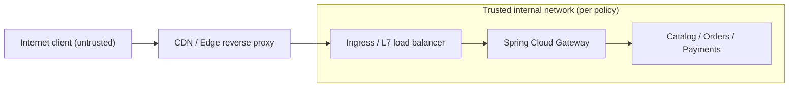
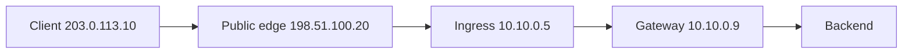
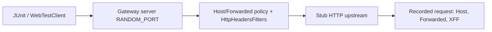

# Controlling Host, Forwarded, and X-Forwarded-* in Spring Cloud Gateway

An HTTP request passing through a CDN, reverse proxy, ingress, or load balancer typically **does not retain all original connection details**. A client accesses `https://api.example.com/api/orders`, yet Spring Cloud Gateway may receive an internal HTTP connection from `10.20.0.5:8080`. Upstream proxies attach `Forwarded` or `X-Forwarded-*` headers to describe the client address, public host, scheme, and port. That information is valuable for redirects, auditing, and rate limiting, **yet it is also spoofable input** if the trust boundary is not enforced.

A vulnerability rarely hides in a complex cryptographic algorithm. It can start with:

```http
GET /reset-password HTTP/1.1
Host: account-attacker.example.test
X-Forwarded-Host: account-attacker.example.test
X-Forwarded-Proto: https
X-Forwarded-For: 127.0.0.1
```

If an application uses these headers to build password-reset URLs, recognize an "internal" IP address, or bypass quotas, that request can lead to **Host header poisoning, open redirects, cache poisoning, inaccurate audit logs, or IP-based limit bypasses**. For an API Gateway fronting microservices, the blast radius can span multiple services simultaneously.

This lesson belongs to the **Security Hardening** chapter of the `SPRING_CLOUD_GATEWAY` module. Within the module's scope, Gateway routes via route predicates/filter chains, transforms paths and headers, discovers services, authenticates, rate-limits, applies circuit breakers, retries, terminates/initiates TLS, and observes requests. The direct focus of this lesson is **Controlling Host, Forwarded, and X-Forwarded-***: distinguishing client-supplied HTTP details from verified proxy metadata, identifying which proxies are trusted, and safeguarding security decisions based on host/IP/scheme.

**Learning outcomes:**

1. Understand `Host`/HTTP/2 `:authority`, RFC 7239 `Forwarded`, and the `X-Forwarded-*` family.
2. Distinguish **TCP peer address** from **verified real client address**.
3. Build a **trusted proxy boundary**, sanitize headers at the perimeter, and block direct access to Gateway.
4. Separate Spring WebFlux's `ForwardedHeaderTransformer` from Gateway's `ForwardedHeadersFilter` and `XForwardedHeadersFilter`.
5. Configure hostname allowlists, NGINX/Kubernetes edge forwarding, and Gateway header filters matching your variant and version.
6. Prevent Host poisoning, open redirects, and cache poisoning; never use untrusted headers for JWT, IP allowlist, or rate-limit key decisions.
7. Test spoofed hosts, conflicting multi-headers, proxy chains, HTTPS redirects, WebSockets, CORS, and failure modes.

> **Technical scope:** Primary examples use **Spring Cloud Gateway Server WebFlux**. Config keys `spring.cloud.gateway.server.webflux.*` match newer Gateway lines (5.1.0 documentation); older 4.x branches and **Server Web MVC** use different namespaces/filters. Cross-check Spring Cloud Gateway and Spring Framework docs for your **exact deployed version**, especially forwarded-header transformers and `trusted-proxies`. Hostnames/IPs in this lesson are illustrative; code must be built, tested through a real proxy, and security-reviewed before production.

## 1. Threat Model: Who Does the Gateway Trust?

First map the request path:



A trust boundary cannot be drawn merely with a box labeled "internal network." You must verify whether **actual connections to Gateway are restricted strictly to managed proxies**; another pod in the cluster or an accidentally exposed NodePort could reach Gateway directly.

### 1.1. Three Distinct Information Sources

| Source | Example | Trust level |
| --- | --- | --- |
| **Transport peer** | TCP peer `10.20.0.5` (Ingress). | Identifies who connected directly at transport layer, not necessarily the end user. |
| **Client-supplied HTTP headers** | `Host`, `Forwarded`, `X-Forwarded-For` set by client. | **Untrusted by default**. |
| **Trusted edge metadata** | Values written/overwritten by verified proxies after filtering inputs. | Usable under **trust policy + network isolation + standard parser**. |

A header starting with `X-` **does not** mean internal infrastructure generated it. An mTLS connection from a trusted proxy also **does not prove** client-origin header contents were sanitized by that proxy; explicit header-handling policy is still required.

### 1.2. Assets to Protect

- Hostnames of public APIs and login callbacks.
- Password reset / magic link / invitation / email verification URLs.
- Per-user/tenant/IP rate limits and IP allowlists.
- Internal routing and administrative route rules.
- JWT issuer/audience selection, OAuth2 redirect URIs, and cookie origins.
- Cache keys at CDNs/proxies and backends.
- Audit logs, metrics, threat detection, and incident correlation.
- Personal data and secrets inside headers.

**Never use a single header as proof that "the user is on the internal network" or "the request arrived over HTTPS" without tracing provenance to a trusted root.**

## 2. What Is the `Host` Header and How Does HTTP/2 `:authority` Relate?

In HTTP/1.1, `Host` identifies the authority/virtual host of the request:

```http
GET /api/catalog/products/42 HTTP/1.1
Host: api.example.com
```

In HTTP/2, the `:authority` pseudo-header carries the corresponding authority:

```text
:method: GET
:scheme: https
:authority: api.example.com
:path: /api/catalog/products/42
```

HTTP implementations/proxies translate authority across protocol versions. **Never write a security check assuming raw `Host` in an HTTP/1.1 packet is the only form** and ignoring HTTP/2 host poisoning.

### 2.1. Host Is Not User Identity

`Host=api.example.com` selects a virtual host/route; it does not authenticate the caller. An attacker can send a valid Host without a JWT, or send an unexpected Host if the edge fails to block it.

`Host` never replaces:
- OAuth2 Resource Server JWT verification.
- mTLS client identity.
- Backend authorization.
- Tenant ownership checks.

### 2.2. Host Headers Can Include a Port

```text
Host: api.example.com
Host: api.example.com:443
Host: api.staging.example.com:8443
Host: [2001:db8::1]:8443
```

When writing allowlists, parse the authority using an HTTP library rather than homegrown `split(":")`. IPv6 addresses contain multiple `:` characters; ports may be omitted or invalid. Check the canonicalized hostname, environment-permitted port, and target protocol.

### 2.3. Case, Trailing Dots, IDN, and Wildcards

DNS hostnames compare case-insensitively, yet that does not make every similar string valid. Decide explicitly how to handle:

- `API.EXAMPLE.COM`.
- `api.example.com.` with a trailing dot.
- Internationalized Domain Names (IDNA/Punycode).
- `api.example.com.attacker.test`.
- `attacker-api.example.com`.
- Unicode confusable characters.
- Ports 80/443/8443 outside policy.
- Multiple Host headers or conflicting `Host` vs `:authority`.

**Allowlists must check parser-normalized authorities and permit only specific hostnames/ports**, never `contains("example.com")` or `endsWith("example.com")` without boundary checks.

## 3. Distinguishing `Forwarded` and `X-Forwarded-*`

`Forwarded` is standardized by **RFC 7239**. The `X-Forwarded-*` family consists of de facto conventions, not a single standardized header with a universal schema across all proxies.

| Name | Described data | Typical usage |
| --- | --- | --- |
| `Host` | Authority carried by HTTP request. | Virtual hosting, route predicates, URL generation post-validation. |
| `Forwarded` | List of `for`/`by`/`host`/`proto` across proxy hops. | Preserving client/scheme/host across proxy chains. |
| `X-Forwarded-For` | List of IPs in client/proxy chain. | Auditing, anti-abuse, IP allowlists **after trust resolution**. |
| `X-Forwarded-Host` | Original host or host list per proxy convention. | Public URLs/redirects, if edge-controlled. |
| `X-Forwarded-Proto` | External scheme, e.g., `https`. | Generating HTTPS redirects/cookie policies per public origin. |
| `X-Forwarded-Port` | Public port, e.g., `443`. | Absolute URLs/callbacks when using non-default ports. |
| `X-Forwarded-Prefix` | External URL prefix, e.g., `/api`. | External path modeling; does not perform rewrites itself. |
| `X-Real-IP` | Single client IP per proxy convention. | Use only when provenance is trusted. |
| `Via` | Proxy traversal info under separate HTTP semantics. | Proxy diagnostics; **never** replaces forwarded trust. |

A single request can contain both `Forwarded` and `X-Forwarded-*`, **even contradicting each other**. Select the recognized source per infrastructure contract rather than picking whichever looks convenient.

## 4. Understanding RFC 7239 Syntax Properly

A `Forwarded` element consists of `;`-separated parameter pairs, with multiple elements separated by `,`.

```http
Forwarded: for=203.0.113.10;proto=https;host=api.example.com
```

With two proxies:

```http
Forwarded: for=203.0.113.10;proto=https;host=api.example.com,
           for=198.51.100.20;proto=http;host=api.example.com
```

Four standard parameters:

- `for`: node that called the proxy.
- `by`: proxy interface that received the request.
- `host`: Host observed by the proxy.
- `proto`: protocol/scheme received by the proxy.

A proxy may append a new element or drop incoming headers; preserving the full chain is **not mandatory** at every hop.

### 4.1. IPv6 and Quoting

```http
Forwarded: for="[2001:db8::1234]";proto=https;host="api.example.com:443"
```

Colons and IPv6 brackets require proper quoted-string grammar per the RFC. Never parse with naive `split(",")` or `split(";")` ignoring quoted strings, escaping, duplicate fields, multiple header lines, and `unknown`/obfuscated identifiers.

### 4.2. `for=unknown` Is Not a Broken IP to Turn into 127.0.0.1

```http
Forwarded: for=unknown;proto=https
Forwarded: for="_hidden-client";proto=https
```

The RFC permits node identifiers that are not real IP addresses. If policy demands a trusted IP and none can be safely derived, **fail closed or use another identity**; never default to an internal IP.

### 4.3. `Forwarded` Has No Built-In Integrity

RFC 7239 does not cryptographically sign headers. It describes metadata, yet **does not prove** which proxy emitted it. Integrity depends on edge sanitization, network controls, proxy identity, and proper parsing.

## 5. Common Host/Forwarded Attack Patterns

| Attack type | Spoofed input | Potential consequence |
| --- | --- | --- |
| **Host header poisoning** | `Host: attacker.example.test`. | Generates absolute URLs/redirects pointing to attacker domain. |
| **X-Forwarded-Host poisoning** | `X-Forwarded-Host: attacker.example.test`. | Bypasses Host allowlist if app trusts XFH over Host. |
| **Password reset poisoning** | Public reset link pulls host from request. | Victim receives link pointing to attacker domain. |
| **Web cache poisoning** | Cache key omits host while response builds URLs from host. | Other users receive poisoned content/redirects. |
| **IP spoofing via XFF** | `X-Forwarded-For: 127.0.0.1`. | Evades IP allowlist/rate limiter if gateway trusts raw XFF. |
| **Scheme confusion** | `X-Forwarded-Proto: http` on public HTTPS. | Broken redirects, broken cookie/secure-origin logic. |
| **Prefix confusion** | Arbitrary `X-Forwarded-Prefix: /admin`. | Unexpectedly alters URL/path policies. |
| **Proxy chain confusion** | Multiple conflicting Forwarded/XFF elements. | Picks wrong IP or host from an untrusted hop. |
| **Virtual host bypass** | Host matches internal vhost. | Routes to internal endpoints if edge lacks host restrictions. |
| **Log/metric poisoning** | Header carries long/special strings. | Corrupted logs, high cardinality, injected data. |

These are **defensive threat scenarios**. Actual exploitability depends on how proxies and applications process headers; an unusual request alone does not prove a vulnerability exists.

### 5.1. Dangerous Password Reset URL Example

Pattern to avoid:

```java
// DO NOT USE: raw Host or forwarded host is client-modifiable data.
String resetUrl = requestHostFromHeaders + "/reset?token=" + resetToken;
```

Better approach: use a **preconfigured public base URL and allowlist** tied to the verified environment/tenant:

```properties
app.public-base-url=https://accounts.example.com
```

Then:
- Build the reset link from the trusted base URL config.
- Give the token an expiration/context, and never log it in access logs.
- Never use raw request Host/XFH as the primary redirect source.
- Test that Host poisoning cannot alter the generated link.

### 5.2. Cache Poisoning via Host Substitution

If a CDN caches responses for `/login` by path alone while Gateway builds `Location` or HTML meta links from a spoofed `X-Forwarded-Host`, an attacker can poison cached responses served to other users. Combine **Host validation** with **cache key semantics**, rather than tweaking `Cache-Control` alone.

## 6. Defining the "First Trusted Edge"

Consider the topology:



Addresses belong to documentation ranges and serve as illustrative examples.

The crux is **identifying the first organization-controlled proxy receiving Internet input**. That proxy must:

1. Block/overwrite `Forwarded` and **all** `X-Forwarded-*` headers sent by Internet clients.
2. Select/validate Host/SNI/public domains against an allowlist.
3. Populate client IP and external scheme/host/port metadata from **verified sources**.
4. Reject malformed requests and excessive header counts/sizes.
5. Forward requests to Gateway solely over authorized network paths.

Internal proxies may append hop details **only after the edge has scrubbed the incoming chain**. A trust policy living solely in Gateway Java code while ingress passes client XFF straight through is **insufficient**.

### 6.1. Direct Access Breaks the Trust Model

If a client bypasses CDN/Ingress and connects straight to Gateway via a public NodePort:

```text
Internet client → Gateway:8080
Forwarded: for=127.0.0.1;proto=https;host=api.example.com
```

Gateway may perceive headers "as if from a proxy" even though the actual TCP peer is an attacker. **Network isolation, ingress-only Services/NetworkPolicies, and hop authentication** must be enforced; never expect a `trusted-proxies` regex to close network bypasses.

### 6.2. Every Hop Needs a Contract

| Point | Trusted input | Header processing | Output |
| --- | --- | --- | --- |
| **Public Edge** | Client TCP peer, validated SNI/Host. | Strip incoming forwarded metadata; emit canonical values. | Clean chain from the perimeter. |
| **Internal Ingress** | Allowlisted Edge peer. | Append exact hop details; cap headers. | Chain with controlled provenance. |
| **Gateway** | Ingress peer + metadata per trust config. | Normalize, apply routing/security, enforce outbound header policy. | Only permitted forwarded metadata reaches backend. |
| **Backend** | Permitted Gateway/mesh peer. | Trust no out-of-contract headers; verify identity independently. | Accurate audits/redirects/business decisions. |

## 7. Determining Client IP: TCP Peer Differs from X-Forwarded-For

Suppose:

```http
X-Forwarded-For: 203.0.113.10, 198.51.100.20
```

Gateway receives TCP from `10.10.0.5`. Meaning of values:

- Transport `getRemoteAddress()` may be ingress `10.10.0.5`.
- `203.0.113.10` might be the client.
- `198.51.100.20` might be the CDN/edge.
- Yet **nothing in the header text itself proves** those IPs are real.

A safe rule: start from the **last trusted transport peer**, walk the chain against the list of trusted proxy hops, and stop at the first untrusted hop. Picking the "first element" is valid only if the edge scrubbed inputs; if any proxy drops that rule, attackers can prepend entries.

### 7.1. Never Use an Ad-Hoc Regex as an IPv4 Parser

`X-Forwarded-For` is a list that can hold whitespace, IPv6, multiple header lines, and malformed values. Never write:

```java
// UNSAFE as an IP authentication source:
String ip = exchange.getRequest().getHeaders()
    .getFirst("X-Forwarded-For")
    .split(",")[0];
```

Never treat `"127.0.0.1"` or a client-declared `10.0.0.0/8` address as network identity.

### 7.2. Gateway WebFlux `XForwardedRemoteAddressResolver`

Gateway Server WebFlux provides `XForwardedRemoteAddressResolver` for evaluating the `RemoteAddr` predicate from `X-Forwarded-For`:

- `trustAll()` picks the first IP and is **easily spoofed** if Internet headers are not scrubbed.
- `maxTrustedIndex(n)` picks an element by the **assumed count of trusted proxy hops**, not automatic CIDR/signature verification.

Example assuming one secured proxy ahead of Gateway:

```java
import org.springframework.cloud.gateway.support.ipresolver.XForwardedRemoteAddressResolver;

var resolver = XForwardedRemoteAddressResolver.maxTrustedIndex(1);
```

This is only a **logic fragment**: attach `resolver` to the route predicate using the Java route DSL for your version. `1` fits only when topology has **exactly one** trusted hop in front; CDN + Ingress may require another setting. Never set `maxTrustedIndex(99)` thinking "trusting more is safer."

### 7.3. What Happens When Hop Count Changes?

Moving from direct ingress to CDN + ingress may break `maxTrustedIndex(1)`: instead of selecting the client IP, it may pick the CDN. If attackers can prepend an XFF entry and the edge fails to scrub it, a misconfigured index can even pick a spoofed address.

Include client-IP resolution tests in your **topology change checklist**, not just once during initial coding.

## 8. Host Allowlisting: Multi-Layer Defense Policy

**First line of defense:** the edge accepts requests only for managed public hostnames, e.g.:

```text
Allowed:
  api.example.com
  api.staging.example.com

Rejected:
  api.example.com.attacker.test
  attacker-api.example.com
  internal-admin.local
  unknown.example.com
```

A proper allowlist must:
- Match exact hostnames or wildcards bounded strictly by DNS segments.
- Validate port/SNI when required by policy.
- Handle IDNA/Punycode/case/trailing dots intentionally.
- Reject duplicate Host headers, malformed values, or conflicting authorities per HTTP stack.
- Block default vhosts from forwarding unknown hosts into Gateway.
- Maintain separate policies for health probes/management listeners.

### 8.1. The `Host` Route Predicate Only Selects Routes

In Gateway Server WebFlux, the `Host` predicate compares host patterns against the request Host:

```yaml
spring:
  cloud:
    gateway:
      server:
        webflux:
          routes:
            - id: orders-public
              uri: lb://order-service
              predicates:
                - Host=api.example.com
                - Path=/api/orders/**
```

This performs **route matching**, not a complete "hostname firewall." If another route has `Path=/**` without a Host check, an unknown host can still route. If spoofed forwarded metadata alters how Host is viewed, inspect transformer/filter order.

**A `Host` predicate does not replace edge allowlists, SNI policies, or authentication.**

### 8.2. Behavior for Unknown Hosts

The edge should configure a **default virtual host** rejecting unlisted hostnames. Depending on controller/proxy, the status may be `400`, `403`, `404`, or `421 Misdirected Request`; do not assume one uniform code across all implementations. What must be proven is **zero forwarding into privileged routes**.

## 9. WebFlux `WebFilter` Example as Supplementary Defense

You can add a WebFlux `WebFilter` verifying Host on requests that passed a controlled proxy policy:

```java
package com.example.gateway.security;

import java.net.InetSocketAddress;
import java.util.Locale;
import java.util.Set;

import org.springframework.context.annotation.Bean;
import org.springframework.context.annotation.Configuration;
import org.springframework.core.Ordered;
import org.springframework.core.annotation.Order;
import org.springframework.http.HttpStatus;
import org.springframework.web.server.WebFilter;

@Configuration
public class PublicHostPolicy {

    private static final Set<String> ALLOWED_HOSTS =
        Set.of("api.example.com", "api.staging.example.com");

    @Bean
    @Order(Ordered.HIGHEST_PRECEDENCE)
    WebFilter knownPublicHostOnly() {
        return (exchange, chain) -> {
            InetSocketAddress host =
                exchange.getRequest().getHeaders().getHost();

            if (host == null) {
                exchange.getResponse().setStatusCode(
                    HttpStatus.BAD_REQUEST);
                return exchange.getResponse().setComplete();
            }

            String name = host.getHostString()
                .toLowerCase(Locale.ROOT);

            if (!ALLOWED_HOSTS.contains(name)) {
                exchange.getResponse().setStatusCode(
                    HttpStatus.BAD_REQUEST);
                return exchange.getResponse().setComplete();
            }

            return chain.filter(exchange);
        };
    }
}
```

**Important limitations:**

- This is **supplementary defense**, not a replacement for proxy sanitization and network isolation; a WebFilter inspects requests already parsed by WebFlux and cannot catch every malformed HTTP framing anomaly.
- If `ForwardedHeaderTransformer` already mutated the request view using spoofed metadata, an app-level allowlist can still be fooled. Edge enforcement remains primary.
- This applies to every WebFlux request in the application context: Kubernetes health probes sending `Host: 127.0.0.1` may be blocked. Use a separate management port/listener or explicit internal health-check policy.
- If public APIs use custom ports/hostname aliases, include them in policy per contract and test thoroughly.
- A stricter policy may validate ports, SNI/Host consistency, and ingress security events; this sample does not replace all of those checks.

### 9.1. Pitfalls When Using Wildcards

```java
// UNSAFE for host policy:
boolean allowed = host.toLowerCase().contains("example.com");
```

`attacker-example.com.evil.test` also contains `example.com`. If subdomains are required, write parsers/allowlists honoring DNS label boundaries or rely on proxy/virtual-host components built for it.

### 9.2. Header Validation Does Not Replace TLS SNI Validation

TLS SNI is sent during the handshake before HTTP `Host`. A proxy might terminate TLS using a valid SNI certificate while the HTTP `Host` header carries a different domain. Decide whether to reject mismatches or allow managed domain aliases per policy. Checking certificate validity alone never proves HTTP `Host` is valid.

## 10. Spring Boot WebFlux: `server.forward-headers-strategy`

Spring Boot offers configuration to handle forwarded metadata at the web server/framework boundary, e.g.:

```yaml
server:
  forward-headers-strategy: framework
```

Common options:

| Value | General meaning | When appropriate |
| --- | --- | --- |
| `none` | Do not interpret forwarded metadata via this strategy. | Direct public Gateway or no trusted proxy metadata. |
| `native` | Let web server/adapter handle per native support. | Only when native implementation is configured and verified. |
| `framework` | Use Spring Framework's mechanism (in WebFlux, `ForwardedHeaderTransformer`). | When edge scrubs headers and app needs external scheme/host. |

**Enabling `framework` does not make headers trustworthy by itself.** Spring Framework emphasizes that applications cannot tell whether headers came from a trusted proxy or a malicious client without an upstream trust boundary.

### 10.1. What Does `ForwardedHeaderTransformer` Do?

In WebFlux, the transformer can:
- Use `Forwarded` or `X-Forwarded-*` to adjust URI/host/port/scheme on the request view, depending on version.
- Handle prefix adjustments if supported by configuration.
- Strip forwarded headers after processing to curb uncontrolled reuse.
- Run early during request/exchange construction, **ahead of many Gateway filters**.

Consequently, `exchange.getRequest().getURI()` after the transformer reflects the **external URL** instead of the internal connection URI. This helps redirects, yet is dangerous if header provenance wasn't verified at the edge.

### 10.2. `removeOnly`: Discard Input Without Trusting Metadata

Spring Framework supports a mode that **only strips forwarded headers**:

```java
import org.springframework.context.annotation.Bean;
import org.springframework.web.server.adapter.ForwardedHeaderTransformer;

// Illustrative WebFlux fragment; register the exact bean name
// where the framework version/setup accepts custom beans.
@Bean(name = "forwardedHeaderTransformer")
ForwardedHeaderTransformer forwardedHeaderTransformer() {
    ForwardedHeaderTransformer transformer =
        new ForwardedHeaderTransformer();

    transformer.setRemoveOnly(true);
    return transformer;
}
```

This **fragment applies when the application does not wish to consume forwarded metadata**. Depending on Spring Framework version, constructors/APIs/bean registration rules may vary; verify against docs. If the app needs external scheme/host for redirects, `removeOnly` can cause URLs to revert to the internal HTTP origin—design an explicit request origin policy rather than toggling blindly.

### 10.3. Avoid Configuration Conflicts

Do not simultaneously enable a native forwarded handler and register a manual transformer without knowing which runs first or takes precedence. Never assume `server.forward-headers-strategy` and Gateway `trusted-proxies` are the same mechanism; they govern different scopes.

**Verify** effective request URIs, Hosts, and outbound headers on your exact version whenever combining Spring Boot and Spring Cloud Gateway filters.

## 11. Gateway WebFlux: `HttpHeadersFilters` Before Sending to Backend

Spring Cloud Gateway runs an **`HttpHeadersFilter` layer** on requests **before outbound routing** (e.g., before `NettyRoutingFilter`). This is separate from Spring WebFlux's **inbound transformer**.

| Component | Scope | Problem it solves |
| --- | --- | --- |
| `ForwardedHeaderTransformer` | Request entering WebFlux/framework boundary. | Interprets or strips forwarded metadata on the request view. |
| `ForwardedHeadersFilter` (Gateway) | Outbound request headers toward backend. | Generates/appends `Forwarded` per Gateway routing context. |
| `XForwardedHeadersFilter` (Gateway) | Outbound request headers toward backend. | Generates/appends `X-Forwarded-For/Host/Proto/Port/Prefix`. |
| `RemoveHopByHopHeadersFilter` | Outbound headers. | Removes hop-by-hop headers like `Connection`, `Keep-Alive`, `Transfer-Encoding`. |
| `PreserveHostHeader` route filter | Host sent to upstream. | Keeps incoming Host per routing filter behavior. |
| `SetRequestHostHeader` route filter | Outbound Host. | Replaces Host sent upstream with configured value. |

A common mistake: configuring "forwarded" in **Gateway outbound headers** and assuming inbound HTTP requests were validated at the edge or local client IPs were verified. **No such guarantee exists.**

### 11.1. Toggling Header Filters Does Not Sanitize Input Automatically

Even when Gateway provides options to disable forwarding, that **does not remove** the requirement for the edge to strip untrusted `Forwarded`/`X-Forwarded-*`. Nor does it prevent another WebFilter from reading raw headers before outbound routing.

### 11.2. Hop-by-Hop Headers

Headers like `Connection` or `Transfer-Encoding` govern a single HTTP hop, not trusted end-user data. Gateway has a filter removing them before sending to backends. Never build a header filter blindly deleting `Connection` on WebSocket Upgrade routes without verifying protocol/version behavior.

## 12. Configuring `trusted-proxies` by Server WebFlux Version

Gateway WebFlux **5.1.0** docs state that to activate the `Forwarded` and `XForwarded` HTTP headers filters, configure a **Java regular expression** matching trusted proxies in the chain:

```yaml
spring:
  cloud:
    gateway:
      server:
        webflux:
          trusted-proxies: "^10\\.20\\.0\\.5$"
          forwarded:
            enabled: true
          x-forwarded:
            enabled: true
```

**This example models a single fixed proxy IP `10.20.0.5`**, not a production config for a Kubernetes cluster with dynamic proxy IPs. Backslashes inside double-quoted YAML strings must be escaped properly; `"^10\\.20\\.0\\.5$"` yields literal dots in regex after YAML parsing. Verify actual config binding on your version.

### 12.1. Meaning of `trusted-proxies`

- It is a **Java regex**, not a CIDR parser: `10.20.0.0/16` does not automatically match an IP range.
- Identify the exact proxy IPs and scope evaluated by Gateway's implementation.
- Overly broad regexes like `.*` nullify the trust boundary.
- Regexes must be anchored and handle IPv6/ports matching the metadata format.
- **Setting the property alone never proves all HTTP sources are authenticated.** NetworkPolicies and first-edge sanitization remain mandatory.

API defaults and filter activation rules may differ across 4.1, 4.3, and 5.x. Older branches document `spring.cloud.gateway.trusted-proxies`; never copy that verbatim into the new server namespace or vice versa.

### 12.2. Enable vs Append

WebFlux 5.1 configuration properties expose these toggles:

| Config suffix | Meaning |
| --- | --- |
| `x-forwarded.for-enabled` | Whether to emit `X-Forwarded-For` to backend. |
| `x-forwarded.host-enabled` | Whether to emit `X-Forwarded-Host`. |
| `x-forwarded.proto-enabled` | Whether to emit `X-Forwarded-Proto`. |
| `x-forwarded.port-enabled` | Whether to emit `X-Forwarded-Port`. |
| `x-forwarded.prefix-enabled` | Whether to emit `X-Forwarded-Prefix`. |
| `x-forwarded.for-append` | Append to existing values rather than replacing per filter semantics. |
| `x-forwarded.host-append` | Append host values. |
| `x-forwarded.proto-append` | Append proto values. |
| `x-forwarded.port-append` | Append port values. |
| `x-forwarded.prefix-append` | Append prefix values. |

**`*-enabled` and `*-append` are two orthogonal axes.** Metadata docs list `true` as default for these toggles when the filter is active. Never assume "old headers are wiped before Gateway adds new ones": parts of a chain may be appended.

### 12.3. Example Choosing Replace Over Append on a Controlled Hop

```yaml
spring:
  cloud:
    gateway:
      server:
        webflux:
          x-forwarded:
            for-append: false
            host-append: false
            proto-append: false
            port-append: false
            prefix-append: false
```

**Enabling this block wholesale in every topology is not recommended.** It can discard proxy-chain entries needed for audit/trust if Gateway must preserve multiple hops. To operate safely, establish canonical metadata at the edge first, decide append vs replace **hop by hop**, and test what the backend actually receives.

## 13. Do Not Mix WebFlux Config with Server Web MVC

Both Gateway variants support Forwarded headers, yet their **namespaces differ**:

| Configuration | Newer WebFlux branch | Newer Server Web MVC branch |
| --- | --- | --- |
| Trusted proxy regex | `spring.cloud.gateway.server.webflux.trusted-proxies`. | `spring.cloud.gateway.server.webmvc.trusted-proxies`. |
| Enable outbound forwarded filter | `...server.webflux.forwarded.enabled`. | `...server.webmvc.forwarded-request-headers-filter.enabled`. |
| Enable outbound x-forwarded filter | `...server.webflux.x-forwarded.enabled`. | `...server.webmvc.x-forwarded-request-headers-filter.enabled`. |
| Key API in custom filters | Reactive `ServerWebExchange`. | Servlet `ServerRequest`/WebMvc.fn. |
| Spring Security chain | Reactive `SecurityWebFilterChain`. | Servlet `SecurityFilterChain`. |

WebFlux Java filter examples in this lesson **do not apply directly** in MVC. Also do not copy WebFlux's `WebFilter`/`ForwardedHeaderTransformer` into the Servlet request lifecycle without checking equivalent `ForwardedHeaderFilter`/native behavior.

### 13.1. Separating "Framework Forwarded Request" from "Gateway Outbound Forwarded"

In MVC, Spring MVC/Servlet has its own forwarded request handling. Spring Cloud Gateway Server MVC also has its own request header filters. **Sharing the word Forwarded does not mean classes, order, and enable properties are identical.**

Therefore, when using **Gateway Server Web MVC**, inspect `SecurityFilterChain` and MVC Servlet request filters separately; do not apply the reactive `WebFilter`/`SecurityWebFilterChain` examples from this Server WebFlux guide.

## 14. NGINX Edge: Pattern for Sanitizing Internet Headers

The first reverse proxy is responsible for **blocking disallowed Hosts** and **overwriting forwarded values**. NGINX example accepting only public `api.example.com` over HTTPS:

```nginx
# Fragment: place inside NGINX http{} at the first trusted edge.
upstream gateway_http {
    server edge-gateway.internal:8080;
    keepalive 32;
}

# Reject undeclared hostnames.
server {
    listen 443 ssl default_server;
    server_name _;
    ssl_certificate     /etc/nginx/certs/default-chain.pem;
    ssl_certificate_key /etc/nginx/certs/default-key.pem;
    return 421;
}

server {
    listen 443 ssl;
    server_name api.example.com;

    ssl_certificate     /etc/nginx/certs/api-chain.pem;
    ssl_certificate_key /etc/nginx/certs/api-key.pem;

    location / {
        proxy_pass http://gateway_http;
        proxy_http_version 1.1;
        proxy_set_header Connection "";
        proxy_http_version 1.1;

        # This edge is the first controlled HTTP proxy receiving clients directly.
        # Do not append dirty XFF from the Internet.
        proxy_set_header Host              api.example.com;
        proxy_set_header X-Forwarded-Host  api.example.com;
        proxy_set_header X-Forwarded-Proto https;
        proxy_set_header X-Forwarded-Port  443;
        proxy_set_header X-Forwarded-For   $remote_addr;

        # Drop client-declared standard Forwarded/prefix headers.
        proxy_set_header Forwarded "";
        proxy_set_header X-Forwarded-Prefix "";

        proxy_connect_timeout 3s;
        proxy_read_timeout 60s;
        proxy_send_timeout 60s;
    }
}
```

**Very important:**

- This pattern assumes NGINX is the **direct first HTTP edge**; `$remote_addr` is then the client TCP peer IP. If NGINX sits behind a CDN/LB, `$remote_addr` is typically the CDN/LB; configure trusted Real IP handling accordingly, never raw `$http_x_forwarded_for`.
- `server_name` and `default_server` must work cleanly alongside real TLS/SNI and 80/443 listeners; the sample illustrates only port 443.
- `proxy_set_header Header ""` in NGINX normally **omits** that header upstream. Verify via recorded backend requests.
- Pinning `Host: api.example.com` in this vhost canonicalizes one domain; for multiple domains, use a controlled allowlist/mapping rather than echoing arbitrary Host headers.
- `proxy_pass` here has no URI suffix, preserving the request URI per NGINX semantics in this `location /`; test any alternative rewrite rules.
- `proxy_http_version 1.1` and clearing `Connection` on normal HTTP branches support upstream keep-alive properly; WebSocket Upgrades need dedicated `Connection: upgrade`/`Upgrade` headers per contract.
- For WebSockets, add HTTP/1.1 Upgrade headers and proper timeouts; this snippet illustrates **Host/Forwarded trust**, not a complete WebSocket config.

### 14.1. Why Not Use `proxy_add_x_forwarded_for` at the First Edge?

`$proxy_add_x_forwarded_for` appends `$remote_addr` to the incoming XFF. If a client sends:

```http
X-Forwarded-For: 127.0.0.1
```

the chain becomes `127.0.0.1, <client-ip>`. Any backend using "leftmost XFF = client IP" will see the spoofed address. **The first trusted edge should strip dirty inputs before appending**; internal hops may validly append once the chain is clean.

### 14.2. When NGINX Sits Behind a CDN

You cannot immediately treat `$remote_addr` as the end user. You must:
- Configure trusted CDN IP ranges via NGINX's Real IP module.
- Accept only identity headers the CDN **guarantees to set/overwrite**.
- Automate updates for CDN IP ranges under change control.
- Block direct-to-origin bypasses via firewall/IP allowlists/mTLS.
- Ensure XFF/Forwarded sanitization occurs at one controlled boundary.
- Test both CDN-routed requests and simulated direct-to-origin bypass blocks.

Never configure `set_real_ip_from 0.0.0.0/0` just to see client IPs; that effectively lets any peer declare its own identity.

## 15. Kubernetes Ingress and Host Policy

An `Ingress` routing a public domain to the Gateway Service:

```yaml
apiVersion: networking.k8s.io/v1
kind: Ingress
metadata:
  name: edge-api
  namespace: gateway
spec:
  ingressClassName: nginx
  tls:
    - hosts:
        - api.example.com
      secretName: api-example-tls
  rules:
    - host: api.example.com
      http:
        paths:
          - path: /
            pathType: Prefix
            backend:
              service:
                name: edge-gateway
                port:
                  number: 80
```

This is a **routing rule**, not a complete security policy. Verify:

1. The controller actually selected this ingress class.
2. Default/fallback virtual hosts reject unknown hosts.
3. TLS secrets/certificates have valid SAN/SNI.
4. The proxy strips/overwrites `Forwarded`/`X-Forwarded-*` from the Internet.
5. How upstream cloud LBs/CDNs alter client IP/Host.
6. The Gateway Service is not accidentally exposed directly via NodePort/LoadBalancer.
7. NetworkPolicy allows traffic solely from the ingress/controller in the right namespace.
8. Actuator management endpoints are not exposed publicly via catch-all path `/`.

### 15.1. NetworkPolicy Is an Enforcement Layer, Not an Assumption

Kubernetes NetworkPolicies take effect only when enforced by the CNI and when pod selectors/IP policies match reality. An ingress controller running with `hostNetwork` or a cloud LB with special source IPs can alter how policies view traffic.

**Test actual connections** from both allowed and disallowed pods, rather than merely inspecting YAML for a `NetworkPolicy`.

### 15.2. Switching Ingress Controllers Can Change Header Semantics

`ingress-nginx`, cloud ALBs, Traefik, HAProxy, and service meshes do not share identical annotations or XFF behavior. When switching controllers, re-verify:
- Client IP provenance.
- Host preservation.
- X-Forwarded-Proto/Port.
- Standard `Forwarded` headers.
- TLS termination/re-encryption.
- Redirects/cookies/CORS.
- WebSocket/SSE behavior.

## 16. PreserveHostHeader and SetRequestHostHeader Are Not Input Security Filters

Gateway WebFlux offers two Host-related route filters:

### 16.1. `PreserveHostHeader`

```yaml
spring:
  cloud:
    gateway:
      server:
        webflux:
          routes:
            - id: public-catalog
              uri: https://catalog.internal.example
              predicates:
                - Path=/api/catalog/**
              filters:
                - PreserveHostHeader
```

This filter tells the routing filter to **keep the incoming Host** when sending upstream, instead of using the target URI's Host from the HTTP client. It **does not validate** the incoming Host.

Use it only when the backend **requires the public Host** and the edge already validated/canonicalized Host ahead of Gateway. If the backend actually expects `catalog.internal.example` for virtual-host routing, `PreserveHostHeader` can make the backend pick the wrong virtual host.

### 16.2. `SetRequestHostHeader`

```yaml
spring:
  cloud:
    gateway:
      server:
        webflux:
          routes:
            - id: private-catalog
              uri: https://catalog.internal.example
              predicates:
                - Path=/api/catalog/**
              filters:
                - name: SetRequestHostHeader
                  args:
                    host: catalog.internal.example
```

This filter replaces Host in the **request sent to the backend** with a configured value. It is useful when the backend expects a fixed Host, yet it also **does not** reject unknown Hosts at the public entrypoint.

### 16.3. Decision Table

| Backend requirement | Reasonable choice |
| --- | --- |
| Backend expects internal target Host from URI | Let HTTP client/Gateway set Host per normal target. |
| Backend expects validated public Host | Intentional `PreserveHostHeader` per route. |
| Backend expects a fixed hostname differing from public Host | `SetRequestHostHeader` with an allowlisted value. |
| Backend needs public origin to build links | Use trusted forwarded metadata or base URL config; never trust raw Host. |
| Gateway must block unknown Hosts | **Edge Host allowlist** and/or supplementary WebFilter validation. |

**Never use `PreserveHostHeader` as a "fix for host injection."** It can propagate untrusted Host values straight to the backend if the edge is weak.

## 17. Path Prefixes and Other Headers: Avoid Mixing Meanings

`X-Forwarded-Prefix` describes that an upstream is published under public `/api`, yet does not automatically act like `StripPrefix` or `RewritePath`.

```text
Public:   https://api.example.com/catalog/products/42
Ingress:  preserves path /catalog/products/42
Gateway:  StripPrefix=1
Backend:  /products/42
```

If ingress already rewrote the path and Gateway also strips, routes can miss or backends can receive wrong paths. If an attacker injects `X-Forwarded-Prefix: /admin` and an app uses it to compute context paths, malformed absolute URLs can result.

**Distinguish clearly:**
- Actual path after each hop.
- External prefix metadata.
- Application context path.
- Security matchers.
- CORS/CSRF/cookie Path.
- Downstream redirect `Location`.

Never derive access rights from `X-Forwarded-Prefix`; it is routing metadata, not a credential.

## 18. HTTPS Redirects, OAuth2 Callbacks, and Cookie Security

A Gateway behind a TLS-terminating ingress sees HTTP on the local socket while the browser sees HTTPS.

### 18.1. When Scheme Is Misinterpreted

```text
Public request:  https://api.example.com/login
Ingress → GW:    http://edge-gateway:8080/login
Bad redirect:    http://edge-gateway:8080/oauth2/callback
Expected:        https://api.example.com/oauth2/callback
```

If the app misreads `X-Forwarded-Proto`/Host:
- Redirects downgrade from HTTPS to HTTP.
- OAuth2 redirect URIs mismatch.
- Public callbacks or password-reset links embed internal hostnames.
- Cookie `Secure`/domain/path violates contract.
- CORS origins mismatch.

### 18.2. Principled Solutions

1. Derive public base URLs from **trusted config/issuer registrations** for sensitive links.
2. Have ingress overwrite external proto/host based on the HTTPS listener and host allowlist.
3. Let Boot frameworks process forwarded metadata **only after the edge actually scrubs**.
4. Test that redirect `Location` uses HTTPS/public host and never contains cluster-local names.
5. Never use raw `X-Forwarded-Host` as a dynamic redirect target.
6. OAuth2 authorization servers/clients must validate redirect URIs against an allowlist.
7. Never infer JWT audience/issuer arbitrarily from the Host header.

### 18.3. TLS and mTLS Do Not Automatically Cure Header Injection

TLS protects integrity between **two endpoints of one connection**; it says nothing about whether a client sent forged Host/XFF values at the start. Even when Gateway uses mTLS with ingress, ingress must still validate input headers and identities properly.

## 19. RemoteAddr Predicate, KeyResolver, and Rate Limiting

In `SPRING_CLOUD_GATEWAY`, IP-based protections typically live in:
- `RemoteAddr` route predicate.
- `RequestRateLimiter` key resolver by IP/client identity.
- IP allowlists for sensitive endpoints.
- Abuse detection/WAF rules.
- Audit logs.

### 19.1. Mistake 1: Using Ingress IP as Client IP

If all traffic flows through one ingress, `exchange.getRequest().getRemoteAddress()` may always be that single peer IP. A 100 RPS/IP rate limit collapses everyone into one bucket, causing widespread 429s.

### 19.2. Mistake 2: Using Client-Spoofed Headers

```java
// Never use directly in an IP-based KeyResolver:
String spoofable = exchange.getRequest()
    .getHeaders()
    .getFirst("X-Forwarded-For");
```

A client rotating `X-Forwarded-For` on every request spawns fresh buckets and bypasses quotas. Moreover, malformed/list headers can generate millions of Redis keys.

### 19.3. Safe Mental Model

```text
Request
  → Is peer IP in trusted ingress/edge sources?
      → No: reject or discard all forwarded metadata.
      → Yes: use scrubbed chain to derive effective client IP.
  → Prefer authenticated principal/API key for per-account quotas.
  → Stable normalized key per user/tenant/IP policy.
  → RateLimiter/authorization receives verified key.
```

One user may span multiple IPs; many users may share NAT/CGNAT. Per-IP limits are only a supplementary control, not a substitute for per-user quotas or bot management.

### 19.4. Proxy Chains Shift During Autoscaling

When ingress adds/removes a hop or enables a service mesh, `maxTrustedIndex(n)` and client-IP resolution outputs can change. Run regression tests after every topology change, not just after Java edits.

## 20. CORS, CSRF, JWT, and Origin: Which One Is Trusted?

Never confuse `Host` with `Origin`:

- `Host`/`:authority` states the HTTP authority of the request.
- `Origin` is sent by browsers to declare the web origin, useful for CORS/CSRF policies.
- `Referer` can be absent/truncated; never treat it as identity.
- `Forwarded`/`X-Forwarded-*` describe proxy metadata, not user credentials.
- `Authorization: Bearer ...` requires Spring Security verification of signature/issuer/audience/expiry.
- Cookie sessions require CSRF protection when requests authenticate via cookies, per threat model.

### 20.1. CORS Does Not Stop Host Poisoning

CORS controls whether browsers can read cross-origin responses under policy. It **does not** make the server reject `curl`/non-browser requests with strange Hosts, nor does it protect password-reset emails if the server builds hosts from headers.

### 20.2. JWTs Should Not Depend on Self-Declared Host

A security policy may pick a tenant or JWT audience from the public hostname, but only once that hostname is **allowlisted and provenance-verified**. Never let an attacker send `Host: tenant-admin.internal` to trick the app into picking a looser issuer/tenant policy.

### 20.3. WebSocket Origin Differs from CORS Preflight

A WebSocket handshake may carry `Origin`, yet does not trigger standard `OPTIONS` CORS preflight like `fetch`. Host/Origin must be validated per WebSocket server/route policy; `Origin` can also be forged by non-browser clients, so real authentication remains mandatory.

## 21. Logs, Traces, and Metrics: Record Decision Provenance Rather Than Trusting Raw Headers

A forwarded-header incident is hard to diagnose if logs show only:

```text
clientIp=127.0.0.1
host=admin.internal
```

without revealing whether those two fields came from the TCP peer, raw XFF, or a normalized source.

Instrument fields with **clear semantics**:

| Internal/log field | Source | Policy |
| --- | --- | --- |
| `peerIp` | Actual socket peer observed by server. | Bounded; may hold personal data, control retention. |
| `effectiveClientIp` | Trusted resolver post-edge validation. | Omit unless needed; consider hashing/pseudonymizing. |
| `publicHost` | Allowlisted canonical host. | Use bounded values. |
| `publicScheme` | External scheme from trusted transport/proxy. | `http`/`https` per policy. |
| `proxyHopCount` | Parsed/validated chain length. | Useful for spotting topology drift. |
| `hostRejected` | Allowlist verdict. | Boolean metric label, never raw Host label. |
| `forwardedRejected` | Invalid/untrusted forward metadata input. | Metrics and security alerts by source. |
| `routeId` | Gateway matched route. | Bounded label, never per-request dynamic. |
| `traceId` | Distributed trace. | Use in logs/traces, **never** as a Prometheus label. |

### 21.1. Never Log Full `Forwarded`/`X-Forwarded-*` Unboundedly

For tracing, W3C `traceparent` is strictly correlation context, **not a credential**, and proves neither Host nor IP identity. In Gateway WebFlux, the `spring.cloud.gateway.requests` meter can tag `httpStatusCode` per route, yet traffic blocked at CDN/ingress before Gateway never reaches this meter.

Raw headers can carry hundreds of IPs, control characters (against weak parsers), attacker domains, PII, or huge strings. Cap lengths, escape/structure logs, redact, and never place raw values in metric labels.

### 21.2. Failures Ahead of Routing May Not Show in Gateway Route Timers

An HTTP request rejected at the edge for an unknown Host never hits Gateway. A request blocked by Spring Security/WebFilters ahead of route matching may lack `routeId` in `spring.cloud.gateway.requests`.

Monitor across layers:
- Ingress accepted/rejected requests by virtual host.
- Gateway HTTP server metrics.
- Host policy rejections and Forwarded trust violations.
- Gateway route status/latency when routes match.
- Backend audits/statuses once requests pass Gateway.

## 22. Practical Testing: Host Spoofing and Forwarded Spoofing

**Run only against staging/test environments or explicitly authorized hosts.** The goal is verifying your own system does not trust self-declared headers, without disrupting or attacking external infrastructure.

### 22.1. Normal Case

```bash
curl -i "https://api.staging.example.com/api/catalog/products/42"
```

Expectation:
- TLS certificate/SNI matches hostname.
- Valid route, response matches contract.
- Redirects (if any) use the public HTTPS host.
- Backend receives Host and forwarded metadata per policy.

### 22.2. Unknown Host

```bash
curl -i \
  "https://api.staging.example.com/api/catalog/products/42" \
  -H "Host: attacker.invalid"
```

Expectation: edge rejects/misdirects per policy and **never** forwards into privileged routes. Do not mandate one single HTTP status code; depending on the edge, it may be 400/403/404/421.

### 22.3. Spoofed X-Forwarded-Host

```bash
curl -i \
  "https://api.staging.example.com/login" \
  -H "X-Forwarded-Host: attacker.invalid" \
  -H "X-Forwarded-Proto: http"
```

Expectation:
- No `Location: http://attacker.invalid/...`.
- No password-reset links or absolute URLs using the spoofed host.
- External scheme/public host remains aligned with HTTPS/allowed host policy.
- If the route requires login, auth/CORS responses remain valid; tests must separate that from host validation.

### 22.4. Spoofed X-Forwarded-For

```bash
curl -i \
  "https://api.staging.example.com/api/debug/whoami" \
  -H "X-Forwarded-For: 127.0.0.1"
```

`/api/debug/whoami` is a **protected test endpoint in staging**, never a public diagnostics endpoint leaking IPs/private headers. Expect `effectiveClientIp` from the trusted edge, never `127.0.0.1`.

### 22.5. Spoofed Standard `Forwarded` Header

```bash
curl -i \
  "https://api.staging.example.com/api/debug/whoami" \
  -H 'Forwarded: for=127.0.0.1;proto=http;host=attacker.invalid'
```

This test matters because many systems block `X-Forwarded-*` while forgetting the **standard `Forwarded` header**, or vice versa.

### 22.6. Two Conflicting Header Families

```bash
curl -i \
  "https://api.staging.example.com/api/debug/whoami" \
  -H 'Forwarded: for=203.0.113.9;proto=http;host=attacker.invalid' \
  -H 'X-Forwarded-For: 127.0.0.1' \
  -H 'X-Forwarded-Host: admin.internal' \
  -H 'X-Forwarded-Proto: https'
```

Expect canonical request identity to be **independent of dirty inputs**. If the system accepts a value from either client-declared family, fix the edge trust contract.

### 22.7. Direct-to-Gateway Path

From an unauthorized network, try connecting directly to Gateway's IP/port. **Expect the connection to be unreachable or blocked by auth/network policy**, rather than letting spoofed headers pose as a trusted proxy.

### 22.8. HTTP/2 and Hostname Differing from SNI

If infrastructure permits HTTP/2, test TLS SNI `api.staging.example.com` paired with a different HTTP `:authority`/Host. The edge must enforce virtual-host/authority policies, not just select a certificate.

## 23. Integration Testing with WebTestClient + Upstream Stub

To prove **Gateway never forwards malicious headers**, run a test with a **real WebFlux Gateway on RANDOM_PORT** and a real HTTP stub backend, then inspect what upstream actually received.

Model:



Key assertions:

| Setup | Expect client | Expect upstream |
| --- | --- | --- |
| Allowed Host + valid metadata | 2xx/response per stub. | Receives exact path, host, and trusted headers. |
| Host outside allowlist | 4xx per policy. | **0 requests** if Gateway blocks pre-outbound. |
| Client sends `X-Forwarded-For: 127.0.0.1` via trusted edge test | 2xx or deny per contract. | Never receives raw spoofed value. |
| Client sends `Forwarded: ...attacker...` | Deny/sanitized. | Never uses attacker host/IP. |
| Intentional `PreserveHostHeader` | Response per stub. | Host is canonical public host, not arbitrary input. |
| Intentional `SetRequestHostHeader` | Response per stub. | Configured fixed Host. |
| No-route + unknown Host | 4xx/no route. | Zero requests. |
| Public HTTPS with internal HTTP hop | Redirect per contract. | Never generates internal HTTP origin. |

**Clear distinction:** hitting the Gateway listener directly with `WebTestClient.bindToServer()` **does not** prove NGINX/CDN stripped headers properly. Pair it with **deployed integration tests traversing the real edge/ingress** to verify the outer trust boundary.

### 23.1. Testing `Host` with WebTestClient

```java
client.get()
    .uri("/api/catalog/products/42")
    .header("Host", "attacker.invalid")
    .exchange()
    .expectStatus().isBadRequest();
```

This asserts the **illustrative allowlist WebFilter from section 9**, not a universal default status across all Gateways. If the edge blocks earlier, testing Gateway directly bypasses the edge and targets a different layer.

### 23.2. Testing Spoofed Client IP with an HTTP Stub

```java
client.get()
    .uri("/api/catalog/products/42")
    .header("Host", "api.example.com")
    .header("X-Forwarded-For", "127.0.0.1")
    .exchange()
    .expectStatus().isOk();
```

**Returning 200 is insufficient to conclude the system is safe.** The test must inspect **backend-received headers, effective client IP, or quota keys**; on a directly reached Gateway, policy should discard spoofed headers, or the test harness should simulate a real trusted edge with sanitization.

### 23.3. Testing Header Chains May Require Raw Request Capture

Use WireMock/MockWebServer/Reactor Netty stubs to record:
- Actual request path.
- HTTP Host sent upstream.
- Count and contents of `Forwarded`/`X-Forwarded-*`.
- Port/scheme seen by the backend.
- Correlation ID and route ID.
- Upstream hit count when requests are blocked.

Do not inspect only client 200/403 bodies. Confirm privileged backends never receive denied requests.

## 24. Multi-Proxy Problems and Topology Changes

Suppose initially:

```text
Client → NGINX → Gateway
```

You configure the resolver for one trusted hop. Later a CDN is added:

```text
Client → CDN → NGINX → Gateway
```

What changes?

- NGINX `$remote_addr` becomes the CDN IP.
- XFF gains another hop per the CDN's conventions.
- If NGINX overwrites XFF with `$remote_addr`, Gateway sees only the CDN and loses the client IP.
- If NGINX appends the CDN's raw XFF while the CDN did not strip client-spoofed values, the chain becomes tainted.
- `maxTrustedIndex` results shift.
- TLS may terminate at the CDN ahead of NGINX; NGINX's `$scheme` may become `http` if the CDN calls origin over HTTP.
- Public URL redirects/cookie policies can break if XFP records the internal hop scheme instead of the public scheme.
- IP-based rate limits may suddenly lump all users onto one CDN IP.

### 24.1. Checklist When Adding/Removing Proxies

1. Identify the new first trusted edge and where forwarded metadata is scrubbed.
2. Update peer IP range allowlists/mTLS/network controls.
3. Update proxy chains/hop counts/resolver policies.
4. Define canonical external `host`, `proto`, `port`, `prefix`.
5. Test conflicting XFF/Forwarded, IPv6, and direct-origin bypasses.
6. Test JWT/CORS/OAuth callbacks and IP-based rate limits.
7. Record the change in deployment runbooks with canary/rollback.
8. Compare logs/metrics before and after, especially 401/403/429/5xx.

**Never treat a topology change as "DevOps-only"**; the application's security semantics can shift underneath it.

## 25. Distinguishing 400/403/404/421/429 Errors by Source

| Symptom | Possible source | Investigation step |
| --- | --- | --- |
| `400` on missing/malformed Host | HTTP parser, edge validation, WebFilter. | Request framing, hostname policy. |
| `403` when Host/identity denied | WAF/Security/authorization/host policy. | Response source and audit decision. |
| `404` on unknown Host | Edge default vhost or Gateway Host predicate miss. | Ingress host routing, route inventory. |
| `421 Misdirected Request` | Authority mismatches virtual host/origin policy. | SNI, HTTP/2 authority, ingress logs. |
| `429` after XFF changes | Miscomputed rate-limit key or edge rate limiting. | Effective client IP, limiter source. |
| `502` after enabling TLS/host rewrite | Wrong upstream TLS SNI/Host or unavailable target. | Proxy upstream TLS/cert/route host. |
| Redirect points to wrong host | App trusts Host/XFH input or internal scheme. | `Location`, external base URL, transformer. |
| OAuth callback mismatch | Scheme/host/port disagrees with public origin. | OIDC registration, XFP/XFH, URL policy. |
| Replicas behave differently | Config/Ingress trust/header drift. | Compare configs/versions and backend request captures. |

Do not assume every `400` is an attack; a buggy HTTP client can also send an invalid Host. Security metrics should retain category/source, never raw Host as high-cardinality labels.

## 26. Per-Path Security Test Matrix

| Test | Target | Pass criterion |
| --- | --- | --- |
| Exact allowed Host | Normal routing. | Public 2xx, right upstream. |
| Differently cased Host | Normalization policy. | Matches allowlist contract, no bypass. |
| Host with arbitrary port | Authority/port control. | Out-of-policy port never opens privileged route. |
| Host with trailing dot | DNS normalization policy. | Consistent, creates no unintended alias. |
| Host containing attacker subdomain | Avoid broken `contains/endsWith`. | Rejected. |
| HTTP/2 authority differs from SNI | Virtual-host consistency. | Never reaches privileged route. |
| Duplicate/conflicting Host | Parser protection. | Rejected or handled per HTTP spec; never misrouted. |
| Unknown `X-Forwarded-Host` | Header poisoning. | Never affects redirects/reset URLs. |
| Unknown `Forwarded host` | Standard header poisoning. | Never affects public host. |
| Spoofed loopback XFF | IP spoofing. | Never treated as local admin. |
| Multi-hop XFF | Chain resolution. | Picks effective IP per trusted topology. |
| IPv6/unknown XFF | Parser robustness. | Never falls back to trusted private IP. |
| Conflicting Forwarded + XFF | Precedence policy. | Never consumes unscrubbed Internet metadata. |
| XFP `http` on public HTTPS | Scheme confusion. | Never emits downgrade redirect. |
| Spoofed `X-Forwarded-Prefix` | Prefix confusion. | Never opens wrong route/admin context. |
| New CDN added to chain | Trust topology drift. | Rate-limit/client IP/redirects remain accurate. |
| Direct NodePort bypass | Network isolation. | Clients cannot reach Gateway directly. |
| Public Actuator path | Management exposure. | Admin/refresh unreachable from Internet. |
| IP-keyed RequestRateLimiter | Fair quotas. | Spoofed headers cannot open fresh buckets. |
| OAuth redirect URI | Callback safety. | Configured HTTPS host, never attacker host. |
| Cache poisoning attempt | Response-cache isolation. | Never caches responses with attacker origin. |
| WebSocket Origin/Host | Upgrade security. | Allowed origin/auth, no route spoofing. |
| Retry/503 hop | Preserve error provenance. | Logs/traces pinpoint edge/Gateway/backend. |
| Rolling deploy | Uniform policy. | All replicas enforce identical rules, no bypass window. |

## 27. Exercises with Answers

### Exercise 1 — Is Host Authentication?

A client sends `Host: admin.internal`, and Gateway has an admin route with a `Host` predicate. Can Host verify that the user is an admin?

**Answer:** No. Host is client-modifiable routing metadata; block unknown public hosts at the edge and enforce real authentication/authorization.

### Exercise 2 — Spoofed XFF

A client sends `X-Forwarded-For: 127.0.0.1` and passes an IP allowlist. Where is the bug?

**Answer:** The application trusted raw XFF unverified by a trusted proxy, or the edge failed to scrub incoming values.

### Exercise 3 — Trusted Edge

Why is setting `spring.cloud.gateway.server.webflux.trusted-proxies` alone insufficient?

**Answer:** Headers can arrive over a direct bypass path or via a proxy retaining dirty input; you need network isolation and stripping/overwriting at the first trusted edge.

### Exercise 4 — Two Conflicting Families

`Forwarded` says `proto=http`, while `X-Forwarded-Proto` says `https`. Which should be trusted?

**Answer:** Trust only the family/precedence defined in your trusted-proxy and framework contract; if inputs were not scrubbed, neither is trustworthy.

### Exercise 5 — RFC 7239

In `Forwarded: for=203.0.113.10;proto=https;host=api.example.com`, is the `by` parameter mandatory?

**Answer:** No. `Forwarded` parameters are optional; `by` identifies the proxy interface, not a mandatory field.

### Exercise 6 — IPv6 Parser

Why does a naive `split(":")` to extract a port from `Forwarded for="[2001:db8::1]"` break?

**Answer:** IPv6 addresses contain multiple `:` characters and the RFC supports quoted-strings; use a tested HTTP parser rather than manual splitting.

### Exercise 7 — Host Allowlist

Is `hostname.contains("example.com")` safe?

**Answer:** No. `api.example.com.attacker.test` also contains that string. Use an exact allowlist or wildcards aligned to DNS label boundaries.

### Exercise 8 — Host Predicate

Is a `Host=api.example.com` route enough to ensure all other Hosts are rejected?

**Answer:** No. Other routes may still match; enforce default-vhost denial at the edge, app validation, and security policies.

### Exercise 9 — `PreserveHostHeader`

Why can this filter expose risk if the edge does not validate Host?

**Answer:** It forwards untrusted incoming Host values to the backend; it is not an allowlist validator.

### Exercise 10 — `SetRequestHostHeader`

A route's backend requires `Host=catalog.internal.example`. Which filter sets a fixed outbound Host?

**Answer:** `SetRequestHostHeader`, though public Host validation at ingress/edge is still mandatory.

### Exercise 11 — HTTP/2

If a request uses HTTP/2 `:authority`, can the server skip hostname validation because there is no raw HTTP/1.1 `Host`?

**Answer:** No. `:authority` carries the authority and still requires virtual-host/SNI policies.

### Exercise 12 — Password Reset Poisoning

A reset email link pulls host directly from the request. An attacker alters `X-Forwarded-Host`. How do you fix it?

**Answer:** Use a trusted-config public base URL or allowlisted tenant domain plus edge header scrubbing; never build sensitive links from raw request headers.

### Exercise 13 — Spring Boot Framework Strategy

Does `server.forward-headers-strategy: framework` automatically authenticate Proxy IPs by CIDR?

**Answer:** No. It controls how the framework processes metadata; the trust boundary must be enforced at proxies and the network.

### Exercise 14 — `removeOnly`

When is `ForwardedHeaderTransformer.setRemoveOnly(true)` used?

**Answer:** When you want to strip forwarded headers without interpreting them as external scheme/host; verify redirect impacts and framework version behavior.

### Exercise 15 — Trusted Proxies Regex

Why is `trusted-proxies: ".*"` risky?

**Answer:** It is overly broad, eliminating the filter's ability to limit which proxies are actually trusted; use explicit regex/peer policies plus network isolation.

### Exercise 16 — NGINX `proxy_add_x_forwarded_for`

Why can appending raw XFF from the Internet at the first trusted edge be dangerous?

**Answer:** It preserves any attacker-prepended IP at the start, causing downstreams to read the wrong client IP; strip incoming XFF before building a clean chain.

### Exercise 17 — Ingress Behind a CDN

NGINX's `$remote_addr` is now the CDN IP instead of the client IP. What must be done?

**Answer:** Update trusted CDN IP ranges/Real IP config and client-IP policy; block direct-origin bypasses and re-test XFF/key resolvers.

### Exercise 18 — RateLimiter

Why can a raw `X-Forwarded-For` key let clients bypass Redis quotas?

**Answer:** Clients vary the header per request to create new buckets; use verified identities/IPs and bounded stable keys.

### Exercise 19 — Redirect to Internal HTTP Host

An HTTPS client receives `Location: http://edge-gateway.svc/login`. What should be investigated?

**Answer:** Trusted external host/scheme was not applied properly, response `Location` rewriting failed, or the app built URLs from internal peer/Host values.

### Exercise 20 — Strong Test Evidence

Name four pieces of evidence proving Gateway Host/Forwarded hardening works properly.

**Answer:** (1) Unknown Host/SNI is blocked before privileged routes; (2) spoofed XFF/XFH/Forwarded never alter client IP or public URLs; (3) stub backends receive canonical Host/Forwarded per contract; (4) direct-to-Gateway bypasses are blocked by network policy while rate limits/JWTs/redirects remain accurate across multi-hop proxies.

## 28. Production Deployment Checklist

- [ ] Mapped the **trusted proxy topology** to Gateway, including CDNs, LBs, ingress, mesh, and direct paths.
- [ ] Identified the first HTTP edge and stripped/overwrote both `Forwarded` and **all** untrusted `X-Forwarded-*`.
- [ ] Public Hosts/HTTPS SNI/allowed ports allowlisted at edge, without loose wildcards/substrings.
- [ ] Unknown Hosts/default vhosts never forward to privileged Gateway routes.
- [ ] Direct NodePort/LoadBalancer/private-port bypasses blocked via network/security policy.
- [ ] NGINX/CDN/Ingress trusted proxy IPs/CIDRs/mTLS managed with an IP-range update workflow.
- [ ] Explicit `Host`/`Forwarded`/`X-Forwarded-For/Host/Proto/Port/Prefix` contract at every hop.
- [ ] Raw forwarded headers never used for authorization, rate limiting, password resets, or OAuth callbacks.
- [ ] XFF chains parsed/validated; IPv6, `unknown`, duplicate headers, and hop counts tested.
- [ ] Precedence chosen between `Forwarded` and `X-Forwarded-*`; conflicting inputs handled per policy.
- [ ] `server.forward-headers-strategy` matched to Spring Boot/WebFlux version with effective external URLs tested.
- [ ] Inbound `ForwardedHeaderTransformer` distinguished from Gateway outbound `ForwardedHeadersFilter`.
- [ ] `trusted-proxies` regex matches namespace/version, never unchecked `.*`.
- [ ] `x-forwarded.*-enabled` and `*-append` enabled strictly per proxy-chain contract, never assuming implicit trust.
- [ ] WebFlux configs never copied to Web MVC or older branches without fixing namespaces.
- [ ] `PreserveHostHeader` never mistaken for Host validation; `SetRequestHostHeader` uses fixed outbound hosts.
- [ ] Host route predicates do not replace full edge allowlisting and authentication.
- [ ] Public base URLs for password-reset/email/OAuth callbacks come from trusted config/allowlists.
- [ ] HTTPS redirects, Secure/SameSite/Domain/Path cookies, and OIDC callbacks tested through edge.
- [ ] Spring Security JWT signature/issuer/audience validated; tenants never selected from raw Host.
- [ ] CORS/CSRF and WebSocket Origin policies decoupled from Host allowlists; Origin never mistaken for a credential.
- [ ] Backend authorization never relies solely on client-supplied `X-User-Id`/`X-Role`.
- [ ] Per-user/tenant/IP RateLimiters use stable verified keys, never raw XFF lists.
- [ ] Gateway route metrics and ingress logs distinguish requests blocked prior to routing.
- [ ] Security events/logs record peer IP vs effective client IP and canonical Host without high-cardinality labels.
- [ ] Tests cover spoofed Host, XFH, XFF, Forwarded, XFP, conflicting families, IPv6, and HTTP/2 authority.
- [ ] End-to-end tests traverse the **real edge**, not just `WebTestClient.bindToServer()`.
- [ ] Network tests verify direct Gateway bypasses and internal admin/Actuator exposure are blocked.
- [ ] Runbook exists for adding/removing CDN/proxy hops or upgrading Gateway/Ingress controllers.
- [ ] Canary/rollback dashboards track reject rates, 401/403/429/5xx, redirects, and backend request traces.
- [ ] Cross-checked framework/SCG version docs; STEP 4 learning materials are not treated as STEP 6 Content QA or a production security audit.

## 29. References for Version Cross-Checking

Original sources to consult before deploying configurations to production:

1. **Spring Cloud Gateway Server WebFlux 5.1.0 — HttpHeadersFilters** (`ForwardedHeadersFilter`, `XForwardedHeadersFilter`, `trusted-proxies`, enable/append toggles):  
   https://docs.spring.io/spring-cloud-gateway/reference/spring-cloud-gateway-server-webflux/httpheadersfilters.html
2. **Spring Cloud Gateway 5.1.0 — Configuration Properties** (cross-checking `server.webflux` and `server.webmvc` prefixes):  
   https://docs.spring.io/spring-cloud-gateway/reference/5.1/configprops.html
3. **Spring Cloud Gateway — Host Route Predicate Factory**:  
   https://docs.spring.io/spring-cloud-gateway/reference/spring-cloud-gateway-server-webflux/request-predicates-factories.html
4. **Spring Cloud Gateway — PreserveHostHeader and SetRequestHostHeader GatewayFilter factories**:  
   https://docs.spring.io/spring-cloud-gateway/reference/spring-cloud-gateway-server-webflux/gatewayfilter-factories/preservehostheader-factory.html  
   https://docs.spring.io/spring-cloud-gateway/reference/spring-cloud-gateway-server-webflux/gatewayfilter-factories/setrequesthostheader-factory.html
5. **Spring Framework WebFlux — Forwarded Headers / ForwardedHeaderTransformer and Security Considerations**:  
   https://docs.spring.io/spring-framework/reference/web/webflux/reactive-spring.html
6. **RFC 7239 — Forwarded HTTP Extension**:  
   https://www.rfc-editor.org/rfc/rfc7239.html
7. **OWASP Web Security Testing Guide — Host Header Injection (WSTG-INJT-16)**:  
   https://wstg.owasp.org/latest/11-Injection/16-Host_Header_Injection/
8. **NGINX — proxy_set_header and Real IP module**:  
   https://nginx.org/en/docs/http/ngx_http_proxy_module.html  
   https://nginx.org/en/docs/http/ngx_http_realip_module.html
9. **Kubernetes Ingress and NetworkPolicy**:  
   https://kubernetes.io/docs/concepts/services-networking/ingress/  
   https://kubernetes.io/docs/concepts/services-networking/network-policies/

### 29.1. Rules for Verifying Code/Configs from Documentation

These snippets **are not build or pentest results**. When implementing:
- Pin compatible Spring Boot/Spring Cloud BOMs.
- Verify compatible packages/APIs/constructors.
- Inspect effective config/restricted management endpoints.
- Capture real headers at an upstream stub behind ingress/Gateway.
- Run negative Host/XFF/Forwarded tests per topology.
- Conduct platform and security reviews prior to production.

## 30. Summary

**Controlling Host, Forwarded, and X-Forwarded-*** is essential to hardening `SPRING_CLOUD_GATEWAY` when an API gateway sits behind CDNs, load balancers, ingress, or reverse proxies. `Host`/`:authority` specifies HTTP authority; `Forwarded` and `X-Forwarded-*` merely describe metadata a proxy may have observed. **No header proves by itself that it came from a trusted proxy.**

Proper defense starts at the **first trusted edge**: block out-of-policy Hosts, strip incoming client-declared forwarded metadata, construct a trusted proxy chain, and forbid direct connections bypassing the edge. Spring Boot WebFlux can then process origin metadata via `ForwardedHeaderTransformer`, while Gateway emits outbound headers via `ForwardedHeadersFilter`/`XForwardedHeadersFilter` per configuration and version. Those two layers **serve different purposes and do not replace trust verification**.

Finally, decisions around **IP-based rate limiting, RemoteAddr, OAuth callbacks, password resets, cookies, HTTPS redirects, and backend virtual hosts** must rest on verified identities/origins. Test through real proxies with spoofed headers, multiple hops, HTTP/2 Host/SNI, JWT/CORS, and backend request recording. **A syntactically valid forwarded header is not automatically a safe header**; only when network boundaries, proxy sanitization, application logic, and observability align consistently can Gateway reliably protect microservices.
