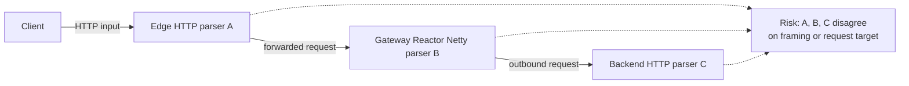
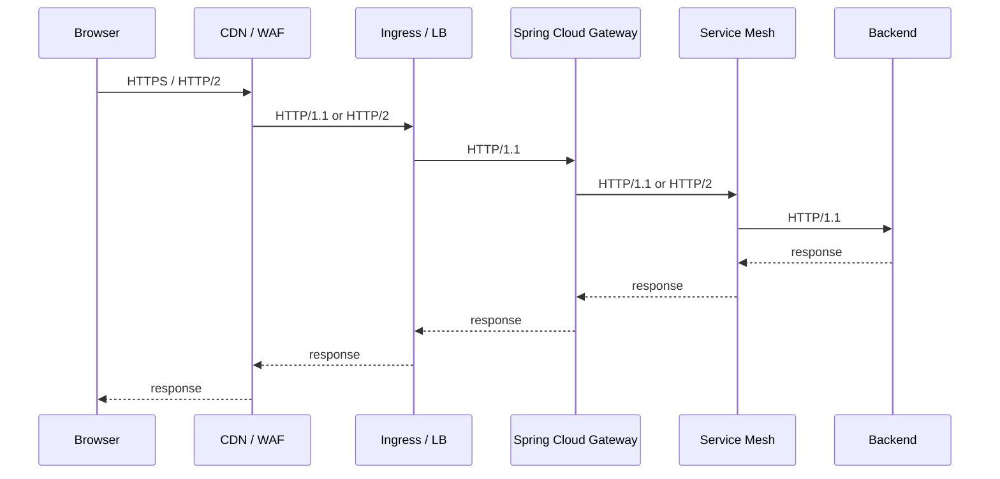
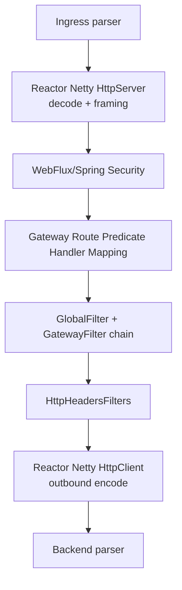

# Reviewing Request Smuggling and HTTP Interpretation Discrepancies Across Hops

## Lesson Objectives

In the **Security Hardening** chapter of the **SPRING_CLOUD_GATEWAY** module, this lesson guides you through reviewing **HTTP request smuggling** and **HTTP desynchronization** in architectures using Spring Cloud Gateway as the microservices entry point. A Gateway may enforce **route predicates, filter chains, path/header rewrites, service discovery, authentication, rate limiting, retries, circuit breakers, TLS, and observability**, yet still face risk if **CDN, Ingress, Gateway, or backends parse HTTP messages differently**.

After this lesson, learners will be able to:

- Explain request smuggling and identify **trust boundaries** along Client → Edge/WAF → Ingress → Spring Cloud Gateway → Backend.
- Distinguish **HTTP/1.1 framing** via `Content-Length` and `Transfer-Encoding` from the already-decoded body inside Spring WebFlux.
- Understand **CL.TE, TE.CL, TE.TE** mismatch families, duplicate Content-Length, malformed chunk encoding, HTTP/2 downgrades, and request-target ambiguity.
- Know the key rules in **RFC 9110, RFC 9112, and RFC 9113** regarding framing, duplicate fields, HTTP/2 pseudo-headers, CRLF, and connection-specific fields.
- Explain the true roles of Reactor Netty's decoder, `NettyRoutingFilter`, `HttpHeadersFilter`, `RequestSize`, `RequestHeaderSize`, and `SecureHeaders`; never mistake a `GatewayFilter` for a network parser.
- Audit `Host`, `:authority`, `Forwarded`, `X-Forwarded-*`, route predicates, `StripPrefix`, and `RewritePath` so paths or hosts are not interpreted differently across hops.
- Design **defensive tests in an isolated environment** using HTTP fixtures, an echo backend, and assertions on the actual number of requests received by the backend.
- Track **Netty/Gateway security advisories**, pick patches compatible with Spring Boot/Cloud BOMs, and plan rollouts/rollbacks.
- Handle incidents without logging raw JWTs, cookies, API keys, or sensitive request bodies.

> **Scope:** Gateway examples focus on **Spring Cloud Gateway Server WebFlux on Reactor Netty**. Gateway Server Web MVC, Servlet containers, and `ProxyExchange` have separate HTTP stacks/configurations; never apply one subsystem's properties to another without verification. In newer Spring Cloud Gateway releases, configurations usually reside under `spring.cloud.gateway.server.webflux.*`, whereas older versions use `spring.cloud.gateway.*`. **All malformed-request testing must run in a lab you control**—never send desync payloads to production or third-party services.

## 1. Where Does Request Smuggling Actually Happen?

HTTP/1.1 allows reusing a single TCP connection to transmit multiple HTTP requests. Every recipient must agree on:

1. Where the request line starts and the header section ends.
2. How many **bytes** the request body contains.
3. If the body uses chunked encoding, where the terminal chunk and trailers end.
4. Where the **next request** starts on that connection.

A failure model:

```text
Proxy A: "These bytes still belong to request #1."
Server B: "Request #1 already ended; the next bytes start request #2."
```

The two sides have **desynchronized on message boundaries**. If a security layer inspects a different request from what the backend executes, routing, authentication/authorization, or cache policies can be bypassed.



**The root cause is divergence between HTTP parsers/translation hops**, not merely a malicious header. A request rejected at every hop under identical rules does not create smuggling simply because it contains `Transfer-Encoding`.

### 1.1. Potential Impacts

- A request aimed at a low-privilege endpoint gets processed by the backend as a request to a different endpoint.
- **Response queue poisoning:** two responses and two callers get cross-wired when an upstream connection desynchronizes.
- Caches store a response under a different URL/cache key than the actual resource.
- Cross-user data leaks, wrong session context, or tenant confusion.
- SSRF/host routing confusion via differently interpreted `Host` or request-targets.
- 400, 502, 504, connection resets, backend timeouts, hung requests, or prolonged resource holds.

Not every 502 is request smuggling. Nor does every parser mismatch allow reading data: investigate the **exact pair of HTTP implementations**, connection pooling style, and message forwarding behavior.

### 1.2. Do Not Confuse with Related Topics

| Concept | Key distinction |
| --- | --- |
| **Request smuggling** | Multiple hops disagree on request boundaries/meaning |
| **HTTP response splitting** | Breaking header/response boundaries, often via CRLF |
| **SSRF** | Backend is tricked into calling an unauthorized target |
| **Cache poisoning** | Cache stores wrong data under a key; sometimes a consequence of smuggling |
| **Host header poisoning** | Using untrusted Host/Forwarded to build URLs/routing |
| **CSRF** | Browser automatically sends credentials in an unintended user action |
| **CORS** | Browser enforces JavaScript cross-origin response read permissions |
| **HTTP desync** | Request/response states across hops fall out of alignment |

CSRF/CORS/TLS are important layers, yet **they never replace strict message parsing**.

## 2. Mapping Protocols Across the Proxy Chain

A typical deployment:



**Never assume that because the Browser uses HTTP/2, Order Service receives HTTP/2.** A CDN may downgrade h2 → h1; a mesh sidecar may open a fresh connection; Gateway's HTTP client may use another protocol/connection pool on the next hop.

### 2.1. Map to Maintain in Architecture Documentation

| Hop | Inputs/outputs to record | Security questions |
| --- | --- | --- |
| Browser → CDN | h2/h3, TLS/ALPN | Are malformed pseudo-headers and field values rejected? |
| CDN → Ingress | h2 → h1 or h1 → h1 | Is HTTP/1.1 framing rebuilt cleanly? |
| Ingress → Gateway | h1, keep-alive, Host | Where are duplicate CL/invalid TE blocked? |
| Gateway Netty → HTTP client | Inbound decode → outbound encode | Do body and headers stay consistent after filters? |
| Gateway → Mesh | h1/h2, TLS, pooled connections | Are hop-specific fields forwarded wrongly? |
| Mesh → Backend | h2 → h1 if downgraded | How does backend interpret Host/Content-Length/trailers? |
| Backend → Gateway | Response headers/body | Are response framing, caching, and connection reuse safe? |

For each hop, document:

- **Name, version, and advisory status** of the HTTP parser/codec.
- Whether HTTP/1.0, 1.1, 2, 3, h2c, Upgrade, and CONNECT are enabled.
- TLS termination mode, mTLS, SNI, and ALPN.
- Who may emit/overwrite `Host`, `Forwarded`, `X-Forwarded-*`.
- Connection reuse, pooling, pipelining, HTTP/2 multiplexing, and idle timeouts.
- Where authN/authZ, CORS, WAF, caching, and rate limiters execute.
- Behavior on malformed inputs: reject, normalize, close, or forward?

**Inspecting Gateway alone is insufficient.** Test the exact chain of parser pairs deployed in your environment.

## 3. HTTP/1.1 Message Framing: Mandatory Foundations

An illustrative HTTP/1.1 request:

```http
POST /api/orders HTTP/1.1
Host: api.example.test
Content-Type: application/json
Content-Length: 17

{"itemId":"A-42"}
```

`Content-Length` counts **bytes**, not Unicode characters or `String.length()`. If Gateway modifies the body, the outbound representation's byte length can change; the HTTP client must recalculate framing from actual bytes.

### 3.1. Two Ways to Signal Body Length

| Mechanism | Meaning | How it must terminate |
| --- | --- | --- |
| `Content-Length: N` | Body is exactly N octets | Exactly N bytes |
| `Transfer-Encoding: chunked` | HTTP/1.1 chunked transmission | Terminal zero-sized chunk and valid trailers if present |
| Neither CL nor TE in request | Body length is 0 per HTTP/1.1 framing | End of headers ends the request |

**The HTTP method does not define message framing.** Never replace RFC 9112 rules with assumptions like "GET always has body length 0" or "POST always has a body."

### 3.2. `Content-Length` and `Transfer-Encoding` Present Together

Per [RFC 9112](https://www.rfc-editor.org/rfc/rfc9112.html):

- Senders **MUST NOT** send both `Content-Length` and `Transfer-Encoding` in one HTTP message.
- When both are received, `Transfer-Encoding` takes precedence for framing; the combination is a dangerous signal and should be treated as an error.
- Servers may **reject** the request; if choosing to process via TE, they must **close the connection after the response** so remaining bytes cannot be misinterpreted.
- An intermediary that forwards must **strip the received Content-Length** and handle Transfer-Encoding properly before emitting a new message.

**Preferred policy at a public edge** is usually **rejecting conflicting framing**. Do not claim the RFC forces every TE+CL case to return 400 immediately: it allows processing via TE paired with an obligation to close the connection. What matters is **never having two "sources of truth" for body boundaries**.

### 3.3. Duplicate Content-Length

Risky example:

```text
Content-Length: 11
Content-Length: 27
```

If Proxy A uses the first value while Backend B uses the last value, they disagree on where the body ends. For identical values in list form, **RFC 9110** allows recipients to reject or normalize certain cases like `Content-Length: 42, 42` into a single valid value. However, it forbids forwarding a CL known to be wrong. <https://www.rfc-editor.org/rfc/rfc9110.html>

For ingress security policy, **rejecting duplicate Content-Length** is a conservative, easily verifiable choice even though some identical duplicates can be validly normalized under the RFC. Test all hops to ensure none arbitrarily picks first or last.

### 3.4. Framing Matrix and Defensive Behavior

| Input | Assessment | Desired policy |
| --- | --- | --- |
| Single valid decimal CL, no TE | Clear framing | Allow if within size limit |
| Valid chunked, no CL | Clear framing | Allow if decoder supports it |
| TE and CL in same request | Ambiguity/smuggling risk | Reject at edge or handle TE per RFC + close |
| Two differing CL values | Ambiguous length | Reject, close |
| Negative/non-numeric/overflowing CL | Invalid | Reject, close |
| Duplicate identical decimal CL | Narrow normalization rule exists | Choose reject or consistent normalization |
| Request TE where `chunked` is **not the final coding** | Reliable length indeterminable | **400 and close** per RFC 9112 |
| Malformed chunk size/terminal chunk | Incomplete or invalid | Reject, close, never reuse connection |
| HTTP/1.0 request with TE | Faulty framing | Reject/close per HTTP/1.1 compatibility rules |
| Neither CL nor TE on request | Zero body length | Never guess based on method |

### 3.5. Transfer-Encoding Is Not a Substring Search for `"chunked"`

A parser must handle:

- Multiple `Transfer-Encoding` field lines.
- Lists of transfer codings and their **order**.
- Mixed case, whitespace, and control chars per grammar.
- `chunked` must be the **final transfer coding** for HTTP/1.1 requests.
- Hex chunk sizes, integer overflows, and size limits.
- Chunk extensions, quoted strings, and CRLF.
- Trailers, terminal zero-sized chunks, and incomplete closes.

**Code like the following is not validation:**

```java
if (transferEncoding.toLowerCase().contains("chunked")) {
    // Insufficient to declare an HTTP message valid.
}
```

Full validation belongs in a **patched HTTP codec/decoder**, not implemented ad hoc in a `GatewayFilter` inspecting header text.

### 3.6. Chunked Requests and Connection Close

Chunked framing follows this logical structure:

```text
<chunk size hex> CRLF
<exact chunk bytes> CRLF
...
0 CRLF
<optional trailer fields>
CRLF
```

A request with a malformed terminal chunk or mid-stream truncation is **incomplete/malformed**; rely on a proper HTTP parser and never reuse a connection containing unclassified leftover bytes.

In tests, use only synthetic bodies and backend stubs; never craft a "second request" hitting real endpoints with side effects to demonstrate a parser gap.

### 3.7. `Transfer-Encoding` Differs from `Content-Encoding`

| Header | Purpose |
| --- | --- |
| `Transfer-Encoding: chunked` | Framing over an HTTP/1.1 connection/hop |
| `Content-Encoding: gzip` | Encoding of the content representation |
| `Content-Length` | Content body byte count per framing rules |

After `ModifyRequestBody` or a custom body transformation alters JSON/gzip/UTF-8, never retain the raw incoming length, and previous encoding/digest/ETag values become invalid. Still, **modifying an already-parsed body** differs from **delimiting raw message boundaries** in the network parser.

## 4. Parser Discrepancy Families to Recognize

The abbreviations below denote **differences between two parsers**, not exploit API names or Spring filters.

### 4.1. CL.TE

```text
Front-end parser: I use Content-Length to determine the body.
Back-end parser: I use Transfer-Encoding to determine the body.
```

If a conflictingly framed message slips through, the two sides can interpret subsequent bytes as belonging to two different requests.

### 4.2. TE.CL

```text
Front-end parser: I use the chunked terminal marker.
Back-end parser: I use Content-Length.
```

One side considers the body finished while the other waits for more bytes; outcomes include timeouts, request misassociation, or the backend misparsing the next request.

### 4.3. TE.TE

Both sides recognize TE yet **parse field values differently**: whitespace, multiple field lines, chunked token order, chunk extensions, or malformed syntax. This combination can produce desyncs akin to CL.TE/TE.CL in specific topologies.

### 4.4. Zero-Length / Early Response Variants

Some research labels zero-length or early-response scenarios `CL.0`. Variant labels do not change the core question: **do both hops agree on request boundaries and any remaining bytes?**

A backend responding before reading the entire body does not mean remaining bytes may be treated as a fresh request. Components must manage connection/request lifecycles per protocol rules.

### 4.5. Response Queue Poisoning

If an upstream keep-alive connection desynchronizes, a response can be matched to the wrong request or caller. This is a key reason to **close/discard suspected desynced connections**, rather than reusing them merely because the server returned 200.

## 5. HTTP/2 and h2 → HTTP/1.1 Conversion Risks

HTTP/2 does not use start-lines or `Transfer-Encoding: chunked` like HTTP/1.1. It uses **frames, streams, and pseudo-headers**:

```text
:method    = GET
:scheme    = https
:authority = api.example.test
:path      = /api/orders/42
```

Bodies travel in DATA frames. When a proxy translates h2 to h1, it must **reconstruct valid HTTP/1.1 framing from a validated h2 message**.

### 5.1. Content-Length in h2

HTTP/2 can carry a regular `content-length` field, though actual body length comes from DATA frames/streams. Under RFC 9113, if present on a message with content, it must **equal the sum of DATA frame payload lengths** per protocol rules. Any mismatch must be treated as malformed.

When downgrading:

```text
h2 stream data
  ↓ validation
h1 request with a fresh valid Content-Length
  or Transfer-Encoding properly generated by HTTP client
```

Never copy an untrusted/mismatched h2 CL forward as HTTP/1.1 framing.

### 5.2. Hop-by-Hop Fields Forbidden in h2

Connection-specific fields such as:

```text
Connection
Keep-Alive
Proxy-Connection
Transfer-Encoding
Upgrade
```

must not appear in an HTTP/2 message under RFC 9113. Exception: an HTTP/2 request may carry `TE: trailers` and **no other value** for TE. An h2 parser must reject/raise a protocol error on invalid fields, never copying them down to h1.

### 5.3. Host and `:authority`

If an h2 request has:

```text
:authority = api.example.test
host       = admin.internal.example.test
```

there is **host/target ambiguity**. RFC 9113 forbids clients from generating a `Host` differing from `:authority`, and servers **SHOULD treat** a `Host` conflicting with `:authority` as malformed after appropriate canonical normalization.

Test across components:

- Where does ingress read the authority for routing?
- Which host do Gateway's route/host predicates and Spring Security see?
- What is the backend's h1 `Host` after downgrade?
- Do cache keys, redirects, and virtual hosting share one consistent authority?

Never use Host or `:authority` as proof of user identity.

### 5.4. CR, LF, and Invalid Fields in h2

RFC 9113 forbids CR, LF, and NUL in field values; h2 field names must be lowercase and valid. If a proxy accepts a field value containing line breaks and serializes it verbatim to h1, that text can turn into **another header line or request line**.

**Block before downgrading** using a patched HTTP parser/codec—never rely solely on regexes after `ServerWebExchange` is constructed.

### 5.5. H2C, CONNECT, and WebSocket

`h2c` cleartext upgrades, HTTP/2 prior knowledge, CONNECT tunneling, and WebSocket 101 Upgrades each carry distinct semantics. Enable them only on controlled routes and network boundaries; never allow public clients to arbitrarily request upgrades/tunnels to non-allowlisted internal backends. Do not claim h2c or WebSockets always imply request smuggling: risk stems from inconsistent protocol translation and parser/state handling.

## 6. Paths, Hosts, and Request Targets Must Also Be Consistent

Not every multi-hop bypass stems from CL/TE. Some occur when the **front proxy checks a different URL from what the backend actually executes**.

```text
Ingress policy:  /api/public/** allowed
Gateway:         RewritePath / StripPrefix
Backend:         performs an extra URI decode/canonicalization pass
```

Cases to review:

- Percent-encoded slashes `%2F`, `%2f`, and double-encoded `%252F`.
- Dot-segments `.` / `..` and encoded dots `%2e`.
- Backslashes `%5C`, repeated slashes, trailing slashes.
- Query vs path separators, semicolons/matrix parameters.
- Unicode canonicalization/invalid UTF-8 bytes.
- HTTP/1.1 origin-form vs absolute-form request targets.
- Host/`:authority` and TLS SNI/virtual-host routing.

The goal is **one consistent canonical target** when making security/routing decisions, while the backend still enforces resource authorization after applying its own path rules.

### 6.1. Example of a Valid Route That Still Needs Backend Path Testing

```yaml
spring:
  cloud:
    gateway:
      server:
        webflux:
          routes:
            - id: orders
              uri: lb://order-service
              predicates:
                - Path=/api/orders/**
              filters:
                - StripPrefix=1
```

For normal URLs:

```text
Gateway receives: /api/orders/42
Backend receives: /orders/42
```

When `%2F`, encoded dot segments, or repeated slashes appear, **verify the on-wire request target** and **backend route mapping**; never infer from a correct route predicate that every downstream parser interprets it identically.

### 6.2. Backends Must Enforce Resource Authorization

Never put every barrier on `Path=/api/admin/**` at Gateway and let the backend trust every call from a private IP. Each service must:

- Verify authenticated identity/token/service identity.
- Verify tenant and resource ownership.
- Block direct backend bypasses via network policies/mTLS where appropriate.
- Never trust client-supplied `X-User`, `X-Tenant`, `X-Forwarded-*`.

### 6.3. URI Injection and Outbound Request-Lines

HTTP/1.1 start-lines use `SP` and `CRLF` separators. URIs built from user-controlled strings must be properly validated and encoded before reaching an HTTP client. Never assemble raw target URIs via string concatenation. Several Netty advisories have described request-line validation bypasses when URIs are mutated via specific APIs; **keep libraries patched and use validated URI components only**.

## 7. `Connection`, Hop-by-Hop Headers, and Forwarded Trust

Spring Cloud Gateway Server WebFlux runs `HttpHeadersFilters` on request headers **before sending downstream** in the routing path. Per current Gateway docs, `RemoveHopByHop` strips these fields by default:

```text
Connection
Keep-Alive
Proxy-Authenticate
Proxy-Authorization
TE
Trailer
Transfer-Encoding
Upgrade
```

Source: <https://docs.spring.io/spring-cloud-gateway/reference/spring-cloud-gateway-server-webflux/httpheadersfilters.html>.

### 7.1. What `RemoveHopByHop` Does Not Solve

This outbound filter operates on already-parsed headers. It **does not replace** a strict **inbound HTTP parser** at Netty/Ingress. If a prior hop already misparsed body boundaries, stripping `Transfer-Encoding` on Gateway outbound does not prove request desync was prevented.

### 7.2. `Connection` Can Nominate Additional Headers

Example:

```http
Connection: keep-alive, X-Internal-Hop
X-Internal-Hop: untrusted-value
```

HTTP semantics require intermediaries to treat field names listed in `Connection` as connection-specific for that hop. Simply deleting the `Connection` header itself while forwarding every header it nominated without handling dynamic list processing is insufficient.

### 7.3. Forwarded Headers Are Metadata, Not Authentication

```text
Forwarded
X-Forwarded-For
X-Forwarded-Host
X-Forwarded-Proto
X-Forwarded-Port
X-Forwarded-Prefix
```

can be forged by clients if the edge does not sanitize. In newer Gateway Server WebFlux releases, `spring.cloud.gateway.server.webflux.trusted-proxies` configures Forwarded/XForwarded header filters, **not a switch enabling full parser hardening**.

Safe policy:

```text
Untrusted client
  → Trusted Ingress strips spoofed forwarded metadata
  → Gateway interprets metadata only from trusted proxies
  → Backend checks authenticated identity instead of trusting headers alone
```

### 7.4. Outbound Host

Client sends:

```http
Host: api.example.test
```

Gateway calls:

```text
https://orders.internal.example.test/orders/42
```

then the outbound Host/authority must match the target URI and virtual-host contract rather than automatically keeping the public Host. Use `PreserveHostHeader` only if upstream genuinely needs it and TLS SNI, redirects, routing, and auth boundaries have been tested; never enable it "to preserve all headers" when dealing with request smuggling.

## 8. Real Limits of Spring Cloud Gateway Filters

Logical flow:



*This diagram illustrates roles, not a guarantee of exact custom filter ordering in every runtime.* The key point is that **Netty has already framed the request before route filters ever see `ServerWebExchange`**.

### 8.1. Useful Application-Level Filters

- `RequestRateLimiter` throttles request rates.
- Spring Security WebFlux authenticates and authorizes.
- `Path`/`Method`/`Host` route predicates select routes.
- `StripPrefix`/`RewritePath` transform parsed URLs.
- `RemoveRequestHeader`, `SetRequestHeader` control header forwarding.
- `RequestSize`, `RequestHeaderSize` curb oversized requests/headers.
- `Retry`, `CircuitBreaker` manage resilience within appropriate bounds.

Yet they **cannot repair raw invalid CRLF, malformed chunk-sizes, duplicate CLs already merged by a decoder, or HTTP/2 pseudo-header parsing at a preceding hop**.

### 8.2. Example of `RequestSize` and `RequestHeaderSize`

```yaml
spring:
  cloud:
    gateway:
      server:
        webflux:
          routes:
            - id: bounded-orders
              uri: lb://order-service
              predicates:
                - Path=/api/orders/**
              filters:
                - StripPrefix=1
                - RequestHeaderSize=8KB
                - name: RequestSize
                  args:
                    maxSize: 1MB
```

`RequestHeaderSize` can return **431** when headers exceed the limit; `RequestSize` can return **413** when bodies are too large, per Gateway docs. These provide defense-in-depth against resource exhaustion, **not an HTTP framing validator**. Also configure limits at Ingress and the Netty listener.

### 8.3. `SecureHeaders`/CORS/CSRF/TLS Do Not Replace Framing Validation

`SecureHeaders` adds response security headers (HSTS, X-Frame-Options, etc.); CORS governs browser cross-origin reads; CSRF protects cookie-based state changes; TLS protects bytes between TLS endpoints. **None of these replaces consistency across hops on HTTP framing and request targets.**

### 8.4. Body Rewrites Must Let the HTTP Client Recompute Framing

When a filter transforms JSON/Unicode, never:

- Keep the incoming `Content-Length` after body bytes change.
- Forward HTTP/1.1 `Transfer-Encoding: chunked` into HTTP/2.
- Keep `Content-Encoding: gzip` if the body was decompressed.
- Keep signatures/digests/ETags from the old representation after rewriting.
- Read stream buffers multiple times outside supported cache/replay APIs.

Use supported body transformation APIs and verify what bytes the backend actually receives; never serialize raw request-lines/headers via string concatenation.

## 9. Reviewing Dependencies and Netty Security Advisories

A system without dangerous custom GatewayFilters can still be exposed if the **underlying HTTP decoder/encoder** has bugs. Spring Cloud Gateway Server WebFlux relies on Spring WebFlux/Reactor Netty/Netty, alongside independent Ingress controllers, HTTP clients, service meshes, and backend servers.

### 9.1. Inspecting `pom.xml` Alone Is Insufficient

In many Spring Boot projects, the Netty version is managed by Spring Boot dependency management/BOMs and can shift due to:

- Spring Cloud release trains/BOMs.
- Another dependency pulling transitive Netty jars.
- Manual dependency overrides.
- Container images or platform classpaths.
- Spring Boot patch updates or native packaging.

Verify **resolved runtime artifacts** for:

```text
io.netty:netty-codec-http
io.netty:netty-codec-http2
io.netty:netty-handler
io.projectreactor.netty:reactor-netty-http
org.springframework.cloud:spring-cloud-gateway-...
```

Never assume upgrading `spring-cloud-gateway` alone means all Netty codecs at runtime are patched. Conversely, never force a Netty JAR from an arbitrary release onto the classpath without verifying Reactor Netty/Boot compatibility.

### 9.2. Directly Relevant Advisory Examples

The advisories below are **historical examples published by Netty**. They illustrate why divergent parsers must be audited, not an exhaustive list of future vulnerabilities.

| Advisory and date | Discrepancy type | Published fix milestones |
| --- | --- | --- |
| [GHSA-fghv-69vj-qj49](https://github.com/netty/netty/security/advisories/GHSA-fghv-69vj-qj49), Sep 2025 | Chunk extensions with bare LF could parse differently from reverse proxies | `4.1.125.Final`, `4.2.5.Final` |
| [GHSA-84h7-rjj3-6jx4](https://github.com/netty/netty/security/advisories/GHSA-84h7-rjj3-6jx4), Dec 2025 | CRLF validation in HTTP request encoder/URI | `4.1.129.Final`, `4.2.8.Final` |
| [GHSA-pwqr-wmgm-9rr8](https://github.com/netty/netty/security/advisories/GHSA-pwqr-wmgm-9rr8), Mar 2026 | HTTP/1.1 chunk extension quoted-string parsing | `4.1.132.Final`, `4.2.12.Final` |
| [GHSA-38f8-5428-x5cv](https://github.com/netty/netty/security/advisories/GHSA-38f8-5428-x5cv), May 2026 | Malformed `Transfer-Encoding` with `chunked` not as final coding | `4.1.133.Final`, `4.2.13.Final` |
| [GHSA-v8h7-rr48-vmmv](https://github.com/netty/netty/security/advisories/GHSA-v8h7-rr48-vmmv), May 2026 | `DefaultHttpRequest.setUri()` and request-line injection | `4.1.133.Final`, `4.2.13.Final` |
| [GHSA-rq4j-fc47-9698](https://github.com/netty/netty/security/advisories/GHSA-rq4j-fc47-9698), Sep 2026 | Control characters in chunk-size line | `4.1.138.Final`, `4.2.18.Final` |
| [GHSA-hcvj-94mj-jp5c](https://github.com/netty/netty/security/advisories/GHSA-hcvj-94mj-jp5c), Sep 2026 | Incomplete validation of malformed Transfer-Encoding | `4.1.138.Final`, `4.2.18.Final` |

**Note on using this table:** each milestone is the version listed as fixed in that **specific advisory**, not a guarantee that version fixes all later advisories or is currently latest. Cross-check affected/fixed ranges in the original advisory against your running BOM, upgrade to an appropriate **supported release**, and run regression tests.

### 9.3. Triage by Component, Not by Keyword

Some CVEs related to Spring Cloud Gateway involve `Forwarded` headers from untrusted proxies, Actuator route mutation, SpEL, or resource exhaustion. These can be severe, yet they are **not identical** to HTTP message framing bugs.

Workflow:

```text
Which artifact does the advisory affect?
  ↓
Is the system's resolved version in the affected range?
  ↓
Is the affected protocol/feature exposed in the actual topology?
  ↓
Do proxy/backend pairs exhibit a parser differential or bypass path?
  ↓
Patch / mitigate / retest / document residual risk
```

**Never wait for an active production exploit** before patching an affected component. Simulation/testing simply helps pick interim mitigations and verify post-upgrade behavior.

### 9.4. Testing After a BOM Upgrade

Do not test only `GET /health` returning 200. Test:

- Valid HTTP/1.1 CL and valid chunked requests.
- HTTP/2 → HTTP/1.1 downgrades.
- Unicode, gzip, and streaming bodies.
- WebSocket handshakes if used.
- Route predicates, `StripPrefix`, `RewritePath`, and `Host` forwarding.
- `RequestSize`/`RequestHeaderSize` rejections.
- Duplicate/invalid framing rejected per policy.
- Connections never reused after malformed inputs.
- Load balancer, retries, circuit breakers, and TLS working as before.

## 10. Hardening at the Public Edge and Ingress

Public ingress is where **raw malformed HTTP can be rejected ahead of Gateway**, provided the edge parser itself is kept updated and configured properly. It is the first line of defense, not the only one.

### 10.1. Policies to Enforce

1. Restrict HTTP protocol versions/ALPN and enable `h2c`, CONNECT, and Upgrade only where genuinely required.
2. Enable strict HTTP parsing per your **exact Ingress/WAF vendor and version** guidance.
3. Reject conflicting TE + CL and duplicate/invalid CL per approved security policy.
4. Reject malformed transfer codings, chunk lengths/extensions, and incomplete messages.
5. Reject HTTP/2 invalid pseudo-headers, `:authority`/Host conflicts, and forbidden connection-specific fields.
6. Never forward raw field values containing CR, LF, or NUL from h2 to h1.
7. Set max header count/size, request-line limits, body sizes, and timeouts.
8. Whenever message boundaries are unclear, **close the affected connection** instead of reusing it.
9. Strip untrusted client-supplied `Forwarded`/`X-Forwarded-*`; attach only metadata verified by trusted edge.
10. Restrict routes/hosts entering Gateway; never forward arbitrary targets.

### 10.2. Rejection Beats Uncertain Normalization

A proxy might normalize identical duplicate CLs per the RFC, yet if another hop folds or prioritizes another field, risk remains.

Normalize only when:

- There is **one verified body-length authority**.
- Normalization completes **before** authorization, routing, and forwarding.
- Only one fresh message with valid framing is emitted.
- All downstream parsers handle it identically in integration tests.
- No connection with unclassified leftover bytes is retained.

Whenever a **single unambiguous request boundary** cannot be established, **reject/close** rather than "patch it up and forward."

### 10.3. A WAF Does Not Substitute for Parser Correctness

A WAF can add signature/rate controls, yet fails if:

- The WAF parser reads requests differently from the Ingress HTTP parser.
- The WAF inspects h2 while downstream receives improperly translated h1.
- Backends/Gateways remain reachable via paths bypassing ingress.
- Malformed transfer codings evade regex/signature rules.

Test **across all real hops**. "WAF enabled" is not proof that request smuggling is impossible.

### 10.4. Preventing Bypasses Around the Sanitized Layer

Safe architecture:

```text
Internet
  ↓
Patched CDN/WAF/Ingress + strict parsing
  ↓ private network
Spring Cloud Gateway replicas
  ↓ mTLS/NetworkPolicy
Backend services
```

Audit cloud firewalls, Kubernetes Service types, NodePorts/LoadBalancers, pod ingress rules, security groups, service mesh policies, and management ports. If raw Internet traffic can hit Gateway/Backends directly, you cannot rely solely on ingress sanitization.

## 11. Hardening at Gateway and Backend

### 11.1. Gateway WebFlux

- Run **patched**, BOM-compatible Spring Boot/Gateway/Reactor Netty/Netty versions.
- Keep `RemoveHopByHop` headers filter with sound defaults; never arbitrarily retain TE/Connection.
- Never let `RequestHeaderToRequestUri` or custom URL selectors take arbitrary client hosts.
- Enforce security authN/authZ ahead of sensitive routes, **without treating it as raw parser defense**.
- Never copy all inbound headers blindly in custom filters.
- Enforce header/body/connection limits at **Netty HTTP server/Ingress**, not just route filters.
- Set request timeouts, pending queue limits, rate limiters, and retry budgets.
- Never log raw headers/bodies/tokens via Netty wiretap on real traffic.
- When malformed input is detected, fail via HTTP codec error/close; never retry a request with uncertain boundaries.

### 11.2. Backend

- Patch the HTTP server library (Servlet container, Undertow/Jetty/Tomcat/Netty/NGINX depending on stack).
- Verify authenticated service identity or user tokens with audience/scope checks.
- Enforce **object/tenant authorization** after backend path canonicalization.
- Never trust private network IPs or client-sent `X-User`, `X-Tenant`, `X-Forwarded-*` as authentication proof.
- Block direct access bypassing Gateway using network policies and mTLS as needed.
- Cap body/header sizes and idle/read timeouts.
- Reject malformed/incomplete messages and never reuse desynced keep-alive connections.
- If caching is used, avoid cache keys derived from a different path representation than the backend resource.

### 11.3. Separating Error Responses from Parser Errors

If a backend returns 400 for a request Gateway considered valid, possible causes include:

- Stricter backend business validation.
- Differing header/body size limits.
- Differing route URL/encoding interpretation.
- Divergent message-framing parsers.

Investigate using evidence rather than assuming smuggling immediately. Answer:

```text
How many HTTP requests did Edge observe?
How many ServerWebExchanges did Gateway see?
How many outbound HTTP requests did Gateway send?
How many did Backend actually receive?
Which connections were closed/reused after errors?
For what reason did Backend's parser reject?
```

### 11.4. TLS/mTLS Does Not Exempt Framing Checks

TLS protects bytes on each segment:

```text
Client --TLS #1--> Ingress --TLS #2--> Gateway --TLS #3--> Backend
```

Once TLS terminates, HTTP is still parsed. Encryption does not make a wrong `Content-Length` valid, nor does it prevent h2→h1 translation bugs. mTLS authenticates workload connections, yet does not cure HTTP parsing differentials.

## 12. Designing Defensive Tests Without Endangering Other Users

Request smuggling testing is uniquely sensitive because a malformed request can corrupt a **shared persistent connection** carrying other users' traffic. Testing procedures must therefore be isolated.

### 12.1. Minimum Test Topology

```text
Synthetic test client
  ↓
Test Ingress/Proxy matching production version
  ↓
Spring Cloud Gateway test pod
  ↓
Backend HTTP echo stub
```

Rules:

- Components run in a namespace/network with **zero live customer traffic**.
- Never use real accounts, JWTs, cookies, or valid API keys.
- Backend merely echoes metadata and counts requests, with **zero side-effecting endpoints**.
- Tests enforce overall timeouts and kill switches so pipelines cannot hang indefinitely.
- Each case starts with a fresh connection or reset pool per test design.
- Never run fuzzing against public CDN domains, production endpoints, or systems you do not control.

### 12.2. Two Test Tiers

**Tier A — syntax/codec unit tests:** use HTTP decoders/encoders and an isolated network fixture to confirm invalid framing is rejected. No real user-facing client is needed.

**Tier B — end-to-end parser differential:** send synthetic malformed HTTP through the **exact Ingress → Gateway → Backend** chain in the lab. Compare accepted/rejected requests and recorded backend request counts.

High-level HTTP test clients like `WebTestClient` or standard `curl` often **auto-normalize headers/bodies** and prevent emitting syntax-violating requests. They work for happy paths, yet are **insufficient** to prove parsers reject raw malformed bytes. Use a controlled protocol/codec test suite approved by the security team.

### 12.3. Invariants to Assert

| Invariant | Meaning |
| --- | --- |
| Every valid request triggers only expected backend calls | No hidden requests |
| Malformed inputs are rejected or normalized per verified policy | Zero ambiguity |
| On framing errors, connections are never improperly reused | Prevents cross-request contamination |
| Gateway authz decisions apply to the exact backend action | No resource policy bypass |
| h2→h1 paths never emit conflicting CL/TE | Safe downgrades |
| Backend responses bind to the right caller/request ID | No queue poisoning |
| Caches never swap keys on conflicting paths/hosts | No poisoning |
| Tokens/bodies are never stored in test/production logs | No new data leaks |

### 12.4. Inspecting the Backend with a Test Stub

A stub backend can record **metadata only**:

```json
{
  "method": "GET",
  "path": "/orders/42",
  "host": "orders.internal.example.test",
  "requestId": "synthetic-req-042",
  "bodyLengthBytes": 0,
  "connectionId": "test-conn-01"
}
```

Never record raw `Authorization`, `Cookie`, `X-API-Key`, payloads, or session IDs. The stub backend should count:

```text
receivedRequestCount
requestIdsReceived
connectionIdsUsed
backendStatusCodes
connectionCloseReason
```

If a client sends one valid test request and the backend records more than one request **outside Retry policy**, that is a key investigation signal. Note that `Retry`/CircuitBreaker/load balancing can legitimately generate extra attempts; disable or track them separately when verifying parsers.

### 12.5. Safe Test Assertions Without Printing Payloads

Pseudocode:

```java
// Test pseudocode: use your project's proper HTTP test client/stub.
// Do not simulate malformed bytes with standard WebTestClient.

String expectedId = "synthetic-req-042";

sendValidRequestToIsolatedIngress(expectedId);

List<RecordedRequest> calls = backendStub.recordedRequests();

assertThat(calls).hasSize(1);
assertThat(calls.get(0).method()).isEqualTo("GET");
assertThat(calls.get(0).path()).isEqualTo("/orders/42");
assertThat(calls.get(0).header("X-Test-Request-Id"))
    .isEqualTo(expectedId);

// For malformed fixtures:
//   assert input is rejected per edge policy;
//   assert backend received zero requests;
//   assert suspect connection was closed/not reused.
```

`sendValidRequestToIsolatedIngress` and `RecordedRequest` are **illustrative test harness abstractions**, not built-in Spring Cloud Gateway APIs. Implement them with WireMock/MockWebServer/embedded test servers or team-approved protocol-conformance tools.

## 13. HTTP/1.1 and HTTP/2 Test Matrix

| # | Group | Safe fixture | Expectation |
| --- | --- | --- | --- |
| 1 | H1 | Valid CL, short JSON | One backend request, exact body bytes |
| 2 | H1 | Valid chunked, proper terminal chunk | One backend request |
| 3 | H1 | TE and CL together | Edge rejects per policy, zero backend requests |
| 4 | H1 | Duplicate CL with differing values | Reject, never forward |
| 5 | H1 | Duplicate CL with identical values | Reject or normalize per policy/RFC |
| 6 | H1 | Negative CL | Reject |
| 7 | H1 | Non-decimal CL | Reject |
| 8 | H1 | Huge/overflowing CL | Reject without excessive allocation |
| 9 | H1 | TE where `chunked` is not final coding | 400 and close per RFC |
| 10 | H1 | Multiple TE fields | Parse per grammar or reject, zero divergence |
| 11 | H1 | Unknown transfer coding | Never forward ambiguously |
| 12 | H1 | Invalid chunk-size syntax | Reject/close |
| 13 | H1 | Chunk extension control characters | Reject/close |
| 14 | H1 | Incomplete terminal chunk/trailer | Reject/close |
| 15 | H1 | HTTP/1.0 with TE | Reject/close, do not treat as valid H1 |
| 16 | H1 | `Connection` listing extra header | Hop semantics applied consistently |
| 17 | H1 | Mixed-case header names | Proper case-insensitive semantics |
| 18 | H1 | Header with invalid CR/LF | Reject |
| 19 | H1 | Request-line containing invalid characters | Rejected at encoder/decoder |
| 20 | H2 | Valid DATA frames, matching CL | Downgrade emits valid H1 framing |
| 21 | H2 | CL mismatches DATA bytes | Malformed, not forwarded downstream |
| 22 | H2 | `Transfer-Encoding` present | Malformed |
| 23 | H2 | `TE` other than `trailers` | Malformed |
| 24 | H2 | `Connection`/`Upgrade` present | Malformed |
| 25 | H2 | `:authority` differs from Host | Reject per strict policy |
| 26 | H2 | Duplicate pseudo-header | Malformed |
| 27 | H2 | Uppercase field name | Malformed |
| 28 | H2 | CR/LF inside field value | Malformed |
| 29 | H2 | Invalid `:path` target | Reject or handle per standard |
| 30 | URI | Encoded slash/dot segments | Gateway and backend resolve same resource per contract |
| 31 | URI | Duplicate slash/backslash | Cannot bypass protected resources |
| 32 | Host | Host/authority conflict | Never routes to internal virtual host |
| 33 | Forwarded | Client spoofs `X-Forwarded-Host` | Does not alter routing/security authority |
| 34 | Forwarded | Client spoofs private XFF IP | Does not bypass IP-based policy |
| 35 | Body | JSON rewrite changes UTF-8 bytes | Outbound CL/TE/Content-Encoding accurate |
| 36 | Response | HEAD/204/304/CONNECT semantics | Valid response framing |
| 37 | Pool | Malformed request on keep-alive | Connection not improperly reused |
| 38 | Security | Malformed request near protected path | Zero backend actions bypassing authz |
| 39 | Cache | Host/path variants | Cache keys/responses never cross-contaminated |
| 40 | Recovery | Upgrade Netty/Ingress to patched version | Happy paths unregressed, malformed rejected |

**For malformed cases, you do not need to embed an admin request payload inside the body** to gain test value. Testing response policies, connection closes, and stub backend request counts suffices to catch dangerous discrepancies without affecting other systems.

## 14. A Controlled Lab: Comparing H1 and H2

### 14.1. Valid Baseline First

Given Gateway route:

```yaml
spring:
  cloud:
    gateway:
      server:
        webflux:
          routes:
            - id: demo-orders
              uri: http://localhost:9001
              predicates:
                - Path=/api/orders/**
              filters:
                - StripPrefix=1
                - RequestHeaderSize=8KB
                - name: RequestSize
                  args:
                    maxSize: 1MB
```

The backend stub listens on `localhost:9001` in the same lab network namespace; this is **not** a production URI.

Send a valid H1 request:

```bash
curl --http1.1 -i \
  "http://localhost:8080/api/orders/42" \
  -H "X-Test-Request-Id: lab-h1-042"
```

Expected:

```text
Gateway routeId: demo-orders
Backend path:    /orders/42
Backend count:   1
Backend ID:      lab-h1-042
```

### 14.2. Valid HTTP/2 Comparison

When lab Gateway/Ingress has HTTP/2 enabled with TLS/ALPN:

```bash
curl --http2 -i \
  "https://lab-api.example.test/api/orders/42" \
  -H "X-Test-Request-Id: lab-h2-042"
```

This tests only **valid h2 requests**, not malformed HTTP/2 frames. If the edge speaks h2 while the backend receives HTTP/1.1, the backend stub must observe the **same resource and single request**, with properly generated intermediary framing.

### 14.3. Negative Fixtures Should Be Driven by a Protocol-Conformance Harness

For duplicate CL, invalid TE, bare CR/LF, or h2 pseudo-header conflicts, standard HTTP clients often auto-correct or reject before sending. Security teams can use codec-level tests or protocol-conformance fixtures:

```text
Given:
  isolated ingress, Gateway, backend stub
  zero real user traffic
  fixture contains a non-conforming framing/header case

When:
  fixture is sent through the proxy chain

Then:
  policy requires rejection at edge
  backendStub.receivedRequests == 0
  errored connection is closed/not reused
  logs record no raw synthetic secrets
```

**Never send those fixtures across a shared production CDN connection**; in some configurations, desync can impact subsequent requests from other users.

### 14.4. Distinguishing Fail-Closed from Availability

Rejecting malformed requests with 400/close is correct behavior, not an outage. However, if an overly strict ingress/parser rejects a legitimate HTTP client due to a client-side parser bug, determine:

- Does the client violate the RFC?
- Can the client be fixed or proxy upgraded instead of weakening security?
- Is a backward-compatible fix possible while keeping **one framing authority**?
- Does it open an unsafe h2/h1 upgrade path?

Never blindly turn on global "lenient HTTP parsing" just for one buggy legacy device.

## 15. Reviewing AuthN/AuthZ and Route Security Under Parser Ambiguity

A parser flaw can shatter the assumption that "every request was checked by Gateway."

### 15.1. Insufficient Model

```text
Ingress checks host + path
  ↓
Gateway route only authenticates /api/admin/**
  ↓
Backend trusts every request coming through Gateway
```

If the request target is normalized differently or the backend has a direct access path, a privileged action may escape proper rules.

### 15.2. Multi-Layer Defense

- Front proxy enforces **strict parsing** and host/path allowlists.
- Gateway Spring Security checks authenticated principals/authorities.
- Backends verify tokens/service identities and resource authorization.
- Service-to-service mTLS/network policies block bypasses.
- Public routes expose only strictly required endpoints.
- Admin/management routes live on a private plane.
- Telemetry uses stable/canonical route IDs and policy revisions.

Never treat a private source IP as proof of identity. Never use `X-Forwarded-For: 127.0.0.1` to authorize admin access.

### 15.3. `Retry` and Body Replay

Retries can generate multiple upstream attempts for **one** normal inbound request. When testing parser mismatches:

- Disable `Retry` during fixture tests or log attempt counts separately.
- Never confuse legitimate retry attempts with a "hidden request."
- Never retry malformed requests, 400 parser errors, or bad credentials.
- Never replay non-idempotent POSTs without idempotency keys and backend deduplication.

An HTTP parser desync and a retry storm can occur together; distinguish root causes using traces/spans, connection IDs, attempt numbers, and backend audits.

## 16. Observability: Detecting Anomalies Without Collecting Raw Secrets

### 16.1. High-Value Signals

| Signal | Why it helps |
| --- | --- |
| HTTP decoder/parser error count | Spike in malformed framing/headers |
| Ingress 400, Gateway 400, backend 400 by hop | Pinpoints which hop rejected |
| Connection close/reset after 400 | Confirms desynced connections are not reused |
| 502/504, premature close, read timeout | Can surface when parsers disagree |
| Inbound request count vs outbound attempt count | Surfaces discrepancies worth investigating |
| Upstream request ID vs Gateway trace ID | Checks request/response mapping consistency |
| Route ID and canonical path class | Detects route confusion |
| Inbound/outbound HTTP protocol version | Identifies h2→h1 downgrades |
| Netty/Ingress versions | Checks whether running software is patched |
| Anomalous backend authz denials | Signals protected resources hit unexpectedly |
| Cache miss/hit/key anomalies | Investigates cache poisoning |

### 16.2. Never Infer from a Single Metric

Gateway receiving 100 requests while backend logs 110 calls **does not automatically** mean smuggling, since `Retry` or application fan-out creates extra calls.

Compute:

```text
Expected outbound calls =
  incoming matched requests
  + allowed retries
  + explicit fan-out
  - short-circuited/fallback/cache-hit requests
```

and account for every branch. When investigating request desync, correlate **client request ID, Gateway trace/span ID, backend request ID, HTTP connection ID, and response association** per designed telemetry.

### 16.3. Wiretap Only in Isolated Labs

Reactor Netty `HttpServer`/`HttpClient` wiretaps can log **raw headers and bodies**, including:

```text
Authorization: Bearer ...
Cookie: SESSION=...
X-API-Key: ...
PII or request body contents
```

HEX_DUMP **is not encryption**, and TLS does not stop application contents from hitting logs after decryption. If byte-level evidence is needed:

- Use synthetic traffic, fake tokens, and dedicated test pods/namespaces.
- Route to a separate log sink with short retention, RBAC, and auditing.
- Disable wiretap once evidence is collected; purge records per policy.
- Never distribute PCAPs/logs holding real credentials outside the incident response team.

In production, prefer a **structured metadata allowlist**; never log raw malformed payloads or full query strings.

### 16.4. Safe Event Log Example

```json
{
  "routeId": "orders",
  "ingressProtocol": "HTTP/2",
  "upstreamProtocol": "HTTP/1.1",
  "result": "rejected-malformed-framing",
  "errorClass": "invalid-transfer-encoding",
  "httpStatus": 400,
  "connectionClosed": true,
  "traceId": "synthetic-trace-id"
}
```

**Note:** these example fields represent telemetry **the application/agent must implement**, not default Gateway/Netty labels. `errorClass` should be a normalized enum rather than copying raw exception messages containing raw URLs/headers.

## 17. Procedure When Request Smuggling Is Suspected

### 17.1. Trigger Signals

- Anomalous backend 400s/timeouts paired with differing Ingress 200/400 codes.
- One client trace ID correlating to multiple backend requests not matching Retry policy.
- Responses delivered that belong to a different original request.
- Caches serving content from one endpoint under another endpoint's key.
- An auth-protected route where the backend logs an unauthenticated action.
- Publication of a parser CVE covering your resolved version/protocol.

### 17.2. Immediate Actions

1. Open an incident per policy and scope impact.
2. **Never replay malformed payloads against production.**
3. Verify current versions and HTTP hop topology.
4. If high risk, block/restrict the affected protocol path at the edge or temporarily disable unneeded h2c/downgrade features per change procedure.
5. If an advisory applies, prioritize vendor patches and verified rollouts.
6. If connection desync is suspected, drain/close affected connections and review pool reuse based on actual implementation behavior.
7. Audit logs under privacy rules without storing or spreading tokens.
8. Stand up a reproducible **isolated lab** matching production configs/versions to verify before/after behavior.
9. Check for data leaks, cache poisoning, or unauthorized writes; contain and revoke/rotate any exposed credentials.
10. Complete a postmortem with preventative actions and regression suites.

### 17.3. Interim Mitigations Have Limits

| Measure | Helps with | Does not guarantee |
| --- | --- | --- |
| Reject TE+CL/duplicate CL at Ingress | Reduces CL/TE ambiguity | Does not fix all HTTP/2/chunk parser bugs |
| Close connection on malformed input | Reduces cross-request contamination | Does not patch an earlier misparsing component |
| Disable HTTP/2 downgrade on unneeded paths | Eliminates one risky translation path | Does not protect H1-only parser mismatches |
| Block direct access to Gateway/Backend | Protects trust boundaries | Does not cure malformed requests arriving via public ingress |
| Cap connections/requests/rates | Limits load and blast radius | Does not guarantee authz or correct framing |
| Upgrade Netty/Ingress/Backend | Patches known bugs | Requires regressions and checking other CVEs |

Do not use "set `Connection: close` on every request" as a silver bullet. It can reduce certain reuse scenarios, yet does not fix parser correctness, increases CPU/socket churn, and leaves other downgrade paths exposed.

## 18. Troubleshooting Common Scenarios

### 18.1. Ingress Returns 400, Gateway Has No Logs

**Likely correct behavior:** the edge parser rejected malformed input before forwarding. Check edge error categories, policies, and connection close behavior; never "fix" it by letting invalid requests through.

### 18.2. Gateway Logs GET, Yet Backend Sees an Extra Unexpected POST

Do not jump to conclusions. Check Retries, async side effects, route fan-out, and connection/request IDs. Once legitimate mechanisms are ruled out, suspect parser desync and investigate in an isolated lab while preserving audit evidence.

### 18.3. Random 502s After Keep-Alive Reuse

Could stem from stale upstream connections, backend resets, TLS/idle timeouts, response framing, or desync. Inspect response/connection close reasons, pool metrics, and codec errors instead of simply bumping timeouts.

### 18.4. Wrong `Content-Length` After `ModifyRequestBody`

If the body shifts from ASCII to Unicode, Java's `String.length()` differs from UTF-8 byte count. Never set CL from string length; let the HTTP client compute outbound representation framing. Test actual backend bytes.

### 18.5. Gateway `RemoveHopByHop` Is Enabled, Yet Scanner Still Flags CL.TE

`RemoveHopByHop` is an outbound header filter; it does not prove raw inbound parsers or front ingress rejected ambiguous framing. Inspect parser versions, ingress policies, and end-to-end tests.

### 18.6. Backend Receives a Different `Host` from Gateway's Public Host

That can be **intended** when Gateway proxies to an upstream virtual host. What matters is whether the backend uses an untrusted Host/Forwarded value for routing or link generation. Test Host/SNI and authority contracts.

### 18.7. HTTP/2 Client Gets 400 While HTTP/1.1 Client Succeeds

Likely caused by invalid h2 pseudo-headers/forbidden fields, differing header size limits, or h2 downgrade rules. Compare **validity per each RFC** rather than forcing the h2 parser to become as permissive as h1.

### 18.8. H2 `content-length` Mismatches DATA

Per RFC 9113, this is a malformed message. Gateway/Ingress must reject rather than forwarding an invalid CL to an H1 backend. Verify upstream proxies do not copy stale CLs.

### 18.9. HTTP/1.0 Request with Transfer-Encoding Fails

Per RFC 9112, HTTP/1.0 receiving Transfer-Encoding must be treated as faulty framing. Do not try parsing it as H1.1 chunked for compatibility with broken clients.

### 18.10. Malformed Test Gets Auto-Corrected Before Reaching Gateway

This is usually `curl`/WebTestClient HTTP client normalization. To test parser syntax, use safe **codec-level or protocol-conformance fixtures** in the lab. Never claim Gateway rejected an input the client never actually sent.

### 18.11. Netty CVE Has a Fix, Yet Dependency Tree Still Holds Old Version

The Spring Cloud BOM may pin an un-updated release, or the app may override transitive dependencies. Verify **resolved runtime** artifacts and upgrade to a patched compatible release rather than editing an unused property.

### 18.12. Error Appears on Only One Gateway Pod

Check config/image drift, network/Ingress routing paths, native transport mode, JVM/Netty versions, sidecar versions, and connection pools. Audit the entire fleet rather than assuming one healthy instance proves all paths safe.

### 18.13. WAF Misses Input, Yet Backend Flags Anomalous Requests

WAF parsers/signatures do not replace Ingress/backend parsers; h2/h1 translation or bypasses may exist. Compare request interpretation hop by hop, not just WAF verdicts.

### 18.14. Security Team Needs Packet Captures for Analysis

Capture only synthetic test traffic in an isolated environment. If production data is required under incident policy, restrict scope, enforce access control, encrypt at rest, enforce retention and redaction; never distribute PCAPs containing cookies/JWTs.

## 19. Pre-Release Review Checklist

| Area | Verification question |
| --- | --- |
| **Topology** | Is there an h1/h2/h3 diagram across CDN/Ingress/Gateway/Mesh/Backend? |
| **Versions** | Have resolved Netty, Reactor Netty, Boot, Gateway, Ingress/Backend versions been audited for CVEs? |
| **Framing** | Does Ingress reject TE+CL and invalid duplicate CL per policy? |
| **Chunk parsing** | Are decoders patched for chunk-size, chunk-ext, CRLF, and final coding? |
| **H1 close** | Do malformed/incomplete messages prevent reusing desynced connections? |
| **HTTP/2** | Are forbidden connection-specific fields, invalid pseudo-headers, and CL/DATA mismatches rejected? |
| **Downgrade** | Does h2→h1 emit valid Host/CL/TE without copying forbidden fields? |
| **URI** | Are decoding, dot segments, encoded slashes, and double encoding consistent? |
| **Host** | Do `Host`, `:authority`, SNI, virtual-host rules, and cache keys align? |
| **Proxy trust** | Are X-Forwarded/Forwarded headers from the Internet sanitized before being trusted? |
| **Headers** | Does RemoveHopByHop keep safe defaults, including dynamic `Connection` handling? |
| **Security** | Do backends enforce object/tenant authz rather than trusting requests just for passing Gateway? |
| **Routing** | Are route predicates/filters/rewrites tested against actual backend URIs? |
| **Body** | Are CL/TE/Content-Encoding accurate in bytes/protocol after rewrites? |
| **Limits** | Are header/body/connection/read-timeout limits enforced at both edge and app? |
| **Retries** | Can attempt counts be distinguished from smuggled requests, with non-idempotent retries blocked? |
| **Cache** | Do cache keys use canonical authority/path and authorization boundaries? |
| **Actuator** | Are route mutation/refresh endpoints isolated on a private admin plane? |
| **Network** | Are all direct ingress bypasses to Gateway/backend ports blocked? |
| **Testing** | Do isolated lab differential tests cover malformed rejects, backend call counts, and connection closes? |
| **Operations** | Are parser errors, pool state, 400/502 rates, route IDs, and traces monitored? |
| **Privacy** | Are raw JWTs/cookies/API keys/PII/wiretap bodies kept out of production logs? |
| **Change** | Are canary/rollback, security advisory reviews, and restricted-access evidence archives in place? |

## 20. Practice Exercises with Answers

### Exercise 1 — Conflicting CL and TE

An H1 request contains both `Content-Length` and `Transfer-Encoding`. Ops wants to pass it through because "the backend will pick the right one."

**Answer:** Never pass through ambiguously. RFC 9112 states TE takes precedence if processed, intermediaries must strip CL when forwarding, and servers must close after responding. At a public edge, **rejecting conflicting framing** is a much more verifiable defensive policy.

### Exercise 2 — Duplicate CL

A proxy picks the first CL, while the backend picks the last CL.

**Answer:** That is a **parser differential** capable of causing desync. Reject mismatched duplicate CLs and test consistency across hops; never pick an arbitrary value.

### Exercise 3 — H2 with `Transfer-Encoding: chunked`

**Answer:** Malformed. HTTP/2 does not use chunked Transfer-Encoding; reject at the h2 parser. Never downgrade that field into an H1 chunked request.

### Exercise 4 — HTTP/2 `TE: trailers`

**Answer:** This is the exception allowed by RFC 9113 in HTTP/2 requests. Other TE values are forbidden. Test the parser against exact h2 grammar.

### Exercise 5 — Host Differs from `:authority`

`Host` points to `admin.internal.example.test`, while `:authority` is `api.example.test`.

**Answer:** This is an authority mismatch. Reject at the h2 edge under strict policy; never let the frontend route by `:authority` while the backend authorizes by a different Host.

### Exercise 6 — Is `RequestSize` Enough?

A route caps bodies at 1MB, yet ingress accepts malformed chunk extensions.

**Answer:** No. `RequestSize` operates on already-parsed requests and cannot replace codec validation. You need parser patches and malformed framing tests.

### Exercise 7 — Same URL, Different Backend Path

Ingress permits `/public/**`, while the backend normalizes an encoded path to a protected handler.

**Answer:** Route/path normalization ambiguity. Test canonical paths across hops and enforce backend resource authorization, not edge ACLs alone.

### Exercise 8 — TLS Is Enabled

A team claims HTTPS prevents HTTP request smuggling.

**Answer:** TLS secures transport between endpoints, while HTTP is still decoded/parsed at each hop. h2→h1 conversion bugs can still occur.

### Exercise 9 — Scanner Sends Malformed Request and Sees 502

**Answer:** A single 502 does not prove exploitable smuggling. Use an isolated lab to identify parser disagreement, backend request counts, and connection close behavior. Do not repeat scans against production.

### Exercise 10 — Netty Patch

Netty appears in the dependency tree, though the build declares no direct version.

**Answer:** Inspect resolved runtime dependencies managed by the Spring Boot BOM against official affected/fixed ranges. Upgrade the compatible Boot/Cloud stack and re-test parser behavior.

### Exercise 11 — WAF Blocked the Input

Gateway pods still expose a NodePort to the Internet.

**Answer:** A **sanitization-layer bypass** exists. Enforce network isolation/ingress-only traffic, security policies, and Gateway parser correctness simultaneously.

### Exercise 12 — Keep-Alive After Framing Error

An HTTP server returns 400 yet keeps the connection open with unconsumed bytes.

**Answer:** This risks desync/cross-request contamination. Reject and close per RFC and implementation contracts; test that errored connections are never reused.

### Exercise 13 — Netty Wiretap in Production

A team wants to enable HEX_DUMP to inspect all users' malformed requests.

**Answer:** Do not do this. Wiretap can capture credentials, cookies, and PII. Use metadata alerts and isolated labs with synthetic traffic; if an incident requires raw evidence, follow strict data-handling controls.

### Exercise 14 — Backend 401 and Gateway 200

**Answer:** Insufficient to prove smuggling. Check which hop produced each status, correlation IDs, route/Retry/fallback behavior, and backend authorization. Investigate parser differentials only when signs point to inconsistent request identities/boundaries.

### Exercise 15 — One Request Becomes Two Backend Calls

**Answer:** Could be Retry, load-balancer fan-out, or request smuggling. Disable/measure Retry separately and inspect backend request IDs and connections in a lab before concluding.

## 21. Practical Workflow for a Security Review

### Step 1 — Map HTTP Boundaries

Diagram Client → CDN/WAF → Ingress → Gateway WebFlux → Service Mesh → backend. Fill in protocol versions, connection reuse, and software versions at each hop.

### Step 2 — Audit Parser Advisories

Check Netty, Reactor Netty, Boot/Gateway BOM, and Ingress/mesh/backend advisories. Record resolved dependency versions and fixed ranges; plan compatible upgrades.

### Step 3 — Audit Edge Configuration

Confirm strict malformed parsing, limits, H2→H1 translation, host normalization, and metadata trust. Close public bypass paths to internal listeners.

### Step 4 — Audit Gateway Route/Filter Policy

Verify `HttpHeadersFilters`, body transforms, `Host` handling, request/header size limits, authN/authZ, TokenRelay/cookie filtering, and route URI allowlists.

### Step 5 — Stand Up a Matching Lab

Run matching versions/protocol chains in an isolated network, testing strictly with synthetic requests and an HTTP stub backend.

### Step 6 — Run Safe Differential Regressions

Test valid H1/H2 first, then malformed protocol fixtures asserting rejection/close/zero backend calls. Verify consistent paths, hosts, authorization, and caches.

### Step 7 — Analyze Telemetry

Compare request counts, route IDs, backend calls, HTTP versions, parser errors, and connection close reasons. Never enable raw body/credential logging in production.

### Step 8 — Fix, Canary, Rollback

Upgrade parsers/proxies/BOMs, deploy canary, monitor 400/502 rates and happy paths, and keep a rollback plan if legitimate clients break. If rolling back a security patch, put an approved compensating mitigation in place.

### Step 9 — Automate Invariants in CI

Keep tests for duplicate CL, conflicting TE, chunk syntax, illegal h2 fields, authority mismatches, URL normalization, body framing, and direct-ingress bypasses in an isolated automated suite.

## 22. References

### Standards

- [RFC 9110 — HTTP Semantics](https://www.rfc-editor.org/rfc/rfc9110.html): Content-Length validity, duplicated values, target URI, HTTP field semantics, and security considerations.
- [RFC 9112 — HTTP/1.1](https://www.rfc-editor.org/rfc/rfc9112.html): Transfer-Encoding, message body length, incomplete messages, request smuggling, and close behavior.
- [RFC 9113 — HTTP/2](https://www.rfc-editor.org/rfc/rfc9113.html): pseudo-headers, field validity, invalid connection-specific fields, CL vs DATA length, downgrade considerations.
- [RFC 7239 — Forwarded HTTP Extension](https://www.rfc-editor.org/rfc/rfc7239): proxy metadata (`for`, `host`, `proto`, `by`), not an authentication protocol.

### Spring Cloud Gateway and Netty

- [Spring Cloud Gateway Server WebFlux — HttpHeadersFilters](https://docs.spring.io/spring-cloud-gateway/reference/spring-cloud-gateway-server-webflux/httpheadersfilters.html): `Forwarded`, `XForwarded`, `RemoveHopByHop`.
- [Spring Cloud Gateway — Configuration Properties](https://docs.spring.io/spring-cloud-gateway/reference/configprops.html): current namespaces, filters, and properties per release train.
- [Spring Cloud Gateway Server WebFlux — RequestSize](https://docs.spring.io/spring-cloud-gateway/reference/spring-cloud-gateway-server-webflux/gatewayfilter-factories/requestsize-factory.html): body size limit.
- [Spring Cloud Gateway Server WebFlux — RequestHeaderSize](https://docs.spring.io/spring-cloud-gateway/reference/spring-cloud-gateway-server-webflux/gatewayfilter-factories/requestheadersize-factory.html): header-size limit.
- [Netty official security advisories](https://github.com/netty/netty/security/advisories): check HTTP codec advisories and affected/fixed versions.
- [OWASP Web Security Testing Guide — HTTP Request Smuggling](https://wstg.owasp.org/): testing methodology, applicable strictly to authorized systems you control.

## Summary

**Reviewing request smuggling** means verifying **consistency of HTTP message framing and request targets across every hop**, not merely searching for a `Transfer-Encoding` string in `ServerWebExchange`. HTTP/1.1 demands proper handling of `Content-Length`, `Transfer-Encoding`, terminal chunks, duplicate fields, and close behavior; HTTP/2 demands validating pseudo-headers, DATA frame lengths, forbidden hop-specific fields, and h2→h1 downgrades. CL.TE/TE.CL/TE.TE flaws arise when **parsers apply different rules** to the same input.

For **Spring Cloud Gateway Server WebFlux**, `HttpHeadersFilters`, `RequestSize`, `RequestHeaderSize`, `RewritePath`, Spring Security, and `SecureHeaders` play key roles, yet **do not replace patched, strict Netty/Ingress parsers**. Effective defense requires **edge rejection of malformed input, accurate protocol translation, route/Host/path canonicalization, backend authorization, network isolation, patched dependencies, closing connections on suspect framing, and differential testing in an isolated lab**. Combining selective observability with incident response that never leaks credentials keeps the Gateway routing microservices **safely, consistently, and verifiably**.
