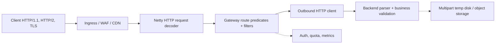
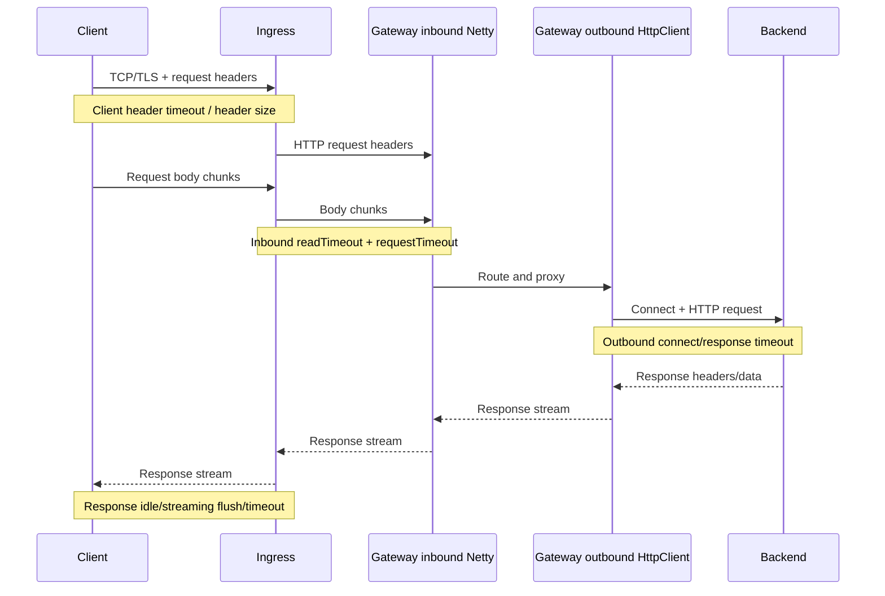
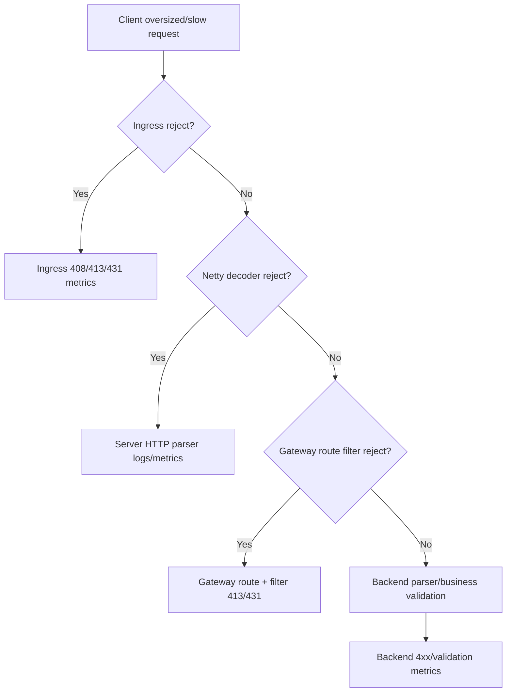
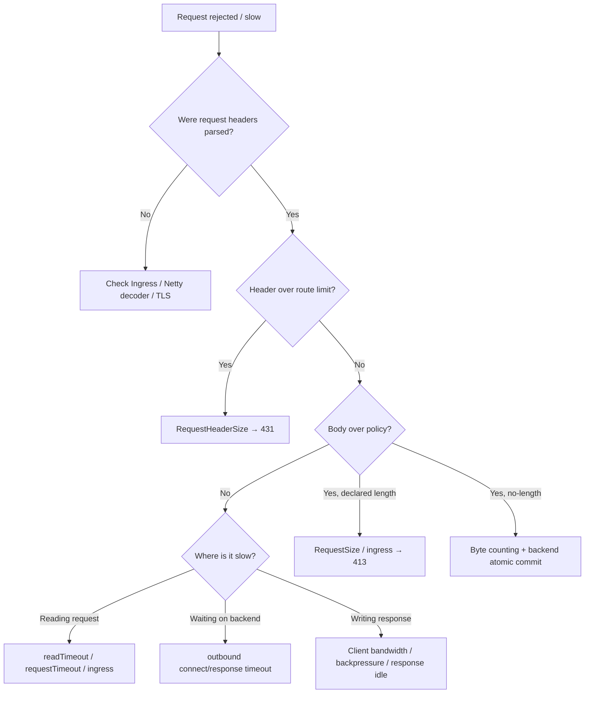

# Limiting Headers, Bodies, Multipart Payloads, and Read Timeouts in Spring Cloud Gateway

## 1. Why Are Input Limits Part of Security Hardening?

**Spring Cloud Gateway** serves as the entry point for microservices: routing via route predicates, executing filter chains, transforming paths/headers, performing service discovery, authenticating/authorizing, rate limiting, applying circuit breakers, retrying, terminating/initiating TLS, and observing requests. Even a Gateway with correctly configured routes can become overloaded if it **reads, buffers, or forwards data without bounds**.

Requests to guard against:

- An unusually long cookie/JWT/custom header or hundreds of headers; parsers/proxies/applications spend memory decoding them.
- URLs with huge query strings, abnormal request lines, or conflicting framing headers.
- HTTP POSTs declaring a huge `Content-Length`, or **omitting** total length and streaming the body.
- Multipart uploads with an oversized file, thousands of tiny parts, huge per-part headers, or temp files piling up on disk.
- Clients sending a few bytes every several seconds (**slow upload/slowloris**), holding connections open even when total body size stays small.
- Memory spikes from body caching in `Retry`, `CacheRequestBody`, or `ModifyRequestBody`: a few dozen requests can pin hundreds of MiB on heap/direct memory.
- Long-lived SSE/WebSocket responses; sharing timeouts with JSON APIs cuts them off prematurely, yet removing all timeouts lets dead connections linger indefinitely.

**Objective:** build a **defense-in-depth** policy limiting the right data types at the right moments without breaking legitimate streaming:

1. Limit HTTP header sizes, request lines, and header counts.
2. Limit **total request body size** for JSON, uploads, and streaming requests, even when `Content-Length` is absent.
3. Limit **multipart** details separately: part counts, headers per part, non-file memory, per-file size, and temporary disk usage.
4. Limit **request read time**: idle gaps between chunks and maximum duration to receive the full body.
5. Separate outbound connect/response timeouts from inbound read timeouts, and separate streaming routes from short-request routes.
6. Test failures at every layer and check **whether the backend received/committed data**, rather than inspecting client status alone.
7. Maintain TLS, authentication, resource quotas, safe logging, and operational metrics.

> **Scope and versions:** Examples prioritize **Spring Cloud Gateway Server WebFlux** (4.3+/5.x) running on Reactor Netty with Spring Boot 3.5 or 4.x. Gateway **Server Web MVC** uses Servlet/WebMvc.fn and Tomcat/Jetty parser/timeout limits that differ; comparisons are noted separately. The newer WebFlux Gateway prefix is `spring.cloud.gateway.server.webflux.*`, while older releases use `spring.cloud.gateway.*`.

## 2. Four Independent Limit Layers



| Layer | Appropriate limits | Does not replace |
|---|---|---|
| **Ingress/WAF** | Header bytes/count, URI, body bytes, header/body read time, connections | Business authorization; backend parser limits |
| **Reactor Netty HTTP server** | Request decoder, request line, header parse, read/request timeouts, idle connections | Gateway per-route content policies and outbound timeouts |
| **Gateway routes/filters** | `RequestHeaderSize`, `RequestSize`, authentication, RateLimiter, MIME/path checks | Unparsed headers; lengthless bodies if filter checks headers only |
| **WebFlux/Servlet Backend** | Multipart parts/memory/disk, file type, checksum, user quota, atomic commit | Protecting Gateway from traffic that already consumed earlier resources |

A request can be rejected **ahead of the Gateway filter chain**, such as an oversized request line blocked by the HTTP decoder. Conversely, a request with valid headers can still be rejected by a route's `RequestHeaderSize` if that route's policy is stricter.

### 2.1. Ordering Policies by Cost

```text
Block early (typically cheaper)
  1. Ingress / TLS / HTTP parser: headers, request line, framing, slow input
  2. Authentication / route policy / declared size
  3. Counting bytes as read + global concurrency/timeout budgets
  4. Multipart/JSON parsing with memory/disk caps
  5. Backend domain validation, file scanning, atomic commit
Block late (typically consumed more resources)
```

Not every policy can inspect everything before the backend sees the first byte. For streaming uploads, Gateway may already have forwarded part of the body when a byte limit is tripped. Backends must be designed **not to commit** files/transactions on incomplete requests, and must clean up when clients or proxies disconnect.

### 2.2. Which Data Matches Which Limit?

| Data | Unit and meaning | Example placement |
|---|---|---|
| HTTP request headers | Bytes per header or total field section depending on server | `server.max-http-request-header-size`, `RequestHeaderSize`, ingress |
| Request line / URI | Bytes/chars of method+target+protocol or URL path/query | Netty `httpRequestDecoder.maxInitialLineLength`, ingress |
| Total HTTP body | Total request bytes, **including multipart framing** | `RequestSize`, ingress body cap, streaming byte counting |
| JSON string/object | Bytes aggregated before deserialization | WebFlux codecs `max-in-memory-size` |
| Multipart text field | Memory consumed by a non-file part | WebFlux multipart `max-in-memory-size` |
| Multipart file part | Bytes per file, disk/temp budget | `max-disk-usage-per-part` and business rules |
| Multipart part headers | Bytes of Content-Disposition/Content-Type inside each part | `max-headers-size` |
| Multipart part count | Number of parts in a single request | `max-parts` |
| Idle gap without bytes | Silence interval between two request reads | Reactor Netty `readTimeout`/ingress client-body timeout |
| Total body read time | Total duration receiving request content | Reactor Netty `requestTimeout`/ingress total budget |

**Key point:** `256KB` for codecs **does not mean** every upload over 256 KiB is blocked; `max-in-memory-size` and `RequestSize` guard different boundaries.

## 3. Bootstrapping Gateway Server WebFlux on the Right Stack

### 3.1. Starters and Observability

```xml
<!-- pom.xml: compatible Spring Boot parent + Spring Cloud BOM versions -->
<dependency>
    <groupId>org.springframework.cloud</groupId>
    <artifactId>spring-cloud-starter-gateway-server-webflux</artifactId>
</dependency>
<dependency>
    <groupId>org.springframework.boot</groupId>
    <artifactId>spring-boot-starter-actuator</artifactId>
</dependency>
<dependency>
    <groupId>io.micrometer</groupId>
    <artifactId>micrometer-registry-prometheus</artifactId>
    <scope>runtime</scope>
</dependency>
```

`spring-boot-starter-actuator` and the Prometheus registry support health/metrics and are not required for routing itself. If the application uses Spring Security WebFlux resource server, add the OAuth2 resource server starter and configure issuer/audience/scope; never treat header limits as authentication.

### 3.2. Two Very Different Ways to Run Gateway

| Characteristic | **Server WebFlux** | **Server Web MVC** |
|---|---|---|
| Network/server | Reactor Netty by default on reactive stack | Servlet container (Tomcat/Jetty) |
| Gateway routing | `GatewayFilter`, `GlobalFilter`, `ServerWebExchange` | WebMvc.fn `HandlerFunctions.http()`, before/after filters |
| Inbound request read timeout | Reactor Netty `HttpServer`/Boot server properties | Container connectors, Servlet async/body parsing |
| Boot header limit | `server.max-http-request-header-size` (Netty semantics) | Same property, different Tomcat/Jetty semantics |
| Multipart | WebFlux multipart codec/`PartEvent` | Servlet multipart resolver/`spring.servlet.multipart.*` |
| Outbound HTTP | Reactor Netty `HttpClient` | `RestClient`/`ClientHttpRequestFactory` |

Do not put `server.tomcat.max-http-form-post-size` and `spring.servlet.multipart.max-file-size` into a **Server WebFlux Netty** Gateway assuming limits are enforced. Likewise, `spring.cloud.gateway.server.webflux.httpclient.response-timeout` is an **outbound timeout**, not an **inbound** HTTP request-body timeout.

## 4. Header Limits at the Server and Route Levels

### 4.1. Server-Level: Blocking at the HTTP Decoder

Spring Boot provides:

```yaml
# application.yml for Gateway running on Reactor Netty.
server:
  port: 8080
  max-http-request-header-size: 8KB
```

Spring Boot describes `server.max-http-request-header-size` as the request header size limit. **Exact semantics depend on the embedded server**: Boot docs note Netty enforces the limit **per header**, whereas Tomcat considers the **request line plus header names and values**. Reactor Netty's HTTP decoder also has `maxHeaderSize` and request-line limits; when deploying HTTP/1.1 vs HTTP/2, verify actual limits on your **running version**.

**Do not assume 8KB is always the total of all headers across every server.** If the organization requires a **total header field section cap** or header count limit, add policies at a suitable ingress/HTTP/2 proxy and test in practice.

### 4.2. Route-Level: `RequestHeaderSize`

Gateway WebFlux provides a dedicated filter:

```yaml
spring:
  cloud:
    gateway:
      server:
        webflux:
          routes:
            - id: orders-header-guard
              uri: http://localhost:8081
              predicates:
                - Path=/api/orders/**
              filters:
                - StripPrefix=1
                - RequestHeaderSize=4KB
```

Per the docs, `RequestHeaderSize` sums **key + value** bytes of **each request header**; if any header exceeds `maxSize`, the filter sets status **`431 Request Header Fields Too Large`** and may add an `errorMessage` header (name customizable). Using `4KB` here is **stricter** than the HTTP server's `8KB` limit.

Do not mistake this filter for a **combined byte cap across all headers** or a **header count cap**. It also runs only after the HTTP request **parses cleanly and matches a route**; if blocked earlier by the HTTP decoder, the status may differ from 431 or the connection may close.

### 4.3. Why Both Server Limits and Route Limits Are Needed

```text
Client sends one 20 KiB header
  -> Netty decoder with 8 KiB limit blocks before routing

Client sends one 6 KiB header, route requires 4 KiB
  -> Netty parses it, RequestHeaderSize rejects with 431

Client sends 100 headers × 1 KiB
  -> Each header is under the 4 KiB route policy
  -> Requires total header size and header count limits at ingress/server if needed
```

Overly tight limits can also block **legitimate JWTs/cookies**, especially browsers carrying many cookies. Measure the **legitimate header size distribution** in authorized environments (never logging raw tokens), then pick a threshold large enough for real traffic without leaving it unbounded.

### 4.4. Request Line, Query, and Header Count

Beyond header field bytes, constrain:

- `maxInitialLineLength`: oversized HTTP/1.x request lines, including path/query; Reactor Netty reference cites a default around **4096 bytes** in current lines, though verify your release.
- **Header count**: ingress/HTTP/2 header-list policies; many small fields still consume resources.
- **Cookie count and total cookie bytes**: never move identifiers or access tokens into query strings to evade cookie/header limits.
- Unbounded query parameters burn CPU in routers/apps/logs and database searches; cap parameter counts and query lengths per API contract.
- Keep header parsing validation enabled. **Never disable `validate-headers`** to "fix" a client sending malformed framing.

Example customizing **Netty's HTTP decoder in Spring Boot 4.x**:

```java
package com.example.gateway.security;

import org.springframework.boot.reactor.netty.NettyReactiveWebServerFactory;
import org.springframework.boot.web.server.WebServerFactoryCustomizer;
import org.springframework.context.annotation.Configuration;

@Configuration(proxyBeanMethods = false)
public class InboundDecoderLimits
        implements WebServerFactoryCustomizer<NettyReactiveWebServerFactory> {

    @Override
    public void customize(NettyReactiveWebServerFactory factory) {
        factory.addServerCustomizers(server ->
            server.httpRequestDecoder(spec -> spec
                .maxInitialLineLength(4096)
                .maxHeaderSize(8192)
                .validateHeaders(true)));
    }
}
```

**Use only when Netty must be customized beyond Boot properties**, and verify **Spring Boot 4.x packages/APIs**. In Boot 3.x, the factory class usually lives in `org.springframework.boot.web.embedded.netty.NettyReactiveWebServerFactory`. If setting both `server.max-http-request-header-size` and a customizer setting `maxHeaderSize`, **never configure conflicting values**; pick one authoritative source, check customizer ordering, and verify final wire behavior. HTTP/2 framing/header-list limits follow separate rules at proxies/TLS terminators; this customizer does not enforce one invariant across every protocol.

## 5. Header Hardening Goes Beyond Byte Limits

### 5.1. Headers to Inspect at the Trust Boundary

| Header/group | Risk if mishandled | Policy |
|---|---|---|
| `Authorization` | Oversized JWT or leaked into logs | Bound valid sizes, verify token, never log |
| `Cookie` | Huge header or excessive cookies | Cap size, `Secure`/`HttpOnly`/`SameSite`, never log |
| `Host` | Host routing to unexposed services | Allowlist Hosts/virtual hosts and route policies |
| `Forwarded`, `X-Forwarded-*` | Client spoofing IP/host/scheme to bypass ACLs/redirects | Trust only verified reverse proxies; strip/overwrite at edge |
| `X-User-Id`/`X-Tenant-Id` | Identity spoofing to read another tenant's resources | Never trust client; derive from verified principal or do not forward |
| `Content-Length`/`Transfer-Encoding` | Ambiguous body framing / request smuggling | Align parsers and proxies; reject conflicting/malformed framing |
| `Connection`, `TE`, `Upgrade` | Improper hop-by-hop header forwarding | Per HTTP version; strip hop-by-hop headers outside required upgrades |
| `Content-Encoding` | Tiny compressed payload expanding into huge content | Cap both compressed bytes and decompressed/parser bytes |

### 5.2. Header Size Limits Do Not Replace HTTP Protocol Validation

HTTP request smuggling arises when ingress, Gateway, and backend **interpret body boundaries differently**. The system must:

1. Run patched versions of ingress/Netty/Gateway.
2. Reject conflicting framing, invalid `Content-Length`, or `Transfer-Encoding` invalid for the HTTP version.
3. Normalize hop-by-hop headers, protocol upgrades, and HTTP/2 → HTTP/1 conversions at a trusted edge.
4. Test malformed cases in an **isolated environment** using authorized HTTP parser testers.
5. Never write a filter trying to "repair" malformed framing headers and forward them anyway.

Because header validation typically runs **before routing**, a custom `GatewayFilter` cannot substitute for HTTP parser hardening. Header-size limits also do not fix authorization, CSRF, CORS, or SSRF bugs when an app uses dynamic Hosts/URIs.

## 6. Total HTTP Body Limits: `RequestSize` and Easy-to-Miss Gaps

### 6.1. Route-Level Body Limit

Gateway WebFlux offers the `RequestSize` `GatewayFilter Factory`. Example route accepting only small uploads:

```yaml
spring:
  cloud:
    gateway:
      server:
        webflux:
          routes:
            - id: document-upload
              uri: http://localhost:8081
              predicates:
                - Path=/api/documents/upload
                - Method=POST
              filters:
                - StripPrefix=1
                - RequestHeaderSize=4KB
                - name: RequestSize
                  args:
                    maxSize: 1048576
```

`1048576` is **1 MiB in bytes**; explicit byte integers remove `MB`/`MiB` ambiguity in boundary tests. Per official docs, if the filter detects the request exceeds `maxSize`, it returns **413 Payload Too Large** and can attach an `errorMessage` header. When omitted, docs state the **filter's** default is 5 MB; that does not mean the filter is enabled automatically on **every route**.

**Do not misunderstand:** route `RequestSize` governs the total request body, not just the multipart `file` bytes; HTTP multipart framing and text fields count toward bytes too. The filter runs **after HTTP decoding/route selection**. A Gateway with multiple routes must ensure **every body-accepting route** carries its own policy or a global ingress cap.

### 6.2. `Content-Length`: Easy to Check, Yet Incomplete

HTTP/1.1 scenario:

```text
POST /api/documents/upload HTTP/1.1
Content-Type: application/octet-stream
Content-Length: 1200000

... 1,200,000 bytes ...
```

If the HTTP parser accepts valid headers and `Content-Length` exceeds the limit, Gateway can reject **before reading the full body**. Early rejection saves bandwidth, heap, and backend work. However:

- `Content-Length` is a **client declaration**, not proof of actual received bytes.
- HTTP/1.1 can send `Transfer-Encoding: chunked` **without declaring total length upfront**.
- HTTP/2 request bodies travel in **DATA frames**, with no mandatory `Content-Length`.
- Clients can send wrong or conflicting length/framing; HTTP decoders or proxies must reject per protocol rules.

Hence a test sending only a `Content-Length` body and observing 413 **does not prove every size bypass is closed**.

### 6.3. Reported Issue with Lengthless Requests

Public issue **spring-cloud-gateway#3843** (opened July 6, 2025) reported that in some versions, `RequestSize` relied solely on `Content-Length` and could let lengthless streaming bodies pass through. This is an **issue report**, not a claim that every current Gateway version is broken. Yet it demonstrates why you must test:

| Case | Header/actual body | What a safe system must achieve |
|---|---|---|
| Declared length below cap | `Content-Length: 1000` | Allow if authorized and MIME valid |
| Declared length above cap | `Content-Length: 1200000` | Reject ahead of backend per policy |
| No declared length | Chunked transfer, actual bytes > limit | Catch over-limit via a **byte-counting layer** |
| HTTP/2 without length | DATA frames > limit | Never treat no-length as unlimited |
| Declared length disagrees with reality | Abnormal EOF/extra bytes | HTTP parser/edge rejects malformed framing |
| Client aborts mid-body | Incomplete request | Backend never commits invalid data |

**Policy distinction:** "Every POST on `document-upload` is at most **1 MiB actual bytes**" differs from "When `Content-Length` exists, reject if over 1 MiB." Tests must prove the **first** statement, or documentation must clearly state which layer enforces byte counting.

### 6.4. Do Not Use `spring.http.codecs.max-in-memory-size` as a Total Body Limit

In Spring Boot 4.x:

```yaml
spring:
  http:
    codecs:
      max-in-memory-size: 256KB
```

In many Boot 3.x releases, the property name is `spring.codec.max-in-memory-size`. The codec property limits how many bytes may be **aggregated** to decode a single representation/object inside WebFlux server/auto-configured WebClient codecs. It **does not guarantee** a Gateway proxying **raw `Flux<DataBuffer>`** will automatically reject a 5 MiB body because of 256KB.

Examples:

- A controller `@RequestBody Mono<MyDto>` may buffer an entire JSON object, throwing `DataBufferLimitException` if it exceeds the codec limit.
- A controller `Flux<PartEvent>` streaming multipart uses a different mechanism; per-part data need not aggregate like a DTO.
- Gateway filters `CacheRequestBody(String.class)` or `ModifyRequestBody` trigger aggregation; constrain and test them on the exact pipeline.
- A Gateway route proxying raw bodies does not necessarily run a JSON decoder before forwarding.

**Do not rely on `DataBufferLimitException` as a catch-all status mapper for oversized requests:** default error mappings can differ from `413`. Build explicit error handling without leaking stack traces or internal details to clients.

## 7. Limiting Streaming Bodies Without Buffering Everything in Memory

### 7.1. Two Architectures with Different Security Goals

| Strategy | How it works | Pros | Trade-offs |
|---|---|---|---|
| **Pre-validate before sending to backend** | Receive entire body under quota into bounded memory/disk before forwarding | Backend **never sees** over-limit requests | Higher latency, memory/temp storage, restricts streaming |
| **Streaming count while proxying** | Count read bytes and cancel connection when threshold is crossed | Less buffering, suits large uploads under policy | Backend may have **already received partial bytes** before cutoff |
| **Ingress body cap + backend validation** | Block early; backend also counts bytes and commits atomically | Defense in depth, lowers Gateway load | Requires aligning policies across components |

A custom `GlobalFilter` counting bytes on `Flux<DataBuffer>` **cannot promise** the backend received zero bytes once the outbound stream has started. For mutations/uploads, backends must use **temporary staging**, checksums/atomic commits, and cleanup on cancellation; never treat a late HTTP 413 as rolling back a committed transaction.

### 7.2. Byte-Accounting Pseudocode

```text
PSEUDOCODE — expresses design requirements, NOT directly runnable Java:

maxRequestBytes = 1048576
principal = authenticateOrReject()
route = authorizeAndChooseRoute(principal, request)
if Content-Length is valid and > maxRequestBytes:
    reject(413) BEFORE proxy starts

actualBytes = 0
on each inbound DataBuffer:
    actualBytes += readableByteCount(buffer)
    if actualBytes > maxRequestBytes:
        cancel inbound publisher
        cancel/close outbound request if already started
        release owned DataBuffers / cleanup staging
        return 413 IF response headers are not committed
        otherwise close transport and record limit violation
    else:
        forward buffer without copying, respecting ownership/backpressure

backend MUST NOT commit partial upload before complete body+validation
```

Production requirements when implementing an actual custom filter:

1. Scope strictly by **route, method, and body scope**—never apply an arbitrary global cap blindly to all traffic.
2. Place the filter ahead of steps that might **cache/deserialize the full body**.
3. Never call `collectList()`/`DataBufferUtils.join()` on an unbounded stream.
4. Never spawn an independent `subscribe()` outside the request's reactive chain.
5. Preserve **single subscription**, cancellation, and backpressure; handle `doOnDiscard` and `DataBufferUtils.release` whenever the filter owns buffers.
6. Block oversized `Content-Length` requests **before forwarding**; still count actual bytes for lengthless/HTTP2 streams.
7. Enforce maximum duration/concurrency quotas to stop 1-byte/second clients.
8. If response/headers are already committed, do not try writing a 413 JSON body onto the stream.
9. Log metrics by **violation type/route**, never raw bodies or tokens.
10. Test chunked/HTTP2, mid-upload cancellation, large multiparts, retries, and upstream errors.

**Never paste an unverified "custom GlobalFilter from the Internet" as your default security control.** Where exact byte enforcement and atomic commits are compliance requirements, favor ingress/server controls proven by integration tests paired with backend validation.

### 7.3. Memory Budget of Caching Filters

Suppose a route allows a **4 MiB** body, enables `CacheRequestBody`, and handles **120 concurrent requests**:

\[
4\ \text{MiB/request} \times 120\ \text{requests}
 = 480\ \text{MiB}
\]

480 MiB covers **just one copy of the payloads**, before counting extra copies, header state, JWTs, Netty direct buffers, TLS, thread stacks, heap objects, and GC overhead. A container with `limits.memory:512Mi` can be `OOMKilled` with zero "business logic bugs" in any payload.

`Retry` on body-bearing requests may have to cache bodies for replay. `ModifyRequestBody`/`ModifyResponseBody` may decode/encode full representations. Avoid applying those filters globally to large uploads, SSE, or infinite NDJSON streams.

### 7.4. Request Quotas Differ from Rate Limits

A `RequestRateLimiter` token bucket limits **requests per second** per key; it does not limit **bytes per request**, **bytes per second**, **active uploads**, or open WebSocket/SSE streams. A user can send very few requests yet keep each connection open for minutes consuming RAM and disk.

Designs need at least four independent limits:

- `max-request-bytes`: maximum bytes per request?
- `max-request-read-duration`: maximum time to finish sending the body?
- `max-concurrent-uploads-per-principal`: how many concurrent uploads per user?
- `max-upload-byte-rate/tenant quota` (if needed): total data over time, typically at ingress/backend.

Distributed quotas across multiple Gateway pods may need Redis/central admission control; never rely on local in-memory counters when cluster-wide enforcement is required.

## 8. Multipart: Multiple Limits Inside One Request

### 8.1. Multipart Framing Has Multiple Parts

A multipart request contains more than just the file:

```http
POST /api/documents/upload HTTP/1.1
Content-Type: multipart/form-data; boundary=abc123

--abc123
Content-Disposition: form-data; name="description"

test document
--abc123
Content-Disposition: form-data; name="file"; filename="demo.pdf"
Content-Type: application/pdf

%PDF-1.7...
--abc123--
```

The HTTP request's `Content-Length` (if present) covers **boundaries, part headers, field bytes, and file bytes**. Therefore, a 1 MiB file makes the multipart request **larger than 1 MiB**. If business rules allow up to 1 MiB per file plus metadata, intentionally set the total request cap **higher**, paired with a **per-file cap** on the backend.

### 8.2. Spring Boot WebFlux Multipart Properties

On the **WebFlux backend that actually parses multipart**, configure:

```yaml
# application.yml of the WebFlux BACKEND receiving uploads.
spring:
  webflux:
    multipart:
      max-in-memory-size: 128KB
      max-disk-usage-per-part: 2MB
      max-headers-size: 4KB
      max-parts: 5
      file-storage-directory: /tmp/spring-multipart
```

| Property | What it protects | What it does NOT mean |
|---|---|---|
| `max-in-memory-size` | Memory for non-file parts and spill-to-disk threshold for file parts | Not a total body-size limit |
| `max-disk-usage-per-part` | Disk space per file part when parser spills to disk | Not a node-wide or full-request quota |
| `max-headers-size` | Header bytes **inside one multipart part** | Not the initial HTTP request headers |
| `max-parts` | Number of parts allowed in a request | Does not cap individual part sizes |
| `file-storage-directory` | Parser temp-part storage location | Not durable business file storage |

**Defaults change across Boot versions:** newer Boot docs specify more explicit defaults (e.g., `max-disk-usage-per-part` and `max-parts` are no longer unlimited by default in certain lines). Never rely on old `-1` defaults from tutorials assuming things are safe; set explicit budgets, verify startup binding, and test both memory and disk behavior.

### 8.3. Do Properties Set on Gateway Automatically Protect the Backend?

Not necessarily. If Gateway simply **proxies raw multipart bodies** via Reactor Netty without invoking `MultipartHttpMessageReader`, Gateway's `spring.webflux.multipart.*` may **never execute** during forwarding. The backend that actually parses multipart must enforce its own `spring.webflux.multipart.*` limits.

For layered protection:

1. Ingress caps total body bytes (including chunked).
2. Gateway applies `RequestSize`/byte-counting policy on upload routes.
3. Backend multipart parser caps parts/memory/disk.
4. Backend business logic validates true file types, file counts, ownership, checksums, quotas, and scans.
5. Temporary files are promoted to durable storage **only after completion and validation**.

If the backend is **Spring MVC/Servlet**, the properties are `spring.servlet.multipart.max-file-size`, `max-request-size`, `file-size-threshold`, and container/part-parser limits—**not** `spring.webflux.multipart.*`.

### 8.4. Multipart Streaming with `PartEvent`

Spring WebFlux supports streaming multipart handling via `Flux<PartEvent>`. With this approach, you must consume/release each part's `DataBuffer` and enforce stream byte counts/limits yourself. Boot docs note that `file-storage-directory` for parser-spilled file parts may **not apply** under `PartEvent` streaming.

Never assume default parser disk quotas still protect a stream your application consumes manually. When streaming, enforce yourself:

- File count/part count; max bytes per part; max aggregate bytes.
- Part header length, filename sanitization, and path traversal checks.
- Buffer ownership/cancellation if the client drops mid-stream.
- Atomic commits/temp cleanup and per-principal upload concurrency.

### 8.5. Temp Files Can Evict Pods Before Heap Fills

With 3 MiB/file uploads and 100 concurrent uploads, a parser spilling to temp disk can consume **300 MiB of temp disk** before copies. Account for Kubernetes `ephemeral-storage`, `emptyDir.sizeLimit`, and node `DiskPressure`. If using `emptyDir.medium: Memory` (tmpfs), temp pages also **count against cgroup memory**, potentially triggering OOM.

Never use client-supplied filenames directly in filesystem write paths. In production, generate server-side UUID/random object keys, use staging storage, enforce disk/size quotas, and run antivirus/MIME checks per business needs. Metadata like `filename` and `description` are untrusted input—never attach them as metric labels.

## 9. Limiting Request Read Time from Clients

### 9.1. Slowloris and Slow Uploads Differ from Slow Backends

Compare two requests:

```text
Case A — slow client:
Client --1 byte / several seconds--> Gateway --???--> Backend
                          ^ Gateway waiting for client to send more body

Case B — slow backend:
Client --body finished--> Gateway --request sent--> Backend
                                                      ^ Backend takes 20s
```

Case A requires **inbound read** and connection-lifetime limits. Case B requires **outbound response timeouts**, circuit breakers/bulkheads, and backend SLOs. Setting only `spring.cloud.gateway.server.webflux.httpclient.response-timeout` **does not** stop a slow client trickling a request body.

### 9.2. Three Inbound Timeouts on Reactor Netty `HttpServer`

| API | Definition per Reactor Netty docs | What it is NOT |
|---|---|---|
| `readTimeout(Duration)` | Maximum interval **between two network-level reads** while reading **request content** | Not an end-to-end business/backend deadline |
| `requestTimeout(Duration)` | Maximum total time allowed to read **request content** | Not total HTTP response time |
| `idleTimeout(Duration)` | Time an idle connection waits **between HTTP requests** | Does not replace request-body read timeouts |

**Crucial detail:** Reactor Netty docs note that the `readTimeout` handler is added **after full request headers are received** and removed once content reading finishes. Therefore, it **does not fully defend against slow-header attacks before headers complete**. Use `client_header_timeout` or an appropriate header-read deadline at ingress/transport.

A client steadily sending **one byte every 4 seconds** can **evade** `readTimeout=5s` yet still take minutes to finish. `requestTimeout=30s` caps total time spent receiving request content; both are needed because they defeat two distinct slow-client patterns.

### 9.3. Customizing Inbound `HttpServer` in Spring Boot

Example for **Spring Boot 4.x**:

```java
package com.example.gateway.security;

import java.time.Duration;

import org.springframework.boot.reactor.netty.NettyReactiveWebServerFactory;
import org.springframework.boot.web.server.WebServerFactoryCustomizer;
import org.springframework.context.annotation.Configuration;

@Configuration(proxyBeanMethods = false)
public class InboundReadTimeLimits
        implements WebServerFactoryCustomizer<NettyReactiveWebServerFactory> {

    @Override
    public void customize(NettyReactiveWebServerFactory factory) {
        factory.addServerCustomizers(server -> server
            .readTimeout(Duration.ofSeconds(5))
            .requestTimeout(Duration.ofSeconds(30))
            .idleTimeout(Duration.ofSeconds(30)));
    }
}
```

For **Spring Boot 3.x**, `NettyReactiveWebServerFactory` typically resides in `org.springframework.boot.web.embedded.netty.NettyReactiveWebServerFactory`, with `WebServerFactoryCustomizer` in the matching Boot package. Reactor Netty `HttpServer.readTimeout`/`requestTimeout` arrived in Reactor Netty 1.1.9; check your dependency train and Boot customizer ordering before applying.

**This configuration sets a server-wide inbound policy**, not an automatic per-route deadline. If legitimate video uploads take 10 minutes while JSON APIs are capped at 30 seconds, never apply `requestTimeout=30s` blindly to both. Consider separating upload domains/ingress/gateway deployments, uploading directly to object storage, or using verified per-route extension points.

### 9.4. Distinguishing Header Timeouts

`readTimeout` and `requestTimeout` in the snippet primarily govern **bodies** after headers. To curb slow-header attacks:

- Set a header completion deadline at Ingress (`client_header_timeout` in Nginx) and cap header/URI bytes.
- Reactor Netty applies HTTP decoder constraints during parsing with supported connection lifecycle timeouts, yet never assume `idleTimeout` covers trickled request headers.
- On TLS edges, configure a proper **TLS handshake timeout**; slow TLS handshakes also tie up resources pre-HTTP.
- Enforce connection quotas and rate limits at the edge rather than relying on sizes alone.

### 9.5. HTTP Status on Timeout

HTTP 408 is the semantic code for **request timeout**, yet **never hardcode** an expectation that every Netty timeout returns 408. Depending on timing/proxies/parsers, the stack may return 408, another 4xx, drop the TCP/TLS socket, or cause a client network error. Once response headers are committed, the server cannot change the status code.

Tests must record **who closed** (ingress/Gateway/backend/client), **elapsed time**, and **whether the backend had side effects**. On mid-upload disconnects, backends must delete staging files and never commit partial content.

## 10. Ingress/WAF: Block Early, Understand Buffering and Timeouts Properly

### 10.1. Reference Nginx Configuration

The snippet below is an **Nginx fragment inside a TLS server already configured with valid certs and upstreams**, not a standalone runnable `nginx.conf`:

```nginx
# Illustrates directives inside a managed server/location block.
server {
    listen 443 ssl;
    server_name api.test.example.test;

    # Read full headers within a bounded window.
    client_header_timeout 10s;
    client_header_buffer_size 1k;
    large_client_header_buffers 4 8k;

    # Cap request body where proxy can count bytes.
    client_max_body_size 2m;
    # Wait interval between body reads, NOT total upload deadline.
    client_body_timeout 10s;

    location /api/ {
        proxy_pass http://gateway_upstream;
        proxy_http_version 1.1;

        # Buffer body before forwarding: requires temp disk quota.
        proxy_request_buffering on;
        proxy_send_timeout 15s;
        proxy_read_timeout 60s;
    }
}
```

Read accurately:

- `client_max_body_size 2m` is an ingress **total HTTP request body** policy. Match units consistently and run boundary tests on real tooling; Nginx usually returns 413 when exceeded.
- `client_header_timeout 10s` requires headers to complete within the threshold; may return 408 for slow clients.
- `client_body_timeout 10s` is the gap **between two reads**; a client trickling tiny chunks can evade it—another layer still needs total duration/bandwidth quotas.
- `large_client_header_buffers 4 8k` governs large-header handling; **it does not guarantee the allowed total header section is exactly 32 KiB** across all protocols. Test many small headers and HTTP/2 too.
- `proxy_send_timeout` and `proxy_read_timeout` likewise govern I/O wait intervals between upstream operations, not a default total response deadline.
- `proxy_request_buffering on` buffers the body at ingress before forwarding, curbing partial uploads to backends while **increasing temp disk usage and latency**, requiring quotas/cleanup.

In Kubernetes Nginx Ingress Controller, equivalent limits are typically managed via **controller annotations/ConfigMaps**, not by editing `nginx.conf` inside Pods directly. Annotation names vary by controller type/version; consult docs for your **exact deployed controller** before applying.

### 10.2. Streaming Uploads and Proxy Buffering

With `proxy_request_buffering off`, ingress forwards request bodies **as a stream** to cut disk buffering and latency; backends may then receive partial bytes **before** discovering the upload exceeds quota. Pick a policy based on trade-offs:

| Goal | Typical fit | Must add |
|---|---|---|
| Never let backend see over-limit uploads | Bounded pre-buffering at ingress or staging layer | Temp storage quota, body timeout, scan/checksum |
| Large streaming uploads | Streaming forward or direct-to-object-storage | Byte-count cap, backpressure, backend atomic commit |
| Resumable uploads | Chunked protocol or object-store multipart API | Idempotent chunk IDs, size/type/auth quotas |
| Offload Gateway CPU/bandwidth | Direct-to-object-store with short-lived presigned credentials | Ownership, method/size/content validation |

**Never enable `proxy_request_buffering off` as a "security fix" just to make uploads faster.** It is a deliberate trade-off between ingress resources and letting backends receive partial data.

### 10.3. Separate SSE/WS onto Different Policies

SSE `GET` has a **long-lived response stream**, not a long request-body upload. At ingress, SSE routes typically need:

- `proxy_buffering off` for SSE responses (or equivalent policy).
- `proxy_read_timeout`/idle timeouts aligned with **heartbeats**; without heartbeats reaching clients, streams still get severed.
- Explicit **connection lifetime** or rotation/reconnect policies for auth/sessions.
- No response caching and no full-body rewrite filters.

WebSocket upgrades use an HTTP handshake followed by **WebSocket frames**. HTTP `client_max_body_size` **does not limit** individual WebSocket frames/messages; enforce separate frame size, message rate/active sessions, and queue/bandwidth limits. Never put WebSockets in a raw HTTP multipart filter chain assuming `RequestSize` caps frames.

### 10.4. Multi-Hop Configs Easily Conflict

```text
Client -> CDN max 10MB -> Ingress max 2MB -> Gateway max 1MiB
                                             -> Backend max 1MiB/file
```

A 900 KiB file plus multipart framing can pass if total body stays under Gateway's cap; an exact 1 MiB file hitting the **per-file** limit may fail Gateway because total multipart exceeds 1 MiB. This is a policy choice to document for clients, not a surprise bug.

Set **per-file limits clearly below total-request limits with explicit headroom**; document both in API specs. For multi-file uploads, account for total file/part counts and business quotas rather than vague "1 MB upload" wording.

## 11. Outbound Gateway Timeouts Differ Completely from Client Read Times

### 11.1. Configuring Reactor Netty HTTP Client for Standard API Routes

```yaml
# application.yml — Gateway Server WebFlux, applies to HTTP outbound calls.
spring:
  cloud:
    gateway:
      server:
        webflux:
          httpclient:
            connect-timeout: 2000
            response-timeout: 10s
            pool:
              type: fixed
              max-connections: 200
              acquire-timeout: 1000
```

- `connect-timeout: 2000`: **milliseconds** for outbound TCP connect to the backend; does not measure slow client body uploads.
- `response-timeout: 10s`: outbound response timeout per Reactor Netty/SCG semantics; not a hard wall-clock deadline for every long download.
- `max-connections`/`acquire-timeout`: manage the **outbound** connection pool when using a `fixed` pool; do not cap inbound WebSocket/SSE sessions or active uploads.

Never raise outbound timeouts to "fix" slowloris. A request can stall for minutes in the **inbound read phase** before the backend is ever contacted.

### 11.2. SSE Routes May Need a Different Response Timeout

```yaml
spring:
  cloud:
    gateway:
      server:
        webflux:
          streaming-media-types:
            - text/event-stream
          routes:
            - id: notifications-sse
              uri: http://localhost:8082
              predicates:
                - Path=/api/notifications/stream
                - Method=GET
              filters:
                - StripPrefix=1
              metadata:
                response-timeout: -1
```

In Gateway WebFlux, `metadata.response-timeout: -1` is the documented example to **disable the global response timeout for this route**. It **does not** override ingress/CDN/firewall idle timeouts, extend JWT/session lifetimes indefinitely, or disable body-read timeouts on other HTTP requests.

WebSocket routes use `ws://`/`wss://`, and do not govern WebSocket frame lifetimes via `httpclient.response-timeout` like ordinary HTTP GETs.

### 11.3. Retries, Circuit Breakers, and Absolute Deadlines

If a backend takes 8 seconds to process, `connect-timeout=2s` does nothing once TCP connects. A `Retry` filter with three attempts, each waiting several seconds, can breach API end-to-end SLAs without a **retry budget**, circuit breaker/bulkhead, and client deadline.

In particular, retrying `POST`/multipart requests can resend bodies, inflate caching memory, and trigger duplicate side effects if the backend committed before a lost response. Never retry mutations solely on 5xx without an idempotency contract.

### 11.4. Timeout Summary by Direction



From the diagram: **server read timeouts** and **HTTP client response timeouts** measure completely different legs. Never collapse everything into a single `"gateway.timeout=30s"` knob without specifying the stage.

## 12. Consolidated Configuration for an Experimental Gateway

### 12.1. Four Routes with Distinct Quotas

Complete example for **Spring Cloud Gateway Server WebFlux** and **Spring Boot 4.x** (adjust backend URIs per environment):

```yaml
# application.yml — local/test profile, no secrets.
server:
  port: 8080
  max-http-request-header-size: 8KB

spring:
  http:
    codecs:
      max-in-memory-size: 256KB
  cloud:
    gateway:
      server:
        webflux:
          default-filters:
            - RequestHeaderSize=4KB
          httpclient:
            connect-timeout: 2000
            response-timeout: 10s
          streaming-media-types:
            - text/event-stream
          metrics:
            enabled: true
            path-tags:
              enabled: false
          routes:
            - id: orders-read
              uri: http://localhost:8081
              predicates:
                - Path=/api/orders/**
                - Method=GET
              filters:
                - StripPrefix=1

            - id: documents-raw
              uri: http://localhost:8081
              predicates:
                - Path=/api/documents/raw
                - Method=POST
              filters:
                - StripPrefix=1
                - name: RequestSize
                  args:
                    maxSize: 1048576  # 1 MiB total body

            - id: documents-multipart
              uri: http://localhost:8081
              predicates:
                - Path=/api/documents/upload
                - Method=POST
              filters:
                - StripPrefix=1
                - name: RequestSize
                  args:
                    maxSize: 2097152  # 2 MiB total multipart body

            - id: events-stream
              uri: http://localhost:8081
              predicates:
                - Path=/api/events/stream
                - Method=GET
              filters:
                - StripPrefix=1
              metadata:
                response-timeout: -1

management:
  endpoints:
    web:
      exposure:
        include: health,info,metrics
```

**Meaning and limits of this example:**

- `default-filters` applies `RequestHeaderSize=4KB` to **every matched route**, not to requests blocked earlier by Netty's decoder or missing routes.
- `documents-raw` has a 1 MiB total HTTP body **policy**; test lengthless/chunked transfers to confirm full byte-counting enforcement.
- `documents-multipart` has a 2 MiB total HTTP body policy; the backend still needs its own **per-file cap**, e.g., 1 MiB/file and at most three files.
- `events-stream` is an HTTP SSE GET route, not WebSocket; `response-timeout: -1` does not remove request/header timeouts at ingress.
- `spring.http.codecs.max-in-memory-size` is **Boot 4.x**. For Boot 3.x, check `spring.codec.max-in-memory-size` and config metadata.
- `server.max-http-request-header-size` is an embedded server limit whose semantics follow Netty; it **does not** replace route `RequestHeaderSize` or HTTP/2 header-list policies at ingress.
- `management.endpoints.web.exposure` only exposes endpoints; secure Actuator with a private network and Spring Security/identity, never leaving it publicly exposed.

**Snippets in earlier sections were standalone illustrations.** When using this consolidated config, never paste duplicate route IDs into other `application.yml` files or Java DSL builders to avoid non-deterministic route selection.

### 12.2. Backend Multipart Needs Its Own Config

The demo backend (running on `localhost:8081`) needs:

```yaml
# application.yml of the WebFlux 4.x/Boot 4.x BACKEND (not Gateway).
server:
  port: 8081
spring:
  webflux:
    multipart:
      max-in-memory-size: 128KB
      max-disk-usage-per-part: 2MB
      max-headers-size: 4KB
      max-parts: 5
      file-storage-directory: /tmp/spring-multipart
```

If placed solely on Gateway when Gateway does not parse multipart, the backend **never inherits** these quotas. Create temp directories with non-root permissions and proper `emptyDir`/filesystem quotas in containers.

### 12.3. Four Requirements Two Filters Alone Cannot Satisfy

`RequestHeaderSize` + `RequestSize` **do not fully solve**:

1. Total **header count** or all HTTP/2 header-list scenarios.
2. Bodies lacking `Content-Length` in `RequestSize` versions that inspect only headers.
3. Total **request-content read duration**, read gaps, and slow headers.
4. Backend multipart per-file caps, quotas, scanning, and atomic commits.

You need ingress HTTP parser policies, Netty `readTimeout`/`requestTimeout`, and backend validation. Confirm each layer's responsibility **via testing**, not property names alone.

## 13. Demo Backend to Verify Actual Request Bytes

### 13.1. WebFlux Backend Consuming Raw Bytes Without Full Aggregation

To tell whether a request was blocked by Gateway or reached the backend, use a separate test backend with `spring-boot-starter-webflux`.

```java
package com.example.documentdemo;

import java.util.Map;
import org.springframework.core.io.buffer.DataBufferUtils;
import org.springframework.http.MediaType;
import org.springframework.web.bind.annotation.PostMapping;
import org.springframework.web.bind.annotation.RequestBody;
import org.springframework.web.bind.annotation.RestController;
import reactor.core.publisher.Flux;
import reactor.core.publisher.Mono;
import org.springframework.core.io.buffer.DataBuffer;

@RestController
public class RawUploadProbeController {

    @PostMapping(path = "/documents/raw",
                 consumes = MediaType.APPLICATION_OCTET_STREAM_VALUE)
    public Mono<Map<String, Long>> raw(
            @RequestBody Flux<DataBuffer> body) {
        return body.map(buffer -> {
                try {
                    return (long) buffer.readableByteCount();
                } finally {
                    // Release only when handler owns and has consumed the buffer.
                    DataBufferUtils.release(buffer);
                }
            })
            .reduce(0L, Long::sum)
            .map(n -> Map.of("receivedBytes", n));
    }
}
```

This demo handler **counts consumed bytes** and returns JSON without saving files or enforcing total byte limits itself. It is **not a safe production backend**: add business size/cancellation/storage quotas. If no response arrives because Gateway aborted mid-request, the test harness should track a **resettable server-side counter** or redacted metadata logs to tell if the backend started receiving bytes.

### 13.2. Backend Receiving Multipart and Counting File Bytes

```java
package com.example.documentdemo;

import java.util.Map;
import org.springframework.core.io.buffer.DataBufferUtils;
import org.springframework.http.MediaType;
import org.springframework.http.codec.multipart.FilePart;
import org.springframework.web.bind.annotation.PostMapping;
import org.springframework.web.bind.annotation.RequestPart;
import org.springframework.web.bind.annotation.RestController;
import reactor.core.publisher.Mono;

@RestController
public class MultipartProbeController {

    @PostMapping(path = "/documents/upload",
                 consumes = MediaType.MULTIPART_FORM_DATA_VALUE)
    public Mono<Map<String, Object>> upload(
            @RequestPart("file") FilePart file,
            @RequestPart("description") String description) {

        return file.content()
            .map(buffer -> {
                try {
                    return (long) buffer.readableByteCount();
                } finally {
                    DataBufferUtils.release(buffer);
                }
            })
            .reduce(0L, Long::sum)
            .map(bytes -> Map.of(
                "fileName", file.filename(),
                "description", description,
                "receivedBytes", bytes));
    }
}
```

This shows the file part arrived and how many bytes it held. **Never** use `file.filename()` directly for file writes, and never log sensitive payloads. Matching `receivedBytes` **does not prove contents weren't altered**; verify SHA-256 on raw bytes at client and backend when needed. The multipart decoder may write temp files **before the controller is called**, so enforce parser/temp-directory quotas independently.

### 13.3. Test SSE Endpoint for Checking Timeout Classification

```java
package com.example.documentdemo;

import java.time.Duration;
import org.springframework.http.MediaType;
import org.springframework.http.codec.ServerSentEvent;
import org.springframework.web.bind.annotation.GetMapping;
import org.springframework.web.bind.annotation.RestController;
import reactor.core.publisher.Flux;

@RestController
public class EventProbeController {

    @GetMapping(path = "/events/stream",
                produces = MediaType.TEXT_EVENT_STREAM_VALUE)
    public Flux<ServerSentEvent<String>> stream() {
        return Flux.interval(Duration.ofSeconds(1))
            .map(i -> ServerSentEvent.<String>builder()
                .id(Long.toString(i + 1))
                .event("tick")
                .data("test-" + (i + 1))
                .build());
    }
}
```

Here, event IDs start **from 1 per subscription** with no durable replay. It solely verifies **HTTP response streaming is not severed by the 10s outbound timeout** of other routes. For multi-user live notifications, add authentication, durable cursors, retry/backpressure handling, and active connection quotas.

## 14. Manual Practice: Headers, Bodies, Multipart, and Read Time

The commands below are strictly for **personal machines, test containers, or approved sandbox clusters**. Never send malformed/oversized/slowloris requests to production APIs or third-party systems. Use synthetic content only, keep payloads under 2 MiB, and delete temp files afterward.

### 14.1. Baseline Check Through the Right Route

```bash
# Demo backend must run on :8081, Gateway on :8080.
curl -i http://localhost:8080/api/orders/42

# Small raw body compatible with backend /documents/raw.
printf 'hello' | curl -i \
  -X POST \
  -H 'Content-Type: application/octet-stream' \
  --data-binary @- \
  http://localhost:8080/api/documents/raw
```

If `/api/orders/42` returns 404 because the demo backend lacks an `/orders/42` handler, that is a **demo route/backend setup issue**, not a header policy error. To test header policy, use the existing `/api/documents/raw` upload endpoint.

### 14.2. One Header Under Limit and One Over Limit

```bash
# Header under the route's 4 KiB limit.
curl -i -X POST \
  -H 'X-Training-Padding: short' \
  -H 'Content-Type: application/octet-stream' \
  --data-binary 'hello' \
  http://localhost:8080/api/documents/raw

# Generate ~5,000 test characters: larger than 4 KiB yet under Netty's 8 KiB.
PAD=$(printf 'x%.0s' $(seq 1 5000))
curl -i -X POST \
  -H "X-Training-Padding: $PAD" \
  -H 'Content-Type: application/octet-stream' \
  --data-binary 'hello' \
  http://localhost:8080/api/documents/raw
```

Expected for the second call: `RequestHeaderSize=4KB` **catches the violation and returns 431** once Netty parses the request; the backend never handles it. Actual header bytes include the **header name**, not just the 5000 `x` chars. If you get 400 or a connection reset, check whether the **ingress/Netty decoder** blocked it ahead of the Gateway route.

Do not generate megabyte headers to test; small thresholds prove policy with small payloads. **Never paste real JWTs/Cookies into shells or history.**

### 14.3. Request Body Below and Above 1 MiB with Declared Length

```bash
# Create synthetic 100,000-byte and 1,200,000-byte binary files.
head -c 100000 /dev/zero > /tmp/gw-body-ok.bin
head -c 1200000 /dev/zero > /tmp/gw-body-too-large.bin

curl -i -X POST \
  -H 'Content-Type: application/octet-stream' \
  --data-binary @/tmp/gw-body-ok.bin \
  http://localhost:8080/api/documents/raw

curl -i -v -X POST \
  -H 'Content-Type: application/octet-stream' \
  --data-binary @/tmp/gw-body-too-large.bin \
  http://localhost:8080/api/documents/raw
```

For regular files, `curl` typically computes `Content-Length`. Inspect `-v` to confirm actual wire headers before concluding. For bodies exceeding 1 MiB, Gateway `RequestSize` should return **413**, and the backend counter must not increment on early rejections.

### 14.4. Raw Chunked Body Without `Content-Length`

To test the **streaming path** rather than a pre-declared length:

```bash
# Example curl reading stdin from pipe, sending streaming POST; sandbox only.
head -c 1200000 /dev/zero |
  curl --http1.1 -i -v \
    -X POST \
    -T - \
    -H 'Content-Type: application/octet-stream' \
    http://localhost:8080/api/documents/raw
```

**Mandatory check on `-v` trace:** did the client actually send `Transfer-Encoding: chunked` and **no `Content-Length`**? Curl versions or proxies can alter framing; this command tests "no-length" only if confirmed on the wire.

Security criterion: when actual bytes > 1 MiB, **a byte-counting layer must stop the request**, and the backend must never **commit** policy-violating data. If the current Gateway `RequestSize` only checks `Content-Length` and forwards the body anyway, that is an **enforcement architecture FAIL** requiring ingress/backend support—never change expected status to 200 to turn the test green.

### 14.5. HTTP/2 Without Total Body Length

```bash
# Only when TLS sandbox hostname and HTTP/2-capable curl build exist.
curl --http2 -v -i \
  -X POST \
  -H 'Content-Type: application/octet-stream' \
  --data-binary @/tmp/gw-body-too-large.bin \
  https://api.test.example.test/api/documents/raw
```

`--http2` does not guarantee a **Content-Length–free** request: `curl` may attach length when file size is known. To test **HTTP/2 DATA frames without declared length**, use an HTTP/2 streaming client/test harness and verify ALPN/protocol and actual headers at ingress. Never conclude you tested all no-length cases from `curl --http2` alone.

### 14.6. Small Multipart, Over-Total Limit, and Over Per-File Cap

```bash
head -c 64000 /dev/zero > /tmp/gw-file-small.bin
head -c 1900000 /dev/zero > /tmp/gw-file-large.bin

# Under 2 MiB total request: backend returns receivedBytes=64000.
curl -i \
  -F 'description=small-test' \
  -F 'file=@/tmp/gw-file-small.bin;filename=small.bin' \
  http://localhost:8080/api/documents/upload

# Near 2 MiB; inspect total multipart bytes + headers/boundary.
curl -i \
  -F 'description=large-test' \
  -F 'file=@/tmp/gw-file-large.bin;filename=large.bin' \
  http://localhost:8080/api/documents/upload
```

With a 1.9 MB file, the total request may **still fit under** Gateway's 2 MiB cap, and the backend parser's `max-disk-usage-per-part=2MB` may also allow it. If business policy allows only **1 MiB/file**, the backend must reject by **file bytes** itself—do not expect Gateway `RequestSize` to block a request under **total** 2 MiB. This proves **total vs per-file caps** differ.

To trigger a Gateway 413 on multipart, use a file clearly pushing the total request **above 2 MiB while staying within sandbox budgets**:

```bash
head -c 2200000 /dev/zero > /tmp/gw-file-over-total.bin
curl -i \
  -F 'description=over-total' \
  -F 'file=@/tmp/gw-file-over-total.bin;filename=over.bin' \
  http://localhost:8080/api/documents/upload
```

This should be rejected at Gateway/ingress when size is detected; **never** rely on 413 alone—verify the backend/temporary storage never commits oversized files.

### 14.7. Malformed Multipart and Part Counts

A handcrafted multipart header missing `boundary` should be rejected by the backend parser:

```bash
curl -i -X POST \
  -H 'Content-Type: multipart/form-data' \
  --data-binary 'not-a-valid-multipart-message' \
  http://localhost:8080/api/documents/upload
```

The response may be `400`/`415` depending on decoder/HTTP client error handling. Proper rejection, zero file writes, and temp resource cleanup are the core requirements. When using `curl -F`, **never set `Content-Type: multipart/form-data` manually**, as `curl` must append the boundary.

Testing `max-parts:5` should send 6 **small** parts with a valid test client. Do not generate thousands of parts; one over the cap suffices. The backend parser must actually parse multipart for that setting to take effect.

### 14.8. Slow Bodies Must Measure **Timing**, Not Just Errors

```bash
# Client sends 40 KiB synthetic payload slowly, sandbox only.
head -c 40960 /dev/zero > /tmp/gw-body-slow.bin

curl -i --http1.1 -v \
  --limit-rate 1k \
  --max-time 45 \
  -X POST \
  -H 'Content-Type: application/octet-stream' \
  --data-binary @/tmp/gw-body-slow.bin \
  http://localhost:8080/api/documents/raw
```

If inbound `requestTimeout=30s` is active, the body takes ~40s at ~1KiB/s, exceeding the 30s budget. The actual outcome may be a timeout/error/disconnect, **not necessarily 408**. Measure:

- Actual upload byte rate and headers to ensure the test hits the right direction.
- Elapsed time from headers received until request cancellation.
- Whether Gateway/backend clean up connections and buffers.
- That the backend **never commits** incomplete bodies.

To test `readTimeout=5s`, use a client/harness capable of **pausing completely** mid-body for >5 seconds, not `--limit-rate` trickling steady bytes. Run controlled pause fixtures in a sandbox; never run slowloris against production.

### 14.9. Testing SSE Is Not Cut Off by the Wrong Timeout

```bash
curl -i -N --max-time 20 \
  -H 'Accept: text/event-stream' \
  http://localhost:8080/api/events/stream
```

With `-1` response timeout on the SSE route, events should stream incrementally from the backend rather than buffering until the end. `--max-time 20` makes the **client intentionally terminate** the infinite demo stream, and `curl` may exit with code 28; that does not indicate a Gateway bug. Compare backend/Gateway/ingress directly if chunks batch up or unexpected timeouts occur.

### 14.10. Cleaning Up Synthetic Files After Practice

```bash
rm -f /tmp/gw-body-ok.bin /tmp/gw-body-too-large.bin \
  /tmp/gw-file-small.bin /tmp/gw-file-large.bin \
  /tmp/gw-file-over-total.bin /tmp/gw-body-slow.bin
```

Delete **only the exact fixtures you created** on the sandbox machine. Never use broad wildcards or wipe temp directories belonging to other services.

## 15. Automated Testing and PASS/FAIL Criteria

### 15.1. Why Use a Real Gateway Instead of Mock Filters Alone?

`WebTestClient.bindToController(...)` tests backend parsers/validation, yet skips real HTTP decoders, route filters, and Netty proxying. To prove **server header limits**, `RequestHeaderSize`, `RequestSize`, and backend side effects, test through a **real Gateway HTTP port** backed by a separate backend:

```text
JUnit / curl HTTP client
      |
      v
Gateway :8080 (Netty parser + Gateway filters)
      |
      v
Backend :8081 (counters, multipart parser, bytes)
```

A mock controller "400" test does not prove Netty rejected malformed headers. Likewise, a Gateway "413" does not prove the backend never wrote part of the upload.

### 15.2. JUnit Test for Route Header Policy 431

The snippet below assumes Gateway/backend are already running in a sandbox per sections 12–13:

```java
package com.example.gatewaytest.it;

import java.time.Duration;
import org.junit.jupiter.api.Test;
import org.springframework.http.HttpStatus;
import org.springframework.http.MediaType;
import org.springframework.test.web.reactive.server.WebTestClient;

class HeaderHardeningIT {

    private final WebTestClient client = WebTestClient.bindToServer()
        .baseUrl("http://localhost:8080")
        .responseTimeout(Duration.ofSeconds(8))
        .build();

    @Test
    void rejectsSingleHeaderLargerThanRouteLimit() {
        client.post()
            .uri("/api/documents/raw")
            .header("X-Training-Padding", "x".repeat(5000))
            .contentType(MediaType.APPLICATION_OCTET_STREAM)
            .bodyValue(new byte[] {1, 2, 3})
            .exchange()
            .expectStatus()
            .isEqualTo(HttpStatus.REQUEST_HEADER_FIELDS_TOO_LARGE);
    }
}
```

This test assumes Boot/Netty **parses the 5000-byte header** under the 8KB server limit before Gateway `RequestHeaderSize=4KB` rejects it. If ingress or Netty's decoder blocks earlier, write a separate **decoder rejection test** rather than turning the suite green by accepting any status. For route policy tests, hit the **Gateway sandbox directly** and verify the backend was never invoked via a reset counter.

### 15.3. Testing Oversized Declared Request Body

```java
package com.example.gatewaytest.it;

import java.time.Duration;
import org.junit.jupiter.api.Test;
import org.springframework.http.HttpHeaders;
import org.springframework.http.HttpStatus;
import org.springframework.http.MediaType;
import org.springframework.test.web.reactive.server.WebTestClient;

class BodySizeIT {

    @Test
    void rejectsDeclaredLengthOverOneMiB() {
        byte[] payload = new byte[1_200_000];

        WebTestClient client = WebTestClient.bindToServer()
            .baseUrl("http://localhost:8080")
            .responseTimeout(Duration.ofSeconds(10))
            .build();

        client.post()
            .uri("/api/documents/raw")
            .contentType(MediaType.APPLICATION_OCTET_STREAM)
            .header(HttpHeaders.CONTENT_LENGTH,
                    Integer.toString(payload.length))
            .bodyValue(payload)
            .exchange()
            .expectStatus()
            .isEqualTo(HttpStatus.PAYLOAD_TOO_LARGE);
    }
}
```

**Verification requirement:** confirm the HTTP client actually sends `Content-Length: 1200000` without converting to chunked or conflicting headers using wire-level test fixtures. Beyond status 413, the backend test counter must **not increment** and zero files may be committed.

### 15.4. Testing Small Multipart with Exact Part Names

```java
package com.example.gatewaytest.it;

import java.time.Duration;
import org.junit.jupiter.api.Test;
import org.springframework.core.io.ByteArrayResource;
import org.springframework.http.MediaType;
import org.springframework.http.client.MultipartBodyBuilder;
import org.springframework.test.web.reactive.server.WebTestClient;
import org.springframework.web.reactive.function.BodyInserters;

class MultipartHardeningIT {

    @Test
    void forwardsSmallFileWithinDeclaredLimits() {
        byte[] fileBytes = new byte[64_000];
        ByteArrayResource file = new ByteArrayResource(fileBytes) {
            @Override
            public String getFilename() {
                return "fixture.bin";
            }
        };

        MultipartBodyBuilder parts = new MultipartBodyBuilder();
        parts.part("description", "safe-fixture");
        parts.part("file", file)
             .contentType(MediaType.APPLICATION_OCTET_STREAM);

        WebTestClient.bindToServer()
            .baseUrl("http://localhost:8080")
            .responseTimeout(Duration.ofSeconds(10))
            .build()
            .post()
            .uri("/api/documents/upload")
            .contentType(MediaType.MULTIPART_FORM_DATA)
            .body(BodyInserters.fromMultipartData(parts.build()))
            .exchange()
            .expectStatus().isOk()
            .expectBody()
            .jsonPath("$.fileName").isEqualTo("fixture.bin")
            .jsonPath("$.receivedBytes").isEqualTo(64000);
    }
}
```

This is a **small correctness test**, not a disk-exhaustion or multipart-parser abuse test. Write separate tests for 6 parts against `max-parts:5`, oversized part headers, missing `file`, malformed boundaries, and cancellation; inspect temp files and backend side effects.

### 15.5. Chunked/HTTP2 No-Length Tests Must Truly Omit the Header

`WebTestClient.bodyValue(byte[])` can usually compute length, so **never** cite section 15.3 as proving no-length bodies are blocked. Use:

- An HTTP/1.1 streaming client sending `Transfer-Encoding: chunked`, confirming **no `Content-Length`** arrives at Gateway.
- An HTTP/2 test fixture emitting DATA frames without declared length; verify ALPN and HTTP version at ingress.
- Backend test counter/atomic commit assertions, not response status alone.
- Mid-stream client cancellation, plus bodies exceeding the tested layer's limit by exactly one byte.

Test clients sending slow or truncated bodies should run with overall test-runner deadlines and strict byte/concurrency bounds. If a `RequestSize` version fails to block no-length streams, keep the regression test **red** until another byte-counting layer enforces the real policy.

### 15.6. Testing Read Gaps and Total Request Duration

**Two distinct tests:**

```text
Test A — read gap:
  send headers + 100 bytes of body
  pause completely for > 5s
  expect connection/request termination per readTimeout policy

Test B — slow continuous:
  send steadily at 1 KiB/sec
  total body requires > 30s
  expect requestTimeout termination per policy
```

Verify timestamps from body start to termination and resource cleanup. **Do not require status 408** if the implementation closes the socket before writing an HTTP response. For Test B, increasing `readTimeout` does not replace a total body deadline.

### 15.7. CI Acceptance Matrix

| Category | Test PASSES when |
|---|---|
| Headers within limit | Server parses, route matches, backend receives exact request |
| Header above route limit | Gateway returns 431 (once parser accepted), backend untouched |
| Header above server limit | Decoder/ingress rejects early, no route/backend execution |
| Many small headers | Aggregate/header-count edge limit holds within memory budget |
| Declared body above limit | 413 per RequestSize/ingress, backend commits nothing |
| No-length/chunked above limit | **Byte counting enforced**, backend commits no out-of-policy data |
| Valid multipart | Exact `file`/`description`, byte count/checksum, zero temp leaks |
| Excessive multipart parts | Parser rejects per `max-parts`, no OOM/disk exhaustion |
| Slow gap | `readTimeout`/ingress closes request and cleans up |
| Slow continuous | `requestTimeout`/absolute deadline aborts within budget |
| Valid SSE | Not cut off by short JSON HTTP timeout; events flush live |
| Missing auth permissions | 401/403 before backend commit, no resource leakage |
| Incident response | Metrics/logs distinguish ingress/Gateway/backend; zero logged secrets |

Every PR does not need complex raw malformed-HTTP suites, yet run them in a **preproduction sandbox** whenever upgrading ingress, Netty, Spring Boot, or Gateway versions.

## 16. Security and Observability on Rejected Requests

### 16.1. Status Codes by Layer

| HTTP status / outcome | Likely cause | Do not infer |
|---|---|---|
| **400 Bad Request** | HTTP decoder/header framing/malformed multipart | Does not mean body was too large |
| **401 Unauthorized** | Missing/invalid authentication | Does not prove body size was safe |
| **403 Forbidden** | Principal lacks permission, Origin policy | Not an HTTP request-size limit |
| **408 Request Timeout** | Ingress/server timeout before request finished in some cases | Not guaranteed for every Netty timeout |
| **413 Payload Too Large** | Total body limit/ingress/RequestSize/decoder | Does not prove backend saw zero partial bytes |
| **414 URI Too Long** | Long request target rejected at server/ingress | Does not replace header-size policy |
| **415 Unsupported Media Type** | Backend cannot parse MIME/content type | Not always a multipart size error |
| **429 Too Many Requests** | Rate limiter/throttling quota | Does not cap bytes per request |
| **431 Request Header Fields Too Large** | Route RequestHeaderSize or matching HTTP layer | Cannot tell which parser blocked without logs |
| **502/503/504** | Upstream connect/read timeout, no instance, breaker/fallback | Never infer client uploaded too slowly |
| **Connection close/reset** | Timeout/parser/proxy/client abort, response committed | Cannot turn every close into a JSON status |

**Error formatting:** keep messages brief without exposing internal route URIs, backend topology, stack traces, tokens, or PII-bearing multipart filenames. For `431`/`413`, `application/problem+json` Problem Details work well when a valid response can still be written, yet never try writing JSON onto a closed socket or committed headers.

### 16.2. Security Still Must Be Verified Before Processing Sensitive Data

- JWT/OAuth2 Resource Server: validate **issuer, signature, audience, scope, and resource ownership**.
- Cookies/sessions: `Secure`, `HttpOnly`, `SameSite`, and appropriate CSRF policies.
- Ingress TLS and Gateway→backend TLS/mTLS: protect **both legs independently**.
- Never trust client-sent `X-User-Id`/`X-Tenant-Id`; strip/overwrite from trusted identity.
- Multipart: validate extensions/MIME **beyond client-supplied filename and Content-Type**; scan/block forbidden file types.
- Stop decompression bombs by capping **uncompressed size** at the component performing decompression, not compressed `Content-Length` alone.
- Direct-to-backend access needs NetworkPolicies/firewalls and backend auth; never treat Gateway as the sole security perimeter.

An upload with `Content-Encoding: gzip` that looks small on the wire can expand hugely upon decompression. If Gateway counts only **compressed bytes**, the backend must **cap decompressed bytes** and validate—never raise codec memory limits indefinitely "to support all files."

### 16.3. Metrics Must Distinguish Where Rejections Occurred



Not every request blocked by ingress/Netty/Spring Security ahead of routing appears under `spring.cloud.gateway.requests` with a `routeId`. Track across layers:

1. Ingress WAF/request-size/rejection counters.
2. Netty HTTP request decoder errors and active connections.
3. Gateway 4xx/5xx metrics by **stable route ID**, never raw paths or user IDs.
4. Backend parser limits/validation rejections, staged bytes, and atomic commits.
5. Container heap/direct memory, GC, temp disk, open sockets, and resource pressure.
6. Slow request durations and client disconnect rates (without logging raw payloads).

### 16.4. Never Log in a Way That Exposes What You Protect

Avoid:

```text
WARN request rejected: Authorization=Bearer eyJ...
WARN upload too large: rawBody=[...binary...]
WARN invalid multipart: filename=/home/alice/private/...
```

Use instead:

```text
WARN ingress_reject reason=body_limit route_class=upload status=413
WARN gateway_reject reason=header_limit route_id=documents-raw status=431
WARN backend_validation reason=too_many_parts status=400
```

Never put `userId`, `clientIp`, raw `path`, multipart filenames, JWTs, or trace IDs into **Micrometer time-series tags**. To investigate a specific request, use access-controlled, redacted traces/logs; metric tags must stay bounded in cardinality.

### 16.5. Limits Must Be Measured from Legitimate Traffic

For real headers/cookies, collect **size distributions** using low-cardinality histogram buckets or aggregated stats without logging sensitive values. If legitimate SSO JWTs/cookies routinely reach 5 KiB, a 4 KiB route policy will cause false positives. From there you can:

1. Trim cookie count/length and token claims where feasible.
2. Move session state server-side instead of oversized cookies.
3. Design allowlists and budgets per API/route group.
4. Align ingress and Netty decoder limits to close bypasses.
5. Test with real TLS/HTTP2 and header compression.

Never raise limits to hundreds of KiB merely for one unclassified failure; first diagnose the root cause and measure legitimate p99 header sizes.

## 17. Resource-Limit Troubleshooting Matrix

| Symptom | Possible cause | Investigate before changing |
|---|---|---|
| 5 KiB header returns 400 instead of 431 | HTTP parser/ingress rejected ahead of filter | Hit Gateway sandbox directly; inspect Netty decoder/ingress logs and real limits |
| >4 KiB header still passes Gateway | Wrong route, `RequestHeaderSize` missing, header count/size misunderstood | Actuator routes/filters on live instance, wire bytes |
| 100 small headers spike memory despite each <4 KiB | Per-header limit differs from total header-section/count | Edge aggregate header count/list-size, proxy HTTP/2 policy |
| Valid JWT gets 431 | Token/cookie exceeds route policy | Measure aggregated header byte distribution; trim tokens/cookies before raising cap |
| Huge URL/query returns 414/400 | Request-line/URI limit at decoder/ingress | `maxInitialLineLength`/HTTP2 pseudo-headers and API URI design |
| 413 on an "exact 1 MB" file | Multipart boundary/headers/text fields push total body above file size | Compare full `Content-Length` against per-file size |
| 413 on declared-length request | `RequestSize`/ingress cap | Check matched route, rejecting component, backend received bytes |
| No 413 on large chunked body | Filter checked `Content-Length` only or byte-counting layer missing | Test real `Transfer-Encoding: chunked`, inspect backend commits |
| Over-limit HTTP/2 upload reaches backend | Lengthless DATA frames or cap missing at H2 terminator | ALPN, ingress enforcement, Netty/request filters, backend |
| Small body throws `DataBufferLimitException` | Per-object JSON/codec aggregation > memory cap | Verify `max-in-memory-size`, avoid full aggregation |
| Large file upload causes `OOMKilled` | CacheRequestBody/Retry/ModifyBody, unbounded queues | Heap/direct memory, bytes × concurrency, stop caching |
| Many-part multipart not blocked | `spring.webflux.multipart.max-parts` set on wrong service or parser unused | Check backend config binding/parser/`PartEvent` path |
| Multipart fails with disk full | Temp directory/`emptyDir` full, missing disk usage limit | File storage, ephemeral metrics, cleanup, and pod eviction |
| Backend receives empty file | A filter already consumed body or body rewrite broke | Compare direct backend vs Gateway, single-subscription, and checksum |
| Backend committed despite client getting 413 | Over-limit detected after partial forward; early backend commit | Block pre-proxy or stage/atomic-commit on backend |
| Slow client stays open despite `readTimeout=5s` | Client sends within every 5s window, or timeout not enforced | Add total `requestTimeout` and verify runtime customizer |
| Client pauses after headers without timeout | Only `idleTimeout` set, no body `readTimeout` | Check lifecycle and when request headers completed |
| Trickled headers evade `readTimeout` | Netty `readTimeout` starts only after headers complete | Ingress `client_header_timeout`/TLS handshake timeout |
| Valid 10-minute upload severed at 30s | Server-wide `requestTimeout=30s` applies to every body | Split upload route/deployment with dedicated upload budget |
| Backend slow 20s, raising inbound `readTimeout` has no effect | Request already sent; waiting on outbound response | `httpclient.response-timeout`, backend tracing/CB |
| SSE drops after 10s | Short API global outbound response timeout | SSE route metadata `response-timeout: -1`, ingress idle/heartbeat |
| Large WebSocket frame bypasses `RequestSize` | HTTP upgrade switched to WebSocket frames | Separate WebSocket max frame/message/connection quotas |
| Weird multipart Content-Type returns 415 | Backend decoder rejects media type | Check MIME/`boundary`; do not raise request-size cap |
| Proxy returns 408, Gateway has no route metric | Ingress timed out before reaching Gateway | Ingress logs/metrics; verify originating layer |
| Route metrics miss 400/431 | Parser/Security rejected ahead of route chain | Add server/ingress metrics; never guess route tags |
| Body-size test green, production fails | CI used Content-Length, production uses chunked/H2 | Add transport-specific regression tests |
| Header sizes grow after SSO rollout | Cookie bloat / JWT claim growth | Review auth config, max sizes, and browser cookie policies |

### 17.1. Six-Step Procedure for 413/431/408

1. **Record the protocol:** HTTP/1.1 or HTTP/2? Where does TLS terminate? Are ingress/CDN/mesh in front?
2. **Identify the rejecting layer:** ingress, Netty decoder, Gateway route filter, or backend parser?
3. **Measure the exact quantity:** per-header vs total header section bytes, declared vs actual body bytes, per-file vs total multipart, read gap vs total duration.
4. **Verify side effects:** did the backend receive/write partial payloads? Were temp files/buffers cleaned up after cancellation?
5. **Fix policy at the right layer:** edge cap, Netty parser, route filter, multipart parser, backend quota; never tweak every knob simultaneously.
6. **Add regression tests:** declared/no-length, HTTP1/H2, bounded slow reads, and auth; measure memory/latency afterward.

### 17.2. Quick Decision Flow



## 18. Pre-Production Hardening Checklist

### 18.1. Headers and HTTP Protocol

- [ ] Defined both **total header policy** and **per-header policy** across ingress, HTTP/1.1/HTTP2, and runtime.
- [ ] Configured `server.max-http-request-header-size` for Netty and tested on a real Gateway port.
- [ ] Applied `RequestHeaderSize` to protected routes; tested 431 once parser accepts request.
- [ ] Capped request line/URI/query and header counts at edge where supported.
- [ ] Kept HTTP header validation enabled, stripped hop-by-hop headers, and resolved CL/TE ambiguities per protocol.
- [ ] Trusted Host/Forwarded/X-Forwarded solely from verified proxies; never trusted client identity headers.
- [ ] Confirmed valid JWTs/cookies are not falsely blocked; zero raw credentials logged.

### 18.2. Bodies and Multipart

- [ ] Configured **total body size policy** for every body-receiving route, not just response/codec sizes.
- [ ] Tested **valid `Content-Length`, missing length, and HTTP/2 no-length**.
- [ ] If `RequestSize` relies on headers in the active version, enforced another **byte-counting layer** with regression tests.
- [ ] Defined **per-file cap**, part counts, part-header-size, and memory/disk budgets on the backend parser.
- [ ] Distinguished Boot 4 `spring.http.codecs.*` from Boot 3 `spring.codec.*` and verified config binding.
- [ ] Avoided unconditional caching of large multiparts/uploads in `Retry`/`CacheRequestBody`/`ModifyBody`.
- [ ] Backend never commits partial uploads; uses staging, checksums, scanning, cleanup, and idempotency as needed.
- [ ] Temporary disk, `emptyDir`, per-tenant storage quotas, and lifecycles managed.
- [ ] Client-sent filenames/MIME types never trusted; raw filenames never concatenated into filesystem paths.

### 18.3. Read Timeouts and Connection Quotas

- [ ] Distinguished **header read timeout**, **body read gap**, **total body duration**, and **idle keep-alive**.
- [ ] Tested `readTimeout` and `requestTimeout` on the **inbound Reactor Netty server**.
- [ ] Never confused outbound `httpclient.connect-timeout`/`response-timeout` with inbound reads.
- [ ] Configured concurrency/connection limits per route/principal with headroom for long-lived streams.
- [ ] SSE/WS configured with dedicated timeouts/heartbeats/lifetimes and matching reconnect/replay contracts.
- [ ] Measured CPU, memory, direct buffers, temp disk, and active sockets under slow consumers.
- [ ] Slow-client regressions run strictly in **sandboxes with bounded bytes/concurrency/duration**.

### 18.4. Security and Operations

- [ ] Authentication/authorization enforced at Gateway **and** backend per trust boundary.
- [ ] TLS enforced on every leg; request compression/decompression sizes controlled.
- [ ] Ingress/WAF and Gateway parsers/filters share consistent policies without parser ambiguity.
- [ ] 400/408/413/431/429 observed at their exact **originating layer** without exposing request contents.
- [ ] Actuator/Prometheus kept private; metric tags bounded and free of PII/tokens.
- [ ] Alerts configured for parser errors, ingress rejections, body overlimits, read timeouts, 5xx, and OOM/temp disk.
- [ ] Version/config rollback runbooks and tests proving **backends never commit forbidden payloads** exist.

## 19. Self-Practice Questions and Answers

**Q1 — Header vs body.** Does `server.max-http-request-header-size: 8KB` block a 50 MB body?

**Answer:** No. That property limits request headers on the embedded server, not total HTTP bodies. Use separate body-size policies and backend limits.

**Q2 — Route headers.** What status does `RequestHeaderSize=4KB` return when a header exceeds the limit after Netty parsed the request?

**Answer:** Gateway docs describe **431 Request Header Fields Too Large**; parsers/ingress blocking earlier may produce different status codes or connection closes.

**Q3 — One hundred small headers.** Each header is 1 KiB and the route sets `RequestHeaderSize=4KB`. Does that guarantee total headers stay under 4 KiB?

**Answer:** No. `RequestHeaderSize` checks **each header** (key + value); enforce total header-section size and header count at the HTTP server/ingress if required.

**Q4 — Netty vs Tomcat.** Does `server.max-http-request-header-size` have identical byte semantics across all embedded servers?

**Answer:** No. Spring Boot notes differences—for example, Netty checks per header while Tomcat evaluates the request line plus all headers combined; test on your exact runtime.

**Q5 — Long URI.** A client sends a 100 KiB query string. Does enabling `RequestHeaderSize` alone block the oversized request line early?

**Answer:** Not necessarily. You need request-line/URI limits in the HTTP decoder/ingress; route filters execute after parsing.

**Q6 — Size by header.** `Content-Length: 1200000` exceeds `RequestSize.maxSize=1048576`. Can it be rejected before reading the full body?

**Answer:** Yes, when the filter/ingress sees a valid declared length; assert that the backend never receives rejected requests per policy.

**Q7 — No-length.** If an HTTP/2 upload lacks `Content-Length`, is a `RequestSize` test returning 413 on HTTP/1.1 with length enough to prove safety?

**Answer:** No. Test lengthless HTTP/2 DATA frames or HTTP/1.1 chunked streams, and add a byte-level cap if the filter checks headers only.

**Q8 — Multipart total.** A 1 MiB file on a route with exactly a 1 MiB total body cap—will it surely pass?

**Answer:** No. Multipart requests add boundaries, part headers, and fields; total bytes > file bytes.

**Q9 — Codec cap.** Does `spring.http.codecs.max-in-memory-size:256KB` make a raw-proxying Gateway automatically reject any 300 KB upload?

**Answer:** No. It guards codec aggregation, not raw streaming proxy total request-body sizes.

**Q10 — Non-file vs file part.** Does `max-in-memory-size:128KB` guarantee a 1 MiB file is rejected?

**Answer:** No. File parts can spill to disk above the threshold. Set `max-disk-usage-per-part`/per-file business caps and temp storage quotas.

**Q11 — Where is the parser?** Gateway proxies multipart raw; the backend parses it. Is setting `spring.webflux.multipart.max-parts:5` on Gateway alone enough?

**Answer:** No. If Gateway does not parse multipart, that setting may never execute; configure and test it on the backend that actually parses.

**Q12 — PartEvent.** Does using `Flux<PartEvent>` guarantee every file goes to disk and all `DataBuffer`s release automatically?

**Answer:** No. Streaming parsers follow a different lifecycle; the application must consume/release buffers, count bytes/parts, and clean up.

**Q13 — Read gap.** A client sends 1 byte every 4 seconds with `readTimeout=5s`. Is the request guaranteed to abort?

**Answer:** No. The gap between reads stays under 5 seconds; add `requestTimeout`/an absolute body deadline to cap drawn-out requests.

**Q14 — Header slowloris.** Does `HttpServer.readTimeout=5s` protect against all slow-header requests before headers complete?

**Answer:** No. Reactor Netty applies read timeouts to request **content after headers**; ingress header-read deadlines and TLS limits require separate policies.

**Q15 — Outbound timeout.** The backend takes 20 seconds after the client finished sending the body. Will raising inbound `requestTimeout` fix it?

**Answer:** No. That waits on the outbound backend response; inspect HTTP client response timeouts, circuit breakers/bulkheads, and backend SLOs.

**Q16 — Response streaming.** An SSE GET emits an event every second for an hour. Should you raise the global response timeout for all JSON routes to an hour?

**Answer:** No. Use a dedicated SSE route with suitable timeouts/heartbeats so short requests stay bounded and queues never grow unbounded.

**Q17 — Counting after forwarding.** Gateway detects an over-quota upload after forwarding 800 KiB and cuts it off. Can you guarantee the backend saw zero bytes?

**Answer:** No. The backend may have seen a partial body. Use pre-validation/staging with atomic commits and cancellation cleanup.

**Q18 — Compressed requests.** A 100 KiB gzip body decompresses to 100 MiB. Is checking `Content-Length` of 100 KiB sufficient?

**Answer:** No. Whichever component decompresses/parses must cap **decompressed bytes**, object sizes, and CPU/memory budgets.

**Q19 — HTTP status.** A too-slow request gets its TCP connection closed by Netty without an HTTP 408. Is that automatically a security test FAIL?

**Answer:** No. The contract may be **closing the connection** before sending a response; what matters is that the timeout fired, zero resources leaked, and the backend committed no partial data.

**Q20 — Testing the right layer.** Ingress returns 413, yet `spring.cloud.gateway.requests` does not increment. Is that abnormal?

**Answer:** Not necessarily. Ingress rejected the request before it ever reached Gateway; monitor ingress metrics alongside Gateway route timers.

**Q21 — RequestRateLimiter.** Does allowing 5 requests/second stop a user from sending a 2 GB POST?

**Answer:** No. RPS limits do not replace **bytes/request**, total upload duration, concurrent requests, or byte-rate quotas.

**Q22 — Production policy.** What is the most important step after changing header/body/timeout settings?

**Answer:** Run regression tests over the **real path** (ingress→Gateway→backend) with HTTP1/H2, declared/no-length, and multipart/slow requests; inspect statuses, backend side effects, and resource usage, then monitor production metrics with a rollback plan ready.

## 20. Official References and Verification Sources

- [Spring Cloud Gateway Server WebFlux – RequestHeaderSize](https://docs.spring.io/spring-cloud-gateway/reference/spring-cloud-gateway-server-webflux/gatewayfilter-factories/requestheadersize-factory.html): `maxSize`, per-header key+value size, and HTTP 431.
- [Spring Cloud Gateway Server WebFlux – RequestSize](https://docs.spring.io/spring-cloud-gateway/reference/spring-cloud-gateway-server-webflux/gatewayfilter-factories/requestsize-factory.html): `DataSize`, `maxSize`, HTTP 413, and `errorMessage`.
- [Spring Cloud Gateway Server WebFlux – HTTP Timeouts](https://docs.spring.io/spring-cloud-gateway/reference/spring-cloud-gateway-server-webflux/http-timeouts-configuration.html): outbound connect/response timeouts and per-route metadata.
- [Spring Cloud Gateway Server WebFlux – CacheRequestBody](https://docs.spring.io/spring-cloud-gateway/reference/spring-cloud-gateway-server-webflux/gatewayfilter-factories/cacherequestbody-factory.html): request body caching and memory impact.
- [Spring Cloud Gateway Server WebFlux – Retry](https://docs.spring.io/spring-cloud-gateway/reference/spring-cloud-gateway-server-webflux/gatewayfilter-factories/retry-factory.html): request body caching when retrying POSTs and memory risks.
- [Spring Cloud Gateway Server WebFlux – Configuration Properties](https://docs.spring.io/spring-cloud-gateway/reference/configprops.html): prefixes, Netty HTTP client, metrics, and filters.
- [Spring Boot – Common Application Properties](https://docs.spring.io/spring-boot/appendix/application-properties/): `server.max-http-request-header-size`, `spring.http.codecs.max-in-memory-size`, `spring.webflux.multipart.*`, and server properties.
- [Spring Boot – Reactive Web Applications](https://docs.spring.io/spring-boot/reference/web/reactive.html): `NettyReactiveWebServerFactory`, `WebServerFactoryCustomizer`, and Netty-specific HTTP server tuning.
- [Reactor Netty – HTTP Server Reference](https://projectreactor.io/docs/netty/release/reference/http-server.html): HTTP decoder, `readTimeout`, `requestTimeout`, and `idleTimeout`.
- [Reactor Netty – HttpServer Javadoc](https://projectreactor.io/docs/netty/release/api/reactor/netty/http/server/HttpServer.html): exact timeout lifecycle for request content.
- [Spring Framework – WebFlux Reactive Core/Codecs](https://docs.spring.io/spring-framework/reference/web/webflux/reactive-spring.html): aggregation/`maxInMemorySize`/multipart buffering.
- [Spring Framework – Multipart Content](https://docs.spring.io/spring-framework/reference/web/webflux/controller/ann-methods/multipart-forms.html): `FilePart`/`PartEvent` and content handling.
- [Nginx – ngx_http_core_module](https://nginx.org/en/docs/http/ngx_http_core_module.html): `client_header_timeout`, `client_body_timeout`, `client_max_body_size`, and header buffers.
- [Nginx – ngx_http_proxy_module](https://nginx.org/en/docs/http/ngx_http_proxy_module.html): `proxy_request_buffering`, `proxy_read_timeout`, `proxy_send_timeout`.
- [Spring Cloud Gateway issue #3843](https://github.com/spring-cloud/spring-cloud-gateway/issues/3843): report regarding `RequestSize` when clients omit `Content-Length`; **basis for adding regression tests, not proof all versions remain unfixed**.
- [OWASP – File Upload Cheat Sheet](https://cheatsheetseries.owasp.org/cheatsheets/File_Upload_Cheat_Sheet.html): validation, file limits, file types, storage, and scanning as needed.
- [OWASP – HTTP Security Response Headers](https://cheatsheetseries.owasp.org/cheatsheets/HTTP_Headers_Cheat_Sheet.html): proper header policies and avoiding sensitive data leaks.

**Remember:** Hardening Spring Cloud Gateway never means setting a single `RequestSize`. Protect **HTTP headers/parsers at ingress and Netty**, cap **actual body bytes including chunked/HTTP2 without `Content-Length`**, enforce **per-part/memory/disk multipart limits** on the component that actually parses, and set **request read-gap + total-read deadlines** separate from outbound backend timeouts. For streaming and uploads, account for **partial forwarding/atomic commits**, avoid unbounded body caching, test each layer directly, and monitor 400/408/413/431/429 without logging secrets. Only when test suites prove zero bypasses, zero resource leaks, and zero unauthorized commits is the API Gateway ready for safe operation.
