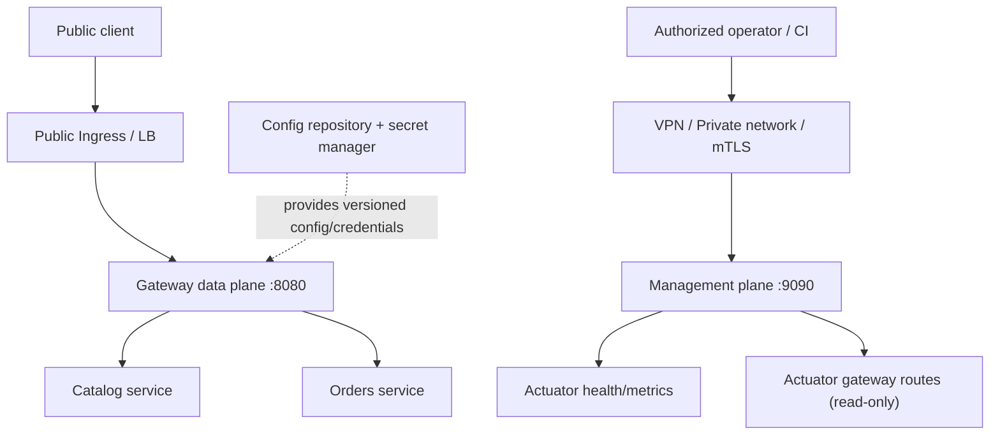
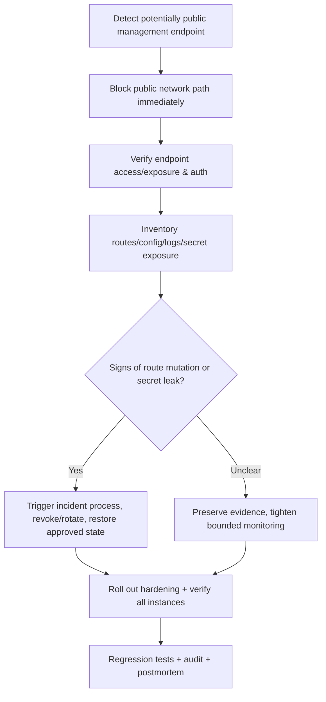

# Never Expose Writable Actuator Endpoints or Sensitive Configuration Data

## 1. Goal: Keep Gateway Manageable Without Turning the Operations Port into a Backdoor

**Spring Cloud Gateway** serves as the microservices entry point: it evaluates route predicates, runs filter chains, transforms paths and headers, discovers services, enforces authentication, rate limiting, circuit breakers, retries, TLS, and request observability. Alongside the business-traffic port, a Gateway running **Spring Boot Actuator** can expose additional APIs for operations.

These APIs are genuinely helpful: `health` reports readiness; `metrics`/`prometheus` supply telemetry; `gateway/routes` lets operators inspect loaded routes. Yet if misconfigured, that same HTTP port can allow unauthorized callers to **create new routes, delete routes, refresh route caches, change logging levels, read configuration details, or download sensitive data**.

Hypothetical scenario: a public application exposes `/api/catalog/**`. A deployer copies a debug configuration:

```yaml
management:
  endpoint:
    gateway:
      access: unrestricted
  endpoints:
    web:
      exposure:
        include: "*"
```

Without proper authentication, authorization, and network restrictions, this configuration can put numerous administrative tools on the HTTP listener. A single malicious route edit can divert requests/credentials to an untrusted backend, hijack URL namespaces, or take down multiple APIs. **TLS alone does not replace authorization**: HTTPS protects bytes in transit; it does not prove the caller is authorized to administer the Gateway.

### Learning Outcomes

After this lesson, you will be able to:

1. Distinguish **Actuator endpoint access**, **HTTP/JMX exposure**, **Spring Security authorization**, and **network reachability**.
2. Set the `gateway` endpoint to `none` or `read-only`, never granting route create/delete/refresh permissions on the public plane.
3. Explain why `/env`, `/configprops`, `/heapdump`, `/logfile`, `/mappings`, and even `GET /gateway/routes` can be sensitive.
4. Design a **public traffic plane** separated from a **private management plane**, covering network ports, TLS/mTLS, ServiceAccounts/OAuth2, RBAC, and auditing.
5. Write Spring Boot 4 / Gateway Server WebFlux 5 configurations that expose only genuinely required observability endpoints.
6. Establish a safe WebFlux `SecurityWebFilterChain` policy when the application defines custom Spring Security rules.
7. Use `curl` and integration tests to prove unauthorized users **cannot perform admin actions** or read sensitive configurations.
8. Follow an incident response runbook if a management endpoint is discovered to have been exposed.

> **Scope:** **Spring Cloud Gateway Server WebFlux 5.0.x**, **Spring Boot 4.x**, reactive Spring Security. Gateway Server Web MVC has a similar Actuator model yet uses Servlet `SecurityFilterChain`; never paste `SecurityWebFilterChain` directly into MVC. Hostnames, accounts, tokens, routes, and statuses in this lesson use **synthetic data**. This lesson covers defensive practices and testing strictly on authorized environments.

## 2. Threat Model: Why Is Actuator a Special Attack Surface?

### 2.1. Business Port and Control Port Do Not Share the Same Trust Boundary



The **data plane** receives HTTP requests from browsers, mobile apps, and service clients, whereas the **management plane** is meant for probes, metrics collectors, and operators. Never treat two endpoints living inside one Spring Boot process as a reason to share **public accessibility**.

### 2.2. Assets at Risk

| Asset | If management API is exposed | Impact |
|---|---|---|
| Route definitions | Creating routes to unapproved URIs; altering filters/order | Traffic hijacking, outages, data leaks |
| Route cache | Refreshing while config is unstable | Routing failures or wider blast radius |
| Logging config | Raising level to DEBUG/TRACE at runtime | CPU/I/O overhead; leaking tokens/headers/payloads if loggers print them |
| Environment/configuration | Reading property names, sources/origins, or values if sanitization disabled | Exposes topology, credentials, or operational data |
| Heap/thread dumps | Memory snapshots and execution contexts | May contain tokens, private data, and system internals |
| Metrics/HTTP exchanges | URIs, tags, endpoints, latency, traffic metadata | Reconnaissance, PII/cardinality risks |
| Shutdown/management operations | Stopping or altering application state | Availability loss, costly recovery |
| Kubernetes/Cloud credentials | Credentials leaked via logs, env, or dumps | Unauthorized access to systems beyond Gateway |

Even read-only APIs carry risk. For instance, `GET /actuator/gateway/routes` reveals backend URIs, route predicates, and GatewayFilter descriptions; an `AddRequestHeader` containing a sensitive literal can surface in diagnostics. **Never store secrets in route definitions** and rely solely on disabling GET Actuator.

### 2.3. Four Incident Categories to Distinguish

- **Unauthenticated exposure:** the Internet can invoke management endpoints without any identity.
- **Overly broad authorization:** every logged-in user is permitted to inspect environment/routes or perform writes.
- **Unsafe configuration changes:** endpoints are network-locked, yet an authorized operator/automation pushes a bad/SSRF route due to missing policy review.
- **Indirect data leakage:** `/env` values are sanitized, yet secrets leak through logging, exceptions, Actuator `heapdump`, or metric labels.

Therefore defense in depth is required: **least capability**, **least exposure**, **identity/RBAC**, **network isolation**, **secret minimization**, **auditing**, and **verification**.

## 3. Four-Layer Actuator Protection Model in Spring Boot 4

### 3.1. Layer A — Endpoint *Access*: Is the Capability Enabled at All?

Spring Boot 4 supports:

```yaml
management:
  endpoints:
    access:
      default: none
      max-permitted: read-only
  endpoint:
    health:
      access: read-only
    info:
      access: read-only
```

Meaning:

- `management.endpoints.access.default: none` enforces **deny-by-default**; any endpoint not opted in is **unavailable**.
- `management.endpoint.<id>.access: read-only` opts in strictly the read portion of a specific endpoint.
- `management.endpoints.access.max-permitted: read-only` sets an application-wide **capability ceiling**, taking precedence over per-endpoint settings. It blocks write operations even if another config accidentally asks for `unrestricted`.

In Spring Boot 4, the key values are `none`, `read-only`, and `unrestricted`. Boot docs state most endpoints default to `unrestricted` access **except special endpoints like `shutdown` and `heapdump`**, yet they **do not automatically appear over HTTP** merely because access permits them. Gateway Actuator has its own default: **`gateway` access is disabled unless explicitly enabled**.

**Distinction:** `read-only` does not mean every GET is harmless. `GET /env` can reveal configuration metadata; `read-only` only removes **write** capability, not data classification concerns.

### 3.2. Layer B — *Exposure*: Is the Endpoint Mapped to HTTP/JMX?

```yaml
management:
  endpoints:
    web:
      exposure:
        include: "health,info"
    jmx:
      exposure:
        exclude: "*"
```

Spring Boot exposes only `health` over HTTP (and JMX) by default. `include` is an allowlist of endpoint IDs, **not an access-permission list**. `exclude` removes an endpoint even if listed in `include`. Wildcard `"*"` must be quoted in YAML; **never use `include: "*"` in production** just for observability convenience.

**Do not infer:** setting `management.endpoint.gateway.access=read-only` does not automatically make `GET /actuator/gateway/routes` reachable. You must also include `gateway` in `management.endpoints.web.exposure.include` and satisfy authentication/network policies.

### 3.3. Layer C — *Authorization*: Who May Read or Administer?

Whenever Actuator is reachable over HTTP, enforce:

- **Authentication:** verified identity (OIDC/OAuth2 JWT, mTLS, workload identity, or enterprise-approved mechanism).
- **Authorization:** explicit `ops.read`, `ops.admin`, or RBAC separation; never treat "is logged in" as sufficient.
- **Session/CSRF:** if using sessions/cookies on endpoints accepting POST/DELETE, enforce CSRF protection appropriate to the client; never disable CSRF "to fix a 403" without analyzing the threat model.
- **Audit:** record actor, action, route ID, timestamp, request source, and outcome without storing credentials.

Spring Security provides **`SecurityWebFilterChain`** for WebFlux and **`SecurityFilterChain`** for MVC. If an application defines custom chains, ensure Actuator is covered by an appropriate chain; **never blindly rely on Spring Boot's default auto-configuration**.

### 3.4. Layer D — *Network Reachability*: Can Packets Reach the Endpoint?

Even read-only endpoints belong on a private network:

```yaml
management:
  server:
    port: 9090
    address: 127.0.0.1
```

This illustrates **running on localhost or a management interface meant strictly for local tooling**. Spring Boot allows `management.server.address` to differ from the app server only when `management.server.port` also differs. On Kubernetes, binding loopback can prevent cluster Prometheus/remote probes from **reaching it directly**; when private network reachability is needed, bind the right interface and use **NetworkPolicy/internal Service/ingress restrictions**, not just a port change.

A different port **is not a security control by itself** if Services/Ingress/firewalls still expose it to the Internet. Renaming `/actuator` to `/hidden-monitoring` likewise only changes the URL, adding neither identity nor permissions.

### 3.5. Four-Layer Matrix

| Scenario | Access | HTTP Exposure | Auth/network | Conclusion |
|---|---|---|---|---|
| `gateway=none` | None | Even if included | Irrelevant | Gateway Actuator disabled |
| `gateway=read-only` | Read-only | Included | Private + authorized | Observe routes, no mutations |
| `gateway=read-only` | Read-only | Not included | Irrelevant | No HTTP API for gateway |
| `gateway=unrestricted` | Writable | Included | Internet/unauthenticated | **Dangerous** |
| `gateway=unrestricted` | Writable | Included | Private + admin RBAC/mTLS/audit | Only when genuinely needed; still raises risk |
| `env=read-only` | Read-only | Included | Broad authenticated users | **Still sensitive**; check data classification |
| `metrics=read-only` | Read-only | Included | Collector identity/private | Suitable if metric labels leak no PII |

**Verification rule:** an endpoint is usable only when **capability is enabled + exposed on transport + request passes security/network**. Losing any one layer prevents unintended access.

## 4. Endpoint Risk Inventory: Read-Only Is Not Automatically Harmless

### 4.1. Endpoints to Review First

| Endpoint/group | Example operation | Operator value | Risk if misconfigured |
|---|---|---|---|
| `health` | `GET /actuator/health` | Liveness/readiness/overall status | Leaks component details if `show-details` is too broad |
| `info` | `GET /actuator/info` | Version, selected release metadata | Leaks git details/hostnames/component names if published |
| `metrics` | `GET /actuator/metrics`, `/.../{name}` | Bottleneck and error-rate diagnostics | Leaks route names, upstream hints, user-ID labels |
| `prometheus` | `GET /actuator/prometheus` | Scrape time-series metrics | Leaks service topology/metric tags; scrape DoS |
| `gateway` | `GET /actuator/gateway/routes` | Runtime routes, predicates, filters, URI, order | Reveals topology, routing logic, and filter values |
| `gateway` **writable** | `POST /.../refresh`, `POST/DELETE /.../routes/{id}` | Modify routes via management API | Traffic hijacking, SSRF, policy bypass, DoS |
| `env` | `GET /actuator/env` and subpaths | Inspect property sources | Sensitive property names/sources/paths/values |
| `configprops` | `GET /actuator/configprops` | Inspect bean bindings | Property structure/names, values if sanitization opened |
| `beans`, `conditions` | `GET` | Debug Spring context/autoconfiguration | Class/bean names, component surface |
| `mappings` | `GET` | HTTP endpoint mappings | Exposes paths, handler names, API internals |
| `httpexchanges` | `GET` when `HttpExchangeRepository` exists | Inspect HTTP exchanges | Traffic metadata, URIs/headers per configuration |
| `logfile` | `GET` if log file is configured | Download logs for triage | Logs may hold tokens, headers, PII, internal errors |
| `heapdump` | Download heap when permitted | Analyze leaks/runtime objects | **Highly sensitive**: tokens, secrets, user data in heap |
| `threaddump` | `GET` | Diagnose thread deadlocks/blocking | Stack traces, package names, internal details |
| `loggers` | GET/POST level changes | Dynamic troubleshooting | POST enabling TRACE/DEBUG leaks secrets, spikes CPU/I/O |
| `caches` | Read/evict per implementation | Cache diagnostics | Eviction degrades performance/behavior |
| `shutdown` | POST if enabled | Graceful shutdown in some runtimes | Unauthorized Gateway shutdown |
| `refresh`, `busrefresh` | POST if Spring Cloud dependencies present | Refresh configuration/event bus | Rebinding/config churn; distinct from `gateway/refresh` |

**Availability depends on dependencies and configuration.** For example, `prometheus` requires a registry, `httpexchanges` requires a repository, `logfile` requires log-file config, and `shutdown` is disabled by default. Never assume every endpoint in the table exists on every Gateway instance.

### 4.2. Two "Refresh" APIs That Are Easily Confused

```text
POST /actuator/gateway/refresh    # Spring Cloud Gateway: refresh route cache
POST /actuator/refresh            # Spring Cloud Context: if dependency/endpoint enabled
```

These two endpoints have **different lifecycles, side effects, and dependencies**. Do not equate refreshing the route cache with reloading all Config Data, certificates, OAuth2 secrets, or application beans. During security reviews, inventory **all active Actuator endpoints**, including any added by internal libraries/plugins.

### 4.3. Why `GET /gateway/routes` Should Still Be Private

In Gateway Server WebFlux, a runtime route representation may look like:

```json
{
  "route_id": "catalog-internal",
  "predicate": "(Paths: [/api/catalog/**])",
  "filters": [
    "[[StripPrefix parts = 2], order = 1]",
    "[[AddRequestHeader X-Partner-Tag = 'internal'], order = 2]"
  ],
  "uri": "lb://catalog-internal",
  "order": 30
}
```

This is **illustrative output**. Filter strings displayed by Gateway vary by version. An external reader can learn namespaces, upstream services, filter policies, and route ordering. If a route/filter holds a literal credential, even read-only access becomes **data exposure**.

Better choices:

1. Never put secrets inside `RouteDefinition`, especially literal `AddRequestHeader` values.
2. Keep `gateway` Actuator at **`none`** unless needed.
3. If operators need it, use **`read-only` on a private management plane** gated by role `ops.read`.
4. Evaluate verbose Actuator formatting; disabling verbosity is reasonable if less detail is acceptable for operators, yet **never treat it as a substitute for RBAC**.

### 4.4. Why `/env` and `/configprops` Remain Sensitive Even When Masked

Spring Boot masks sensitive **values** with `******` in `/env`, `/configprops`, and `/quartz` by default. Nevertheless, responses can still reveal:

- Property key names (e.g., `spring.security.oauth2.client.registration.*`).
- Property sources (`systemEnvironment`, file/config locations) and source metadata depending on version.
- Bean names, configuration namespaces, and backend endpoints if extra unsanitized fields appear.
- Properties exposed by custom application/Actuator endpoints that bypass default sanitization.

`management.endpoint.env.show-values: when-authorized` does not mean admin-only: if **no roles are configured**, Boot may treat **any authenticated user** as authorized to view values. `show-values: always` is even riskier. Therefore choose **`show-values: never`, keep these endpoints unexposed**, and grant time-bound diagnostic access only in isolated environments where policy allows.

### 4.5. `/heapdump` and `/logfile` Require Especially Strict Controls

- Heap dumps can hold copies of OAuth2 access tokens, session IDs, credentials, personal data, or in-memory key material; **never distribute** them in tickets or chats.
- Log files can capture request URIs/queries, upstream errors, debug/wiretap payloads, and tokens if prior logging policies had gaps.
- Thread dumps/beans/mappings assist reconnaissance even when they rarely contain plain secret text.

If heap dumps or log extraction are required for incident triage, use a **dedicated diagnostic workflow with approvals, temporary permissions, encryption, retention limits, and secure deletion**, never leaving open read endpoints for all operators.

## 5. Secure-by-Default Production Config: Deny by Default

### 5.1. Public-Facing Gateway Pattern Exposing Minimal Health Only

Example `application-prod.yml`:

```yaml
server:
  port: 8080

spring:
  application:
    name: gateway-edge

management:
  endpoints:
    access:
      default: none
      max-permitted: read-only
    web:
      exposure:
        include: "health"
    jmx:
      exposure:
        exclude: "*"
  endpoint:
    health:
      access: read-only
      show-details: never
      show-components: never
    gateway:
      access: none
    env:
      show-values: never
    configprops:
      show-values: never
```

**Scope:** this configuration suits a Gateway whose HTTP probes hit the **same listener**; it exposes only `health` on the Actuator web endpoint. `management.endpoints.access.default=none` makes non-opted-in endpoints **unavailable**, rather than merely hiding URLs from HTTP. JMX is excluded to avoid an unmonitored second management transport.

However, `management.endpoints.web.exposure.include=health` does not stop **custom controllers** from mapping `/actuator/foo`, does not restrict HTTP routes outside Actuator, and does not replace Spring Security. If Gateway sits behind a public ingress, expose only truly required health endpoints; platform readiness/liveness paths should ideally stay on a private listener.

### 5.2. Dedicated Observability Mode (Private Management, Still Read-Only)

When SREs need to read routes, health, and metrics, use an **operations profile**:

```yaml
server:
  port: 8080

management:
  server:
    port: 9090
    address: 127.0.0.1
  endpoints:
    access:
      default: none
      max-permitted: read-only
    web:
      exposure:
        include: "health,info,metrics,gateway"
    jmx:
      exposure:
        exclude: "*"
  endpoint:
    health:
      access: read-only
      show-details: never
    info:
      access: read-only
    metrics:
      access: read-only
    gateway:
      access: read-only
    env:
      show-values: never
    configprops:
      show-values: never
```

Here, `read-only` on `gateway` **eliminates** HTTP mutation operations. `management.server.address: 127.0.0.1` is an example for a **single-host process**; in Kubernetes, metrics collectors in other Pods may need management bound to a private Pod interface with a **NetworkPolicy** permitting only collectors/operators to port 9090.

**Important:** even though `GET /actuator/gateway/routes` is read-only, it still reveals topology. Private management should still enforce **authentication/RBAC** when multiple internal principals exist. Never route port 9090 through public Gateway ingress or NodePorts.

### 5.3. Stronger Guardrail Across All Endpoints

```yaml
management:
  endpoints:
    access:
      max-permitted: read-only
```

This capability ceiling serves as **defense in depth**, especially if another profile attempts to set `management.endpoint.gateway.access: unrestricted`. Still pair it with **`default: none`** + explicit opt-ins; setting `max-permitted: read-only` alone could accidentally open **many sensitive read endpoints** if someone later adds `include: "*"`.

### 5.4. Do Not Use `management.endpoint.gateway.enabled=true` as a Shortcut

Gateway 5.0.x documentation notes that setting `management.endpoint.gateway.access=unrestricted` **or** the legacy `management.endpoint.gateway.enabled=true` property can enable route creation/deletion/refresh. Therefore:

- Never mix `enabled: true` from old guides with `access: read-only` assuming it stays safe.
- Prefer explicit `management.endpoint.gateway.access: none` or `read-only`.
- Verify **effective endpoints and HTTP methods** when upgrading Spring Boot/Gateway, including profile and env overrides.
- Keep `management.endpoints.access.max-permitted: read-only` as an extra guardrail, not a substitute for tests.

### 5.5. Changing the Path Does Not Make Endpoints Safer

```yaml
management:
  endpoints:
    web:
      base-path: /secret-operations
```

This only renames the path (e.g., `/actuator/health` to `/secret-operations/health`). It does not make endpoints private, adds no authorization, and can cause old security/nginx rules to miss them. If changing the base path, update **security matchers, reverse proxy rules, tests, and observability** together.

### 5.6. Audit JMX, Not Just HTTP

`management.endpoints.web.exposure.include` governs HTTP only, while `management.endpoints.jmx.exposure.include/exclude` governs JMX. If remote JMX/Jolokia/diagnostics are enabled, enforce authentication, network access controls, and data restrictions separately. For Gateways not using JMX, set `exclude: "*"` and keep JMX ports closed.

## 6. If Route Writes Are Truly Needed: Only Inside a Controlled Control Plane

### 6.1. Route-Mutating Operations

With `gateway.access: unrestricted` and the endpoint exposed, Spring Cloud Gateway docs describe:

```text
GET    /actuator/gateway/routes            # list routes
GET    /actuator/gateway/routes/{id}       # view route details
POST   /actuator/gateway/routes/{id}       # create route
DELETE /actuator/gateway/routes/{id}       # delete Actuator-managed route
POST   /actuator/gateway/refresh           # refresh cache
```

Routes from `application.yml`/Java `@Bean`s belong to their own sources and **are not Actuator-managed routes you can arbitrarily DELETE**. Even for valid administration, `POST` overwriting an existing route ID can trigger duplicate definitions/runtime errors per docs warnings. This is **not** a safe API to expose to arbitrary clients.

### 6.2. Abuse Scenarios to Prevent

If an untrusted principal gains route-creation rights, they can:

- Create `Path=/**` with a high-priority `order` to hijack all requests.
- Point `uri` to unapproved upstreams, including internal admin/cloud metadata endpoints (**SSRF**).
- Add/remove request/response headers to drop tenant identities or break security contracts.
- Flood routes/filters to spike load, exhaust memory, or thrash route refreshes.
- Cause outages via broken route updates and continuous refreshes.

**Defensive goal:** never grant principals outside the control plane access to route-management HTTP methods. Even authorized operators must be **constrained by URI allowlists, route namespaces, filter rules, order bounds, and change approvals**.

### 6.3. Minimum Policy When Dynamic Routing Is Required

Safer workflow:

1. Maintain a versioned **route source of truth** in GitOps/Config Server/`RouteDefinition` repository.
2. Operator opens a change request specifying route ID, predicates, filters, URI, order, owner, and rollback revision.
3. Static checks enforce **host/scheme/port allowlists**, no duplicate IDs, no unauthorized `Path=/**`, and no literal secrets.
4. Approved CI/deployment automation calls the API over a **private network** using short-lived identity/mTLS.
5. Gateway applies the definition and refreshes within expected bounds; verify runtime + backend traffic per instance.
6. Audit actor, change ID, route revision, and outcome without logging raw tokens or secret values.
7. Revoke temporary permissions at maintenance-window end; roll back if tests fail.

**Never leave `unrestricted` enabled 24/7** just to change a route a few times per quarter. Many systems achieve stronger safety by deploying **versioned config rollouts** instead of exposing writable Actuator HTTP APIs.

### 6.4. Emergency Mode Must Never Become a Permanent Backdoor

When an incident demands an urgent route change, still enforce:

- Privileged operator identity and dual approval per policy.
- Private network / VPN / mTLS; never spin up a temporary public ingress and forget to remove it.
- Time-bound access, audit logging, and automatic revocation.
- Idempotent change/rollback plan; avoid `POST`ing colliding route IDs.
- Verification that live HTTP traffic hits the approved backend identity.

Never confuse **`POST /gateway/refresh` returning HTTP 200** with proof that route updates are active on every Pod; asynchronous failures or divergent instance caches can occur.

## 7. Spring Security WebFlux: Never Let Custom Security Chains Overlook Actuator

### 7.1. Why "Having starter-security" Is Not Enough

Spring Boot provides auto-configuration protecting certain Actuator endpoints when Spring Security is on the classpath. Yet in Gateway apps, teams frequently write custom `SecurityWebFilterChain` beans for JWT, OAuth2, CORS, or TokenRelay. Once you define custom chains, **you own** the rules and matching order—do not assume Boot's defaults still shield Actuator identically.

Common mistake:

```java
// COUNTEREXAMPLE: secures APIs while overlooking other URLs.
// Without a safe fallback policy, Actuator can slip through.
http.securityMatcher(
    new PathPatternParserServerWebExchangeMatcher("/api/**"))
    .authorizeExchange(ex -> ex.anyExchange().authenticated());
```

A chain matching only `/api/**` **does not block** `/actuator/**`. Without another chain or fallback, requests may hit paths unguarded despite team assumptions. Audit every `SecurityWebFilterChain` and actual endpoint mapping.

### 7.2. Example `SecurityWebFilterChain`: Minimal Health, Scoped Observability

This example applies when **Actuator and HTTP APIs share the same WebFlux listener**, with Spring Security OAuth2 Resource Server dependencies, issuer, and JWT validation **configured from trusted sources**. For separate ports/contexts, verify policies per port as in section 8.

```java
package com.example.gateway;

import org.springframework.boot.security.autoconfigure.actuate.web.reactive.EndpointRequest;
import org.springframework.context.annotation.Bean;
import org.springframework.context.annotation.Configuration;
import org.springframework.core.Ordered;
import org.springframework.core.annotation.Order;
import org.springframework.security.config.annotation.web.reactive.EnableWebFluxSecurity;
import org.springframework.security.config.web.server.ServerHttpSecurity;
import org.springframework.security.web.server.SecurityWebFilterChain;

import static org.springframework.security.config.Customizer.withDefaults;

@Configuration(proxyBeanMethods = false)
@EnableWebFluxSecurity
public class GatewaySecurityConfig {

    @Bean
    @Order(Ordered.HIGHEST_PRECEDENCE)
    SecurityWebFilterChain actuatorChain(ServerHttpSecurity http) {
        http.securityMatcher(EndpointRequest.toAnyEndpoint())
            .authorizeExchange(exchanges -> exchanges
                .pathMatchers(
                    "/actuator/health",
                    "/actuator/health/liveness",
                    "/actuator/health/readiness"
                ).permitAll()
                .anyExchange().hasAuthority("SCOPE_ops.read"))
            .oauth2ResourceServer(oauth2 -> oauth2.jwt(withDefaults()));

        return http.build();
    }

    @Bean
    @Order(Ordered.LOWEST_PRECEDENCE)
    SecurityWebFilterChain applicationChain(ServerHttpSecurity http) {
        http.authorizeExchange(exchanges -> exchanges
                // Also block Actuator-lookalike URLs outside known endpoints.
                .pathMatchers("/actuator/**").denyAll()
                .anyExchange().authenticated())
            .oauth2ResourceServer(oauth2 -> oauth2.jwt(withDefaults()));

        return http.build();
    }
}
```

**How to read this:**

1. `EndpointRequest.toAnyEndpoint()` matches **using Actuator metadata**, covering endpoint subpaths and the Actuator links endpoint rather than relying solely on a raw path string.
2. The `@Order(Ordered.HIGHEST_PRECEDENCE)` chain runs ahead of the fallback chain.
3. Only `health` and the listed probe paths permit anonymous access in this example.
4. Other Actuator endpoints require `SCOPE_ops.read` **provided** those endpoints are enabled and exposed; it **does not** enable new endpoints.
5. The fallback chain denies `/actuator/**` and requires authentication elsewhere. In production, business routes also need **scope/tenant/resource authorization**, not `authenticated()` alone.
6. `oauth2ResourceServer(...jwt(...))` needs issuer/JWK validation from an identity provider: adding the Java method alone does not validate JWTs.

Example property supplying the approved issuer to Spring Security:

```yaml
spring:
  security:
    oauth2:
      resourceserver:
        jwt:
          issuer-uri: https://identity.ops.example.test/realms/platform
```

The issuer name is **illustrative**. Scope `ops.read` normally maps to authority `SCOPE_ops.read` in standard Resource Server JWT setups; if your IdP uses custom roles/claims, add a reviewed converter and integration tests.

### 7.3. Conditions and Limits of This Example

**Do not copy verbatim** into a cookie-login app and disable CSRF globally. Browser/cookie sessions require dedicated Spring Security CSRF and CORS policies. Machine-to-machine bearer-only flows may omit CSRF on bearer-only endpoints, yet that decision must rest on the threat model rather than silencing a 403.

**Never let `ops.read` create/delete routes.** If route writes are ever needed later, isolate an admin identity `ops.change` behind a dedicated control plane, restrict network/URI/filters, and enforce auditing/change approval. Keep `max-permitted: read-only` on standard traffic-serving production Gateways.

**Never assume** the main app listener's chain automatically protects management endpoints running on a **separate management port/context**. Test the exact URL, port, context path, and security setup of your Boot/Gateway version; treat network isolation as an independent layer rather than inferring it from a `SecurityWebFilterChain` bean.

### 7.4. Why `EndpointRequest` Beats Hardcoded Paths

An organization might change `management.endpoints.web.base-path` to `/ops`, add `management.server.base-path`, or expose extra health paths. `EndpointRequest` understands endpoint metadata, whereas a hardcoded `/actuator/**` matcher can **miss alternate paths**. Even so, keep a deny-by-default fallback chain for URLs that miss endpoint matchers.

### 7.5. Securing Actuator Differs Between MVC and WebFlux

| Gateway stack | Primary security API | Endpoint matcher |
|---|---|---|
| **Gateway Server WebFlux** | `ServerHttpSecurity`, `SecurityWebFilterChain` | `org.springframework.boot.security.autoconfigure.actuate.web.reactive.EndpointRequest` |
| **Gateway Server Web MVC** | `HttpSecurity`, `SecurityFilterChain` | `org.springframework.boot.security.autoconfigure.actuate.web.servlet.EndpointRequest` |

Never import `servlet.EndpointRequest` into WebFlux classes, and never use `ServerHttpSecurity` in Servlet-only apps. `management.*` properties look similar in Spring Boot, yet the security filter chain belongs to the **active web runtime**.

## 8. Separating the Management HTTP Listener and Restricting the Network

### 8.1. Splitting Two Listeners Is Only Step One

```yaml
server:
  port: 8080

management:
  server:
    port: 9090
    address: 127.0.0.1
```

For local processes, public APIs listen on `8080`, while Actuator binds loopback `127.0.0.1:9090`. On VMs where only port 8080 is exposed, this avoids Internet reachability. However:

- Anyone able to run code in the **same host/network namespace** can reach loopback.
- If a container publishes the management port or runs sidecars/host-network access, audit real paths.
- In Kubernetes, a monitoring sidecar in the same Pod shares the network namespace, whereas Prometheus in another Pod cannot scrape loopback directly.
- For remote management, bind a private interface + mTLS/RBAC/NetworkPolicy—**never** open an all-interfaces listener via public ingress.

### 8.2. Public Ingress Must Route Only to the Business Port

Suppose a Gateway Pod exposes app port `8080` and management port `9090`. The public Service/Ingress should map only `8080`. Example public Service **omitting the management port**:

```yaml
apiVersion: v1
kind: Service
metadata:
  name: gateway-public
  namespace: gateway-prod
spec:
  type: ClusterIP
  selector:
    app: gateway-edge
  ports:
    - name: http
      port: 80
      targetPort: 8080
```

This is a **Service snippet**, not complete ingress/TLS/network policies. Use `ClusterIP` for the Ingress controller backend; never expose port `9090` via public Ingress, NodePort, or LoadBalancer.

### 8.3. NetworkPolicy Allowing Scrapes on the Private Port Only from Approved Workloads

**Illustrative** example when management binds a Pod IP/private interface (not `127.0.0.1`) and the CNI enforces Kubernetes NetworkPolicy:

```yaml
apiVersion: networking.k8s.io/v1
kind: NetworkPolicy
metadata:
  name: gateway-ingress-restrictions
  namespace: gateway-prod
spec:
  podSelector:
    matchLabels:
      app: gateway-edge
  policyTypes:
    - Ingress
  ingress:
    - from:
        - namespaceSelector:
            matchLabels:
              gateway-client: "trusted-ingress"
      ports:
        - protocol: TCP
          port: 8080
    - from:
        - podSelector:
            matchLabels:
              app: private-metrics-collector
      ports:
        - protocol: TCP
          port: 9090
```

**Do not deploy verbatim:** namespace labels, collector namespace/podSelectors, and ingress topology must match reality. A `podSelector` without `namespaceSelector` matches Pods **only in the same namespace**. If the collector sits in another namespace, add the matching namespace selector. NetworkPolicy also depends on CNI enforcement and node/`hostNetwork` exceptions; test actual network paths rather than reading YAML alone.

### 8.4. TLS/mTLS on the Management Plane

If management is accessed over the network:

- Enforce HTTPS with validated SAN/chain/SNI certificates.
- Apply mTLS or workload identities where required, paired with application RBAC.
- Issue separate Secrets/keys/certs from the public Gateway inbound private key if PKI policy dictates.
- Protect Prometheus/collector credentials; never put static tokens in URLs/queries.
- Never set `management.server.ssl.enabled=false` on a reachable management listener.

Spring Boot supports `management.server.ssl.*` on separate management ports. Exact configuration depends on SSL bundles/PKCS12/PEM/secret managers—**never commit passwords or PEM private keys to Git YAML**. TLS secures the wire; `ops.read`/`ops.admin` governs authorization.

### 8.5. Other Paths That Can Bypass Ingress

Audit at least:

- Public DNS/ingress routes, including wildcard `Path=/**`.
- Kubernetes NodePorts/LoadBalancers, `hostPort`, `port-forward` RBAC, and service meshes.
- VM firewalls/security groups, IPv4/IPv6 listeners, and secondary network interfaces.
- JMX, RSocket management/diagnostics, or custom admin HTTP controllers.
- Backend service Actuator endpoints **proxied indirectly through Gateway** by overly broad routes.

For example, even if Gateway disables its own `/actuator/env`, a route `Path=/services/**` with `StripPrefix=1` could accidentally proxy **`/services/catalog/actuator/env`** straight to the **catalog backend's Actuator** if that service leaves it open. Lock down Actuator on **every service**, not Gateway alone.

## 9. Masking Config Data: Do Not Rely on Six Asterisks Alone

### 9.1. Default Sanitization Helps, Yet Is Not a Standalone Security Boundary

Spring Boot provides value-display modes for `env`, `configprops`, and `quartz`:

| `show-values` | Who sees raw values? | Recommendation |
|---|---|---|
| `never` | Hidden via standard mechanism (values sanitized) | **Safer default** |
| `when-authorized` | Authenticated users, matching roles if roles are configured | Use very cautiously on closed networks |
| `always` | Anyone able to reach the endpoint (unless masked by custom sanitizers) | **Never use on exposed production** |

**Common misconception:** `when-authorized` **without configured roles** can treat **every authenticated user** as authorized to read values. If Gateway is an OAuth2 Resource Server serving millions of end users, a logged-in end user **is not an operator**. Separating roles/scopes in Spring Security and leaving `env`/`configprops` unexposed remains the best policy.

If an organization must temporarily enable `when-authorized` to troubleshoot staging, require:

1. Dedicated admin network and approved identity with explicit roles.
2. Properly set `management.endpoint.env.roles` and `management.endpoint.configprops.roles`.
3. Custom `SanitizingFunction` beans for domain-specific keys/values.
4. Time-boxed enablement, auditing, redaction tests, and config rollback.

**Never test by putting a real production secret into an endpoint to see if it gets masked.** Use synthetic values in an isolated environment.

### 9.2. Secrets Must Never Live in YAML/Logs/Route Definitions

**Do not write:**

```yaml
# COUNTEREXAMPLE — never copy into a project.
spring:
  cloud:
    gateway:
      server:
        webflux:
          routes:
            - id: partner-api
              uri: https://api.partner.example.test
              predicates:
                - Path=/partner/**
              filters:
                - AddRequestHeader=Authorization,Bearer SUPER_SECRET_TOKEN
```

Literal tokens leak through Git history, container images, ConfigMaps, diagnostics, Actuator filter strings, and backups. A public route proxied to a backend also risks sending the token to the wrong host if the route URI is misconfigured.

**Better approach:** fetch secrets from Vault/secret managers/workload identity with short TTLs/audiences, using an appropriate upstream auth flow (OAuth2 client credentials, token exchange, or signed request policies). In Gateway, `TokenRelay`/OAuth2 requires Spring Security OAuth2 client setup and auth policies—**never treat every inbound bearer token as safe to relay**.

### 9.3. Avoid Using Environment Dumps for Debugging

Actions that routinely cause leaks:

```text
kubectl exec ... -- printenv
kubectl get secret ... -o yaml
actuator /env with show-values=always
logging.level.reactor.netty=TRACE + body wiretap
publicly stored heap dump
curl -v with Authorization on shared terminals
```

Instead:

- Log approved **config revisions/secret version IDs**, never secret values.
- Verify **whether properties bound** via startup validation checks rather than returning values over an API.
- Inspect **certificate issuer, serial, SAN, and expiry**, never printing private keys.
- Use mock tokens/test identities to verify authn/authz.
- Use bounded-label application metrics; never tag raw JWTs, emails, or account IDs.

### 9.4. Diagnostic Endpoints Can Break Data Boundaries

Sanitizing `/env` does not guarantee:

- `/heapdump` is free of tokens in JVM memory.
- `/logfile` is free of headers/PII logged earlier by the app.
- `/httpexchanges` is free of sensitive URIs or request details per enabled repository.
- `/gateway/routes` does not expose a literal secret inside a Filter description.
- `/prometheus` does not leak user IDs or hostnames in metric labels.

Therefore **do not expose them at all** unless needed. Every approved diagnostic dataset needs separate authorization, encryption, retention, and redaction policies.

### 9.5. Writable `loggers` Can Enable Secret-Leaking Modes

When `/actuator/loggers/{logger}` has write access, callers can flip runtime log levels—e.g., setting HTTP client/Netty to DEBUG/TRACE. Even though the endpoint returns no tokens directly, **future logs can capture headers, URIs, or bodies** if debug/wiretap logging activates with incomplete sanitization.

Never grant `loggers.access: unrestricted` on a public Gateway. When diagnostics are needed, ops teams should use **time-bound, audited changes**, limiting permitted logger categories, log-collector access, and a revert schedule. Never assume `read-only` lets the loggers API alter levels.

### 9.6. Security Headers, HTTP Paths, and SSRF Are Configuration Data Too

Places prone to leaks or bypasses:

| Config location | Example data | Control |
|---|---|---|
| Route `uri` | Internal hostname, scheme, port | Destination allowlist, DNS/egress guards |
| `Path`/`Host` predicate | Internal URL namespaces | Collision review, route priorities |
| `AddRequestHeader` | Literal API key/token | Never store literal secrets |
| `RemoveRequestHeader` | Stripping Authorization/tenant IDs | Verify security contracts |
| `RequestRateLimiter` | Bucket policies/key resolvers | Lock editing away from arbitrary operators |
| `Retry`/`CircuitBreaker` | Attempts, fallback routes | Protect idempotency/availability |
| `X-Forwarded-*` handling | Client identity, host/scheme | Trust only authenticated ingress |
| Custom `GlobalFilter` | Logs, headers, upstream identity | Redaction, code reviews, tests |

A JSON-valid route change can still be **security-broken**. Even with writable Actuator disabled, enforce reviewed/signed/versioned configurations and route security regression tests.

## 10. Safe Localhost Testing Lab: Proving True Read-Only Behavior

### 10.1. Topology and Dependencies

The lab runs Gateway Server WebFlux on `127.0.0.1:8080`, a mock backend on `127.0.0.1:8081`, and a separate management listener on `127.0.0.1:9090`.

```text
curl ──> Gateway HTTP :8080 ──> catalog-demo :8081
             |
             └── Actuator :9090 (localhost only, read-only)
```

In a Boot 4 / Cloud Gateway 5 project, core dependencies:

```xml
<dependencies>
    <dependency>
        <groupId>org.springframework.cloud</groupId>
        <artifactId>spring-cloud-starter-gateway-server-webflux</artifactId>
    </dependency>
    <dependency>
        <groupId>org.springframework.boot</groupId>
        <artifactId>spring-boot-starter-actuator</artifactId>
    </dependency>
</dependencies>
```

When testing JWT roles/scopes, add Spring Security OAuth2 Resource Server dependencies matching the Boot BOM and use a test identity provider **with properly configured issuer/JWKS**; never put production tokens in the lab.

### 10.2. A Valid Route Without Writable Actuator

```yaml
server:
  port: 8080

spring:
  application:
    name: gateway-actuator-hardening-demo
  cloud:
    gateway:
      server:
        webflux:
          routes:
            - id: catalog-public
              uri: http://127.0.0.1:8081
              predicates:
                - Path=/api/catalog/**
                - Method=GET
              filters:
                - StripPrefix=2

management:
  server:
    port: 9090
    address: 127.0.0.1
  endpoints:
    access:
      default: none
      max-permitted: read-only
    web:
      exposure:
        include: "health,gateway"
  endpoint:
    health:
      access: read-only
      show-details: never
    gateway:
      access: read-only
    env:
      show-values: never
    configprops:
      show-values: never
```

In this localhost lab, the **custom JWT security config from section 7 is omitted** so we can isolate and observe **Actuator capabilities and network binding**. The operator runs `curl` locally on the same machine. **Never deploy an unauthenticated config on a management interface reachable from broader networks**; in K8s/VMs, authn/RBAC/mTLS and network restrictions are mandatory.

### 10.3. Verifying Health and Read Route Operations

```bash
# Run from the Gateway host itself.
curl --noproxy '*' -i \
  'http://127.0.0.1:9090/actuator/health'

curl --noproxy '*' -i \
  'http://127.0.0.1:9090/actuator/gateway/routes'

curl --noproxy '*' -i \
  'http://127.0.0.1:9090/actuator/gateway/routes/catalog-public'
```

Expected once app/routes load: health reports appropriate status; the read-only Gateway routes list shows `catalog-public`, URI, and order. This is a **local admin API**, not a public browser endpoint.

### 10.4. Verifying Mutations Are Blocked

**Run only in an authorized localhost lab.** Use side-effect-free test calls:

```bash
# POST refresh disallowed when gateway.access=read-only.
curl --noproxy '*' -i -X POST \
  'http://127.0.0.1:9090/actuator/gateway/refresh'

# DELETE on a known route disallowed.
curl --noproxy '*' -i -X DELETE \
  'http://127.0.0.1:9090/actuator/gateway/routes/catalog-public'

# POST creating a synthetic route must be blocked.
curl --noproxy '*' -i -X POST \
  'http://127.0.0.1:9090/actuator/gateway/routes/blocked-test-route' \
  -H 'Content-Type: application/json' \
  --data '{"predicates":["Path=/lab/blocked/**"],"uri":"http://127.0.0.1:8081"}'
```

**Expected:** all three operations **fail** (typically 4xx such as 404/405/401/403 depending on endpoint access, Spring Security, and web stack). Never hardcode an assertion for one single status; confirm **zero route state changes**.

Verify state afterward:

```bash
# Real route still exists.
curl --noproxy '*' -i \
  'http://127.0.0.1:9090/actuator/gateway/routes/catalog-public'

# Synthetic ID must not exist in runtime.
curl --noproxy '*' -i \
  'http://127.0.0.1:9090/actuator/gateway/routes/blocked-test-route'
```

**Interpretation warning:** `DELETE catalog-public` in this example targets a YAML route, which Actuator **cannot delete** even when `gateway.access: unrestricted` per docs. Hence **testing DELETE solely on a YAML route does not prove writes are disabled**; verify endpoint method mappings/permissions and test a **dynamic route in an Actuator-managed store** in an isolated test environment, or combine `POST /refresh` + negative POST creation with state checks.

### 10.5. Verifying Configuration Data Is Unexposed

```bash
curl --noproxy '*' -i \
  'http://127.0.0.1:9090/actuator/env'

curl --noproxy '*' -i \
  'http://127.0.0.1:9090/actuator/configprops'

curl --noproxy '*' -i \
  'http://127.0.0.1:9090/actuator/heapdump'

curl --noproxy '*' -i \
  'http://127.0.0.1:9090/actuator/loggers'
```

These endpoints are **disabled/unexposed in the lab config**, so none should return data successfully. `404` is typical when an endpoint is unavailable; with Spring Security added, `401/403` may fire ahead of routing. The mandatory condition is **zero data retrieved**.

### 10.6. Verifying Business Routes Are Unaffected

Assuming backend port `8081` serves `GET /items/42`:

```bash
curl --noproxy '*' -i \
  'http://127.0.0.1:8080/api/catalog/items/42'
```

Goal: business routing continues working and `StripPrefix=2` forwards `/items/42`. Locking down Actuator **does not disable Gateway routing**: YAML/Java routes remain active per application config.

### 10.7. Never Test Public Exposure Solely with a Localhost Curl

`curl http://127.0.0.1:9090/actuator/...` tests the app/methods on localhost. It **does not prove** port 9090 is unreachable via public DNS, LBs, NodePorts, IPv6, or service meshes. Inspect topology/IaC/firewalls and **probe from an unauthorized external source** under an approved internal pentest workflow.

## 11. Automating Actuator Permission Tests with `WebTestClient`

### 11.1. What Contract-Based Tests Need

A **security regression** suite should assert:

- Health or metrics are accessible only at approved locations and roles.
- Mutation operations are **unavailable**, regardless of whether callers send valid payloads.
- Sensitive endpoints **return no data**.
- Business routes keep working with zero unexpected route IDs created.
- Behavior is verified against the **real management listener**, not merely a mocked web handler lacking a route repository.

If a test checks only that `POST /gateway/refresh` returns 4xx without checking runtime state, it can miss an interceptor returning an error status **after executing the side effect**. Always pair **HTTP status + route state**.

### 11.2. Test Dependencies

With Spring Boot 4.x and a compatible BOM, example test dependencies:

```xml
<dependencies>
    <dependency>
        <groupId>org.springframework.boot</groupId>
        <artifactId>spring-boot-starter-webflux-test</artifactId>
        <scope>test</scope>
    </dependency>
    <dependency>
        <groupId>org.springframework.security</groupId>
        <artifactId>spring-security-test</artifactId>
        <scope>test</scope>
    </dependency>
</dependencies>
```

`spring-security-test` helps when mocking JWT principals/roles in tests with a Spring Security context. The black-box HTTP tests below need only `WebTestClient` and a running Gateway lab, with JUnit Jupiter on the test classpath.

### 11.3. A Localhost Black-Box Integration Test

Example class run against the started lab from section 10 (Gateway :8080; Actuator :9090). This is an **external HTTP test** that does not boot servers or backends inside JUnit:

```java
package com.example.gatewaytests;

import org.junit.jupiter.api.Test;
import org.springframework.http.MediaType;
import org.springframework.test.web.reactive.server.WebTestClient;

class ActuatorReadOnlyContractTest {

    private final WebTestClient management = WebTestClient.bindToServer()
        .baseUrl("http://127.0.0.1:9090")
        .build();

    private final WebTestClient traffic = WebTestClient.bindToServer()
        .baseUrl("http://127.0.0.1:8080")
        .build();

    @Test
    void canReadAllowedRoutesButNotSensitiveConfig() {
        management.get()
            .uri("/actuator/gateway/routes/catalog-public")
            .exchange()
            .expectStatus().isOk()
            .expectBody()
            .jsonPath("$.route_id").isEqualTo("catalog-public");

        management.get().uri("/actuator/env")
            .exchange().expectStatus().is4xxClientError();

        management.get().uri("/actuator/configprops")
            .exchange().expectStatus().is4xxClientError();

        management.get().uri("/actuator/heapdump")
            .exchange().expectStatus().is4xxClientError();
    }

    @Test
    void cannotCreateRouteOrRefreshAndBusinessStillWorks() {
        String payload = """
            {
              "predicates": ["Path=/lab/blocked/**"],
              "uri": "http://127.0.0.1:8081",
              "order": -100
            }
            """;

        management.post()
            .uri("/actuator/gateway/routes/blocked-test-route")
            .contentType(MediaType.APPLICATION_JSON)
            .bodyValue(payload)
            .exchange().expectStatus().is4xxClientError();

        management.post().uri("/actuator/gateway/refresh")
            .exchange().expectStatus().is4xxClientError();

        management.get().uri("/actuator/gateway/routes/blocked-test-route")
            .exchange().expectStatus().is4xxClientError();

        management.get().uri("/actuator/gateway/routes/catalog-public")
            .exchange().expectStatus().isOk();

        // Assumes backend :8081 serves GET /items/42.
        traffic.get().uri("/api/catalog/items/42")
            .exchange().expectStatus().isOk();
    }
}
```

**Understand the limits:** this test uses the lab config **without custom JWT security** and runs only on loopback. Once Spring Security/JWT is active, unauthenticated requests can return 401/403 before reaching endpoints. Add tests with a test `ops.read` identity proving GET succeeds for the right role while `public-user`/anonymous callers are denied; **never embed production tokens in test source**.

If production sets `gateway.access: none`, update the `GET .../routes/catalog-public` assertion to **unavailable**. Tests must match the **tested profile**, never exposing route metadata publicly just to make tests pass easily.

### 11.4. Network Isolation Tests Must Be Separate

`WebTestClient.bindToServer().baseUrl("http://127.0.0.1:9090")` running on the **same host** cannot verify firewalls or Ingress. Add smoke tests from at least two sources:

| Caller | Path to management | Expected result |
|---|---|---|
| Approved operator/collector | VPN/private Service or local port-forward | Read-only endpoints per scope |
| Unauthenticated Internet client | Public DNS/Gateway Ingress | No network path to management |
| Non-allowlisted Pod | Pod IP/management Service | Blocked by NetworkPolicy/mTLS/RBAC |
| Workload authorized to scrape metrics | Private metrics endpoint | Read-only, zero mutations |
| Business JWT user | API listener | Zero implicit ops permissions |

**Connection refused/timeout** evidences network isolation; **HTTP 403** evidences the application received and rejected the request. Both differ and should be tested from authorized vantage points.

### 11.5. Testing JWT Roles/Scopes Without Real Credentials

In WebFlux tests running with a Spring Security context, `spring-security-test` provides `mockJwt()`. Scenarios should include:

```text
Given synthetic JWT with role/scope = ops.read
When  GET /actuator/gateway/routes on permitted management context
Then  200 and route metadata contains no secrets

Given synthetic JWT with only scope = catalog.read
When  GET /actuator/gateway/routes
Then  cannot read route metadata

Given synthetic JWT with scope = ops.read
When  POST /actuator/gateway/refresh
Then  still rejected because Gateway endpoint access=read-only

Given any JWT
When  GET /actuator/env or /actuator/configprops
Then  endpoint does not exist / is unexposed in production profile
```

Here `mockJwt()` only mocks the authentication layer for security-aware unit/integration tests; it **does not prove JWT signatures, issuer/JWKS, audiences, or network mTLS are verified**. Pair it with an end-to-end test using a test IdP over real transport to validate the full trust boundary.

### 11.6. Test Method Mappings, Not Only GET

When `gateway.access: read-only`, security tests must exercise **GET/HEAD** and **POST/DELETE** separately. `GET /actuator/gateway/routes` succeeding is right for `ops.read`; a POST create/refresh succeeding is a hardening bug.

Remember `404`, `405`, `401`, and `403` originate at different layers:

- `404`: endpoint disabled/unexposed/unmapped.
- `405`: URL exists, HTTP method has no handler.
- `401`: authentication required.
- `403`: authenticated yet lacks authorization, or CSRF check failed.

**Never assume** `403` always means "RBAC blocked it"; if Spring Security CSRF is active, a POST can fail CSRF even when **the caller actually holds write permissions**. Check endpoint capabilities, security policies, and **side effects** to pinpoint the cause.

## 12. Lifecycle Governance for Sensitive Configuration Data

### 12.1. Keep Secrets Out of Actuator-Readable Sources

Classification table:

| Data | Example | Proper provisioning | Never do |
|---|---|---|---|
| OAuth2 client secret | Client credentials for TokenRelay/token fetch | Vault/Secret manager/K8s Secret, workload identity | Literal in `application.yml`/route `AddRequestHeader` |
| Server TLS private key | `tls.key`, PKCS12 keystore | Secret volume/PKI | Git, container image, public heapdump |
| Upstream mTLS client key | Gateway identity toward backends | PKI/Secret volume with distinct identity | Reusing unvetted public ingress keys |
| JWT/JWK private signing key | Token signing if service acts as issuer | KMS/HSM/secret manager | `/env`, console logs |
| DB/service password | Backend/internal connectors | Secret manager, TTL/rotation | URL queries or exception logs |
| Public CA certificate | Trust chains/anchors | Versioned trust bundle with integrity | Swapping in unapproved CAs arbitrarily |
| Route namespace/upstream host | `Path`, `uri` | Versioned Git/Config Server | Exposing GET routes publicly unnecessarily |

Even a mounted Secret file is safe only when **file permissions, workload identity, access logging, and backup policies** are locked down. Turning YAML into a K8s Secret is not the finish line; inside a Pod, a compromised process with permissions can still read mounted files.

### 12.2. Keep Observability Config at Minimum Disclosure

Example:

```yaml
management:
  endpoint:
    health:
      show-details: never
      show-components: never
    env:
      show-values: never
    configprops:
      show-values: never
```

Keep `show-values: never` even when `env`/`configprops` are disabled/excluded: it acts as an **extra guardrail** if another config accidentally enables the endpoint later. Final behavior still depends on **profile/config precedence**; verify effective properties on every release.

Never send all `/actuator` traffic to raw debug access logs containing queries/bodies/headers. Even an observability endpoint that exposes no secrets itself can cause **the caller's own credentials** to land in logs.

### 12.3. CORS Does Not Replace Authentication

Actuator CORS activates when configuring `management.endpoints.web.cors.allowed-origins`. CORS governs **browser cross-origin access** only; it never blocks `curl` or non-browser clients. Never use CORS to restrict administration, and never configure broad `allowed-origins: "*"`/credentials for an operator dashboard. Prefer same-origin private UIs or authorized backends-for-frontends that never relay credentials recklessly.

### 12.4. CSRF Does Not Replace Authorization

Spring Security can return 403 on a POST due to an invalid CSRF token. Yet CSRF only **stops unintended actions via browser sessions**; it does not check caller privileges. If operators use bearer-only access tokens on a non-browser control plane, CSRF rules may differ, yet **strong authentication, RBAC, replay protection/auditing** remain mandatory and mutation APIs should stay off unless needed.

### 12.5. Separate Access Controls for Logs and Metrics Too

Even when `prometheus` or `metrics` are read-only, labels can expose route names, hostname/upstream tags, or IDs. Ensure:

- Scrapes hit private interfaces using collector identity.
- **Bounded metric tags** only—never embed emails, JWTs, or account IDs in labels.
- Retention and RBAC limits on log, metric, and trace backends.
- Sanitized API error messages and stack traces.
- No long-lived Reactor Netty wiretap/TRACE logging in production.

## 13. Incident Response: Discovering a Previously Public Writable Actuator

### 13.1. Assess Scope and Cut Exposure Immediately

Defensive action flow:



Never respond by "moving `/actuator` to `/admin-private`" while keeping the new URL public. First **block at Ingress/LB/firewall**, then set endpoint access to `none`/`read-only` and inspect identity controls.

### 13.2. Audit Route Mutation Scope

If the endpoint had write permissions:

1. Dump **effective routes** and diff against the reviewed Git/`RouteDefinition` source of truth.
2. Hunt for unfamiliar route IDs, abnormal destination URIs/ports, `Path=/**`, tiny `order` values, and strange header filters.
3. Check Gateway logs, HTTP access logs, and proxy audits for POST/DELETE/refresh calls (logs may be incomplete—never treat missing logs as proof of no exploitation).
4. Check all Gateway instances, since one Pod might hold a mutated route while others do not.
5. Restore the **approved version** from the authoritative source (GitOps/route repository) and refresh/roll out properly.
6. Verify live HTTP traffic reaches legitimate **backend identities**, rather than trusting `GET /routes` alone.

**Never POST raw GET/runtime JSON straight back into Actuator**; formats and mutation permissions differ. If Actuator-managed routes were used, clean up the backing store properly, prevent duplicate IDs, and retain revision audits.

### 13.3. When Secrets May Have Leaked

If `env`, `configprops`, `heapdump`, `logfile`, or literal route secrets could have been read:

- Inventory potentially exposed secrets, keys, and permissions.
- Suspend or restrict compromised principals or egress routes per incident playbook.
- **Revoke/rotate** OAuth client secrets, API keys, session tokens, and TLS/private keys as warranted by evidence/risk.
- Inspect downstream logs and data-exfiltration indicators.
- Lock down forensic logs/dumps; never post raw samples containing secrets publicly.
- Record changes and notify owners/compliance stakeholders per policy.

Never roll back to a **compromised or revoked private key** just to restore HTTP 200 quickly. Provision new identities/keys and coordinate trust rotation per PKI runbook.

### 13.4. Why Every Instance Must Be Checked After Remediation

In a multi-pod cluster, one Gateway instance might still run an old image/profile with `gateway.access: unrestricted`, or another Service/Ingress might still expose the management port. Updating `application-prod.yml` in Git does not automatically prove **running processes** changed. Verify across every instance:

```text
pod / instance ID
image digest
config revision
management endpoint access level
management listener & network path
security-chain version
route IDs / destination URIs
secret/certificate version (never print values)
```

Test from **unauthorized external clients**, **authorized operators**, and **every pod** per topology. Never close an incident just because one Pod returned 403.

## 14. Troubleshooting: Why Is Actuator Still Open or Why Are Operators Blocked?

### 14.1. Layer-by-Layer Diagnostic Table

| Symptom | Possible cause | Resolution |
|---|---|---|
| `/actuator/gateway/routes` returns 404 | Gateway endpoint `none`/disabled, unexposed, wrong management port/base path | Check `management.endpoint.gateway.access`, web exposure, exact port |
| `GET routes` returns 200, POST refresh returns 4xx | `gateway.access: read-only` or `max-permitted: read-only` | **Expected** when only observability is desired |
| `POST /gateway/refresh` returns 200 in production | `unrestricted`/legacy `enabled=true` active, authn/RBAC allows write | Investigate immediately if disallowed; locate overriding config source |
| `management.endpoints.access.default: none` breaks health | Missing opt-in `health.access: read-only` | Add explicit read-only health, test probes |
| `include: "health,gateway"` yet GET gateway missing | Gateway access disabled by default | Opt in `read-only` if genuinely needed |
| `include: "*"` with `exclude: env,beans` still exposes `configprops` | Incomplete exclude list, overly broad allowlist | Switch to short explicit `include` allowlist |
| `GET /env` returns masked values yet scanner flags it | Even masked, endpoint exposes key names/origins | Disable access/exposure; do not rely solely on sanitization |
| `/env` reveals real values to a user JWT | `show-values=when-authorized` without role bounds, or `always` | Set `show-values: never`, remove exposure, investigate leak |
| `/heapdump` is downloadable | Enabled/exposed via config or override | Close endpoint; secure/purge forensic artifacts if needed |
| Metrics collector cannot scrape after hardening | `metrics.access: none`, loopback bind, overly tight NetworkPolicy, missing scope | Grant read-only opt-in + private access to collector role |
| App has `SecurityWebFilterChain`, yet Actuator is unprotected | Chain matches `/api/**` only; missing fallback/Actuator chain | Use `EndpointRequest`, fix chain ordering, deny-by-default |
| Operator has valid JWT yet gets 403 | Missing scope/claim mapping or CSRF blocking POST | Check authority mapping, endpoint access, and CSRF separately |
| Regular user JWT can read routes | Chain checks `authenticated()` without ops authority | Require `SCOPE_ops.read`, private network, add tests |
| Changed `management.endpoints.web.base-path` to `/ops`, ingress still allows it | Path change does not isolate network | Fix Ingress/ACLs and endpoint security |
| Gateway mgmt port 9090 reachable from Internet | NodePort/LB/Ingress/`hostPort`/firewall exposure | Block public path; use private Service/NetworkPolicy |
| `management.server.address: 127.0.0.1` breaks Prometheus scrapes | Prometheus in another Pod cannot reach Gateway loopback | Bind private Pod IP/Service + auth/TLS/NetworkPolicy |
| Backend Actuator readable via public Gateway | Catch-all route or path rewrite forwarding to backend `/actuator` | Lock down Actuator per backend and add route guards |
| `DELETE /routes/{id}` returns 404 even when unrestricted | Route came from YAML/Java, not Actuator store | Do not treat as proof RBAC blocked writes |
| `POST route` leaves state unchanged yet returns 2xx | Wrong store checked or asynchronous side effects | Read back runtime state + test live traffic; alert if out of policy |
| Loggers fail to change level | Endpoint read-only or CSRF/role blocks write | Expected if debug mutations are forbidden |
| `management.endpoint.gateway.enabled=true` in old profile | Legacy flag unexpectedly enables mutations | Remove legacy flag; set explicit `access` and `max-permitted` |
| JMX still exposes endpoints blocked over HTTP | JMX exposure/access configured independently | Exclude JMX and audit remote JMX connectors |
| GET health leaks DB/client details | `show-details: always` or sensitive custom `HealthIndicator` | Set `show-details: never`; sanitize custom indicators |
| One pod denies while another allows writes | Divergent configs/profiles/image revisions | Inspect every instance, rollout, and drift detection |
| Management traffic missing from Gateway route logs | Actuator management context sits outside `GatewayFilter` chain | Use dedicated management HTTP access/audit logs |
| `GET /gateway/routes` still reveals backend URIs when read-only | `read-only` only blocks writes | Restrict reader roles; never expose publicly |
| Access logs/metrics contain secrets in query strings | App put secrets in URLs or enabled debug logging | Fix API, redact, rotate compromised secrets |

### 14.2. Procedure When a Scanner Reports "Actuator Exposed"

Never declare safe or vulnerable from a URL status alone. Follow these steps:

1. Confirm the URL/port/base path **actually** hits Actuator rather than another handler.
2. Identify **WebFlux Netty** vs **Web MVC Servlet**, and whether management uses a separate listener.
3. Inspect effective `management.endpoints.access.*` and `management.endpoint.<id>.access`.
4. Check HTTP/JMX `exposure.include/exclude` and any dependency-added endpoints.
5. Verify **network reachability** from Internet clients, untrusted Pods, and authorized operators.
6. Audit Spring Security chains, roles/scopes/CSRF, and mappings on that exact port.
7. For writable candidates, verify **mutation denial + unchanged route state** in an authorized environment.
8. For sensitive reads, verify zero data leakage (including URL aliases and custom endpoints).
9. Record evidence, config revision, ownership, and remediate per risk severity.
10. Repeat across all Gateway instances post-rollout.

### 14.3. Distinguishing 401, 403, 404, and 405

```text
401  Unauthenticated or missing valid bearer token.
403  Authenticated but lacking permission; or CSRF check failed.
404  Endpoint unavailable or URL unmatched.
405  URL has a handler, yet HTTP method is disallowed.
```

Because status depends on security/handler ordering, a `"POST disallowed"` test can accept **4xx** codes provided **route state stays unchanged**. Yet for high-assurance security audits, pinpoint the **exact denying layer** so you don't accidentally mistake a wrong-path 404 for protection while the real production route remains writable.

### 14.4. Default vs Custom Spring Security Chains: Common Pitfall

In Spring Boot WebFlux, adding OAuth2/JWT for client APIs often leads to a custom security configuration. If a team writes only:

```java
http.authorizeExchange(exchanges -> exchanges
    .pathMatchers("/api/**").authenticated()
    .anyExchange().permitAll());
```

then **Actuator can become `permitAll`** if exposed and matched by that chain. Flip the mental model: explicitly **list** public paths (`health` or approved public routes), and **deny/authenticate** everything else. Better yet, keep sensitive Actuator endpoints unexposed so they never become HTTP paths even if a security chain has a bug.

### 14.5. Measures That Are Insufficient Alone

| Single measure | Why it falls short |
|---|---|
| Renaming `/actuator` to a long obscure path | Lacks authentication/RBAC |
| Binding port 9090 to an "unusual" port number | Port scans/Ingress/Services can still reach it |
| CORS allowlist alone | Non-browser clients ignore CORS |
| HTTPS alone | TLS does not distinguish operators from ordinary users |
| Requiring only `authenticated()` | Customer tokens do not confer ops roles |
| Relying on `/env` sanitization alone | Metadata/heapdump/logfile can still leak |
| Blocking only `GET /gateway/routes` | Write mutations can still work if enabled |
| Testing DELETE solely on a YAML route | YAML routes are not in the Actuator-managed store anyway |
| Testing only one Gateway pod | Peer pods may still run old configs |
| Checking one HTTP 4xx status | Does not prove side effects did not occur |

## 15. Pre-Deployment Hardening Checklist

### 15.1. Access and Exposure

- [ ] Inventoried **all Actuator endpoints** contributed by Boot/Gateway/Cloud libraries.
- [ ] Set `management.endpoints.access.default: none` wherever opt-in mode is viable.
- [ ] Enabled only truly required `health`/`info`/`metrics` as `read-only`.
- [ ] Set `management.endpoints.access.max-permitted: read-only` on production data-plane Gateways.
- [ ] Set `management.endpoint.gateway.access: none` or `read-only`, **never** `unrestricted`.
- [ ] Confirmed legacy `management.endpoint.gateway.enabled=true` is absent from production profiles.
- [ ] HTTP exposure uses a **short allowlist**, never `include: "*"`.
- [ ] JMX exposure audited and disabled when unused.
- [ ] `/env`, `/configprops`, `/heapdump`, `/logfile`, `/loggers` are never public.
- [ ] `health.show-details: never` whenever health is reachable from public networks.

### 15.2. Identity, Authorization, and Network

- [ ] Management listener runs on a private port/network, never exposed via public Ingress/LB/NodePort.
- [ ] Kubernetes NetworkPolicy/VM firewall/Service mesh policies tested from multiple sources.
- [ ] Authentication and RBAC/scopes separate `ops.read` from write privileges.
- [ ] Spring Security `SecurityWebFilterChain` covers both Actuator and APIs; no unintended `permitAll` fallbacks.
- [ ] If management uses a separate port/context, security chains tested on that **exact listener**.
- [ ] CORS never used as authn/authz; CSRF never disabled unconditionally for browser sessions.
- [ ] Certificates/TLS/mTLS, issuers/audiences, and token lifetimes fit operator/workload identities.
- [ ] Management audit logs capture actor, action, route revision, and outcome.
- [ ] `port-forward`, `exec`, config-edit, and JMX privileges restricted to operational roles.
- [ ] Upstream backend Actuator endpoints cannot be reached via public Gateway proxy routes.

### 15.3. Configuration Data and Secrets

- [ ] `env.show-values: never` and `configprops.show-values: never`, with no profile overriding to `always`.
- [ ] Zero literal tokens/credentials in `RouteDefinition`, ConfigMaps, or Git.
- [ ] Secrets/PKI private keys provisioned via secret managers/volumes with rotation and least privilege.
- [ ] Env dumps, `Secret.data`, heap dumps, and JWTs never pasted into logs/tickets.
- [ ] Logs, metrics, and traces contain zero raw credentials, PII, or high-cardinality IDs.
- [ ] Gateway `GET /routes` restricted strictly to operators needing backend topology visibility.
- [ ] Custom Actuator endpoints and hand-written HTTP handlers reviewed.
- [ ] Outbound destination allowlists enforced to prevent route-SSRF.
- [ ] Retention/RBAC/encryption applied to all diagnostic artifacts.

### 15.4. Testing, Rollout, and Recovery

- [ ] Unit/integration tests prove read-only endpoints expose zero write methods.
- [ ] Negative tests assert **zero route-state changes**, not merely 4xx statuses.
- [ ] Authorized reads and unauthorized reads tested separately.
- [ ] Health/readiness probes continue working properly for rollouts/draining post-hardening.
- [ ] Runtime routes and business traffic remain intact after locking down Actuator.
- [ ] Network tests confirm Internet/untrusted Pods cannot reach management.
- [ ] Checked across all Gateway pods/profile revisions and both HTTP/JMX transports.
- [ ] Policy/approval workflow defined if writable management is ever temporarily required in maintenance.
- [ ] Runbook ready to block public paths, revoke/rotate secrets, and restore approved routes.
- [ ] Pre/post-change audit reports captured; never declare PASS from a single pod.

## 16. Security Hardening Test Matrix and Operational Observability

### 16.1. Positive, Negative, and Regression Tests

| ID | Setup/action (authorized lab or staging) | Result to prove |
|---|---|---|
| T01 | Only `health.access=read-only`, default access none | `GET health` works; all other endpoints disabled |
| T02 | `GET /actuator/health` on public plane if approved | Leaks no component details/secrets |
| T03 | `gateway.access=none` while `exposure.include=gateway` | Gateway Actuator unavailable |
| T04 | `gateway.access=read-only` + include gateway | GET routes works only for authorized operators |
| T05 | `gateway.access=read-only` + POST refresh | No route refresh, zero side effects |
| T06 | `gateway.access=read-only` + POST new route ID | No route created in repository/runtime |
| T07 | `gateway.access=read-only` + DELETE dynamic route | Does not delete route in writable test store |
| T08 | `gateway.access=unrestricted` yet `max-permitted=read-only` | Global cap blocks mutations |
| T09 | Legacy `gateway.enabled=true` appears in a test profile | Static preflight/policy catches unwanted config |
| T10 | `env/configprops` not opted in | No HTTP response returns config data |
| T11 | `env.show-values=never` | No raw property values via standard sanitizer if read-enabled in lab |
| T12 | `env.show-values=when-authorized`, ordinary logged-in user | Role policy blocks viewing raw values |
| T13 | `env.show-values=always` in Git diff | Static CI policy blocks release |
| T14 | `heapdump` disabled/unexposed | Cannot download heap data |
| T15 | `logfile` unexposed | Cannot download log files via public endpoint |
| T16 | `loggers` read-only | Cannot change logger levels |
| T17 | `shutdown` disabled | POST shutdown does not stop Gateway |
| T18 | Cloud Context `refresh` present via dependency | Endpoint inventoried and mutation blocked outside control plane |
| T19 | `httpexchanges`/`mappings` unapproved | Leaks no URL handlers/traffic |
| T20 | `/actuator/gateway/routes` read-only on private plane | `ops.read` role can view; regular user role cannot |
| T21 | Anonymous caller hits routes with JWT security | Blocked; zero route metadata leaked |
| T22 | User JWT with business scope lacking ops scope | Cannot read admin data just by being logged in |
| T23 | `ops.read` JWT tries POST refresh | Still blocked by read-only endpoint capability |
| T24 | Custom WebFlux `SecurityWebFilterChain` matching only /api | Test catches actuator path left unprotected by other chains |
| T25 | Actuator base-path changed to /ops | Matchers/security/network policies still protect the right path |
| T26 | HTTP management port 9090 bound to local loopback | External clients cannot connect |
| T27 | Kubernetes private management Pod IP + NetworkPolicy | Only allowlisted collectors/operators can connect |
| T28 | Public Ingress/Service configs | Zero routes/port-forwards targeting 9090 |
| T29 | Unintended NodePort/LoadBalancer/IPv6 listener | Authorized internal scan detects/forbids it |
| T30 | Catch-all route proxies to backend `/actuator/env` | Backend Actuator remains locked down |
| T31 | JMX enabled despite HTTP exposing only health | JMX does not expose sensitive endpoints |
| T32 | Health readiness/liveness probes | Continue functioning per policy post-hardening |
| T33 | Gateway business `GET /api/catalog/items/42` | Routes/filters/backends unaffected |
| T34 | YAML-sourced route ID deleted in lab | Do not cite that 404 as sole proof writes are disabled |
| T35 | API client sends CORS preflight to Actuator | CORS never substitutes for authn/RBAC |
| T36 | Mutating POST missing CSRF | Distinguish CSRF 403 from actual write capability |
| T37 | DEBUG/wiretap logger enabled on one Pod | Audit/retention detects and curbs sensitive data capture |
| T38 | Synthetic secret inside route header value | Policy review blocks it before reaching GET routes/logs |
| T39 | Stale rollout Pod still running unrestricted | Multi-pod compliance test catches config drift |
| T40 | Re-probe from Internet post-hardening | Zero public network path to management |
| T41 | Authorized operator scrapes metrics on private port | Read-only scrape, no tokens in labels |
| T42 | Audit log after blocked mutation attempt | Records actor/action/outcome properly without credentials |

**Remember:** the tests above are **proposed checks**, not results already executed while writing this lesson. For mutations in T05–T08, run them only on **authorized labs/staging**—never hit a live production Gateway "just to see if a route can be created."

### 16.2. How to Classify Each Test Result

```text
test ID:                   T06
environment:               gateway-security-lab
gateway image/config:      versioned identifiers only
management listener:       127.0.0.1:9090
caller identity/scope:     anonymous / ops.read / public-user
endpoint capability:       gateway.access=read-only
HTTP method/path:          POST /actuator/gateway/routes/blocked-test-route
HTTP status:               4xx (actual recorded)
route state before:        blocked-test-route ABSENT
route state after:         blocked-test-route ABSENT
side effects:              NONE observed
result:                    PASS if policy + state assertions both pass
```

When policy mandates network unreachability, tests from untrusted clients may end with **TCP connection refused/timeout** instead of an HTTP status. Never mark a test failed merely for lacking HTTP 403: **network denial** is an intentional protection layer.

### 16.3. Policy-as-Code Pre-Rollout Checks

A CI linter/release gate can evaluate **pseudocode** assertions such as:

```text
assert prod.management.endpoints.access.default == "none"
assert prod.management.endpoints.access.max-permitted in {"read-only","none"}
assert prod.management.endpoint.gateway.access in {"none","read-only"}
assert prod.management.endpoint.gateway.enabled != true
assert prod.management.endpoints.web.exposure.include subsetOf APPROVED_IDS
assert "env" not in prod.management.endpoints.web.exposure.include
assert "heapdump" not in prod.management.endpoints.web.exposure.include
assert "logfile" not in prod.management.endpoints.web.exposure.include
assert prod.management.endpoint.env.show-values == "never"
assert prod.management.endpoint.configprops.show-values == "never"
assert noPublicIngressToManagementPort()
assert allowedRouteDestinationsOnly()
assert allGatewayInstancesUseApprovedConfigRevision()
```

This is **not** runnable Python or Shell. Production needs policy tooling aware of Spring Boot **property precedence**, active profiles, Helm/template expansion, env overrides, and version-specific defaults. A safe-looking `application-prod.yml` **does not prove** running Pods hold identical effective properties.

### 16.4. Completion Criteria for a Hardening Change

A change passes only when **all** hold simultaneously:

1. **Endpoint capability PASS:** no write operations exist outside authorized control planes.
2. **Exposure PASS:** HTTP/JMX expose only required endpoint IDs.
3. **Identity PASS:** regular users hold zero ops permissions; operator scopes are bounded.
4. **Network PASS:** public clients cannot reach management listeners.
5. **Confidentiality PASS:** zero config/secret/dump/log leaks.
6. **Business PASS:** Gateway routing, authn, rate limits, and readiness keep working.
7. **Cluster PASS:** every instance runs the same approved config revision.
8. **Audit/Recovery PASS:** logs suffice for triage and a source-backed rollback plan exists.

**A single `GET /actuator/health → 200` is just one piece of evidence**, never a substitute for all eight criteria.

## 17. Exercises and Self-Check Questions

**Exercise 1 — Three technical layers.** Distinguish `management.endpoint.gateway.access`, `management.endpoints.web.exposure.include`, and Spring Security/NetworkPolicy. What happens if one layer is missing?

**Exercise 2 — Deny-by-default.** Write a YAML snippet allowing only `health` read access and disabling all other Actuator endpoints. Why is `max-permitted: read-only` still useful?

**Exercise 3 — Read-only.** Why does `gateway.access: read-only` allow `GET /routes` while blocking `POST /refresh` and route `DELETE`?

**Exercise 4 — Risk of read access.** Why shouldn't `/actuator/gateway/routes` be public even though the endpoint only supports GET?

**Exercise 5 — Boot defaults.** Are all Actuator endpoints exposed over HTTP automatically as soon as you add the Actuator starter? What special default does the `gateway` endpoint have?

**Exercise 6 — Secrets in headers.** A route has `AddRequestHeader=Authorization,Bearer <secret>`. List all places the value can leak and propose a proper design.

**Exercise 7 — Env sanitization.** An operator says: "Spring Boot masks `/env` with `******`, so anyone can read it safely." Where does this reasoning fail?

**Exercise 8 — when-authorized.** `management.endpoint.env.show-values=when-authorized` has no roles configured. What risk does an authenticated end user's JWT pose if the endpoint is exposed?

**Exercise 9 — Heapdump.** Why can a heap dump expose secrets even when `/env` is not exposed?

**Exercise 10 — Logger writes.** How can a writable `loggers` endpoint switching levels to DEBUG/TRACE hurt both confidentiality and availability?

**Exercise 11 — Legacy config.** Why must you search old profiles/Helm values for `management.endpoint.gateway.enabled=true` before claiming the write API is off?

**Exercise 12 — Management port.** Does switching `management.server.port` to 9090 automatically block all Internet requests? Name at least three checks required.

**Exercise 13 — Kubernetes.** A NetworkPolicy allows only same-namespace pod `private-metrics-collector` to TCP 9090. If Prometheus runs in another namespace, what must change?

**Exercise 14 — SecurityWebFilterChain.** A WebFlux chain matches only `/api/**` with fallback `anyExchange().permitAll()`. What is the risk to Actuator? Rewrite the policy safely.

**Exercise 15 — EndpointRequest.** Why is metadata-driven `EndpointRequest.toAnyEndpoint()` safer than hardcoding `/actuator/**`?

**Exercise 16 — CSRF.** Why is a 403 on a management POST insufficient proof that RBAC blocked write access?

**Exercise 17 — Testing side effects.** A test POST creating `blocked-test-route` returns 4xx. What follow-up assertions prove the route was never created?

**Exercise 18 — YAML route deletion.** Deleting `catalog-public` returns 404. Why does this test alone fail to prove Gateway Actuator is read-only?

**Exercise 19 — Proxying to backends.** Gateway's own `/actuator/env` is disabled. How could a catch-all route still expose the `catalog` service's Actuator?

**Exercise 20 — CORS.** Why does configuring CORS allowed origins alone fail to replace authentication/authorization for Actuator?

**Exercise 21 — Incident.** A scanner confirms a writable Gateway Actuator was reachable from the Internet. List six prioritized response steps, from cutting access to verifying every pod.

**Exercise 22 — Multi-pod drift.** Pod A has `gateway.access=read-only`, Pod B has `unrestricted`. Why does a single 403 through the LoadBalancer fail to prove safety?

**Exercise 23 — Metrics privacy.** `prometheus` is read-only yet includes metric labels containing email/userId. What are the consequences and how do you fix them?

**Exercise 24 — Permissions.** An operator needs to inspect routes during troubleshooting, without permission to create or delete routes. Which config and identity fit best?

**Exercise 25 — Config revision.** `application-prod.yml` contains the right hardening, yet the Gateway process still exposes endpoints. List overriding sources or deployment errors to check.

**Exercise 26 — JMX.** HTTP exposes only `health`, yet remote JMX exposes many more endpoints. Why is hardening incomplete?

**Exercise 27 — Health.** What kinds of data can `health.show-details: always` expose? What is the safer alternative?

**Exercise 28 — Dynamic route policy.** If the business requires zero-downtime route updates, why are URI allowlists, approvals, auditing, and versioned rollbacks still mandatory even when only admins may POST?

### Suggested Answers

1. `access` enables endpoint capabilities, `exposure` maps them onto HTTP/JMX, and Spring Security/network policies control who reaches them and what they may do. All required layers must hold; one strong layer cannot compensate for gaps in the others.
2. `management.endpoints.access.default=none`, `management.endpoint.health.access=read-only`, `management.endpoints.web.exposure.include=health`; `max-permitted=read-only` blocks accidental write overrides from other configs.
3. `read-only` permits read operations only; create/delete/refresh are write operations and remain unmapped/disallowed.
4. GET routes reveal upstream URIs, Path/Host predicates, filters/order, and topology; restrict to private networks and `ops.read` roles.
5. No. Boot typically exposes only `health` over HTTP by default; Gateway Actuator disables `gateway.access` by default and requires explicit opt-in.
6. Git/config history, container images/ConfigMaps, diagnostics, route output, and logs; use a secret manager and scoped/audience-bound token acquisition or relay instead of literal tokens.
7. Key names/sources/paths remain sensitive; other endpoints like heapdump/logfile/routes may still leak; sanitization never replaces exposure controls or RBAC.
8. Per Boot, without configured roles, any authenticated user can be treated as authorized to read raw values when exposed and not masked by custom sanitizers; prefer `never` plus disabled exposure.
9. The JVM heap can hold live secrets/tokens/sessions/PII in memory regardless of `/env` exposure.
10. Debug/wiretap logs can capture headers/bodies/tokens and spike CPU/disk/log I/O; logger writes must be temporary, audited privileges.
11. Legacy `enabled=true` can activate route mutations per Gateway docs; inspect effective properties/method mappings and remove legacy flags.
12. No. Audit Ingress/Services/NodePorts/firewalls, bind addresses/IPv6, Kubernetes/VM networking, and Spring Security/mTLS.
13. Add the matching `namespaceSelector` alongside the collector `podSelector`; test actual CNI/network paths.
14. It can permit Actuator outside `/api/**`. Add a higher-precedence endpoint-aware chain allowing minimal health and `ops.read` for reads, plus a fallback denying unknown Actuator paths.
15. `EndpointRequest` inspects Actuator metadata and handles subpaths and base-path changes; hardcoded paths easily miss changes.
16. A 403 may come from CSRF rather than proving the caller lacks write permission; verify `access=read-only`/method absence and zero route side effects.
17. `GET /routes/blocked-test-route` must show no such ID, and before/after runtime route lists and live traffic must stay unchanged.
18. YAML/Java routes cannot be deleted via Actuator anyway; test a dynamic route in an isolated lab or check method mappings/access caps.
19. Broad path routes can forward `/services/catalog/actuator/env` to the backend's Actuator; lock down Actuator per backend and add route guards.
20. CORS governs browser cross-origin reads only; `curl`/machine clients ignore CORS. Network/identity/RBAC controls are required.
21. Cut public network paths; disable writable access; audit route mutations; check data exposure; revoke/rotate compromised secrets; restore approved configs; verify every instance; preserve incident records.
22. The LoadBalancer might route the test to A while other traffic hits B. Verify every pod, config convergence, and network paths.
23. PII exposure, high-cardinality metrics, and long retention inside collectors. Use bounded labels/route templates, drop IDs, and enforce RBAC/retention.
24. `gateway.access=read-only` + private exposure + `SCOPE_ops.read`; never grant `unrestricted` or `ops.admin`.
25. Env vars, command-line args, other active profiles, Config Server, un-rolled-out Helm/ConfigMaps, stale pods/images; verify effective state on every pod.
26. HTTP and JMX are separate transports; JMX exposure and remote connectors must be disabled or secured independently.
27. Health details can expose DB names, component statuses, and topology/exception details depending on HealthIndicators. Use `show-details: never` publicly and private monitoring if detailed checks are needed.
28. Admin accounts can still make mistakes or lose credentials; route mutations impact traffic, SSRF, auth headers, and availability. Guardrails beyond identity and revisioned rollbacks remain essential.

## Official References

- [Spring Cloud Gateway Server WebFlux 5.0 — Actuator API](https://docs.spring.io/spring-cloud-gateway/reference/5.0/spring-cloud-gateway-server-webflux/actuator-api.html) — `gateway.access`, read-only/unrestricted, create/delete/refresh routes, duplicate ID warnings.
- [Spring Boot 4.0 — Actuator Endpoints](https://docs.spring.io/spring-boot/4.0/reference/actuator/endpoints.html) — endpoint access levels, `max-permitted`, exposure, `env`/`configprops` sanitization, health details, and security.
- [Spring Boot 4.0 — Monitoring and Management Over HTTP](https://docs.spring.io/spring-boot/4.0/reference/actuator/monitoring.html) — management port/address, HTTP endpoint mappings, and management-specific SSL.
- [Spring Boot 4.0 — Spring Security](https://docs.spring.io/spring-boot/4.0/reference/web/spring-security.html) — WebFlux security auto-configuration and custom `SecurityWebFilterChain`.
- [Spring Boot 4.0 Javadoc — WebFlux EndpointRequest](https://docs.spring.io/spring-boot/4.0/api/java/org/springframework/boot/security/autoconfigure/actuate/web/reactive/EndpointRequest.html) — matching Actuator URLs and endpoint subpaths.
- [Spring Security — WebFlux Security](https://docs.spring.io/spring-security/reference/reactive/configuration/webflux.html) — multiple security filter chains, matching, and ordering.
- [Spring Security — Reactive OAuth2 Resource Server JWT](https://docs.spring.io/spring-security/reference/reactive/oauth2/resource-server/jwt.html) — issuer/JWKS validation and JWT authorities/scopes.
- [Spring Cloud Gateway Server WebFlux 5.0 — How It Works](https://docs.spring.io/spring-cloud-gateway/reference/5.0/spring-cloud-gateway-server-webflux/how-it-works.html) — distinction between the route filter chain and other HTTP handlers.
- [Spring Cloud Gateway Server WebFlux 5.0 — Configuration Properties](https://docs.spring.io/spring-cloud-gateway/reference/5.0/configprops.html) — namespaces and property compatibility.
- [Spring Boot 4.0 — Externalized Configuration](https://docs.spring.io/spring-boot/4.0/reference/features/external-config.html) — property-source precedence and profile/config overrides.
- [Kubernetes — Network Policies](https://kubernetes.io/docs/concepts/services-networking/network-policies/) — restricting traffic between workloads via selectors and ports.
- [Kubernetes — Good Practices for Secrets](https://kubernetes.io/docs/concepts/security/secrets-good-practices/) — Secret RBAC, encryption, least privilege, and credential lifecycles.
- [OWASP — Secrets Management Cheat Sheet](https://cheatsheetseries.owasp.org/cheatsheets/Secrets_Management_Cheat_Sheet.html) — lifecycle controls, curbing secret leaks, and incident response.
- [OWASP — SSRF Prevention Cheat Sheet](https://cheatsheetseries.owasp.org/cheatsheets/Server_Side_Request_Forgery_Prevention_Cheat_Sheet.html) — destination allowlisting and preventing SSRF via dynamic proxy routing.
