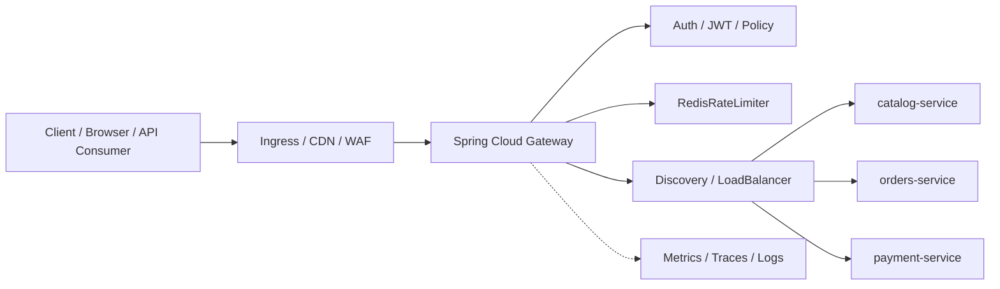
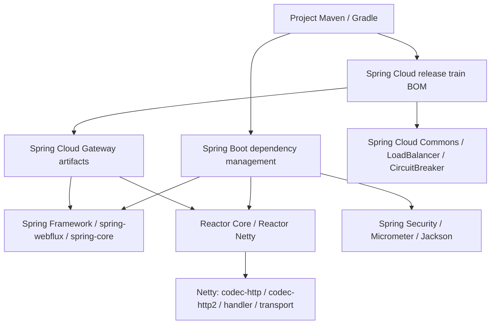
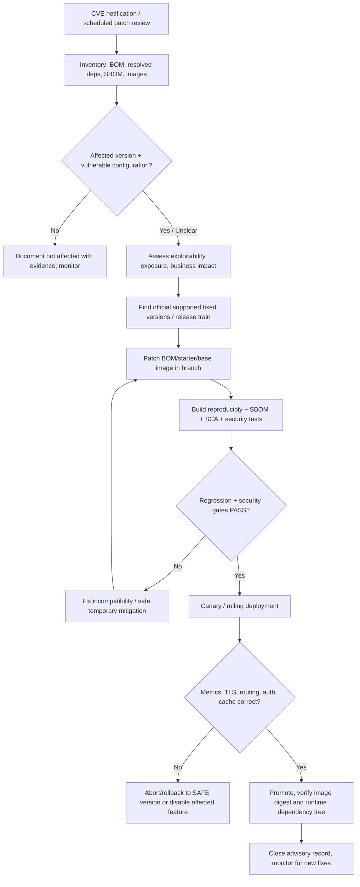
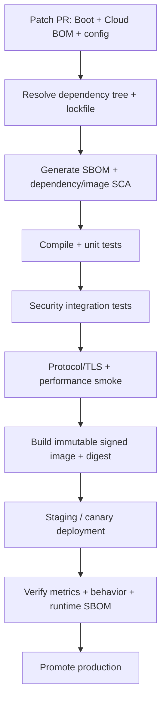
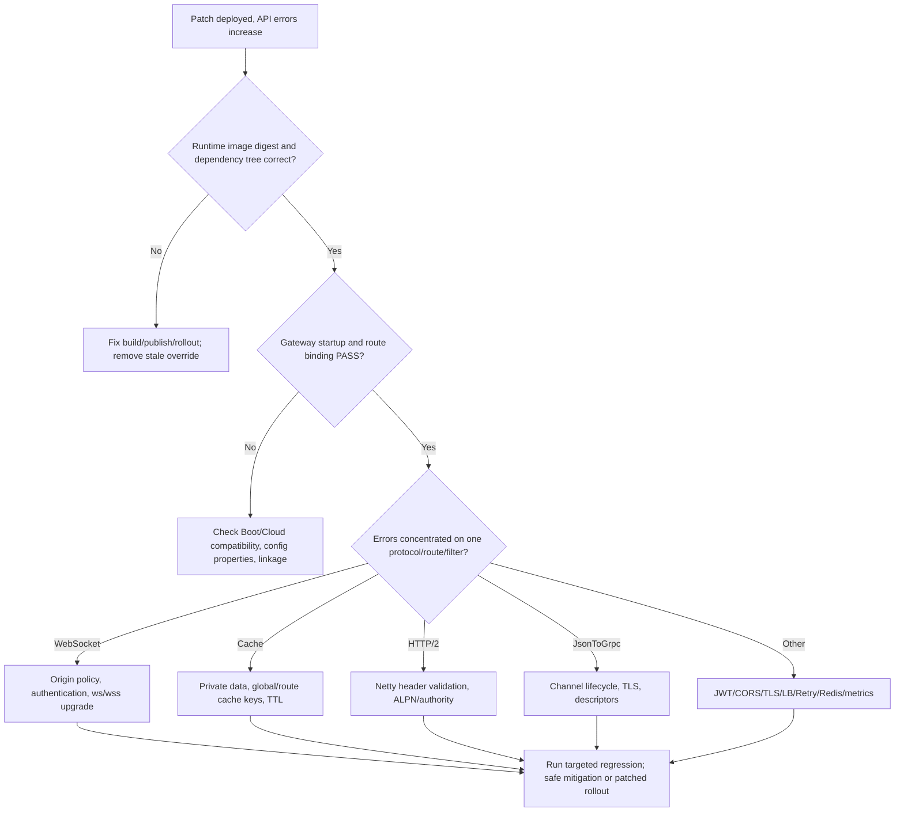

# Patching Gateway, Spring Framework, and Reactor Netty

In a microservices architecture, **Spring Cloud Gateway** sits at the edge receiving traffic from untrusted clients, selecting routes via route predicates, executing `GlobalFilter`/`GatewayFilter` chains, rewriting paths and headers, forwarding requests to backends via discovery/LoadBalancer, validating JWTs, and applying rate limiting, retries, circuit breakers, and TLS. A vulnerability in Gateway, **Spring Framework**, **Reactor Netty**, or the underlying **Netty** library can affect many microservices simultaneously even when application code has not changed.

Therefore, **security hardening through patching** is not merely running a command to update a single dependency. It is an end-to-end workflow: **identify the actual running components → evaluate advisories and affected conditions → select a compatible version chain → run functional/security regression tests → deploy in a controlled rollout → verify final runtime versions → maintain support lifecycle**.

This lesson belongs to the **Security Hardening** chapter of the **SPRING_CLOUD_GATEWAY** module. It connects patch management with API Gateway specifics: route predicates, filter chains, path/header mutation, discovery, JWT/token relay, rate limiting, circuit breaker/retry, TLS, WebSocket/gRPC, and observability. The focus is on upgrading **Gateway + Spring Boot/Framework + Reactor Netty/Netty** properly, rather than disabling security features just to achieve a "zero-alert" status.

> **Reference Point:** The incident examples in this lesson use advisories published on **2026-11-19**, available at [Spring Security Advisories](https://spring.io/security/), along with a Netty advisory published in 2026. At the time you read this lesson, always **re-check the latest advisories and versions**; the version numbers shown here illustrate how to verify and evaluate fixes, **not immutable upgrade recommendations**. OSS releases and **Enterprise Support Only** releases do not share the same availability or usage rights.

## 1. Why Can a Small Patch Matter to an API Gateway?

The Gateway is both a security boundary and a network boundary:



If an HTTP parser library has a bug, Gateway may interpret a request differently from the backend; if response caching applies the wrong privacy policy, user A's data could be returned to user B; if a filter opens connections without closing them, repeated traffic can exhaust sockets/file descriptors. These risks are **configuration-dependent** and **data-path-dependent**, and cannot be fixed merely by patching a controller in a backend service.

### Risk Categories to Watch

| Risk Category | Impact on Gateway | Signals to Monitor |
| --- | --- | --- |
| **Request parsing / smuggling** | Gateway and downstream disagree on `Host`, request target, or HTTP framing. | Unusual 4xx responses, route mismatches, request parse errors, security audit logs. |
| **Authorization bypass** | Header/path normalization or matcher alters route semantics. | Requests reaching backend outside policy, 401/403 anomalies. |
| **Data disclosure via cache** | Private responses are stored and served to other callers. | Cache hits on auth routes, cross-user data leaks, security incidents. |
| **Resource exhaustion / DoS** | Memory leaks, socket/channel leaks, unbounded allocations. | Heap/direct memory, open FDs, active connections, GC/OOM. |
| **TLS / hostname validation** | Connections fail to verify the intended peer or break after upgrade. | TLS handshake failures, SNI/CA validation errors, certificate expiry. |
| **WebSocket / long-lived traffic** | Origin checks, handshake changes, stream cancellation. | 403 handshake errors, active streams, unexpected disconnections. |
| **Dependency mismatch** | Newer versions run with incompatible APIs/ABIs. | `NoSuchMethodError`, `NoClassDefFoundError`, startup failures. |

**The goal of a patch is to eliminate exploitable conditions while preserving intended functionality.** Never mask failures by allowing all CORS origins, disabling authentication, skipping TLS certificate validation, or serving cached private data.

## 2. Understanding the "Version Chain" Gateway Actually Uses

A typical Spring Cloud Gateway Server WebFlux application has the following dependency management structure:



**This diagram shows a typical management relationship**, not a fixed dependency tree that applies verbatim to every release. To know exactly what your project runs, inspect the **resolved dependency graph** and the artifacts actually packaged in the runtime image.

| Layer | Example Artifacts | Role in Patch Assessment |
| --- | --- | --- |
| **Spring Cloud release train** | `org.springframework.cloud:spring-cloud-dependencies`. | Selects Spring Cloud versions compatible with Spring Boot. |
| **Gateway** | `spring-cloud-starter-gateway-server-webflux`, `spring-cloud-gateway-server-webflux`. | Route/filter chains, caching, WebSocket, JsonToGrpc, NettyRoutingFilter. |
| **Spring Boot** | `spring-boot-starter-parent` / `spring-boot-dependencies`. | Manages Spring Framework, Reactor/Netty, logging/Jackson, Actuator. |
| **Spring Framework** | `spring-webflux`, `spring-web`, `spring-core`, `spring-context`. | HTTP request/response handling, codecs, SpEL, framework infrastructure. |
| **Project Reactor** | `reactor-core`, `reactor-netty-http`, `reactor-netty-core`. | Reactive streams and Netty HTTP client/server integration. |
| **Netty** | `io.netty:netty-codec-http`, `netty-codec-http2`, `netty-handler`, `netty-transport`. | Byte-level protocols, HTTP/1.1, HTTP/2, TLS, buffers, transport. |
| **Security** | `spring-security-web`, `spring-security-oauth2-resource-server`. | Authentication, Authorization, JWT/JWK, WebFilter chains. |
| **Other optional** | Reactive Redis client, gRPC/Protobuf, Caffeine, discovery clients. | Feature-specific components requiring separate advisory/compatibility checks. |

### Do Not Confuse These Three Names

1. **Reactor Core** orchestrates reactive streams; it is not the Netty HTTP parser.
2. **Reactor Netty** is the reactive network runtime integration built on top of Netty.
3. **Netty** is the underlying protocol/transport library suite composed of multiple distinct modules.

If a CVE affects `io.netty:netty-codec-http2`, you cannot conclude it is patched solely because `reactor-netty-http` changed versions while the **resolved Netty HTTP/2 codec** remains old. Conversely, a Spring Framework advisory does not necessarily disappear just by upgrading Netty.

### Selecting the Right Gateway Variant

| Variant | Runtime | Management Approach |
| --- | --- | --- |
| **Gateway Server WebFlux** | Reactive stack, Reactor Netty by default. | Inspect Spring Framework WebFlux, Reactor Netty/Netty, and Gateway Server WebFlux. |
| **Gateway Server Web MVC** | Servlet stack/HTTP client depending on actual starter/container. | Do not assume every Reactor Netty vulnerability hits the inbound path; inspect the actual Servlet container/HTTP client. |
| **Proxy Exchange WebFlux/MVC** | Controller-based proxy distinct from Gateway Server filters. | Inspect the specific artifact and HTTP client variant; do not infer from `GatewayFilterFactory`. |

An application that also pulls in a Netty client, Tomcat server, or gRPC Netty transport may have **multiple distinct Netty usage paths**. Before concluding "not affected," examine the resolved artifacts, runtime configuration, and actual request paths.

## 3. Spring Boot and Spring Cloud Release Trains: Upgrading in Compatible Pairs

Spring Cloud maintains a **release train compatibility table with Spring Boot** on the [Spring Cloud project page](https://spring.io/projects/spring-cloud/) and in the release train documentation. This matrix evolves over time; **never arbitrarily pair "latest Boot" with "oldest Cloud."**

### Compatibility Snapshot Example

In project documentation published in November 2026, the following reference information appears:

| Spring Cloud Train | Spring Boot Generation Indicated by the Project | How to Use the Table |
| --- | --- | --- |
| `2026.0.x` | `2026.0.0` documentation indicates **Spring Boot 4.2.0**. | Review release notes and included modules before upgrading majors. |
| `2025.1.x` | Spring Cloud table indicates Boot `4.0.x`; `4.1.x` support starts from the service release milestone noted on the project page. | Use the service release aligned with your Boot minor version. |
| `2025.0.x` | Table references Boot `3.5.x`. | Check support/EOL status before choosing it for production. |
| Older trains | Older Boot generations per the support matrix. | Do not assume **OSS security fixes** are still provided. |

Reference sources: [Spring Cloud project](https://spring.io/projects/spring-cloud/), [Spring Cloud 2026.0.0 documentation](https://docs.spring.io/spring-cloud-release/reference/index.html), [Supported Versions](https://github.com/spring-cloud/spring-cloud-release/wiki/Supported-Versions).

**Do not choose strictly by a single table row.** Any specific application must verify: Java baseline, Spring Boot minor/patch, Gateway artifact version, Spring Framework/Netty resolved tree, server/client behavior, and the corresponding OSS/Enterprise release channel.

### Upgrade Options

1. **Patch within the same compatible branch:** fewest API/configuration changes; preferred when a supported fix exists.
2. **Service release of the Spring Cloud train:** typically updates multiple Spring Cloud modules together.
3. **Minor/Major migration:** if the current branch is EOL or lacks public patches, plan runtime/startup/property and JVM upgrades.
4. **Commercial/Enterprise fix:** some patches are provided exclusively through a support channel with dedicated access rights and terms; **do not reference them in `pom.xml` without confirming repository access and entitlement**.

**Do not use local version overrides on `spring-webflux` or `netty-handler` as a default workaround** to bypass BOM compatibility. Doing so can produce a dependency graph that looks "CVE-free to a scanner" while breaking at runtime or exposing other incompatibilities.

## 4. End-to-End Security Patching Workflow



Every step requires **artifacts and evidence**: before/after versions, affected routes/filters, test outputs, canary metrics, rollout revisions, and approvers. Under high urgency, never skip testing altogether; run a pre-prepared **minimal smoke/security regression suite** so you can deploy quickly while still catching critical defects.

## 5. Properly Identifying and Reading Advisories

Advisories are published across multiple sources:

- [Spring Security Advisories](https://spring.io/security/) — affected projects, severity, affected ranges, fixed versions, and vulnerability conditions.
- [Spring Cloud Gateway Releases](https://github.com/spring-cloud/spring-cloud-gateway/releases) — service releases and behavior changes.
- [Spring Framework Releases](https://github.com/spring-projects/spring-framework/releases).
- [Reactor Netty Releases](https://github.com/reactor/reactor-netty/releases).
- [Netty Security Advisories](https://github.com/netty/netty/security/advisories), [Netty Releases](https://github.com/netty/netty/releases).
- [GitHub Advisory Database](https://github.com/advisories), NVD/OSV to cross-check artifact coordinates and aliases.
- SBOM/SCA scans of **both the project and the container image actually deployed**.

### Risk Classification Fields

| Field in Advisory | Questions to Answer |
| --- | --- |
| **Affected product/artifact** | Is it a Gateway factory, Spring Framework codec, or specific Netty module? |
| **Affected version ranges** | Does the resolved runtime version fall within the affected range? |
| **Conditions** | Is the feature/filter/protocol/config enabled and reachable by an attacker? |
| **Impact** | Data disclosure, auth bypass, DoS, cache poisoning, or unauthorized routing? |
| **Fixed version** | Is the fix available in OSS or Enterprise Support only? |
| **Workaround** | Is there a safe way to disable **the exact affected feature** while patching? |
| **Release train compatibility** | Which Boot/Cloud/Gateway/Framework/Reactor/Netty versions run together? |
| **Evidence** | Source code, route inventory, SBOM, tests, logs/traces, exposure map. |

A CVE appearing in the dependency tree whose **code path is unused** may be a non-exploitable finding under the advisory's conditions. However, never dismiss an alert solely because "no exploit has been seen": document clear configuration/route/usage evidence and evaluate whether dynamic routes could enable that feature later.

## 6. Snapshot of Gateway-Direct Advisories — 2026-11-19

Spring published several vulnerabilities affecting specific Gateway features. The table below is a **practical example of how to read conditions**, not an exhaustive list of all CVEs:

| Advisory | Typical Component / Condition | Primary Consequence | What to Check |
| --- | --- | --- | --- |
| [CVE-2026-59425](https://spring.io/security/cve-2026-59425/) | `JsonToGrpc` on a reachable route; affected versions create a new `ManagedChannel` per request without releasing it. | Socket/channel resource exhaustion → DoS. | Route inventory, whether the filter is enabled, gRPC resource lifecycle, patched Gateway version. |
| [CVE-2026-59426](https://spring.io/security/cve-2026-59426/) | **Global** `LocalResponseCache` with routes sharing the same request URI but differing in predicates omitted from the cache key. | Potential cross-route response disclosure. | Is global cache enabled? Do route predicates distinguish policies/tenants? |
| [CVE-2026-59427](https://spring.io/security/cve-2026-59427/) | `LocalResponseCache` can store responses with multi-directive `Cache-Control` headers such as `private, no-store` / `no-cache, no-store, ...` in affected versions. | Disclosure of authenticated/private content via cache. | Does cache apply to private endpoints? `Cache-Control`/`Vary` policy and version? |
| [CVE-2026-59428](https://spring.io/security/cve-2026-59428/) | `WebsocketRoutingFilter` on `ws/wss` routes prior to the default same-origin policy. | Cross-origin WebSocket handshakes may reuse browser credentials. | Origin allowlist/allowed patterns, cookie auth, websocket routes. |

These advisories list **Gateway 5.0.0–5.0.4** in affected ranges and **5.0.5 (OSS)** as a release containing the corresponding fixes. Certain `4.3.x`, `4.2.x`, or `3.1.x` branches have different affected/fixed ranges, where some fixes are marked **Enterprise Support Only**. **Do not claim that every 4.x branch has a public OSS patch.** Read each advisory individually instead of assuming one shared version range for all CVEs.

### Distinguishing "Dependency Present" from "Feature Reachable"

Even if the class `JsonToGrpcGatewayFilterFactory` exists in the JAR, if no route uses `JsonToGrpc`, the specific condition for CVE-2026-59425 may not be triggered on current traffic paths. However, if dynamic routes can add that filter in the future, an uncontrolled route publisher could introduce exposure as soon as it is enabled. Therefore:

1. Inventory the **artifact version**.
2. Inventory **active routes/filter factories** and config revisions.
3. Inventory **external reachability** of each route.
4. Cross-check against advisory conditions.
5. Upgrading remains the durable fix; never let a temporary assessment replace a patch plan.

## 7. Spring Framework and Netty Snapshot: Beyond Gateway Filter Factories

On 2026-11-19, Spring also published Framework advisories directly or indirectly relevant to WebFlux:

| Advisory | Example Specific Condition | Lesson for Gateway |
| --- | --- | --- |
| [CVE-2026-59418](https://spring.io/security/cve-2026-59418/) | Spring WebFlux on Reactor Netty decoding request bodies as streaming `Flux<String>` / `bodyToFlux(String.class)` with codec `maxInMemorySize` smaller than Netty buffer size; leads to pooled memory leaks. | Audit custom body-inspecting filters and codec limits; do not assume every Gateway instance is affected. |
| [CVE-2026-59419](https://spring.io/security/cve-2026-59419/) | `WebClient`/`RestClient`/`RestTemplate` with observations enabled, HTTP method chosen from untrusted input, and a connector permitting non-standard methods. | Audit custom proxies/controllers using client-chosen methods; inspect cardinality and HTTP client metrics. |
| [CVE-2026-59389](https://spring.io/security/cve-2026-59389/) | Spring WebFlux parsing multipart requests, inspecting contents, and relaying downstream on affected versions. | Audit upload / `ModifyRequestBody` / multipart filters if Gateway inspects and forwards untrusted parts. |

Per the November 2026 advisories, these Framework issues list **7.0.11 (OSS)** among fixed releases; fixes for several `6.x` branches are marked **Enterprise Support Only**. Always read the affected/fixed range **for each individual CVE**; never extrapolate across all Framework issues.

On the Netty side, [GHSA-c69g-56f8-xwqj / CVE-2026-59900](https://github.com/netty/netty/security/advisories/GHSA-c69g-56f8-xwqj) involves `io.netty:netty-codec-http2` when translating HTTP/2 headers to HTTP/1.x, with advisory-indicated fixes in `4.1.136.Final` and `4.2.16.Final` for their respective branches. **This is an example published in July 2026, not an assertion that it is the latest Netty patch.** Check your resolved Netty modules, HTTP/2 translation usage, and route/`Host` policy.

### Why Testing Is Essential After Patching Netty

Fixes to parsers, header validation, or size limits can **reject requests that were previously accepted**. That may be the correct security behavior, yet still impact legacy clients, proxies, or backends relying on non-standard headers. After patching, test:

- RFC-compliant HTTP/1.1 headers, chunking, and keep-alive.
- HTTP/2 pseudo-headers, `Host`/`:authority`, ALPN, and gRPC if used.
- WebSocket handshakes and `Origin` checks.
- Request target/path normalization, encoded slashes, and routing.
- Header size / body size limits with valid clients.
- Proper error statuses on malformed requests without forwarding to backends.
- TLS, certificate trust, SNI, and pooled connection lifecycles.

**Never disable Netty HTTP header validation merely to "turn benchmarks green again"** when that check is the exact security control just patched.

## 8. Inventory Running Versions, Not Just Declared Versions

Source files may declare `spring-cloud-starter-gateway-server-webflux`, yet resolve different actual versions via:

- Spring Boot BOM.
- Spring Cloud BOM.
- Explicit `<version>` declarations on transitive or child dependencies.
- `dependencyManagement` or Gradle resolution strategies/plugin overrides.
- Maven profiles, Gradle variants, or differing build conditions.
- A third-party starter pulling in an incompatible Netty version.
- A gRPC Netty transport managing its own dependencies.
- Shaded/relocated JARs, native libraries, or container image layers.

### Record Both Source and Runtime State

| Inventory Layer | Example Values to Record | Why It Is Needed |
| --- | --- | --- |
| **Repository revision** | Commit SHA / release tag, build job ID. | Pinpoints the exact source code state. |
| **Build configuration** | Boot parent/plugin, Cloud BOM, active profiles. | Identifies version management rules. |
| **Resolved dependencies** | Group/artifact/version, dependency paths. | Detects overrides and transitive packages. |
| **Produced artifact** | Boot executable JAR, image digest. | Avoids building a fix while deploying an old image. |
| **SBOM** | CycloneDX/SPDX component list. | Cross-references CVE scanners accurately. |
| **Runtime flags/config** | WebFlux/MVC, HTTP/2, ws/wss, caching, `JsonToGrpc`. | Determines exploitability per advisory conditions. |
| **Deployment evidence** | K8s image digest, pod revision/labels. | Proves production actually received the patch. |

### Example Artifacts to Locate in the Dependency Tree

```text
org.springframework.cloud:spring-cloud-gateway-server-webflux
org.springframework.cloud:spring-cloud-commons
org.springframework:spring-webflux
org.springframework:spring-web
org.springframework:spring-core
io.projectreactor.netty:reactor-netty-http
io.projectreactor.netty:reactor-netty-core
io.projectreactor:reactor-core
io.netty:netty-codec-http
io.netty:netty-codec-http2
io.netty:netty-handler
io.netty:netty-transport
org.springframework.security:spring-security-web
```

**Never assume you are immune to an HTTP/2 CVE just because `netty-codec-http2` is absent from a filtered output snippet**: inspect the full graph or SBOM and runtime classpath. Modules loaded only for optional features must also be evaluated if those features can be enabled in production.

## 9. Maven: Inspecting Resolved Dependencies Before Editing `pom.xml`

The commands below are **examples for learners to run in an authorized repository**, not commands executed for this lesson:

```bash
# View the dependency graph, including dependency paths.
./mvnw dependency:tree

# Filter relevant artifacts.
./mvnw dependency:tree -Dincludes=org.springframework.cloud:*,org.springframework:*,io.projectreactor.netty:*,io.netty:*

# Inspect effective dependencyManagement / profiles (choose your own output path).
./mvnw help:effective-pom -Doutput=effective-pom.xml

# Verify the project builds a new JAR.
./mvnw -DskipTests package
```

In Windows PowerShell with a standard wrapper, the script is typically `mvnw.cmd` rather than `./mvnw`; adjust for your shell and project scripts. **Never commit `effective-pom.xml` to the repo just for inspection if it contains repository URLs or credentials**; store it in a temporary working folder and protect build metadata. In CI, use Maven's offline cache or approved repositories when reproducibility is required.

### How to Read a Dependency Tree

An illustrative sketch:

```text
project
  spring-cloud-starter-gateway-server-webflux (via Cloud BOM)
    spring-cloud-gateway-server-webflux
      spring-webflux (managed by Boot BOM)
      reactor-netty-http (managed by Boot BOM)
        netty-codec-http
        netty-handler
        ...
```

This is a **simulated diagram**, not output from an actual project. Every dependency path must be verified using real tooling. If two different versions of `netty-handler` appear across branches:

- Identify Maven's **resolved winner** under dependency mediation/management.
- Check which artifact was omitted and why.
- Check whether all Netty modules align with a compatible BOM.
- Verify that the runtime image does not contain a separately shaded copy.

**Never look only at direct dependency lines in `pom.xml` and assume the resolved version is correct.**

## 10. Maven: Upgrading the Boot Parent and Spring Cloud BOM

An illustrative dependency management structure:

```xml
<project>
  <modelVersion>4.0.0</modelVersion>
  <groupId>com.example</groupId>
  <artifactId>api-gateway</artifactId>
  <version>1.0.0</version>

  <parent>
    <groupId>org.springframework.boot</groupId>
    <artifactId>spring-boot-starter-parent</artifactId>
    <version>REPLACE_WITH_SUPPORTED_BOOT_VERSION</version>
    <relativePath/>
  </parent>

  <properties>
    <java.version>REPLACE_WITH_SUPPORTED_JAVA_BASELINE</java.version>
    <spring-cloud.version>REPLACE_WITH_COMPATIBLE_CLOUD_TRAIN</spring-cloud.version>
  </properties>

  <dependencyManagement>
    <dependencies>
      <dependency>
        <groupId>org.springframework.cloud</groupId>
        <artifactId>spring-cloud-dependencies</artifactId>
        <version>${spring-cloud.version}</version>
        <type>pom</type>
        <scope>import</scope>
      </dependency>
    </dependencies>
  </dependencyManagement>

  <dependencies>
    <dependency>
      <groupId>org.springframework.cloud</groupId>
      <artifactId>spring-cloud-starter-gateway-server-webflux</artifactId>
    </dependency>
    <dependency>
      <groupId>org.springframework.boot</groupId>
      <artifactId>spring-boot-starter-actuator</artifactId>
    </dependency>
  </dependencies>
</project>
```

**This template is only a structural POM snippet**; replace placeholders and add actual build plugins, Java version, and security/test dependencies. `java.version` **does not accept a placeholder string in a real build**; this example highlights the fields to update rather than providing a directly buildable POM.

### Recommended Upgrade Procedure

1. Select a **Spring Cloud train** compatible with the required Spring Boot patch/minor version.
2. Select a **supported Spring Boot patch** that already includes the Framework/Reactor/Netty fixes per release notes.
3. Update both the Boot parent and Cloud BOM **in the same pull request**, including a before/after resolved-version table.
4. Use explicit version overrides only when **release management proves** it necessary, backed by an issue/ticket, compatibility tests, and an expiration deadline to remove the override.
5. Run `dependency:tree` after building; compare **all** relevant `spring-*`, `reactor-*`, and `netty-*` modules.
6. Re-run security scans on the **built artifact/image**, not just the edited POM.

### Why Not Patch Just One Line Like This and Stop?

```xml
<!-- Anti-pattern: overriding a single submodule without evaluating the whole graph -->
<dependency>
  <groupId>io.netty</groupId>
  <artifactId>netty-handler</artifactId>
  <version>UNREVIEWED_NEW_VERSION</version>
</dependency>
```

Netty consists of multiple modules that often must stay synchronized; Reactor Netty carries compatibility assumptions; a single newer module can trigger `NoSuchMethodError` due to ABI mismatch with older sibling modules. If a hotfix override is unavoidable, use an **approved compatible Netty BOM alongside regression tests**, never an ad-hoc single-JAR swap.

## 11. Gradle: Inventorying and Upgrading Compatibly

An illustrative **Gradle Groovy DSL** structure:

```groovy
plugins {
    id 'java'
    id 'org.springframework.boot' version 'REPLACE_WITH_SUPPORTED_BOOT_VERSION'
    id 'io.spring.dependency-management' version 'REPLACE_WITH_COMPATIBLE_PLUGIN_VERSION'
}

group = 'com.example'
version = '1.0.0'

ext.springCloudVersion = 'REPLACE_WITH_COMPATIBLE_CLOUD_TRAIN'

dependencyManagement {
    imports {
        mavenBom "org.springframework.cloud:spring-cloud-dependencies:${springCloudVersion}"
    }
}

dependencies {
    implementation 'org.springframework.cloud:spring-cloud-starter-gateway-server-webflux'
    implementation 'org.springframework.boot:spring-boot-starter-actuator'
    testImplementation 'org.springframework.boot:spring-boot-starter-test'
}
```

This is a **build skeleton**; avoid pinning explicit Reactor Netty/Netty versions if the BOM manages them and you lack an approved exception policy. You may use Gradle native `platform(...)` or version catalogs if the project has standardized on them; avoid mixing `platform` constraints and the dependency-management plugin when their precedence is not well understood.

### Commands Learners Can Run

```bash
./gradlew dependencies --configuration runtimeClasspath

./gradlew dependencyInsight --dependency reactor-netty-http --configuration runtimeClasspath
./gradlew dependencyInsight --dependency netty-codec-http2 --configuration runtimeClasspath
./gradlew dependencyInsight --dependency spring-webflux --configuration runtimeClasspath

./gradlew clean test
```

On Windows, use `gradlew.bat` where needed. A Gradle project has multiple variants/configurations (`testRuntimeClasspath`, `runtimeClasspath`, native image), so always inspect the **actual runtime configuration**. Never infer from unit test dependencies that the production runtime image contains identical dependencies.

### Dependency Locking

If CI enforces Gradle dependency locking, patching a BOM changes the dependency graph and requires **controlled lockfile updates** with diff review. If lockfiles still pin old Netty/Framework artifacts, editing the build script alone may fail to upgrade runtime artifacts.

## 12. Inspecting SBOMs and What Is Actually Packaged

An **SBOM (Software Bill of Materials)** lists the components and versions inside a build or image. It helps:

- Locate CVE-targeted artifacts by exact coordinates rather than only grepping JAR filenames.
- Verify which `spring-webflux` version image `gateway:v2` actually runs.
- Detect shaded Netty inside gRPC or other native plugins/transports.
- Tie scan results to a specific release digest and environment.
- Produce an audit trail for security reviews.

### Tooling Examples

| Tool / Format | Purpose | Notes |
| --- | --- | --- |
| **CycloneDX / SPDX** | Standard SBOM output formats. | Store versions/coordinates/hashes and link to the image digest. |
| **Maven/Gradle dependency graph** | Shows resolved transitive dependencies. | Does not fully replace final image/container scanning. |
| **OWASP Dependency-Check / SCA scanner** | Matches versions against vulnerability databases. | Produces false positives; requires exploitability triage. |
| **Trivy/Grype or equivalent scanner** | Scans images, OS packages, and Java dependencies depending on mode. | DB freshness and filesystem scan coverage matter. |
| **Container signing/provenance** | Proves the image originated from trusted CI. | Does not by itself prove zero CVEs remain. |

### One Question You Must Always Answer

```text
Source pom.xml              -> Spring Cloud train X
Resolved runtime classpath  -> Gateway version Y
Container image SHA256      -> digest Z
Running pod imageID         -> digest Z?
SBOM of image Z             -> spring-webflux version W
Advisory affected range     -> W in / out?
```

If source code is patched yet **running pods still use an old image digest**, production is **not** patched. Even if an image is built from a new dependency graph, verify classloading and affected code paths in case an old shaded `netty-all` JAR can still load.

### Never Store Secrets in SBOMs or Logs

SBOMs can expose service topology or private repository URLs; keep credentials and tokens out of metadata. Store SBOM artifacts in access-controlled storage. If plugins generate SBOMs, **pin plugin versions** and maintain reproducible CI builds; never let scanners download unapproved binaries during production pipelines.

## 13. Evidence-Based Triage of "Actually Affected CVEs"

A minimal triage record:

```text
Vulnerability ID:      CVE-...
Product/module:        spring-cloud-gateway / spring-webflux / netty-codec-http2
Resolved version:      measured from runtime/SBOM
Affected range:        copied from official advisory
Affected functionality: enabled / disabled / unknown
Entry point exposure:  public / authenticated / internal / unreachable
Mitigation:            vendor fixed release or guarded workaround
Owner:                 platform security + service owner
Target release:        supported Boot/Cloud train
Evidence:              dependency tree, route inventory, test IDs, image digest
Decision:              patch now / mitigate then patch / not affected with proof
```

### Example Evaluation: CVE-2026-59427

1. **Version:** does runtime Gateway fall within the affected range published by Spring?
2. **Feature:** which routes enable `LocalResponseCache`? Is the global filter enabled?
3. **Data classification:** do responses contain user-specific or authenticated data?
4. **Cache-Control:** do backends return multi-directive headers such as `private, no-store` or `no-cache, no-store, max-age=0, must-revalidate`?
5. **Vary / route separation:** does caching isolate callers per policy, or is cross-caller mixing possible?
6. **Action:** prioritize upgrading to a fixed release; if immediate patching is impossible, **disable caching for private data** and add cross-identity tests.

Never dismiss this as a false positive merely because the backend sends `Cache-Control: no-store`: this advisory specifically highlights directive-matching errors when headers contain **multiple directives**, so inspect the **actual headers** and version.

### Example Evaluation: CVE-2026-59418

Merely proxying raw bytes through Netty in Gateway does not mean it invokes the advisory's specific `Flux<String>` decoder. However, a **custom `GatewayFilter`/`GlobalFilter`** reading request bodies, parsing text lines, and setting custom codec limits can satisfy the condition. Review all **body inspection/adapter code**. Even if no affected code path exists, archive the evidence and still schedule the Framework upgrade within a supported branch.

### Dangerous False Negatives

A "green scanner" can mislead when:

- SBOM scans only `pom.xml`, not the final fat JAR or container image.
- The CVE is absent from the scanner DB or new advisories have not synced yet.
- Dependencies are shaded, relocated, or rely on native transports.
- The runtime image inherits an old JAR from another base/layer.
- Dynamic routes enable a vulnerable filter after the scan.

**Vulnerability scanners are a signal source, not a replacement for security architecture review.**

## 14. Prioritizing Patches by Exploitability and Blast Radius

CVSS is only one dimension; a public Gateway entry point should also weigh:

| Factor | Practical Question |
| --- | --- |
| **Reachability** | Does the route/filter accept traffic from the Internet or untrusted users? |
| **Privileges required** | Can an anonymous caller reach the vulnerable condition? |
| **Data sensitivity** | Are tokens, sessions, multi-tenant records, or payment/customer data involved? |
| **Blast radius** | Does one shared Gateway instance sit in front of many services? |
| **Exploit prerequisites** | Does it trigger only under ws/wss, `LocalResponseCache`, multipart decoding, or HTTP/2 conversion? |
| **Existing mitigations** | Route denial, Origin allowlists, TLS policies, network segmentation, strict cache rules? |
| **Patch support** | Is there an OSS fixed release, or does it require Enterprise subscription/migration? |
| **Operational impact** | Does upgrading require config migrations, a Java major bump, or connection drain/test work? |

An internal severity policy can assign **remediation timelines** across critical/high/medium/low tiers. Do not blindly copy fixed SLA day counts unsuited to your organization; weigh real exploitability, vendor fix availability, and Gateway exposure.

### Three Decision Scenarios

1. **Public `JsonToGrpc` route on an affected Gateway:** very high patch priority; if immediate patching is impossible, disable the route or restrict access/traffic rather than merely increasing file descriptor limits.
2. **Global cache across routes serving authenticated/private responses:** data safety comes first; **turn off shared caching** until the fix is deployed and verified.
3. **Netty HTTP/2 advisory while Gateway uses HTTP/1.1 across the entire trust boundary:** may reduce conditional exploitability, yet you must still verify ingress hops, downstreams, gRPC paths, and ensure HTTP/2 cannot be enabled in a future rollout.

**Never document "not affected" based solely on one YAML snippet** if ingress can convert H2→H1, a gRPC/sidecar uses its own Netty, or the app exposes unlisted public endpoints.

## 15. Reading Release Notes and Changelogs Before Selecting a Target

Security releases may intentionally introduce **behavioral changes**:

- Header/protocol parsers reject ambiguous inputs that used to pass.
- WebSocket `Origin` enforcement becomes stricter.
- Cache keys or cacheability rules change to prevent private response leaks.
- Resource/channel lifecycles change, affecting connection reuse and shutdown.
- Default codecs, size/time limits, and observability tags change.
- Route/filter configuration property names shift across `3.x`/`4.x`/`5.x`.

### Upgrade Matrix

| Area | Record Before Upgrade | Confirm After Upgrade |
| --- | --- | --- |
| Boot & Cloud | Parent/plugin + Cloud BOM, Java version, support status. | Selected pair is officially compatible and boots cleanly. |
| Gateway | Variant/starter, route definitions, filter factories, dynamic routes. | Route semantics intact; all used factories remain supported. |
| Framework | `spring-webflux`, codecs, SpEL, Security integration. | No regressions in HTTP parsing, body binding, or auth. |
| Reactor Netty | `reactor-netty-http`/`core`, connection pool metrics, HTTP client. | No linkage errors; pooling, TLS, and stream handling work properly. |
| Netty | `codec-http`/`codec-http2`/`handler`/`transport`. | Matches patched branch; parser and HTTP/2 compatibility verified. |
| Security | JWT issuers/audiences, OAuth2/TokenRelay, CORS/CSRF. | No auth bypass; legitimate users retain access. |
| Caching | Local/global cache, `Cache-Control`, `Vary`, key isolation. | Private content never cached; route isolation holds. |
| WebSocket/gRPC | ws/wss origin policy, `JsonToGrpc`/gRPC channel resources. | Valid handshakes succeed, invalid Origins rejected, channels close/reuse properly. |
| Operations | Actuator, metrics, health probes, shutdown/timeouts. | Readiness/liveness probes, rollouts, and alerts keep working. |

### A Concrete Upgrade Example Using Published Milestones

On **2026-11-20**, Spring published these Spring Cloud releases:

- [Spring Cloud 2025.1.5](https://spring.io/blog/2026/11/20/spring-cloud-2025-1-5-has-been-released/) — release announcement listing Gateway fixes for CVE-2026-59425 through 59428.
- [Spring Cloud 2026.0.0](https://spring.io/blog/2026/11/20/spring-cloud-2026-0-0-has-been-released/) — release announcement also listing corresponding fixes.

**This is not guidance saying "every project must jump straight to 2026.0.0."** Check your Boot generation, Java baseline, API changes, required features, and support lifecycle. In particular, a brand-new train may be incompatible with a project's current Boot/Java versions, requiring a planned migration.

### Do Not Assume a Patch Only Changes Version Numbers

A WebSocket Origin fix often causes **undeclared cross-origin clients** to receive 403 instead of passing through as before. If your legitimate frontend is hosted on another origin, build an **explicit allowlist** after review rather than setting `*` just to "make tests pass."

A Netty header validation fix may expose an older reverse proxy sending malformed headers. When tests fail, fix the proxy/client or adjust protocol configuration appropriately instead of downgrading back to the vulnerable version just because production traffic sends non-standard requests.

## 16. Example: Hardening WebSocket Origin After Patching

According to [CVE-2026-59428](https://spring.io/security/cve-2026-59428/), patched Gateway releases validate the `Origin` header on WebSocket handshakes and provide properties to configure allowed origins.

### Modern WebFlux Configuration, Allowlist Example

```yaml
spring:
  cloud:
    gateway:
      server:
        webflux:
          websocket:
            allowed-origins:
              - https://app.example.com
              - https://portal.example.com
```

In `4.x`/`3.1.x` branches, the advisory uses the legacy prefix `spring.cloud.gateway.websocket.*`; **do not copy the newer WebFlux prefix into older releases**. At startup, inspect configuration metadata and execute real handshake tests to confirm the property actually binds rather than relying solely on valid YAML syntax.

### Nature of This Control

- Browsers send `Origin` on WebSocket upgrades but do not run CORS preflight checks like standard `fetch` requests.
- `Origin` must be checked against an explicit policy; `Host` or backend URIs do not implicitly form an allowlist.
- Non-browser WebSocket clients can forge `Origin`; **Origin checks never replace authentication and authorization**.
- Cookie/session-authenticated WebSockets require protection against cross-site misuse rather than trusting "once JWT/session is checked."
- In multi-tenant WebSockets, align Origin policies with tenant identity and trusted hostnames rather than overly broad patterns.

### Required Tests

| Request | Expected Policy Result |
| --- | --- |
| Origin `https://app.example.com` with valid token/session | Handshake proceeds; backend authorization still applies. |
| Origin `https://attacker.invalid` | Rejected, e.g., HTTP 403 per security policy. |
| Similar-looking suffix `app.example.com.evil.invalid` | Rejected; never match via substring checks. |
| Missing or malformed `Origin` header | Behavior depends on Gateway version/policy; test explicitly. |
| Valid credentials, unauthorized channel user | Backend/Gateway authorization still denies access. |
| `wss` route over HTTP/2 or behind ingress | Handshake/protocol verified over the supported transport. |

**Never configure `allowed-origins: ["*"]` as a permanent fix**; wildcards can reintroduce cross-origin exposure depending on your credential model.

## 17. Example: Global `LocalResponseCache` and Private Data

[CVE-2026-59426](https://spring.io/security/cve-2026-59426/) describes cross-route cache sharing under specific conditions, while [CVE-2026-59427](https://spring.io/security/cve-2026-59427/) covers handling of `private`/`no-store` `Cache-Control` directives.

### Temporary Mitigation for Global Cache

Advisory 59426 notes a temporary mitigation of **disabling global `LocalResponseCache`**, then enabling route-level caching strictly on reviewed public routes:

```yaml
spring:
  cloud:
    gateway:
      server:
        webflux:
          global-filter:
            local-response-cache:
              enabled: false
```

**Note:** Property namespaces and behavior vary across Gateway branches; use the exact property specified in the **advisory for your version**. This is an **interim mitigation while patching**, not a substitute for upgrading to a fixed version. Route-level caching also requires proper `Cache-Control`/private-data handling; disabling only the global filter does not fix CVE-2026-59427 if route-level caching remains active on an affected version.

### Never Cache User-Identifying Data

```text
GET /api/public/catalog/products/42
  → Consider caching if the response is public with a clear TTL contract.

GET /api/users/me
GET /api/orders/123
GET /api/payments/history
  → Never share-cache; responses depend on user/tenant identity.
```

**Never rely on "`Cache-Control: private, no-store`" as a one-off assumption on an unpatched version.** Upgrade to a fixed release and verify through tests that private/no-store responses **are never cached**, even when headers carry multiple directives (including directives emitted by Spring Security).

### Cross-Identity Testing

1. Authenticate as user A, call a sensitive endpoint, and record response A.
2. As caller B or anonymously, call the **exact same URL** with different credentials.
3. Verify B never receives A's body, headers, `ETag`, or cookies.
4. Exercise MISS/HIT cache states, multiple Gateway replicas, query strings, and cacheable methods/statuses.
5. Record backend access counts and response hashes **in a lab environment**, keeping PII out of test logs.
6. Test both `Cache-Control: private, no-store` and multi-directive headers.

If any disclosure is observed, **disable route/global caching immediately, isolate the incident, and follow incident response procedures** without waiting for the entire regression suite to finish.

## 18. Example: `JsonToGrpc` `ManagedChannel` Lifecycle

Under [CVE-2026-59425](https://spring.io/security/cve-2026-59425/), affected Gateway versions allocate a new `ManagedChannel` for each HTTP JSON→gRPC request handled by `JsonToGrpc` without proper shutdown or reuse, leading to resource exhaustion.

### Post-Patch Verification Points

| Observation | Before vs. After Patch Comparison |
| --- | --- |
| **Active sockets / file descriptors** | Must not grow unboundedly across sustained traffic and traffic quiescence. |
| **gRPC Netty channel resources** | Lifecycle/reuse/shutdown is properly managed per the patched implementation. |
| **Request latency** | No SLO regression; note cold vs. warm connection behavior may change. |
| **TLS trust/SNI/mTLS** | Connections to gRPC backends still authenticate servers properly. |
| **Error mapping** | HTTP JSON responses and gRPC statuses/trailers map accurately. |
| **Connection exhaustion recovery** | After load stops, resource counts return to a stable baseline within a reasonable window. |

### Do Not Substitute Resource Limits for a Patch

Raising `ulimit -n`, JVM heap, Netty pool sizes, or Gateway replica counts delays failure but **does not fix the underlying channel leak**. If you cannot upgrade immediately, safe interim control requires disabling or restricting reachable `JsonToGrpc` routes per business necessity while closely monitoring sockets/FDs until the fixed build deploys.

### Streaming Boundaries

`JsonToGrpc` is an HTTP JSON→gRPC bridge with specific boundaries; do not treat it as a full gRPC streaming proxy merely because both use Netty. When upgrading, test the unary JSON bridge separately from native gRPC, WebSocket, and SSE; never let a passing unary test stand in for all protocols.

## 19. Spring Framework WebFlux: Custom Filters and Body Decoding

A WebFlux Gateway typically proxies raw HTTP bytes, yet applications often write:

- `CacheRequestBody` to reuse read payloads.
- `ModifyRequestBody` / `ModifyResponseBody` to transform JSON.
- Custom `GlobalFilter` implementations reading `DataBuffer`.
- Controller / `ProxyExchange` bridges accepting `multipart/form-data`.
- Observability or validation filters parsing text and JSON.

**A Spring Framework change can directly affect these code paths**, not only built-in Gateway factories.

### Areas Requiring Code Audit

| Code Path | Risk Around / After Patching | Testing Focus |
| --- | --- | --- |
| `Flux<String>` decoding | Streaming text decoding, codec limits, pooled memory. | Multi-line text payloads within limits, cancellation, direct memory usage. |
| Multipart inspect + relay | Boundary parsing and downstream semantic divergence. | Multi-part payloads, metadata, content limits, forwarded body consistency. |
| `WebClient` with dynamic HTTP method | Non-standard methods, metrics cardinality, exceptions. | Method allowlists, low-cardinality tags, rejection of invalid methods. |
| Data binding / SpEL / route config | Untrusted expressions/configs influencing routing. | Config source ownership, security validation, blocking dangerous fields. |
| Path/header normalization | Gateway and backend parse paths/headers differently. | Percent-encoding, duplicate headers, route/authorization tests. |

### Never Disable Codec Limits to Silence Errors

`maxInMemorySize` and body size bounds protect system resources. When a parser/decoder patch resolves a DoS bug, certain legacy oversized requests may rightfully be rejected. **Never raise limits to infinity** or wrap parsing exceptions in infinite catch/retry loops; define formal max body/header caps, return clean 4xx responses, and keep memory bounded.

### Reactor Event Loop Hygiene

After dependency updates, if a custom filter performs blocking JDBC calls, `Thread.sleep`, or a blocking HTTP client on the event loop, p99 latency can worsen. Patching dependencies never eliminates application-induced blocking. Run concurrency load tests and monitor Reactor Netty pools, event loops, and GC; do not blame a "Gateway patch bug" for latency caused by custom blocking code without evidence.

## 20. Spring Cloud Config, Dynamic Routes, and Route-Update Authorization

When routes update dynamically, an up-to-date Gateway binary can still become vulnerable if an untrusted config source injects an unsafe route:

```text
Approved route config → validation → signed revision → publish
                                             ↓
                                         Gateway pods
                                             ↓
                                     Route predicate + filters
```

**Never let Internet clients supply URLs, SpEL expressions, or filter arguments that become live route definitions directly.** The route-update control plane must enforce strong authentication, authorization, auditing, and allowlists for URIs/service IDs, route filter factories, and path prefixes.

### Release Gate Questions

- Does a new route enable `JsonToGrpc`, global caching, `ws/wss` WebSockets, or proxy to a host outside the trust boundary?
- Can `RewritePath`/`StripPrefix` steer requests toward a backend admin endpoint?
- Could filter ordering cause auth or rate limiting to execute after a short-circuit filter?
- Does `KeyResolver` rely on an authenticated principal rather than trusting a raw client header?
- Do `lb://` backend service instances belong to the right namespace and TLS identity?
- Are Gateway Actuator route mutation endpoints blocked from public exposure?
- Does every route revision from Config Server carry a verified signature, owner, and change ticket?

**Library patching and configuration governance must go hand in hand.** Fixing a parser CVE will not prevent SSRF caused by user-controlled destination URIs.

## 21. CI Pipeline: What Must Be Verified Before Closing a Vulnerability Ticket?

A sample pipeline flow:



### Mandatory Gates

| Gate | Pass Criteria |
| --- | --- |
| **BOM compatibility** | Valid Boot/Cloud train pair and Java baseline. |
| **Resolved tree** | Affected artifacts are outside vulnerable ranges or documented not-affected with evidence. |
| **Build/linkage** | Zero `NoSuchMethodError`, `ClassNotFoundException`, or `NoClassDefFoundError`. |
| **Gateway functional tests** | Route predicates, path/header filters, and `lb://` behave correctly. |
| **Security regression** | JWT/CORS/CSRF/TLS/origin/cache authorization boundaries are not weakened. |
| **Protocol tests** | H1/H2/WebSocket/gRPC behave properly when used; malformed input is safely rejected. |
| **Resilience tests** | Rate limiting, Retry/CircuitBreaker, fallbacks, and timeouts do not amplify failures. |
| **Observability** | Actuator/probes, route metrics, and tracing do not silently drop. |
| **Image evidence** | Built digest matches runtime digest; image SBOM is archived. |

### A Pipeline Failure Is Not Always a Security Patch Defect

For instance, a WebSocket client test sending an unapproved `Origin` may start receiving 403 after patching. That can be the **intended security behavior**. Update the frontend/deployment allowlist to approved domains rather than disabling Origin validation. Likewise, Netty may reject malformed headers once tolerated by an old proxy; fix the producer or protocol instead.

## 22. Gateway Security Regression Suite

Maintain a **suite executed both before and after patching**. Its purpose is not to run live exploits in production, but to validate **valid contracts, security invariants, and rejection of dangerous inputs** against mock backends in staging.

### 22.1. Route Predicates and Path Rewriting

| Test | Input | Correct Evidence |
| --- | --- | --- |
| R01 | `GET /api/catalog/products/42` | Matches `catalog-public`; upstream receives expected rewritten path. |
| R02 | `POST` to a GET-only route | Cannot bypass `Method` predicate; returns expected status per API contract. |
| R03 | Lookalike URL `/api/catalogue/**` | Does not erroneously match the catalog route. |
| R04 | `/api/catalog/../admin` | Does not bypass authorization/backend prefixes; ingress/framework may reject early. |
| R05 | Encoded slash/dot segments | Gateway and backend interpret consistently without bypass. |
| R06 | Untrusted `Host`/`Forwarded` headers | Cannot redirect upstream target or tenant outside policy. |

On malformed inputs, **identical error status codes across versions are not strictly required**: a stricter parser may return 400, a security matcher 403, or an unmatched route 404. The invariant to verify is that **unauthorized requests never reach disallowed backends or routes**, not an arbitrary status code.

### 22.2. Authentication, CORS, and Token Relay

| Test | Expectation |
| --- | --- |
| Missing token on a protected route | Returns 401/403 per policy; never reaches protected backend. |
| Expired JWT / wrong issuer or audience | Rejected without falling back to anonymous bypass. |
| Insufficient user scope / cross-tenant resource | Returns 403 or defined error contract. |
| Token Relay to trusted backend audience | Never leaks access tokens to backends outside the trust boundary. |
| CORS preflight from allowed `Origin` | Returns proper `Access-Control` headers without wildcard credentials. |
| CORS preflight from untrusted `Origin` | Cross-origin access denied where policy forbids it. |
| Health/admin endpoints | `/actuator/**` blocked publicly; probes work within trusted networks. |

### 22.3. Rate Limiting, Retry, and CircuitBreaker

- Enable `RequestRateLimiter` in a lab: base quota keys on trusted principals/API keys rather than spoofable raw headers; confirm 429 triggers only for callers truly exceeding limits.
- Perform a controlled Redis outage test: confirm the configured fail policy works without triggering a Gateway restart storm from misconfigured liveness checks.
- On backend `503→200`: confirm one inbound request triggers only bounded retries, and avoid retrying non-idempotent `POST` requests.
- On sustained backend `503`: Retry must respect max attempts/time budgets; CircuitBreaker/fallbacks must never leak stack traces or secret headers.
- Verify **filter ordering**: auth/quotas are never bypassed by cache/fallback short-circuits, and retries do not duplicate side effects in custom filters.

### 22.4. TLS and Protocols

| Scenario | Verification |
| --- | --- |
| Valid client TLS chain | Handshake succeeds with matching hostname/SAN. |
| Untrusted upstream CA/hostname | Gateway rejects connection instead of using trust-all. |
| Missing mTLS client certificate | mTLS-enforced hop rejects properly. |
| HTTP/2 clients | ALPN, `:authority`/`Host`, trailers, and downstream routing work cleanly. |
| Non-standard / ambiguous headers | Handled per patched parser without routing/authorization bypass. |
| Valid / invalid WebSocket `Origin` | Origin allowlist enforces policy accurately. |
| gRPC / `JsonToGrpc` | Unary mapping, TLS, and resource lifecycle behave properly; test streaming separately if supported. |

### 22.5. Response Cache Private Data

Use two test identities **A and B**:

1. User A calls an authenticated private endpoint and receives A's payload.
2. User B (or anonymous) calls the same URL with different credentials.
3. User B must never receive A's body or headers from any cache entry.
4. Verify `Cache-Control: no-store, private` behavior across multi-directive combinations.
5. If global caching can match one URL across multiple routes with different policies, test route isolation.
6. Test across multiple Gateway replicas and cold/warm cache states, since local caching is per-pod.

This is a **security correctness gate**: if it fails, **do not promote** even if p95/CPU dropped and scanners show zero alerts.

## 23. Staging Upgrade POC: From Inventory to Patch Confirmation

Suppose a platform team runs Gateway on a release train whose versions fall within the affected ranges of the 2026-11-19 advisories. Hypothetical POC setup:

```text
Source branch:                 security/gateway-patch
Deployed Gateway:              verify as potentially affected
Spring Cloud train:            check compatibility of current Boot
Active features:               WebFlux, RedisRateLimiter, ws/wss,
                               optional LocalResponseCache / JsonToGrpc
Goal:                          supported fixed release + no regression
```

### Step 1: Capture Baseline

- Export the resolved dependency tree and SBOM for the current staging image.
- Record Boot parent/plugin, Cloud train, Gateway/Framework/Reactor Netty/Netty versions, JDK, and image digest.
- Export the route inventory including predicates, filters, route IDs, and dynamic config revision (without dumping secrets or tenant IDs).
- Record baseline p95/p99, 4xx/5xx/429 rates, Redis limiter decisions, cache hit/miss ratios, and gRPC socket counts if used.
- Run current security/functional smoke tests and log pre-existing failures so they are not misattributed to the patch.

### Step 2: Choose the Target

Consult the Spring Cloud compatibility matrix and latest release notes. Using the November 2026 snapshot as an illustration:

- If the app aligns with Cloud `2025.1.x`, check the [2025.1.5 release notes](https://spring.io/blog/2026/11/20/spring-cloud-2025-1-5-has-been-released/) and inspect the BOM-managed patched Gateway version.
- If **intentionally** migrating Boot/Cloud generations, review [2026.0.0](https://spring.io/blog/2026/11/20/spring-cloud-2026-0-0-has-been-released/) alongside actual Boot/Java/Framework compatibility.
- Cross-check against advisory fixed versions; never trust a newer release tag if explicit overrides or lockfiles still hold a vulnerable artifact.

### Step 3: Update Build Configuration

Update the approved Boot parent/plugin and Cloud BOM together in one pull request. Remove obsolete overrides conflicting with the target BOM. If an explicit override is truly required, document:

```text
override module:
current BOM-managed version:
required patched version:
compatibility evidence:
owner + expiry date:
tests required:
```

**Never manually patch a fat JAR by swapping class files inside it**: that breaks build reproducibility, invalidates SBOM/attestations, and risks classpath conflicts.

### Step 4: Build and Re-Scan

Run the build and tree commands matching your build tool:

```bash
./mvnw -DskipTests=false verify
./mvnw dependency:tree
```

Or:

```bash
./gradlew clean test
./gradlew dependencies --configuration runtimeClasspath
```

Once the new image is built, generate SBOM/SCA scans directly from the **image digest**; never attach pre-patch scan results to close a post-patch ticket. If an SCA database still flags a CVE already patched per the vendor, verify **group/artifact/version, affected ranges, and official advisories** rather than ignoring it without proof.

### Step 5: Run Security Regression Tests

Execute the Section 22 test suite. In particular verify:

- `JsonToGrpc` leaks zero FDs/channels under load and after quiescence.
- `LocalResponseCache` never caches authenticated/private data or leaks across routes.
- `WebsocketRoutingFilter` rejects origins outside the allowlist.
- Spring WebFlux body/codec paths in custom filters do not leak pooled memory.
- Netty H1/H2 header behavior matches policy.
- Inbound/outbound TLS, JWT/CORS, service discovery, timeouts, and retries/fallbacks remain intact.

### Step 6: Verify Final Artifact

```text
Deployed image digest:          from Kubernetes/cloud runtime
Gateway artifact version:      from final SBOM
spring-webflux version:         from final SBOM
reactor-netty-http version:     from final SBOM
netty-codec-http2 version:      from final SBOM
Affected ranges matched:       none, or justified not-affected records
Known patch exceptions:        explicit with deadline
Canary security tests:         PASS
Canary route/resilience tests:  PASS
Rollback target:               last-known-safe image/config
```

**Never declare production patched just because a pull request merged.** Evidence must link the **live runtime image digest** to verified dependency versions and release records.

## 24. Load Simulation After Upgrading Netty and Reactor Netty

Codec/HTTP parser patches can alter latency, connection reuse, direct memory usage, or pool behavior. Use a contract-matching mock backend in staging and compare **identical topology and identical traffic** before vs. after patching.

### Minimum Workloads

| Workload | What to Measure |
| --- | --- |
| Small JSON GET, HTTP/1.1 keep-alive | Proxy overhead, steady RPS, p95/p99. |
| JSON GET over HTTP/2 | ALPN/header validation and HTTP/2 route behavior. |
| Bounded POST/body upload | Codec behavior, buffering, max body size, direct memory. |
| `503→200` with Retry | Extra attempts/backoff, absence of retry storms. |
| 100% `503` with CircuitBreaker | Fallback/status correctness, backend calls shed properly. |
| Redis rate limiter burst | Redis decision p95, 429 accuracy, backend protection. |
| WebSocket sessions | Origin accept/reject, handshake, close/cancel, long-lived connections. |
| `JsonToGrpc` unary traffic | `ManagedChannel`/sockets/FDs stay stable after quiescence. |
| Public + private cache mix | Hit/miss behavior, memory footprint, zero private leakage. |
| Cold/warm TLS | Certificate verification, handshakes, and connection pooling. |

### Distinguishing Regressions from Bug Fixes

- Rejecting requests with malformed headers is the **intended security fix**, not automatically a functional regression.
- Returning 403 for unapproved browser WebSocket Origins is **correct** under the updated policy.
- Rejecting oversized bodies cleanly is **protective safety behavior**, not a reason to raise limits indefinitely.
- Higher p99 when enabling real TLS verification instead of trust-all is the cost of required security, not justification to turn off checks.

Conversely, **valid requests** before and after the patch must continue honoring the API contract. Benchmark legitimate traffic under your actual route policy rather than loosening protocol checks just to inflate numbers.

### Metrics to Collect per Pod

```text
gateway.request.count / status / latency p95, p99
http.client.connect / TLS handshake / pool pending acquire
JVM heap, direct buffers, process RSS, GC pauses
open file descriptors, active sockets, connection lifetime
backend request attempts / errors / retries
rate limiter decisions + Redis latency
fallback invocations and degraded outcomes
cache hits/misses/private-data test results
pod restarts / readiness / liveness / canary revision
```

Exact metric names vary with Boot, Micrometer, and Reactor Netty versions. A `spring.cloud.gateway.requests` timer alone will not reveal a gRPC channel leak; combine HTTP client/runtime instrumentation with OS/container-level metrics.

## 25. Canary Rollout and Safe Rollback

### Why Not Upgrade the Whole Cluster at Once?

Patches can alter parsers, headers, Origin/CORS rules, TLS handshakes, or memory characteristics. Rolling out to 100% of Gateway pods at once risks breaking every public microservice entry point simultaneously if a regression occurs.

Suggested rollout sequence:

1. **Staging verified** across dependencies, routes, security, and memory behavior.
2. **Small canary** handling a defined slice of traffic or test cohort with representative data.
3. **Compare canary vs. stable** on an equivalent request mix: HTTP 2xx/4xx/429/5xx, p95/p99, TLS errors, policy-correct Origin 403s, FDs/memory, and private cache checks.
4. Once release gates pass, **expand incrementally**, watching for behaviors triggered only under higher concurrency or rollout overlap.
5. Verify **all pods** run the approved image digest and route config revision.

If using **GitOps** (controllers syncing manifests from Git), digest and route config updates must go through reviewed pull requests/revisions. Never patch a live Deployment manually only for reconciliation to revert pods back to the vulnerable image; keep Git state, live cluster state, and SBOM evidence aligned.

### Kubernetes Manifest Excerpt

```yaml
apiVersion: apps/v1
kind: Deployment
metadata:
  name: api-gateway
spec:
  replicas: 3
  strategy:
    type: RollingUpdate
    rollingUpdate:
      maxSurge: 1
      maxUnavailable: 0
  selector:
    matchLabels:
      app: api-gateway
  template:
    metadata:
      labels:
        app: api-gateway
    spec:
      terminationGracePeriodSeconds: 45
      containers:
        - name: gateway
          image: registry.example.invalid/platform/api-gateway@sha256:REPLACE_WITH_DIGEST
          ports:
            - containerPort: 8080
              name: http
          readinessProbe:
            httpGet:
              path: /readyz
              port: http
            periodSeconds: 5
            timeoutSeconds: 2
            failureThreshold: 2
          livenessProbe:
            httpGet:
              path: /livez
              port: http
            periodSeconds: 10
            timeoutSeconds: 2
            failureThreshold: 3
```

**This is only an excerpt**; it omits the `Service`, `startupProbe`, resource limits, `SecurityContext`, Secrets, HPA/PDB/NetworkPolicy, and cluster TLS policies. The image URI is a non-existent placeholder. Never copy incomplete manifests straight into production.

### Readiness Checks Do Not Replace Security Regression Tests

Returning HTTP 200 on `/readyz` only shows the pod passed its health group checks; it does **not** verify that:

- Spring Framework HTTP parsing is fixed.
- `LocalResponseCache` does not leak authenticated responses.
- WebSocket Origin allowlists work properly.
- `JsonToGrpc` `ManagedChannel`s do not leak under load.
- TLS/mTLS and JWT audience checks were not downgraded.

Thus, **200 probe + completed rollout ≠ verified security patch**. Always pair rollouts with canary functional/security validation and image digest checks.

### Rollback Plans Must Avoid Returning to a Vulnerable Build

If the new build causes a regression while the previous release contains a publicly reachable CVE, blindly running `rollout undo` can **re-open the vulnerability**. Prepare instead:

- A **last-known-safe patched image** or previously validated alternative build.
- The ability to **disable/isolate an affected route or filter** via config if a temporary version must stay live.
- Feature flags / config revisions to shrink blast radius.
- Formal owner sign-off on a timebound security exception/mitigation if truly unavoidable.
- Heightened auditing and monitoring throughout any exception window.

**Never claim rolling back to an exploitable release is "safe"** solely because HTTP 200 rates and latency recovered. A safe build must satisfy both functional and security gates.

## 26. Post-Patch Observability: Catching Lingering Path Issues

Monitor these signals during canary and post-promotion phases:

| Signal | Interpretation |
| --- | --- |
| **Gateway route HTTP status** | Unusual 401/403 may stem from Security/Origin policies; 502/503 may reflect TLS/route issues. |
| **Request latency** | Higher p95/p99 may point to pools, header parsers, body buffering, Redis, or downstreams. |
| **Netty connection pool** | Pending acquisitions, active/idle counts, request cancellations. |
| **Open file descriptors/sockets** | Critical for verifying `JsonToGrpc` channel leak remediation. |
| **Heap/direct memory** | Watch pooled buffers, GC, and OOM—not only JVM heap. |
| **Cache hits/misses/private tests** | Zero cross-route/cross-user leaks; hit ratio may legitimately drop after a fix. |
| **WebSocket handshake counts** | Track rejected Origins vs. accepted legitimate clients. |
| **HTTP/2 / H1 parsing errors** | Stricter parsers reject more malformed traffic after patching; review traffic patterns. |
| **Service discovery/LB** | Distinguish no-instance 503s from upstream TLS mismatches; confirm route definitions hold. |
| **Readiness/liveness/restarts** | Confirm startup, shutdown, and graceful draining did not regress. |

### PromQL Example for Gateway 5xx

If Micrometer's `spring.cloud.gateway.requests` timer exports as `spring_cloud_gateway_requests_seconds_count` with `routeId` and `status` labels, a query might look like:

```promql
sum by (routeId) (
  rate(spring_cloud_gateway_requests_seconds_count{
    status=~"5.."
  }[5m])
)
```

**Exact metric names and labels depend on Boot/Micrometer versions and registry configuration**; verify `/actuator/prometheus` before relying on dashboards or alerts. This metric tracks **final route responses** and cannot detect private cache leaks or Netty FD leaks on its own. Never tag metrics with raw user IDs, tokens, or unbounded URL paths just to distinguish canary pods.

### Correlating Image Revisions and Outcomes

```text
gateway.routeId           = catalog-public
gateway.releaseGroup      = stable | canary
gateway.imageRevision     = finite release label
http.status              = observed status
gateway.httpClientPool   = active / idle / pending
memory.direct            = observed bytes
securityTest.cachePrivate = pass | fail
```

This is a **team-defined telemetry schema**, not metrics emitted automatically out of the box. Every security-review metric needs **clear data definitions and access controls**; never record tokens, private payloads, or raw stack traces inside attributes or tags.

## 27. Runbook: When an Update Breaks Something, Where Could the Cause Be?

| Post-Upgrade Symptom | Hypothesis | Evidence / Safe Action |
| --- | --- | --- |
| JVM fails to start with `ClassNotFoundException` / `NoSuchMethodError` | Incompatible Boot/Cloud/Framework/Reactor/Netty versions or leftover overrides. | Compare effective dependency tree, BOM, and starter variant; fix the graph instead of forcing a lone JAR. |
| Gateway starts but routes return 404 | Changed config namespace, broken route binding, or `RouteDefinitionLocator` difference. | Inspect internal Actuator route snapshot, config binding metadata, route IDs/predicates, and mock backends. |
| Legitimate WebSocket clients receive 403 | Stricter `Origin` checks after CVE patch; origin missing from allowlist. | Inspect actual `Origin` and add the **exact trusted origin**, never a wildcard. |
| Invalid WebSocket clients still connect | Allowlist property uses wrong namespace or route bypasses expected filter. | Test handshakes against live runtime; check property binding and auth/Origin tests. |
| Private responses still get cached | Wrong Gateway artifact deployed, misconfigured route/global settings, or missing cache policy. | Disable route caching, check image digest, inspect directives/`Vary`, and run cross-user tests. |
| Cache hit ratio drops sharply | Tighter cache eligibility/keys or cold caches post-rollout. | Check public eligible URLs, backend request rate, per-pod Caffeine stats; never cache private data to boost hit rate. |
| `JsonToGrpc` FD count grows steadily under load | Patch not deployed, shaded gRPC transport differs, or separate leak exists. | Verify runtime digest, profile sockets/FDs and channel lifecycle; disable exposed route if necessary. |
| Netty HTTP/2 requests fail with 400 | Stricter header/pseudo-header validation rejects non-compliant clients/proxies. | Inspect redacted ingress/header traces; fix the client/proxy rather than globally disabling validation. |
| Downstream 502/503 spikes | Changes in TLS CA/SNI, ALPN, LB/discovery, connection pool, or route settings. | Run per-hop TLS tests, check HTTP client metrics, verify backend availability. |
| JWT 401/403 spikes | Security DSL, issuer, JWK, audience, or authority mapping changed or misbound. | Test valid/invalid tokens and resource-level auth; never resort to `permitAll`. |
| Readiness returns 503 after upgrade | Changed health property namespace, custom indicator issue, or slower startup. | Test `/readyz` on main port, Actuator health group, and startup/readiness logs. |
| CPU / heap / direct memory climbs | Changes in codecs, body buffering, Retry, cache sizing, Netty pools, or logging. | Capture JFR/GC profiles, check per-pod traffic, direct buffer allocators, and FD metrics. |
| Scanner still reports the CVE | Old image deployed, stale transitive version, outdated scanner DB, or false positive. | Compare runtime SBOM, coordinates, vendor advisory, and fixed version. |
| Canary passes, production fails | Different traffic mix, TLS/certs, multi-tenant routes, or horizontal scale/region behavior. | Review canary cohort coverage, staging fidelity, and per-pod/revision metrics. |
| H2 clients lose metadata/trailers | Proxy/ingress conversion behavior changed or regressed. | Run per-hop HTTP/2/gRPC protocol tests and inspect actual metadata received by backend. |
| Retry storm after patching | Filter ordering or status mapping changed, or stricter parsing raised errors. | Inspect backend attempts and Retry/CircuitBreaker metrics; constrain retry budgets safely. |

### Post-Upgrade Triage Decision Tree



### What to Avoid During Incident Response

- Disabling `oauth2ResourceServer`, TLS trust verification, or Origin checks for all clients.
- Automatically rolling back to a release with a known publicly exploitable CVE.
- Dropping a Netty JAR manually into a running container.
- Removing all Redis rate limits without alternative backend protection.
- Raising HTTP/codec limits, FDs, or buffer pools indefinitely to hide a memory/channel leak.
- Logging raw JWTs, cookies, request bodies, or PII to "debug faster."
- Promoting a canary solely on HTTP 200 rates when cross-tenant cache tests fail.

## 28. Temporary Mitigations, Virtual Patching, and Their Limits

When an immediate upgrade is blocked or an application remains on a branch without OSS fixes, consider **timebound** mitigations:

| Risk | Temporary Mitigation to Consider | Why It Is Not a Full Fix |
| --- | --- | --- |
| `JsonToGrpc` channel leak | Disable the route/filter or block untrusted access; cap concurrency/rate. | Does not fix the underlying lifecycle leak in old code. |
| Global cache route-mixing | Disable global cache per advisory; restrict to safe public-only route caching. | Route-level cache on an affected version may still have other `Cache-Control` bugs. |
| Private/no-store response caching | Disable caching on all private/auth routes; audit response policies. | Only upgrading to fixed code resolves directive parsing bugs cleanly. |
| WebSocket cross-origin | Restrict `ws/wss` routes at edge/Origin allowlist if supported; tighten session policies. | Edge proxies do not always preserve full handshake semantics; filter patching is still needed. |
| HTTP/2 parsing issue | Temporarily restrict protocols/entry points if business allows, plus tested WAF rules. | H1↔H2 conversion can span multiple hops; workarounds are not airtight. |
| Spring WebFlux codec DoS | Remove/restrict the vulnerable decoding path and enforce bounded body limits. | Cannot substitute for Framework-level pooled memory fixes. |

**Virtual patching / WAF rules** can reduce exposure, yet rarely match application-level parser semantics and protocol conversions. When a CVE involves request smuggling, `Host`, or HTTP/2 handling, two proxy tiers can **interpret the same request differently**; an edge WAF rule never proves the risk is fully eliminated.

### Defining a Security Exception

A valid exception record must include:

- Advisory ID and current running version.
- Business rationale explaining why immediate patching cannot happen.
- Exact verified compensating controls (disabled routes, allowlists, network policies).
- Expiration date, approving owner, and tracking ticket.
- Monitoring/incident triggers and firm upgrade/rollback deadline.

**Never grant an indefinite "risk accepted" status** on a shared public Gateway when an officially supported vendor patch exists.

## 29. Recurring Patch Management and PR Automation

Fixing one wave of CVEs is never a one-time task. Because edge Gateways expose HTTP and security libraries to public traffic, establish a recurring cadence:

| Cadence | Activities |
| --- | --- |
| **Continuous / on advisory** | Intake Spring/Netty/GitHub/NVD/OSV alerts and evaluate exposure. |
| **Weekly** (example) | Review dependency/SBOM diffs and open patch PRs along supported trains. |
| **Every application release** | Verify resolved versions and scan the final container image. |
| **Every route/filter change** | Audit feature-specific advisories, destination allowlists, JWT/CORS/cache/Origin rules. |
| **Before EOL** | Plan Boot/Cloud train and Java baseline migrations ahead of end-of-life. |
| **Post-incident** | Update regression tests, runbooks, deployment gates, and SBOM inventories. |

These cadences are **process recommendations**, not mandatory fixed SLAs. For vulnerabilities actively exploitable from the Internet once a patch exists, do not wait for a weekly cycle.

### Reference Dependabot Configuration

```yaml
version: 2
updates:
  - package-ecosystem: maven
    directory: "/"
    schedule:
      interval: weekly
    open-pull-requests-limit: 10
    labels:
      - dependencies
      - security-review
```

This is a **GitHub Dependabot example** for a root Maven repository; for Gradle, set `package-ecosystem: gradle` and the matching directory if GitHub/Dependabot is enabled in your organization. Dependabot Security Updates **do not guarantee** full BOM/Cloud train compatibility across upgrades; humans and CI must still verify the Boot/Cloud matrix and runtime SBOM. For private repositories or Maven registries, configure credentials securely in bot settings—never hardcode them in YAML.

### Managing BOMs Rather Than Individual Modules

Dependency bots often open single-module PRs for `spring-webflux` or `reactor-netty-http`. Configure policy accordingly:

1. **Prefer Spring Boot patches + compatible Spring Cloud train/service releases**.
2. Accept direct overrides only with documented compatibility justification / protected hotfixes.
3. Require security, protocol, cache, and auth regression suites to run.
4. Update lockfiles, SBOMs, and image digests alongside the release.
5. Never auto-merge major or minor bumps without full regression gates.

### Treat the Route Inventory as a Security Asset

A `route-inventory` exported from active Gateway config should track:

```text
route ID / environment / revision / owner
public vs internal exposure
URI scheme/host/service ID allowlist
predicates: Host, Path, Method, Headers
filters: auth, rate limit, body transform, cache, retry, circuit breaker
ws/wss and JsonToGrpc usage
TLS/mTLS and token relay policies
backend data classification
```

Never store credentials or raw access tokens inside inventories. Audit every dynamic route change and re-evaluate exploitability whenever advisories depend on specific routes or filters.

## 30. Responsibility Boundaries: Platform, Security, and Service Owners

| Role | Typical Responsibilities | Handoff Evidence |
| --- | --- | --- |
| **Platform / Gateway team** | Boot/Cloud BOMs, route inventory, filter/runtime tests, deployments and rollbacks. | Dependency diffs, SBOM, image digest, canary metrics. |
| **Security / AppSec** | Advisory intake, exploitability analysis, threat modeling, mitigation/exception approval. | Triage record, exception ticket, control verification. |
| **Backend service owners** | Response `Cache-Control`, auth/tenant checks, TLS, protocol contracts. | Cross-identity tests, status/body contracts, certificate checks. |
| **SRE / Operations** | Capacity, p95/p99/5xx/FD metrics, rollout gates, incident runbooks. | Monitors/alerts, rollout records, rollback history. |
| **Release management** | Version/support policies, approvals, change windows. | Signed release record, approved BOM/image revision. |

### Actions When No OSS Patch Exists for the Current Branch

If a Spring advisory lists a fixed version only under Enterprise Support for an older branch:

1. Do not assume the patched artifact is freely available on Maven Central.
2. Check official support entitlements, licensing, and private repository access.
3. Without entitlement, plan a **migration to a supported OSS branch** with compatible Boot/Java baselines.
4. During migration, apply bounded mitigations where valid, shrink exposure, and heighten monitoring.
5. Close the ticket only once production runs the real fix or a properly governed security exception.

**Never pull JARs from untrusted sources or download "matching version numbers" from random mirrors.** Supply-chain integrity is part of security patching.

## 31. Production Gateway Patch Acceptance Matrix

The table below is a **test plan**; it does not assert that these tests have already been run. Execute them in an isolated environment with mock backends, test credentials, and proper network permissions. Never run stress or fault injection against production outside approved change windows and procedures.

| ID | Test Case | Pass Criteria |
| --- | --- | --- |
| P01 | Inspect Boot/Cloud/Gateway versions pre-patch | BOM, JDK, resolved runtime tree, and image digest recorded. |
| P02 | Inspect Framework/Reactor Netty/Netty graph | No overlooked modules or shaded libraries affected by CVEs. |
| P03 | Compare against advisory affected ranges | Version, feature config, reachability, and target fix documented. |
| P04 | Upgrade Boot/Cloud per support matrix | Builds and runs cleanly without conflicting overrides. |
| P05 | Rebuild image in CI | Produces immutable image digest and fresh SBOM. |
| P06 | Run SCA scan on final image | CVE resolved or documented not-affected with evidence. |
| P07 | Start Gateway WebFlux application | Zero linkage or classpath errors. |
| P08 | Verify route config namespace | Route definitions bind and match properly. |
| P09 | `Path`/`Host`/`Method` predicates | Never match routes outside defined contracts. |
| P10 | `StripPrefix`/`RewritePath` | Backends receive properly normalized URIs/paths. |
| P11 | Header forwarding/trust | Untrusted client `Host`/`Forwarded` headers are not trusted blindly. |
| P12 | JWT issuer/audience/scope | Invalid tokens rejected; valid tokens authorized accurately. |
| P13 | `TokenRelay` to trusted backends | Access tokens never sent to wrong audiences/hosts. |
| P14 | CORS allowed/disallowed origins | No policy-violating wildcard credentials allowed. |
| P15 | WebSocket `ws/wss` allowed Origin | Legitimate handshakes still succeed. |
| P16 | WebSocket disallowed Origin | Rejected per patched policy without dropping auth. |
| P17 | WebSocket long-lived connections | No regressions in close, reconnect, or upgrade headers. |
| P18 | Global `LocalResponseCache` cross-route | Cached responses never bleed across distinct route policies. |
| P19 | Route cache private/no-store | Authenticated/user-specific responses are never cached or served cross-user. |
| P20 | Multi-directive cache headers | `private, no-store` enforces no-caching reliably. |
| P21 | Cache `Vary`/language/query isolation | Response variants never mix across callers. |
| P22 | `JsonToGrpc` unary path | JSON bridge mapping, errors, and proto descriptors work properly. |
| P23 | `JsonToGrpc` load and quiescence | Open sockets, FDs, and channel resources do not leak over time. |
| P24 | Valid HTTP/1.1 headers | Proxied accurately without breaking standard clients. |
| P25 | Malformed HTTP/1.1 framing | Safely rejected with zero routing or auth bypass. |
| P26 | HTTP/2 pseudo-headers/`Host` | Handled consistently across ingress and backends. |
| P27 | H1↔H2 translation through ingress | Request target/authority preserved without misrouting. |
| P28 | TLS cert trust/hostname/SNI | No trust-all; mTLS and CA rotation work smoothly. |
| P29 | gRPC/trailers if used | HTTP/2/ALPN, `grpc-status`, and deadlines behave accurately. |
| P30 | Spring WebFlux text decoding paths | Codec limits, cancellations, and direct memory stay bounded. |
| P31 | Multipart inspect/relay | Part boundaries and backend authorization remain accurate. |
| P32 | Client methods from untrusted input | Allowlisted; never produces unbounded HTTP-method metric tags. |
| P33 | Redis limiter / `KeyResolver` | Accurate rate decisions without false 429s or uncontrolled fail-open. |
| P34 | Retry / CircuitBreaker / filter ordering | Bounded amplification; fallbacks expose zero secrets. |
| P35 | `lb://` discovery / LoadBalancer | Selects intended instances, schemes, and TLS trust settings. |
| P36 | Actuator `/livez` and `/readyz` | Internal probes stay healthy while management endpoints stay private. |
| P37 | Graceful shutdown / rolling update | Maintains SLOs without dropping in-flight requests unnecessarily. |
| P38 | Canary vs. stable p95/p99/5xx | Stays within release gates on equivalent request mixes. |
| P39 | Multi-replica cache/cert/config drift check | All pods share the approved image digest and route revision. |
| P40 | Rollback dry run | Avoids reverting to a known publicly vulnerable image when safe options exist. |
| P41 | Post-deploy runtime SBOM | Live image digest matches patch records with no stale artifacts. |
| P42 | Close security ticket | Includes owner, evidence, test IDs, release notes, and active monitoring. |

### Sample Test Report

```text
Patch change:                  gateway-security-YYYYMMDD
Image digest old/new:          sha256:... / sha256:...
Boot/Cloud train old/new:      ...
Gateway artifact old/new:      ...
Framework artifact old/new:    ...
Reactor Netty old/new:         ...
Netty codec HTTP/2 old/new:   ...
Advisories evaluated:          ...
Features used:                LocalResponseCache / ws / JsonToGrpc / other
Tests PASS:                   P01-P42 with applicable/not-applicable reasons
Failed tests:                 ...
Open exceptions:              ...
Canary p95/p99/5xx:            ...
Security approval:             ...
Rollback candidate safety:    ...
Production digest verified:   yes/no
```

**"N/A" requires justification.** For instance, P22/P23 may be N/A if the app neither packages nor reaches `JsonToGrpc`, supported by route inventory or configuration review evidence. Never mark tests N/A simply because integration testing is inconvenient.

## 32. Pre-Closure Security Deployment Checklist

### A. Versions and Supply Chain

- [ ] Selected a **supported** Spring Boot patch and Spring Cloud release train from the current compatibility matrix.
- [ ] Accurately identified the Gateway Server WebFlux / Web MVC / Proxy Exchange variant.
- [ ] Inventoried `spring-webflux`, `reactor-netty-http`/`core`, and all relevant `io.netty` modules in runtime.
- [ ] Removed explicit overrides or Gradle lockfiles holding vulnerable versions against the new BOM.
- [ ] Distinguished **OSS** fixed versions from **Enterprise Support Only** fixes on every advisory.
- [ ] Generated the SBOM from the final fat JAR / image digest with clear SCA and exception evidence.
- [ ] Patched the container base image and JDK per security policy, not only Java libraries.
- [ ] Pinned/controlled build plugins and scanner versions, pulling from trusted artifact registries/sources.

### B. Feature and Route Exploitability

- [ ] Active route inventory tracks predicates, filters, dynamic revisions, public/private exposure, and owners.
- [ ] Evaluated CVEs against **filter/protocol activation conditions** rather than assuming every dependency is identically exploitable.
- [ ] Verified `JsonToGrpc` (if enabled) runs a patched build without socket/FD leaks under regression tests.
- [ ] Confirmed local/global `LocalResponseCache` never caches `private`/`no-store` responses or mixes routes/tenants.
- [ ] Configured approved WebSocket `ws/wss` Origin allowlists alongside independent auth/authz.
- [ ] Tested Netty H1/H2/header/authority/path translation without disabling parser validation.
- [ ] Audited custom WebFlux body/multipart parsing and dynamic HTTP client methods against Framework advisories.
- [ ] Locked down dynamic route publishers/config stores so untrusted input cannot inject SSRF/SpEL routes.

### C. Contracts and Security Gates

- [ ] Route, path, and header transformations still target backends within intended trust boundaries.
- [ ] JWT validation (issuer/audience/scope), CORS/CSRF/session handling, and `TokenRelay` behave accurately.
- [ ] TLS/mTLS certificate verification, SNI, CA trust stores, and key rotation work on both inbound and outbound hops.
- [ ] `RateLimiter` quotas, error handling, and Redis/`KeyResolver` outages follow policy without triggering restart storms.
- [ ] Retry time budgets, idempotency rules, and CircuitBreaker fallbacks prevent duplicate side effects and mask no outages silently.
- [ ] Health/probes and Actuator management endpoints are not publicly exposed.
- [ ] No secrets, raw tokens, cookies, or PII appear in logs, metrics, traces, or security reports.
- [ ] Security regression suite covers both **legitimate traffic** and **malicious inputs that must fail**, beyond HTTP 200 smoke checks.

### D. Deployment, Cost, and Operations

- [ ] Canary vs. stable compared across identical traffic mixes, measuring p95/p99/5xx/429/Origin-reject/TLS metrics.
- [ ] Monitored Netty connection pools, heap/direct buffers, open FDs, sockets, retries, cache stats, and backend attempts.
- [ ] Verified rollout readiness/progression and graceful shutdown on actual pods.
- [ ] Confirmed live image digests and route revisions across 100% of promoted production pods.
- [ ] Ensured rollback avoids known publicly reachable CVEs, with safe fallback or route-isolation plans ready.
- [ ] Updated advisory tickets with evidence, owners, and exception expiry dates.
- [ ] Established recurring advisory/SBOM reviews and migration planning ahead of release-train EOL.
- [ ] Prepared runbooks for client breakage caused by legitimate H2/WebSocket/cache/auth hardening changes.

## 33. Self-Check Questions

1. Why is updating Spring Cloud Gateway more than changing one dependency line in `pom.xml`?
2. What distinct version-management roles do the **Spring Cloud release train**, Spring Boot BOM, and Gateway starter play?
3. How do Reactor Core, Reactor Netty, and Netty differ in responsibility?
4. Why isn't a CVE in `netty-codec-http2` automatically fixed just by bumping `spring-webflux`?
5. Why must you inspect the **runtime resolved dependency graph** rather than direct dependencies alone?
6. Is a Gateway Server Web MVC application guaranteed to be affected the same way as WebFlux by an inbound Reactor Netty HTTP parser flaw?
7. How do `spring-cloud-starter-gateway-server-webflux` and `spring-cloud-gateway-server-webflux` differ in starter vs. implementation role?
8. Which official sources determine the compatible Spring Cloud train for a given Spring Boot generation?
9. Why shouldn't you pair the latest Spring Boot release with an unsupported Cloud BOM?
10. What is the difference between **affected dependency present** and **vulnerable feature reachable**?
11. When can a CVE legitimately be assessed as **not affected**, and what evidence is required?
12. Which Gateway filter is tied to `CVE-2026-59425`, and which resource leaks in affected versions?
13. Why does increasing the file descriptor limit fail to fix a channel leak?
14. How do `CVE-2026-59426` and `CVE-2026-59427` differ regarding global caching vs. `Cache-Control` handling?
15. What risk does a response carrying `Cache-Control: private, no-store` face on affected Gateway cache versions?
16. Why must a private cross-user cache leak block rollout even if HTTP 200 rates and cache hit ratios look great?
17. How does a WebSocket Origin check differ from CORS preflight, and why doesn't it replace JWT/session authorization?
18. When a trusted WebSocket client receives 403 after patching, how should you adjust the Origin allowlist?
19. Why is `allowed-origins: ["*"]` invalid as a default mitigation for cookie-authenticated applications?
20. Does a Spring Framework advisory about `Flux<String>` decoders automatically apply to every raw byte-proxying WebFlux route?
21. How can setting a custom `WebClient` HTTP method from untrusted input harm HTTP client metrics?
22. Across which protocols should `io.netty:netty-codec-http` and `netty-codec-http2` be verified?
23. Why might a Netty HTTP header validation fix cause previously succeeding requests to fail with 400?
24. When tests fail due to malformed headers, should you fix the client/proxy or disable Netty validation?
25. Why is patching Boot/Cloud BOMs generally safer than overriding `netty-handler` in isolation?
26. What do Maven `dependency:tree` and Gradle `dependencyInsight` verify?
27. How does a source-level SBOM differ from a final container image SBOM?
28. Does merging a PR that bumps a dependency prove production Gateway is patched?
29. How should image digests and route revisions be tied into tests and telemetry?
30. Why does a clean SCA scan fail to guarantee zero CVEs or zero vulnerable code paths?
31. Should you automatically roll back to a Gateway version with a public CVE if a new patch introduces functional errors?
32. When is a temporary mitigation (like disabling a route or cache) appropriate, and what tracking is required?
33. Could a lower cache hit ratio post-patch actually indicate a positive security fix?
34. Beyond CVSS scores, what factors drive patch prioritization for a public Gateway?
35. Which regression tests catch post-upgrade issues across path rewriting, JWT, mTLS, Redis quotas, and CircuitBreakers?
36. Why is socket/FD load testing necessary after patching `JsonToGrpc` rather than testing just one HTTP JSON request?
37. Does a newly released Spring Cloud train automatically fit every Spring Boot and JDK project?
38. How do you tell OSS fixed versions apart from Enterprise Support Only fixes in an advisory?
39. What valid options exist if an application runs on an EOL branch with no OSS fix?
40. When can a security ticket legitimately be closed as **COMPLETED** with technical evidence?

## 34. Official Documentation and Security Advisories for Reference

**Always verify dates, project names, affected ranges, and fixed versions directly from official sources before finalizing any plan.** The references below help validate versions and behavior, but never replace runtime SBOMs and regression testing:

### Spring Cloud Gateway, Spring Framework, and Spring Cloud Release Trains

- [Spring Security Advisories](https://spring.io/security/) — official advisory index, conditions, severity, fixed versions, and support channels.
- [Spring Cloud Gateway reference](https://docs.spring.io/spring-cloud-gateway/reference/) — variants, route predicates, GatewayFilters, TLS, observability, config properties.
- [Spring Cloud Gateway Config Properties](https://docs.spring.io/spring-cloud-gateway/reference/configprops.html) — namespaced properties by release.
- [Spring Cloud Gateway GitHub Releases](https://github.com/spring-cloud/spring-cloud-gateway/releases) — Gateway patch/service releases.
- [Spring Cloud release train](https://spring.io/projects/spring-cloud/) — Spring Boot compatibility matrix.
- [Spring Cloud 2026.0.0 documentation](https://docs.spring.io/spring-cloud-release/reference/index.html) — Boot generation alignment and included projects.
- [Spring Cloud Supported Versions](https://github.com/spring-cloud/spring-cloud-release/wiki/Supported-Versions) — support lifecycle policy.
- [Spring Cloud 2025.1.5 announcement, 2026-11-20](https://spring.io/blog/2026/11/20/spring-cloud-2025-1-5-has-been-released/) — patch train snapshot.
- [Spring Cloud 2026.0.0 announcement, 2026-11-20](https://spring.io/blog/2026/11/20/spring-cloud-2026-0-0-has-been-released/) — new train snapshot.
- [Spring Boot dependency management](https://docs.spring.io/spring-boot/reference/using/build-systems.html) — Boot parent/BOM guidance.
- [Spring Framework Releases](https://github.com/spring-projects/spring-framework/releases) — framework upgrade/release notes.

### Example Advisories Published 2026-11-19

- [CVE-2026-59425 — Spring Cloud Gateway JsonToGrpc ManagedChannel Resource Leak](https://spring.io/security/cve-2026-59425/).
- [CVE-2026-59426 — Spring Cloud Gateway Global LocalResponseCache Cross-Route Leak](https://spring.io/security/cve-2026-59426/).
- [CVE-2026-59427 — Spring Cloud Gateway LocalResponseCache Private/No-Store Leak](https://spring.io/security/cve-2026-59427/).
- [CVE-2026-59428 — Spring Cloud Gateway WebSocket Cross-Origin Policy](https://spring.io/security/cve-2026-59428/).
- [CVE-2026-59418 — Spring Framework WebFlux Streaming Text Decoding DoS](https://spring.io/security/cve-2026-59418/).
- [CVE-2026-59419 — Spring Framework HTTP Client Observations DoS](https://spring.io/security/cve-2026-59419/).
- [CVE-2026-59389 — Spring Framework Multipart Part Smuggling](https://spring.io/security/cve-2026-59389/).

### Reactor Netty, Netty, and Supply Chain

- [Reactor Netty project](https://projectreactor.io/docs/netty/release/reference/index.html) — HTTP client/server, connection pools, metrics.
- [Reactor Netty Releases](https://github.com/reactor/reactor-netty/releases) — version and compatibility notes.
- [Netty GitHub Security Advisories](https://github.com/netty/netty/security/advisories) — vulnerability details and fixed Netty modules.
- [Netty GitHub Releases](https://github.com/netty/netty/releases) — parser/transport behaviors and fixes.
- [GHSA-c69g-56f8-xwqj / CVE-2026-59900](https://github.com/netty/netty/security/advisories/GHSA-c69g-56f8-xwqj) — HTTP/2→H1 Host duplication case and patched branches.
- [CycloneDX specification](https://cyclonedx.org/specification/overview/) and [SPDX project](https://spdx.dev/) — SBOM formats.
- [Maven Dependency Plugin](https://maven.apache.org/plugins/maven-dependency-plugin/tree-mojo.html) — resolved dependency trees.
- [Gradle dependency insight](https://docs.gradle.org/current/userguide/viewing_debugging_dependencies.html) — transitive dependency and version selection.
- [GitHub Dependabot version updates](https://docs.github.com/en/code-security/dependabot/working-with-dependabot/dependabot-options-reference) — bot configuration.
- [OWASP Dependency-Check](https://owasp.org/www-project-dependency-check/) — SCA scanning and vulnerability matching.

### Three Core Principles to Carry Forward

| Principle | What You Must Prove |
| --- | --- |
| **Patch the right versions** | Runtime Gateway, Framework, Reactor Netty, and Netty all run compatible fixed versions. |
| **Patch the attack path** | Affected route, filter, protocol, auth, and cache conditions have been tested and mitigated. |
| **Patch without breaking behavior** | Valid requests, TLS, JWT, CORS, retry/circuit breakers, discovery, and SLOs remain intact with safe rollback ready. |

**Key Takeaway:** **Patching Spring Cloud Gateway cannot be separated from the Spring Boot/Cloud release train, Spring Framework, Reactor Netty, and Netty.** Identify the *actual artifacts and code paths*, read **advisories per affected configuration**, pick a **supported fixed release**, keep the dependency graph aligned via BOMs, thoroughly test routing/auth/TLS/HTTP2/WebSocket/caching/`JsonToGrpc`, and ship via **immutable images + SBOM + canary**. A version-bump PR or a green scanner alone is not enough; you can only declare Gateway hardened once **runtime dependency versions, security regression tests, production telemetry, and rollback policies** are all verified.
