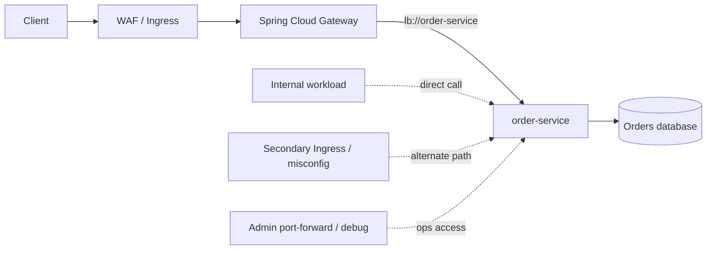
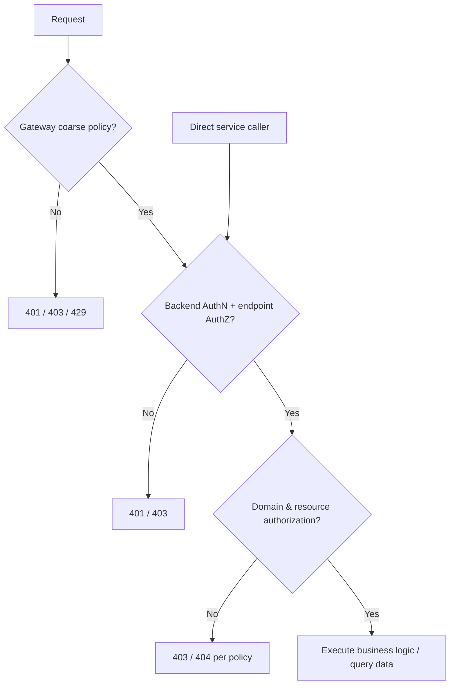
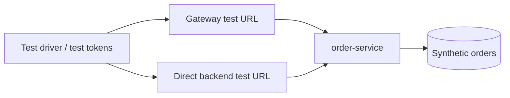
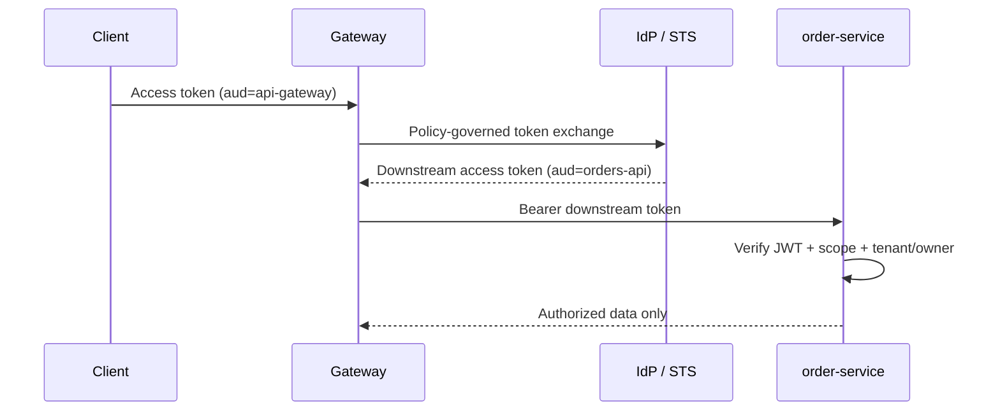

# Enforcing Service-Level Authorization When Gateway Is Bypassed

A **Spring Cloud Gateway** can validate JWTs, evaluate route predicates, normalize headers, enforce rate limits, apply TLS, and forward only permitted requests to microservices. However, a backend that blindly "assumes every request came through Gateway" becomes dangerous whenever **alternative access paths** exist: internal Kubernetes Services, an accidentally exposed `NodePort`, a secondary Ingress, a background worker calling the backend directly, a compromised sibling service, or a misconfigured network rule.

This lesson belongs to the **Security Hardening** chapter and centers on one key question:

> **If an attacker or an internal service sends an HTTP request straight to the backend, bypassing Spring Cloud Gateway, will the backend still authenticate the caller and reject unauthorized actions?**

This is a core **defense-in-depth** principle in API Gateway architectures built with **Spring Cloud Gateway**: route predicates, filter chains, path/header rewrites, `lb://` service discovery, edge authentication, rate limiting, circuit breakers, retries, TLS, and observability protect the front door, yet they **never replace authorization inside the service owning the data and business logic**.

This lesson uses **Gateway Server WebFlux** and a backend built as a **Spring Boot REST service using Spring Security Servlet/MVC**. WebFlux backends follow the same principles, though their `SecurityWebFilterChain` and reactive method security APIs differ. Configuration examples follow common Spring Boot 3 / Spring Security 6 patterns; always verify exact dependencies, properties, and security defaults against your **actual deployed version**.

> **Safety Scope:** Perform direct-backend testing only against services, namespaces, and test environments where you hold explicit authorization. Never scan ports, bypass network boundaries, or probe unauthorized systems. All hostnames, tokens, and datasets in this lesson are synthetic.

## 1. When Can Gateway Be Bypassed?

Consider a typical topology:



The primary path is `Client → Ingress → Gateway → order-service`. Yet the dashed paths can exist because:

- An internal workload resolves the DNS name `order-service.shop.svc.cluster.local`.
- Another Ingress, Service, or LoadBalancer was added without matching Gateway policies.
- The backend accidentally exposes a public `NodePort` or `LoadBalancer`.
- A batch job, message consumer, or service-to-service caller legitimately contacts the backend directly.
- Another sidecar, reverse proxy, service mesh, or API management tier routes straight to the backend.
- Operators open `kubectl port-forward` for authorized troubleshooting.
- A compromised pod in the same cluster has broader network reachability than intended.
- A rollout temporarily creates an exposure path bypassing the tested Gateway instance.

**Using a Kubernetes `ClusterIP` does not make a backend publicly exposed**, as `ClusterIP` traffic stays within the cluster/network fabric; however, **internal does not mean trusted**. Network reachability is a separate control layer, never proof that a user is allowed to view a given order.

### What Happens If the Backend Has No Protection?

Suppose Gateway blocks:

```http
GET /api/orders/7ed5... HTTP/1.1
Authorization: Bearer <Bob's-token>
```

because Bob does not own that order. If the backend exposes `GET /orders/{id}` and returns rows strictly by `id` without checking principal and tenant, any direct caller can bypass Gateway's policy and read the order.

**Missing backend authorization is a data exposure vulnerability**, not merely "incomplete Gateway configuration."

## 2. Distinguishing Authentication, Authorization, and Network Controls

| Control | Question Answered | Example | Replaces Other Controls? |
| --- | --- | --- | --- |
| **Authentication (AuthN)** | Who is the caller? | Verifying a JWT or mTLS identity | Does not replace AuthZ |
| **Authorization (AuthZ)** | What may the caller do to which resource? | Alice may read orders belonging to tenant A that she owns | Does not replace AuthN |
| **Network access** | Does the caller have a TCP path to the service? | `NetworkPolicy` allowing ingress only from the Gateway namespace | Does not replace AuthN/AuthZ |
| **API Gateway policy** | Which routes and edge filters handle external requests? | JWT validation, rate limits, path rewrites, CORS | Does not replace backend AuthZ |
| **Service-to-service identity** | Which workload initiated the call? | mTLS SPIFFE ID or OAuth client credentials | Does not prove end-user rights |
| **Audit** | Who attempted what action, and with what outcome? | Order read denied, trace ID logged | Prevents nothing without active enforcement |

Strong systems combine **all layers simultaneously**. If network controls are misconfigured, the backend still checks tokens and ownership. If Gateway has a route/filter bug, the backend still enforces resource ownership. When the backend itself harbors a data-access bug, network isolation and Gateway rules narrow exposure yet **cannot eliminate the underlying logic flaw**.

## 3. Threat Model: Assets, Callers, and Trust Boundaries

To design tests systematically, specify:

**Protected assets:**

- Orders, payments, invoices, reports, and customer profiles.
- Per-tenant SaaS records.
- Financial or state-mutating write operations.
- Credentials, tokens, connection strings, and audit logs.

**Possible callers:**

1. End users calling through Gateway.
2. End users holding valid tokens trying direct or alternate paths.
3. Legitimately authorized internal microservices.
4. Compromised internal workloads.
5. Unauthenticated callers presenting no tokens.
6. Revoked identities or identities from a different tenant.
7. Operators/admins with network access but zero rights to read customer data.

**Boundaries to verify:**

```text
Internet -> Ingress/WAF -> Gateway -> service network -> backend code -> database
             |              |          |                |
          network         routing     AuthN           AuthZ + data
          boundary        policy      & caller        ownership
                                        proof
```

Resource-level decisions typically require context available only to the backend: order ownership, payment status, live tenant membership, and domain rules. Gateway checks are therefore **coarse-grained**, whereas backends must enforce **fine-grained authorization**.

## 4. One Non-Negotiable Principle

**"Gateway already authenticated the request" is never sufficient proof for a backend to trust a request blindly.**

Gateway might:

- Validate a JWT and forward it untouched to a backend with a mismatched intended audience.
- Inject `X-User-Id` from a token while the backend trusts that header from any caller.
- Have a route missing `TokenRelay` or lacking an auth filter.
- Be reachable through an alternate ingress lacking identical rules.
- Supply a service token rather than a user token, which the backend mistakenly treats as a user.
- Enforce rules against pre-rewrite URLs while the backend queries records via another parameter.

Backends should evaluate every request consistently:

1. **Validate credentials** intended for the backend, or authenticate the trust boundary using strong cryptography.
2. **Identify caller type**: end user, service principal, or delegated user.
3. **Check operation/endpoint permissions**.
4. **Verify resource-level access** using tenant, ownership, and business policy.
5. **Never trust caller-asserted metadata**, even on headers labeled "internal."
6. **Deny by default** whenever credentials, audiences, principals, scopes, tenants, or ownership fail validation.
7. **Emit controlled audit events** for denials and sensitive operations.

## 5. Three Policy Layers: Gateway, Backend HTTP, and Domain



Look closely at the **Direct service caller → Backend AuthN + endpoint AuthZ** arrow. Direct callers must hit the exact same data-protection controls even without Gateway's routes or filters in front.

### Coarse-Grained vs. Fine-Grained

Gateway typically enforces:

- Does the request carry a valid JWT?
- Does the token contain `orders.read`?
- Do HTTP method and path match an allowed route?
- Is the client/tenant within rate limits?
- What CORS headers apply to browsers?
- Which untrusted headers must be stripped before forwarding?

The backend must additionally verify:

- Does order `42` belong to the authenticated principal's tenant?
- Is the principal the owner, assignee, or authorized delegate?
- May a support role read or mutate this specific record type?
- Is a locked/finalized invoice disallowed from edits?
- Is the caller authorized to refund this **specific dollar amount**?
- May a service principal execute this action on a user's behalf?

**Holding the `orders.read` scope never implies permission to read every order across every tenant.**

## 6. BOLA/IDOR: The Critical Test When Gateway Is Bypassed

**Broken Object Level Authorization (BOLA)**—closely tied to **Insecure Direct Object Reference (IDOR)**—occurs when an API checks broad identity or scope yet fails to verify **authorization on the specific target object**.

Example:

```text
Tenant Alpha:
  Alice owns order A-101
  Bob owns order A-102

Tenant Beta:
  Carol owns order B-201
```

If Alice has `SCOPE_orders.read`, outcomes must remain:

```text
GET /orders/A-101  -> ALLOW
GET /orders/A-102  -> DENY (unless explicitly shared by policy)
GET /orders/B-201  -> DENY
```

equally whether requests arrive through Gateway or straight at the backend.

A backend method doing only:

```java
@PreAuthorize("hasAuthority('SCOPE_orders.read')")
public OrderDto get(UUID id) {
    return repository.findById(id).map(mapper::toDto).orElseThrow();
}
```

is **insufficient**, because any user carrying read scope could supply someone else's ID. Ownership and tenant boundaries must be enforced inside the query or domain service.

### UUIDs Are Not Access Control

Even when order IDs are unpredictable random UUIDs, if another caller learns a UUID via logs, emails, `Referer` headers, partial leaks, or legitimate events, the backend must still deny unauthorized access. **Unpredictable IDs slow enumeration; they never replace authorization.**

## 7. BFLA: Enforcing Function-Level Permissions

**Broken Function Level Authorization (BFLA)** happens when callers invoke operations outside their role or privilege tier.

Example backend operations:

| Backend API | Minimum Authority | Additional Data-Level Authorization |
| --- | --- | --- |
| `GET /orders/{id}` | `orders.read` | Matching tenant + owner/authorized role |
| `POST /orders` | `orders.write` | Only creates orders within permitted tenant |
| `PATCH /orders/{id}` | `orders.write` | Owner + mutable workflow state |
| `POST /orders/{id}/refund` | `payments.refund` | Refund permission + monetary caps + state rules |
| `GET /admin/reports` | Admin/report scope | Authorized within approved report scope |
| `DELETE /users/{id}` | Privileged account management | Separation of duties + strict audit trail |

If Gateway routes only `GET`, yet the backend still exposes `DELETE /orders/{id}` with no `@PreAuthorize` or HTTP matcher guard, direct callers can invoke `DELETE`.

**Never assume blocking an HTTP method at Gateway protects the backend.** Protect both the backend HTTP layer and domain methods.

## 8. Selecting a Backend Credential Model

Three common patterns exist:

| Pattern | What Backend Receives | When Appropriate | Key Risks to Manage |
| --- | --- | --- | --- |
| **End-user access token relay** | User's JWT/OAuth access token | Backend is an intended resource server for that token | Validate issuer, audience, expiry, scopes, and object rights |
| **Token exchange / on-behalf-of** | Downstream-scoped token carrying delegation context | Gateway/API must exchange into backend-specific audience | Never forge unsigned headers; rely on trusted IdP/STS |
| **Service-to-service credential** | Client-credentials token or mTLS workload identity | Workers/services calling backends autonomously without an end user | Never imply end-user rights; isolate scopes and workload identities |

Many systems pair **workload authentication (mTLS)** with **end-user authorization (tokens)**. Those represent two separate proofs, never interchangeable claims of the same permission.

## 9. Backends Must Independently Verify JWT Access Tokens

A backend accepting JWTs must verify at minimum:

1. **Signature** and trusted algorithms/keys—reject `alg=none` and caller-supplied keys.
2. **Issuer (`iss`)** matching an approved allowlist.
3. **Audience (`aud`)** matching this specific backend/API, rejecting tokens minted only for another service.
4. **Expiration (`exp`)** and **not-before (`nbf`)** with bounded clock skew.
5. **Token type / intended use** per IdP contract: access token, not a misused ID token.
6. **Scopes/authorities** required by the endpoint.
7. **Trusted subject (`sub`)** and valid tenant/membership context.
8. **Revocation / permission freshness** aligned with risk instead of treating unexpired JWTs as permanent rights.
9. **Key rotation / JWKS trust**: never download keys from untrusted `jku`/`jwk` URLs inside token headers.
10. **Transport protection**: pass tokens over HTTPS/mTLS and never write raw tokens to logs.

Base64-decoding a JSON payload to read `sub` is **not** JWT verification. Claims are **trustworthy only after the cryptographic verifier accepts the entire token**.

### An ID Token Is Not a Backend Access Token

In OpenID Connect, an **ID token** proves user authentication to the client application and typically sets `aud` to that client app. It does not authorize API access to `order-service`. Backends should require an **OAuth2 resource access token** carrying appropriate audiences and scopes.

## 10. Audience (`aud`): Preventing Token Misuse Across Services

Suppose the Identity Provider issues:

```json
{
  "iss": "https://identity.example.invalid/realms/shop",
  "sub": "alice",
  "aud": ["api-gateway"],
  "scope": "orders.read"
}
```

Gateway may accept this token if Gateway is the intended audience, yet **`order-service` must reject it** if policy requires `aud=orders-api`.

A separate backend-targeted token:

```json
{
  "iss": "https://identity.example.invalid/realms/shop",
  "sub": "alice",
  "aud": ["orders-api"],
  "scope": "orders.read",
  "tenant_id": "alpha"
}
```

Both JSON snippets are **unsigned illustrative payloads**—never treat them as real tokens. Standard JWT decoders handle `aud` whether serialized as a string or array; validation must rely on a properly configured verifier.

### Why `aud` Matters When Gateway Is Bypassed

If `order-service` accepts tokens meant for a reporting service or a mobile frontend merely because they share the same issuer, a token compromised in that lower-trust system can be replayed straight against `order-service`. Audience binding constrains token blast radius.

**Never "disable audience validation" simply to make `TokenRelay` convenient.** If user tokens target Gateway alone, use **token exchange / on-behalf-of** or issue access tokens explicitly scoped to intended resource audiences per IdP design.

## 11. Issuer, Signature Verification, and Key Rotation

Backends must use a **pre-configured trust anchor**—such as the IdP's configured JWKS endpoint—never dynamically loading keys from arbitrary untrusted `jku` or `jwk` header parameters.

Verify:

- Signed by an approved issuer.
- JWKS URL sourced from trusted discovery/config over HTTPS.
- Explicit algorithm allowlist preventing algorithm-confusion attacks.
- Invalid signatures or unknown `kid` values → rejected immediately.
- During issuer key rotation, valid tokens signed with new keys succeed once refreshed, while retired keys follow revocation policy.
- Bounded clock skew with NTP synchronization.
- Zero hardcoded private signing keys committed in repositories.

**Misconfigured JWKS caching and rollover** can cause outages when backends fail to refresh rotated keys. Test key rotation cleanly as infrastructure hardening rather than disabling signature checks.

## 12. Opaque Access Tokens Also Require Backend Verification

Not all access tokens are self-contained JWTs. With **opaque tokens**, backends generally call the Authorization Server's **introspection endpoint** to confirm active status, scopes, subject, audience/resources, and expiration.

Trade-offs:

- Enables centralized status checks and near-real-time revocation.
- Per-request or cached introspection adds latency/load and needs explicit timeouts and circuit breakers.
- If introspection is unavailable, the backend must never default-allow; define an explicit **fail-closed policy**.
- Cached introspection entries require bounded TTLs that never extend privileges past expiration.
- Backends still must enforce resource and tenant authorization after confirming token validity.

**Offline JWT verification and opaque introspection represent distinct architectures**—never mix or weaken them merely to silence a 401.

## 13. Gateway `TokenRelay` Only Forwards Credentials

In an appropriate OAuth2 setup, Spring Cloud Gateway's `TokenRelay` filter forwards the access token downstream:

```text
Client -- token --> Gateway
                       |
                       +-- authn/route checks
                       |
                       +-- TokenRelay --> order-service
                                          |
                                          +-- validate token
                                          +-- authorize endpoint
                                          +-- authorize order/tenant
```

`TokenRelay` **neither alters signatures nor swaps audiences nor proves the backend checked permissions**. It simply relays credentials in the right flow.

### Never Use "Gateway Already Authed This" as a Bypass Flag

Anti-pattern:

```http
X-Authenticated-User: alice
X-Tenant-Id: alpha
X-Is-Admin: true
```

If a backend honors these headers without verifying origin and cryptographic authenticity, any direct caller can forge identical headers to escalate privileges. Header labels like `"internal"`, `"verified"`, or `"from-gateway"` are plain text, not cryptographic proof.

To convey identity context safely, prefer **verifiable audience-bound access tokens** or short-lived **signed/encrypted assertions** carrying issuer, audience, timestamps, replay guards, and verified peer trust. Remember that **mTLS identifies the peer workload only**—it does not validate end-user context headers end-to-end unless strictly governed.

## 14. User Identity and Workload Identity Are Separate Axes

A single call often involves two identities:

- **User principal:** Alice in tenant Alpha, permitted to read order A-101.
- **Workload caller:** `api-gateway`, `report-worker`, or `billing-service`.

```text
Request context:
  workload = api-gateway
  user = alice
  tenant = alpha
  action = orders.read
  resource = A-101
```

The backend should evaluate:

1. Is this calling workload allowed to invoke the API under workload policy?
2. Is the user/delegation token valid for the intended audience?
3. Does the user hold authority to read orders?
4. Does the order belong to that tenant and user/role?
5. Do any business-state rules forbid the operation?

When a batch worker calls via **client credentials** with no end user present, the backend must enforce a dedicated **service authorization policy** rather than assuming every request has a user `sub`.

## 15. Service-to-Service Authorization Means More Than "On the Internal Network"

Suppose `report-worker` aggregates reports using an OAuth2 client-credentials token:

```json
{
  "iss": "https://identity.example.invalid/realms/shop",
  "sub": "report-worker",
  "aud": ["orders-api"],
  "scope": "orders.export"
}
```

The backend may permit `exportOrdersForReport` within an approved tenant/service contract, yet must forbid that token from calling `POST /orders/{id}/refund` just because the caller is "internal."

**Client credentials never represent an interactive end user.** Actions requiring user consent need trusted delegation/on-behalf-of chains recording both actor and subject, or a separate service authorization model.

### Scopes Tailored to Caller Roles

- `orders.read.self`: end user reading own orders.
- `orders.read.support`: support staff acting under policy.
- `orders.export.service`: tightly scoped reporting workload.
- `orders.write`: order mutations.
- `payments.refund`: high-risk operation with stricter controls.

These scope names are illustrative. Maintain **stable semantics and least privilege**, avoiding a catch-all `ROLE_INTERNAL`.

## 16. Never Trust Forwarded Headers Unconditionally

Gateway can mutate headers via `SetRequestHeader`, `AddRequestHeader`, and `RemoveRequestHeader`. These are request-shaping filters, not cryptographic guarantees.

Headers requiring scrutiny:

| Header | Risk | Proper Handling |
| --- | --- | --- |
| `X-User-Id` | Client spoofs principal | Never treat as authority without cryptographic verification |
| `X-Tenant-Id` | Cross-tenant data exposure | Derive tenant from verified identity and membership |
| `X-Role` / `X-Is-Admin` | Privilege escalation | Never trust raw role headers |
| `Authorization` | Token leaked or misdirected | Validate token at target backend; never log it |
| `X-Forwarded-For` | Spoofed IP bypassing rate limits | Trust only from verified proxy chains |
| `X-Forwarded-Proto` / `Host` | Host/scheme spoofing, URL confusion | Enforce trusted proxies, host policy, and forwarding strategy |
| `X-Original-URI` | Pre-rewrite path auth bypass | Authorize actual backend resource and operation |
| `X-Request-Id` | Log injection / cardinality blowup | Validate format/length; never use as authorization |
| `Cookie` | Session fixation / CSRF risks | Enforce proper auth model and keep CSRF active for cookies |

**Gateway should strip untrusted client identity headers** before attaching edge metadata, yet the backend must still verify cryptographic credentials or signed provenance. Header removal narrows exposure; it never replaces backend authentication.

## 17. Route Predicates and Rewrites Never Define Resource Authorization

Suppose Gateway defines:

```yaml
spring:
  cloud:
    gateway:
      routes:
        - id: orders-api
          uri: lb://order-service
          predicates:
            - Path=/api/orders/**
          filters:
            - StripPrefix=1
```

Request flow:

```text
Client:  GET /api/orders/A-101
Gateway: match Path=/api/orders/**
Gateway: StripPrefix=1
Backend: GET /orders/A-101
```

If backend security rules protect `/api/orders/**` **instead of `/orders/**`**, direct calls to the backend skip the matcher. A trailing `anyRequest().permitAll()` turns that path mismatch into a complete bypass.

**Backends must secure their own actual URIs and operations**, never relying on Gateway's external prefix.

Furthermore:

- `RewritePath` can perform complex path transformations.
- `SetPath` can map multiple external routes onto one backend endpoint.
- Gateway `Method` predicates can reject HTTP verbs externally while direct callers still reach them.
- `Host`/`Header` predicates do not prove user permissions.
- Backend HTTP and method security must remain independent even as Gateway routes update dynamically.

## 18. Spring Security at the Backend: Deny by Default

Example **Spring Boot Servlet/MVC** security configuration for `order-service`:

```java
@Configuration
@EnableMethodSecurity
public class OrderSecurityConfiguration {

    @Bean
    SecurityFilterChain securityFilterChain(HttpSecurity http)
            throws Exception {
        return http
            // Only suitable for stateless Bearer-only APIs;
            // evaluate CSRF carefully if browser cookies/sessions are used.
            .csrf(csrf -> csrf.disable())
            .sessionManagement(session -> session
                .sessionCreationPolicy(SessionCreationPolicy.STATELESS))
            .authorizeHttpRequests(authorize -> authorize
                .requestMatchers(
                    "/actuator/health/liveness",
                    "/actuator/health/readiness"
                ).permitAll()
                .requestMatchers(HttpMethod.GET, "/orders/**")
                    .hasAuthority("SCOPE_orders.read")
                .requestMatchers(HttpMethod.POST, "/orders/**")
                    .hasAuthority("SCOPE_orders.write")
                .requestMatchers(HttpMethod.PATCH, "/orders/**")
                    .hasAuthority("SCOPE_orders.write")
                .anyRequest().denyAll())
            .oauth2ResourceServer(oauth2 -> oauth2
                .jwt(Customizer.withDefaults()))
            .build();
    }
}
```

This is a **configuration template requiring full imports, dependencies, and real testing**; exact Spring Security APIs vary by version. Notice what it establishes:

- Every request (except explicitly permitted health probes) must match a rule or hit `denyAll()`.
- `GET /orders/**` requires `SCOPE_orders.read`.
- `POST`/`PATCH` require `SCOPE_orders.write`, followed by domain ownership checks.
- `DELETE` is denied until explicitly configured with its own policy.
- JWT verification runs via Resource Server config.
- Enforcement happens inside the **backend process**, independent of Gateway.

**Never expose full Actuator health details, metrics, or gateway routes publicly.** Restrict permitted liveness/readiness probes to orchestrator networks and isolate management endpoints accordingly.

### CSRF and Stateless APIs

`csrf.disable()` applies strictly when the backend accepts **Bearer tokens in `Authorization` headers** without browser cookie sessions. If browsers automatically transmit session cookies, retain CSRF defenses rather than copying `csrf.disable()` blindly.

## 19. Configuring JWT Issuer Validation at the Backend

In Spring Boot Resource Server:

```yaml
spring:
  security:
    oauth2:
      resourceserver:
        jwt:
          issuer-uri: https://identity.example.invalid/realms/shop
```

This configures issuer verification and JWKS discovery from a trusted source. However, **setting `issuer-uri` alone does not automatically enforce business-specific audience checks**. Configure audience validation via Boot/Security properties supported in your version or a custom validator.

**Never deploy `example.invalid` in production.** Substitute your actual IdP issuer over HTTPS with verified truststores, private connectivity, and key-rollover support.

### Common Dependencies

```xml
<dependency>
    <groupId>org.springframework.boot</groupId>
    <artifactId>spring-boot-starter-security</artifactId>
</dependency>
<dependency>
    <groupId>org.springframework.boot</groupId>
    <artifactId>spring-boot-starter-oauth2-resource-server</artifactId>
</dependency>
```

Do not confuse `oauth2-client` with `oauth2-resource-server`. Backends validating inbound access tokens need **Resource Server**; `oauth2-client` is for services actively acquiring or exchanging tokens as a client.

## 20. Audience Validator: Backend Example

When the Authorization Server issues tokens carrying `aud=orders-api`, the backend can enforce a custom validator:

```java
@Configuration
public class JwtValidationConfiguration {

    @Bean
    JwtDecoder jwtDecoder(
            @Value("${security.jwt.issuer}") String issuer,
            @Value("${security.jwt.jwk-set-uri}") String jwkSetUri) {

        NimbusJwtDecoder decoder =
            NimbusJwtDecoder.withJwkSetUri(jwkSetUri).build();

        OAuth2TokenValidator<Jwt> issuerAndTime =
            JwtValidators.createDefaultWithIssuer(issuer);

        OAuth2TokenValidator<Jwt> intendedAudience = jwt -> {
            if (jwt.getAudience().contains("orders-api")) {
                return OAuth2TokenValidatorResult.success();
            }

            OAuth2Error error = new OAuth2Error(
                "invalid_token",
                "Token audience is not orders-api",
                null
            );
            return OAuth2TokenValidatorResult.failure(error);
        };

        decoder.setJwtValidator(
            new DelegatingOAuth2TokenValidator<>(
                issuerAndTime, intendedAudience
            )
        );
        return decoder;
    }
}
```

Matching configuration:

```yaml
security:
  jwt:
    issuer: https://identity.example.invalid/realms/shop
    jwk-set-uri: https://identity.example.invalid/realms/shop/jwks
```

**This Java/Spring Security skeleton requires proper imports and the real IdP JWKS URL.** It illustrates **signature + issuer/timestamps + audience** checks. Adjust `/jwks` if your IdP exposes a different discovery path. Note that declaring a custom `JwtDecoder` bean overrides auto-configuration, so test signatures, key rotation, and all validators end-to-end.

Never replace `JwtValidators.createDefaultWithIssuer` with an audience-only validator—doing so drops `exp` and `nbf` enforcement.

### Built-In Audience Properties

Certain Spring Boot releases offer built-in properties/auto-configuration for `audiences`, though exact names and behavior differ across versions. Use your pinned version's built-in support when available instead of writing duplicate beans. Regardless of mechanism, **negative tests with a valid issuer yet wrong `aud` must fail with 401**.

## 21. Resource Ownership Belongs in the Domain Layer

Suppose the repository holds:

| Order | Tenant | Owner |
| --- | --- | --- |
| A-101 | alpha | alice |
| A-102 | alpha | bob |
| B-201 | beta | carol |

Queries must scope data using the verified token/principal. **Never read owner or tenant values from query params, path segments, or unverified headers.**

Example repository query:

```java
public interface OrderRepository
        extends JpaRepository<OrderEntity, UUID> {

    Optional<OrderEntity> findByIdAndTenantIdAndOwnerSubject(
        UUID id,
        String tenantId,
        String ownerSubject
    );
}
```

Compare:

```java
// INSUFFICIENT if any caller with read scope can fetch another user's order.
orderRepository.findById(orderId);

// Safer for "read my own order":
orderRepository.findByIdAndTenantIdAndOwnerSubject(
    orderId, verifiedTenantId, verifiedSubject
);
```

Pushing tenant and owner predicates directly into the query lowers the risk of over-fetching and leaking records before checks run, though domain policies must still govern privileged roles, sharing/delegation, and transactional invariants.

### Why Check Both Tenant **and** Owner?

- Checking only tenant lets Alice read Bob's order in the same tenant when prohibited.
- Checking only `ownerSubject` fails if subject IDs are not globally unique or collide across tenants.
- Checking a global `ADMIN` role without tenant scoping lets one tenant's admin act across another tenant.
- Reading active tenant from an unverified request header lets attackers switch tenants freely.

**Authorization evaluates full access predicates over specific resources, not single claim strings.**

## 22. Domain Service Example: Checking Both Principal and Resource

```java
@Service
public class OrderQueryService {

    private final OrderRepository repository;
    private final OrderMapper mapper;

    public OrderQueryService(
            OrderRepository repository,
            OrderMapper mapper) {
        this.repository = repository;
        this.mapper = mapper;
    }

    @PreAuthorize("hasAuthority('SCOPE_orders.read')")
    @Transactional(readOnly = true)
    public OrderDto readOwnedOrder(
            UUID orderId,
            JwtAuthenticationToken caller) {

        Jwt jwt = caller.getToken();
        String subject = jwt.getSubject();
        String tenantId = jwt.getClaimAsString("tenant_id");

        if (subject == null || subject.isBlank()
                || tenantId == null || tenantId.isBlank()) {
            throw new AccessDeniedException(
                "Required identity context is missing");
        }

        OrderEntity order = repository
            .findByIdAndTenantIdAndOwnerSubject(
                orderId, tenantId, subject)
            .orElseThrow(() ->
                new ResponseStatusException(
                    HttpStatus.NOT_FOUND,
                    "Order not found"));

        return mapper.toDto(order);
    }
}
```

This sample intentionally focuses on **"read my own order"** without support or admin access. Add full imports, mappers, entities, JPA wiring, error response contracts, and tests.

Explanation:

1. `JwtAuthenticationToken` represents a JWT **already cryptographically verified by Spring Security**.
2. `@PreAuthorize` enforces operation scope prior to database queries when method security proxies apply.
3. `tenantId` and `subject` come strictly from verified JWT claims per IdP contract.
4. The repository scopes rows by **both tenant and owner**.
5. Out-of-scope orders return `404` under an existence-hiding policy; return `403` if your API contract dictates.
6. Never treat `?tenant=beta` or `X-User-Id: alice` as authoritative.

**Never invoke `readOwnedOrder` internally in a way that bypasses Spring's method-security proxy** (e.g., same-class self-invocation). Domain methods should enforce checks and scoped queries **without relying solely on proxy annotations**.

## 23. Controllers Delegate to Domain Services Without Trusting Gateway Paths

```java
@RestController
@RequestMapping("/orders")
public class OrderController {

    private final OrderQueryService orderQueryService;

    public OrderController(OrderQueryService orderQueryService) {
        this.orderQueryService = orderQueryService;
    }

    @GetMapping("/{id}")
    public OrderDto getOne(
            @PathVariable UUID id,
            JwtAuthenticationToken authentication) {

        return orderQueryService
            .readOwnedOrder(id, authentication);
    }
}
```

The backend exposes `/orders/{id}`. Even if Gateway exposes `/api/orders/{id}` and applies `StripPrefix`, **backend authorization never depends on `/api` being present**.

Direct `GET /orders/{id}` calls still pass through backend Spring Security and into the scoped service query. An alternate ingress or port-forward grants zero extra privileges.

## 24. Never Put `@PreAuthorize` Only on Controllers

A common mistake:

```java
@GetMapping("/{id}")
@PreAuthorize("hasAuthority('SCOPE_orders.read')")
public OrderDto getOrder(@PathVariable UUID id) {
    return service.findById(id);
}
```

If another execution path calls `service.findById(id)`:

- Batch consumers.
- Internal schedulers.
- Admin handlers.
- GraphQL resolvers.
- Message queue listeners.
- gRPC endpoints.

controller annotations are completely bypassed. **Resource-ownership authorization must live at the service/domain boundary**, enforcing explicit caller contexts and policies.

A clear domain API reflects its security contract directly in method signatures:

```text
readOwnedOrder(userContext, orderId)
readTenantOrders(tenantAdminContext, tenantId)
exportOrders(reportServiceContext, approvedScope)
```

Avoid creating a permissive public `findAnyOrder(id)` inside your domain module and hoping every caller remembers to authorize first.

## 25. Combining Scopes and Row-Level Authorization

Access control can be expressed as:

\[
\text{ALLOW} =
\text{valid credential}
\land \text{operation scope}
\land \text{tenant membership}
\land \text{resource predicate}
\land \text{business constraints}
\]

For `GET /orders/{id}`:

- Valid access token issued for `orders-api`.
- `SCOPE_orders.read`.
- Verified active tenant membership.
- Order belongs to the matching tenant.
- Order owner matches `sub` (or valid delegated actor).
- No business state restricts viewing.

If any term fails, deny access. Real policies can combine RBAC, ABAC, and ReBAC, provided **every input comes from a trusted source**.

### Are Verified JWT Tenant Claims Enough for Live Membership?

Suppose the IdP issues a token with `tenant_id=alpha` at 10:00, and at 10:05 the user is removed from the tenant while the JWT remains valid until 10:30. Weigh risk to decide **authorization freshness**:

- Short access token lifetimes and tighter token issuance.
- Token revocation, session invalidation, or introspection.
- Policy/membership caching with bounded TTLs for sensitive actions.
- Direct membership checks inside the backend or authorization service when required.
- Auditing every permission change.

No single freshness mechanism fits all endpoints; payment refunds demand tighter freshness than low-risk reads.

## 26. HTTP 401, 403, and 404: Choosing a Consistent Contract

| Status | Typical Meaning | What to Verify |
| --- | --- | --- |
| **401 Unauthorized** | Missing, invalid, or expired token (unauthenticated) | Backend AuthN rejects direct calls consistently |
| **403 Forbidden** | Authenticated, yet lacks required scope, role, or policy permission | Cannot be bypassed around Gateway |
| **404 Not Found** | Resource does not exist **or** intentionally masked across scopes | Reveals zero cross-tenant order details |
| **405 Method Not Allowed** | Method unsupported by handler | Never rely on 405 instead of AuthZ on sensitive paths |
| **429 Too Many Requests** | Edge quota/admission limit | Backend AuthZ still runs independently |
| **5xx** | Server or dependency failure | Never return 200 if auth verification fails |

**Returning 401/403 on wrong tokens proves nothing about BOLA checks.** A caller holding `orders.read` still passes HTTP scope matchers and must still be blocked on another user's order.

### Preventing Information Leakage

If error responses differ between "order exists in another tenant" and "order does not exist," attackers can enumerate valid IDs. Depending on policy, backends may return an identical **404** in both cases. Above all, **return zero unauthorized data** and expose no existence hints via bodies, timing, or public logs.

## 27. Write Authorization: TOCTOU and Idempotency

Checking "may this user edit the order?" and updating it separately creates a **time-of-check to time-of-use (TOCTOU)** race:

```text
1. Backend reads order; status is DRAFT.
2. Backend verifies user owns the order.
3. Concurrent transaction marks the order PAID.
4. Backend applies update assuming the stale DRAFT state.
```

For sensitive mutations:

- Enforce both scope and tenant/owner authorization.
- Validate state transitions inside the write transaction.
- Use transactions, optimistic locking, or conditional updates.
- Never trust workflow states submitted by the client.
- When retries can re-send writes, require idempotency keys enforced by the backend.
- Emit sanitized audit records capturing actor, action, outcome, and resource ID.
- Ensure direct callers cannot bypass validation or domain invariants.

Gateway `Retry` and `CircuitBreaker` policies cannot preserve transactional safety; backends must protect write integrity regardless of which caller submits the request.

## 28. Service Mesh mTLS Authenticates Workloads, Not End Users

**Mutual TLS (mTLS)** authenticates both endpoints of a connection using certificates. Service meshes can enforce workload identities (e.g., SPIFFE IDs), allowing only `api-gateway` pods to connect to `order-service`.

```text
Gateway workload identity -- mTLS --> order-service workload identity
             |
             +-- delegated user access token (when acting for a user)
```

Keep the two proofs distinct:

- mTLS proves: which workload opened the TCP/TLS connection?
- OAuth/JWT proves: which user/delegation authorized this resource and scope?

If mTLS authenticates `report-worker` without a user token, the backend may authorize service-level operations permitted to `report-worker`, never impersonating Alice implicitly.

### Limits of mTLS Alone

- Workload certificates can be compromised.
- Overly broad mesh allowlists can grant sibling services unnecessary access.
- Misconfigured mesh policies or sidecar bypasses open direct connections.
- A workload-authenticated Gateway can still forward a wrong-audience user token.
- mTLS does not check row-level order ownership unless application/policy logic checks it.

**mTLS + application authorization** work together as defense-in-depth, not mutually exclusive alternatives.

## 29. Kubernetes `NetworkPolicy`: Restricts Paths Without Replacing AuthZ

Example `NetworkPolicy` for `order-service` in namespace `shop`, allowing ingress solely from Gateway pods in namespace `edge`:

```yaml
apiVersion: networking.k8s.io/v1
kind: NetworkPolicy
metadata:
  name: orders-from-gateway-only
  namespace: shop
spec:
  podSelector:
    matchLabels:
      app: order-service
  policyTypes:
    - Ingress
  ingress:
    - from:
        - namespaceSelector:
            matchLabels:
              kubernetes.io/metadata.name: edge
          podSelector:
            matchLabels:
              app: api-gateway
      ports:
        - protocol: TCP
          port: 8080
```

**Critical notes:**

- Putting `podSelector` and `namespaceSelector` inside the same `- from` list item creates an **AND** rule: only matching pods inside that matching namespace are allowed.
- Splitting them into **two separate `- from` list items** creates an OR rule, widening access unintentionally!
- `NetworkPolicy` only enforces when your **CNI plugin enforces network policies**; applying YAML does not prove the dataplane actually blocks traffic.
- Label/namespace selectors never prove end-user identity or object rights.
- Legitimate scrapers, probes, mesh sidecars, and approved callers require explicit additional rules reviewed for security.
- Port-forwards, node-local traffic, and `hostNetwork` pods carry cluster/CNI-specific behavior; never view `NetworkPolicy` as an absolute barrier against privileged cluster roles.

**Never lock down production with this snippet before inventorying legitimate callers.** Validate connectivity in staging first to avoid breaking integrations.

### Testing `NetworkPolicy` Enforcement

Do not stop at verifying Kubernetes accepted the YAML. Test from authorized lab sources:

- Approved Gateway pod → TCP connects, and backend AuthZ still enforces tokens.
- Unapproved test pod → connection blocked by CNI network policy.
- Approved internal service caller → allowed by policy and restricted by service AuthZ.
- Pod in the right namespace with wrong labels → denied.
- Pod with right app label in the wrong namespace → denied under combined AND rule.

Then **send an unauthenticated request over an allowed network path** to confirm the backend still returns 401—network reachability never substitutes for AuthN.

## 30. Service Types, Ingresses, and Admin Ports: Auditing Real Exposure

A thorough hardening audit inventories:

| Resource | Question |
| --- | --- |
| `Service type: ClusterIP` | Can internal pods reach the backend directly? |
| `Service type: NodePort/LoadBalancer` | Is any backend port exposed externally? |
| `Ingress / Gateway API` | Do secondary routes point directly to the backend? |
| `Service mesh VirtualService/HTTPRoute` | Do any rules bypass Gateway? |
| `HostPort / hostNetwork` | Does any pod bind unexpected host ports? |
| `kubectl port-forward` / `exec` | Who holds cluster RBAC for debug access, and how is it audited? |
| `/actuator/**` | Are management paths network- and role-isolated? |
| Backend HTTP vs. HTTPS | Where do TLS termination and trust boundaries sit? |
| Egress policies | Which internal workloads can dial the backend? |
| Secrets / truststores | Are keys, tokens, and truststores protected and rotated? |

**Never assume "no public LoadBalancer" prevents Gateway bypass.** Inside Kubernetes, many workloads can dial internal Service DNS depending on network and RBAC rules.

## 31. Inspecting Forwarded Host, Proxy, and Origin Headers

`Forwarded`, `X-Forwarded-For`, `X-Forwarded-Proto`, and `Host` support URL generation, client IP logging, scheme detection, and routing. They **never authorize a user to read an order**.

When configuring `trusted-proxies` or forward-header handling per your Spring Boot/Gateway version:

1. Define explicitly which proxy IPs/CIDRs may supply forwarded headers.
2. Edge/ingress must strip or overwrite spoofed client headers.
3. Never derive tenant membership or admin roles from forwarded addresses.
4. For IP-based rate limits, test shared NAT, IPv6, and forged header chains.
5. Test both Gateway-routed and direct calls: absent forwarded headers must never disable backend authorization.
6. Verify Host/SNI routing so arbitrary `Host` headers cannot select lax virtual hosts.

**CORS is strictly a browser policy**, not backend access control; `curl`, internal services, and non-browser clients ignore same-origin rules entirely.

## 32. Never Rely on Gateway Route Filters to Scope Database Access

Suppose Gateway adds:

```yaml
filters:
  - SetRequestHeader=X-Tenant-Id, alpha
```

That header must never be the trusted source for backend tenant selection. If a direct caller sends `X-Tenant-Id: beta` and the backend trusts the header without membership validation, cross-tenant exposure occurs immediately.

Safer design:

```text
Verified Bearer token:
  sub = alice
  tenant_id = alpha

Backend policy:
  active tenant membership = alpha per contract
  GET /orders/{id}
  repository query WHERE order.tenant=alpha AND owner=alice
```

When users hold access to multiple tenants and switch contexts, the tenant-selection check must validate actual membership for the requested tenant. **Never infer membership from URL paths or unverified headers.**

## 33. Multi-Tenant and Role-Based Authorization in SaaS

A SaaS system often requires nuanced access matrices:

| Actor | Tenant | Resource | Action | Result |
| --- | --- | --- | --- | --- |
| Alice (owner) | Alpha | Alice's order | Read | Allow |
| Bob (same tenant) | Alpha | Alice's order | Read | Deny unless explicitly shared |
| Tenant manager | Alpha | Alpha order | Read | Allow per manager policy |
| Tenant manager | Beta | Alpha order | Read | Deny |
| Support agent | Platform | Customer order | Read | Only with valid support ticket/delegation |
| Report worker | Service | Alpha order | Export | Allow per service scope/approved export |
| Anonymous | None | Any order | Read | Deny |
| Expired token | Alpha | Alice's order | Read | Deny |

**Never grant a global `ADMIN` role spanning every tenant** when business rules require per-tenant administration. Scope roles cleanly across global, tenant, resource, and delegation levels, testing every combination.

### Cross-Tenant Negative Tests Commonly Missed

Confirming Alice reads an Alpha order is only the happy path. Always add:

- Alice reading Bob's order inside Alpha.
- Alice reading an order in Beta.
- Alpha's tenant manager reading Beta's order.
- Support accessing Alpha's order without an active case/delegation.
- Alice's token paired with header `X-Tenant-Id: beta`.
- Token missing a tenant claim entirely.
- Token carrying malformed or deactivated tenant claims.

Run every negative test **directly against the backend**, not solely via Gateway.

## 34. Dual-Path Testing: Through Gateway and Direct to Backend

To prove Gateway is not your sole authorization boundary, set up two test paths in an **authorized staging environment**:



You do not need to expose backends to the public Internet: run an authorized in-cluster test runner, execute integration tests on randomized local ports, or use RBAC-permitted `kubectl port-forward`.

| Caller / Request | Via Gateway | Direct to Backend | Goal |
| --- | --- | --- | --- |
| Alice reads Alice's order | 200 | 200 | Authorized access succeeds |
| Alice reads Bob's order (same tenant) | 403/404 | 403/404 | Identically denied |
| Alice reads cross-tenant order | 403/404 | 403/404 | Zero cross-tenant leakage |
| Alice missing required scope | 403 | 403 | Backend enforces scopes independently |
| Missing token | 401 | 401 | Backend authenticates independently |
| Token with wrong audience | 401 | 401 | Backend blocks token misuse |
| Expired token | 401 | 401 | Backend enforces expiration |
| Service token missing permission | 403 | 403 | Zero implicit "internal" privilege |

Status codes can differ when Gateway enforces edge rate limits or blocks routes upstream; the non-negotiable invariant is that **the backend never returns unauthorized data or performs unauthorized mutations**.

## 35. Preparing Multi-Tenant Test Fixtures

```text
Users:
  alice: tenant=alpha, scope=orders.read
  bob:   tenant=alpha, scope=orders.read
  carol: tenant=beta,  scope=orders.read

Orders:
  order-101: tenant=alpha, owner=alice
  order-102: tenant=alpha, owner=bob
  order-201: tenant=beta,  owner=carol
```

Include extra test identities: a tenant-Alpha-scoped admin, a case-delegated support agent, `report-worker` with a service token, a disabled user, and revoked/expired tokens.

**Never use real customer records or production signing keys.** Use a dedicated test issuer/JWKS, synthetic user/tenant data, and tokens scoped exclusively to test environments.

## 36. Unit-Level AuthZ Tests vs. Real-Token Integration Tests

A `MockMvc` test using Spring Security Test's `jwt()` post-processor injects an `Authentication` directly into the test context. It works well for verifying:

- Mapped scopes and authorities.
- Tenant/owner checks inside domain services.
- 403/404 statuses and response body policies.
- Controller and method security rules.

However, it **does not verify JWT signature, issuer, audience, JWKS retrieval, or expiration enforcement**. Those require HTTP integration tests using **cryptographically signed access tokens** issued by a test IdP/JWKS.

| Test Type | Primary Coverage | What It Cannot Prove Alone |
| --- | --- | --- |
| `MockMvc jwt()` | Domain authorization once principal is resolved | Real signature/JWKS verification |
| `@SpringBootTest` + DB fixtures | Controller/service/repository ownership | Production network topology |
| Signed-JWT HTTP test | JWT decoder, audience, scopes, and AuthN/AuthZ | Kubernetes `NetworkPolicy` enforcement |
| In-cluster test pod calling backend | Real cluster network paths + app AuthZ | Full production mesh/ingress permutations |
| Gateway/Backend E2E | `TokenRelay`, path rewrites, and backend AuthZ | Untested endpoints or direct paths |

**Combine policy tests, signed-credential tests, and network tests** rather than treating any one category as complete coverage.

## 37. Direct-Backend `MockMvc` Test: Same Tenant, Different Owner

```java
@SpringBootTest
@AutoConfigureMockMvc
class OrderBackendAuthorizationTest {

    @Autowired
    MockMvc mockMvc;

    @Test
    void aliceCannotReadBobsOrder() throws Exception {
        UUID bobsOrder = UUID.fromString(
            "00000000-0000-0000-0000-000000000102");

        mockMvc.perform(get("/orders/{id}", bobsOrder)
            .with(jwt()
                .jwt(token -> token
                    .subject("alice")
                    .claim("tenant_id", "alpha"))
                .authorities(new SimpleGrantedAuthority(
                    "SCOPE_orders.read"))))
            .andExpect(status().isNotFound());
    }

    @Test
    void aliceCanReadHerOrder() throws Exception {
        UUID alicesOrder = UUID.fromString(
            "00000000-0000-0000-0000-000000000101");

        mockMvc.perform(get("/orders/{id}", alicesOrder)
            .with(jwt()
                .jwt(token -> token
                    .subject("alice")
                    .claim("tenant_id", "alpha"))
                .authorities(new SimpleGrantedAuthority(
                    "SCOPE_orders.read"))))
            .andExpect(status().isOk());
    }
}
```

This skeleton requires imports, Spring Security Test dependencies, seeded test data, and a real `OrderQueryService`. It asserts `404` under an existence-hiding policy; adjust to `isForbidden()` if your API contract returns `403`.

**Never mock away your domain service or ownership queries**, otherwise `@SpringBootTest` only validates URL routing and stubbed responses.

### Verify Error Response Bodies Too

On cross-tenant denials, confirm responses never expose:

- Order amounts, statuses, customer emails, or tenant IDs.
- SQL diagnostics or internal stack traces.
- Tokens or sensitive headers.
- Hint fields confirming whether the order ID exists.

An HTTP 404 whose JSON payload leaks order metadata is still a security leak.

## 38. Testing Direct HTTP Requests Against a Backend Instance

```bash
# 1) Missing token.
curl -i http://127.0.0.1:18081/orders/00000000-0000-0000-0000-000000000101

# 2) Alice's token issued for orders-api.
curl -i \
  -H "Authorization: Bearer $TEST_ALICE_ACCESS_TOKEN" \
  http://127.0.0.1:18081/orders/00000000-0000-0000-0000-000000000101

# 3) Token missing required scope.
curl -i \
  -H "Authorization: Bearer $TEST_NO_SCOPE_TOKEN" \
  http://127.0.0.1:18081/orders/00000000-0000-0000-0000-000000000101
```

`127.0.0.1:18081` assumes an authorized lab backend or local port-forward. Never test with production tokens or leave bearer credentials in shell histories and logs.

Expected results: missing token → 401; valid token with matching scope/owner → 200; missing scope → 403; wrong signature/audience → 401; valid scope with wrong owner → 403/404.

**This exercises the backend directly, bypassing Gateway.** If direct calls return 200 on an unauthorized resource where Gateway returned 403, you have uncovered a backend authorization vulnerability that must be fixed.

## 39. Signed JWT/JWKS Integration Testing

A rigorous test flow:

1. Start a **test authorization server** or JWKS endpoint trusted by the backend config.
2. Mint synthetic JWTs containing `iss`, `aud`, `sub`, `tenant_id`, `exp`, `nbf`, and `scope`.
3. Confirm the backend validates signatures against the test public key.
4. Call the backend directly with a valid token → proceeds to authorization.
5. Token signed with an untrusted key → 401.
6. Token with valid issuer yet wrong audience → 401.
7. Expired token or future `nbf` beyond clock skew → 401.
8. Token with valid audience yet missing scope → 403.
9. Exercise key rotation, JWKS refresh, and TLS/truststore handling.
10. Pair with `MockMvc jwt()` tests so both authorization logic and token verification are covered.

**Never fabricate test tokens by hand-editing Base64 payloads of real tokens.** Altering payloads without re-signing invalidates signatures; always mint tokens through your dedicated test issuer so real verifiers run.

## 40. Header-Spoofing Regression Tests

Call the backend directly presenting **Bob's valid token** alongside forged raw headers:

```http
GET /orders/00000000-0000-0000-0000-000000000101 HTTP/1.1
Authorization: Bearer <Bob's-test-token>
X-User-Id: alice
X-Tenant-Id: alpha
X-Is-Admin: true
X-Authenticated-User: alice
```

The backend must authorize strictly from the **verified token's subject and claims**, ignoring raw headers. Since Bob cannot view Alice's order, it must return 403/404. Repeat with:

- Missing token + `X-Is-Admin: true`.
- Beta-tenant token + `X-Tenant-Id: alpha`.
- Valid non-admin token + `X-Role: ADMIN`.
- Repeated, whitespace-padded, or mixed-case headers.
- Spoofed client-certificate forwarding headers outside any authenticated proxy.

**Adding `RemoveRequestHeader` at Gateway is never enough**: direct callers never hit that filter.

## 41. Wrong Audience and Token Exchange

A token carrying:

```json
{
  "iss": "https://identity.example.invalid/realms/shop",
  "sub": "alice",
  "aud": ["reporting-api"],
  "scope": "orders.read"
}
```

**must not** be accepted automatically by `order-service` just because issuer and scope match. Policy requires `aud=orders-api`.

If Gateway initially receives an `aud=api-gateway` token and must invoke `order-service`, implement **OAuth2 Token Exchange / on-behalf-of** with your IdP/STS, or issue tokens explicitly listing intended resource audiences per your security architecture. **Never remove audience validation merely to let `TokenRelay` pass.**



Downstream tokens should remain short-lived and narrowly scoped, logging actor/delegation audit context where appropriate. Never let Gateway assert `sub=alice` with an unsigned header.

## 42. Revoked Privileges: Freshness and Revocation

Offline JWT signature checks prove claims were valid when minted; they **cannot detect** that a user was just disabled or removed from a tenant.

Risk-proportionate controls include:

- Short access token lifetimes.
- Opaque token introspection or explicit revocation lists.
- Live membership/ACL lookups in domain services.
- Bounded-TTL authorization caches with event invalidation.
- Requiring fresh authorization on privileged actions.
- Auditing user disablements, role updates, and session revocations.

Test privilege revocation directly: with an unexpired token belonging to a user whose role was just revoked, sensitive APIs must deny access per your freshness policy. **Never assume a future `exp` timestamp guarantees current authorization.**

## 43. Database Row-Level Security: Defense-in-Depth, Not a Standalone Default

Some backends adopt PostgreSQL **Row-Level Security (RLS)**, per-tenant schemas, or Hibernate/query filters as a guardrail against missing tenant predicates in code.

Bear in mind:

- DB session tenant context must be set exclusively from **verified identity**.
- Connection pooling reuses sessions; always reset session security context cleanly between checkouts.
- DB superusers or `BYPASSRLS` roles bypass policies entirely.
- Native SQL or misconfigured ORM queries can skip application-level filters.
- RLS rarely encodes rich domain rules (refund caps, order workflow state, delegation rules).

Test row-level isolation at both application and database layers, specifically exercising pooled connection reuse alternating between tenants Alpha and Beta.

## 44. Asynchronous Jobs and Messaging Bypass Gateway by Design

Kafka/RabbitMQ consumers and scheduled jobs execute domain actions without any inbound HTTP Gateway request.

When a message payload reads:

```json
{
  "action": "REFUND_ORDER",
  "orderId": "A-101",
  "userId": "alice",
  "tenantId": "alpha"
}
```

`userId` and `tenantId` are **unverified data fields**, not security proof. Enforce:

1. Authenticated producer and workload identities.
2. Broker/queue ACLs and message provenance/integrity checks aligned with your threat model.
3. Explicit delegation context or strict service-only policies.
4. Business-state and tenant-ownership checks inside the consumer before committing.
5. Idempotency and replay protections for state-changing actions.
6. Audit events recording actor, caller/service ID, and correlation ID.

**Never write `if event.source == internal then allow`** based on self-declared payload attributes.

## 45. WebSocket and SSE Have Separate Authorization Lifecycles

Gateway may authenticate the initial HTTP `101` WebSocket upgrade, yet subsequent frames flow over a long-lived tunnel. Backends must enforce:

- Authorization when subscribing to rooms or resources.
- Per-message permission checks for commands and writes.
- Tenant isolation across all frames.
- Session/token expiration and privilege revocation during open connections.
- Re-authentication when reconnecting after Gateway scale-in or rolling updates.
- Direct backend WebSocket endpoints enforcing identical rules.

SSE is mostly unidirectional, yet stream subscriptions still require authorization—especially for private feeds. Never treat an initial handshake as blanket authorization for every message across the connection's lifetime.

## 46. Response Caching Can Bypass Backend AuthZ

Even with airtight backend authorization, a misconfigured shared cache in Gateway or a CDN can serve private responses to another user **without touching the backend**.

Example:

```text
Alice GET /api/orders/42 -> backend 200 -> shared cache stores response
Bob   GET /api/orders/42 -> cache hit -> receives Alice's data (BUG)
```

For sensitive endpoints, enforce `Cache-Control: no-store` alongside reviews of CDN/Gateway caching rules, cookies, `Authorization`, `Vary`, `ETag`/304 handling, and cache-key isolation.

Test identical URLs across Alice, Bob, and separate tenants. **Backend ownership checks never execute on cache hits**, making cache isolation an independent security boundary.

## 47. Alternate Endpoints and Method/Path Mismatches

A backend often exposes more entry points than Gateway maps:

```text
GET    /orders/{id}
POST   /orders
PATCH  /orders/{id}
DELETE /orders/{id}
POST   /orders/{id}/refund
GET    /internal/orders/{id}
GraphQL /graphql
gRPC OrderService.GetOrder
```

Gateway may expose only a subset externally. The backend must protect **every deployed entry point**—including internal/debug/admin routes, GraphQL fields, gRPC methods, and direct service URLs.

Test URL normalization behaviors:

- `/orders/42` vs. `/orders/42/`.
- Encoded path segments and trailing slashes per router rules.
- HTTP `HEAD` and `OPTIONS`.
- HTTP method-override headers/params if enabled in the stack.
- Regex/path matchers free of unvalidated user-string dependencies.
- Ensuring Gateway `StripPrefix`/`RewritePath` never weakens backend security matchers.

Never rely on `request.getRequestURI().startsWith("/orders")` alone for access decisions. **Use framework security matchers, method/domain security, and verified resource ownership.**

## 48. Management and Actuator Endpoints Are a Distinct Attack Surface

When backends expose Actuator:

- Restrict health liveness/readiness to minimal unauthenticated orchestrator checks if needed.
- Protect `metrics`, `prometheus`, `env`, `configprops`, and mutating endpoints with strict management network isolation and roles.
- Never open all `/actuator/**` via `permitAll` just to keep probes green.
- Separate management ports, TLS/mTLS, and `NetworkPolicy` rules where appropriate.
- Audit privileged management calls and guard against credential/config exposure.
- Test direct access against the management port, not only through Gateway.

**An operator holding `kubectl port-forward` access does not inherently possess permission to inspect customer records.** Keep cluster ops RBAC separate from application authorization.

## 49. Backends Need Capacity Controls Independent of AuthZ

Even with strong backend AuthN/AuthZ, direct callers bypass Gateway's `RedisRateLimiter` quotas. Where relevant to your threat model, protect backends with:

- `NetworkPolicy` / mesh allowlists restricting internal callers.
- Backend concurrency limits and bulkheads.
- Request body size caps and timeout budgets.
- Database query and connection resource quotas.
- Service/application-level throttling when direct calls are part of supported flows.
- Alerts for anomalous internal request spikes.
- Bounded retries alongside idempotency for writes.

**You need not duplicate Gateway's entire rate-limiting setup in every microservice**, yet remember that bypassing Gateway also bypasses Gateway traffic shaping.

## 50. TLS/mTLS and Forwarded Client Certificates

Two-hop transport topology:

```text
Client -- HTTPS --> Ingress/Gateway -- HTTPS/mTLS --> backend
```

Terminating TLS at Gateway does not secure the hop behind it. When a mesh verifies the `api-gateway` workload via mTLS, the backend can enforce workload policies, **while end-user authorization still demands verified tokens/delegation and ownership checks**.

Never trust raw `X-Forwarded-Client-Cert` headers from arbitrary direct callers. Only honor proxy-forwarded client certificates from authenticated proxies stripping spoofed inputs across isolated network boundaries. Never disable hostname, SNI, or certificate verification merely to "make direct-bypass tests succeed."

## 51. Dynamic Routes, Canaries, Scale-Out, and Policy Drift

As Gateway scales pods or updates dynamic routes:

- A misconfigured pod might omit a security or `RequestRateLimiter` filter.
- Changing route IDs can alter Redis rate-limit buckets.
- Path rewrites might alter how `/api/orders/{id}` maps upstream.
- Audience/issuer settings might drift across Gateway releases.
- Local response caches across replicas might not invalidate simultaneously.

**The backend must continue enforcing authorization consistently**, regardless of which Gateway version forwards the call. Testing a canary Gateway pod missing coarse filters in staging is valid only to prove the backend still rejects unauthorized callers with 401/403/404—never test against production data.

## 52. Observability: Distinguishing Direct Calls from Authorization Denials

Observability signals:

| Signal Source | What It Reveals | Pitfall |
| --- | --- | --- |
| Gateway route metrics | Traffic traversing instrumented Gateway routes | Misses direct backend calls |
| Backend HTTP server metrics | Total requests arriving at the backend | Includes legitimate internal jobs, health checks, and sibling calls |
| Mesh / mTLS identity logs | Peer workload identity | Does not identify end users |
| Backend AuthN denials | 401 / invalid tokens | Does not reflect object-ownership checks |
| Backend AuthZ denials | 403 / 404 policy rejections | Needs structured reason categories and operation names |
| Audit events | Actor, action, resource, outcome | Protect PII, retention, and log integrity |
| Distributed traces | Multi-hop request paths | A missing trace is not automatically an attack |
| Redis / Gateway throttling | 429 decisions at edge | Direct callers may never hit 429 |

Never log raw access tokens, refresh tokens, or session cookies. In Prometheus labels, stick to bounded sets like route, operation, status, and reason category—never use `userId`, `tenantId`, raw URLs, or `traceId` as metric dimensions.

### Sample Audit Event

```json
{
  "service": "orders-api",
  "operation": "orders.read",
  "outcome": "DENIED",
  "reason": "RESOURCE_SCOPE_MISMATCH",
  "callerType": "END_USER",
  "policyVersion": "orders-authz-v3",
  "traceId": "synthetic-test-trace"
}
```

Business audit trails requiring actor or resource identifiers under compliance retention must encrypt/restrict storage access and omit raw request payloads containing PII.

## 53. Direct-Backend JWT Test Matrix

| ID | Test Case | Expected Result |
| --- | --- | --- |
| J01 | Missing `Authorization` header | 401 |
| J02 | Malformed Bearer token | 401 |
| J03 | Unsigned JWT / `alg=none` | 401 |
| J04 | JWT signed by untrusted key | 401 |
| J05 | JWT `kid` absent from JWKS | 401 |
| J06 | Untrusted `iss` issuer | 401 |
| J07 | Audience restricted to `api-gateway` | 401 on `orders-api` |
| J08 | Valid `orders-api` audience | Proceeds to scope and ownership checks |
| J09 | Expired token | 401 |
| J10 | Future `nbf` beyond clock skew | 401 |
| J11 | Token missing subject or tenant claim | Denied per policy |
| J12 | ID token sent instead of access token | Rejected per token-purpose policy |
| J13 | Valid `aud`, missing read scope | 403 on `GET` |
| J14 | Read scope only, missing write scope | 403 on `POST`/`PATCH` |
| J15 | Valid key rotation | Accepted after JWKS refresh per policy |
| J16 | Revoked signing key | Rejected once policy/keys update |
| J17 | User disabled/revoked before `exp` | Enforced per freshness policy |
| J18 | Opaque token introspection unavailable | Explicit fail-closed behavior, never silent allow |
| J19 | Bob's token + `X-User-Id: alice` | Evaluated strictly as Bob |
| J20 | Admin header with no token | Zero privilege escalation |

Exact HTTP status codes represent standard contracts and may vary with custom security handlers. **Unauthorized data must never be returned and unauthorized writes must never commit**, regardless of status formatting.

## 54. Data and Function Authorization Test Matrix

| ID | Actor / Resource / Operation | Expected Result |
| --- | --- | --- |
| A01 | Alice reads Alice's order | Allow |
| A02 | Alice reads Bob's order in same tenant | Deny unless sharing policy permits |
| A03 | Alice reads order in tenant Beta | Deny |
| A04 | Bob guesses/knows UUID of Alice's order | Deny |
| A05 | Alpha tenant manager reads Alpha order | Per manager policy |
| A06 | Alpha tenant manager reads Beta order | Deny |
| A07 | Support without active case/delegation | Deny |
| A08 | Support with valid case delegation | Allow within scoped bounds |
| A09 | Token missing `orders.read` | Deny |
| A10 | Read scope invoking `PATCH`/`DELETE` | Deny |
| A11 | Write scope on non-owned order | Deny |
| A12 | `POST` payload specifying another tenant | Caller cannot override tenant arbitrarily |
| A13 | Mutating a `PAID` order illegally | Deny |
| A14 | Refund exceeding authorized limit | Deny |
| A15 | Non-existent order ID | 404 |
| A16 | Order ID existing in another tenant | Existence concealed (e.g., 404) |
| A17 | Report worker lacking export scope | Deny |
| A18 | Export service token calling refund | Deny |
| A19 | GraphQL/gRPC query for another tenant's order | Deny |
| A20 | Async consumer trusting `userId` in payload | Must not bypass AuthZ |
| A21 | WebSocket message targeting another resource | Deny |
| A22 | SSE subscribing to another tenant's feed | Deny |
| A23 | Revoked role tested with unexpired token | Enforced per freshness budget |
| A24 | DB RLS pooled connection reuse across tenants | Zero cross-tenant leak |
| A25 | Concurrent updates / TOCTOU | Transaction and state rules hold |
| A26 | Retried `POST` | Zero duplicate side effects |
| A27 | Alternate debug/admin endpoints | Zero bypass |
| A28 | AuthZ dependency outage | Safe fail-closed behavior |

Execute A02, A03, A10, A11, A18, and A19 **directly against the backend** in staging.

## 55. Network and Path Test Matrix

| ID | Test Path | Verification Goal |
| --- | --- | --- |
| N01 | Client through Gateway | Both coarse Gateway and fine backend policies apply |
| N02 | Allowed test pod → `ClusterIP`, no token | Backend returns 401 |
| N03 | Allowed test pod → `ClusterIP`, wrong scope | Backend returns 403 |
| N04 | Allowed test pod → `ClusterIP`, wrong tenant | Backend denies |
| N05 | Pod outside `NetworkPolicy` allowlist | CNI blocks TCP connection |
| N06 | Gateway pod matching selector | Network allowed, yet AuthN still enforced |
| N07 | Pod in right namespace, wrong app label | Blocked outside policy |
| N08 | Pod with right app label, wrong namespace | Blocked under combined AND selector |
| N09 | Alternate Ingress path | Backend still enforces AuthZ |
| N10 | Accidentally exposed `NodePort`/`LoadBalancer` | Caught by IaC/network audit |
| N11 | Authorized `port-forward` | Backend still demands valid tokens |
| N12 | Actuator management port | Protected by network and roles |
| N13 | Forged forwarded headers | Cannot influence user authorization |
| N14 | Wrong mTLS peer certificate | Rejected by TLS/mesh |
| N15 | Valid workload mTLS without end-user context | Cannot read/write user resources arbitrarily |
| N16 | Gateway canary missing coarse filter | Backend still rejects unauthorized calls |
| N17 | Divergent route rewrites across pods | Domain AuthZ holds unchanged |
| N18 | Alice/Bob cache hits on identical URL | Zero cross-user leakage |
| N19 | Valid backend batch job | Service scope + domain rules enforced |
| N20 | HPA scales Gateway replicas up | Backend AuthZ stays consistent |

**Network-level blocks usually do not return HTTP 401/403** because traffic never reaches the app—you observe timeouts or connection failures instead. Never mistake a passing `NetworkPolicy` test for proof of JWT verification.

## 56. Common Pitfalls Producing False-Green Security Tests

- Test profile disables Spring Security entirely.
- Treating `@WithMockUser` / `jwt()` mocks as proof of real signature verification.
- Mocking domain services/repositories and skipping real ownership queries.
- Single-tenant test databases lacking negative cross-tenant fixtures.
- Direct-test URLs accidentally pointing to a stub server rather than the real backend.
- Asserting status codes without checking whether error bodies leak data.
- Gateway route tests hitting a warm cache so the backend was never even invoked.
- Gateway filter returning 403 while direct backend endpoints remain open.
- Unexamined test/prod profile containing `anyRequest().permitAll()`.
- CI ignoring `NetworkPolicy` or secondary Ingress configurations.
- Custom `JwtDecoder` beans overriding defaults and silently dropping issuer/audience validation.

Separate **domain policy tests**, **signed-JWT integration tests**, **network conformance checks**, and **end-to-end Gateway tests** so each suite makes an unambiguous guarantee.

## 57. CI/CD Security Gates

Practical automated checks:

1. Unit tests for tenant, owner, and action policies.
2. Controller and method-security tests.
3. Signed-JWT integration tests for issuer, audience, signature, and expiry.
4. Direct-backend negative tests covering missing tokens, wrong scopes, and wrong tenants.
5. Gateway rewrite and filter regression tests.
6. Alternate endpoint, OpenAPI, and handler-mapping audits.
7. Kubernetes Service/Ingress/NodePort exposure checks against allowlists.
8. `NetworkPolicy` conformance checks against a live CNI in staging.
9. Service-to-service scope and delegation tests.
10. WebSocket, gRPC, and async consumer authorization tests where applicable.
11. Shared cache and private-response isolation tests.
12. Telemetry/audit checks ensuring zero token or PII leakage.
13. Canary and scale-out config consistency checks.
14. Manual review gates for privileged operations and security exceptions.

Not every PR needs a full Kubernetes cluster boot, yet every release pipeline must run **direct-backend negative tests** hitting real Security filters and domain authorization code.

## 58. Runbook: Direct Backend Call Reads Another User's Order

This indicates active **unauthorized data exposure**:

1. Trigger incident response and preserve forensic evidence per policy.
2. Restrict unauthorized network/Ingress paths via approved emergency rules.
3. Identify exposed endpoints, affected actors/credentials, resources, and scopes.
4. Confirm whether the backend's `SecurityFilterChain` covers the handler path.
5. Audit for stray `anyRequest().permitAll()` rules or unguarded alternate APIs.
6. Check JWT issuer, audience, signature, and expiry verification.
7. Audit repository tenant+owner queries and domain policies.
8. Audit service credentials for overly broad permissions.
9. Check whether shared caches served private responses bypassing the backend.
10. Review access and audit logs to bound the scope of affected records.
11. Fix domain-level authorization—do not stop at closing an external port.
12. Add direct-backend regression tests for wrong-tenant and wrong-owner access.
13. Evaluate notification and regulatory obligations if real data was exposed.
14. Document in the postmortem the broken assumption of treating Gateway as the sole authorization boundary.

**Blocking a network path reduces immediate exposure, yet does not fix a backend lacking ownership checks.**

## 59. Runbook: Backend Returns 401 After Enabling Audience Validation

1. Confirm whether the 401 originates from Gateway or the backend.
2. Inspect structured auth logs without logging raw tokens.
3. Inspect the actual `aud` claim in issued access tokens.
4. If tokens target Gateway only, implement token exchange / on-behalf-of flows instead.
5. Verify issuer JWKS endpoint reachability, TLS truststores, key rotation, and clock skew.
6. Verify custom `JwtDecoder` validators preserve issuer, `exp`, and `nbf` checks.
7. Test synthetic tokens with `aud=orders-api` succeed.
8. Test tokens with `aud=reporting-api` still fail with 401.
9. Never disable audience validation merely to restore broken callers.
10. Align token issuance and resource-server registration under formal IdP policy.

## 60. Runbook: Spoofed Internal Header Escalates Privileges

1. Reproduce in staging using synthetic user tokens plus forged headers.
2. Locate where backend code maps raw headers to principals or roles.
3. Replace header trust with verified token/credential identity claims.
4. Keep Gateway stripping/overwriting untrusted headers to shrink surface area.
5. If internal assertions are required, enforce signed assertions with issuer, audience, expiry, replay guards, and peer auth.
6. Audit alternate Ingress routes and sibling service callers.
7. Add regression test: Bob's token + Alice/admin headers → denied.
8. Add regression test: no token + admin headers → 401.
9. Audit any sibling privileged operations sharing the same helper code.
10. Deploy cleanly across replicas and verify zero config drift.

## 61. Runbook: Service Token Gains Cross-Tenant Access

1. Identify the workload identity, access token subject, and granted scopes.
2. Inspect `aud` claims and any delegation chains.
3. Search code for anti-patterns like `if internal then allow all`.
4. Constrain client-credential scopes strictly to necessary operations and tenants.
5. Review mTLS workload policies alongside Kubernetes `NetworkPolicy`.
6. Prohibit spoofing end users via raw `X-User-Id` headers.
7. Isolate privileged administrative operations onto dedicated APIs if helpful.
8. Audit both workload actor and delegated subject whenever services act for users.
9. Rotate any over-privileged or compromised credentials.
10. Expand tests across per-service scopes and cross-tenant denials.

## 62. Runbook: Data Leak via Shared Caching

1. Verify whether responses came directly from the backend or from a cache hit.
2. Classify exposed endpoints across private, shared, and public data.
3. Inspect `Cache-Control`, `Vary`, cookies/`Authorization`, and cache-key construction.
4. Replay identical URLs across Alice, Bob, and multiple tenants.
5. Purge/disable shared caching immediately under incident policy.
6. Verify backend AuthZ enforces ownership on cache misses and direct calls.
7. Test `ETag`/304 revalidation and permission invalidation flows.
8. Assess exposure scope through authorized access logs and audits.
9. Add cross-identity regression tests to CI.
10. Never treat response cache configuration merely as a performance tweak.

## 63. Checklist for Hardening Backends Independently of Gateway

- [ ] Every business endpoint enforces AuthN unless an explicit approved exemption exists.
- [ ] HTTP security defaults to deny-by-default (`anyRequest().denyAll()`), avoiding broad `permitAll()`.
- [ ] Backend verifies JWT signatures, issuer, `exp`, `nbf`, and intended `aud`.
- [ ] Accepts resource access tokens rather than misusing OIDC ID tokens.
- [ ] Enforces endpoint scopes/roles alongside domain tenant and ownership checks.
- [ ] Applies risk-appropriate tenant-membership and permission freshness controls.
- [ ] Protects privileged writes with state validation, idempotency, and transactional rules.
- [ ] Never trusts raw identity headers or unauthenticated forwarded client certificates.
- [ ] Enforces least-privilege scopes and workload policies for service-to-service callers.
- [ ] Restricts direct network paths via `NetworkPolicy`, service mesh, and Ingress controls.
- [ ] Eliminates unapproved public `NodePort` or `LoadBalancer` services.
- [ ] Isolates and protects Actuator/management endpoints.
- [ ] Prevents shared response caches from leaking private data across users or tenants.
- [ ] Ensures async consumers, GraphQL, gRPC, and WebSockets enforce domain AuthZ.
- [ ] Includes multi-tenant and multi-owner negative unit/domain tests.
- [ ] Runs signed-JWT integration tests verifying real cryptographic validation.
- [ ] Executes direct-backend HTTP tests for 401, 403, 404, and object ownership.
- [ ] Verifies live CNI enforcement of Kubernetes `NetworkPolicy`.
- [ ] Remains resilient when Gateway canaries or dynamic routes drift.
- [ ] Logs structured audit reasons without recording raw tokens or PII.
- [ ] Maintains clear rollback procedures, incident runbooks, and service ownership.
- [ ] Restricts bypass probing strictly to authorized lab and test resources.

## 64. Capstone Exercise: `order-service` in a Multi-Tenant SaaS

Platform setup:

- Gateway Server WebFlux exposes `GET /api/orders/{id}`.
- Gateway enforces JWT auth, per-user `RedisRateLimiter`, and `StripPrefix=1`.
- Backend `order-service` runs Spring Boot MVC serving `/orders/{id}`.
- Tenant Alpha: Alice and Bob each own separate orders.
- Tenant Beta: Carol owns a separate order.
- `report-worker` uses OAuth2 client credentials for controlled exports.
- Kubernetes namespace `edge` hosts Gateway; namespace `shop` hosts the backend.
- Backend resource audience is `orders-api`, trusting a synthetic test IdP issuer.
- Rate quotas and backend authorization must remain intact as Gateway scales out.

### Task A — Threat Model

Map all paths: through Gateway, `ClusterIP`, alternate Ingresses, service mesh, `port-forward`/admin/debug tools, and message consumers. Mark authorized paths, authentication layers, and backend ownership checkpoints.

### Task B — Backend Resource Server

Configure `SecurityFilterChain` requiring `SCOPE_orders.read` for `GET /orders/**`, write scopes for `POST`/`PATCH`, and `anyRequest().denyAll()`. Enable JWT signature, issuer, audience, and expiry validation. Explain why CSRF is disabled strictly for stateless Bearer-only APIs.

### Task C — Ownership

Implement `findByIdAndTenantIdAndOwnerSubject` fed exclusively from verified JWT claims (`sub` and `tenant_id`). Confirm Alice reads her own order while failing on Bob's order and Beta orders—even when supplying known UUIDs.

### Task D — Direct Callers

Invoke the backend directly in staging with missing tokens, insufficient scopes, wrong audiences, and cross-tenant tokens. Inspect HTTP statuses, payloads, and audit events. Include `X-Is-Admin: true` to confirm zero privilege escalation.

### Task E — Service-to-Service

Mint a test token for `report-worker` holding export scope only; confirm it cannot read arbitrary user orders or invoke refunds. Test delegated user flows if business requirements demand them.

### Task F — Network Isolation

Apply a scoped `NetworkPolicy`, then test both an allowed Gateway pod and a blocked test pod. Over the allowed path, confirm unauthenticated calls still return HTTP 401 from the application.

### Task G — CI Integration

Implement both a `MockMvc` domain-policy suite and a signed-JWT HTTP integration suite. Include cache isolation checks, Gateway canary auth-drift simulations, and release audit verifications.

### Task H — Acceptance Criteria

- Direct backend paths never expose unauthorized records.
- Cross-tenant and non-owner callers are consistently denied.
- Scopes and tenants are never trusted from raw Gateway headers.
- Invalid-audience, invalid-signature, and expired tokens fail cleanly.
- Service tokens cannot masquerade as admins or end users.
- `NetworkPolicy` and Actuator boundaries hold under verification.
- Caching, async consumers, and WebSockets open no authorization bypasses.
- Audit logs and metrics leak zero credentials or PII.
- Gateway flows continue working seamlessly while the backend guards itself independently.

## 65. Self-Check Questions

1. Why must Gateway never serve as the sole data authorization boundary?
2. Does `ClusterIP` automatically make internal callers trustworthy?
3. At which layer does `NetworkPolicy` differ from backend AuthZ?
4. How do BOLA/IDOR and BFLA differ?
5. Why doesn't holding `orders.read` grant permission to read all orders?
6. Why cannot random UUIDs replace access control?
7. Does a Gateway `Path` predicate prove resource ownership?
8. How can `StripPrefix` cause a backend security matcher mismatch?
9. Why is `anyRequest().permitAll()` risky when callers reach a backend directly?
10. Why must backends verify the JWT `aud` claim?
11. Should `orders-api` accept a token with `aud=api-gateway` by default?
12. What does `TokenRelay` do, and what does it explicitly *not* guarantee?
13. How does an OIDC ID token differ in purpose from an access token?
14. Why are raw `X-User-Id` and `X-Is-Admin` headers untrustworthy?
15. Does mTLS authenticate peer workloads or end-user permissions?
16. Does a client-credentials token establish delegated end-user rights?
17. Why does tenant membership require a freshness policy?
18. How does checking tenant without checking owner create a BOLA vulnerability?
19. Why does combining tenant and owner directly in repository queries improve safety?
20. Do controller `@PreAuthorize` annotations protect async workers or gRPC entry points?
21. What signature verification steps does Spring Security's `jwt()` test helper skip?
22. Why are signed-JWT + JWKS integration tests essential?
23. How do 401, 403, and 404 differ semantically?
24. Why can returning 404 help conceal whether a restricted resource exists?
25. How should a backend react when a caller sends a spoofed `X-Tenant-Id` header?
26. If JWKS becomes unreachable, should backends silently accept tokens?
27. What risk arises when a JWT remains valid before `exp` after a user loses privileges?
28. How does OAuth2 token exchange differ from editing a JWT payload manually?
29. What must be managed around connection pooling when using database RLS?
30. Why does a `userId` field inside a queue message fail to prove authorization?
31. Does a successful WebSocket upgrade handshake authorize every subsequent frame?
32. How can response caching expose private data even with airtight backend AuthZ?
33. Is CORS an access-control mechanism for backends?
34. Should backends trust raw `X-Forwarded-Client-Cert` from direct callers?
35. In `NetworkPolicy`, do `namespaceSelector` and `podSelector` in one `from` item combine via AND or OR?
36. Why must you test real CNI enforcement in cluster?
37. How must the backend behave if a Gateway canary pod lacks coarse auth filters?
38. How can overly broad service credentials trigger cross-tenant exposure?
39. Does Gateway's `RedisRateLimiter` throttle requests hitting the backend directly?
40. How should denied operations be audited without leaking tokens?
41. Can a `MockMvc` authorization test substitute for network isolation testing?
42. Does a network-level block prove JWT validation works correctly?
43. Does a direct-backend 401 prove object ownership checks are implemented?
44. How should you test two users belonging to the same tenant with distinct ownership?
45. How should backend management/Actuator endpoints be secured?
46. During suspected cross-tenant exposure, why isn't shutting down Ingress sufficient?
47. Should backend authorization rules rely on pre-rewrite forwarded URLs?
48. How should privileged writes handle TOCTOU races and idempotency?
49. How does least privilege apply to internal worker tokens?
50. Which three test suites must pass before claiming a backend resists Gateway bypass?

**Key Takeaway:** **Spring Cloud Gateway** provides routing, edge authentication, rate limiting, and perimeter protection; **the backend owning the resources must still independently decide who may read which records and execute which operations**. Verify credential signatures, issuers, audiences, and expirations, enforce endpoint scopes/roles, validate tenant and ownership predicates, and apply business constraints—never trusting raw identity headers or assuming internal networks are safe. Pair `NetworkPolicy`, mTLS, and isolated management planes as layered defenses. Above all, **test both through Gateway and directly against the backend in authorized environments** to prove that bypassing Gateway never bypasses service authorization.
