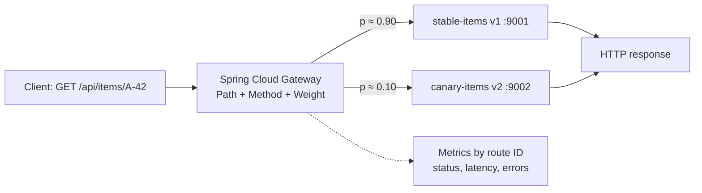
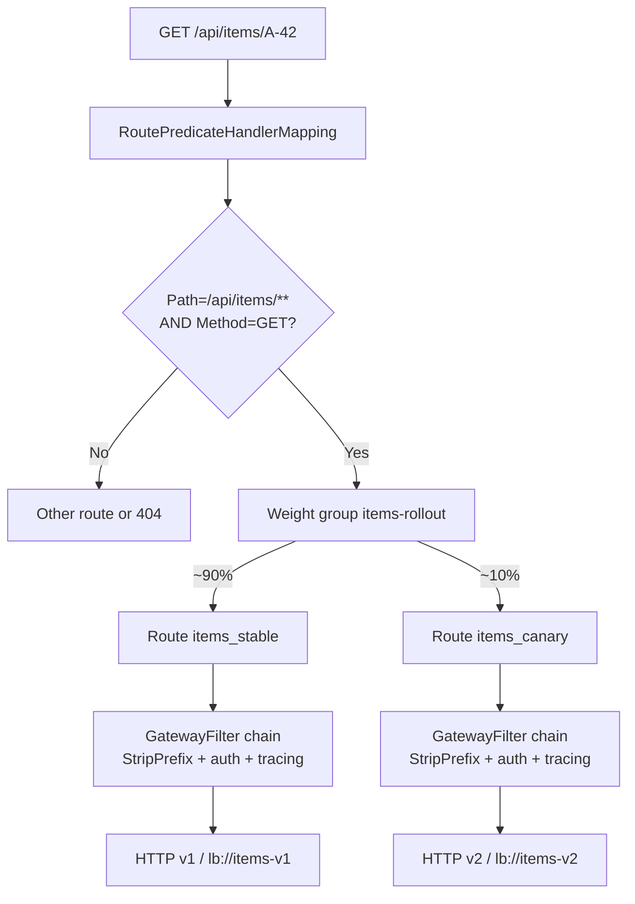

# Weight-Based Canary Routing and Limits of Probabilistic Distribution

## 1. What Problem Does Canary Routing Solve in Spring Cloud Gateway?

When deploying a new version of a microservice, you usually do not want to shift all production traffic to it immediately. A subtle change in the JSON response, data structure, permissions, or timeouts can break many clients. A **canary release** sends a slice of real traffic to the new version for observation before scaling up.

In **SPRING_CLOUD_GATEWAY**, the gateway selects a route via **route predicates**, then runs a filter chain for path/header transformation, authentication, rate limiting, circuit breaking, retries, TLS, and forwarding to an HTTP(S) backend or `lb://` service. The **`Weight` Route Predicate Factory** adds a routing pattern where multiple routes in **the same group** compete for requests according to **relative weights**.

For example, the stable version `items-v1` receives weight **9** and the canary version `items-v2` receives **1** in the `items-rollout` group. For requests matching both routes, the Gateway probabilistically selects v1 roughly **90%** of the time and v2 roughly **10%** of the time.



**Key point from the start:** `Weight=items-rollout,1` **does not mean** 1% or 1 request out of every 10 requests; it is **a weight** normalized within the group. The resulting distribution is **random per request**, not a deterministic schedule guaranteeing `9 calls to v1 then 1 call to v2`. There is **no sticky session** guarantee: the same user is not pinned to one version, and the request ratio does not necessarily equal the share of users, CPU, or revenue.

### Learning Objectives

After this lesson, learners will be able to:

1. Declare two `RouteDefinition` entries with identical `Path`, `Method`, and `Weight` group, but distinct URIs and route IDs.
2. Compute expected probabilities from weights and distinguish **absolute weights** from **relative shares**.
3. Explain the effect of sample size, standard deviation, and uncertainty intervals; avoid treating 7/100 instead of 10/100 as a configuration bug.
4. Distinguish **per-request canary routing** from **user-cohort/sticky releases** and **A/B experimentation**.
5. Identify route overlap, route ordering, group naming, route reloads, multiple Gateway pods, and fallbacks/retries that skew measurements.
6. Build a Gateway WebFlux lab with two `EchoBackend` instances able to identify which version handled a request.
7. Measure request counts per route via `curl` and gateway metrics, comparing observed ratios against expected probabilities.
8. Write tests verifying that both backends receive requests, preserve the path and method, and support rollback policies.
9. Plan a 1% → 5% → 10% → 25% → 50% → 100% canary rollout driven by **SLOs and error budgets**, not traffic ratios alone.

> **Version scope:** Spring Cloud Gateway **Server WebFlux 4.3.x**, Spring Cloud **2025.0.x**, Spring Boot **3.5.x**, Java 17+. This lesson uses the `spring.cloud.gateway.server.webflux.routes` namespace. **Server Web MVC** also has a Weight concept, but with different APIs and stack; do not copy these Reactor Netty/WebFlux examples into Servlet MVC. The Maven pair `3.5.0` and `2025.0.0` in the lab illustrates compatibility, not a recommendation to deploy an initial `.0` patch in production.

## 2. `Weight` Is a Route Predicate, Not a GatewayFilter

### 2.1. Standard Syntax

Gateway Server WebFlux 4.3 documentation defines **two arguments**:

```text
Weight=<group>, <weight>
```

- `group`: routing group name, such as `items-rollout`; routes participating in the split must share **the same group**.
- `weight`: integer indicating the route's **relative weight** within the group. Positive values are typically used for rollouts.
- `id`: route name used to distinguish stable from canary in management and metrics.
- `uri`: approved HTTP(S) destination or service ID.
- `predicates`: all conditions on a route—such as `Path`, `Method`, and `Weight`—are normally combined with **AND**.

Example:

```yaml
spring:
  cloud:
    gateway:
      server:
        webflux:
          routes:
            - id: items_stable
              uri: http://127.0.0.1:9001
              predicates:
                - Path=/api/items/**
                - Method=GET
                - Weight=items-rollout, 9

            - id: items_canary
              uri: http://127.0.0.1:9002
              predicates:
                - Path=/api/items/**
                - Method=GET
                - Weight=items-rollout, 1
```

According to the [Spring Cloud Gateway 4.3 Weight Route Predicate Factory](https://docs.spring.io/spring-cloud-gateway/reference/4.3/spring-cloud-gateway-server-webflux/request-predicates-factories.html), `8:2` corresponds to roughly 80%:20%. Likewise, `9:1` corresponds to roughly 90%:10%. Weights do not need to sum to 100.

The **fully expanded** form is also valid when you want explicit argument names:

```yaml
predicates:
  - Path=/api/items/**
  - Method=GET
  - name: Weight
    args:
      group: items-rollout
      weight: 9
```

In a stable/canary pair, make sure both routes share **the same group** and the same predicates defining the target population. If you put `group: items-stable` on v1 and `group: items-canary` on v2, you **are no longer** configuring a 90/10 split within one group.

### 2.2. Normalization Formula

For a group with eligible routes \(r_1,\ldots,r_k\) and weights \(w_i\), the expected share for each route is:

\[
p_i = \frac{w_i}{\sum_{j=1}^{k} w_j}
\]

If group `items-rollout` has two routes:

\[
p_{\mathrm{stable}} = \frac{9}{9+1} = 0.9, \qquad
p_{\mathrm{canary}} = \frac{1}{9+1} = 0.1.
\]

With three versions, `7:2:1` yields roughly 70% / 20% / 10%, **but only when they are properly configured with the same group and the same target request population**.

| Stable : canary weights | Expected stable | Expected canary | Notes |
| --- | ---: | ---: | --- |
| `99 : 1` | 99% | 1% | Conservative start requiring an adequate sample size. |
| `19 : 1` | 95% | 5% | Small shares remain very noisy over short windows. |
| `9 : 1` | 90% | 10% | Primary configuration for this lab. |
| `3 : 1` | 75% | 25% | Significantly increases exposure. |
| `1 : 1` | 50% | 50% | Not a per-user A/B test. |
| Only the canary route remains | 0% | 100% | Explicit full cutover. |

**Do not use `Weight=...,0` as a default kill switch.** Zero-weight validity, whether the route still contributes to the weight sum, and refresh behavior vary and must be verified per release. A cleaner, easily verifiable rollback is to **remove/disable the canary route from the approved route set**, keep the stable route active, deploy, and re-verify.

### 2.3. `Weight` and `lb://` Operate at Different Layers

| Mechanism | Decision level | Example |
| --- | --- | --- |
| `Weight` predicate | **Selects the route** (stable vs. canary). | `items_stable` 90%; `items_canary` 10%. |
| `lb://service-id` | **Selects an instance** within a discovered service ID. | `lb://items-v2` has 3 v2 pods. |
| Client-side retry | One request may trigger **multiple downstream attempts**. | A request selected v2, then retried on 503. |
| Kubernetes Service | Distributes connections/requests across pods behind the route. | Service contains only v2 instances. |
| Identity-hash canary | **Selects a stable cohort** per user/tenant. | One user stays on v2 throughout the trial. |

You can combine `Weight` with `lb://items-v1` and `lb://items-v2`, but never **mix both versions under the same service ID** and claim the Gateway is enforcing a 90/10 version split. `Weight` decides only which route matches; service discovery and load balancing select the instance afterward.

## 3. Route Selection Path and Boundaries of `Weight`



**Boundary condition:** A `POST /api/items/A-42` request **is outside the population** in this lab because both routes require `Method=GET`. A `GET /health` request is also outside the population. If an aggregate metric counts health probes, static routes, unauthenticated rejections, and the canary API together, the observed ratio will diverge from 90:10 even when `Weight` is working properly.

### 3.1. Route Overlap Distorts Results

Error-prone example:

```yaml
# ANTI-PATTERN: a broad route can capture requests
# before the stable/canary pair is evaluated.
- id: catch_all
  uri: http://127.0.0.1:9001
  predicates:
    - Path=/api/**

- id: items_stable
  uri: http://127.0.0.1:9001
  predicates:
    - Path=/api/items/**
    - Weight=items-rollout, 9

- id: items_canary
  uri: http://127.0.0.1:9002
  predicates:
    - Path=/api/items/**
    - Weight=items-rollout, 1
```

`Path=/api/**` overlaps `/api/items/**`. When matched early, it bypasses `Weight` completely. Do not rely on **YAML declaration order** as a guaranteed route-selection contract. Design cleanly partitioned predicates, verify `order`, and **test both route IDs and actual backends**.

### 3.2. Same Group with Different `Path` or `Method`

Another mistake:

```yaml
- id: items_stable
  predicates:
    - Path=/api/items/**
    - Weight=shared-group, 9

- id: other_canary
  predicates:
    - Path=/api/checkout/**
    - Weight=shared-group, 1
```

Do not share one group across two **completely different request populations**. Group selection, predicate evaluation, and route matching can introduce unintended skew or route misses. Use `items-rollout` for the `items` versions and `checkout-rollout` for the `checkout` versions.

When restricting a canary to users in a specific region or role, express the eligibility predicate **on both branches**, avoiding situations where the canary fails to match and stable absorbs all remaining traffic. If you need a deterministic cohort, consider a dedicated sticky solution rather than stacking predicates without understanding the probabilistic impact.

### 3.3. Route Order Is Not a Ratio Mechanism

`order` determines priority when routes overlap; **it does not replace `Weight`**. Setting `order: -100` on the canary does not mean “10% canary evaluated first” as a valid canary setup. In the lab, keep both weighted routes on the exact same eligible population with no third route capturing traffic.

In production, audit route inventory, filter order, and weighted groups after **every update**. An overly broad emergency or temporary debug route can silently nullify a canary without changing any `Weight` numbers.

## 4. `Weight` Does Not Provide Sticky Sessions or Experiment Cohorts

### 4.1. One User Can Hit Both Versions

Suppose the same client sends three requests:

```text
GET /api/items/A-42  -> v1
GET /api/items/A-42  -> v2
GET /api/items/A-42  -> v1
```

With **per-request** canary routing, that sequence is completely normal. Never assume HTTP keep-alive or a single HTTP/2 connection pins a user to one version. Therefore, `Weight` fits **stateless** APIs with compatible v1/v2 contracts best.

Risks when two backends do not share state or response schemas:

- A user writes data via v2 and the next request hits v1, which cannot read it.
- Cookies or sessions exist only on one version.
- Cache keys omit API/schema version or tenant, causing cross-version data leaks.
- The client receives a new field from v2, then v1 omits it on the next call.
- A `POST` writes to v2 while read-after-write hits v1, creating an inconsistent user experience.
- Background jobs/consumers run non-backward-compatible migrations across versions.

### 4.2. When Do You Need Cohort/Sticky Releases?

If the requirement is “pin roughly 10% of **users** to the canary for 7 days,” use a **deterministic assignment based on a trusted identity** (for example hashing `authenticatedUserId + rolloutSalt`) and version the mapping. Conceptual bucketing:

```text
bucket = stableHash(tenantOrUserId, rolloutSalt) mod 10000

if bucket < 1000:
    cohort = canary   # 10% bucket space
else:
    cohort = stable
```

This is a **design pattern**, not a built-in `Weight` setting, and must never trust unauthenticated client-supplied `X-User-Id` headers or cookies. For anonymous visitors, you can use a server-issued, signed assignment cookie with proper security, privacy, and expiration controls; actual user counts can still deviate from the bucket share when populations are small or traffic is uneven.

Keep in mind:

- User IDs and tenant IDs are **personal/internal data**: never log raw IDs as metric labels.
- Cohort assignments, session routing, feature flags, and A/B analytics should carry a **stable experiment ID**.
- If the rollout unit is a B2B tenant, hash the tenant (not individual users) to keep an entire tenant on one version, recognizing that tenant sizes vary widely.
- Never let clients pass `X-Canary: true` as a shortcut to privileged endpoints.
- For authentication and authorization, both v1 and v2 must enforce the same policies and appropriate token audiences.

### 4.3. Weighted Canary vs. A/B Testing

| Aspect | Weight canary | User-based A/B |
| --- | --- | --- |
| Distribution unit | Request. | User, tenant, or cohort. |
| Stickiness | Not guaranteed. | Guaranteed via deterministic assignment. |
| Primary goal | Reduce rollout risk for new code, protect SLOs. | Measure behavioral or business differences. |
| Ratio counting | Request counts by route. | Unique assigned units + exposures. |
| Result analysis | 5xx, latency, CPU, compatibility. | Conversion, retention, causal inference. |
| Common bias | Uneven requests per user; retries. | Sampling/selection bias, cross-user interference. |

**Never divide v2 requests by total requests and conclude “10% of users tried v2.”** A single bot sending 1,000 requests can dominate request counts while infrequent users never hit the canary during the observation window.

## 5. Probabilistic Limits: 90/10 Is an Expectation, Not a Per-Window Promise

### 5.1. Bernoulli/Binomial Approximation

For intuition, assume `n` **independent requests with identical eligibility and canary probability `p=0.1`**, and no external interference:

\[
X \sim \mathrm{Binomial}(n,p)
\]

\[
\mathbb{E}[X] = np,\qquad
\mathrm{Var}(X)=np(1-p),\qquad
\sigma_X=\sqrt{np(1-p)}.
\]

`X` is the **number of requests routed to the canary**, not successful responses or unique users. These formulas are an **idealized statistical model** for learning; in production, requests are not strictly independent, and traffic bursts, retries, route refreshes, and replica heterogeneity can alter the distribution.

For the observed share \(\hat p=X/n\):

\[
\mathrm{SE}(\hat p) = \sqrt{\frac{p(1-p)}{n}}
\]

When `n` is sufficiently large, an **approximate** 95% normal-approximation interval around the expectation is \(\hat p \approx p \pm 1.96\,\mathrm{SE}\). **That is not a guaranteed tolerance** for every test run. When `p` is very small or `n` is low, use Wilson or exact binomial intervals rather than the simple normal formula.

### 5.2. Same 10% Share, Different Sample Sizes Give Different Spread

| Eligible requests `n` | Expected canaries `np` | \(\sigma_X\) | Approximate 95% spread around expected **share** |
| ---: | ---: | ---: | --- |
| 20 | 2 | 1.34 | About ±13 percentage points; normal approx is inaccurate at small n. |
| 100 | 10 | 3.00 | About ±5.9 percentage points. |
| 500 | 50 | 6.71 | About ±2.6 percentage points. |
| 1,000 | 100 | 9.49 | About ±1.9 percentage points. |
| 10,000 | 1,000 | 30.00 | About ±0.59 percentage points. |

This means that across 100 requests, seeing **7 canaries** instead of **10** does not by itself prove the Gateway is misconfigured. Across 10,000 requests under identical conditions, a sustained deviation from 10% is worth investigating.

Another example:

\[
P(X=0 \mid n=20,p=0.1)=(0.9)^{20}\approx 12.16\%.
\]

Even with an exact 10% canary, there is still roughly a **12%** chance that **all 20 initial requests never hit v2**. With a 1% canary and `n=100`:

\[
P(X=0 \mid n=100,p=0.01)=(0.99)^{100}\approx36.6\%.
\]

Concluding **“the canary is broken because I sent 20 requests and never saw v2”** has no statistical basis. Check route config, inspect metrics, and increase sample size properly in an **authorized environment** rather than prematurely bumping weights after a few misses.

### 5.3. Reference Sample Size

Suppose you want the observed share in a window near `p=0.10` with roughly ±2 percentage points at an intuitive 95% confidence level. Estimate:

\[
n \gtrsim
\frac{1.96^2\,p(1-p)}{(0.02)^2}
\approx 865.
\]

This **~865-request** figure only **estimates the canary hit ratio**; it is not enough by itself to:

- Certify that v2 is free of rare bugs.
- Catch security or corruption bugs occurring 1 in 100,000 requests.
- Reliably compare P99 tail latency.
- Conclude conversion lift or business impact.
- Provide statistical power for a user-level A/B test.

Rollout evaluation needs the actual count of **canary requests received**, error counts, latency distributions, and a minimum observation duration—not merely a percentage.

## 6. Request Share Is Not Resource Share or Risk Level

One v2 request might consume 10x the CPU or return a 50 MiB payload, whereas a v1 request returns 2 KiB. Thus:

```text
10% of requests on canary
    DOES NOT EQUAL
10% of CPU, memory, connections, bytes, user impact, or revenue
```

Total backend load can be approximated as:

\[
\mathrm{Load}_{\mathrm{canary}}
\approx
N_{\mathrm{canary}} \times \mathrm{CostPerRequest}_{\mathrm{canary}}.
\]

Per-request cost varies across `GET /items/{id}`, list/search, and batch exports. If v2 is slow, in-flight canary requests can pile up faster than the hit ratio suggests. If retries are enabled, 1 canary request can generate multiple **HTTP attempts** and different memory retention than 1 v1 request.

Real-world sources of skew:

- **Traffic mix:** bots, health checks, or long polling hit specific routes with different eligibility.
- **Retry/fallback:** one initial route ID selection generates more than 1 outbound attempt.
- **Load balancing:** multiple instances behind the same service ID; unclear which instance/version actually served.
- **Caching:** Gateway/CDN cache hits **never reach the backend**; upstream ratios diverge from route ratios.
- **Time windows:** 1-minute windows are highly volatile, especially at p=1%; 1-hour windows may span deployment changes.
- **Route definition changes:** old and new weights coexist while refreshing across replicas.
- **Client behavior:** uneven requests per user; client-side retries create new requests that are re-weighted.
- **Security filters:** 401/403/429 responses block requests before upstream routing.
- **HTTP errors:** a canary returning 503 does not cause `Weight` to automatically fail over all traffic to stable.

**Proper routing patterns measure three distinct ratios:** `selected route`, `actual backend attempts`, and `successful outcomes`. A single 9:1 total request ratio is insufficient to declare a canary safe.

## 7. Hands-On Lab: v1/v2 Canary with Weight 9:1

### 7.1. Lab Architecture

We will run three **independent processes locally**:

```text
                  300 GET requests /api/items/A-42
Client (curl) ------------------------------------+
                                                  |
                                                  v
                                    Gateway WebFlux :8080
                                    group: items-rollout
                                     /              \
                           Weight=9 /                \ Weight=1
                                   v                  v
                         EchoBackend :9001      EchoBackend :9002
                         variant=stable         variant=canary
                         GET /items/A-42        GET /items/A-42
                                  \                 /
                                   +---------------+
                                           |
                                  response with variant
                                           |
                                     curl counts ratio

Management Actuator :8081 (127.0.0.1)
  - health / metrics / gateway routes (read-only)
```

The lab uses **side-effect-free GET** requests, making it safe to replay the same URL repeatedly to observe probability. Never use order/payment-creating POST requests for traffic-sampling experiments. Ports `9001` and `9002` bind only to `127.0.0.1`; never send lab traffic to production or shared environments.

### 7.2. Creating the Maven Project

Requires JDK **17+**, Maven, and `curl`. Create a dedicated project `gateway-weight-canary-lab` with `pom.xml`:

```xml
<?xml version="1.0" encoding="UTF-8"?>
<project xmlns="http://maven.apache.org/POM/4.0.0"
         xmlns:xsi="http://www.w3.org/2001/XMLSchema-instance"
         xsi:schemaLocation="http://maven.apache.org/POM/4.0.0
                             https://maven.apache.org/xsd/maven-4.0.0.xsd">
    <modelVersion>4.0.0</modelVersion>

    <parent>
        <groupId>org.springframework.boot</groupId>
        <artifactId>spring-boot-starter-parent</artifactId>
        <version>3.5.0</version>
        <relativePath/>
    </parent>

    <groupId>com.example</groupId>
    <artifactId>gateway-weight-canary-lab</artifactId>
    <version>0.0.1-SNAPSHOT</version>

    <properties>
        <java.version>17</java.version>
    </properties>

    <dependencyManagement>
        <dependencies>
            <dependency>
                <groupId>org.springframework.cloud</groupId>
                <artifactId>spring-cloud-dependencies</artifactId>
                <version>2025.0.0</version>
                <type>pom</type>
                <scope>import</scope>
            </dependency>
        </dependencies>
    </dependencyManagement>

    <dependencies>
        <dependency>
            <groupId>org.springframework.cloud</groupId>
            <artifactId>spring-cloud-starter-gateway-server-webflux</artifactId>
        </dependency>

        <dependency>
            <groupId>org.springframework.boot</groupId>
            <artifactId>spring-boot-starter-actuator</artifactId>
        </dependency>

        <dependency>
            <groupId>org.springframework.boot</groupId>
            <artifactId>spring-boot-starter-test</artifactId>
            <scope>test</scope>
        </dependency>

        <dependency>
            <groupId>io.projectreactor</groupId>
            <artifactId>reactor-test</artifactId>
            <scope>test</scope>
        </dependency>
    </dependencies>

    <build>
        <plugins>
            <plugin>
                <groupId>org.springframework.boot</groupId>
                <artifactId>spring-boot-maven-plugin</artifactId>
            </plugin>
        </plugins>
    </build>
</project>
```

Notes:

- `spring-cloud-starter-gateway-server-webflux` is the starter for **Gateway Server WebFlux** on Spring Cloud 2025.0.
- Actuator exposes metrics and the routes inventory when properly configured.
- `spring-boot-starter-test` enables writing HTTP integration tests and assertions.
- `reactor-test` is used when testing custom reactive components; `Weight` is a built-in predicate, so **no custom predicate or Reactor scheduler is needed** in this lab.
- Do not add `spring-boot-starter-web` or Gateway Server MVC to the same lab.
- Boot `3.5.0` + Cloud BOM `2025.0.0` is an **illustrative pairing**; use supported patch releases for real deployments.

### 7.3. Spring Boot Entry Point

Create `src/main/java/com/example/gateway/GatewayWeightApplication.java`:

```java
package com.example.gateway;

import org.springframework.boot.SpringApplication;
import org.springframework.boot.autoconfigure.SpringBootApplication;

@SpringBootApplication
public class GatewayWeightApplication {
    public static void main(String[] args) {
        SpringApplication.run(GatewayWeightApplication.class, args);
    }
}
```

No `@RestController` is needed for canary routes: routes are declared in Gateway route definitions and handled by Gateway Server WebFlux, not an MVC proxy handler.

### 7.4. `application.yml`: Two Routes in the Same Group

Create `src/main/resources/application.yml`:

```yaml
server:
  port: 8080
  address: 127.0.0.1

spring:
  application:
    name: gateway-weight-canary-lab

  cloud:
    gateway:
      server:
        webflux:
          metrics:
            enabled: true

          routes:
            - id: items_stable
              uri: http://127.0.0.1:9001
              predicates:
                - Path=/api/items/**
                - Method=GET
                - Weight=items-rollout, 9
              filters:
                - StripPrefix=1

            - id: items_canary
              uri: http://127.0.0.1:9002
              predicates:
                - Path=/api/items/**
                - Method=GET
                - Weight=items-rollout, 1
              filters:
                - StripPrefix=1

management:
  server:
    port: 8081
    address: 127.0.0.1
  endpoint:
    gateway:
      access: read-only
  endpoints:
    web:
      exposure:
        include: health,metrics,gateway
```

Reviewing the key lines:

1. `id`: separates `items_stable` and `items_canary` for per-route error/latency observability.
2. `uri`: two distinct backends. Locally on one machine, use `127.0.0.1`; in Kubernetes, `localhost` inside a Gateway Pod **does not point to another backend Pod**.
3. `Path` and `Method`: **identical** on both routes so both evaluate the exact same request slice.
4. `Weight`: same `items-rollout` group with values 9 and 1, targeting `~90%:~10%`.
5. `StripPrefix=1`: both backends receive `/items/A-42` from `/api/items/A-42`.
6. `metrics.enabled`: enables gateway metrics under the version-appropriate WebFlux namespace. Metrics appear once Actuator and real traffic are active.
7. Actuator `gateway` is **read-only** on a dedicated management port, never exposed as a dynamic route write path in the lab.

**There is no third `/api/**` route**, avoiding route overlap. Keep auth, filter paths, and response headers consistent across both versions for fair comparison.

### 7.5. `EchoBackend` Runnable as Two Versions

Create **one** file `EchoBackend.java` in a separate directory (outside the Spring Boot project). It accepts `port` and `variant`, letting you run two processes from the same source file:

```java
import com.sun.net.httpserver.HttpServer;
import java.net.InetSocketAddress;
import java.nio.charset.StandardCharsets;
import java.util.concurrent.atomic.AtomicLong;

public class EchoBackend {

    public static void main(String[] args) throws Exception {
        if (args.length != 2) {
            throw new IllegalArgumentException(
                    "Usage: java EchoBackend.java <port> <stable|canary>");
        }

        int port = Integer.parseInt(args[0]);
        String variant = args[1];

        if (!variant.equals("stable") && !variant.equals("canary")) {
            throw new IllegalArgumentException(
                    "Variant must be stable or canary");
        }

        AtomicLong requests = new AtomicLong();

        HttpServer server = HttpServer.create(
                new InetSocketAddress("127.0.0.1", port), 0);

        server.createContext("/", exchange -> {
            long n = requests.incrementAndGet();

            String path = exchange.getRequestURI().getRawPath();
            String query = exchange.getRequestURI().getRawQuery();

            String response = "variant=" + variant + "\n"
                    + "backend-count=" + n + "\n"
                    + "method=" + exchange.getRequestMethod() + "\n"
                    + "path=" + path + "\n"
                    + "query=" + query + "\n";

            System.out.printf(
                    "%s #%d %s %s%n",
                    variant, n, exchange.getRequestMethod(), path);

            byte[] output = response.getBytes(StandardCharsets.UTF_8);

            exchange.getResponseHeaders().set(
                    "Content-Type", "text/plain; charset=UTF-8");
            exchange.getResponseHeaders().set(
                    "X-Backend-Version", variant);

            exchange.sendResponseHeaders(200, output.length);

            try (var stream = exchange.getResponseBody()) {
                stream.write(output);
            }
        });

        server.start();
        System.out.printf(
                "EchoBackend %s at http://127.0.0.1:%d%n",
                variant, port);
    }
}
```

The backend simply returns text generated from the variant name and path, with no database or business side effects. `backend-count` is **per process**, not the total requests routed through the Gateway. `EchoBackend` has no authentication or TLS because it is a **loopback demo**; never expose it directly to the Internet.

### 7.6. Starting the Three Processes

**Terminal A** (directory containing `EchoBackend.java`):

```bash
java EchoBackend.java 9001 stable
```

**Terminal B** (same `EchoBackend` directory):

```bash
java EchoBackend.java 9002 canary
```

**Terminal C** (Gateway project directory containing `pom.xml`):

```bash
mvn spring-boot:run
```

You can use Maven Wrapper `./mvnw spring-boot:run` on Linux/macOS or `mvnw.cmd spring-boot:run` on Windows. If ports 8080/8081/9001/9002 are already in use, update **both Gateway and backend** configs consistently.

**These commands are solely for learners running in their own practice project.** The STEP 4 worker does not build/run the Gateway repo or execute the platform's Content QA.

## 8. Observing Canary Behavior and Probabilistic Distribution with `curl`

### 8.1. Sending a Single Request

```bash
curl -i \
  "http://127.0.0.1:8080/api/items/A-42"
```

Sample response from **one arbitrary run**:

```http
HTTP/1.1 200 OK
Content-Type: text/plain; charset=UTF-8
X-Backend-Version: stable

variant=stable
backend-count=1
method=GET
path=/items/A-42
query=null
```

Other runs **may** return `variant=canary` and `X-Backend-Version: canary`. Either outcome is valid under Weight=9:1. Do not alter the config just because the first 3–5 requests all land on stable.

`query=null` is simply how `EchoBackend` prints `getRawQuery()` when no query string is present; it is not an HTTP error. The path must be `/items/A-42` because of `StripPrefix=1`.

### 8.2. Sending 300 Sequential Local Requests

Bash example using `curl`, `sed`, `sort`, and `uniq`:

```bash
for ((i = 1; i <= 300; i++)); do
  curl -fsS --max-time 5 \
    "http://127.0.0.1:8080/api/items/A-42" \
    | sed -n 's/^variant=//p' \
    || echo "ERROR"
done | sort | uniq -c
```

**Illustrative output, not fixed:**

```text
  272 stable
   28 canary
```

With `n=300` and `p=0.10`, the expected canary count is **30**, though 21, 34, or another value can occur. This command counts **responses containing the marker**, not necessarily total attempts: if `curl` fails, inspect status codes/logs separately; `sed` prints nothing if an upstream returns a different body.

For meaningful sampling, ensure:

- Both backends are healthy before starting.
- Weights are not modified mid-sample.
- No HTTP cache/CDN, stray route, or client retry interferes.
- All four ports stay on localhost, without loading shared environments.
- Requests share the same path and method—no mixing POSTs, health checks, or cache hits.
- Record **eligible request counts and errors**, not only ratios among 200 responses.

### 8.3. Observing That One Client Still Switches Versions

```bash
for ((i = 1; i <= 12; i++)); do
  curl -fsS \
    "http://127.0.0.1:8080/api/items/A-42" \
    | sed -n 's/^variant=//p'
done
```

Seeing stable, then canary, then stable demonstrates **per-request** canary behavior. Even if all 12 hit stable, that still does not prove stickiness: the chance of 12 non-canary hits at 10% is \((0.9)^{12}\approx28.2\%\).

### 8.4. Out-of-Population Requests Must Be Handled Separately

```bash
# POST does not match the two GET-only routes:
curl -i -X POST \
  "http://127.0.0.1:8080/api/items/A-42"

# Path outside population:
curl -i \
  "http://127.0.0.1:8080/health"
```

In this lab, with no matching route, both typically return **404** (or another status if extra handlers/security exist). **Do not include these requests in the 90/10 sample.** If you want to canary both GET and POST, design method eligibility and idempotency explicitly rather than blindly changing `Method=GET` to `Method=GET,POST` on live transactional traffic.

## 9. Actuator Metrics: Counting Selected Routes Instead of Body Markers Alone

Spring Cloud Gateway includes a Gateway Metrics Filter producing `spring.cloud.gateway.requests` (when enabled in your release) with tags such as `routeId`, `routeUri`, `status`, `httpMethod`, and `outcome`. With **separate route IDs**, you can compare canary vs. stable on the same functional endpoint.

### 9.1. Inspecting the Route Inventory

```bash
curl -sS \
  "http://127.0.0.1:8081/actuator/gateway/routes"
```

Verify that both `items_stable` and `items_canary` exist with `Path=/api/items/**`, `Method=GET`, group `items-rollout`, weights 9 and 1, and the right target ports. Depending on the version, verbose Actuator output may display compiled predicate representations rather than verbatim YAML text. If the endpoint does not appear, check exposure/access settings and startup logs before concluding the routes are missing.

**Never enable `management.endpoint.gateway.access: unrestricted`** merely to read routes. That Actuator endpoint allows creating, deleting, and refreshing routes when write access is enabled; this lab sets `read-only` and binds management to loopback.

### 9.2. Querying Metrics by Route ID

After sending some requests:

```bash
curl -sS \
  "http://127.0.0.1:8081/actuator/metrics/spring.cloud.gateway.requests"

curl -sS \
  "http://127.0.0.1:8081/actuator/metrics/spring.cloud.gateway.requests?tag=routeId:items_stable"

curl -sS \
  "http://127.0.0.1:8081/actuator/metrics/spring.cloud.gateway.requests?tag=routeId:items_canary"
```

In the Actuator response, `measurements` may include `COUNT`, `TOTAL_TIME`, and `MAX`, depending on the meter. Take **`COUNT` per route ID** over the same time window, then compute:

\[
\hat p_{\mathrm{canary}}
=
\frac{N_{\mathrm{items\_canary}}}
{N_{\mathrm{items\_stable}}+N_{\mathrm{items\_canary}}}.
\]

Never build an application metric label from `routeUri` populated by untrusted URLs. In production, analyze time series in Prometheus/Grafana using **windowed rates/counters** broken down by `status`, method, and route ID; a cumulative Actuator `COUNT` since process startup will not reflect **the current canary stage** if weights were recently changed.

### 9.3. Separating Metrics and Headers to Avoid Wrong Conclusions

| Data source | What is it counting? | Limitation |
| --- | --- | --- |
| `X-Backend-Version` in body/header | Which backend version returned a successful response. | Misses failed/timed-out requests; may be served from cache/CDN. |
| `spring.cloud.gateway.requests` by `routeId` | Requests passing through the Gateway metric filter per route. | Depends on filter order and error paths; verify instrumentation. |
| Backend counter :9001/:9002 | Actual HTTP requests received by the backend. | Retries make this count exceed client requests. |
| Outbound Netty client metrics | HTTP attempts, connection errors, and latency. | Requires proper tags; does not automatically map 1:1 to route selection. |
| Ingress requests | Total HTTP requests entering the edge. | Includes health checks, 401/403/404/429s, and unrelated routes. |

**Canary hit ≠ canary success.** A route may be selected 10% of the time while v2 returns 503 on half of them; the **successful canary response share** will be under 10%. Never look only at 200 responses and assume “v2 is taking 5% cleanly.”

## 10. Scaling Up and Down via Controlled Weight Updates

### 10.1. Sample Rollout Sequence

Example exposure ramp:

| Stage | Stable / Canary | Gate to advance |
| --- | --- | --- |
| 0: baseline | 100% stable | v2 deployed healthy, contract tests green, zero public traffic. |
| 1: smoke | 99 : 1 | Enough canary requests observed; no severe 5xx or latency spikes. |
| 2: early | 95 : 5 | No auth or data-compatibility errors. |
| 3: expand | 90 : 10 | SLOs and error budgets within thresholds. |
| 4: expand | 75 : 25 | P95/P99, DB, CPU, heap, and quotas look healthy. |
| 5: half | 1 : 1 | v2 performance and cost measured under substantial load. |
| 6: complete | 100% canary | Only approved v2 route remains; rename to new stable once settled. |

This is an **example workflow**, not a rigid minute-by-minute schedule or mandatory percentages for every system. Under low traffic volumes, extend observation windows or run separate synthetic tests to surface bugs—keeping in mind synthetic tests do not replace real traffic for assessing production behavior.

### 10.2. Shifting from 90:10 to 95:5

In `application.yml`, update only **the two `Weight` values in the same group**:

```yaml
# Stable
- Weight=items-rollout, 19

# Canary
- Weight=items-rollout, 1
```

`19/(19+1)=95%`, `1/(19+1)=5%`. No sum-to-100 requirement. **Do not rename `group` on only one branch**, and do not drop a route from the inventory without assessing the impact.

When deploying via GitOps config or a dynamic `RouteDefinitionLocator`, ensure changes are **applied and refreshed** across all Gateway replicas. Before raising traffic further, verify the active route inventory and observed share. Saving route definitions does not mean every runtime instance picked them up instantaneously.

### 10.3. Rolling Back to 100% Stable

A clear, easily verifiable rollback in the lab is to **remove the canary route** and remove `Weight` from the remaining stable route:

```yaml
spring:
  cloud:
    gateway:
      server:
        webflux:
          routes:
            - id: items_stable
              uri: http://127.0.0.1:9001
              predicates:
                - Path=/api/items/**
                - Method=GET
              filters:
                - StripPrefix=1
```

After apply/refresh:

- `/actuator/gateway/routes` shows only `items_stable` for this endpoint.
- Synthetic `GET` calls to the path must land on v1.
- The backend v2 counter stops climbing **once in-flight requests finish**.
- Per-route metrics show the canary `rate` dropping to 0 (do not confuse with cumulative `COUNT`).
- Verify all Gateway replicas, ingress/CDN caches, and clients holding open connections.

**Traffic rollback does not automatically roll back data.** If v2 wrote schemas, orders, or side effects incompatible with v1, you need a separate database migration, backward-compatibility plan, and compensating actions.

### 10.4. Never Treat 503 Responses as Automatic Rollback

`Weight` is a route-selection predicate, **not a circuit breaker or health-check failover**. When v2 fails, a request routed to v2 that returns 503 does not cause the Gateway to “retry on v1.” `Retry` and `CircuitBreaker` are separate policies whose timeouts, idempotency rules, and fallbacks must be explicitly engineered.

For severe incidents, roll back through the **config/control plane** and verify end-to-end. If you want automated traffic shifting driven by canary health, use a rollout controller or traffic manager with explicit metrics, guardrails, and route-mutation permissions.

## 11. Integration Test with Two HTTP Backends on Ephemeral Ports

Unit testing `WeightRoutePredicateFactory` in isolation verifies the class syntax and logic, yet **does not prove** the Gateway bound both YAML routes, selected the right route, ran `StripPrefix`, and proxied via Netty. We therefore need an **HTTP integration test** running the Gateway and two real backends in the same JVM.

Plan:

1. Start the Gateway with `@SpringBootTest(webEnvironment = RANDOM_PORT)`.
2. Start two JDK `HttpServer` stubs on port `0` so the OS assigns free ports.
3. Use `@DynamicPropertySource` to override the URIs of `routes[0]` and `routes[1]` **before Spring binds the route definitions**.
4. Send `GET` requests with `TestRestTemplate` over the Gateway's real HTTP socket.
5. Give each backend an `AtomicInteger` counting incoming requests.
6. Assert **every eligible request** reaches exactly one valid backend with the expected URL and method.
7. **Do not hard-assert** that 120 requests must split exactly 108/12.

### 11.1. Complete Test Class

Create `src/test/java/com/example/gateway/WeightedRoutesIntegrationTest.java`:

```java
package com.example.gateway;

import java.io.IOException;
import java.io.UncheckedIOException;
import java.net.InetSocketAddress;
import java.nio.charset.StandardCharsets;
import java.util.concurrent.atomic.AtomicInteger;

import com.sun.net.httpserver.HttpServer;

import org.junit.jupiter.api.AfterAll;
import org.junit.jupiter.api.Test;
import org.springframework.beans.factory.annotation.Autowired;
import org.springframework.boot.test.context.SpringBootTest;
import org.springframework.boot.test.web.client.TestRestTemplate;
import org.springframework.http.HttpStatus;
import org.springframework.http.ResponseEntity;
import org.springframework.test.context.DynamicPropertyRegistry;
import org.springframework.test.context.DynamicPropertySource;

import static org.assertj.core.api.Assertions.assertThat;

@SpringBootTest(
        webEnvironment = SpringBootTest.WebEnvironment.RANDOM_PORT)
class WeightedRoutesIntegrationTest {

    private static final AtomicInteger STABLE_CALLS =
            new AtomicInteger();
    private static final AtomicInteger CANARY_CALLS =
            new AtomicInteger();

    private static final HttpServer STABLE =
            startBackend("stable", STABLE_CALLS);
    private static final HttpServer CANARY =
            startBackend("canary", CANARY_CALLS);

    private static HttpServer startBackend(
            String variant, AtomicInteger counter) {

        try {
            HttpServer server = HttpServer.create(
                    new InetSocketAddress("127.0.0.1", 0), 0);

            server.createContext("/", exchange -> {
                counter.incrementAndGet();

                String body = "variant=" + variant + "\n"
                        + "method=" + exchange.getRequestMethod() + "\n"
                        + "path=" + exchange.getRequestURI()
                                .getRawPath() + "\n";

                byte[] output = body.getBytes(StandardCharsets.UTF_8);

                exchange.getResponseHeaders().set(
                        "Content-Type",
                        "text/plain; charset=UTF-8");

                exchange.sendResponseHeaders(200, output.length);

                try (var stream = exchange.getResponseBody()) {
                    stream.write(output);
                }
            });

            server.start();
            return server;
        } catch (IOException e) {
            throw new UncheckedIOException(e);
        }
    }

    @DynamicPropertySource
    static void chooseBackendPorts(DynamicPropertyRegistry registry) {
        registry.add(
                "spring.cloud.gateway.server.webflux.routes[0].uri",
                () -> "http://127.0.0.1:"
                        + STABLE.getAddress().getPort());

        registry.add(
                "spring.cloud.gateway.server.webflux.routes[1].uri",
                () -> "http://127.0.0.1:"
                        + CANARY.getAddress().getPort());
    }

    @Autowired
    TestRestTemplate client;

    @AfterAll
    static void stopBackends() {
        STABLE.stop(0);
        CANARY.stop(0);
    }

    @Test
    void eligibleGetsReachOnlyApprovedVersions() {
        int stableBefore = STABLE_CALLS.get();
        int canaryBefore = CANARY_CALLS.get();

        int sampleCount = 120;

        for (int i = 0; i < sampleCount; i++) {
            ResponseEntity<String> response = client.getForEntity(
                    "/api/items/A-42", String.class);

            assertThat(response.getStatusCode())
                    .isEqualTo(HttpStatus.OK);

            assertThat(response.getBody())
                    .contains("method=GET")
                    .contains("path=/items/A-42");

            assertThat(
                    response.getBody().contains("variant=stable")
                    || response.getBody().contains("variant=canary"))
                    .isTrue();
        }

        int stableDelta = STABLE_CALLS.get() - stableBefore;
        int canaryDelta = CANARY_CALLS.get() - canaryBefore;

        // Each client request reaches one of the two backends.
        assertThat(stableDelta + canaryDelta)
                .isEqualTo(sampleCount);

        // DO NOT assert stableDelta == 108 and canaryDelta == 12!
        // Weight produces a probabilistic distribution, not an exact quota.
    }

    @Test
    void unrelatedPathDoesNotHitEitherBackend() {
        int before = STABLE_CALLS.get() + CANARY_CALLS.get();

        ResponseEntity<String> result = client.getForEntity(
                "/api/other/A-42", String.class);

        assertThat(result.getStatusCode())
                .isEqualTo(HttpStatus.NOT_FOUND);

        assertThat(STABLE_CALLS.get() + CANARY_CALLS.get())
                .isEqualTo(before);
    }

    @Test
    void postDoesNotMatchGetOnlyCanaryRoutes() {
        int before = STABLE_CALLS.get() + CANARY_CALLS.get();

        ResponseEntity<String> result = client.postForEntity(
                "/api/items/A-42", "demo", String.class);

        // No POST route in the lab; do not hard-assert if
        // the app added security/mappings outside the lab scope.
        assertThat(result.getStatusCode().is4xxClientError())
                .isTrue();

        assertThat(STABLE_CALLS.get() + CANARY_CALLS.get())
                .isEqualTo(before);
    }
}
```

### 11.2. Important Caveats About the Test

- `@DynamicPropertySource` relies on **the exact YAML indices `[0]` and `[1]`**; if you reorder route declarations, update the mapping accordingly. Tests should also confirm URIs/route IDs via Actuator if the project is configured differently.
- Port `0` for the backend stubs avoids colliding with ports `9001`/`9002` from the manual lab.
- `STABLE_CALLS` and `CANARY_CALLS` are class-wide counters: assertions assume test methods do not run **concurrently**; if CI uses JUnit parallel execution, isolate tests or tag requests with a correlation ID.
- **Every request returning 200** and the two counters summing to `n` in the lab does not prove an exact 90:10 ratio. It proves **route matching + real proxying + approved backends only** under simple conditions.
- Any HTTP client interceptor, retry, or filter added to the project can push backend attempts above `n`; the assertion catches that behavioral change for investigation.
- If a custom security layer intercepts before routing, the test will need matching credentials—never disable security just to get 200s in production.
- `TestRestTemplate` sends HTTP through the real Gateway socket; it is not merely a `MockServerWebExchange` test.
- Never extrapolate P99 latency, error rate, or user-cohort correctness from **one** test of `n=120`.

### 11.3. Commands to Run in Your Learning Project

```bash
mvn -Dtest=WeightedRoutesIntegrationTest test
```

With Maven Wrapper:

```bash
./mvnw -Dtest=WeightedRoutesIntegrationTest test
```

**These commands are for learners only**, not part of the STEP 4 worker's duties inside the course repository. Do not run STEP 6 domain Content QA here.

## 12. Testing Probabilistic Distributions Without Flaky CI Tests

### 12.1. Anti-Pattern: Asserting 90 Stable and 10 Canary Out of 100 Requests

```java
// WRONG: this test can fail even when Weight is configured properly.
assertThat(stableCount).isEqualTo(90);
assertThat(canaryCount).isEqualTo(10);
```

Even with an ideal random generator, the probability that a 100-request sample hits **exactly 10 canaries** is nowhere near 100%. Enforcing an exact 90/10 assertion causes random CI failures, tempting developers to alter production logic just to make the test “stable.”

Better options:

1. **Deterministic unit/config tests:** Assert both `RouteDefinition` entries share the same `Path`, `Method`, group, and 9:1 weights.
2. **HTTP contract tests:** Assert every request reaches an approved backend with the right body, path, and headers, and no unauthorized route is hit.
3. **Statistical smoke checks:** Collect a large enough sample and report **observed ratio + confidence interval** against a baseline; place this in staging/observability pipelines rather than gating every CI commit on a tight range.
4. **Deterministic selection:** If exact per-user assignment is mandatory, build a dedicated hash/cohort allocator with seeds/test vectors; built-in `Weight` does not expose a configurable `seed` to freeze unit-test outcomes.
5. **Statistical failure thresholds:** Use only wide tolerance bounds and large sample sizes, compute false-alarm probabilities, and re-evaluate after excluding failed requests or route refreshes.

### 12.2. Example Acceptable Tolerance for Smoke Tests Only

At `p=0.1`, `n=1,000`, the expected canary count is 100 with a standard deviation of about 9.49 requests. Under the binomial model, an interval of `[70,130]` canaries is very wide (more than 3 standard deviations), so it will usually contain the observation when ideal assumptions hold.

Yet **no finite probabilistic interval guarantees zero failures**. If production canary traffic is 1% or splits unevenly across pods, recalculate thresholds. Never copy-paste `[70,130]` for p=0.01 or n=50.

Suggested testing workflow:

```text
CONFIG CHECK:
  group = items-rollout
  stableWeight = 9
  canaryWeight = 1
  Path/Method identical
  no overlapping higher-priority route

FUNCTIONAL TEST:
  every eligible request reaches v1 or v2
  same upstream API contract
  no third destination

STATISTICAL OBSERVATION:
  n >= sample requirement
  observed canary share = canarySelected / eligibleSelected
  report CI / confidence range, do not require exact 10%
  investigate outliers before rollback/change
```

### 12.3. Separating Route Selection Share from Successful Response Share

Suppose 1,000 eligible client requests arrive:

```text
Selected by Weight: stable = 900, canary = 100
Actual backend attempts: stable = 900, canary = 130
Successful responses: stable = 895, canary = 60
```

In this hypothetical run, **selected canary share** = 100/1000 = 10%, matching configuration. Yet **canary backend attempt share** = 130/(900+130) ≈ 12.6% due to retries, and **successful canary response share** = 60/(895+60) ≈ 6.3% due to errors. Counting only **backend 200s** could mislead you into thinking `Weight` missed 10% or favored stable.

Measure:

- `selected_route_count` in Gateway metrics.
- `outbound_attempt_count` and retry counts.
- `success/error` by route ID, backend version, and status class.
- `latency` and resource consumption by version.
- `eligible_requests` after excluding route misses, 401/403/429s, and unrelated traffic.

### 12.4. Evaluating Metrics by Time Window and Sample Size

Do not aggregate all traffic since application startup if weights changed three times. Compute shares over **each rollout stage's time window**, excluding transition periods while Gateway replicas reload configs (or annotating them explicitly).

With a 1% canary, 10,000 eligible requests yield only about **100** canary requests. Seeing 0 errors across 100 canary requests still leaves an approximate 95% upper bound on the error probability near **3%** by the *rule of three*. Thus “0 errors” on a small sample **does not prove the service is free of rare bugs**.

When one endpoint handles multiple request profiles, segment GET item/detail, search/list, payload size, and client platform according to the contract. Large volume on a lightweight endpoint does not prove a heavy endpoint is safe.

## 13. Operating a Canary Across Multiple Gateway Replicas

A deployment typically runs multiple Gateway pods, each holding its own route cache/config version at a given instant. Even when every pod faithfully executes its current config, **the overall ratio** can deviate from expectations if weights are rolled out unevenly.

### 13.1. Example: Two Gateway Replicas with Different Configs

Suppose ingress splits requests evenly:

- Gateway A has received the `90:10` config.
- Gateway B is still running `99:1`.

The expected overall canary share is:

\[
p_{\mathrm{overall}}
= 0.5\times0.10 + 0.5\times0.01
= 0.055 = 5.5\%.
\]

If ingress splits traffic unevenly (sticky connections, autoscaling, regional routing), the overall share also varies with each pod's traffic share:

\[
p_{\mathrm{overall}}=\sum_{i=1}^{m} a_i p_i,\quad
\sum_i a_i=1,
\]

where `a_i` is the fraction of eligible requests hitting Gateway replica `i`, and `p_i` is the canary probability on that replica.

**Takeaway:** During weight rollouts, check **the config version and route inventory on every replica**, along with per-pod/instance metrics. One aggregate `COUNT` never proves every replica adopted the new route config.

### 13.2. Refreshing the Route Cache Is More Than Editing YAML

If routes come from GitOps, Config Server, a database, Redis, or a runtime API:

1. Maintain a single source of truth and approved change requests.
2. Validate group names, weight values, route ID uniqueness, identical eligibility, filter arguments, and ordering.
3. Persist definitions under **the same config revision** instead of updating one route's weight and refreshing prematurely.
4. Apply/refresh route definitions through a mechanism supported by Spring Cloud Gateway 4.3.
5. Verify active routes and weight groups on every Gateway replica post-refresh.
6. Run synthetic HTTP checks for stable/canary and watch 404/5xx counts and the canary ratio.
7. Keep a rollback/kill-switch ready if configuration is invalid.

**Historical note:** Spring Cloud Gateway previously had [issue #2980](https://github.com/spring-cloud/spring-cloud-gateway/issues/2980) in version **3.1.2** where the weight calculator did not update as expected upon refreshing routes. Do not assume that legacy bug still exists in Gateway 4.3.x, but do treat it as a practical reason to **integration-test the refresh path on your exact artifact** rather than testing startup alone.

### 13.3. Route ID, Group, and Ownership

A helpful convention:

```text
routeId: catalog_items_stable
routeId: catalog_items_canary
group:   catalog-items-v2-rollout
owner:   catalog-team
change:  CHG-2026-1042
```

Keep route IDs **constant across stages**, and make group names specific enough to never collide with other services. Never let users alter groups or weights via query parameters or headers; this is **control-plane configuration** requiring authentication, authorization, and auditing.

### 13.4. Distinguishing Route Rollback from Binary Rollback

Real-world scenario:

- Canary v2 is deployed on :9002 and healthy.
- Weight increases from 10% to 25%.
- v2 hits a bug returning another tenant's data.
- Rolling `Weight` back to 100% stable blocks **new traffic** to v2, but does not purge cached responses, undo persisted side effects, or cancel in-flight requests.

Plan to:

- Block v2 from receiving new requests.
- Invalidate cached responses with incompatible schemas or scopes if needed.
- Ensure database/schema rollback compatibility.
- Address idempotency, retries, and authorization.
- Inspect active routes across every Gateway replica.
- Audit root causes and halt further rollouts until fixed.

## 14. Safety and Compatibility When Splitting Traffic

### 14.1. Authentication and Authorization Must Be Consistent

In the Gateway, Spring Security's `SecurityWebFilterChain` typically executes **before** Gateway route predicates and filters. Both v1 and v2 must enforce identical resource and tenant permission checks. Never treat `Weight` as an access-control mechanism.

Broken design:

```text
90% -> v1 checks JWT + tenant
10% -> v2 checks only path / user header
```

Here, the 10% canary becomes an **authentication bypass**, not an experiment. Never let clients set `X-Canary: true` to bypass rate limits or auth, and never relay bearer tokens to services lacking the right audience. If backend versions use separate identities or TLS certificates, define appropriate trust stores, mTLS, and scopes for each service.

### 14.2. Data and Database Migrations

For database changes:

- Use **expand/contract migrations** so v1 and v2 can read and write concurrently during overlap.
- Never deploy a v2 write format that v1 cannot read if users can switch versions between requests.
- Guard write-path logic behind separate feature flags when needed.
- If caching at the backend or Gateway, verify cache keys partition by version and tenant.
- For session cookies, consider a shared session store or cohort routing instead of per-request randomness.
- Test read-after-write and concurrent updates across both versions.
- Route rollback does not automatically undo database writes.

### 14.3. Retries, Circuit Breakers, and Fallbacks

Suppose `items_canary` was selected. If v2 returns `503`:

- `Weight` does not fail over to v1 automatically.
- `Retry` may call downstream **v2** again or interact with the filter chain depending on order/config, inflating actual attempts.
- `CircuitBreaker` may serve a fallback, but fallbacks must never mask data corruption or authorization failures.
- `POST` or `PATCH` requests should not be retried without idempotency.
- Rate limiters count per request/account, while retries can execute at different stages in the chain.
- `routeId` metrics may attribute the request to the selected canary even when the final response came from a fallback.

For high-risk deployments, establish **canary-specific error budgets and rollback triggers** alongside traffic percentages.

### 14.4. TLS/mTLS and Service Discovery

When using `https://` or `lb://`:

- `lb://items-v1` and `lb://items-v2` must use approved service IDs.
- Every instance needs accurate health/readiness probes so unready v2 pods never enter discovery.
- Never disable TLS CA chain, SAN/hostname/SNI, or client-certificate verification when troubleshooting handshake failures.
- Enforce egress controls and a target URI allowlist; route targets must never come from public headers or query parameters.
- Never set `use-insecure-trust-manager` on one version just to get the canary “working.”
- Never leave the canary branch on plain `http://` when stable mandates HTTPS/mTLS.

The `127.0.0.1` lab uses HTTP only because all processes run locally on loopback. In production, replace it with HTTPS/mTLS or an appropriate service mesh.

### 14.5. Canary Stop Criteria Beyond HTTP 5xx

Recommended signals:

| Signal | How to compare |
| --- | --- |
| Anomalous HTTP 5xx/4xx | Compare v1/v2 per API operation, separating client errors. |
| P95/P99 latency | Compare identical request types and payload sizes, not averages alone. |
| CPU/heap/direct memory | Canaries can be resource-heavy even at a small request share. |
| DB query latency / lock contention | v2 may overload shared infrastructure, degrading stable too. |
| Retries / circuit breaker OPEN | Distinguish selected canary route from fallback outcomes. |
| Auth/tenant denials | Canary must never create a permission bypass. |
| Data integrity | Detect schema mismatches, side effects, or duplicate writes. |
| Client compatibility | Contract tests for old and new mobile/web/SDK clients. |
| Error budget | Allowed burn threshold and window before rollback. |
| Observability completeness | Canaries emit full traces/metrics without leaking tokens or PII. |

Do not “wait for 1,000 requests” once you detect **cross-tenant data leaks, auth bypasses, or data loss**; severe failures demand immediate containment/rollback per the runbook, regardless of sample size.

## 15. Investigating Deviations Between Observed Share and `Weight`

An observed `items_canary` share of 2% instead of 10% has many plausible explanations. Do not adjust `Weight` until you verify **the denominator** and **the running config**.

| Symptom | Common cause | Diagnostic step |
| --- | --- | --- |
| 10 GETs all hit stable | Sample size too small. | Run a larger lab sample; compute `0.9^n`; do not assume a bug yet. |
| 300 GETs yield 8% canary | Acceptable probabilistic variance. | Check CI/sample size; compare logs and route metrics. |
| All GETs hit stable across 10,000 requests | Mismatched group, canary not loaded, route shadowed, or bad metrics. | Inspect active routes, groups, weights, order, and backend counts. |
| 50/50 despite YAML showing 9/1 | Different groups on routes, replica config drift, or wrong route definitions. | Inspect route inventory and startup/refresh logs. |
| 10% selected route but 6% succeeded | Canary returning errors, timeouts, or fallbacks. | Compare selected count, outbound attempts, and success count. |
| Canary backend receives >10% attempts | Retries, HTTP client retries, load-balancer routing, or out-of-window traffic. | Compare **client requests vs. backend attempts** and trace IDs. |
| Ratio drifts after deploy | Some Gateway pods still hold stale config. | Compare config versions and route inventories per pod. |
| 404 spike during dynamic weight change | Out-of-sync route group/refresh state or predicate mismatch. | Check app logs, active routes, and synthetic tests; roll back if needed. |
| `GET /api/items` hits another route | Path overlap, higher-priority route, or route order. | List every route matching `/api/items/**`. |
| Neither stable nor canary receives traffic | Method/Path mismatch, Gateway down, or security blocking. | Check HTTP status, gateway logs, and network/ports. |
| Health checks depress canary ratio | Denominator includes ineligible requests. | Filter by `routeId`, method, and valid API paths. |
| One user hits both v1 and v2 | `Weight` is not sticky. | Use cohort assignment when state/session affinity is needed. |
| Some clients see old version responses | Cache/CDN or keep-alive client caching. | Check `Cache-Control`, origin logs, and response headers/bodies. |
| v2 P99 degrades even at 1% share | Canary per-request cost/latency differs from stable. | Compare per-version tail latency and in-flight load. |
| v2 503s keep reaching clients | `Weight` does not health-check failover. | Check v2 readiness and circuit breaker/rollback policy. |
| v2 returns 200 but DB corrupts | Migration incompatibility or missing tenant authorization. | Run data-integrity contract tests; handle data rollback separately. |
| `/actuator/gateway/routes` missing | Actuator endpoint not exposed/authorized or wrong config version. | Check management exposure/access without enabling unrestricted mode. |

### 15.1. 10-Step Investigation Workflow

1. **Define the population:** Which methods, Paths, Hosts, tenants, and audiences are weighted? Does the denominator include unauthenticated traffic, health checks, or route misses?
2. **Inspect the approved config:** Two route IDs, same group, weights, Path/Method, and filters.
3. **Inspect active routes on every Gateway replica:** Do all pods run the same revision post-refresh?
4. **Check route overlap and order:** Is a catch-all, debug route, or legacy route shadowing traffic?
5. **Verify backend identities:** Do stable/canary URIs/service IDs target the right versions? Are v1/v2 pods mixed in discovery?
6. **Check the time window:** Did weights change mid-measurement? Do counters include pre-stage traffic?
7. **Count route selections:** Use Gateway `routeId` metrics, not only 200 responses.
8. **Count downstream attempts:** Check backend logs, HTTP client metrics, retries, timeouts, and fallbacks.
9. **Evaluate statistically:** Check `n`, `p`, and standard deviation/CI; avoid declaring a bug on small samples.
10. **Verify rollback/remediation:** Apply one controlled change, re-measure the same workload, and record an audit trail.

### 15.2. When to Halt the Canary Immediately

The following conditions never wait for sample size:

- **Cross-user or cross-tenant data leakage.**
- **Authentication/authorization bypass** or wrong-audience token relay.
- **Data loss or duplicated side effects** on write requests.
- **Severe outage / 5xx breach** against SLOs.
- **Non-backward-readable database migration** breaking stable.
- **Disabled TLS/mTLS** or connections to non-allowlisted upstreams.
- **Unauthorized modification of management endpoints.**

In any of these cases, trigger containment/rollback under change control and inspect Gateway replicas and backend state. Never raise `Weight` to “collect more statistical data” during active data leaks or broken access controls.

## 16. Canary Test Matrix for CI and Staging

| ID | Scenario | Expected Gateway behavior | Evidence |
| --- | --- | --- | --- |
| W01 | Two routes, same `items-rollout`, weights 9/1 | Correct group, expected ~90/10 split. | Static config / Actuator route inventory. |
| W02 | Stable and canary share identical Path/Method | Identical eligible population. | Route definition assertions. |
| W03 | `GET /api/items/A-42` | Returns 200 from v1 **or** v2. | Backend marker + response status. |
| W04 | 120 sequential GETs | All reach approved backends; do not require exact 108/12. | HTTP integration tests + request counters. |
| W05 | POST to GET-only endpoint | Does not match canary routes. | Local 4xx; backend counters unchanged. |
| W06 | `GET /api/other/A-42` | Route miss. | 404 in lab; backend counters unchanged. |
| W07 | `StripPrefix=1` | Both upstreams receive `/items/A-42`. | Capture raw path at backend. |
| W08 | 300 local GET samples | Observed ratio fluctuates around 10%. | Histogram/counts by marker. |
| W09 | Same client sends multiple GETs | May alternate v1 and v2; not sticky. | Observe variant across requests. |
| W10 | Mismatched group name on one route | Split breaks; test must catch it. | Config validation + route metrics. |
| W11 | Overlapping catch-all route present | Does not shadow canary. | Route order/mapping tests. |
| W12 | Third route added to same group | New shares recomputed accurately. | Static weight sum + HTTP observations. |
| W13 | Change 9/1 → 19/1 | Canary targets ~5% post-apply. | Active route inventory + per-stage metrics. |
| W14 | Remove canary, drop Weight on stable | 100% of new eligible traffic goes to stable. | Verify routes + backend counters post-drain. |
| W15 | Canary backend down | `Weight` does not auto-failover to stable. | Status/error/fallback policy test. |
| W16 | Retries enabled | Attempts may exceed selected routes. | Gateway vs. backend counters. |
| W17 | Multiple Gateway replicas, one pod stale | Aggregate share deviates from 10%. | Per-pod config revision + weighted average. |
| W18 | `lb://items-v2` | Only v2 instances serve canary route. | Discovery/instance identity logs. |
| W19 | Insufficient JWT scope | Security returns 401/403; no canary bypass. | Spring Security + zero backend calls. |
| W20 | `LocalResponseCache` or CDN active | Route selections and origin hits tracked separately. | Cache hit/miss + route metrics. |
| W21 | v2 P99 spikes at 1% share | SLO/latency guardrails trigger. | Per-version traces and metrics. |
| W22 | Dynamic route refresh | All replicas converge on stage config. | Read-only Actuator + synthetic HTTP. |
| W23 | Rollback after v2 DB writes | Data/version compatibility verified. | Migration/contract/side-effect tests. |
| W24 | v2 TLS/mTLS differs from stable | Certificate/hostname checks stay enforced. | HTTPS backend integration test. |

**W01–W09** are demonstrated in this lesson's lab and Section 11 integration test; **W10–W24** extend coverage for production setups with dynamic routes, Kubernetes, discovery, security, or data migrations. Never mark everything as passing merely because Maven tests succeeded.

### 16.1. Balancing CI Speed and Reliability

Recommended pipeline structure:

```text
Build / config validation
        |
        v
Fast tests: group/weight/path/method/filter definitions
        |
        v
HTTP contract tests: stable/canary backends + no route miss
        |
        v
Staging smoke: statistical distribution with enough requests
        |
        v
Production canary: SLO, error budget, latency, rollout controller
        |
        v
Promote or rollback
```

Never place a narrow probabilistic threshold inside **fast unit tests** and expect it to stay green on every run. Conversely, never substitute a unit test computing `9/(9+1)` for network-level contract verification. Match each test type to the exact question it answers.

## 17. Pre-Production Canary Checklist

### 17.1. Routing Configuration

- [ ] Same **group** for stable/canary within one API population; distinct groups for other services.
- [ ] Weights are valid integers computed over the **group total**, never assuming a sum of 100.
- [ ] Identical Path, Method, Host, and eligibility constraints across both routes.
- [ ] No catch-all route, higher-priority route, or shadowing bypassing `Weight`.
- [ ] Separate stable/canary route IDs and approved target URIs/service IDs.
- [ ] Both routes apply consistent path-rewrite, header, tracing, and auth policies.
- [ ] `StripPrefix`/`RewritePath` verified end-to-end against backends so API contracts stay intact.
- [ ] `Weight=0` not used as a kill switch without verifying release semantics.
- [ ] Tested rollback config retaining only the stable route is ready.

### 17.2. Data Contracts and Security

- [ ] Request/response schemas compatible across v1 and v2, backed by contract tests.
- [ ] Expand/contract database migrations and read-after-write work when users switch versions.
- [ ] Session/state (if any) properly shared or handled via dedicated cohort routing.
- [ ] Authentication, authorization, and tenant isolation cannot be bypassed via canary.
- [ ] Token relay, CORS/CSRF (where applicable), and cache privacy evaluated for both versions.
- [ ] `lb://` routes stable solely to v1 instances and canary solely to v2 instances.
- [ ] HTTPS/mTLS, trust stores, SAN/hostname verification, and egress policies consistent.
- [ ] Client headers/queries cannot self-select canary without a trusted cohort policy.
- [ ] Non-idempotent POST/side-effect methods are never retried without idempotency.

### 17.3. Observability and Deployment

- [ ] `spring.cloud.gateway.requests` per `routeId` (or equivalent) verified active.
- [ ] Route selections, backend attempts, and response outcomes tracked **separately**.
- [ ] Sample sizes adequate for `p` without expecting exact per-window counts.
- [ ] Monitoring 5xx, P95/P99, CPU/heap/direct memory, DB latency, retries, and circuit breakers.
- [ ] v1 baseline and canary-specific SLOs, error budgets, and stop criteria defined.
- [ ] Route configs synchronized across all Gateway replicas and verified post-refresh.
- [ ] Actuator write operations never exposed publicly.
- [ ] Change requests include owner, diff, approval, audit trail, and rollback plan.
- [ ] Traffic ramped through approved stages rather than jumping based on a few successes.
- [ ] Rollback plan accounts for in-flight requests, caches, and persisted database side effects.
- [ ] Regression tests cover route overlap, weight groups, refresh, HTTP proxying, and TLS.
- [ ] Metrics and logs exclude tokens, cookies, user IDs, and PII-bearing paths/queries as tags.

## 18. Self-Check Questions

**1. What percentages do `Weight=items-rollout,9` and `Weight=items-rollout,1` correspond to?**

Roughly **90% stable / 10% canary**, because the group's total weight is 10.

**2. Why does `Weight=...,1` not mean 1%?**

Because `1` is a **relative weight**, not a fixed percentage. The share depends on **the sum of weights across all routes in that group**.

**3. If 20 requests are sent and none hit the canary, is routing proven broken?**

No. At `p=10%`, the chance of 20 requests missing the canary is `0.9^20` ≈ **12.16%**. Inspect route config and collect a larger sample.

**4. Does `Weight` pin a user to one version?**

Not by itself. It is **probabilistic per request**. For stable cohorts, build deterministic assignment using a trusted identity/hash/flag and matching architecture.

**5. How does `Weight` differ from `lb://`?**

`Weight` picks the stable or canary **route**. `lb://` resolves a service ID to a specific **instance** via service discovery and load balancing.

**6. Can the `items-rollout` group be reused for a checkout route?**

No, not when those routes serve different populations. Groups compare weights within one functional route set; mixing populations makes behavior unpredictable.

**7. Why can a catch-all `Path=/api/**` break a canary?**

Because route ordering may let it match requests before the weighted pair is evaluated, bypassing the traffic split.

**8. Why avoid asserting exact counts of 108 stable and 12 canary out of 120 requests?**

Across 120 requests at p=0.1, **12 canaries is only the expectation**, while actual counts are random; never hard-assert 108 stable/12 canary—not even 12 canaries is guaranteed.

**9. Why not compute shares solely from backend 200 responses?**

Because errors, timeouts, retries, caches, and fallbacks cause successful responses to differ from **route selections**, while backend attempts can exceed client requests.

**10. What is the safest rollback procedure in the lab?**

Remove the canary route, keep the stable route without `Weight`, deploy/refresh, verify the active route inventory, and confirm new HTTP requests reach stable only.

**11. If two Gateway pods run 90/10 and 99/1 with even ingress splitting, what is the overall canary share?**

About **5.5%**: the weighted average `0.5×10% + 0.5×1%`.

**12. If v2 returns 503, does `Weight` automatically redirect that traffic to v1?**

No. `Weight` is a **route predicate**, not a circuit breaker or failover mechanism. Retries, fallbacks, or rollbacks require separate policies.

**13. Should `Weight` be used when exactly 10% of users must participate in an A/B test?**

It is insufficient. Use **sticky cohort assignment** keyed on authenticated user/tenant identity, tracking unique exposures and experiment metrics.

**14. With 100 canary requests and zero errors, is the error rate proven near 0?**

No. By the *rule of three*, the approximate 95% upper bound on error probability with 0/100 failures is still near **3%**.

## Conclusion

**`Weight`-based canary routing** is a **probabilistic routing pattern** in Spring Cloud Gateway Server WebFlux: multiple routes in the same group split traffic by relative weights—such as `9:1` for roughly **90%/10% of eligible requests**. It is simple, declarative in YAML or Java DSL, and composes cleanly with filters and service discovery, yet it is **not** a system guaranteeing exact request counts, sticky sessions, user cohorts, or automatic health-based rollback.

To run reliable canaries, **keep eligibility identical across routes**, prevent route overlap and bad ordering, isolate groups per service, use clear route IDs and metrics, and measure **route selection separately from actual backend attempts and successful outcomes**. Account for sample-size variance before judging an observed 10% split. As you ramp exposure, verify active configs on every Gateway replica alongside backward-compatible migrations, auth/authorization, rate limiting, retries, circuit breakers, TLS, and observability. Whenever v2 misbehaves, roll back **both traffic routing and data/side effects** as required.

### Official References

- [Spring Cloud Gateway Server WebFlux 4.3 — Route Predicate Factories / Weight](https://docs.spring.io/spring-cloud-gateway/reference/4.3/spring-cloud-gateway-server-webflux/request-predicates-factories.html)
- [Spring Cloud Gateway 4.3 — Configuring Route Predicate Factories](https://docs.spring.io/spring-cloud-gateway/reference/4.3/spring-cloud-gateway-server-webflux/configuring-route-predicate-factories-and-filter-factories.html)
- [Spring Cloud Gateway 4.3 — How It Works](https://docs.spring.io/spring-cloud-gateway/reference/4.3/spring-cloud-gateway-server-webflux/how-it-works.html)
- [Spring Cloud Gateway 4.3 — Route Configuration](https://docs.spring.io/spring-cloud-gateway/reference/4.3/spring-cloud-gateway-server-webflux/configuration.html)
- [Spring Cloud Gateway 4.3 — Global Filters / Metrics / Ordering](https://docs.spring.io/spring-cloud-gateway/reference/4.3/spring-cloud-gateway-server-webflux/global-filters.html)
- [Spring Cloud Gateway 4.3 — Actuator API / Route Inventory](https://docs.spring.io/spring-cloud-gateway/reference/4.3/spring-cloud-gateway-server-webflux/actuator-api.html)
- [Spring Cloud Gateway 4.3 — Configuration Properties](https://docs.spring.io/spring-cloud-gateway/reference/4.3/configprops.html)
- [Spring Boot 3.5 — Testing Spring Boot Applications](https://docs.spring.io/spring-boot/3.5/reference/testing/spring-boot-applications.html)
- [Spring Boot 3.5 — Actuator Endpoints: Access and Exposure](https://docs.spring.io/spring-boot/3.5/reference/actuator/endpoints.html)
- [Spring Framework — WebTestClient](https://docs.spring.io/spring-framework/reference/testing/webtestclient.html)
- [Spring Cloud — Release Train Compatibility](https://spring.io/projects/spring-cloud/)
- [Spring Cloud Gateway issue #2980 — Historical weight calculator refresh report (Gateway 3.1.2)](https://github.com/spring-cloud/spring-cloud-gateway/issues/2980)
