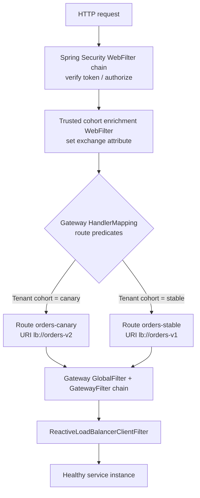
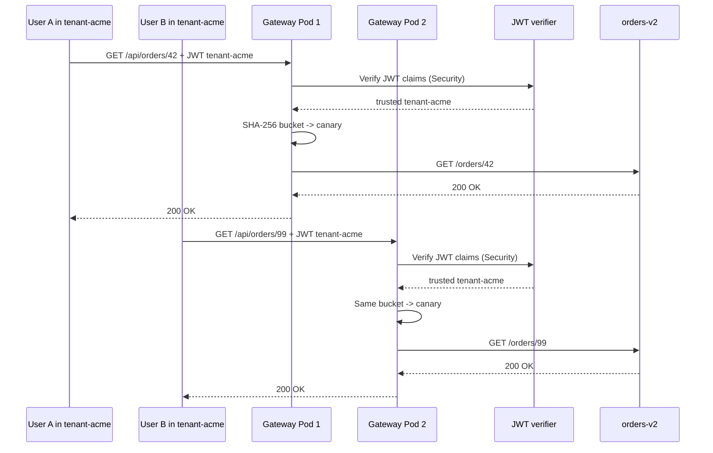
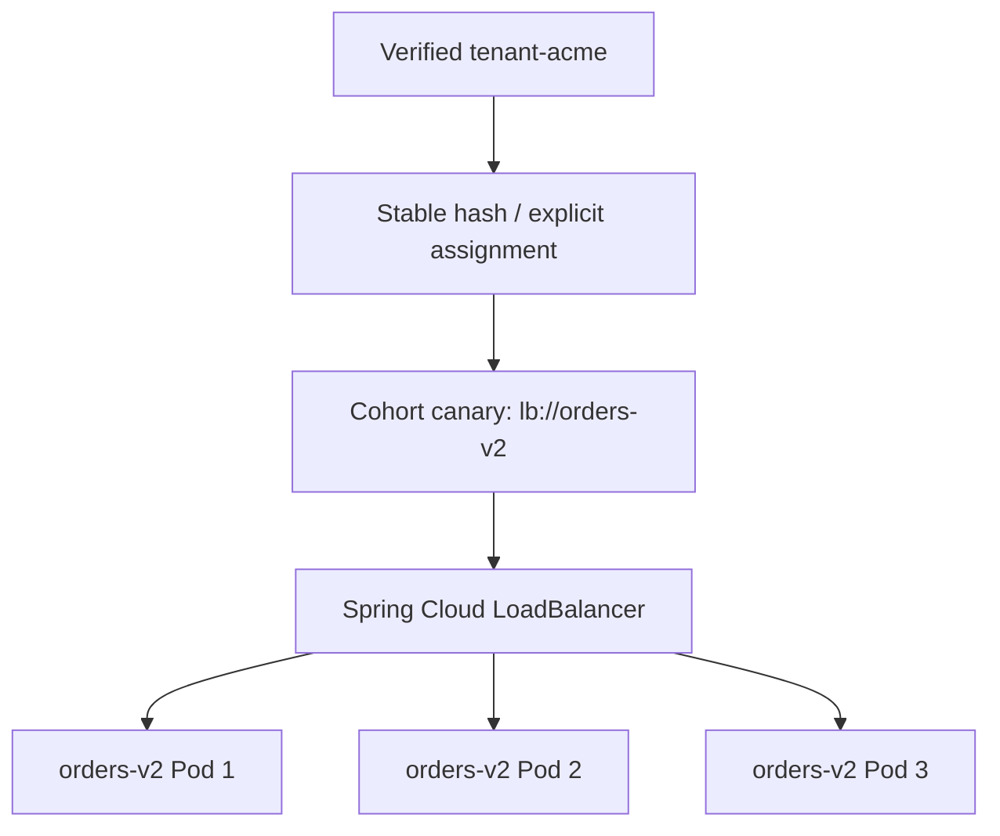
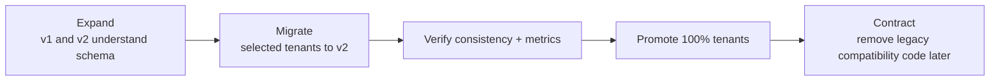

# Consistent Routing by User or Tenant Cohort

Suppose a commerce system runs two backend versions for its orders API: stable **`orders-v1`** and experimental **`orders-v2`**. Operations wants 10% of customers on v2 and 90% on v1, yet **a single customer must stick to the same version across their entire session**, even across multiple requests, browser switches, or requests hitting different Gateway pods. If one tenant writes an order to v2 and reads it back from v1, data or contracts may be inconsistent.

This is the problem of **consistent routing by user or customer cohort** (*stable cohort routing*, *tenant-aware routing*, *deterministic traffic split*). It differs from **probabilistic per-request traffic splitting**, and also differs from **sticky sessions to a single backend instance**.

In the **Routing Patterns** chapter of the **SPRING_CLOUD_GATEWAY** module, this lesson combines route predicates, the filter chain, path/header rewriting, service discovery, JWT/OAuth2, Redis rate limiting, circuit breakers, retries, TLS, and observability to implement stable, fair routing with controlled rollouts and rollbacks.

**Learning outcomes:**

1. Distinguish **user/tenant stickiness**, **`Weight`-based splitting**, and **service-instance stickiness**.
2. Choose a **trusted identity** for routing: verified tenant claim, subject, entitlement, or signed assignment.
3. Compute a cohort via **stable hashing** with a policy ID shared identically across Gateway replicas.
4. Use a `WebFilter` running after Spring Security to attach the cohort to `ServerWebExchange` before route matching.
5. Build a synchronous custom `RoutePredicateFactory` and declare cohort-based stable/canary routes.
6. Ramp rollouts 1% → 5% → 10% → 25% → 100% without **unintentionally flipping existing cohorts**.
7. Prevent spoofing of `X-Tenant-ID`, arbitrary cookies/headers, or valid tokens belonging to another tenant.
8. Test consistency across multiple users, devices, Gateway pods, backend instances, and policy revisions.
9. Monitor traffic, error budgets, rate limits, circuit breakers, and assigned tenant counts without leaking PII into metric labels.
10. Write a rollback runbook for when a customer cohort hits the wrong version or config drift occurs.

> **Scope:** Examples use **Spring Cloud Gateway Server WebFlux 5.x** and Spring Security reactive resource server. Routes are configured under `spring.cloud.gateway.server.webflux.routes`. On WebFlux 4.3.x, the route prefix is often `spring.cloud.gateway.routes`; for Gateway Server Web MVC, APIs and ordering differ and require a separate design. Some snippets are **teaching examples** that must be integrated and tested against your project's Spring Boot–Spring Cloud BOM and identity contract before production deployment.

## 1. Scenario: Why a 90/10 Request Split Is Not Enough

Customer `tenant-acme` executes a workflow:

```text
POST /api/orders            -> create order on orders-v2
GET  /api/orders/123        -> read order on orders-v2
PUT  /api/orders/123/status -> update status on orders-v2
```

If the Gateway picks the version probabilistically **per request**:

```text
POST -> v2
GET  -> v1
PUT  -> v2
```

This can cause severe failures if v1 and v2 differ in response schemas, store data in different locations, or lack full cross-compatibility. Conversely, if the Gateway assigns **tenant-acme** to a stable cohort:

```text
tenant-acme -> canary -> orders-v2
tenant-beta -> stable -> orders-v1
tenant-gamma -> stable -> orders-v1
```

then every request from the same tenant is served consistently regardless of which Gateway pod handles it.

**Not every product needs sticky cohorts.** If v1 and v2 are already backward-compatible, stateless, and share the same backend data store, probabilistic request splitting may suffice for performance testing. Sticky cohorts are needed when you require **consistent UX, tenant migrations, staged feature enablement, or group-scoped debugging**.

## 2. Defining Three Easily Confused Types of “Consistency”

| Type | Stable key / unit | Destination | When to use |
| --- | --- | --- | --- |
| **Stable user cohort** | Authenticated user ID | v1 or v2 for one user | Per-user UX A/B tests, personal features |
| **Stable tenant cohort** | Authenticated tenant/customer ID | v1 or v2 for an **entire customer** | B2B SaaS, schema/logic migrations |
| **Sticky backend instance** | Client/session ID or instance cookie | One instance inside a service | Temporary stateful sessions, cache affinity |
| **Weighted random split** | No guaranteed stable key | 80% of requests to v1, 20% to v2 | Testing stateless compatible backends |
| **Geographic/zone routing** | Network region / tenant residency | Approved cluster/region | Latency and data residency |
| **Explicit allowlist** | ID present on allowlist | Specific beta backend | Opt-in contracted pilot customers |

**Tenant cohort is not authorization.** Routing a request to `orders-v2` does not mean the user is allowed to access another tenant's orders. Both Gateway and backend must still verify JWT claims, roles/scopes, and resource permissions.

## 3. Where Routing Decisions Happen in Spring Cloud Gateway

In the Server WebFlux architecture, Spring Security runs in the **WebFilter chain**; the Gateway uses `HandlerMapping` to find the matching route; and after a route matches, `FilteringWebHandler` runs `GlobalFilter` and `GatewayFilter` instances.



**Critical technical details:**

- `RoutePredicateFactory.apply(...)` returns a **synchronous** `Predicate<ServerWebExchange>` evaluated during route matching.
- `exchange.getPrincipal()` returns a **reactive** `Mono<Principal>`; never call `block()` inside a route predicate on the event loop.
- `GlobalFilter` executes **after the route is selected**, so a regular `GlobalFilter` runs **too late** to pick the route itself.
- To route on JWT claims, extract them **after Spring Security authenticates** inside a properly ordered `WebFilter` **before `HandlerMapping`**, store the trusted value in `exchange.getAttributes()`, and read that attribute in a custom route predicate.
- Ordering between Spring Security and your custom `WebFilter` must be **verified by integration tests**, never guessed from an `@Order` number alone.

**Never write a custom route predicate doing `exchange.getPrincipal().block()`.** It can block the Netty event loop, cause deadlocks or reactive subscription errors, and make the Gateway unsafe under load.

## 4. What Problem Does the `Weight` Predicate Solve?

Gateway WebFlux provides a built-in `Weight` route predicate taking two arguments: `group` and `weight`. Example splitting roughly **90% of requests** to v1 and **10% of requests** to v2:

```yaml
spring:
  cloud:
    gateway:
      server:
        webflux:
          routes:
            - id: orders-weighted-stable
              uri: lb://orders-v1
              predicates:
                - Path=/api/orders/**
                - Method=GET
                - Weight=orders-rollout, 90
              filters:
                - StripPrefix=1

            - id: orders-weighted-canary
              uri: lb://orders-v2
              predicates:
                - Path=/api/orders/**
                - Method=GET
                - Weight=orders-rollout, 10
              filters:
                - StripPrefix=1
```

Routes in the same `Weight` group receive requests according to their relative weights. With `90` and `10`, the long-run split approaches **90% and 10%** when route sets and predicates align.

**`Weight` never promises that the same user or tenant stays on the same backend version.** One tenant sending 100 requests can hit both v1 and v2. It is a **traffic-splitting tool**, not stable cohort assignment.

### When Is `Weight` Appropriate?

- Both backend revisions share the same schema and contract.
- Neither revision keeps revision-local session state.
- Data comes from the same source or is read/write compatible.
- The goal is canarying performance/errors by **requests**, without needing per-tenant stickiness.
- Consistent rollback and filter policies are in place.

### When Should You Not Use `Weight` Alone?

- Tenant migrations across data partitions.
- Two versions with incompatible write behavior.
- Multi-step workflows that must stay on one version.
- Beta programs restricted to specific customers.
- A/B tests requiring a user to remain on the same variant for valid measurement.

## 5. Can Built-In `Cookie` and `Header` Predicates Provide Stickiness?

The Gateway offers built-in route predicates:

- `Cookie=name, regexp`: matches cookies **sent by the client**.
- `Header=name, regexp`: matches headers **sent by the client**.
- `Host`, `Path`, `Method`: match request context; combined via logical AND.

Header-based routing example:

```yaml
spring:
  cloud:
    gateway:
      server:
        webflux:
          routes:
            - id: beta-header-demo
              uri: lb://orders-v2
              predicates:
                - Path=/api/orders/**
                - Header=X-Cohort, beta
```

**This is a matching demo only, not a trusted cohort policy.** Clients can freely send `X-Cohort: beta` or forge cookies. Regex predicates **do not verify signatures, membership, permissions, or quotas**. Trusting raw headers or cookies allows users to self-select unauthorized tenants or variants.

A safer design:

1. The Gateway strips or ignores client-supplied internal routing headers.
2. Spring Security authenticates the token or session.
3. A trusted `WebFilter` or identity sidecar determines the cohort from **verified claims**.
4. The Gateway route predicate reads a **server-side exchange attribute** or a verified signed ticket.
5. If the backend needs a header, the Gateway **overwrites** the internal value after validation instead of forwarding the raw client header.

**Never treat a cookie with a “special name” as a signed cookie.** If a cookie participates in security or routing decisions, enforce HMAC/signature verification, expiration, tenant binding, and key rotation.

## 6. Choosing a Stable Key: Subject, Tenant, or Account?

Your choice of identity determines the stickiness boundary:

| Identity | Sticky scope | Pros | Risks / prerequisites |
| --- | --- | --- | --- |
| JWT `sub` | Single user identity | Suits per-user UX A/B tests | Users in the same tenant split across v1/v2 |
| Verified `tenant_id` | Single tenant/customer | Consistent tenant workflows and data | Must verify tenant membership |
| OAuth2 client ID | Calling application | Suits B2B machine-to-machine | One app may act on behalf of many tenants |
| Entitlement tier | Gold/Beta/Standard | Splits by contract tier | A single tier may hold too much traffic |
| Signed rollout ticket | Session/experiment | Time-bounded assignment control | Must be signed, identity-bound, replay-safe |
| Trusted device ID | Single device | Suits device-specific UX | Clearing cookies/switching devices changes cohort |
| Source IP | Network address | Easy to read at edge | NAT, proxies, mobile IPs, spoofed forwarded headers |

**For B2B SaaS with tenant-scoped transactions**, the sensible default is **verified tenant ID**. For an independent user-facing UI feature, **verified subject** may be better suited.

### Multi-Tenant Authorization Must Remain Intact

A JWT may carry `tenant_id` and `sub`, yet membership can change between token issuance and request time. The backend must still enforce resource ownership. If a request uses `/tenants/{tenantId}/orders`, validate the path tenant against the authenticated tenant context—never treat cohort routing as an access check.

## 7. Stable Cohort Hashing Formula

We want to map **tenant IDs** deterministically into 10,000 stable buckets, numbered `0` through `9999`. Define:

\[
b(t)=
\operatorname{U64}\big(\operatorname{SHA256}(p \;||\; ":" \;||\; t)[0:8]\big)
\bmod 10000
\]

Where:

- `t`: canonical verified tenant ID.
- `p`: fixed **cohort policy ID**, such as `orders-cohort-v1`.
- `SHA256`: digest over UTF-8 bytes.
- `U64`: first 8 bytes interpreted as an unsigned 64-bit big-endian integer.
- `b(t)`: bucket in `0..9999`.

For a 10% rollout:

\[
\operatorname{cohort}(t)=
\begin{cases}
\text{canary}, & b(t)<1000\\
\text{stable}, & b(t)\ge1000
\end{cases}
\]

Identical `tenant_id`, `policy ID`, canonical encoding, and threshold yield the exact same decision across all Gateway pods.

### Illustrative Bucket Examples

| Tenant | Hypothetical bucket | Threshold = 1,000 (10%) | Result |
| --- | ---: | ---: | --- |
| `tenant-acme` | 205 | 1,000 | canary |
| `tenant-beta` | 6,432 | 1,000 | stable |
| `tenant-gamma` | 985 | 1,000 | canary |
| `tenant-delta` | 9,118 | 1,000 | stable |

**Bucket values in this table are hypothetical for explanation**, not computed outputs for those names. In real tests, verify **golden vectors** produced by the exact SHA-256 function across JVMs and services.

**A 10% bucket slice is roughly 10% of tenant IDs**, not guaranteed to be 10% of traffic. One large tenant can generate 50% of all requests; if that tenant lands in the canary bucket, canary traffic will far exceed 10%.

## 8. Why Not Use `Math.random()`, `hashCode()`, or IP Affinity?

### `Math.random()`

Randomizing per request causes the same tenant to flip versions constantly. Fine for `Weight`-style request splitting, **wrong** for sticky cohorts.

### `String.hashCode()`

Java's `String.hashCode()` is deterministic for a given string, but it is not a cross-service experiment hashing standard. It is prone to input patterns, collisions, and mismatch across non-Java SDKs. Choosing a standard hash with fixed encoding—such as SHA-256—makes cross-platform test vectors straightforward.

### Object `hashCode()`

Never call `Object.hashCode()` on a tenant wrapper or runtime object; behavior can vary by implementation/instance and is unstable across JVMs.

### IP Affinity

An IP does not identify a customer: NAT puts multiple tenants behind one IP, mobile clients roam across IPs, and `X-Forwarded-For` can be spoofed if trusted proxy chains are misconfigured. Use IP only for explicit network-level policies with verified trusted proxies.

### Hashing Does Not Secure Authorization

Even though SHA-256 is practically non-invertible, bucket assignment **is neither a signature nor a permission**. Callers can present arbitrary identities if the identity source is unauthenticated. Authenticate **first**, then hash.

## 9. Pinning Policy ID, Canonicalization, and Threshold

Even a solid algorithm drifts if Gateway pods run mismatched policies.

**Invariants to maintain:**

1. All pods read the same `tenant_id` claim name and apply identical identity normalization.
2. Same `policy ID` (`orders-cohort-v1`).
3. Same SHA-256/UTF-8/unsigned 64-bit/big-endian/modulo-10,000 formula.
4. Same threshold within a given rollout revision.
5. Same mapping `canary -> lb://orders-v2`, `stable -> lb://orders-v1`.
6. Same allowlist/override policy if present.
7. Never include timestamps, random salts, or pod names in the hash input.

**Canonical tenant IDs** should be issued by the identity system (e.g., unique UUIDs or string IDs). Never arbitrarily lowercase emails, trim inconsistently, or vary Unicode normalization across microservices in ways that could **merge distinct tenants**. Any normalization rule must be governed and tested as part of the contract.

**Policy ID is not a secret** when hashing for statistical bucketing; however, it still requires change control so it is never altered accidentally. If assignments must prevent clients from predicting buckets, use HMAC with a secret and rotation process—never use HMAC as a substitute for auth.

## 10. Spring Security Verifies the JWT Before Cohort Selection

On WebFlux, Spring Security's resource server verifies bearer tokens and supplies a `JwtAuthenticationToken`. Configuration example **sketching an authenticated API chain**:

```java
package example.gateway.cohort;

import org.springframework.context.annotation.Bean;
import org.springframework.context.annotation.Configuration;
import org.springframework.security.config.annotation.web.reactive.EnableWebFluxSecurity;
import org.springframework.security.config.web.server.ServerHttpSecurity;
import org.springframework.security.web.server.SecurityWebFilterChain;
import org.springframework.security.web.server.util.matcher.PathPatternParserServerWebExchangeMatcher;

@Configuration
@EnableWebFluxSecurity
public class ApiSecurityConfiguration {

    @Bean
    SecurityWebFilterChain ordersSecurity(ServerHttpSecurity http) {
        return http
            .securityMatcher(
                new PathPatternParserServerWebExchangeMatcher(
                    "/api/orders/**"))
            .authorizeExchange(exchanges ->
                exchanges.anyExchange().authenticated())
            .oauth2ResourceServer(oauth2 -> oauth2.jwt(
                org.springframework.security.config.Customizer.withDefaults()))
            .build();
    }
}
```

**This is an excerpt illustrating route protection**, not a complete system security configuration. With multiple `SecurityWebFilterChain` beans, configure `@Order` and a fallback chain so other endpoints are appropriately secured too. Imports and DSL methods may vary across Spring Security major versions; test against your actual BOM.

**Authentication and authorization are distinct:** `authenticated()` checks only for a valid token. For write operations or sensitive tenant data, enforce scopes/roles and verify tenant ownership. Never treat being placed in `canary` as authorization.

## 11. Why Not Put Cohort Logic Inside a `GlobalFilter`?

Look at the exact execution order:

```text
HTTP -> Security WebFilters -> HandlerMapping chooses Route
     -> FilteringWebHandler creates GlobalFilters + GatewayFilters
     -> ReactiveLoadBalancerClientFilter -> HTTP client
```

If a custom `GlobalFilter` computes `tenant-cohort=canary`, the route `orders-v1` or `orders-v2` has **already been selected** before the `GlobalFilter` runs, so adding an exchange attribute there **cannot influence the current route selection**.

A custom `GatewayFilter` also runs after route matching. That is the right place to:

- Inject post-auth backend headers.
- Record metrics for the chosen route.
- Apply `Retry`, `CircuitBreaker`, `RedisRateLimiter`, and path/header rewrites.
- Enforce post-match policies.

It is **not the place** to decide *which candidate route matches* via `RoutePredicateFactory`.

**Pattern used in this lesson:** a post-Security `WebFilter` enriches the exchange; a synchronous `RoutePredicateFactory` reads the attribute. This is one clean approach; larger systems may use a control plane/edge mesh with a dedicated policy engine or a tested custom `ReactiveLoadBalancer`.

## 12. Post-Authentication `WebFilter`: Setting the Trusted Cohort Attribute

Example `WebFilter` computing cohorts solely for `/api/orders/**` from **claims verified by Spring Security**:

```java
package example.gateway.cohort;

import java.util.Optional;
import org.springframework.core.annotation.Order;
import org.springframework.http.HttpStatus;
import org.springframework.security.oauth2.server.resource.authentication.JwtAuthenticationToken;
import org.springframework.stereotype.Component;
import org.springframework.web.server.ServerWebExchange;
import org.springframework.web.server.WebFilter;
import org.springframework.web.server.WebFilterChain;
import reactor.core.publisher.Mono;

@Component
@Order(0) // Ensure this runs AFTER the Spring Security WebFilter chain.
public final class TenantCohortWebFilter implements WebFilter {

    public static final String ATTR = "trusted.tenant.cohort";
    private final CohortDecider decider;

    public TenantCohortWebFilter(CohortDecider decider) {
        this.decider = decider;
    }

    @Override
    public Mono<Void> filter(ServerWebExchange exchange,
                             WebFilterChain chain) {
        String path = exchange.getRequest().getPath().value();
        if (!path.startsWith("/api/orders/")) {
            return chain.filter(exchange);
        }

        return exchange.getPrincipal()
            .ofType(JwtAuthenticationToken.class)
            .flatMap(jwt -> Mono.justOrEmpty(
                jwt.getToken().getClaimAsString("tenant_id")))
            .filter(tenant -> !tenant.isBlank())
            .map(Optional::of)
            .defaultIfEmpty(Optional.empty())
            .flatMap(tenant -> {
                if (tenant.isEmpty()) {
                    // Route requires verified tenant; fail closed.
                    exchange.getResponse()
                        .setStatusCode(HttpStatus.FORBIDDEN);
                    return exchange.getResponse().setComplete();
                }
                exchange.getAttributes()
                    .put(ATTR, decider.routeFor(tenant.get()));
                return chain.filter(exchange);
            });
    }
}
```

### Safety Analysis

- `exchange.getPrincipal()` is consumed **reactively**, never via `block()`.
- `JwtAuthenticationToken` is produced by Spring Security after verifying the JWT signature, issuer, and audience per the resource-server configuration.
- The `tenant_id` claim must be minted by a **trusted issuer** and match scopes/membership; do not trust the claim name if the issuer does not enforce its semantics.
- `map(Optional::of).defaultIfEmpty(Optional.empty())` ensures the filter chain executes only once when no principal or claim exists.
- When a route requires a tenant and the trusted claim is missing, returning **403** is intentional; the Security chain still returns **401** for unauthenticated callers.
- The attribute lives **only in the server-side request exchange**, never supplied by clients and immune to raw `X-Tenant` spoofing.
- `@Order(0)` is illustrative; Spring Security's `WebFilterChainProxy` normally has higher precedence, yet you must test **actual runtime ordering**, especially alongside other custom `WebFilter` beans.
- Restricting to `/api/orders/**` avoids overhead on unrelated routes; never perform blocking network or DB calls inside this filter.

**Important:** Never write `switchIfEmpty(chain.filter(exchange))` after a `Mono<Void>` returned by `flatMap`: a `Mono<Void>` completes empty and will trigger the fallback branch, executing the filter chain **twice**. The `Optional` pattern above avoids that control-flow bug.

## 13. Java Algorithm: Deterministic Cohort Decision

A stateless component accepting a verified tenant ID and returning `stable` or `canary`:

```java
package example.gateway.cohort;

import java.nio.ByteBuffer;
import java.nio.charset.StandardCharsets;
import java.security.MessageDigest;
import java.security.NoSuchAlgorithmException;

import org.springframework.beans.factory.annotation.Value;
import org.springframework.stereotype.Component;

@Component
public final class CohortDecider {

    private final String policyId;
    private final int canaryBasisPoints;

    public CohortDecider(
            @Value("${routing.orders.policy-id:orders-cohort-v1}")
            String policyId,
            @Value("${routing.orders.canary-bps:1000}")
            int canaryBasisPoints) {

        if (canaryBasisPoints < 0 || canaryBasisPoints > 10000) {
            throw new IllegalArgumentException(
                "canary-bps must be within [0, 10000]");
        }
        if (policyId == null || policyId.isBlank()) {
            throw new IllegalArgumentException("policy-id required");
        }
        this.policyId = policyId;
        this.canaryBasisPoints = canaryBasisPoints;
    }

    public String routeFor(String verifiedTenantId) {
        if (verifiedTenantId == null || verifiedTenantId.isBlank()) {
            throw new IllegalArgumentException(
                "Verified tenant id required");
        }
        return bucketFor(verifiedTenantId) < canaryBasisPoints
            ? "canary" : "stable";
    }

    public int bucketFor(String verifiedTenantId) {
        // Stable across JVM pods: UTF-8 + SHA-256 + first 8 bytes.
        String input = policyId + ":" + verifiedTenantId;
        try {
            MessageDigest sha = MessageDigest.getInstance("SHA-256");
            byte[] digest = sha.digest(
                input.getBytes(StandardCharsets.UTF_8));
            long first64 = ByteBuffer.wrap(digest, 0, 8).getLong();
            return (int) Long.remainderUnsigned(first64, 10_000L);
        } catch (NoSuchAlgorithmException e) {
            throw new IllegalStateException(
                "SHA-256 unavailable", e);
        }
    }
}
```

**Properties:**

- Identical input and policy ID → identical bucket across all JVMs and instances.
- `Long.remainderUnsigned` prevents negative modulo results on signed `long` values whose high bit is set.
- Threshold 0 → zero tenants in canary; 10,000 → all tenants in canary.
- Raising the threshold while keeping `policyId` fixed yields a **monotonic** rollout: tenants already in canary never flip back to stable merely because the percentage increased.
- Each request gets one deterministic result; no per-request randomness.

**Operational caution:** This component injects `@Value` at bean creation; editing an external file does not automatically update a running JVM's policy. Use rolling config revisions, tested controlled refreshes, or a versioned policy store. Never change `policyId` from `orders-cohort-v1` to `orders-cohort-v2` mid-rollout unless you intentionally want to **reshuffle cohorts**.

## 14. Custom `RoutePredicateFactory` Reading the Trusted Attribute

Spring Cloud Gateway Server WebFlux supports custom route predicates via `AbstractRoutePredicateFactory`.

```java
package example.gateway.cohort;

import java.util.List;
import java.util.Objects;
import java.util.function.Predicate;

import org.springframework.cloud.gateway.handler.predicate.AbstractRoutePredicateFactory;
import org.springframework.stereotype.Component;
import org.springframework.web.server.ServerWebExchange;

@Component
public final class TenantCohortRoutePredicateFactory
    extends AbstractRoutePredicateFactory<
        TenantCohortRoutePredicateFactory.Config> {

    public TenantCohortRoutePredicateFactory() {
        super(Config.class);
    }

    @Override
    public List<String> shortcutFieldOrder() {
        return List.of("value");
    }

    @Override
    public Predicate<ServerWebExchange> apply(Config config) {
        String expected = Objects.requireNonNull(
            config.getValue(), "cohort value required");
        if (!expected.equals("stable") &&
            !expected.equals("canary")) {
            throw new IllegalArgumentException("Unsupported cohort");
        }

        // Route matching is synchronous; no network I/O or block().
        return exchange -> expected.equals(
            exchange.getAttribute(TenantCohortWebFilter.ATTR));
    }

    public static final class Config {
        private String value;

        public String getValue() {
            return value;
        }

        public void setValue(String value) {
            this.value = value;
        }
    }
}
```

Because the class name ends with `RoutePredicateFactory`, Spring Cloud Gateway registers the predicate under the config name **`TenantCohort`** (by factory convention). `shortcutFieldOrder()` enables the concise syntax `TenantCohort=canary`.

**Never perform JWT verification inside `Predicate.apply`**; principal verification/lookup is reactive, whereas predicates are synchronous. The predicate simply reads a **pre-validated attribute**. When the attribute is absent, neither stable nor canary matches; for protected routes, Security and the `WebFilter` must already have handled 401/403 prior to route matching.

## 15. Configuring Two Cohort-Based Routes (WebFlux 5.x)

```yaml
routing:
  orders:
    policy-id: orders-cohort-v1
    canary-bps: 1000  # 10% of the bucket space

spring:
  cloud:
    gateway:
      server:
        webflux:
          routes:
            - id: orders-canary
              order: -20
              uri: lb://orders-v2
              predicates:
                - Path=/api/orders/**
                - Method=GET
                - TenantCohort=canary
              filters:
                - StripPrefix=1

            - id: orders-stable
              order: -10
              uri: lb://orders-v1
              predicates:
                - Path=/api/orders/**
                - Method=GET
                - TenantCohort=stable
              filters:
                - StripPrefix=1
```

Execution flow:

```text
GET /api/orders/42
  -> Spring Security verifies JWT
  -> TenantCohortWebFilter reads verified tenant_id
  -> CohortDecider hashes tenant_id
  -> exchange.attr "trusted.tenant.cohort" = stable/canary
  -> HandlerMapping evaluates Path + Method + TenantCohort
  -> matching route orders-stable / orders-canary
  -> StripPrefix=1
  -> lb://orders-v1 or lb://orders-v2
  -> one service instance chosen by LoadBalancer
```

**Notes:**

- `Path`, `Method`, and `TenantCohort` on a route must all match.
- `order: -20` and `order: -10` make ordering explicit, yet the predicates are **mutually exclusive**, so you never rely on ordering to resolve a logical conflict.
- Never place a `Path=/api/orders/**` route without a cohort predicate at higher priority; it would swallow all traffic before these two routes.
- Both `orders-v1` and `orders-v2` must have healthy `ServiceInstance` entries; missing v2 instances will not **automatically fall back to v1**.
- To route `POST`/`PUT` under the same cohort, declare `Method=GET,POST,PUT` or matching routes—**after** verifying idempotency, authorization, and schema compatibility for v2 writes.
- `StripPrefix=1` turns `/api/orders/42` into `/orders/42` upstream; both backend versions must honor the same contract or have tested dedicated rewrites.

## 16. Sequence Diagram for Two Users in the Same Tenant



**This is a logical diagram:** JWT resource servers normally verify signatures locally using cached JWKs rather than calling the IdP on every request. “JWT verifier” represents Gateway-side verification, not necessarily a per-request outbound RPC.

## 17. Handling Users Without a Valid Tenant

There are several distinct cases:

| Request | Resolution |
| --- | --- |
| Missing token on a protected API | Spring Security returns `401` |
| Valid token lacking required `tenant_id` | Return `403` or policy-specific `4xx`; never route arbitrarily |
| Valid token with `tenant_id`, but user lacks access to requested tenant | Return `403`, and backend still verifies ownership |
| Genuinely anonymous public endpoint | Design separate anonymous routing/keying; do not mix with tenant routes |
| Tampered cookie or self-declared `X-Tenant-ID` header | Ignore or reject; never trust for cohort assignment |
| Identity service temporarily down (if extra lookup is needed) | Fail under a controlled policy; never default to allow-all |

**Never silently default a missing tenant to `stable` on an API requiring authorization.** Doing so can turn an identity error into a tenant-policy bypass. Conversely, public static assets should never require a JWT just to assign a cohort.

### About HTTP Status Codes

In the `WebFilter` example, a missing verified tenant returns 403, whereas an unauthenticated request should already return 401 from Spring Security. In practice, filter ordering can alter the status if misconfigured; **integration tests must verify exact 401/403 outcomes**. Never rely on an accidental route miss returning 404 as an authorization mechanism.

## 18. Opt-In Beta Customers via Allowlist

Not every rollout uses percentages alone. Suppose the business has **5 tenants with signed beta agreements** that must always reach v2:

```text
Explicit canary tenants:
  tenant-acme
  tenant-rocket

Other tenants:
  Stable hash 5% canary, 95% stable
```

Policy evaluation order:

1. **Deny/disabled list** per governance or security policy (if any).
2. **Explicit allowlist** approved by the owner.
3. **Hash-based percentage** across remaining tenants.
4. Default to stable, or an explicit policy for edge cases.

Pseudocode:

```java
String cohortFor(String verifiedTenantId) {
    if (disabledTenants.contains(verifiedTenantId)) {
        return "stable";
    }
    if (betaTenants.contains(verifiedTenantId)) {
        return "canary";
    }
    return hashDecider.routeFor(verifiedTenantId);
}
```

**This is pseudocode**; `disabledTenants` and `betaTenants` must come from an audited, access-controlled config store with TTL/revisions. As the allowlist grows, canary traffic can exceed `canary-bps`. Always measure **actual traffic volume**.

**Never let clients pass `X-Beta: true` in place of an allowlist.** Membership must come from an entitlement service or JWT claims verified against a trusted issuer.

## 19. Ramping 1% → 5% → 10% While Keeping Existing Cohorts Stable

With the same policy ID `orders-cohort-v1`:

| Phase | `canary-bps` | Canary bucket range | Property |
| --- | ---: | --- | --- |
| Baseline | 0 | None | All tenants on stable |
| Initial canary | 100 | `0..99` | Roughly 1% of tenant IDs |
| Expand | 500 | `0..499` | Previous 1% group stays in canary |
| Expand | 1,000 | `0..999` | Previous 5% group stays in canary |
| Expand | 2,500 | `0..2499` | Roughly 25% of tenants |
| Promote | 10,000 | `0..9999` | All tenants on canary/v2 |

**Monotonic rollout** means that when you **only increase the threshold** while keeping the policy ID, hash, and identity fixed, tenants already assigned to canary never move back to stable. When **lowering the threshold to roll back**, some tenants return to stable; make sure backend v1 can read any data v2 previously wrote.

### Do Not Change the Seed Between 5% and 10%

If `policyId` changes from `orders-cohort-v1` to `orders-cohort-v2`, every bucket can reshuffle. Formerly canary tenants can drop back to stable while former stable tenants jump into canary. Keep `policyId` in **versioned configuration** and verify the exact same revision across all Gateway pods.

## 20. 10% of Tenants Does Not Necessarily Equal 10% of Requests

Suppose you have 1,000 tenants:

- 990 small tenants at 1 req/s each.
- 10 large tenants at 500 req/s each.

Hashing 10% of tenants selects roughly 100 tenants. If **even one large tenant** lands in that slice, canary traffic jumps by **500 req/s** despite representing ~10% of tenant IDs.

**Never size canary capacity purely from tenant counts.** Track:

- Number of tenants assigned.
- RPS, 5xx, and p95 per stable/canary route.
- Request volume of **top tenants** on access-controlled dashboards (without creating per-tenant metric labels).
- Backend CPU, DB, and connection-pool saturation.
- Retry attempts and circuit breaker OPEN events.
- 429 quota rejections per route/plan tier.

### Stratified Cohorts When Traffic Is Heavily Skewed

You can group tenants by size or usage tier (enterprise, medium, small) and hash **within each tier**, or place top enterprise tenants onto an explicit approved allowlist. Remember that changing **stratification** changes the cohort algorithm and requires versioning and testing. Alternatively, enforce a dedicated **canary traffic budget / capacity gate** rather than treating 10% of tenants as a hard traffic cap.

**Privacy note:** Never export the full list of raw tenant IDs as Prometheus labels. Hashing PII does not automatically make it harmless; auditing and retention rules still apply.

## 21. Version-Level Cohort Stickiness vs. Backend Instance Stickiness

Two routing layers:



**Cohort routing** pins a tenant to a **service version / backend group**, while `lb://orders-v2` remains free to pick **any healthy instance** of `orders-v2`. This is normally the desired design for stateless backends backed by shared data/session stores.

**Sticky instance routing** tries to pin all requests of a session to the same **instance ID**, for example because session state sits in local memory. Its drawbacks include:

- Rolling updates replace instances → affinity breaks.
- HPA scale-in/out skews session distribution.
- Unhealthy pods require failover; affinity cannot be held unconditionally.
- Instance stickiness does not replace shared session state or DB replication.
- Any client-supplied affinity cookie requires a clear trust boundary.

Spring Cloud LoadBalancer offers **Same Instance Preference**, **Request-based Sticky Session**, and **Hint-based LoadBalancing**. Those operate at the **instance-selection layer** after the Gateway chooses a route—not as the primary tenant-to-v1/v2 selector.

## 22. LoadBalancer Sticky Sessions and Support Boundaries

Spring Cloud Commons documents `RequestBasedStickySessionServiceInstanceListSupplier`, which prefers an instance ID carried in a request cookie (by default associated with `sc-lb-instance-id`), with an option to update the cookie if the original instance becomes unavailable.

Documentation config example for **LoadBalancer WebClient-backed flows**—do not copy blindly into every Netty Gateway path:

```yaml
spring:
  cloud:
    loadbalancer:
      configurations: request-based-sticky-session
      sticky-session:
        add-service-instance-cookie: true
```

**Verify the exact transport integration:** Spring Cloud LoadBalancer documentation notes that request-based sticky sessions currently target **WebClient-backed load-balancing** flows; Gateway Server WebFlux typically uses **`NettyRoutingFilter` + `ReactiveLoadBalancerClientFilter`**, so you cannot assume it preserves cookie affinity identically to the WebClient example. Check your release train and test the actual request path.

Likewise, an `sc-lb-instance-id` cookie—if present—**is not proof of authorization**. The backend must still verify tokens and resource ownership. And if an instance dies, a sound strategy must **fail over** gracefully.

**Architectural preference:** Use a **tenant-to-service-version stable hash**, then load-balance **statelessly** across instances of that version. Add instance affinity only for a verified session/cache need and test failover thoroughly.

## 23. Multiple HTTP Methods in a Workflow Must Share the Same Cohort

A customer could create an order on v2 and read it on v1 if only `GET` routes apply cohort logic while `POST` matches a different route.

Example:

```text
POST /api/orders       -> orders-v1 (matched a separate POST route)
GET  /api/orders/42    -> orders-v2 (due to canary cohort)
PATCH /api/orders/42   -> orders-v1 (matched generic fallback route)
```

If v1 and v2 do not share consistent schemas and state, the system may return 404 or miscalculate totals.

**Design around complete workflows:**

1. Enumerate every HTTP method and endpoint participating in a stateful business operation.
2. Define a single **routing scope** (tenant/customer/user) across the whole workflow.
3. Bind the same verified identity, policy ID, and version mapping to every route that must stay aligned.
4. Trace transitions from command APIs (`POST`) to queries (`GET`) and async callbacks/webhooks.
5. For background jobs and events, propagate trusted **version/tenant routing metadata** or ensure consumers handle both schemas.
6. On client retries, never re-roll the cohort randomly; `POST` operations with side effects require idempotency.
7. If an action committed on v2, rolling back to v1 requires backward-compatible read/write semantics.

**Never use sticky routing to paper over an incomplete database migration.** It narrows the blast radius, yet does not solve dual-writes, stale events, or schema incompatibility.

## 24. Expand–Migrate–Contract for Data and API Contracts

Tenant canary routing frequently accompanies backend schema changes:



**Expand phase:**

- Backend v1 can still read new data where required.
- Backend v2 can read legacy data.
- New fields are optional or carry safe defaults.
- Schema changes avoid abrupt renames or drops.
- Event consumers accept both old and new event versions.

**Migrate phase:**

- Pin tenant cohorts under a stable policy.
- Execute any tenant-scoped migrations with an audit trail and rollback plan.
- Compare business invariants, response contracts, error rates, and data quality.
- For large tenants, use an **explicit allowlist** and dedicated maintenance windows.

**Contract phase:**

- Drop v1 support only after every tenant, job, and consumer has migrated.
- Keep data reconciliation and disaster recovery in place.
- Never equate `canary-bps=10000` with “all historical data has been migrated.”

**Life-saving rollback rule:** If v2 writes data that v1 cannot read, dropping `canary-bps` to 0 may be **unsafe**. Operators need a restore plan, read-compatible v1 behavior, or a roll-forward fix—never blindly flip active tenants back to v1.

## 25. Tenant Affinity Is a Security Concern, Not Just UX

A user with a verified JWT may belong to multiple tenants. Whenever the client selects a tenant via path or header, verify all of the following:

- Token issuer and audience are valid.
- `sub` and roles/scopes authorize the specific API.
- The user holds active membership in **the requested tenant**.
- The tenant ID in the request path, body, or query matches the server-resolved tenant context.
- The backend enforces resource-level authorization.
- If using a BFF/session, session fixation and CSRF protections match the contract.

**Anti-pattern:**

```text
GET /api/orders/42
X-Tenant-ID: tenant-victim
X-Cohort: canary
Authorization: Bearer <valid-user-from-tenant-attacker>
```

If the Gateway hashes an unverified `X-Tenant-ID`, an attacker can switch tenants to pick a different version or spoof tenant context toward the backend.

**Invariant:** Routing identity comes from **trusted JWT claims or entitlements**, never from an arbitrary client-editable field. If tenant switching is a legitimate feature, reissue a token/authorized context or verify membership server-side before assigning the cohort. Never log raw tokens in logs or metrics.

## 26. When You Need Versioning via Signed Cookies

Not every application carries a JWT tenant claim at the Gateway. For public web apps or BFFs, you can issue a **signed assignment cookie**:

```text
assignment payload:
  subject_or_session: opaque-id
  cohort: canary
  policy_id: orders-cohort-v1
  expires_at: 2026-12-31T00:00:00Z

signature:
  HMAC-SHA-256 over canonical payload
```

Standard flow:

1. Server/BFF generates the assignment from a trusted identity.
2. Sign the payload with a key managed in a secrets manager.
3. Set the cookie with `Secure`, `HttpOnly` (unless JS needs it), and appropriate `SameSite`.
4. Gateway/BFF verifies the signature, expiration, audience, and identity binding before routing.
5. Reject tampered or expired cookies; issue a fresh assignment only if policy permits.
6. Support key rotation with overlap windows and auditing.

**Never use the built-in `Cookie` predicate by itself** to “validate a signed cookie.” The predicate only runs a regex match. Signature verification must occur **before route selection** inside a trusted `WebFilter` or identity service. An unsigned cookie carrying a cohort value lets users edit it to enter canary at will.

## 27. Header Propagation, TLS, and CORS: Same Cohort Still Needs Exact Contracts

A v2 route may expect a new business header while v1 still relies on an older one. Verify:

- How does the Gateway forward `Authorization`? Does the backend expect its own JWT or `TokenRelay`?
- Do `SetRequestHeader`/`AddRequestHeader` inject tenant context upstream?
- Are all client-sent internal headers like `X-Internal-Tenant` stripped or overwritten before being trusted?
- Do `Host`, `X-Forwarded-*`, and forwarded scheme follow a trusted-proxy policy?
- Do `StripPrefix`/`RewritePath` share exact semantics across v1 and v2?
- Are CORS allowed origins, methods, and credentials consistent across versions?
- Does Gateway→backend TLS/mTLS configure the right SNI, hostname, and truststore for `orders-v2`?

**Illustrative** route-level filter adding a diagnostic header—never use this header for authorization:

```yaml
spring:
  cloud:
    gateway:
      server:
        webflux:
          routes:
            - id: orders-canary
              uri: lb://orders-v2
              predicates:
                - Path=/api/orders/**
                - TenantCohort=canary
              filters:
                - StripPrefix=1
                - SetRequestHeader=X-Backend-Variant, canary
```

**Never let the backend treat `X-Backend-Variant: canary` as proof that the caller may access canary data.** The backend must still verify the JWT and tenant ownership. If internal security headers are used, strip raw client headers, overwrite them from trusted Gateway state, and secure the Gateway→backend link (mTLS / network policies)—never trust them across untrusted networks.

## 28. `RedisRateLimiter` and Per-User/Tenant Quotas Across Split Routes

Identity-based rate limiting can operate independently of cohort routing, yet key namespacing can create surprises.

| Policy | What to check |
| --- | --- |
| 100 req/s/tenant across v1+v2 combined | Do both routes actually share one quota bucket? |
| 10 req/s/user | Does `KeyResolver` use the verified principal rather than `X-User`? |
| Tighter quota on canary due to smaller v2 capacity | Are explicit policies and 429 alerts configured? |
| Redis outage | Are fail-open/closed/degraded behaviors capped and tested? |
| Ramp from 5% to 25% | Do backend v2 and Redis QPS have headroom? |
| Retries | Does a logical request consume one or multiple tokens given filter ordering? |

**Never assume a user or tenant shares one token bucket simply because both routes use Redis.** `RedisRateLimiter` constructs keys using route IDs and state-store prefixes depending on implementation. Distinct route IDs can **split buckets**, granting a customer alternating between v1 and v2 double the intended quota. For a unified quota, use a policy/limiter scoped to a **capacity group** and verify backend request counts.

**Same caveat applies to custom concurrency limiters:** 20 permits/pod is a local JVM cap, not a global tenant quota. Scaling out Gateway pods raises total outbound concurrency; size against backend capacity.

## 29. Retries, Circuit Breakers, and Fallbacks Must Preserve Cohort Semantics

A request routed to `orders-canary` should normally stay on **`orders-v2`** across any retry attempts for that logical request. Never randomize between v1 and v2 per attempt when state or schemas differ.

### When the Canary Backend Returns 503

```text
Tenant-acme -> cohort canary -> orders-v2
  attempt #1 -> 503
  Retry       -> attempt #2 orders-v2 -> 503
  breaker OPEN / fallback 503
```

**Never automatically fail over retry attempt #2 to `orders-v1`** if v1 and v2 differ in state or schema. Cross-version fallback is valid only under an **approved policy** with a contract guaranteeing identical data and side-effect semantics. Falling back to v1 can otherwise serve stale data or create duplicate orders.

### Breaker State Is Per Instance

Resilience4j `CircuitBreaker` state normally lives inside each JVM. Two Gateway pods can be in different OPEN/CLOSED states even though both map the same tenant to canary. That does not break deterministic route assignment, yet produces **different client outcomes**. Track breaker and retry metrics per pod and per route.

### 200 Fallbacks Can Mask Errors

If a canary fallback returns HTTP 200 with incomplete or stubbed content, never count it as a “successful” user-facing SLI solely from status code. Track fallback indicators, business correctness, and error budgets.

## 30. Multi-Pod, Multi-Region, and Configuration Consistency

A stable hash **remains consistent only while all Gateway pods run the same policy**:

```text
Gateway Pod A:
  policy_id = orders-cohort-v1
  canary_bps = 1000

Gateway Pod B:
  policy_id = orders-cohort-v1
  canary_bps = 1000

Gateway Pod C:
  policy_id = orders-cohort-v2  <-- drift!
  canary_bps = 1000
```

Pod C can place the exact same tenant into a different cohort. Therefore, beyond the chosen config hash, track the **deployment configuration revision** and compare effective property values across every pod.

**Safe rollout procedure:**

1. Version policy ID/threshold, route IDs, and target services in GitOps/ConfigMap/Config Server.
2. Validate config and hash outputs against test vectors **before** deploying.
3. Prepare a rollback bundle combining image, route config, and cohort policy revision.
4. Deploy canary pods and compare cohort decisions against existing pods on test tenants.
5. Adjust thresholds only via approved releases; avoid uncoordinated mixed-policy windows.
6. Monitor cohorts, traffic, and errors per revision.
7. Verify active routes on **every pod** (via read-only Gateway Actuator).
8. Mark the rollout complete only once pods converge or the bounded mixed-version window closes.

### `/actuator/gateway/refresh` Is Not a Cluster Broadcast

`POST /actuator/gateway/refresh` refreshes the route cache only on the instance receiving the request; it **does not guarantee** all Gateway pods load the updated route definitions. Calling it through a load-balanced Service hits only a single pod. Use reconciliation, rolling restarts, or a reliable cluster-wide refresh mechanism. **Refreshing the cache never fixes a broken source config.**

## 31. Gating Rollout Thresholds by Actual Capacity and SLOs

An `orders-v2` backend might run only **2 pods** while v1 runs 10 pods. Shifting 10% of tenants onto v2 can send 50% of traffic to v2 if large customers land in the canary cohort.

Determine:

- Safe `orders-v2` capacity in **requests/s, concurrency, and p95**.
- Peak RPS of large tenants and seasonal spikes.
- Retry amplification and breaker OPEN/fallback rates.
- Redis/DB/queue capacity supporting v2.
- Maximum tenant count and **actual RPS** in the cohort.
- v2 availability/latency SLOs compared to v1.
- Stop conditions on 404/401/429/502/503/504 and data correctness.

**Example:** `orders-v2` is safe up to 200 backend attempts/s; canary currently sees 160 logical req/s, with 20% retrying once:

\[
160 \times 1.2=192\ \text{attempts/s}.
\]

The canary is already near its 200 attempts/s ceiling; do not raise the threshold from 10% to 25% before scaling backend capacity or reducing retries. **Tenant percentage does not measure RPS directly**, so gate on real telemetry rather than target percentages.

## 32. Observability: See Target Versions Without Exposing Tenant IDs

Gateway `MetricsFilter` emits `spring.cloud.gateway.requests` with tags commonly including `routeId`, `status`, `httpStatusCode`, `httpMethod`, and `outcome` when Actuator is enabled. Prometheus/Micrometer typically exports Timer counts as `spring_cloud_gateway_requests_seconds_count`.

With distinct route IDs:

- `orders-stable` → v1.
- `orders-canary` → v2.

you can use `routeId` as a **low-cardinality** cohort dimension without putting raw tenant IDs into labels.

| Metric | Purpose |
| --- | --- |
| RPS by stable/canary route | Real traffic per cohort |
| 5xx error ratio by route | Catch backend canary regressions |
| 401/403/404 | Catch auth/route mismatches |
| 429 | Catch quota/key-resolver regressions |
| p95/p99 latency by route | Catch slow canaries |
| Retry attempts per logical request | Detect amplification |
| CircuitBreaker OPEN / fallback | Detect v2 degradation |
| LoadBalancer no-instance 503 | Detect unready target services |
| Backend DB/cache/CPU/pool pending | Detect saturation |
| Cohort policy revision per pod | Detect hash/config drift |
| Assigned tenant count | Measure coverage (aggregated, never per-ID labels) |

**Never put `tenant_id`, `email`, `sub`, raw paths, or JWTs into metric labels**, as that creates high cardinality and risks leaking PII. To debug a specific tenant, query access-controlled logs/traces with appropriate retention and hashing per data policy.

## 33. Illustrative PromQL for Two Cohorts

The following queries assume your exporter emits `spring_cloud_gateway_requests_seconds_count` with `routeId` and `httpStatusCode` labels. **Inspect `/actuator/prometheus` first** to confirm exact metric and label names in your version.

RPS for both routes:

```promql
sum by (routeId) (
  rate(spring_cloud_gateway_requests_seconds_count{
    job="gateway-prod",
    routeId=~"orders-stable|orders-canary"
  }[5m])
)
```

5xx RPS by cohort:

```promql
sum by (routeId) (
  rate(spring_cloud_gateway_requests_seconds_count{
    job="gateway-prod",
    routeId=~"orders-stable|orders-canary",
    httpStatusCode=~"5.."
  }[5m])
)
```

5xx ratio by cohort (when the numerator series exists):

```promql
sum by (routeId) (
  rate(spring_cloud_gateway_requests_seconds_count{
    job="gateway-prod",
    routeId=~"orders-stable|orders-canary",
    httpStatusCode=~"5.."
  }[5m])
)
/
clamp_min(
  sum by (routeId) (
    rate(spring_cloud_gateway_requests_seconds_count{
      job="gateway-prod",
      routeId=~"orders-stable|orders-canary"
    }[5m])
  ),
  0.000001
)
```

Canary share of total traffic across both routes:

```promql
sum(
  rate(spring_cloud_gateway_requests_seconds_count{
    job="gateway-prod", routeId="orders-canary"
  }[5m])
)
/
clamp_min(
  sum(
    rate(spring_cloud_gateway_requests_seconds_count{
      job="gateway-prod",
      routeId=~"orders-stable|orders-canary"
    }[5m])
  ),
  0.000001
)
```

**Interpret carefully:** 10% of **tenants** does not mean canary RPS ratio = 10%. If a few large tenants generate heavy load, traffic ratios can diverge sharply.

**No-data is not zero errors:** If the 5xx numerator series has not been created yet, the ratio query may return empty; use conditional zero-fill when the denominator exists on dashboards. Alert separately on `up` or missing scrape targets. Because no-route 404s or Security 401s happen before the Gateway route timer, these metrics may **miss them**—pair them with HTTP server and ingress metrics.

## 34. A/B Testing vs. Canary Rollout: Same Bucketing, Different Goals

Both can rely on deterministic cohort hashing, yet their objectives differ:

| Characteristic | A/B experiment | Canary release |
| --- | --- | --- |
| Question | Which feature drives better outcomes? | Is the new build safe for wider rollout? |
| Bucketing unit | User/tenant/session matching hypothesis | Tenant/service/backend compatibility |
| Assignment | Requires randomization/stickiness and statistical analysis | May use allowlists or progressive thresholds |
| Success criteria | Conversion, retention, business KPIs | 5xx, p95, crashes, data correctness, security |
| Duration | May span multiple weeks | Usually short, advancing through gates |
| Rollback | Stop experiment; still evaluate side effects | Halt rollout or restore release/config |
| Risk | Sampling bias/mismatch | Outages, incompatible data/schemas |

### Common Measurement Mistakes

- Assigning cohorts by tenant while analyzing conversion per **user** as independent observations; users within the same tenant are correlated, skewing variance.
- Changing salt or `policyId` mid-experiment, causing users to **switch cohorts**.
- Adjusting thresholds without recording exposure revisions.
- Measuring only returning users while ignoring those who hit 5xx errors or abandoned.
- Confusing cohort traffic share with tenant share, violating sampling assumptions.
- Using per-request `Weight` for experiments needing stable user-level exposure.

For real A/B testing, maintain dedicated, access-controlled **assignment/exposure logging**. Gateway routing is only one piece of an experimentation platform—it does not provide randomization statistics, attribution, or business KPIs on its own.

## 35. Unit Testing Deterministic Hashing and Monotonic Rollouts

Because `CohortDecider` has no network dependencies, its unit tests run very fast:

```java
package example.gateway.cohort;

import org.junit.jupiter.api.Test;
import static org.junit.jupiter.api.Assertions.*;

final class CohortDeciderTest {

    @Test
    void sameTenantAndPolicyAlwaysHaveSameBucket() {
        CohortDecider a = new CohortDecider(
            "orders-cohort-v1", 1000);
        CohortDecider b = new CohortDecider(
            "orders-cohort-v1", 1000);

        assertEquals(
            a.bucketFor("tenant-acme"),
            b.bucketFor("tenant-acme"));
        assertEquals(
            a.routeFor("tenant-acme"),
            b.routeFor("tenant-acme"));
    }

    @Test
    void percentageExpansionIsMonotonic() {
        CohortDecider fivePercent = new CohortDecider(
            "orders-cohort-v1", 500);
        CohortDecider tenPercent = new CohortDecider(
            "orders-cohort-v1", 1000);

        for (int i = 0; i < 10000; i++) {
            String tenant = "tenant-" + i;
            if ("canary".equals(fivePercent.routeFor(tenant))) {
                assertEquals("canary",
                    tenPercent.routeFor(tenant));
            }
        }
    }

    @Test
    void boundaryPercentagesBehaveCorrectly() {
        CohortDecider zero = new CohortDecider(
            "orders-cohort-v1", 0);
        CohortDecider all = new CohortDecider(
            "orders-cohort-v1", 10000);

        assertEquals("stable",
            zero.routeFor("tenant-acme"));
        assertEquals("canary",
            all.routeFor("tenant-acme"));
    }

    @Test
    void invalidThresholdFailsFast() {
        assertThrows(IllegalArgumentException.class,
            () -> new CohortDecider("orders-cohort-v1", -1));
        assertThrows(IllegalArgumentException.class,
            () -> new CohortDecider("orders-cohort-v1", 10001));
    }
}
```

**Add golden test vectors** pinning exact hash/bucket outputs for a fixed set of tenant IDs. These are essential whenever a Go or TypeScript control plane also computes cohorts, because checking only that “two Java instances agree” does not prove **cross-language compatibility**.

**Never assert** that “exactly 1,000 out of 10,000 tenants always land in canary.” Real hash outputs on a finite sample show statistical variance; allow an appropriate tolerance and document how the sample is generated.

## 36. Integration Test: Same Tenant Across Two JWTs and Two Gateway Pods

A thorough integration test requires **a real Spring Boot Gateway WebFlux**, `WebTestClient` sending HTTP over a real port, WireMock backend stubs, and JWTs validly signed by a **test issuer**. Required assertions:

```text
Given:
  Gateway Pods A and B share the same routes+cohort policy revision
  orders-v1 and orders-v2 are 2 separate WireMock stubs
  JWT(User A) -> tenant-acme
  JWT(User B) -> tenant-acme
  JWT(User C) -> tenant-beta
  Canary threshold = 10% tenant buckets

When:
  User A GET /api/orders/42 via Gateway A
  User B GET /api/orders/43 via Gateway B
  User A GET /api/orders/44 via Gateway B

Then:
  All three tenant-acme requests reach the SAME backend version
  Not necessarily the same backend INSTANCE
  All requests preserve verified tenant isolation
  No client-controlled X-Cohort override
  Expanding 10% -> 25% with the same policy ID does not flip existing tenants
```

### Test Real JWT Identities Instead of Mocking Headers

- Spring Security Test's `mockJwt()` is great for properly configured **mock-WebFlux/server-side tests**.
- When testing **a real HTTP socket** with `WebTestClient.bindToServer()`, send a **real JWT signed by a test issuer** or use a test auth server; do not expect an in-memory `mockJwt()` helper to sign an HTTP bearer token automatically.
- Test a valid JWT missing `tenant_id`; expect `403` per the `WebFilter` policy.
- Test invalid signatures, expired tokens, and wrong issuer/audience → Security rejects.
- Test a user authorized only for tenant-A trying to access a tenant-B resource → `403`/`404` per security contract; never let the hash substitute for authorization.
- Verify client-supplied `X-Cohort: canary` or `X-Tenant-ID: victim` never alters routing.

### Verifying Route Behavior

Use the backend request journal to assert:

- Exact request count and rewritten path after `StripPrefix`.
- A stable tenant never unexpectedly jumps to v2 through another pod.
- Canaries hit `lb://orders-v2` and stable hits `lb://orders-v1`.
- Internal headers are overwritten and client-spoofed values stripped.
- When the target backend version has zero instances, the Gateway **does not secretly fall back to the other version** unless policy explicitly permits it.

## 37. Testing Exact Route Predicate and `WebFilter` Ordering

In the Java example, `TenantCohortWebFilter` must run **after Spring Security verification** and **before Gateway `HandlerMapping` route selection**. This must be **verified by tests**, not just documented in an `@Order(0)` comment.

Your test suite should cover:

1. Valid token with `tenant_id` → exchange attribute populated before predicate runs.
2. Invalid token → Security returns 401; custom cohort logic never calls a backend.
3. Valid token missing tenant → 403, **never** falling back to an unprotected stable route.
4. Same tenant sending 100 consecutive requests → same cohort every time.
5. Switching Gateway pods → cohort stays unchanged.
6. Route overlap order: no route lacking `TenantCohort` captures traffic ahead of the two cohort routes.
7. `/api/orders` **without a trailing slash** if supported: `Path` matcher and `WebFilter` path checks must share identical semantics so the root path is never missed.
8. WebSocket/upgrade or `Method=POST` if part of the workflow; do not attach a GET-only predicate and expect stickiness on other methods.

**Pitfalls:** Inside `RoutePredicateFactory`, calling `exchange.getPrincipal().block()` risks blocking the event loop. Inside `WebFilter`, using `switchIfEmpty(chain.filter(exchange))` after a `Mono<Void>` risks **running the chain twice**. Assert backend attempt counts to catch double-invocation bugs.

## 38. Failure Scenarios to Simulate

| Case | Fault injection | Expected behavior |
| --- | --- | --- |
| 1 | Backend v2 returns 503 | Only canary cohorts are affected; breaker/Retry behave properly |
| 2 | Backend v2 has zero healthy instances | Never auto-routes to v1 against policy; returns 503/contract fallback |
| 3 | One Gateway pod runs a different policy ID | Config drift detected; rollout halted |
| 4 | One pod uses threshold 1000, another 2500 | Consistency gate fails during non-mixed phases |
| 5 | Redis rate limiter down | Explicit fail policy; tenant routing never becomes a bypass |
| 6 | JWT missing tenant | 403; never routes randomly |
| 7 | Spoofed `X-Tenant` header | Assignment unchanged |
| 8 | Tampered assignment cookie | Rejected by signature verification |
| 9 | User B in same tenant A on another pod | Same service version |
| 10 | Different JWT subject, same tenant | Same service version |
| 11 | Tenant-A enters canary, queries v1 data | No corrupt state reads post-migration |
| 12 | Raise threshold 5% → 10% | Existing canary tenants stay in canary |
| 13 | Accidental salt/policy ID change | Golden vectors / rollout gate fails |
| 14 | JWK refresh failure | Handled by Security; never falls back to anonymous |
| 15 | TLS handshake failure to v2 | 502/handshake error surfaced; verification stays enabled |
| 16 | Wrong header rewrite on v2 only | Security/contract test fails |
| 17 | Retry on v2 503 | Never sends attempts to v1 against policy |
| 18 | Breaker OPEN on one pod | Per-pod metrics reflect it; identity routing stays deterministic |
| 19 | One tenant drives 50% of canary traffic | Capacity guard blocks promotion |
| 20 | Gateway rolling deployment updates config | Pod convergence and route snapshots verified |

**Never inject faults by pointing the Gateway at unauthorized internal hosts or real cloud metadata services.** Use test networks and backend containers under your control.

## 39. Runbook: Same Tenant Alternating Between v1 and v2

**Symptom:** A customer reports `GET /api/orders/42` returns one schema on one call and another schema on the next.

**Ordered investigation:**

1. Pull trace/request IDs (scrubbed of sensitive data); check `routeId`, deployment revision, and Gateway pod.
2. Verify whether the tokens actually carry the same verified `tenant_id` across those requests.
3. Compare `policyId`, `canaryBasisPoints`, and canonicalization across all pods.
4. Compare active routes, `order`, and predicates; check whether a generic fallback route captured traffic.
5. Check whether requests traversed a different ingress/edge route or a separate Gateway MVC stack.
6. Check whether an instance-stickiness layer or feature-flag service overrode the backend version.
7. If running `Weight` instead of cohort hashing, recognize that as **request-level random splitting**.
8. Freeze the rollout and shift traffic back to last-known-good if customer impact is confirmed.
9. Roll back policy/route config **synchronously** or adjust edge weights.
10. Verify 100+ requests for the same tenant across multiple pods all reach the intended version.

**Never replace `Math.random()` with an unsigned sticky cookie** as a quick patch. Block spoofing and store the policy revision in a trusted config source.

## 40. Runbook: 10% of Tenants Overloading the Canary

**Symptom:** Canary backend v2 has only 2 pods, p95 jumps 4x, and 503s spike while the dashboard still reads “tenants assigned = 10%”.

**Likely causes:**

- A very large tenant hashed into the 10% canary slice.
- An explicit beta allowlist added several enterprise tenants on top of the threshold.
- Retry amplification pushed outbound attempts far above logical requests.
- Pod config drift routed extra unintended traffic.
- Backend/DB v2 was under-provisioned.
- `KeyResolver`/Redis quotas on the v2 route behaved unexpectedly.

**Mitigation:**

1. Freeze threshold increases; apply circuit breakers, bounded retries, and policy-aligned admission budgets.
2. Measure **actual canary RPS/attempts**, 5xx rates, pool pending counts, and backend DB saturation.
3. If headroom exists and scaling works, scale v2 capacity and verify.
4. Otherwise, lower the threshold **only after checking data rollback safety**—never automatically move tenants that already wrote new state back to v1.
5. For massive enterprise tenants, use explicit placement/allowlists and dedicated migration windows.
6. Update the runbook to gate rollouts on actual capacity instead of tenant ID percentages alone.

**Never try to fix this solely by enlarging the Gateway HTTP connection pool**; that only pushes more load into an already saturated v2 backend.

## 41. Symptom-Based Troubleshooting

| Symptom | Hypothesis | Check |
| --- | --- | --- |
| Same tenant switches backends per request | `Weight` or random routing, policy drift | Route predicates + hash test |
| Users A/B in same tenant hit different backends | Hashing `sub` instead of `tenant_id` | Trusted key choice |
| No route match (404) | Attribute missing, wrong `WebFilter` order, `Path` | Security + predicate logs |
| Missing token returns 404 instead of 401 | Security chain did not match path | Spring Security matcher/order |
| Verified token missing tenant lands on v1 | Unsafe default to stable | Fail-closed policy |
| `X-Cohort` alters routing | Trusting raw `Header` predicate | Strip/untrusted input tests |
| 10% of tenants generate 50% of traffic | Skewed tenant sizes | Per-tenant aggregate distribution |
| Ramping canary 5%→10% flips existing tenants | Salt, `policyId`, or algorithm changed | Golden vectors / config revision |
| Pods with same image serve different routes | ConfigMap/Redis cache drift | Effective routes per pod |
| v2 route returns `503` | No `ServiceInstance` or breaker OPEN | Discovery + CB metrics |
| Canary 401/403 spike | TLS/OAuth/header-rewrite mismatch | JWT scopes/issuer/`TokenRelay` |
| v2 502 spike | Truststore/SNI/DNS/Netty client | TLS handshake diagnostics |
| 429 behavior shifts on split routes | Token buckets partitioned by route ID | RateLimiter key namespace |
| Fallback to v1 creates inconsistent data | Improper cross-version fallback | Data migration plan |
| WebSockets drop during pod churn | Lost instance/session affinity | Reconnect/replay handling |
| Sticky instance cookie does nothing | LoadBalancer integration unsupported on transport | Verify WebClient vs. Netty path |
| Route metrics miss 401s | Security runs before route timer | Edge/HTTP server metrics |
| Prometheus cardinality explodes | Tenant ID placed in metric label | Cardinality budget; remove labels |
| Canary rate shifts after HPA | Misunderstood traffic split / aggregate quota | Ingress RPS, backend attempts |
| Hash differs between Java and Go | UTF-8, byte order, signedness, modulo | Cross-language vectors |
| 100% rollout yet data unmigrated | Threshold only controls routing policy | Schema/data reconciliation |

### Quick Debugging Checklist

1. Does consistency apply to **tenant, user, session**, or **instance**?
2. Does Gateway route selection use `Weight`, Header, Cookie, or a custom hash?
3. Is trusted identity verified and authorized **before route selection**?
4. Do all pods share the exact same policy ID, algorithm, threshold, and route targets?
5. Is the hash input canonical and free of random values or timestamps?
6. Is any overlapping or catch-all route capturing requests ahead of the cohort routes?
7. Do backends share schema, session, and data compatibility across versions?
8. Do `RedisRateLimiter`, `Retry`, and `CircuitBreaker` distort capacity or quotas?
9. Are `routeId`, 404/401/429/5xx, and p95 metrics sufficient?
10. Is rollback safe for data already written by v2?

## 42. Practice Exercises

### Exercise 1 — Is `Weight` Sticky?

The Gateway defines `Weight=orders-rollout, 9` for v1 and `Weight=orders-rollout, 1` for v2. Tenant A sends 30 requests.

**Answer:** There is no guarantee all 30 requests hit the same version. `Weight` splits **requests** proportionally, not **tenants**.

### Exercise 2 — Choosing the Hash Key

One customer has 20 users who all edit the same contract data. The entire customer needs a consistent version.

**Answer:** Prefer the **verified tenant ID**, rather than hashing each user's JWT `sub`.

### Exercise 3 — Bucket Threshold

Given `b(tenant-A)=350` and a canary threshold of 500.

**Answer:** Tenant A belongs to canary during the 5% rollout (500/10,000). Raising the threshold to 1,000 keeps it in canary as long as the algorithm and policy ID stay unchanged.

### Exercise 4 — Changing `policyId`

Gateway Pod A uses `orders-cohort-v1` and Pod B uses `orders-cohort-v2`, both with threshold 1,000.

**Answer:** The same tenant is not guaranteed the same cohort. Different policy IDs produce different buckets; enforce config convergence or plan an intentional migration.

### Exercise 5 — Hashing the Gateway Pod Name

A developer appends `podName` to the SHA-256 input to “balance load evenly.”

**Answer:** Wrong for sticky cohorts. The same tenant hitting different pods will jump buckets; never include pod/instance IDs or timestamps in a cohort hash.

### Exercise 6 — Trusting a Raw Header

A client sends `X-Tenant-ID: tenant-gold` and hits v2 even though its JWT belongs to `tenant-basic`.

**Answer:** That is a trust-boundary vulnerability. Use only verified tenant claims with membership checks, and ignore/strip raw headers.

### Exercise 7 — Computing Cohort in a `GlobalFilter`

A custom `GlobalFilter` sets `cohort=canary` on the exchange after route matching.

**Answer:** Too late to pick between two routes via predicates. Use a trusted `WebFilter` ahead of `HandlerMapping` or a dedicated route-selection architecture.

### Exercise 8 — Why Not Block on Principal?

A custom `RoutePredicateFactory` calls `exchange.getPrincipal().block()`.

**Answer:** Synchronous route predicates run on the event-loop path; blocking the reactive principal there risks errors and stalls. Enrich an attribute via a reactive `WebFilter` before `HandlerMapping`.

### Exercise 9 — 10% of Tenants vs. 10% of Traffic

10% of tenant IDs are in canary, yet canary handles 40% of RPS.

**Answer:** Not a contradiction; tenants vary in size. Gate rollouts on **actual traffic capacity**.

### Exercise 10 — Canaries on v2, Breaker OPEN

The breaker on Pod A is OPEN while Pod B is CLOSED; the same tenant sees different responses.

**Answer:** Cohort routing to v2 is still consistent; local circuit breaker state alters availability per pod. Inspect per-instance breaker metrics rather than blaming hash drift.

### Exercise 11 — Doubled Redis Quota

A tenant moves from route `orders-stable` to `orders-canary` and unexpectedly receives extra quota.

**Answer:** `RedisRateLimiter` may namespace token buckets by route ID; enforce a shared-quota policy or account for migration explicitly rather than assuming a shared bucket.

### Exercise 12 — Instance Stickiness vs. Cohort

The client must always hit `orders-v2`, though not necessarily the same v2 pod.

**Answer:** A stable tenant cohort pins the service version; the LoadBalancer can distribute across healthy v2 instances. No session-affinity cookie is needed when backends are stateless or share state.

### Exercise 13 — Rollback After v2 Schema Changes

Tenant A writes records in a schema only v2 understands. The canary hits bugs and ops drops the threshold to 0.

**Answer:** v1 risks failing to read those records. Use expand–migrate–contract and a data rollback/roll-forward plan rather than rolling back routing blindly.

### Exercise 14 — Token Missing Tenant

A verified JWT lacking `tenant_id` calls the protected orders endpoint.

**Answer:** Per the example, intentionally return `403`; never route randomly or treat a missing key as a stable customer.

## 43. Production Deployment Checklist

- [ ] Clearly define stickiness at the **tenant, user, session, or backend instance** level.
- [ ] Never use request-level `Weight` when business logic requires deterministic user/tenant cohorts.
- [ ] Choose the identity key to match workflow and data boundaries.
- [ ] Source tenant ID from verified JWTs/entitlements, never raw queries, headers, or cookies.
- [ ] Verify JWT issuer, audience, signature, membership, scopes, and resource ownership.
- [ ] Never treat cohort assignment as authorization.
- [ ] If using signed cookies, verify signature, expiry, identity binding, and key rotation.
- [ ] Maintain a single policy ID, hash algorithm, UTF-8 encoding, and unsigned bucket spec.
- [ ] Maintain **golden test vectors** and cross-language compatibility tests.
- [ ] Never include pod names, randomness, or timestamps in hash inputs.
- [ ] Never change the salt or policy ID unintentionally between ramp steps.
- [ ] Unit-test threshold bounds `0..10000` and monotonic expansion.
- [ ] Give explicit allowlists/denylists revisions, owners, audits, and TTLs where needed.
- [ ] Verify via tests that the cohort `WebFilter` runs **after Security** and before `HandlerMapping`.
- [ ] Never call `block()` inside `RoutePredicateFactory`.
- [ ] Never misuse `switchIfEmpty(chain.filter(...))` on a `Mono<Void>`.
- [ ] Ensure custom predicates read only trusted exchange attributes and fail closed on missing keys.
- [ ] Give stable/canary routes unique IDs, clear Path/Method/`order`, and no unintended overlap.
- [ ] Apply consistent cohort policy across all workflow methods (GET/POST/PATCH/PUT) as needed.
- [ ] Never auto-retry or fail over across versions when data is incompatible.
- [ ] Implement expand–migrate–contract across v1/v2 schemas and events.
- [ ] Contract-test Gateway path/header/rewrite filters on both versions.
- [ ] Verify OAuth2/`TokenRelay`, CORS, TLS/mTLS, and service discovery on v2.
- [ ] Verify `RedisRateLimiter` quotas cannot double across separate route IDs.
- [ ] Enforce per-tenant quotas and aggregate backend capacity budgets where needed.
- [ ] Ensure v2 backend headroom handles top tenants and retry amplification.
- [ ] Keep policy revision, threshold, and route targets synchronized across all Gateway pods.
- [ ] Reconcile/refresh route caches across **every instance**, not a single Service call.
- [ ] Run readiness/synthetic checks and config-drift alerts after rolling deployments.
- [ ] Exclude tenant IDs, PII, and raw JWTs from Prometheus labels.
- [ ] Build dashboards for per-`routeId` RPS, 5xx, 401/404/429, p95, Retry, CircuitBreaker, and LoadBalancer 503s.
- [ ] Track **tenant share** and **traffic share** separately; never conflate them.
- [ ] Equip A/B experiments with assignment/exposure logging and unit-appropriate statistics.
- [ ] Run integration tests with valid/invalid JWTs, two users in one tenant, and multiple Gateway pods.
- [ ] Test WebSocket/SSE/long-lived sessions if used by the application.
- [ ] Define stop conditions and a rollback runbook covering data compatibility.
- [ ] Never roll back the canary threshold before assessing data already written by v2.
- [ ] Chaos/fault-test missing canary instances, TLS errors, Redis outages, open breakers, and retry storms.
- [ ] Never declare a rollout successful solely from weight percentages or green readiness probes.
- [ ] Periodically audit explicit overrides and purge expired beta entries.

## Conclusion

**Consistent routing by user or customer cohort** in Spring Cloud Gateway combines **identity + policy + route selection**. `Weight` is useful for splitting **requests** across version-compatible backends, yet it never keeps a user or tenant pinned to one version. `Cookie` and `Header` predicates match only client-supplied strings; they do not verify identity or signatures on their own.

With Gateway Server WebFlux, a clean pattern is **Spring Security verifies the JWT → a `WebFilter` stores the trusted cohort in an exchange attribute → a synchronous custom `RoutePredicateFactory` picks the route → `LoadBalancer` distributes across healthy instances of that service version**. Stable hashing with a fixed policy ID and progressive thresholds enables predictable tenant rollouts across requests, Gateway pods, and devices.

Routing consistency alone is not enough if **pod configs diverge**, JWT tenant context can be spoofed, Redis quotas split per route, retries/fallbacks switch backend versions, or v2 writes data v1 cannot read. Pair it with **versioned policies, route tests, data compatibility, cohort observability, and controlled rollbacks**. When those boundaries hold, the Gateway becomes a measurable engine for canaries, beta cohorts, and B2B SaaS migrations rather than a per-request coin toss.

## References

- [Spring Cloud Gateway Server WebFlux — Route Predicate Factories, Weight, Cookie, Header](https://docs.spring.io/spring-cloud-gateway/reference/spring-cloud-gateway-server-webflux/request-predicates-factories.html)
- [Spring Cloud Gateway Server WebFlux — Developer Guide, Custom RoutePredicateFactory](https://docs.spring.io/spring-cloud-gateway/reference/spring-cloud-gateway-server-webflux/developer-guide.html)
- [Spring Cloud Gateway Server WebFlux — How It Works (HandlerMapping before Filter Chain)](https://docs.spring.io/spring-cloud-gateway/reference/spring-cloud-gateway-server-webflux/how-it-works.html)
- [Spring Cloud Gateway Server WebFlux — Global Filters and Gateway Metrics](https://docs.spring.io/spring-cloud-gateway/reference/spring-cloud-gateway-server-webflux/global-filters.html)
- [Spring Cloud Gateway Server WebFlux — Actuator Routes API and Route Cache Refresh](https://docs.spring.io/spring-cloud-gateway/reference/spring-cloud-gateway-server-webflux/actuator-api.html)
- [Spring Cloud Gateway Server WebFlux — RequestRateLimiter](https://docs.spring.io/spring-cloud-gateway/reference/spring-cloud-gateway-server-webflux/gatewayfilter-factories/requestratelimiter-factory.html)
- [Spring Cloud Gateway Server WebFlux — Retry Filter](https://docs.spring.io/spring-cloud-gateway/reference/spring-cloud-gateway-server-webflux/gatewayfilter-factories/retry-factory.html)
- [Spring Cloud Gateway Server WebFlux — CircuitBreaker Filter](https://docs.spring.io/spring-cloud-gateway/reference/spring-cloud-gateway-server-webflux/gatewayfilter-factories/circuitbreaker-filter-factory.html)
- [Spring Cloud LoadBalancer — Request-based Sticky Session, Hints and ServiceInstance Suppliers](https://docs.spring.io/spring-cloud-commons/reference/spring-cloud-commons/loadbalancer.html)
- [Spring Security — WebFlux Security, Multiple Filter Chains](https://docs.spring.io/spring-security/reference/reactive/configuration/webflux.html)
- [Spring Security — OAuth2 Resource Server JWT](https://docs.spring.io/spring-security/reference/reactive/oauth2/resource-server/jwt.html)
- [Spring Boot — Metrics and Actuator](https://docs.spring.io/spring-boot/reference/actuator/metrics.html)
- [Google SRE Workbook — Canarying Releases](https://sre.google/workbook/canarying-releases/)
- [Google SRE Book — Handling Overload](https://sre.google/sre-book/handling-overload/)
- [OWASP — JWT Cheat Sheet for Java](https://cheatsheetseries.owasp.org/cheatsheets/JSON_Web_Token_for_Java_Cheat_Sheet.html)
- [OWASP — Authorization Cheat Sheet](https://cheatsheetseries.owasp.org/cheatsheets/Authorization_Cheat_Sheet.html)
