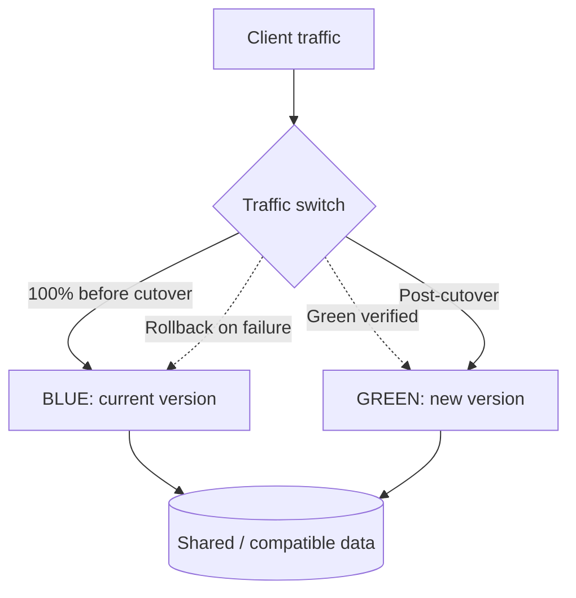
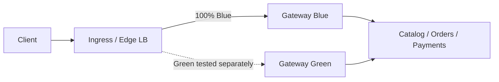
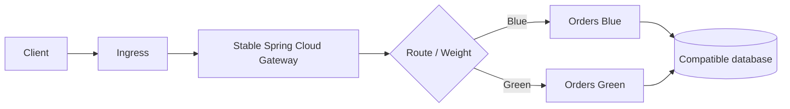
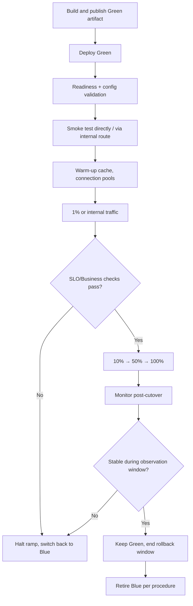
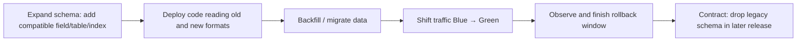

# Blue-Green Deployments and Planned Rollback Traffic Shifting

A new release of an API Gateway or microservice can start up cleanly yet still harbor defects that surface only under real traffic: an incorrect path rewrite, a differently validated JWT audience, cold connection pools, an altered response schema, slow downstream calls, or a filter driving up 5xx rates. Updating all of production at once risks exposing every user to a small bug before operators even notice it.

**Blue-green deployment** reduces that risk by maintaining two servable environments: **Blue** steadily serves current traffic while **Green** is deployed, verified, and warmed up without taking—or while taking only a small slice of—traffic. Once Green satisfies release criteria, traffic shifts on schedule. If metrics breach thresholds, traffic returns to Blue within a defined recovery window.

With **Spring Cloud Gateway**, blue-green applies at two distinct layers: shifting traffic across Gateway versions behind an ingress/load balancer, or keeping a stable Gateway that shifts traffic between two backend versions via route predicates and service discovery. Each layer has different trust boundaries, data implications, and rollback mechanics; always identify precisely which version is being switched.

This lesson belongs to the **Routing Patterns** chapter of the `SPRING_CLOUD_GATEWAY` module. The Gateway routes through predicates and a filter chain, transforms paths/headers, discovers services, and enforces authentication, rate limiting, circuit breakers, retries, TLS, and observability. A blue-green rollout must preserve all of those contracts throughout every traffic shift.

**Learning outcomes:**

1. Explain Blue/Green, cutover, weighted traffic shifting, canarying, and rollback.
2. Distinguish blue-green deployment of the **Gateway application** from deployment of a **downstream service**.
3. Use the Spring Cloud Gateway `Weight` route predicate to split traffic between Blue and Green service IDs.
4. Choose between full cutover at ingress/LB and gradual percentage shifting at the Gateway.
5. Prepare readiness probes, smoke tests, warm-up, capacity, metrics, and rollout stop conditions.
6. Keep database, API, and event contracts compatible while both versions run concurrently.
7. Execute controlled rollbacks, drain connections, and handle WebSockets, SSE, and sessions.
8. Test happy paths, negative paths, writes, and the ability to revert safely to the prior version.

> **Scope:** Primary examples use **Spring Cloud Gateway Server WebFlux** and Kubernetes. The route property prefix `spring.cloud.gateway.server.webflux.routes` applies to newer Gateway release lines; older lines commonly use `spring.cloud.gateway.routes`. Server Web MVC has a different runtime and configuration model. YAML snippets, weights, Service selectors, actuator endpoints, and rollout timings are examples—verify them against your Spring Boot/Spring Cloud release train, ingress controller, and deployment platform. Do not treat these examples as production-deployed configs or benchmarks.

**Gateway Server Web MVC** also has its own route/filter model and HTTP integrations that differ from WebFlux. YAML route prefixes, actuator operations, custom filter APIs, and per-predicate support in this lesson must be verified separately against your exact Server MVC version; never copy WebFlux configs verbatim and assume equivalence.

## 1. What Is a Blue-Green Deployment?

Blue and Green are two environments or versions capable of running side by side. Each has its own artifact, configuration, health status, and dedicated resource pool sufficient to handle its assigned traffic share.



**Blue** is the version currently serving users. **Green** is the replacement that has been deployed and verified. Once Green is confirmed ready, a control point (ingress, load balancer, service selector, or Gateway route config) adjusts the traffic split.

Strengths:
- Prepare and validate the new version before exposing users.
- Retain the old environment for rapid rollback while data remains compatible.
- Run smoke tests and config checks before opening public traffic.
- Shift traffic in small increments to observe real behavior.
- Package and version deployment artifacts cleanly.

Costs and risks:
- Requires enough capacity to run both versions concurrently.
- Both versions may write simultaneously to the database or event store.
- Caches, sessions, JWT keys, rate-limit state, and route configs must remain compatible.
- Rolling back the application does not automatically roll back database schemas.
- Switching traffic does not immediately close existing TCP connections or WebSockets.
- Certain bugs appear only under production load or for specific tenants/regions.

### 1.1. Blue-Green Does Not Mean Canary

| Pattern | How it works | Goal |
| --- | --- | --- |
| **Blue-green** | Two complete environments; switch traffic from old to new. | Maintain a fast path back to the prior version. |
| **Canary** | Route a small slice of traffic or users to the new build before expanding. | Evaluate risk on a small share or cohort. |
| **Rolling update** | Replace old instances with new ones in batches. | Update gradually without running two full independent stacks. |
| **A/B test** | Partition users to compare UX or product variants. | Evaluate product and behavioral impact. |

A blue-green deployment can **combine weighted traffic ramping / canarying**: Green initially receives 1%, then 10%, 50%, and 100%. However, splitting traffic does not automatically turn a deployment into an A/B experiment; that requires dedicated cohort assignment and measurement.

### 1.2. “Fast Rollback” Has Prerequisites

A fast rollback works only when:
- Blue is still running with enough capacity to take full traffic.
- Blue remains compatible with the current data schema.
- Blue still holds valid credentials, certificates, and JWT keys.
- Background workers and consumers do not introduce conflicting side effects.
- Route and ingress configs can be restored cleanly.
- Database migrations have not dropped or altered structures Blue needs.
- Stateful sessions and long-lived connections are handled properly.

If Green has already written data in a format Blue cannot read, shifting traffic back to Blue can turn a deployment bug into a data outage.

## 2. Two Blue-Green Layers in a Gateway Architecture

Never refer to every traffic switch generically as “swapping the Gateway.” Identify exactly what is changing.

### 2.1. Blue-Green for the Gateway Application Itself



Examples:
- Blue runs Gateway 4.x; Green runs an upgraded Gateway build.
- Blue holds the current route/filter config; Green holds updated routes/filters.
- Ingress/LB controls traffic to the Gateway replicas.
- After smoke testing, ramp gradually or cut over 100%.
- Roll back at the ingress/LB if Green introduces errors.

**Pros:** validates changes to the Gateway runtime, dependencies, security filters, route config, and observability.

**Risks:** Green may add fresh outbound load across all backends; if both stacks handle test and live traffic concurrently, backends need matching headroom.

### 2.2. Blue-Green for a Downstream Microservice



The Gateway version stays fixed while the target route changes:
- Blue service ID: `orders-blue`.
- Green service ID: `orders-green`.
- Gateway route definitions control the traffic split.
- You can shift from 100% Blue to 100% Green without replacing Gateway pods.
- Roll back by pointing route weights/URIs back to Blue.

**Pros:** decouples backend releases from Gateway releases.

**Risks:** the Gateway becomes the traffic-switching plane, so a broken route refresh or config can immediately affect the entire API. Protect the control plane and maintain config revisions/rollbacks.

### 2.3. Choosing Where to Switch Traffic

| Objective | Typical switch point |
| --- | --- |
| Upgrade Spring Cloud Gateway / JVM / dependencies | Ingress/LB in front of the two Gateway stacks. |
| Upgrade Orders Service | Gateway route/LoadBalancer or mesh/LB in front of Orders. |
| Point a public hostname to a new stack | Edge DNS / L7 LB / Ingress. |
| Split 95/5 across two backend service IDs | Gateway `Weight` predicate or traffic management layer. |
| Pin stable user cohorts | Verified identity-aware routing / custom policy. |
| Migrate WebSocket sessions | Edge/Gateway session admission and reconnect; never route weight alone. |

**A system can operate both layers simultaneously**—for instance, ingress sends 10% to Gateway Green while each Gateway version runs weighted routes to Blue/Green backends. In that case, percentages multiply across layers; calculate the effective share so you do not overload Green backends accidentally.

## 3. Cutover Plan: From 100% Blue to 100% Green

Standard progression:



Not every system needs the exact 1/10/50 ratios. Tailor traffic shifts to:
- Edge/Gateway traffic-splitting capabilities.
- Risk profile of the release.
- Enough volume to measure error rates reliably.
- Rollback speed and safety.
- Observation windows matching business cycles.

### 3.1. Mandatory Stages

1. **Prepare:** immutable build artifact, configs, secrets, schema compatibility, capacity.
2. **Deploy:** launch Green without exposing public traffic.
3. **Verify:** readiness probes, smoke tests, auth, routes, dependencies.
4. **Warm-up:** JVM/JIT, caches, DNS, TLS sessions, connection pools, and backend dependencies.
5. **Shift:** move traffic using the chosen ratios and switch point.
6. **Observe:** compare SLOs, business outcomes, saturation, and logs/traces.
7. **Commit:** confirm Green is stable and Blue is no longer required as a rollback target.
8. **Retire:** shut down Blue after draining and completing the safety hold window.

### 3.2. Define “Success” Up Front

Do not wait until after cutover to decide what success looks like. Define criteria for:
- HTTP error ratio by route and version.
- p95/p99 latency and timeouts.
- Sufficient request volume.
- Business success/failure (e.g., orders placed, payment settlements).
- Anomalous authentication/authorization rejections.
- Retry, circuit-breaker, and fallback rates.
- CPU, memory, GC, and connection-pool saturation.
- Database errors, lock contention, and pool exhaustion.
- Queue lag and event consumer errors, if applicable.

HTTP 200 does not prove a business transaction succeeded; a 200 fallback can mask backend failures.

## 4. Separate Service IDs for Blue and Green

When the Gateway uses service discovery, a route such as:

```yaml
uri: lb://orders-service
```

lets `LoadBalancer` choose any instance registered under `orders-service`. If both Blue and Green register under **one service ID**, `LoadBalancer` can pick instances from both versions depending on the supplier/policy—providing no clean blue-green isolation.

A straightforward approach is **separate service IDs**:

```text
orders-blue  → Blue version instance set
orders-green → Green version instance set
```

Whether you use Eureka, Consul, Kubernetes discovery, or another registry, ensure **version membership** per service ID is unambiguous.

### 4.1. Using Kubernetes DNS Directly

If you do not have Spring Cloud discovery/LoadBalancer integration for Kubernetes service IDs, the Gateway can route directly to internal cluster DNS:

```yaml
uri: http://orders-blue.orders.svc.cluster.local:8080
```

Here, the Kubernetes `Service` distributes traffic to Pods matching its selector. Never write `lb://orders-blue` merely because a Kubernetes `Service` is named `orders-blue`; the `lb://` scheme requires Spring Cloud LoadBalancer/discovery integration.

### 4.2. Sharing One Service ID Can Undermine Version Pinning

If Blue and Green both register as `orders-service`:
- Route `lb://orders-service` does not guarantee routing solely to Blue.
- Scaling up Green replicas shifts the traffic split implicitly.
- Registry health/instance metadata can fluctuate mid-rollout.
- Route-config rollback alone fails if both versions remain in the same supplier pool.

If you must share one service ID, implement a **tested custom `ServiceInstanceListSupplier`/filter policy** keyed on version metadata or use a dedicated traffic-management layer. For clean blue-green control, separate service IDs are far easier to observe and roll back.

## 5. Splitting Traffic with the `Weight` Route Predicate

Spring Cloud Gateway Server WebFlux provides the **`Weight` Route Predicate Factory**. Routes sharing a group distribute traffic proportionally by weight.

Orders split example:

```yaml
spring:
  cloud:
    gateway:
      server:
        webflux:
          routes:
            - id: orders-blue
              uri: lb://orders-blue
              predicates:
                - Path=/api/orders/**
                - Weight=orders, 90
              filters:
                - StripPrefix=2

            - id: orders-green
              uri: lb://orders-green
              predicates:
                - Path=/api/orders/**
                - Weight=orders, 10
              filters:
                - StripPrefix=2
```

Breakdown:
- Both routes have **distinct route IDs**.
- Identical predicate `Path=/api/orders/**`.
- Same `Weight` group `orders`.
- Blue weight 90, Green weight 10: expected ~90/10 route selection share.
- Each route points to its own service ID.
- Both apply identical path filters so backends see the same API contract.

**`Weight` specifies relative weights, not a deterministic per-request schedule.** Over small traffic windows, actual shares fluctuate; multiple Gateway replicas also introduce statistical variance. Never write a test asserting “exactly 90 Blue hits and 10 Green hits out of 100 requests.”

### 5.1. Stepping Through the Ramp

| Stage | Blue weight | Green weight | Purpose |
| --- | ---: | ---: | --- |
| Baseline | 100 | Not active | Blue serves all traffic. |
| Internal smoke | 100 | Internal/host-scoped test route only | Green verified before public exposure. |
| First exposure | 99 | 1 | Catch severe defects under minimal traffic. |
| Ramp 1 | 90 | 10 | Evaluate latency, errors, and business metrics. |
| Ramp 2 | 50 | 50 | Increase sample size and load on Green. |
| Ramp 3 | 10 | 90 | Test Green near full production load. |
| Cutover | Green route only | Green active | Green serves all traffic. |

For the 100/0 baseline, **do not assume declaring a Green route with weight 0 works everywhere**: zero-weight validation and handling can vary by release. Simply keep only the Blue route active at baseline, add Green with a positive weight when ramping begins, and leave only Green active (or point the stable route URI to Green) at cutover.

### 5.2. Never Reuse the Same Route ID Across Versions

Every route needs a unique ID. Sharing an ID causes:
- Unpredictable route definition overwrites or refresh behavior.
- Metrics and logs that cannot distinguish Blue from Green.
- Ambiguous rollbacks and config diffs.
- Confusing Actuator route inventories.

Use stable IDs like `orders-blue` and `orders-green` alongside bounded version labels in telemetry.

### 5.3. Keep the `Weight` Group Consistent

Routes intended to split traffic must share the same group name (e.g., `orders`). If Blue specifies `Weight=orders,90` and Green specifies `Weight=payments,10`, they belong to separate groups and will not produce a 90/10 split on that API.

Never lump unrelated APIs or paths into one group just to reuse a group name.

### 5.4. All Other Route Predicates Must Still Match

When Blue and Green co-serve one API, verify:
- Identical `Path`, method, host, and header predicates (except intentional cohort filters).
- Identical authentication and security requirements.
- Identical CORS policies.
- Identical path rewrites and request/response header transformations.
- Identical retry, circuit-breaker, and timeout contracts.
- Compatible request bodies and response schemas.

If one route omits `Method=POST` or uses a different `StripPrefix`, users will see intermittent, hard-to-reproduce errors depending on which route won.

## 6. Shift Traffic at the Gateway or at Ingress?

### 6.1. Switching Backends at the Gateway

The Gateway remains unchanged while `Weight` predicates or dynamic route configs shift traffic. Best when:
- Only one or a few backend services are being released.
- You want per-route traffic splitting.
- Telemetry is already broken down by route ID and upstream service.
- No Gateway runtime upgrade is needed.

Risk: the route config control plane becomes tier-0 critical; lock down refresh/admin endpoints and synchronize configs across all replicas.

### 6.2. Switching the Gateway Application at Ingress

Ingress / L7 LB targets two backend Services:

```text
public-api → gateway-blue Service
           → gateway-green Service
```

Best when:
- Upgrading Spring Cloud Gateway, the JVM, or core dependencies.
- Modifying global filters, the security chain, or HTTP clients/pools.
- You want to validate the new Gateway independently before cutover.
- Your ingress/LB natively supports weighted target groups or blue-green switching.

Ingress annotations and weighting syntax differ by controller and cloud provider. Never take an `ingress-nginx` annotation and apply it unchanged to AWS ALB, Traefik, or Kubernetes Gateway API.

### 6.3. Switching via a Kubernetes Service Selector

A stable `Service` can switch versions by updating its pod selector. While simple, note:
- `EndpointSlice` propagation is asynchronous.
- Existing keep-alive connections may linger on old Pods.
- Readiness and graceful termination must be coordinated.
- A single selector cannot natively split 90/10 traffic.
- Selector rollbacks require versioned manifests/config revisions.

For genuine weighted traffic splits, use an ingress/service mesh/controller with weighted routing or Gateway route weights.

### 6.4. Never Rely on DNS TTL as Your Only Rollback Switch

DNS caches in clients, resolvers, CDNs, and ISPs routinely outlive published TTLs. DNS cutover works in some topologies, yet **never guarantees immediate client migration**, making rollback timing unpredictable. L7 traffic switches and Service selectors are far easier to observe within a cluster, though they still have a propagation window.

## 7. Blue-Green for the Gateway Itself on Kubernetes

Example deploying two Deployments and two Services:

```yaml
apiVersion: apps/v1
kind: Deployment
metadata:
  name: gateway-blue
  namespace: gateway
spec:
  replicas: 3
  selector:
    matchLabels:
      app: edge-gateway
      version: blue
  template:
    metadata:
      labels:
        app: edge-gateway
        version: blue
    spec:
      containers:
        - name: gateway
          image: registry.example.com/edge-gateway:1.8.4
          ports:
            - name: http
              containerPort: 8080
---
apiVersion: apps/v1
kind: Deployment
metadata:
  name: gateway-green
  namespace: gateway
spec:
  replicas: 3
  selector:
    matchLabels:
      app: edge-gateway
      version: green
  template:
    metadata:
      labels:
        app: edge-gateway
        version: green
    spec:
      containers:
        - name: gateway
          image: registry.example.com/edge-gateway:1.9.0
          ports:
            - name: http
              containerPort: 8080
```

Two dedicated Services:

```yaml
apiVersion: v1
kind: Service
metadata:
  name: gateway-blue
  namespace: gateway
spec:
  selector:
    app: edge-gateway
    version: blue
  ports:
    - name: http
      port: 80
      targetPort: http
---
apiVersion: v1
kind: Service
metadata:
  name: gateway-green
  namespace: gateway
spec:
  selector:
    app: edge-gateway
    version: green
  ports:
    - name: http
      port: 80
      targetPort: http
```

Ingress initially points to Blue:

```yaml
apiVersion: networking.k8s.io/v1
kind: Ingress
metadata:
  name: public-api
  namespace: gateway
spec:
  ingressClassName: nginx
  rules:
    - host: api.example.com
      http:
        paths:
          - path: /
            pathType: Prefix
            backend:
              service:
                name: gateway-blue
                port:
                  name: http
```

Once Green is ready and verified, switch the backend Service to `gateway-green` through a controlled manifest/release pipeline. **This is a 100/0 cutover**, not a weighted split. For a 10/90 ramp, use your ingress/controller's traffic-splitting feature or another Service/route management mechanism.

### 7.1. Do Not Omit Probes, Resources, and Security from Production Manifests

The abbreviated manifests above must be augmented with:
- Readiness, liveness, and startup probes.
- Resource requests and limits.
- `ServiceAccount`, `securityContext`, and Secrets.
- Termination grace periods and graceful shutdown.
- `PodDisruptionBudget` and topology spread constraints where needed.
- `NetworkPolicy` rules.
- Versioned `ConfigMap`/`Secret` references.
- HPA/autoscaling and capacity planning.
- Image digest/signature enforcement.

Never copy a stripped-down demo manifest straight into production.

### 7.2. Blue and Green Must Enforce Identical Security Contracts

Both Gateway stacks must align on:
- JWT issuer, JWK cache, and audience validation.
- TLS truststores, certificates, and mTLS.
- Trusted proxy ranges and `Forwarded`/`X-Forwarded-*` sanitization.
- Rate limiter keys and backing stores.
- CORS, CSRF, and `Host` allowlists.
- Secrets and encryption keys.
- Route definitions, filters, and default-deny policies.

A rollout can look “green” on HTTP status codes while silently weakening authorization if Green runs a different `SecurityWebFilterChain`.

## 8. Blue-Green for Backends via Gateway Routes

When the Gateway is stable, Blue/Green routes can target separate service IDs:

```yaml
spring:
  cloud:
    gateway:
      server:
        webflux:
          routes:
            - id: catalog-blue
              uri: lb://catalog-blue
              predicates:
                - Path=/api/catalog/**
                - Weight=catalog, 95
              filters:
                - StripPrefix=2

            - id: catalog-green
              uri: lb://catalog-green
              predicates:
                - Path=/api/catalog/**
                - Weight=catalog, 5
              filters:
                - StripPrefix=2
```

This illustrates a 95/5 split. Before applying:
- Both service IDs must resolve via service discovery.
- Suppliers must return Ready instances only.
- Blue and Green must share a compatible API contract.
- Backend Green must have capacity for the incoming traffic share.
- Route IDs and weights must be synchronized across every Gateway replica.
- Gateway route metrics must distinguish Blue from Green.

### 8.1. Smoke-Testing Green Without Sending Public Traffic

Common approaches:
- A protected internal-only hostname or test route.
- A dedicated Gateway test instance.
- A header/cookie predicate restricted to an authenticated test cohort.
- Synthetic tests from the internal network targeting the Green service ID.
- In-cluster direct service tests with equivalent auth/security checks.

Never open a public debug route that bypasses JWT/authorization just to test Green.

### 8.2. Header Canaries Require a Trusted Source

You can use a predicate such as:

```yaml
predicates:
  - Path=/api/catalog/**
  - Header=X-Release-Cohort,green
```

However, if public clients can set `X-Release-Cohort: green` themselves, they can opt into unready versions. When using cohort headers:
- Strip the header from Internet requests at the edge.
- Allow only a trusted proxy or identity-aware layer to set it.
- Or have the Gateway derive the cohort from the verified principal/claims.
- Never treat a cohort header as authorization.
- Test both spoofed headers and under-privileged callers.

### 8.3. Weighted Random Routing Does Not Pin a User to One Version

The `Weight` predicate handles statistical splitting, not sticky per-user routing across requests. If a user creates an order on Green and queries it on Blue, both versions must share the same database/schema and contract. Otherwise, use authenticated-identity stable cohort routing and keep all related APIs on the same cohort.

## 9. Preparing Database and Event Contracts Before Cutover

This is the single most critical prerequisite for rollback. Blue and Green normally coexist for a period during which both may write data.

Follow an **expand–migrate–contract** strategy:



### 9.1. Expand

- Add nullable columns or safe defaults.
- Add tables/indexes without breaking old code.
- Allow both Blue and Green to read the expanded schema.
- When adding event fields, ensure older consumers ignore unknown fields safely.
- Never rename or drop columns in the cutover release itself.

### 9.2. Migrate

- Backfill in checkpointed batches.
- Verify row counts, constraints, nulls, and duplicates.
- Dual-read/dual-write briefly only when semantics are crystal clear.
- Prevent both versions from running conflicting migrations simultaneously.
- Guard migration runners with single-writer locks and version tracking.

### 9.3. Contract

Drop old columns, tables, or fields only after:
- Blue's rollback window has closed.
- No legacy instances or workers remain running.
- Consumer/event retention windows have expired.
- Backup/restore and data migrations are verified.
- Subsequent releases no longer reference the old schema.

**Rolling back the application does not roll back the database.** Never run destructive down-migrations automatically when shifting traffic back to Blue if data loss could occur or Green already wrote new records.

### 9.4. Side Effects and Idempotency

While Blue and Green co-serve traffic:
- A client may retry onto the other version.
- Both versions may consume from the same queue if consumer groups collide.
- Both versions may process the same webhook or event.
- Cache keys or idempotency key semantics may differ.

Enforce idempotency keys, unique constraints, clear ownership for background consumers, and backward-compatible event schemas. Never let two worker pools execute the same business action without coordination.

## 10. Preparing Green: Health, Readiness, and Warm-Up

Green must be genuinely “ready to serve” before accepting traffic.

### 10.1. Liveness, Readiness, and Startup

| Check | Meaning | What not to do |
| --- | --- | --- |
| Startup | JVM/application finished booting. | Crash-loop just because a dependency takes a few extra seconds initially. |
| Liveness | Can the process keep running? | Fail liveness because a downstream business backend is having an outage. |
| Readiness | Is the Pod fit to receive new requests? | Check only an open TCP port while ignoring route or security config loading. |
| Synthetic smoke | Do real APIs work through the Gateway? | Leave an admin-privileged synthetic account exposed on public endpoints. |

With Spring Boot Actuator, you can expose Kubernetes readiness/liveness health groups—just **secure the endpoints and expose them only on the management path/network**. Readiness should not fail on every single downstream service if that would pull the entire Gateway out of Service when one backend dips.

### 10.2. API Contract Smoke Tests

Verify on Green:
- Route IDs, URIs, and route predicates match.
- Path rewriting and header forwarding match.
- Valid JWTs pass; invalid/expired tokens are rejected.
- 401/403/404/429 responses match the contract.
- Backend 5xx responses and timeouts map properly.
- Retries fire only for permitted methods and status codes.
- `CircuitBreaker`/fallbacks never mask business failures.
- CORS, `Host`, `Forwarded`, and TLS behave cleanly behind edge proxies.
- Actuator/admin endpoints are unreachable publicly.

### 10.3. Warming Up Before Ramping Traffic

Resources that often need warming:
- JVM class loading and JIT compilation.
- Route caches and DNS resolution.
- TLS trust and connection pools.
- JWK caches and discovery registries.
- Redis connection pools.
- Backend caches and query plans.
- Local caches (if any) and compiled templates.

Warm up with controlled test traffic that never performs irreversible business writes. Measure latency before and after warm-up; never assume a Ready pod already has stable p99 latency.

### 10.4. Capacity for Concurrent Blue and Green Stacks

If each version requires 3 Gateway pods and Green scales up to 50% traffic, total resource usage can nearly double during overlap, alongside synthetic/warm-up calls to backends. Budget for:
- CPU, memory, and GC headroom.
- Inbound/outbound sockets.
- Backend connections and DB pools.
- Redis quotas.
- Rate-limit state.
- Node capacity and autoscaling headroom.
- `MaxSurge` and `PodDisruptionBudget`.
- Cost of running two environments.

## 11. Controlled Percentage Traffic Shifting

Sample ramp for an API with adequate volume:

| Stage | Blue | Green | Suggested observation | Gate to proceed |
| --- | ---: | ---: | --- | --- |
| Baseline | 100% | 0% | One baseline window | Blue stable, metrics complete. |
| Internal test | Public 100% | Synthetic/internal | Per test suite | Green smoke and security tests pass. |
| First exposure | 99% | 1% | 5–15 min or enough sample | Zero severe errors. |
| Low ramp | 90% | 10% | 10–30 min or enough sample | Error, latency, and business SLOs met. |
| Mid ramp | 50% | 50% | 15–30 min or enough sample | Green handles load; DB remains healthy. |
| High ramp | 10% | 90% | By volume and SLO | Zero saturation or regressions. |
| Cutover | 0% | 100% | Observation window | Green stable; rollback target kept warm. |

Durations are illustrative. For low-volume APIs or daily business cycles, 5 minutes may yield too few samples; for payment endpoints, even a few duplicate charges are critical regardless of percentage.

### 11.1. Never Ramp Solely Because HTTP 2xx Looks Good

Before advancing each step:
- Verify request volume is large enough to draw conclusions.
- Compare Blue and Green on matching routes, methods, regions, and cohorts.
- Check business completion, duplicates, and consistency.
- Watch 429/503/504 responses and upstream attempt counts.
- Inspect database locks, connection pools, and queue lag.
- Sample logs and traces of real errors.
- Confirm the running config revision is exact.

### 11.2. Separate Traffic Shifting from Capacity Scaling

Moving Green from 1% to 50% increases both version exposure and load on Green. If HPA scales slower than the traffic shift, Green will overload. Warm up and pre-scale capacity before major jumps; never assume autoscalers react instantaneously.

### 11.3. Keep Blue Ready During the Rollback Window

While Green handles 90%, Blue receives little traffic yet must retain enough replicas and warm connection pools to absorb 100% immediately on rollback. Never scale Blue to zero before the rollback window ends.

## 12. Changing Route Configs and Refreshing Safely

In Gateway WebFlux, routes can live in application properties/YAML or be managed dynamically depending on your architecture. If using dynamic routes:
- Maintain a versioned configuration source of truth.
- Validate changes before publishing.
- Ensure all Gateway replicas receive the exact same config revision.
- Log audit trails of who changed what and when.
- Keep a revision-based rollback mechanism ready.
- Validate route predicates and weights before enabling traffic.

### 12.1. Static Config vs. Dynamic Config

**Static configuration:** route definitions are baked into app config/artifacts; changes roll out through a planned config deployment, restart, or refresh strategy.

**Dynamic route repository:** route definitions are stored and updated in a repository or control plane, and the Gateway picks up changes as implemented.

Never edit a YAML file on one pod and assume every replica picks it up. Nor should you assume updating a mounted `ConfigMap` volume automatically refreshes route definitions inside the Spring context.

### 12.2. Actuator Gateway Refresh/Admin Endpoints

Some Gateway versions provide Actuator Gateway endpoints to inspect, refresh, or manage route definitions. Conceptual example:

```http
POST /actuator/gateway/refresh
```

Exact endpoints and operations depend on Gateway version and exposure settings. **Never expose refresh or route-write endpoints to the public Internet.** When enabled, enforce:
- A dedicated management network/port.
- Strong authentication and authorization.
- Separation of duties and audit logging.
- Appropriate CSRF and network controls.
- Pre-refresh route validation.
- Config revisions and rollback support.
- Verification of effective routes across every Gateway instance.

A refresh endpoint simply tells the Gateway to reload routes; it **does not provide blue-green orchestration**, health gates, or traffic analysis.

### 12.3. Updating Weights Step by Step

Moving from 90/10 to 50/50 modifies route definitions. Verify:
- Both routes remain in the same `Weight` group.
- Updated weights are loaded across all Gateway replicas.
- Route refreshes introduce no routing gap.
- Metrics distinguish route IDs cleanly.
- In-flight requests finish safely on the prior route.
- A rollback config revision is staged and ready.

### 12.4. Maintain a Single Source of Truth

Avoid combining simultaneously:
- Config Server pushing routes.
- Kubernetes `ConfigMap` mounting routes.
- Actuator API mutating routes directly.
- Ad-hoc scripts editing routes in another store.

Competing control planes overwrite one another. Pick one source with clear ownership, versioning, review, and auditing.

## 13. Rollback: Define Triggers Before Deploying

Rollbacks must never rely on guesswork. Set thresholds according to each service's SLO and criticality. Illustrative example:

| Signal | Illustrative trigger | Action |
| --- | --- | --- |
| Green 5xx ratio | Exceeds baseline and burns error budget in window. | Halt ramp; investigate or roll back. |
| p95/p99 latency | Sustained breach of latency SLO. | Freeze traffic; inspect downstream calls. |
| Business failures | Duplicate charges/orders, data corruption, invariant breach. | Cut Green traffic immediately; remediate data. |
| Auth/security | Anomalous JWT acceptance/rejection or policy bypass. | Roll back/disable Green route; trigger incident response. |
| Saturation | CPU, GC, DB pool, or queue exceeds operating limits. | Shed/reduce traffic or scale under control. |
| Dependencies | Elevated Redis, discovery, or DB errors. | Pause rollout and restore dependency/config. |
| Observability gap | Green metrics/traces missing or mislabeled. | Do not advance without visibility. |

Never apply identical thresholds across every route. Payments, logins, catalog reads, and report exports carry vastly different latency, error, and business risk profiles.

### 13.1. Example SLO-Driven Policy

Suppose the Orders API has:
- Availability SLO: 99.9%.
- Latency SLO: p95 under 300 ms.
- Duplicate orders: **zero tolerance**.
- Minimum sample: 500 requests in the observation window.

A rollout gate might require:
1. Green 5xx ratio does not exceed baseline beyond the agreed margin.
2. p95/p99 stays within SLO.
3. Zero duplicates or business invariant violations.
4. Minimum sample reached.
5. No database or queue saturation.
6. Error rates and trace coverage are observable.

This is an example policy, not a default module SLO.

### 13.2. Rollbacks Require Concrete Procedures

Depending on the switch point:
- Ingress/LB: point backend target back to Blue.
- Gateway `Weight`: deactivate Green and set Blue active/100%.
- Kubernetes Service selector: apply manifest pointing selector back to Blue.
- Service discovery: route back to the Blue service ID or restore the supplier policy.

The runbook must specify exact commands, PRs, or config revisions, required permissions, approvers (if any), and post-rollback verification checks. Never leave “rollback” as a vague sentence in documentation.

## 14. Runbook: Shifting and Rolling Back Traffic with Gateway `Weight`

Assumptions:
- Blue: `lb://orders-blue`.
- Green: `lb://orders-green`.
- Shared path `/api/orders/**`.
- Gateway route config managed via a repository/config pipeline.

### 14.1. Pre-Rollout Checks

```text
[ ] Blue healthy and serving 100%.
[ ] Green healthy, smoke tests passing.
[ ] Blue/Green share compatible schemas and events.
[ ] Metrics include routeIds orders-blue and orders-green.
[ ] Green has enough capacity for the upcoming traffic step.
[ ] Rollback config revision has been tested.
[ ] On-call and dashboards/runbook ready.
```

### 14.2. Starting at 99/1

Publish route weight config:
- Blue `Weight=orders,99`.
- Green `Weight=orders,1`.

Verify effective route config across **every Gateway replica**, then observe live traffic. If the config source or refresh drifts across pods, halt the rollout.

### 14.3. Halting the Ramp

If any trigger fires:
1. Stop increasing Green's weight.
2. Record the exact timestamp and config revision.
3. Identify the fault layer: Gateway route, backend, database, auth, or rate limiter.
4. If impact is severe, revert traffic to Blue immediately per the runbook.
5. Preserve Green logs, metrics, and traces for postmortem.
6. Do not delete Green before capturing diagnostic evidence.

### 14.4. Rolling Back to 100% Blue

When using the `Weight` predicate, a clean rollback state keeps **only the Blue route active** in the group. Single-route example:

```yaml
spring:
  cloud:
    gateway:
      server:
        webflux:
          routes:
            - id: orders-blue
              uri: lb://orders-blue
              predicates:
                - Path=/api/orders/**
              filters:
                - StripPrefix=2
```

With no Green route in the `Weight` group, all matching requests route to Blue under this configuration (an alternative stable route URI can also be used depending on architecture). After refresh/deploy:
- Verify every replica loaded the revision.
- Verify the Green route receives zero new requests.
- Monitor in-flight requests and long-lived connections.
- Check Blue capacity and error rates.
- Confirm Blue reads and writes business data accurately.
- Communicate incident status per internal procedures.

**Rolling back a route does not cancel in-flight Green requests or committed Green transactions.** Handle unfinished requests and side effects separately.

## 15. Kubernetes Service Selectors: Cutover and Rollback

A stable `Service` can select one version via labels:

```yaml
apiVersion: v1
kind: Service
metadata:
  name: orders-active
  namespace: commerce
spec:
  selector:
    app: orders
    version: blue
  ports:
    - name: http
      port: 8080
      targetPort: http
```

Cut over selector to Green:

```yaml
apiVersion: v1
kind: Service
metadata:
  name: orders-active
  namespace: commerce
spec:
  selector:
    app: orders
    version: green
  ports:
    - name: http
      port: 8080
      targetPort: http
```

Apply this manifest via your release pipeline or GitOps. Keep in mind:
- `EndpointSlice` updates are asynchronous.
- `kube-proxy`, mesh, and ingress caches have propagation delays.
- Existing keep-alive connections may remain attached to Blue Pods.
- A Service selector picks **one endpoint set**—it cannot split 90/10.
- Keep Blue alive throughout the rollback window.
- Readiness must be green before flipping the selector.

If you need weighted splits, use a controller/mesh supporting weighted backends or Gateway route weights. Never try to create two Service selectors expecting one stable Service to balance percentages automatically.

## 16. Sessions, Sticky Routing, and State in Blue-Green

### 16.1. Stateless HTTP APIs

When Gateway and backends are stateless:
- JWTs carry signed identity and claims.
- Sessions, idempotency records, and quotas live in shared stores.
- Route configs and versions stay consistent.
- Any replica can serve any user.
- Rollbacks have minimal sticky-session friction.

This is the easiest architecture to shift cleanly.

### 16.2. Sticky Sessions

Sticky routing can pin a user or connection to one version, yet:
- Pod crashes still break affinity.
- Cookies can point to a retired version.
- Browsers opening parallel connections may land on different routes.
- Moving a user from Blue to Green mid-workflow risks state or schema mismatches.
- Stickiness never replaces shared session stores or database compatibility.

If using stickiness, give affinity cookies an explicit version and TTL, define fallbacks when targets disappear, and test rollbacks.

### 16.3. WebSockets and SSE

The `Weight` predicate runs when the initial HTTP request/handshake arrives. An upgraded WebSocket or open SSE stream **does not jump between Blue and Green merely because weights changed**.

Plan for:
- Maximum connection age or drain policies.
- Heartbeats and graceful close notifications.
- Client reconnection with backoff and jitter.
- Replay cursors or event offsets where required.
- Active connection counts by version.
- Holding off retiring Blue while critical sessions remain connected without a drain plan.

### 16.4. Background Jobs and Event Consumers

A Blue/Green service often runs worker processes alongside the HTTP server. While both deployments are active:
- Both may consume the same queue.
- Scheduled jobs may fire twice.
- Cron tasks may send duplicate emails or charges.
- Newer event schemas may break older consumers.

Separate web replicas from worker ownership if needed; rely on leader election, consumer group/partition semantics, idempotency, and job leases. Never assume shifting HTTP traffic turns Blue “off.”

## 17. Rate Limiting, Retries, and Circuit Breakers During Traffic Shifts

### 17.1. Rate-Limit State

If Blue and Green Gateways run `RedisRateLimiter`:
- Share the same key namespace and algorithm so quotas do not reset abruptly.
- Share Redis backing storage per policy.
- Green must never use a weaker key resolver.
- Never let one Gateway version key on raw `X-Forwarded-For` while the other keys on verified principal.
- Test quota behavior as traffic moves across replicas.

With in-memory rate limiters, quotas multiply across Gateway instances and versions.

### 17.2. Retry Amplification

During a 10% Green phase, if Green slows down and the Gateway retries, backend attempts can exceed the expected 10%. Track:
- Client requests by route.
- Upstream attempts by service version.
- Retry attempts and exhausted retries.
- Circuit breaker state.
- Backend concurrency and queues.

Never enable retries on side-effecting `POST` calls just to “mask errors” during a rollout.

### 17.3. `CircuitBreaker` and Fallbacks

A Green fallback returning 200 can keep status dashboards green while the Green backend fails continuously. Gate rollouts on upstream health and business outcomes, not final HTTP status alone. If the circuit breaker trips open, consider halting Green traffic and rolling back per policy.

## 18. Observability by Route and Version

A rollout dashboard should include:

| Panel | Dimensions | Purpose |
| --- | --- | --- |
| Client RPS | route, method, region | Show how traffic is distributed. |
| Upstream RPS/attempts | service version, instance | Show actual calls hitting Green. |
| 4xx/5xx ratio | route, version, status | Surface per-version errors. |
| p50/p95/p99 latency | route, version | Catch latency regressions. |
| Business success | operation/version | Confirm transactions succeed cleanly. |
| Retry/fallback | route/version | Catch hidden errors or amplification. |
| CircuitBreaker | service/version/state | Spot isolated downstreams. |
| Saturation | CPU/GC/DB/Redis/pool | Verify Green capacity headroom. |
| Deployment revision | version/config hash | Correlate errors with specific releases. |
| Health/ready endpoints | pod/version | Verify instances are validly accepting traffic. |

### 18.1. Route IDs Must Distinguish Versions

Use `orders-blue` and `orders-green` for separate measurements. Never embed Git SHAs or request IDs in route IDs or metric labels where every deploy creates unbounded series. Keep version labels low-cardinality, such as `release=1.9`.

### 18.2. Illustrative PromQL for Per-Route Traffic

Assuming your Gateway Prometheus exporter exposes the standardized timer `spring_cloud_gateway_requests_seconds_count` with `routeId`:

```promql
sum by (routeId) (
  rate(spring_cloud_gateway_requests_seconds_count{
    routeId=~"orders-(blue|green)"
  }[5m])
)
```

Green's share of total traffic across both routes:

```promql
100 *
sum(rate(spring_cloud_gateway_requests_seconds_count{
  routeId="orders-green"
}[5m]))
/
clamp_min(
  sum(rate(spring_cloud_gateway_requests_seconds_count{
    routeId=~"orders-(blue|green)"
  }[5m])),
  0.001
)
```

This query measures **route requests recorded by the Gateway meter**, not business success or post-retry upstream attempts. Inspect `/actuator/prometheus` first to confirm exact metric and label names, which vary across Gateway/Micrometer versions.

### 18.3. Green 5xx Ratio

```promql
sum(rate(spring_cloud_gateway_requests_seconds_count{
  routeId="orders-green",
  httpStatusCode=~"5.."
}[5m]))
/
clamp_min(
  sum(rate(spring_cloud_gateway_requests_seconds_count{
    routeId="orders-green"
  }[5m])),
  0.001
)
```

Enforce a minimum request volume and alert window; a low-traffic route can hit 100% from a single failed request. A missing series may indicate zero traffic yet, a scrape failure, or an unloaded route.

### 18.4. Comparing p95 When Histograms Are Enabled

```promql
histogram_quantile(
  0.95,
  sum by (le, routeId) (
    rate(spring_cloud_gateway_requests_seconds_bucket{
      routeId=~"orders-(blue|green)"
    }[5m])
  )
)
```

Run this only when Gateway timer histogram buckets are enabled. Never average Blue's p95 and Green's p95 to estimate overall p95.

### 18.5. Avoid Dashboards That Create False Confidence

- Green at 1% has only 4 requests: sample is too small.
- Gateway returns 200 from a fallback: backend may still be failing.
- Ingress blocks with 429: Gateway route metrics never see it.
- WebSockets already open on Blue: changing weights does not migrate them.
- Backend commits successfully, then response times out: client may retry.
- Green and Blue share one route ID: metrics blur both versions together.

Observability must span edge, Gateway, upstreams, and business events.

## 19. Data Rollback and Handling In-Flight Transactions

During rollback:
- Never automatically delete data Green wrote.
- Never run down-migrations without assessing data loss.
- Identify transactions via idempotency and correlation IDs.
- Reconcile orders, payments, and events committed within the rollout window.
- Identify requests sent to Green that timed out on the client side.
- Inspect queue messages still in-flight or retrying.
- Stop Green background consumers via their own procedure.
- If data corruption occurred, execute the incident/data-repair runbook; shifting traffic does not repair data.

### 19.1. Write Paths Carry Higher Risk Than Read Paths

Shifting 1% of read-only catalog traffic to Green is relatively low-risk. Shifting 1% of `POST` payments demands:
- Idempotency keys.
- Compatible transaction semantics.
- Backward-compatible database migrations.
- Reconciliation jobs.
- Verified side effects and event contracts.
- A rollback policy signed off by security and business owners.

Never assume every route can ramp identically.

### 19.2. Dual-Write Is Not a Default Solution

Writing concurrently from Blue and Green to two schemas or two databases requires guarantees around consistency, ordering, retries, deduplication, and reconciliation. Dual-writes without proper transactions or an outbox pattern produce partial commits. Prefer expand–migrate–contract with a single clearly owned data source.

## 20. Securing the Control Plane and Traffic-Shifting Permissions

Blue-green route weights decide which code serves live production data. Modifying them is a privileged action.

- Store route configs under code review and version control.
- Restrict Actuator route write/refresh endpoints to authenticated management networks.
- Never let public clients pick Green via self-supplied headers.
- Base canary cohorts on authenticated identity, verified claims, or edge-signed metadata.
- Audit every config change with actor, timestamp, revision, and diff.
- Verify Green never weakens JWT, CORS, `Host`, `Forwarded`, or rate-limit policies.
- Coordinate secret and certificate rotation across Blue and Green during overlap.
- Define rollback authorities and approvals in incident policy.
- Never log tokens, cookies, or PII in rollout traces.

An attacker who can overwrite a route URI from `lb://orders-blue` to an arbitrary URL through an unprotected route CRUD endpoint creates an SSRF vector. Restrict the control plane to allowlisted service IDs and schemes only.

## 21. Testing Blue-Green Before Production

### 21.1. Testing Route Weights

- Send an adequate sample of requests through a test Gateway instance.
- Confirm both service IDs receive traffic.
- Confirm observed ratios track weights within statistical variance on larger samples.
- Verify each upstream receives the expected path, headers, and method.
- Update weights, refresh, and verify across all Gateway replicas.
- Roll back the route and confirm Green stops receiving new requests.

Never assert a fixed random sequence or exact ratios in tiny samples.

### 21.2. Negative Testing

- Green unready: zero traffic opened.
- Green returns 503: ramp halts / rolls back per triggers.
- Discovery has zero Green instances: explicit, predictable error behavior.
- Route refresh fails: previous config stays active or rolls back cleanly.
- One Gateway replica misses the config update: drift detected.
- Auth/JWT/Host/CORS policy mismatch: tests fail before rollout.
- Inconsistent Redis rate-limiter state: quota regression caught.
- New DB schema read by older Blue build: compatibility verified.
- Green writes then Blue rollback: Blue reads Green's records cleanly.
- Long-lived sessions: controlled draining and reconnection.

### 21.3. Integration Testing with Stub Services

A solid test can:
- Boot Gateway WebFlux on `RANDOM_PORT`.
- Start two HTTP stubs `orders-blue` and `orders-green`.
- Configure two routes sharing a `Weight` group.
- Send a sufficiently large batch of requests.
- Count hits per stub and inspect bodies, paths, and headers.
- Switch config to Blue-only and assert new requests hit Blue exclusively.
- Verify in-flight requests around refresh boundaries.

This tests Gateway routing integration; to verify real ingress or cloud LBs, run deployed tests through the actual edge controller.

### 21.4. Load and Failover Testing

In staging:
- Ramp traffic onto Green progressively.
- Inject slowness, timeouts, and 503s into Green.
- Terminate a Green instance.
- Scale Green from 1 to multiple replicas.
- Restart a Gateway pod mid-ramp.
- Monitor database connection pools and queues.
- Roll back mid-flight while requests are active.
- Verify client retries and idempotency.

Never test against live production traffic or trigger real charges/orders without explicit authorization and an isolated sandbox.

## 22. Incident Scenario and Action Matrix

| Scenario | Detection | Action |
| --- | --- | --- |
| Green readiness fails | Pod not ready / smoke check fails. | Do not open traffic; fix Green. |
| Green route config missing | Route inventory lacks ID. | Halt rollout; restore config revision. |
| Green 5xx rises | Route/version status ratio. | Stop ramp; roll back if gate breached. |
| Green p99 rises | Histogram/traces. | Freeze traffic; inspect backends and connection pools. |
| Green DB pool saturates | Active/pending pool and DB wait metrics. | Reduce traffic, scale, or optimize. |
| Blue/Green schema mismatch | Contract tests / data read errors. | Abort cutover; fix migration. |
| Redis quota doubles | Rate-limiter telemetry by version. | Standardize shared state and key resolver. |
| Route refresh succeeds on one pod only | Config revision drift. | Pause ramp; resynchronize replicas. |
| CircuitBreaker 200 fallbacks spike | Breaker/fallback metrics. | Inspect upstream health; never treat 200 as a pass. |
| Green 1% sample too small | Low request count. | Extend observation window or run synthetic checks. |
| Blue pods scaled to 0 | Zero rollback capacity. | Restore Blue before cutover if possible. |
| WebSockets pinned to Blue | Active sessions by version. | Drain/reconnect; never assume weights migrate them. |
| Green wrote new data format | Audit / data version. | Confirm Blue readability before rolling back. |
| Duplicate POST retries | Idempotency / business metrics. | Halt traffic and reconcile records. |
| Edge config mis-targeted | Ingress/LB target drift. | Roll back edge revision. |
| Metrics missing | Scrape or labels absent. | Never expand traffic blind without observability. |

## 23. Practice Exercises with Answers

### Exercise 1 — Identifying Two Blue-Green Layers

Ingress splits traffic between Gateway Blue and Gateway Green, while Gateway Blue runs weighted routes to Orders Blue and Orders Green. How many traffic-switching layers exist?

**Answer:** Two independent layers: ingress selects the **Gateway version**, and then the Gateway selects the **backend service version**. Overall exposure must be multiplied across both layers.

### Exercise 2 — Separate Service IDs

Why register `orders-blue` and `orders-green` instead of sharing `orders-service` during a version-pinned rollout?

**Answer:** Separate service IDs let routes target the exact instance pool. A shared service ID allows `LoadBalancer` to mix both versions.

### Exercise 3 — Weight 90/10

What do `Weight=orders,90` and `Weight=orders,10` mean?

**Answer:** Two routes in the same group use relative weights of 90:10; expected statistical shares approach 90/10, with no exact guarantee on small windows.

### Exercise 4 — 100/0 Baseline

Should you declare the Green route with weight 0 by default?

**Answer:** Never assume every release accepts zero weight. Activate only the Blue route at baseline, then add Green with a positive weight when ramping begins.

### Exercise 5 — Route IDs

Why do Blue and Green need distinct route IDs?

**Answer:** So route definitions, logs, metrics, rollbacks, and config diffs distinguish versions cleanly; IDs must be unique.

### Exercise 6 — One Group or Two?

Blue uses `Weight=orders,90` and Green uses `Weight=payments,10`. Does this create a 90/10 traffic split?

**Answer:** No. Different group names do not share traffic splitting for the same API.

### Exercise 7 — Random Weights

Across 100 requests with 90/10 weights, can you assert exactly 90 Blue hits and 10 Green hits?

**Answer:** No. Selection is probabilistic/weighted; small samples fluctuate. Validate statistically on large samples and verify per-route contracts.

### Exercise 8 — Shared Service ID

Blue and Green both register as `orders-service`. Does `lb://orders-service` guarantee 100% Blue?

**Answer:** No. The discovery supplier can return instances from both versions. Use separate service IDs or a controlled supplier filter.

### Exercise 9 — Kubernetes DNS

Can a Kubernetes Service named `orders-green` always be targeted as `lb://orders-green` without Spring Cloud LoadBalancer?

**Answer:** No. `lb://` requires discovery/LoadBalancer integration; otherwise, configure the Service's HTTP DNS URI directly.

### Exercise 10 — Gateway Version Cutover

Where should you switch traffic when upgrading a Gateway global filter?

**Answer:** Typically at the ingress/LB in front of two Gateway stacks so Green can be verified independently before shifting traffic.

### Exercise 11 — Backend Cutover

When upgrading only the Orders Service, what is an appropriate switch point?

**Answer:** Gateway route weights between `lb://orders-blue` and `lb://orders-green`, or another traffic-management layer.

### Exercise 12 — Rollback After Schema Migration

Green dropped a column Blue requires. Will pointing routes back to Blue restore the system?

**Answer:** No. Databases do not roll back automatically; enforce expand–migrate–contract and backward-compatible schemas throughout the rollback window.

### Exercise 13 — Header Canary

A client sends `X-Release-Cohort: green` to reach Green. Is this safe?

**Answer:** Not unless the header is stripped/re-applied by a trusted edge or derived from an authenticated principal. Clients must not self-select unreleased versions outside policy.

### Exercise 14 — 200 Fallback

The Green backend returns 503, yet a `CircuitBreaker` fallback returns 200. Can you keep ramping traffic solely because the 2xx ratio looks healthy?

**Answer:** No. Inspect upstream errors, breaker/fallback metrics, and real business outcomes.

### Exercise 15 — WebSockets

After shifting weights to Green, do open WebSockets on Blue automatically move to Green?

**Answer:** No. Upgraded sessions stay bound to their existing endpoint until closed; plan draining and reconnection.

### Exercise 16 — Scaling Blue to Zero

Green hits 100% and Blue scales down to zero one minute later. Can you still roll back rapidly?

**Answer:** No. Keep Blue capacity warm during the rollback window or maintain a measured, tested spin-up/warm-up procedure.

### Exercise 17 — Retries

Ingress retries twice and the Gateway retries three times. In a simple scenario, how many attempts can one client request generate at most?

**Answer:** Up to 6 attempts (the product) if both layers retry per call; exact behavior depends on method, body, status codes, and response commitment.

### Exercise 18 — Readiness

Green's process is alive and its port is open, yet its JWK cache and route config have not loaded. Should it take 10% traffic?

**Answer:** Not yet. Readiness and smoke tests must confirm everything needed for real requests, not merely an open TCP port.

### Exercise 19 — Sample Size

Green receives 1% traffic totaling 3 requests, all returning 200. Is that sufficient proof of release stability?

**Answer:** No. The sample is far too small; gather adequate volume, run synthetic tests, and observe across business cycles.

### Exercise 20 — Complete Rollback

Name at least four actions required after switching routes back to Blue.

**Answer:** Confirm the config revision across all Gateway replicas; verify Green receives zero new requests; monitor Blue's errors, latency, and capacity; watch in-flight and long-lived connections; reconcile transactions/data written by Green; preserve logs/traces and handle background workers/queues separately.

## 24. Pre-Green-Traffic Checklist

- [ ] Clearly identified whether the rollout targets the Gateway application or a downstream service.
- [ ] Blue and Green artifacts/images have immutable versions/digests.
- [ ] Two separate service IDs/Services configured when version pinning is needed.
- [ ] Gateway route IDs are unique and enforce identical API contracts.
- [ ] Weighted routes share the same group, use positive weights, and are version-tested.
- [ ] Baseline 100/0 does not depend on zero-weight behavior.
- [ ] Client-controlled headers/cookies cannot self-select Green.
- [ ] Trusted cohorts/identities are authenticated with strict edge sanitization.
- [ ] Green pods are ready; configs, JWTs, TLS, routes, and discovery are verified.
- [ ] Smoke tests cover auth, path rewrites, headers, CORS, and negative cases.
- [ ] JVM, DNS, TLS, connection pools, and caches are warmed up.
- [ ] Blue and Green have sufficient capacity; Blue retains rollback capacity.
- [ ] Database schemas follow expand–migrate–contract and Blue reads Green's data cleanly.
- [ ] Event contracts, background workers, scheduled jobs, and idempotency are verified.
- [ ] Shared Redis/rate-limit state and key resolvers align across versions.
- [ ] Retry/`CircuitBreaker`/fallback metrics never mask Green failures.
- [ ] Per-route SLOs, error budgets, and minimum sample sizes are defined.
- [ ] Dashboards separate Blue/Green RPS, status codes, latency, business success, and saturation.
- [ ] Route config source, revisions, audit trails, and rollback steps are clear.
- [ ] Dynamic refresh/admin endpoints are never public.
- [ ] Configs are synchronized and verified across every Gateway replica.
- [ ] Traffic ramp includes staged steps, observation windows, and decision owners.
- [ ] Rollback commands, config revisions, and manifests are staged and tested.
- [ ] Ingress/LB health, readiness, `EndpointSlice`s, and draining are monitored.
- [ ] Active WebSocket/SSE sessions have reconnect and drain plans.
- [ ] Blue is not retired before the rollback window and in-flight work complete.
- [ ] Data/business side-effect rollback has a reconciliation runbook.
- [ ] Canary/load tests run in authorized environments without unplanned production writes.
- [ ] Version compatibility across Gateway, Boot, LoadBalancer, and Ingress controller is verified.
- [ ] Do not treat this document as proof that a real rollout succeeded or that STEP 6 Content QA is complete.

## 25. Official References

Consult documentation for your exact release line before applying:

1. **Spring Cloud Gateway Server WebFlux — Weight Route Predicate Factory** (groups and relative weights):  
   https://docs.spring.io/spring-cloud-gateway/reference/spring-cloud-gateway-server-webflux/request-predicates-factories.html
2. **Spring Cloud Gateway — Actuator API** (route definitions/refresh and securing management operations):  
   https://docs.spring.io/spring-cloud-gateway/reference/spring-cloud-gateway-server-webflux/actuator-api.html
3. **Spring Cloud Gateway — Configuration Properties** (new/legacy prefixes, route properties):  
   https://docs.spring.io/spring-cloud-gateway/reference/configprops.html
4. **Spring Cloud Commons — Spring Cloud LoadBalancer** (service instances and selection):  
   https://docs.spring.io/spring-cloud-commons/reference/spring-cloud-commons/loadbalancer.html
5. **Kubernetes — Deployments** (rolling updates, rollout history, rollback):  
   https://kubernetes.io/docs/concepts/workloads/controllers/deployment/
6. **Kubernetes — Services** (selectors, endpoints, and service discovery):  
   https://kubernetes.io/docs/concepts/services-networking/service/
7. **Kubernetes — Liveness, Readiness and Startup Probes**:  
   https://kubernetes.io/docs/concepts/configuration/liveness-readiness-startup-probes/
8. **Kubernetes — EndpointSlices** (endpoint propagation/representation):  
   https://kubernetes.io/docs/concepts/services-networking/endpoint-slices/
9. **Martin Fowler — BlueGreenDeployment** (model and trade-offs):  
   https://martinfowler.com/bliki/BlueGreenDeployment.html

### 25.1. Pre-Use Verification Rules for Snippets

- Verify the `Weight` predicate and route config prefix against your Spring Cloud Gateway Server variant.
- Verify discovery/LoadBalancer returns the intended instance sets per service ID.
- Verify how config refreshes propagate across all Gateway replicas.
- Verify whether your ingress controller supports weighted targets when switching at the edge.
- Verify database migrations are genuinely backward-compatible.
- Verify management endpoints are properly exposed and authenticated.
- Run integration and staging tests exercising real metrics and rollbacks.

## 26. Summary

**Blue-green deployment and planned rollback traffic shifting** let teams release new versions of `SPRING_CLOUD_GATEWAY` or downstream microservices with a prepared path back. Always pinpoint the switch layer: ingress/LB when upgrading the Gateway application, or Gateway routes/LoadBalancer when upgrading a backend. In Server WebFlux, the `Weight` route predicate splits traffic between Blue and Green service IDs in the same group, though weights express statistical proportions rather than per-request guarantees or per-user stickiness.

A safe rollout prepares Green before opening traffic: readiness, smoke and security tests, warm-up, capacity, schema compatibility, and observability. Advance step by step only after reaching adequate sample sizes and meeting SLO and business criteria. **Rollback is more than flipping weights back to Blue**: Blue needs active capacity, schemas must remain compatible, configs must stay synchronized, sessions/connections must drain cleanly, and any side effects written by Green must be reconciled.

With clear route IDs and versioning, a locked-down control plane, metrics covering traffic/errors/latency/business outcomes, and a tested rollback runbook, blue-green becomes an observable, recoverable release strategy instead of a high-risk cutover.
