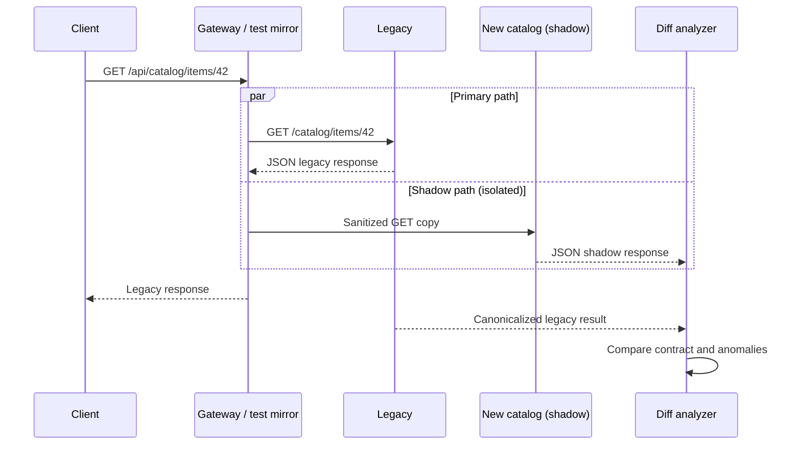
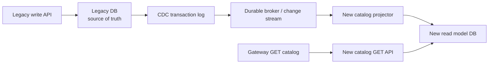
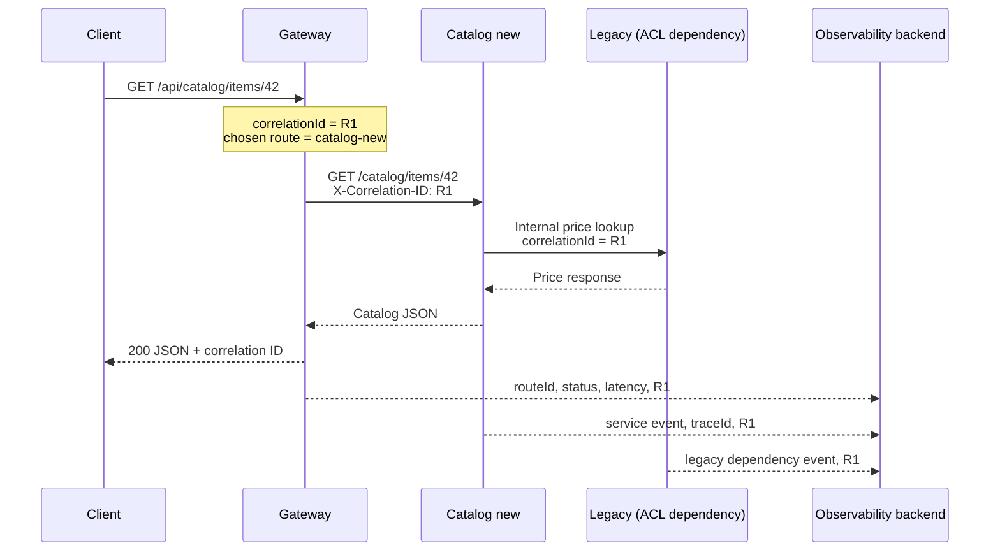
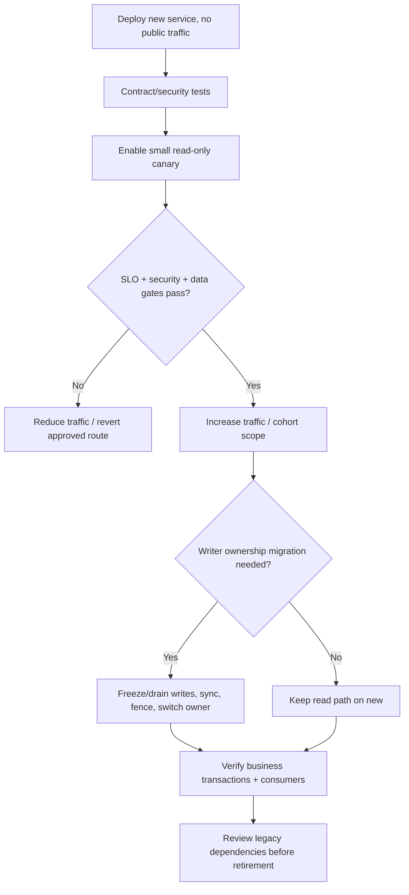

# Strangler Pattern for Gradual Legacy System Migration

An enterprise runs a **monolith** handling logins, product catalog, shopping carts, orders, and payments. The monolith serves live users, holds large datasets, and integrates with partner systems. Engineering wants to extract the **catalog** capability into a new Spring Boot microservice, yet cannot ask every client to switch URLs simultaneously, nor shut down the legacy system for a full rewrite.

The **Strangler Fig pattern** (often shortened to the *Strangler pattern*) solves this by placing a **stable interception and routing layer** in front of the legacy system. Unmigrated capabilities continue routing to the monolith; each completed capability gradually shifts to the new service. Legacy and new systems coexist during the transition, and any legacy components with zero remaining callers or dependencies are retired.

This lesson belongs to the **Routing Patterns** chapter of the **SPRING_CLOUD_GATEWAY** module. That routing layer can be **Spring Cloud Gateway Server WebFlux**: using **route predicates** to select routes by path, method, host, header, or weight; and **Gateway filters** to rewrite paths/headers, enforce authentication, rate limiting, circuit breakers/retries, and observability. Those capabilities power gradual legacy migration, yet **the Gateway does not migrate data, business permissions, or transaction semantics on its own**. That distinction is the heart of this lesson.

**Learning Objectives**

1. Explain the **transform → coexist → eliminate** model and criteria for picking which capability to extract first.
2. Use **Spring Cloud Gateway** to keep the public API stable while directing requests to either legacy or the new service.
3. Choose among **endpoint cutover**, **weighted canarying**, **tenant/user cohorts**, and **shadow traffic**, without conflating them.
4. Control **route ordering, path rewriting, backward compatibility, authentication/authorization, data, and write transactions**.
5. Define **go/no-go gates, rollbacks, SLO tracking, and tests** for every migration step.
6. Complete an end-to-end example with Gateway configuration, stub tests, lightweight load testing, and a pre-retirement checklist.

> **Scope:** Primary config snippets use **Spring Cloud Gateway Server WebFlux** with the new `spring.cloud.gateway.server.webflux.routes` namespace (used in Gateway 5.x docs and newer releases). Legacy Gateway 4.x lines commonly use `spring.cloud.gateway.routes`; verify against your exact BOM and release docs. **Gateway Server Web MVC** uses a different namespace and runtime; **Proxy Exchange** is an annotated-controller variant that does not automatically apply Gateway Server route/filter factories. Hostnames, services, datasets, and SLOs in this lesson are illustrative and have not been built or deployed.

## 1. What Is the Strangler Fig Pattern Really?

**Martin Fowler's** metaphor describes a strangler fig growing around a host tree and eventually becoming the new structure. In software, we build new capabilities **around a running system**, peeling responsibilities off legacy step by step instead of attempting a *big bang* rewrite.

Following AWS Prescriptive Guidance, there are three phases:

| Phase | Required work | Desired outcome |
| --- | --- | --- |
| **Transform** | Define the capability, design the contract, and build the replacement service. | A testable new implementation with zero disruption to legacy. |
| **Coexist** | Place a proxy/facade at the boundary; route part of traffic to the new service and the rest to legacy. | Both systems serve concurrently under clear rules with a rollback path. |
| **Eliminate** | Migrate all traffic, data, and callers; remove the corresponding legacy code and infrastructure. | The new capability has zero legacy dependencies; legacy is safely decommissioned. |

**Core insight:** This is an **architecture, data, and business-change strategy**, not merely a YAML file splitting traffic 90/10. If the Gateway sends 100% of GETs to the new service while every POST still mutates the legacy database and old batch jobs still own the data, that capability **has not been fully replaced**.

### 1.1. Architecture Diagram Once Migration Begins

```mermaid
flowchart LR
    C["Web / Mobile / Partner clients"] --> G["Public API Gateway"]
    G -->|"Catalog: migrated GET"| N["New catalog-service"]
    G -->|"Orders / Payments / remaining features"| M["Legacy monolith"]
    N --> ND["Catalog-owned DB"]
    M --> MD["Legacy DB"]
    N -. "Controlled ACL / sync"| M
```

Clients still call one external base address:

```http
GET https://api.example.test/api/catalog/items/42
GET https://api.example.test/api/orders/1001
POST https://api.example.test/api/orders
```

The Gateway picks the appropriate target per capability. Clients do not need to know whether a catalog request lands on the monolith or the new service; when public contracts remain compatible, frontends and partners do not need coordinated releases.

### 1.2. Why Not Rewrite Everything at Once?

| Big bang replacement | Strangler migration |
| --- | --- |
| Nearly every feature must be ready before cutover. | Migrates one capability or cohesive group at a time. |
| A post-cutover failure carries a massive blast radius. | Limits the blast radius per step, given clean boundaries. |
| Rollback is hard because schemas and data may change wholesale. | Offers per-capability rollback, **provided** data compatibility and reversibility are maintained. |
| Hard to verify feature parity across two whole systems at once. | Compares live behavior per route and contract. |
| Viable when the application is small and simple. | Adds operational overhead of running **two** systems, adapters, and data sync. |

Strangler **is not always the right choice**. For a small, low-dependency application that can tolerate a maintenance window, big bang can be simpler. If requests cannot be intercepted at a clean boundary, internal call sites cannot be updated, and required data cannot be extracted, Strangler becomes very difficult.

## 2. The Exact Role of Spring Cloud Gateway

The Gateway acts as a **stable entry point**:

```text
Client request
   |
   v
Spring Security / WebFilter
   |
   v
RoutePredicateHandlerMapping  -- selects ONE matching route
   |
   v
Gateway filter chain (StripPrefix, headers, retry, ...)
   |
   v
  +-----------------------------+
  | New service or legacy app   |
  +-----------------------------+
   |
   v
HTTP response via Gateway
```

### 2.1. What Can the Gateway Do?

- **`Path` / `Method` / `Host` / `Header`:** select the slice of requests served by the new implementation.
- **`Weight`:** distribute requests proportionally across routes in a group for an **appropriate canary trial**.
- **`order` and predicate specificity:** ensure specialized routes evaluate ahead of catch-all routes under a verified configuration.
- **`StripPrefix`, `RewritePath`, `SetPath`:** map public URIs to backend URIs without changing clients.
- **`AddRequestHeader` / `SetRequestHeader` / `RemoveRequestHeader`:** inject version metadata or sanitize headers when forwarding.
- **`lb://service-id`:** resolve service instances via Spring Cloud LoadBalancer/Discovery when configured.
- **Spring Security, `RequestRateLimiter`, `CircuitBreaker`/`Retry`:** enforce per-route or per-group protection and resilience.
- **Actuator, Micrometer, and tracing:** observe requests by route ID, status, latency, and trace ID.

### 2.2. What Does the Gateway Not Solve by Itself?

| Problem | Who owns the solution? |
| --- | --- |
| Two separate databases with out-of-sync records | Data migration/CDC/outbox/ETL and business owners |
| Changed field, enum, or error contracts | Service adapters / anti-corruption layers and contract tests |
| Whether User A may view User B's order | Backend ownership/tenant authorization; Gateway only helps enforce edge rules |
| Whether a retried POST after timeout causes duplicate writes | Backend idempotency and transaction design |
| Eventual consistency between old and new read models | Product SLAs, data architecture, and consumer handling |
| Monolith internal jobs/call sites calling legacy code directly | Modernization plan, dependency inventory, and ACLs |
| New service diverging from legacy business rules | Golden-master/differential tests and product validation |

**Common misconception:** “The Gateway now routes to the service, so the microservice migration is done.” That solves only **traffic interception**; data ownership, contracts, and caller dependencies determine when legacy can actually be turned off.

## 3. Choosing the First Capability to Migrate

A good unit of extraction is **a cohesive business capability or API group**, not “a random Java class inside the monolith.”

Examples:

| Capability | Initial suitability | Rationale |
| --- | --- | --- |
| **Read-only catalog** | High | Mostly GETs, minimal side effects; easy to measure and diff responses. |
| **Inventory availability read** | Medium | GET, yet requires fresh data and depends on stock reservations. |
| **Order tracking read** | Medium | Requires ownership/tenant checks and accurate order state. |
| **Order creation** | Lower initially | Mutates data, reserves stock, needs idempotency and events. |
| **Payment capture/refund** | Very sensitive | Transactions, reconciliation, compliance; bugs cannot be fixed by route rollback alone. |
| **Authentication/session** | Sensitive | Cookies, JWTs, SSO, trust boundaries, and client compatibility. |

Score candidates before committing:

1. **Clear API boundary:** Can the target be selected from path, method, and trusted identity/tenant?
2. **Separable data:** Who is the primary writer? Are there schema changes, external readers, or legacy jobs?
3. **Stable contract:** Are responses, error schemas, validations, and compatibility tests documented?
4. **Internal coupling:** Does the monolith call this logic directly via Java methods or SQL, bypassing the Gateway?
5. **Recoverability:** If the new service fails, can traffic revert to legacy with data still valid?
6. **Observability:** Do you have baseline latency, error budgets, business reconciliation, and source-of-truth logs?

**Suggested sequence in this lesson:** Migrate `GET /api/catalog/**` first, then tackle writes and data-heavy capabilities. This is a **lab assumption**, not a mandatory rule for every system.

## 4. The Public API Contract Must Stay Stable

Current endpoint:

```http
GET /api/catalog/items/42 HTTP/1.1
Host: api.example.test
Accept: application/json
```

Legacy returns:

```json
{
  "id": "42",
  "name": "Notebook",
  "price": 125000,
  "currency": "VND",
  "available": true
}
```

Even with its own database and internal schema, the new service's **public contract** must honor the same semantics, including:

- Public HTTP methods and paths.
- 200/404/400/401/403 status codes and error payload schemas.
- Field names, types (number vs. string), nullability, enums, localization, and sorting.
- Query parameters, pagination cursors, filters, and default page sizes.
- `Cache-Control`, `ETag`/`Last-Modified`, `Content-Type`, CORS, cookies, and redirects where applicable.
- Per-user/tenant permissions, not only anonymous sample JSON.

If the new service outputs `priceInCents` while the legacy contract expects `price` in VND, a tested **adapter/ACL** must translate it. The Gateway can rewrite paths/headers or minor attributes, yet must never become **the home for complex domain mapping**; domain-specific translation belongs in a service adapter.

### 4.1. Document What Happens at Every Hop

Assume:

```text
Public path:    /api/catalog/items/42
Gateway filter: StripPrefix=1
Backend path:   /catalog/items/42
```

Use `StripPrefix=1` across both routes only if **both legacy and the new service** expect the exact same post-strip path—otherwise configure filters per route. If the monolith expects `/legacy/catalog/items/42` while the new service expects `/v2/items/42`, write separate rewrites rather than reusing one filter blindly.

**Never equate HTTP 200 with contract compatibility.** Assert bodies, headers, backend hit counts, and business semantics.

## 5. Phase 0: Place the Gateway in Front of Legacy Without Extracting Features

First, funnel clients through **one public endpoint** without **moving any implementation yet**. Verify the proxy does not unintentionally alter methods, URIs, bodies, auth, TLS, timeouts, or responses.

### 5.1. Baseline Gateway Server WebFlux Config

```yaml
# application.yml — new Gateway Server WebFlux namespace
spring:
  application:
    name: migration-gateway
  cloud:
    gateway:
      server:
        webflux:
          routes:
            - id: legacy-api
              order: 100
              uri: http://legacy-monolith:8080
              predicates:
                - Path=/api/**
              filters:
                - StripPrefix=1

server:
  port: 8080
```

In a container/Kubernetes network, `legacy-monolith` must be a valid DNS hostname. Locally, replace it with `http://127.0.0.1:9090` pointing to an external backend process. **`localhost` inside a Pod/container does not reach a different backend Pod.**

Mapping:

| Public URL | Path received by legacy | Target |
| --- | --- | --- |
| `GET /api/catalog/items/42` | `GET /catalog/items/42` | Legacy catalog |
| `POST /api/orders` | `POST /orders` | Legacy orders |
| `GET /api/orders/1001` | `GET /orders/1001` | Legacy orders |

If legacy already expects the `/api/...` prefix, **omit `StripPrefix=1`**. Let tested mappings—not habit—determine the filter.

### 5.2. Exposing the Gateway Does Not Mean Exposing Every Legacy API

A `Path=/api/**` route is a **catch-all** for that prefix. If the monolith exposes `/api/admin/reset`, this route will forward requests there too **unless an earlier security layer blocks them**. When placing a Gateway at the public edge, enforce an explicit path/method inventory and security allowlist.

Even at baseline, ensure at minimum:

- Approved public endpoint inventory—never blindly expose all of `/api/**` to the Internet.
- Proper TLS, ingress, and trusted forwarded-header configuration.
- JWT, session, and cookie handling consistent with legacy.
- Request/header size limits and timeouts.
- Actuator and route-management endpoints blocked from public access.
- Structured access logs and metrics recording route IDs and upstream latency.
- Contract tests confirming the Gateway does not alter status, bodies, or headers unexpectedly.

**This catch-all example is for a controlled lab**, not a production security allowlist.

### 5.3. Two Ways to Insert the Gateway in Practice

```text
Option A — all client traffic passes through Gateway:

Client -> API Gateway -> Legacy monolith

Option B — gradual DNS/ingress migration:

Client -> Existing ingress -> API Gateway -> Legacy monolith
                           \-> legacy direct (must be retired on schedule)
```

Option B reduces initial risk when inserting the Gateway, yet creates **two entry paths with potentially diverging security policies**. For a trustworthy Strangler migration, track what still hits legacy directly and schedule closing those backdoors.

## 6. Phase 1: Route Only Catalog GETs to the New Service

This is a **capability/endpoint** cutover. Public client URLs stay unchanged; inside the Gateway, a more specific route takes precedence ahead of the catch-all.

### 6.1. Configuring Two Routes with Explicit Priority

```yaml
spring:
  application:
    name: migration-gateway
  cloud:
    gateway:
      server:
        webflux:
          routes:
            - id: catalog-new-read
              order: -20
              uri: http://catalog-service:8080
              predicates:
                - Path=/api/catalog/**
                - Method=GET
              filters:
                - StripPrefix=1

            - id: legacy-api
              order: 100
              uri: http://legacy-monolith:8080
              predicates:
                - Path=/api/**
              filters:
                - StripPrefix=1

server:
  port: 8080
```

**Expected routing when backends follow the lab mappings:**

| Client request | Selected route | Backend receives |
| --- | --- | --- |
| `GET /api/catalog/items/42` | `catalog-new-read` | `catalog-service:8080/catalog/items/42` |
| `GET /api/catalog/items/42?lang=vi` | `catalog-new-read` | `catalog-service:8080/catalog/items/42?lang=vi` |
| `POST /api/catalog/items` | `legacy-api` | `legacy-monolith:8080/catalog/items` |
| `GET /api/orders/1001` | `legacy-api` | `legacy-monolith:8080/orders/1001` |

Predicates **within one route combine via logical AND**; `catalog-new-read` matches only when both path **and** method satisfy it. Routes with **smaller `order` values are evaluated first**. Place catch-alls after specific routes so they never steal traffic.

**Do not treat the table above as executed output.** Test it against your real Gateway version/BOM, route matcher, ingress prefix, backend stubs, and `SecurityWebFilterChain`.

### 6.2. Never Assume Every `GET` Has Zero Side Effects

By HTTP semantics, `GET` should be safe and read-only. Real legacy apps sometimes use `GET` to write audit rows, mark items read, or initialize sessions. If `GET /catalog/...` hides side effects, migrating or shadowing it is no longer low-risk. Before migrating:

1. Inventory all DB writes, events, and third-party calls triggered by the endpoint.
2. Check cache headers, ETags, and conditional GETs.
3. Verify GDPR, PII, and authorization rules even on “read-only” APIs.
4. Check whether CDN caching could leak user-specific responses.

If an endpoint genuinely mutates state, fix its semantics or pair it with a proper data/ownership migration strategy.

### 6.3. Why a Service Name Alone in the URI Is Not Enough

`lb://catalog-service` lets Service Discovery/LoadBalancer pick instances, yet **does not guarantee** an instance has fresh data, valid TLS, or contract compatibility.

Discovery-based equivalent:

```yaml
spring:
  cloud:
    gateway:
      server:
        webflux:
          routes:
            - id: catalog-new-read
              order: -20
              uri: lb://catalog-service
              predicates:
                - Path=/api/catalog/**
                - Method=GET
              filters:
                - StripPrefix=1
```

Using `lb://` requires load-balancing and discovery dependencies/infrastructure. When zero instances exist, the Gateway typically returns 503 by default (configurable to 404 depending on version). Test stale registries, zero-instance states, partial readiness, and rolling updates.

### 6.4. Switching the Read URI Does Not Migrate Writes

After moving catalog GETs to the new service while catalog POSTs still hit legacy:

```text
Read catalog --> New catalog-service
Write catalog -> Legacy monolith
```

If the new service reads from a **separate database**, you need continuous synchronization from legacy to new. Never run two diverging datastores and declare victory from static GET fixtures. Intentional **read-before-write migration** requires replication/CDC/sync and an explicit lag tolerance.

## 7. Route Selection: Specificity, Order, and Clean Fallbacks

Spring Cloud Gateway Server WebFlux picks routes from **predicates** and route ordering. Whenever multiple routes can match the same request, set explicit `order` values and test for collisions.

### 7.1. Example of Accidental Route Capture

```yaml
spring:
  cloud:
    gateway:
      server:
        webflux:
          routes:
            - id: legacy-all
              order: -100
              uri: http://legacy-monolith:8080
              predicates:
                - Path=/api/**

            - id: catalog-new
              order: 0
              uri: http://catalog-service:8080
              predicates:
                - Path=/api/catalog/**
```

**Hazard:** `legacy-all` has higher priority (`-100 < 0`) and intercepts catalog requests. `Path=/api/catalog/**` **does not automatically beat** `/api/**` just because it looks more specific; configure and test ordering explicitly.

### 7.2. Route Conflict Table

| Route | Predicate | Order | Role |
| --- | --- | ---: | --- |
| `catalog-new-read` | `GET` + `/api/catalog/**` | -30 | Migrated capability |
| `admin-deny-or-internal` | Internal host/role + `/api/admin/**` | -20 | Isolates admin area; Security still enforces authz |
| `legacy-orders` | `/api/orders/**` | 0 | Unmigrated orders |
| `legacy-catchall` | `/api/**` | 100 | Controlled fallback |

**Never assume an `admin-deny-or-internal` route grants or enforces authorization by itself.** Route predicates only select targets; Spring Security and backends still enforce who may call what. Often the safest choice is **omitting public routes** for admin endpoints altogether, backed by default-deny security and ingress network restrictions.

### 7.3. Route Order Differs from Gateway Filter Order

- **Route order:** picks which route matches.
- **Filter order:** once a route matches, `GlobalFilter`s and route `GatewayFilter`s run in `Ordered` sequence on the request and response.

A regular custom `GlobalFilter` **cannot re-run route selection before predicate matching**. To compute a cohort from an authenticated principal before route matching, place that logic **in the web layer ahead of route mapping**, or use a trusted ingress/control-plane header. Setting `X-Cohort` inside a `GlobalFilter` **after the route already matched** is too late to change the chosen route for that request.

### 7.4. Never Expose Route IDs as a Public Contract

`id: catalog-new-read` is **operational metadata**. Clients should never depend on route IDs, which may change as configs evolve. Public contracts rely on documented URLs, methods, and headers; route IDs belong in logs, traces, and dashboards to distinguish implementations.

## 8. Rewriting Paths Without Breaking Contracts

During coexistence, legacy and the new service often expect **different internal paths**:

```text
Client:  GET /api/catalog/items/42
Legacy:  GET /legacy/products/42
New:     GET /v2/catalog/items/42
```

No single `StripPrefix=1` rule handles all three. Pick the right mechanism:

1. **Adapter inside the new service:** accepts `/catalog/items/42` from the Gateway and maps internally.
2. **Controlled Gateway `RewritePath`:** when the mapping is purely syntactic and stable.
3. **Dedicated Anti-Corruption Layer:** when field meanings, status codes, business IDs, or multi-service calls must be translated.

### 8.1. Using `RewritePath` for Fixed Prefixes

Example when the new backend expects `/v2/catalog/items/**`:

```yaml
spring:
  cloud:
    gateway:
      server:
        webflux:
          routes:
            - id: catalog-v2
              order: -20
              uri: http://catalog-service:8080
              predicates:
                - Path=/api/catalog/**
                - Method=GET
              filters:
                - name: RewritePath
                  args:
                    regexp: /api/catalog/?(?<remaining>.*)
                    replacement: '/v2/catalog/$\{remaining}'
```

In YAML, the replacement uses a **named regex capture** and the escaped syntax `/v2/catalog/$\{remaining}` per Gateway WebFlux docs; single quotes preserve the backslash in the YAML scalar. Given `GET /api/catalog/items/42`, the backend receives `/v2/catalog/items/42`. **Still test the actual rewrite** on your runtime, especially encoded paths, queries, and trailing slashes.

### 8.2. Practical Path Transformation Guidelines

- Keep rewrite rules **short, reviewable**, and tested across root paths, trailing slashes, encoded slashes, and query strings.
- For paths with dynamic IDs, verify canonicalization and percent-encoding so the backend sees the exact ID.
- Never let a regex rewrite bypass security path matchers or expose internal admin routes.
- When queries and encoded characters matter, test end-to-end with an HTTP stub rather than reasoning from strings.
- Inspect response `Location`, cookies, and links: if the new backend emits internal hosts or paths, rewrite response headers so **internal hostnames never leak to clients**.

Whenever mapping goes beyond simple prefix changes, move it into a **service adapter/ACL** instead of stacking brittle regexes and JSON-body rewrite filters in the Gateway.

## 9. Phase 2: Canarying with the `Weight` Route Predicate

Even after the new service passes catalog GET contract tests, teams often route **10% of requests** to measure real-world p95/p99, error rates, and diffs before cutting over 100%.

Gateway Server WebFlux provides the **`Weight` Route Predicate Factory**:

```yaml
spring:
  cloud:
    gateway:
      server:
        webflux:
          routes:
            - id: catalog-legacy-canary
              order: -20
              uri: http://legacy-monolith:8080
              predicates:
                - Path=/api/catalog/**
                - Method=GET
                - Weight=catalog-read-migration, 90
              filters:
                - StripPrefix=1

            - id: catalog-new-canary
              order: -20
              uri: http://catalog-service:8080
              predicates:
                - Path=/api/catalog/**
                - Method=GET
                - Weight=catalog-read-migration, 10
              filters:
                - StripPrefix=1

            - id: legacy-other
              order: 100
              uri: http://legacy-monolith:8080
              predicates:
                - Path=/api/**
              filters:
                - StripPrefix=1
```

**Reading this configuration accurately:**

- Both catalog routes share the **`Weight` group** `catalog-read-migration`.
- The group weights are **90 legacy / 10 new** across identical path and method predicates.
- The Gateway routes **roughly** 90%/10% over large samples—it **does not guarantee exactly 9 legacy calls followed by 1 new call**.
- `order=-20` evaluates the canary pair ahead of the `legacy-other` fallback; both canary routes share identical eligibility so behavior stays predictable.
- Anything outside catalog GETs (such as catalog POSTs or order GETs) falls through to `legacy-other`.

**Prerequisite:** Both old and new services must satisfy identical catalog GET contracts. Never use this pattern to test stateful `POST`/payment writes unless data ownership and idempotency are already solved.

### 9.1. `Weight` Is Not Sticky per User or Tenant

Critically: **`Weight` splits routes per request, with no built-in session stickiness**.

One user might see:

```text
GET /api/catalog/items/42  -> new service
GET /api/catalog/items/42  -> legacy service
GET /api/catalog/items/43  -> new service
```

That is fine for synced, contract-compatible catalog GETs with consistent caching. If the same user sends writes to two separate datastores on alternating requests, you risk:

- Broken read-after-write (write to A, read from B).
- Diverging ID sequences or stock counts.
- Duplicate emails, charges, or payments.
- Backend-local sessions/cookies unrecognized by the other backend.
- Confusion over which datastore is the source of truth.

Therefore **`Weight` is not a data-ownership partitioning strategy**. For write workloads, use **deterministic user/tenant/aggregate cohorts**, or cut over the whole capability to a single writer once readiness and sync are proven.

### 9.2. Isolate `Weight` Groups by Capability

Never share one group `migration` across catalog and payments when they have different traffic shapes, methods, and lifecycles:

```text
Group catalog-read-canary:
  catalog-old GET 90
  catalog-new GET 10

Group shipping-read-canary:
  shipping-old GET 95
  shipping-new GET 5
```

Sharing a group across routes with mismatched predicates produces unpredictable routing and fallbacks. **Each group should contain only routes sharing the exact same request eligibility contract**, verified with probability and precedence tests.

### 9.3. Recommended Canary Ramp Steps

| Step | Traffic to new service | Gate to advance |
| --- | ---: | --- |
| S0 | 0% | New service verified via isolated test/internal routes. |
| S1 | ~1% | Real canary with full tracing; zero security or contract violations. |
| S2 | ~5% | p95/p99, 5xx, and data reconciliation within bounds. |
| S3 | ~10% | Breakdown by user segment, cache behavior, and response consistency. |
| S4 | ~25% | Gateway/backend headroom and rollout draining look healthy. |
| S5 | ~50% | Zero major regressions; data reports remain trustworthy. |
| S6 | 100% | Remove the canary split and keep **a single new route**. |

This is an **illustrative cadence**, not a universal rule. Low-traffic systems need longer windows for sufficient samples, whereas payment flows may gate manually on transaction reconciliation rather than traffic percentages.

**Avoid setting `Weight=0` as a long-term way to “disable a route” without verifying release behavior.** For 0%/100%, updating the route config to a single explicit target while keeping a rollback snapshot is clearer and easier to audit.

### 9.4. Simple Sanity Math

Across 10,000 **eligible** requests in a window under a 10/90 split:

\[
\mathbb{E}[N_{\text{new}}] = 10{,}000 \times 0.10 = 1{,}000
\]

Observing 1,050 hits to `new` instead of exactly 1,000 does not indicate a bug. Check sample size, Gateway release, replica balance, group definitions, and random variance. If **backend request counts** diverge from Gateway route metrics, look for retries, caches, proxy errors, or direct bypass traffic.

### 9.5. Do Not Forget Backend Capacity

Sending 10% of traffic to the new service does not mean it uses only 10% of legacy resources:

- Cold caches and JVM JIT warm-up inflate early p99 latency.
- The new service may call a legacy API multiple times to compose one response.
- Retries multiply outbound attempts.
- The new service may process data more heavily.
- Canary requests can cluster on expensive queries or heavy tenants.

Monitor **RPS, concurrency, backend DB queries, errors, connection pools, and business metrics** on the new service independently before ramping up.

## 10. Cohort Routing: Migrating a Stable Customer Slice

A **cohort** groups requests by a stable attribute: tenant, user, organization, region, or entitlement. Once a tenant's data moves to the new database, all requests for that tenant must hit the right owner to prevent split-brain.

### 10.1. `Header` Predicate Example — Only with a Trusted Header

Assume a **trusted ingress or BFF** authenticates the request and **overwrites** `X-Trusted-Migration-Cohort` per a protected policy:

```yaml
spring:
  cloud:
    gateway:
      server:
        webflux:
          routes:
            - id: catalog-new-cohort
              order: -30
              uri: lb://catalog-service
              predicates:
                - Path=/api/catalog/**
                - Method=GET
                - Header=X-Trusted-Migration-Cohort, new
              filters:
                - StripPrefix=1

            - id: catalog-legacy-default
              order: 20
              uri: lb://legacy-monolith
              predicates:
                - Path=/api/catalog/**
                - Method=GET
              filters:
                - StripPrefix=1
```

**Security warning:** `Header=X-Trusted-Migration-Cohort, new` matches only **the header string**—it never authenticates the sender. Internet clients can forge that header **unless ingress/Gateway strips or validates it**. Use this pattern only when:

1. Ingress strips any client-supplied value for that header.
2. A trusted component computes the cohort from verified principal/tenant identity or server-side routing policy.
3. Ingress/BFF writes the fresh header—never basing security decisions on arbitrary queries or cookies.
4. The Gateway accepts traffic exclusively from trusted ingress (network policy/mTLS and forwarded-header trust).
5. Both new and legacy enforce **equivalent authorization**, never treating a cohort header as an admin pass.

Never let users self-select a target or tenant via headers if doing so alters data access or financial outcomes.

### 10.2. Selecting Cohorts via Deterministic Hashing

In a **component executing before route matching**, apply:

```text
identity = verifiedTenantId
bucket = stableHash(identity + migrationSalt) mod 100

if tenant is in approvedMigrationSet
    and bucket < configuredPercentage
then route to new-service
else route to legacy-service
```

This is **architectural pseudocode**, not a built-in Gateway predicate named `stableHash`. Implementation requires:

- **Verified** tenant identity, never client-supplied `X-Tenant`.
- **Consistent** hash algorithm and seed across replicas and deployments.
- Versioned percentage expansion so raising percentages never churns cohorts unpredictably.
- Audited, approved override lists for sensitive tenants.
- An **ownership state** store tracking which system currently owns a tenant's reads/writes, rather than relying solely on a traffic-percentage hash.

**Critical timing rule:** Route predicates run during route selection, so a **Gateway `GlobalFilter` running after route selection** cannot inject a header for that same request's `Header` predicate to match. If computing cohorts inside the Gateway, place the `WebFilter`/auth hook **before route mapping**, or compute it at a trusted external ingress.

### 10.3. Weighted Canary vs. Cohort Routing: Quick Comparison

| Criterion | Per-request `Weight` | Stable cohort |
| --- | --- | --- |
| Distribution | Approximate % per request | By user/tenant/hash bucket |
| Built-in Gateway support | `Weight` predicate | Combine `Header` / custom routing / trusted upstream |
| Per-tenant stickiness | **No** | Yes, when mapping is stable |
| Suits stateless GETs | Usually yes | Yes |
| Suits writes / data ownership | **Not guaranteed** | Better suited to single-writer-per-aggregate |
| Changing canary % | Relatively simple | Requires managing cohorts, ownership history, and data sync |
| Security | Grants no extra privilege | Header/identity must be verified; never trust raw input |
| Rollback | Adjust route weights | May require per-cohort data/ownership rollback |

### 10.4. Post-Auth Cohorts Do Not Share Session Backends Automatically

If legacy uses instance-local session cookies while the new service uses stateless JWTs, moving a tenant to `new` does not automatically migrate active sessions. Plan for:

- SSO/OIDC/session exchange or an explicit re-login policy.
- Compatible cookie `Domain`, `Path`, `SameSite`, and CSRF settings.
- Token audiences and claims mapping for the new service.
- Backend verification of ownership and tenant claims.
- Handling existing sessions and long-lived WebSocket/SSE connections.

Never let the new service accept legacy cookies “by default” without a clear trust model and validation.

## 11. Shadow Traffic vs. Canary: Preview Responses Without Impacting Clients

**Canary:** the Gateway chooses **one** implementation to return the live response for a request.

**Shadow/mirroring:** live traffic still routes to legacy and returns legacy's response; a copy is sent to the new service **for observation and comparison**, while the shadow response is discarded.



**Spring Cloud Gateway does not ship a ready-made YAML `ShadowTraffic` filter out of the box.** Shadowing is an **additional architectural pattern** requiring a custom filter, ingress mirroring, a test harness, or a proxy built for safe traffic duplication.

### 11.1. Risks When Duplicating Requests

- **`POST`/`PUT`/`DELETE`** carry side effects → copies can double-write or double-charge.
- Even legacy `GET`s may update sessions, view counters, audit logs, or quotas.
- Copied requests can carry `Authorization`, `Cookie`, PII, emails, and payment details.
- A shadow service might call real third parties, send emails, or reserve inventory.
- Shadow traffic adds load to the new service and its database even though responses are ignored.
- Synchronous mirroring lets a slow shadow call stall the primary response path.

**Safe design:** shadow only verified read-only endpoints, mask or strip sensitive headers/fields or use synthetic payloads, isolate networks and data, disable outbound side effects, and **never let shadow latency or errors degrade the primary response**.

### 11.2. Compare Semantics, Not Raw JSON Strings

Two systems can return identical semantics yet differ in:

- JSON field ordering.
- Timestamp rounding or timezones.
- Generated IDs or trace IDs.
- List ordering when the API guarantees none.
- Eventual consistency lag.
- Dynamic headers like `Date`, `Server`, or request IDs.

So **canonicalize** responses first:

```text
legacy JSON --------+
                    +--> normalize schema & stable fields
new JSON -----------+
                          |
                          v
                  semantic contract diff
                          |
                +---------+---------+
                |                   |
           expected variance   true mismatch
```

Classify discrepancies by severity:

| Severity | Example | Action |
| --- | --- | --- |
| **Security critical** | New service leaks another tenant's data | Halt canary and block rollout immediately. |
| **Business critical** | Wrong price or inventory count | Stop, reconcile, and fix data ownership. |
| **Contract** | New changes `price` from string to number | Fix adapter/contract or version the API. |
| **Data freshness** | New lags legacy by 5s when SLA allows 2s | Investigate CDC lag; do not ignore indefinitely. |
| **Cosmetic** | Different JSON key order | Normalize before flagging as a failure. |

Shadowing never replaces **authenticated positive and negative integration tests**, because shadow traffic covers only a slice of inputs and often masks or stubs side effects.

## 12. Data: Where Strangler Gets Harder Than Swapping Routes

When two implementations coexist, the biggest danger is not merely misrouting—it is **two systems holding two conflicting truths about the same business entity**.

```text
Legacy monolith                   New catalog service
----------------------------      ----------------------------
legacy_db.products                catalog_db.items
legacy_db.stock                   catalog_db.availability
legacy_db.price_rules             catalog_db.price_snapshots
```

If GETs move to `new` while legacy admin tools still write to `legacy_db.products`, the new service needs synchronization. If `POST`/`PUT` also move to `new` while an old batch job still edits the legacy DB, **competing writers** cause lost updates and corrupted merges.

### 12.1. Three Migration Directions

| Direction | Request path | Primary writer | Risk |
| --- | --- | --- | --- |
| **Read path first** | `GET` → new, `POST`/`PUT` → legacy | Legacy | New read model/replica can lag. |
| **Write path first** | `POST`/`PUT` → new, `GET` → legacy | New | Legacy reads depend on reverse sync; easily stale. |
| **By aggregate/tenant** | Tenant A reads/writes → new, Tenant B → legacy | One writer per aggregate/tenant | Requires stable ownership routing and cross-boundary workflows. |

**Do not force one strategy onto every domain.** Catalog reference data may tolerate eventual consistency, whereas inventory reservations and payment balances demand tighter transactional guarantees.

### 12.2. Single Writer per Aggregate Is the Safe Invariant

For writes:

```text
ownership(orderId=1001) = LEGACY
ownership(orderId=1002) = NEW
```

At any moment, every mutation to order 1001 goes through **one authoritative writer**; the other system may read replicas or synced copies, yet never simultaneously holds write authority for that aggregate.

For per-tenant migration:

```text
tenant A -> NEW writes and primary reads
tenant B -> LEGACY writes and primary reads
```

**Limitation:** From `/api/orders/1001`, the Gateway may not know which tenant owns that order. Never decide write ownership from untrusted query parameters or headers. Use a verified **routing/ownership lookup** or let a domain/router tier receive the request and dispatch safely.

### 12.3. Why Dual-Write Is a Trap

Deceptively simple idea:

```text
POST order -> write legacy DB
           -> write new DB
```

If the legacy write succeeds and the new write fails, you have a **partial commit**. Retrying both may create a second order in legacy. Two independent databases do not share an atomic transaction across an HTTP proxy.

| Anti-pattern | Consequence |
| --- | --- |
| Gateway calls both backends simultaneously for one POST | Duplicate side effects; ambiguous response. |
| New writes its DB then calls legacy DB without idempotency | Partial failures and duplicate writes. |
| Both DBs run triggers updating the other's copy | Update loops, conflicts, lost source of truth. |
| Unversioned Redis flag selects writer | Pod race conditions and uncontrolled ownership flips. |
| Route rollback without reverse data sync | Legacy cannot see transactions committed in new. |

**The Gateway cannot provide exactly-once semantics across two datastores.** You need domain transactions, idempotency, conflict resolution, and deliberate reconciliation.

### 12.4. CDC for the Read-Migration Phase

**Change Data Capture (CDC)** tails legacy's database transaction log and streams changes into the new read model:



Legacy remains the authoritative writer while the new service is proven against live data. Ensure:

- Initial snapshot + CDC catch-up without dropping changes between backfill and streaming.
- Handling for schema evolution, out-of-order events, and duplicate deliveries.
- Idempotent projections and checkpoints.
- Per-key/partition ordering and bounded consumer lag.
- Data deletion and PII handling per privacy and retention rules.
- Tracking p95/p99 replication lag, stale key counts, and max lag.

If the new API serves stale data beyond SLA, **never simply lower `Weight` and call the data migration healthy**. Reconcile critical business fields.

### 12.5. Transactional Outbox for Write/Event Migration

Once the new service becomes primary writer, use a **transactional outbox**:

```text
New service transaction:
  1. UPDATE aggregate in new DB
  2. INSERT outbox_event in same DB transaction
  3. COMMIT

Outbox relay:
  4. Publish event to durable broker (at least once)
  5. Consumers update legacy read model / external integrations
```

Business state and the outbox record share **one local DB transaction**, eliminating “DB committed but event lost.” Because the relay delivers at least once, consumers need idempotency/inbox deduplication. **Never promise system-wide exactly-once without end-to-end idempotency.**

### 12.6. Rolling Back After the New Service Has Written Data

Before shifting writes to `new`, answer:

1. If `new` fails after 24 hours, does legacy have the data needed to serve reads and writes?
2. Is there a controlled, versioned, audited **new → legacy** sync path?
3. Did `new` introduce schemas, enums, or IDs legacy cannot parse?
4. Were irreversible actions triggered (payment capture, emails, external dispatches)?
5. Which owner currently holds each aggregate, and who is authorized to change ownership?
6. Are **fencing/version tokens** in place to block stale writers from mutating migrated aggregates?

If data rollback is unsafe, **shrink migration increments, prepare forward-fix runbooks, and contain blast radius**. Never call flipping a URI from `new` back to `legacy` a complete rollback.

## 13. Anti-Corruption Layer (ACL) Protecting the New Domain

An **Anti-Corruption Layer** translates between incompatible domain/data models. It can live inside the new service, a dedicated integration adapter, or a monolith facade; **it does not have to live inside the Gateway**.

### 13.1. Contract Translation Example

Legacy stores:

```json
{
  "PROD_ID": 42,
  "PRICE_VND": 125000,
  "STOCK_STATUS": "Y"
}
```

The new domain models:

```json
{
  "sku": "ITEM-42",
  "price": {"amount": 125000, "currency": "VND"},
  "availability": "IN_STOCK"
}
```

While the public contract still expects:

```json
{
  "id": "42",
  "price": 125000,
  "currency": "VND",
  "available": true
}
```

The ACL handles:

- Field and enum mapping carrying business meaning.
- Semantic differences: tax-inclusive pricing, timezones, stock states.
- Legacy error codes → domain errors → public HTTP status codes.
- ID translation, validation, missing values, and versioning.
- Calling unmigrated legacy capabilities with resilience and tracing.

**Never cram all of that logic into chains of Gateway `ModifyResponseBody`/`RewritePath` filters.** Gateway filters fit simple cross-cutting transforms; domain translation belongs in an owned, independently tested adapter.

### 13.2. Monolith Still Calling Extracted Capabilities Internally

Invisible in Gateway logs: the monolith may still invoke `ProductRepository.findById` **in-process**. Even after public GETs move to the new service, internal monolith flows still read stale code and tables.

Facade approach:

```text
Legacy order module
     |
     v
Legacy CatalogFacade (ACL)
     |
     +-- not yet migrated --> legacy implementation
     |
     +-- already migrated --> catalog-service internal API
```

Legacy callers stay insulated from implementation details, yet you must update internal call sites, guard against circular dependencies, and retire the facade when migration finishes.

### 13.3. Preventing Circular Service Calls

```text
Gateway -> New catalog
             -> Legacy monolith for price
                   -> Gateway catalog endpoint
                         -> New catalog
                             -> ...
```

Call loops exhaust connection pools, spike latency, and trigger cascading timeouts. ACLs must call an **authorized internal API** on the target capability—never loop back through the public Gateway route on the same path.

Document clear dependency arrows:

- Client → Gateway → selected service.
- New → legacy internal API **distinct from the migrated public endpoint**.
- Legacy → new via a versioned ACL/adapter.
- Never allow clients to pick targets dynamically via `X-Backend-Url`.

## 14. Verifiable Data Migration Milestones

| Milestone | Source of truth | Gateway routing | Exit criteria |
| --- | --- | --- | --- |
| **A. Inventory** | Legacy | 100% legacy | All writers, readers, and batch jobs inventoried. |
| **B. Backfill** | Legacy | 100% legacy | Snapshot covers all records; checksums/keys verified. |
| **C. CDC catch-up** | Legacy | 100% legacy | Consumer lag and reconciliation within SLA. |
| **D. Shadow GET** | Legacy | Served by legacy | New responses semantically diffed safely. |
| **E. Canary GET** | Legacy | Percentage of GETs to new | Error, latency, and diff gates green. |
| **F. New GET full** | Legacy | 100% GETs to new | Read model stays within freshness SLA. |
| **G. Write ownership cutover** | Controlled cutover per tenant/aggregate | Writes to new owner | Zero dual-writers; idempotency/fencing verified. |
| **H. New write full** | New | Capability → new | Legacy callers redirected or synced. |
| **I. Retire legacy** | New | No legacy route for capability | Internal jobs, data deps, and ACLs audited. |

**Not every domain follows the same schedule**, yet skipping ownership milestones routinely leads to unsafe rollbacks.

### 14.1. Measuring Replication Lag

If the new read model consumes an event stamped at `t_event` and finishes applying it at `t_apply`:

\[
\text{replication lag} = t_{\text{apply}} - t_{\text{event}}
\]

Measure **p95/p99 lag**, max lag, and stale key counts—not just averages. Across hosts with clock skew, synchronize clocks or use authoritative broker offsets/cursors. For inventory or pricing APIs, define business-driven lag tolerances rather than guessing “low lag is probably fine.”

### 14.2. Write Cutover Requires Coordinated Orchestration

Before moving a tenant from legacy writer to new writer:

1. Block/drain legacy writes for that tenant or enforce valid fencing/versioning.
2. Wait for in-flight transactions to settle and record explicit checkpoints/offsets.
3. Sync final state; verify checksums, ownership, and business totals.
4. Flip the authoritative owner atomically/under strict control.
5. Only then admit writes to the new service.
6. Monitor duplicate transactions, consistency, and error budgets.
7. Keep a tested data rollback **or** forward-fix plan if irreversible.

**A Gateway flag cannot replace distributed coordination** while monolith workers or batch jobs still write directly to the same aggregate.

### 14.3. Dependency Map to Know When Legacy Can Be Retired

Inventory non-HTTP dependencies:

| Component | Possible lingering legacy dependency | Required action |
| --- | --- | --- |
| Scheduled batch/reports | Direct SQL against legacy DB | Migrate to new APIs or contracted read models. |
| ETL/analytics | Legacy tables and schemas | Switch ingestion feeds and ownership. |
| Messaging consumers | Legacy topics and event schemas | Evolve schemas and migrate consumers. |
| Older mobile apps | Deprecated endpoints/cookies/versions | Track version telemetry and execute deprecation. |
| Partner integrations | Allowlisted legacy IPs/URLs | Coordinate endpoint, cert, and DNS cutovers. |
| Auth/SSO | Legacy session stores or signing keys | Migrate session/token policies. |
| Monolith internal jobs | Direct method calls bypassing Gateway | Introduce facades/ACLs and update call sites. |
| Monitoring/alerts | Legacy route/metric/log names | Update dashboards, triage, and runbooks. |

**Never treat “zero Gateway requests to legacy” as proof legacy has no users left** if internal batch jobs still query it directly.

## 15. Authentication, Authorization, and Identity During Coexistence

The two implementations may use distinct auth stacks:

```text
Legacy:
  browser session cookie + legacy role table

New service:
  OAuth2/OIDC JWT + fine-grained scopes / tenant claims
```

The Gateway can enforce perimeter security, yet must never **infer backend object-level permissions**. Protect all five layers simultaneously:

1. **Incoming identity:** real caller, valid issuer, audience, and token expiry.
2. **Route-level policy:** permitted methods, paths, and scopes.
3. **Service-to-service identity:** Gateway/new service authenticates to backend/legacy.
4. **Object/tenant ownership:** backend verifies user access to the specific object.
5. **Session/cookie compatibility:** legacy browser flows, CSRF, and redirects remain intact.

### 15.1. Sample Spring Security Reactive Policy

Example Gateway exposing only catalog GETs publicly and requiring scopes on orders:

```java
package com.example.gateway.security;

import org.springframework.context.annotation.Bean;
import org.springframework.context.annotation.Configuration;
import org.springframework.http.HttpMethod;
import org.springframework.security.config.Customizer;
import org.springframework.security.config.annotation.web.reactive.EnableWebFluxSecurity;
import org.springframework.security.config.web.server.ServerHttpSecurity;
import org.springframework.security.web.server.SecurityWebFilterChain;

@Configuration
@EnableWebFluxSecurity
public class GatewaySecurityConfiguration {

    @Bean
    SecurityWebFilterChain security(ServerHttpSecurity http) {
        return http
            // Only appropriate for stateless Bearer-only APIs.
            .csrf(ServerHttpSecurity.CsrfSpec::disable)
            .authorizeExchange(exchanges -> exchanges
                .pathMatchers(HttpMethod.GET, "/api/catalog/**")
                    .permitAll()
                .pathMatchers(HttpMethod.GET, "/api/orders/**")
                    .hasAuthority("SCOPE_orders.read")
                .pathMatchers(HttpMethod.POST, "/api/orders/**")
                    .hasAuthority("SCOPE_orders.write")
                .anyExchange().denyAll())
            .oauth2ResourceServer(oauth2 ->
                oauth2.jwt(Customizer.withDefaults()))
            .build();
    }
}
```

Running this requires the JWT Resource Server dependency and version-aligned decoder/issuer/trust setup. This is a **WebFlux example**. In Gateway Server Web MVC, use Servlet `SecurityFilterChain` and `HttpSecurity`—never copy reactive types.

**Limitations of this example:**

- Never leave `csrf.disable()` in place if the Gateway uses browser cookie/session logins; design and test CSRF defense there.
- `permitAll` on catalog is a lab choice and may be unsafe for private catalogs.
- Validate issuer, signature, expiry, and **audience** per business policy; never assume default scope converters fit custom issuer claims.
- `anyExchange().denyAll()` blocks undeclared routes, so define explicit rules for health/actuator probes without exposing management endpoints to the Internet.
- Ownership such as “order 42 belongs to tenant A” **cannot be proven by scope alone**; the backend must check it.

### 15.2. Route Predicates Never Replace Access Control

Suppose a client sends:

```http
GET /api/orders/42 HTTP/1.1
X-Trusted-Migration-Cohort: new
Authorization: Bearer <invalid-token>
```

Even though the `Header` predicate matches, **Spring Security must reject** the invalid request. Never treat a cohort header as an auth token; even sandbox trials of the new service must authenticate caller accounts/entitlements.

### 15.3. Token Relay vs. Service Credentials

When both legacy and new require identity:

| Mechanism | When to use | Risk |
| --- | --- | --- |
| Relay client bearer token | Backend is authorized to accept/validate tokens with matching audience/issuer. | Token leaks to wrong trust zone; audience mismatch. |
| Gateway sends service-to-service token | Backend trusts service identity and receives signed/verified user context separately. | Conflating service authority with end-user authority. |
| Legacy session adapter | Browser cookie contract is not yet replaced. | CSRF, `SameSite`, session fixation, cookie sharing. |
| mTLS between Gateway and backends | Authenticates machine/service identity. | mTLS **never replaces** end-user/object authorization. |

Spring Cloud Gateway provides `TokenRelay` for OAuth2-client configurations where dependencies and security context align. **Never assume adding `TokenRelay` in YAML turns a JWT resource-server Gateway into a full token-exchange service** or mints legacy-audience tokens automatically. Design it explicitly, configure the right starter and client registrations, and test real headers at a backend stub.

### 15.4. Blocking Client-Supplied Identity Headers

Audit these headers before forwarding:

- `X-User-Id`, `X-Tenant-Id`, `X-Role`, `X-Scopes`.
- `X-Trusted-Migration-Cohort`.
- `Forwarded` / `X-Forwarded-For` / `X-Forwarded-Host`.
- `Authorization`, `Cookie`, `Set-Cookie`.
- `Host`, `X-Original-Uri`, and headers injected by ingress or service meshes.

**Anti-pattern:** Backend trusts a client-sent `X-User-Id: admin`. When passing identity downstream, emit metadata from an **authenticated component**, strip client values at the trust boundary, and enforce network/mTLS constraints or signed tokens verified by the backend.

### 15.5. CORS, Redirects, Cookies, and Browser Flows

When migrating login or account flows, test:

- CORS preflight requests passing through the Gateway ahead of JWT enforcement.
- Cookie `Domain`, `Path`, `SameSite`, `Secure`, and `HttpOnly`.
- Redirect `Location` headers never leaking internal hosts or looping `legacy → gateway → legacy`.
- Session logout, refresh, and revocation still working.
- CSRF tokens remaining valid across backend transitions.
- SPAs avoiding mixed-content errors when external HTTPS proxies to internal HTTP.

**Never pick authentication/session as your first extracted capability merely because it has few endpoints**; its security blast radius is wide.

## 16. Resilience and Fallbacks: What to Do When the New Service Fails

Rolling back traffic reduces risk, yet **automatic per-request fallback** is not always safe. Distinguish clearly:

| Case | Safe option | What to avoid |
| --- | --- | --- |
| Stateless catalog GET while legacy data is fresh | Route back to legacy or controlled read fallback | Serving stale data or wrong contracts. |
| Order GET after writes moved to `new` | Fall back only if legacy read model has identical data and ownership | Wrong 404s or cross-tenant leaks. |
| `POST` order/payment creation | Return clear error and retry via idempotency contract | Auto-calling legacy after `new` times out (risks double commit). |
| New service has zero instances | Alert, recover discovery, or roll back conditionally | Silently flipping domain owner on 503 → legacy. |
| Rate limiter or IdP outage | Fail-open or fail-closed per security policy | Disabling auth to “preserve availability.” |

### 16.1. Circuit Breakers Are Protection, Not a Data Rollback Button

Spring Cloud Gateway Server WebFlux integrates Spring Cloud CircuitBreaker / Resilience4J with the matching starter. Example for read-only GETs:

```yaml
spring:
  cloud:
    gateway:
      server:
        webflux:
          routes:
            - id: catalog-new-resilient
              uri: lb://catalog-service
              predicates:
                - Path=/api/catalog/**
                - Method=GET
              filters:
                - StripPrefix=1
                - name: CircuitBreaker
                  args:
                    name: catalogReadBreaker
                    fallbackUri: forward:/catalog-read-fallback
```

**Note:** `fallbackUri: forward:/catalog-read-fallback` is an **internal forward URI**; you must supply the controller/handler or route handling it. It **does not automatically** call legacy or translate schemas. Configure Resilience4J dependencies, thresholds, and timeouts; if a fallback proxies to legacy, test authorization, paths, loop prevention, data consistency, and side-effect suppression.

A simpler option during new-service instability is **rolling back the route config (versioned and audited)** to legacy for read capabilities after confirming legacy data still meets the contract. That avoids “try new on every request, fall back to old on failure,” which doubles load during an outage.

### 16.2. Retries and Amplification

The Gateway `Retry` filter retries on configured statuses, methods, exceptions, and backoffs, yet:

- Retries multiply upstream attempts; 100 client RPS can become 300 attempts/s with 2 retries when all calls fail.
- **Filters placed after `Retry` can execute multiple times**; audit custom filters for side effects.
- Retrying `POST` bodies buffers bytes and increases memory pressure.
- A `POST`/payment may have committed before timing out; retrying onto legacy creates duplicate transactions.
- Coordinate retry and circuit-breaker budgets so they do not multiply each other.

Conservative `GET` example:

```yaml
- name: Retry
  args:
    retries: 1
    statuses: BAD_GATEWAY
    methods: GET
    backoff:
      firstBackoff: 100ms
      maxBackoff: 200ms
      factor: 2
      basedOnPreviousValue: false
```

This is a **filter fragment** placed under `filters:` on a matching route, not a full `application.yml`. It retries only the listed status and does not cover arbitrary network failures unless exceptions are also configured or covered by defaults. Test end-to-end client deadlines, upstream attempts, and exception mapping.

### 16.3. Protecting Legacy Capacity When Traffic Reverts

A new-service outage can swing 50–100% of traffic back to legacy instantly:

```text
Normal state:   Legacy 30% load, New 70%
Rollback state: Legacy 100% load, New 0%
```

If legacy replicas or connection pools were scaled down, legacy **may lack capacity to serve 100%**. Before canarying, establish:

1. Legacy's maximum RPS within SLO.
2. Time required to scale legacy back up on rollback.
3. Cache and DB connection headroom.
4. Whether `new` wrote records legacy cannot parse.
5. Whether rollback can be staged by cohort rather than all at once.

**Successful rollback requires capacity and data compatibility**, not just flipping Gateway routes.

### 16.4. Health Checks Do Not Prove Contract Readiness

The new service might return HTTP 200 on `/actuator/health` while:

- DB migrations or backfills are incomplete.
- JWK/OIDC keys are not yet loaded.
- The read model lags CDC.
- ACL calls to legacy time out.
- Security policies or tenant data are misconfigured.

Include dedicated **functional smoke/contract probes** in release gates alongside dependency metrics. Never wire **every shared downstream dependency** into the Gateway's liveness probe, or a Redis/legacy blip will restart-loop all Gateway pods.

## 17. Observability: Measuring Legacy, New, and Actual Gateway Choices Separately

A Strangler rollout must prove **where real requests go, how users are affected, and whether data is accurate**. Combine Gateway route metrics, backend logs/traces, and business reconciliation on one dashboard.

### 17.1. One Correlation ID Across Hops



**A correlation ID does not automatically build distributed spans.** When using Micrometer Tracing or OpenTelemetry, let the tracing SDK propagate W3C `traceparent`, `traceId`, `spanId`, and sampling; you can add `X-Correlation-ID` as an explicit contract header alongside it.

### 17.2. Gateway Metrics Filter

Spring Cloud Gateway Server WebFlux emits a timer metric typically named **`spring.cloud.gateway.requests`** when Actuator and Micrometer are enabled. Common tags include:

| Tag/field | Purpose |
| --- | --- |
| `routeId` | Distinguish `catalog-legacy-canary` from `catalog-new-canary`. |
| `routeUri` | Identify logical backend URI; use care if URIs carry sensitive data. |
| `status` / `httpStatusCode` | Track 2xx/4xx/5xx rates per route. |
| `outcome` | Group HTTP outcomes. |
| `httpMethod` | Compare GET/POST during capability cutover. |
| Histogram/timer | Measure per-route p95/p99 latency per instrumentation/query. |

Sample observability config:

```yaml
spring:
  application:
    name: migration-gateway
  cloud:
    gateway:
      server:
        webflux:
          metrics:
            path-tags:
              enabled: false

management:
  endpoints:
    web:
      exposure:
        include: health,info,metrics,prometheus
```

Exposing `/actuator/prometheus` requires the Micrometer Prometheus registry alongside Actuator. **Expose Actuator only over a secured management network/identity**—never expose route-management writes or sensitive config details to the Internet.

**Never add** `userId`, `tenantId`, `correlationId`, dynamic raw paths, or tokens to Prometheus labels: they explode cardinality and leak data. For tenant-level reconciliation, use access-controlled logs, analytics, or bounded dimensions.

### 17.3. Suggested Migration Scorecard

| Metric | Source | Illustrative gate |
| --- | --- | --- |
| Canary share by route | Gateway route metrics | Matches expected split over adequate window. |
| Unexpected 5xx | Gateway + backend | Within error budget. |
| P95/P99 latency | Gateway/client + tracing | Zero SLO regression. |
| Auth errors | Security logs/metrics | No anomalous spike for valid users. |
| Security violations | Integration/security tests | **0** severe violations. |
| Contract mismatches | Differential/contract tests | 0 critical; low-severity bounded by threshold. |
| CDC lag | Broker/projector metrics | Within data SLA, including p99/max. |
| Reconciliation drift | Data diff jobs | 0 critical business drift. |
| Duplicate side effects | Backend idempotency metrics | Zero increase outside policy. |
| Outbound dependency calls | New service tracing | Does not overload legacy or DBs. |
| Owner drift | Ownership control plane | 0 aggregates with two primary writers. |
| Rollback capacity | Legacy load test | Headroom suffices for recovery plan. |

**These thresholds must be approved by product, SRE, security, and data owners.** No single p95 or CDC-lag number fits every system.

### 17.4. Never Confuse Gateway Route Share with Backend Share

Suppose the Gateway routes 10,000 requests:

```text
Gateway route: new 1,000, legacy 9,000
New backend inbound logs: 1,120 attempts
```

The gap can come from `Retry` filters, HTTP client retries, ingress/proxy retries, internal calls, or direct traffic bypassing the Gateway. **Never use raw backend hit counts alone to claim `Weight` picked 11.2%.** Separate:

1. **Client inbound requests.**
2. **Gateway route selection count.**
3. **Gateway outbound attempts.**
4. **Backend inbound requests.**
5. **Actual completed business transactions.**

Similarly, if a backend serves a cached response, Gateway request counts climb while DB query counts stay flat—that does not mean the route skipped the backend.

### 17.5. Illustrative Structured Logs

```json
{"event":"gateway.route.selected","correlationId":"req-a9c1","routeId":"catalog-new-canary","httpMethod":"GET","tenantSegment":"masked","message":"Routed request"}
{"event":"catalog.read.completed","correlationId":"req-a9c1","service":"catalog-service","result":"found","durationMs":83}
{"event":"migration.data.diff","capability":"catalog","field":"availability","severity":"low","source":"shadow-test","message":"Observed a tolerated difference"}
```

This is an **illustrative schema**, not automatic Spring output. Never log personal data, raw request bodies, JWTs/cookies, credentials, or query tokens. Keep event names consistent, include service/environment/release/route revision where helpful, and enforce retention and access controls.

## 18. Managing Route Configurations as Versioned Changes

Because a route change decides **which backend handles live data and who can reach it**, govern routing with the same rigor as production code deployments.

### 18.1. Route Change Manifest

Attach metadata to every change:

```yaml
# Self-defined operational schema, NOT Gateway application.yml.
changeId: catalog-2026-11-canary-10
capability: catalog-read
gatewayVariant: server-webflux
routeSetRevision: 1042
source: legacy-monolith
target: catalog-service
trafficPolicy:
  mode: weighted-request
  newSharePercent: 10
  eligibleMethods:
    - GET
  eligiblePaths:
    - /api/catalog/**
data:
  primaryWriter: legacy-monolith
  maximumReplicationLag: "2s"
controls:
  rollbackRouteRevision: 1041
  requireSecurityAndContractTests: true
  requireDataReconciliation: true
approval:
  status: pending
```

**Do not place this illustrative manifest inside `spring.cloud.gateway.*`**; it is a separate rollout-management artifact. Keep the source of truth in GitOps/config repos or an audited control plane with revisions, RBAC, approvals, and rollbacks.

### 18.2. Never Mutate Routes Directly Without Auditing

Gateway Actuator can view, manage, or refresh routes depending on version and exposure. If public access lets someone point a URI to `http://internal-admin` or an unapproved host, the Gateway becomes an SSRF/exfiltration vector.

Recommended policy:

- Route definitions approved via PR and security review.
- Allowlisted URI schemes and hosts, with network egress blocking out-of-policy targets.
- Authenticated least-privilege control plane, with mTLS where required.
- Never expose actuator route **write/delete/refresh** on public ingress.
- Record revision hashes and actor audits on every publish.
- Scope updates and rollbacks by cohort or route rather than blindly overwriting the entire route table.

### 18.3. Multiple Replicas Do Not Switch Routes Atomically

```text
Control plane desired route revision = 1042
Gateway Pod A observed = 1042
Gateway Pod B observed = 1041
Gateway Pod C observed = 1042
```

If Pod B remains on revision 1041, the same tenant may hit legacy on B while hitting `new` on A/C. On a read-only canary this skews numbers; on write ownership it can create **dual writers**.

Therefore:

1. Publish the new revision via your standard rollout mechanism.
2. Inspect **effective routes** on every replica using secured diagnostics.
3. Run HTTP probes checking instance markers and route IDs.
4. Drain or halt traffic to lagging instances if security or data integrity is at risk.
5. Declare the rollout complete only after all active instances reach the target revision.

**A `RefreshRoutesEvent` or HTTP 200 from refresh never guarantees every node converged.** Read back live config and verify actual behavior.

### 18.4. Deploying the New Service and Switching Routes Are Two Separate Steps

Deploy the new service dark before exposing public traffic:

```text
Step 1: Deploy catalog-service replicas with readiness/health.
Step 2: Run smoke/contract tests through internal/test route.
Step 3: Enable 1% production GET catalog canary via config.
Step 4: Observe SLO/security/data diff.
Step 5: Increase cohort/percentage as approved.
```

Decoupling these steps lets you roll out application code without immediately shifting customer traffic. Never point public routes at a new service before replicas are ready and TLS, headers, and data sync are verified.

## 19. Multi-Dimensional Rollout and Rollback

Distinguish **three kinds of rollback**:

| Type | Impact | Fast? |
| --- | --- | --- |
| **Routing rollback** | Shift `new` → `legacy` or lower weights/cohorts. | Fast when config and version control are clean. |
| **Application rollback** | Revert the `new` service image/version. | Needs capacity and compatibility; runs via rolling update. |
| **Data ownership rollback** | Return writes/primary reads to `legacy`. | **Can be hard or unsafe**; requires sync, fencing, and reconciliation. |

A solid rollout plan states more than “swap the URI.” It specifies **when routing rollback applies**, **when data rollback is required**, and **when forward-fix is the only safe path**.

### 19.1. Pre-Rollout

1. Lock capability boundaries, callers, and contracts.
2. Verify the new service is ready with enough capacity, limits, and TLS/secret trust.
3. Run golden-master, contract, and security tests.
4. Check data lag, reconciliation, and ownership state.
5. Verify fallback target, legacy headroom, and rollback latency.
6. Designate an approver for weight/cohort changes.
7. Prepare dashboards for `routeId`, 5xx, p95/p99, retries, dependencies, and CDC lag.

### 19.2. During Rollout



### 19.3. When a Canary Fails

Inside the safety window:

- If **read-only** and legacy is still primary writer: lower `new` weight/traffic to 0 via an approved route revision and verify behavior.
- If **write cutover** already occurred: never blindly revert to legacy on `new` errors; contain impact, run idempotent recovery, and verify transaction/owner state.
- On **security-critical** bugs (cross-tenant leaks), halt the canary immediately—never wait for more latency samples.
- If `new` fails for only one segment, you may pull that cohort back **if data ownership has not moved** or a valid data rollback exists.
- Always confirm every Gateway replica received the rollback config.

### 19.4. When Can Legacy Be Retired?

A capability is ready for decommission only when:

1. Zero public traffic needs the old capability, including supported mobile/partner versions.
2. Zero **internal calls, scheduled jobs, event consumers, or raw SQL** depend on the old code or DB.
3. Data, IDs, schemas, backups, and retention records are migrated and reconciled.
4. The single authoritative writer resides in the new service.
5. Compliance, audit, and legal retention obligations are cleared.
6. Monitoring, runbooks, and SLAs are migrated.
7. Security policies on the new path and direct service ingress are tested.
8. Rollback/forward-fix plans no longer require legacy code, or the support window has closed.
9. A **decommission plan** covers final backups, stopping services, revoking credentials, deleting routes, firewall/network policies, and DNS cleanup.

**Never delete the monolith merely because `routeId=legacy-api` showed 0 requests for one day.** Weekly crons, offline clients, monthly partners, or legal data retention may still rely on it.

## 20. Layered Testing Strategy

Every route change must verify more than HTTP status codes:

```text
                    Migration verification pyramid
                    ------------------------------
                         Data reconciliation
                          Business invariants
                     Security / contract regression
                   Gateway + backend HTTP integration
                Route predicate/filter unit validation
                   Config validation / policy-as-code
```

### 20.1. Route Selection Tests: Right Backend, Right Path

Use **two HTTP stubs** in the lab:

```text
Gateway :8080
   |
   +-- legacy stub :9090  -> responds X-Lab-Backend: legacy
   |
   +-- new stub :9091     -> responds X-Lab-Backend: new
```

Record on each stub:

- Request method, raw path, normalized path, and query string.
- Permitted observable headers; **never log raw `Authorization` or `Cookie`**.
- Timestamp and scrubbed correlation/trace ID.
- Total call count and HTTP response status/body marker.

Exercise via the Gateway URL:

```bash
# Assumes routes and stubs are already running on lab ports.
curl -i 'http://127.0.0.1:8080/api/catalog/items/42?lang=vi'
curl -i -X POST 'http://127.0.0.1:8080/api/catalog/items'
curl -i 'http://127.0.0.1:8080/api/orders/1001'
```

Expected assertions after full catalog GET cutover:

| Request | Gateway route | Stub reached |
| --- | --- | --- |
| Catalog GET | `catalog-new-read` | New :9091, path `/catalog/items/42`, query `lang=vi`. |
| Catalog POST | `legacy-api` | Legacy :9090, path `/catalog/items`. |
| Orders GET | `legacy-api` | Legacy :9090, path `/orders/1001`. |

**Strong evidence:** New stub receives one GET; legacy stub receives zero catalog GETs; POST still hits legacy exclusively. Never count a 200 served from another route, cache, or fallback as PASS.

### 20.2. `WebTestClient` Is Only One Piece of Integration Testing

Assertion snippet using a `WebTestClient` targeting the Gateway test HTTP server and two backend stubs:

```java
webTestClient.get()
    .uri("/api/catalog/items/42?lang=vi")
    .exchange()
    .expectStatus().isOk()
    .expectHeader()
    .valueEquals("X-Lab-Backend", "new")
    .expectBody()
    .jsonPath("$.id").isEqualTo("42");
```

This is a **test snippet**, not a standalone compilable test class. The backend stub must return the test-only header and matching JSON. A complete test needs:

1. `@SpringBootTest(webEnvironment=RANDOM_PORT)` or an equivalent real HTTP server setup.
2. Spring test/client dependencies and test routes wired to the stubs.
3. Request journals reset before each test.
4. Assertions on **backend hit counts and actual forwarded paths**.
5. Real `SecurityWebFilterChain`/JWT fixtures whenever endpoints are non-public.

**Never attach `mockJwt()` to an HTTP client calling a Gateway in another process/port expecting JWT verification to be skipped.** Mock security contexts apply only inside properly bound in-process test contexts; end-to-end JWT tests need signed test tokens from a test IdP/JWK.

### 20.3. Golden-Master / Differential Contract Tests

For migrated APIs, test a representative fixture suite:

- Objects with full fields, nulls, and boundary values.
- Invalid IDs, missing items, and unauthorized cross-tenant calls.
- Search filters, pagination, sorting, UTF-8/Unicode, and timezones.
- HTTP cache validators, redirects, and response headers.
- Rapidly changing and freshly updated records.
- Test users spanning multiple roles and tenants.

Replay identical **logical requests** against both legacy and new in a test environment, then compare schemas and semantics. When datastores sync via eventual consistency, allow a defined **max tolerated lag** before flagging a final mismatch.

### 20.4. Contract Tests Do Not Replace Security Tests

Suppose the new service returns valid JSON for `GET /orders/42`—yet also returns it to User B who does not own order 42. JSON schema tests pass, while **authorization FAILS**. Always verify:

| Test | Expected |
| --- | --- |
| Anonymous calls protected GET | 401; if blocked at Gateway, backend hit count = 0. |
| Expired, bad-signature, or wrong-issuer JWT | Rejected; no backend details leaked. |
| User missing required scope | 403 or contract status; not forwarded if Gateway enforces scopes. |
| User with valid scope but wrong tenant | Backend rejects; zero data or side effects leaked. |
| Client-supplied `X-Role: admin` | Grants zero privilege. |
| Client self-assigns migration cohort | Cannot bypass security or ownership. |
| Catch-all route overlapping admin path | Does not expose internal admin endpoints. |
| Direct call to new service | Network/mTLS/authz policy blocks Gateway bypass. |

### 20.5. Separating Data Integrity from HTTP Correctness

For catalog:

```text
HTTP correctness:
  GET 200, JSON schema valid, expected route chosen.

Data correctness:
  prices accurate, SKU codes mapped properly,
  inventory freshness sufficient, no cross-tenant product leaks.
```

A route test checking status codes **misses** CDC lag corrupting data. For writes, also assert transaction counts, unique constraints, outbox delivery, and idempotency.

## 21. Canary Load Testing with k6

Run only in **authorized environments** using synthetic data. The script below does not alter route weights itself; it drives eligible GETs for 2 minutes to gather data alongside Gateway metrics.

### 21.1. k6 Script

```javascript
import http from 'k6/http';
import { check } from 'k6';
import { Rate } from 'k6/metrics';

const BASE = __ENV.BASE_URL || 'http://127.0.0.1:8080';
const failures = new Rate('migration_contract_failure');
const newShare = new Rate('migration_new_backend_share');

export const options = {
  scenarios: {
    catalog_read: {
      executor: 'constant-arrival-rate',
      exec: 'readCatalog',
      rate: 20,
      timeUnit: '1s',
      duration: '2m',
      preAllocatedVUs: 30,
      maxVUs: 50,
    },
  },
  thresholds: {
    migration_contract_failure: ['rate<0.01'],
    http_req_duration: ['p(95)<400', 'p(99)<900'],
    dropped_iterations: ['count<1'],
  },
};

export function readCatalog() {
  const response = http.get(
    BASE + '/api/catalog/items/42?lang=vi',
    { tags: { operation: 'catalog-read' }, timeout: '5s' },
  );

  const valid = check(response, {
    'status 200': (r) => r.status === 200,
    'response contains expected item': (r) =>
      String(r.body || '').includes('"id":"42"'),
  });

  failures.add(!valid);

  // Test-only stub header; DO NOT add internal hosts to public
  // production responses solely for canary measurement.
  const backend = response.headers['X-Lab-Backend'] || '';
  if (backend === 'new' || backend === 'legacy') {
    newShare.add(backend === 'new');
  }
}
```

**Practical testing caveats:**

- This script expects compact stub JSON with no extra whitespace; against production APIs, parse JSON and assert field types/values rather than raw substrings.
- `X-Lab-Backend` is a **test-stub marker**, not built into the Gateway and unsuitable for public production responses.
- `newShare` increments only when the marker is present, so transport failures or un-marked responses shrink its denominator. **Gateway route metrics and backend logs** remain the primary share verification.
- `migration_contract_failure` checks public GETs; for JWT-protected endpoints, inject a **valid test token** from a secret store rather than disabling auth for load tests.
- `check()` alone never fails a k6 run without thresholds; here custom `Rate` thresholds enforce pass/fail.
- `dropped_iterations` reveals when the load generator fell behind target arrival rate. A test targeting 20/s that achieves 5/s **does not prove** the Gateway handles 20/s.

### 21.2. Command and Interpreting Ratios

```bash
# Only in authorized staging/lab environments:
k6 run --env BASE_URL=http://127.0.0.1:8080 canary-catalog.js
```

At 20 requests/s over 120 seconds, expect ~**2,400 iterations** when each iteration makes one HTTP call with zero dropped iterations. A 90/10 split yields roughly a couple hundred `new` responses, though never **guaranteed to be exactly 240**. Redirects or retries can cause HTTP request counts to exceed iteration counts.

Cross-check:

1. Route metrics for `catalog-new-canary` vs. `catalog-legacy-canary`.
2. New and legacy backend requests, separating retry attempts.
3. Per-route p95/p99, CPU/memory, cache hit rates, and DB latencies.
4. Contract mismatches and CDC lag in the same window.
5. Auth and tenant security tests prior to ramping traffic.

**Never treat an exact 10% share as proof the new service is safe.** If a 1% canary leaks tenant data, halt immediately even if p99 looks stellar.

### 21.3. Ramping Traffic Requires Formal Observation Windows

Advancing from 1% to 10% requires:

- Explicit window start and end timestamps.
- Representative request and tenant counts.
- Approved SLO, lag, and mismatch thresholds.
- Recorded route-set revision and image versions.
- Stop conditions, owner, and expected rollback duration.
- Verification that all Gateway replicas loaded the revision before starting measurement.

A window with only 30 requests yields statistically meaningless p99 and 5xx rates. Never promote to 100% production traffic based on “0 errors” across a handful of requests.

## 22. Strangler Test Matrix Before Every Traffic Step

The following is a **test specification**; every case needs test data, an owner, real evidence, and a PASS/FAIL/INCONCLUSIVE verdict. Some run on every PR; others act as staging release gates or data reconciliation jobs.

### 22.1. Routing, Predicates, and HTTP Contracts

| ID | Scenario | Expected |
| --- | --- | --- |
| RT01 | Migration not yet enabled | All allowed public routes go to legacy per contract. |
| RT02 | Catalog GET after specific route enabled | Only new stub receives GETs; path and query accurate. |
| RT03 | Catalog POST while only GET migrated | Still goes to legacy, never to new writer. |
| RT04 | Unmigrated orders GET | Goes to legacy, never captured by catalog route. |
| RT05 | High-order catch-all route | Never shadows specific routes. |
| RT06 | Same `Path`, different `Method` | `Method` selects the intended route. |
| RT07 | Trailing slashes and query params | Contract preserved without unintended changes. |
| RT08 | Percent-encoded path segments | Never bypasses path or security rules. |
| RT09 | Unknown virtual host | Never routes to another tenant or backend. |
| RT10 | Backend path prefix changes | `StripPrefix`/`RewritePath` produces exact target path. |
| RT11 | Backend returns 301/302 `Location` | No private hostname leaked; redirect valid. |
| RT12 | Responses with `Set-Cookie` / `ETag` | Domain, path, and cache validation accurate. |
| RT13 | New service returns 400/404/500 | Status and error body honor contract; never masked as 200. |
| RT14 | Discovery finds zero instances | Predictable error; never routes to unauthorized hosts. |
| RT15 | `Weight` group shares identical path/method eligibility | Consistent split and route selection. |
| RT16 | 90/10 `Weight` with large sample | Approximates split without requiring 9:1 per 10 calls. |

### 22.2. Cohorts, Security, and Privacy

| ID | Scenario | Expected |
| --- | --- | --- |
| SC01 | Client sends `X-Trusted-Migration-Cohort:new` | Stripped/overwritten at trust boundary; grants zero privilege. |
| SC02 | Tenant A migrated, Tenant B not | All allowed reads/writes hit the right owner per migration state. |
| SC03 | Cohort hash across 3 replicas | Deterministic bucket/target from verified identity. |
| SC04 | Anonymous call to protected route | 401 and zero forwards when blocked at Gateway. |
| SC05 | Expired/bad-signature/wrong-issuer/audience JWT | Rejected per policy. |
| SC06 | Token missing scope | 403 or approved API contract status. |
| SC07 | User A reads User B's object | Backend blocks BOLA; zero data leaked. |
| SC08 | Tenant A accesses Tenant B | Zero data or side effects leaked. |
| SC09 | Client spoofs `X-User-Id` / `X-Role` | Never trusted as an authenticated principal. |
| SC10 | Legacy session cookie through Gateway | CSRF, cookie flags, redirects, and logout work. |
| SC11 | New OAuth2 token relay | Audience and trust zone verified; no careless forwarding. |
| SC12 | Direct URL call to new backend | Blocked by network/auth policy outside approved path. |
| SC13 | Spoofed `Host` / `Forwarded` headers | No SSRF, redirect poisoning, or tenant bypass. |
| SC14 | Shadow request carries PII/tokens | Masked or excluded from mirroring; zero secrets leaked. |
| SC15 | Admin/Actuator route management | Not public; writes require approval and audit. |
| SC16 | Custom 503 fallback handler active | Never bypasses authorization or tenant ownership. |

### 22.3. Data Consistency, Side Effects, and Resilience

| ID | Scenario | Expected |
| --- | --- | --- |
| DT01 | Initial backfill completed | Full key coverage, checksums, and business totals match. |
| DT02 | CDC snapshot → streaming handoff | Zero missed mutations at cutover point. |
| DT03 | Duplicate event delivered | Idempotent consumer projection. |
| DT04 | Out-of-order event delivered | Version/ordering check prevents stale overwrites. |
| DT05 | CDC consumer lag breaches SLA | Canary held or halted by data gate. |
| DT06 | Legacy write followed immediately by new GET | Read freshness satisfies contract. |
| DT07 | Two writers target same aggregate | Fencing/ownership prevents split-brain. |
| DT08 | New write commits, response lost | Idempotent retry avoids duplicate record. |
| DT09 | New DB commits, outbox relay fails | Event publishes once relay recovers. |
| DT10 | Legacy rollback after new writes | Records unknown to legacy are not lost. |
| DT11 | New calls legacy via ACL | Zero call loops or deadlocks; timeout budgets hold. |
| DT12 | Legacy batch job writes legacy DB directly | Caught by inventory and migrated/fenced. |
| DT13 | Legacy receives 100% on route rollback | Capacity SLO holds or mitigation engages. |
| DT14 | Retry 503 on GET | Outbound attempts stay within budget. |
| DT15 | Retry side-effecting POST | Disabled or guarded by idempotency. |
| DT16 | Circuit breaker opens / serves fallback | Does not overload legacy or violate data permissions. |

### 22.4. Control Plane, Multi-Instance, and Decommission

| ID | Scenario | Expected |
| --- | --- | --- |
| OP01 | Route revision updated | Commit, audit, approval, and version hash recorded. |
| OP02 | Gateway A/B/C hold differing revisions | Detected; cluster not marked converged. |
| OP03 | Refresh API returns 200 | Effective routes and probes still verified explicitly. |
| OP04 | Read-only route rollback | Traffic returns to legacy; data contract intact. |
| OP05 | Rollback after ownership shifted | Legacy writer never blindly re-enabled without sync. |
| OP06 | New service deployed dark | Smoke, readiness, authz, and capacity PASS before canary. |
| OP07 | Autoscaling or rolling restart mid-canary | Routing/security state intact; SLOs stable. |
| OP08 | Long-lived WebSockets / SSE | Connection migration/reconnect policy defined if used. |
| OP09 | Old partners/mobile apps still hit legacy | Telemetry and deprecation plan active. |
| OP10 | Legacy scheduler/ETL/reporting still active | Decommission blocked until migrated. |
| OP11 | Legacy route sees zero traffic briefly | Not treated as sufficient proof to shut down system. |
| OP12 | Decommission executed | Credentials, routes, jobs, and backups handled per policy. |

### 22.5. Verify Correctness Before Distribution

**Never substitute a 90/10 test for a 100% contract correctness test.** Order of testing:

1. Full **positive and negative security/contract tests** against the new service in sandbox.
2. Data reconciliation and schema compatibility.
3. Backend stub route selection (method, path, headers, target).
4. Canary load with sufficient samples and observability.
5. Fault, rollback, and restore drills.
6. Only then consider ramping traffic percentages.

If a test harness lacks VUs, a backend stub fails, or logs miss `routeId`, the performance/canary-share run may be **INCONCLUSIVE**; **however, any observed security violation is an immediate FAIL**—never waive it due to harness limitations.

## 23. From Testing to CI/CD: Change-Driven Verification Gates

Different pull requests or config revisions carry different blast radii:

| Change | Tests to run |
| --- | --- |
| `Path` / `Method` / `order` | Route collisions, negative security, path mapping, 404/405. |
| `Weight` | Probabilistic selection, traffic share, p95/p99, backend capacity. |
| Trusted cohort header / logic | Verified identity, header spoofing, stable hashing, owner routing. |
| `RewritePath` / response headers | URL encoding, redirects, cookies, CORS, contracts. |
| Auth / token propagation | JWTs, audience/scopes, BOLA, token privacy, CSRF. |
| DB writer / CDC | Reconciliation, fencing, idempotency, rollback data readiness. |
| `Retry` / `CircuitBreaker` | Attempts, timeout budgets, fallback authz, load amplification. |
| Actuator / dynamic route store | RBAC, public exposure, SSRF, config drift. |
| 100% cutover to `new` | Full functional, security, and load suites; legacy dependency map. |
| Turning off legacy | Direct caller, batch, and reporting inventory; retention; backups. |

### 23.1. Illustrative Pipeline

```yaml
# PSEUDO-CI: not directly runnable by any CI vendor.
pipeline:
  - stage: static-config-policy
    checks:
      - route-allowlist
      - route-overlap-order
      - gateway-variant-and-bom
      - sensitive-headers-and-actuator
  - stage: contract-and-security
    checks:
      - legacy-new-contract-diff
      - jwt-scope-tenant-regression
      - backend-hit-counts
  - stage: data-reconciliation
    checks:
      - cdc-lag-and-checkpoint
      - aggregate-owner-fencing
      - no-critical-business-diff
  - stage: canary-load
    checks:
      - target-and-achieved-rps
      - gateway-route-share
      - p95-p99-and-errors
  - stage: rollout
    checks:
      - approved-route-revision
      - observed-revision-all-instances
      - rollback-readiness
```

**This is a workflow sketch**, not a Spring Cloud Gateway or k6 manifest. Translate it into concrete jobs for GitHub Actions, Jenkins, GitLab CI, or your internal CI platform.

### 23.2. Evidence to Archive per Migration Step

- Source commit / image digest and Spring Boot, Cloud, and Gateway versions.
- Route-set revision/hash, policy rules, and migration cohort spec.
- Current and target data ownership per capability, CDC offsets, and lag.
- Security, contract, and business reconciliation results.
- Client requests, route shares, backend attempts, p95/p99, and error counts.
- Staging/production canary start/end timestamps and sample sizes.
- Approved rollback revision, legacy headroom, and reverse-sync status.
- Approver identity and stop/revert triggers used.

**Never store raw JWTs, credentials, customer payloads, or sensitive tenant identifiers in CI artifacts.** Investigation records should use masked IDs, correlation IDs, and access-controlled dashboards.

## 24. Diagnosing Incidents During Gradual Legacy Migration

### 24.1. Catalog GETs Still Hit Legacy Even After Adding the New Route

Check:

1. Does `spring.cloud.gateway.server.webflux.routes` match your release train's namespace?
2. Does `catalog-new-read` have higher priority (a **smaller** `order` number) than the catch-all?
3. Does the request satisfy `Path`, `Method`, `Host`, and `Header` predicates?
4. Has the route config loaded on **all Gateway replicas**?
5. Is there a route cache or dynamic store needing an explicit refresh?
6. Did a backend stub record hit counts to separate Gateway routing from caches or fallbacks?

Never “fix” this by deleting legacy routes before finding the root cause—that can drop unmigrated features to 404/503.

### 24.2. 90/10 Weight Behaves Like 80/20 in Practice

Categorize the causes:

- Too few samples, uneven traffic mix, or too short an observation window.
- Routes in the group have mismatched path or method predicates.
- Metrics count **backend attempts** instead of route selections.
- Some requests take another path, hit a cache, or trigger fallbacks.
- Gateway replicas hold mismatched route revisions or weights.
- Spring Security rejects a subset of requests before route matching.

Compare actual route share over the exact same window against **eligible requests**, not total Gateway traffic.

### 24.3. Cohort Header Works, Yet Users Can Opt Into `new` Themselves

If a route checks `Header=X-Trusted-Migration-Cohort,new` without ingress overwriting client values, callers can self-select `new`. That creates a **security vulnerability** if `new` has weaker policies or unmigrated tenant data.

Fix: strip client-supplied headers at the public boundary, compute cohorts from verified identity, allow only trusted ingress to emit the header, enforce network/mTLS restrictions, and keep backend authorization consistent.

### 24.4. GET Returns Stale Data Right After POST

If `POST` writes legacy while `GET` reads the new read model:

```text
T0: POST catalog price=130000  -> legacy DB
T1: GET catalog                -> new read DB (125000)
T2: CDC event arrives           -> new read DB (130000)
```

This is **eventual consistency lag**, not necessarily a routing bug. Yet if the client contract requires read-your-writes, it is still a **business defect**. Fixes include temporarily reading from the writer, waiting on a sync checkpoint, read-your-writes tokens, or adjusting cutover boundaries—governed by SLA rather than ignoring staleness.

### 24.5. Rolling Back a Route Makes Recent Orders Disappear

After writes moved to `new` without reverse sync to legacy, reverting the route to legacy hides newly created orders. This is an **unsafe data rollback**. Disable automatic route rollback for writes, verify the source of truth, implement forward-fix/idempotency/reconciliation, and fence ownership transitions.

### 24.6. One GET Through the New Service Overloads the Monolith

New catalog might call legacy pricing multiple times per catalog GET:

```text
1 client GET catalog -> 1 Gateway request
                     -> 1 new catalog request
                     -> 10 calls to legacy pricing
```

A 10% canary does not reduce legacy load by 10%. Inspect fan-out, `N+1` calls, caching, connection pools, and backpressure; consider precomputed read models or batch ACL APIs.

### 24.7. 401 Errors Spike After Switching Routes

Likely causes:

- The new service expects a different JWT audience than legacy.
- Gateway token relay is misconfigured or lacks the right principal.
- New and legacy handle cookies or sessions differently.
- Security matchers match the public path while rewrites break backend authorization.
- JWK issuers, scope converters, or clock skew diverge.

Never fix this by disabling JWT signature or audience checks. Test with a test IdP/JWKS, valid token claims, redacted per-hop logs, and positive/negative tests.

### 24.8. Clients Hit Redirect Loops or Internal Hostnames

Legacy may redirect `/catalog` to `http://legacy-internal:8080/catalog` while the public Gateway terminates HTTPS. Following it exposes internal hostnames or causes redirect loops. Inspect `Location` headers, trusted forwarded headers, scheme/host rewriting, cookie paths/domains, and per-hop authority. Gateway response filters can rewrite headers, yet must be contract-tested.

### 24.9. JSON Schema Matches, Yet Totals Disagree

Two services may expose `price` and `quantity` while differing on tax rules, rounding, timezones, or stock availability. Syntax contract tests pass while **business reconciliation FAILS**. Fix with golden-master tests, verified domain semantics/fixtures, and an owned ACL.

### 24.10. Moving to `new` Causes Retries to Send Multiple POSTs

When a response times out, the Gateway or client retries `POST` onto another route. If the first attempt committed, the retry triggers a second side effect. Inspect attempt counts, idempotency keys, body replay, retry filter order, and ownership. **Never use the `Retry` filter to synchronize state between legacy and new.**

### 24.11. Actuator Refresh Returns 200 Yet Pods Still Disagree

Refresh APIs can update route caches asynchronously; HTTP 200 does not prove every Gateway pod loaded the revision. Inspect effective route tables and run per-node HTTP probes where permitted. Prefer GitOps/control planes tracking desired vs. observed revisions.

### 24.12. Metrics Show Zero Legacy Traffic, Yet Monolith Cannot Shut Down

Audit scheduled jobs, message consumers, SQL clients, partner integrations, old mobile builds, ACL calls, reports, and retention data. Gateway HTTP metrics reflect only Gateway traffic—**not all dependencies**.

### 24.13. Fallback GET Returns 200 with Another Tenant's Data

A legacy fallback might ignore the new service's tenant claim or reuse another session's cookie. **HTTP 200 is a critical security failure** here. Test object-level authorization and response payloads, not just availability; whenever safety is unverified, fail closed instead of falling back.

### 24.14. Switching 100% to `new` Causes p99 Latency to Spike

Possible reasons:

- Cold caches and undersized database connection pools in `new`.
- Repeated fan-out calls from `new` back to legacy.
- Load balancer / readiness exposing only one ready pod.
- GC pauses, CPU throttling, or TLS handshakes.
- Blocking tracing/logging or retry amplification.
- CDC read model hit by read/write contention under query load.

Inspect resource and connection metrics, trace dependency spans, and compare p95/p99 by route/cohort; never set `weight: 100` assuming `new` automatically matches legacy capacity.

## 25. Self-Check Scenario Exercises

### Scenario A — GET Migrated to `new`, POST Still on Legacy

A client updates a price via an admin POST, and an immediate GET returns the old price from the new service.

**Answer:** This is a read-after-write consistency issue. Legacy is the writer, so the new read model must catch up or GETs must read from the writer while lag matters. Check CDC lag, not merely Gateway paths.

### Scenario B — Using `Weight` for Tenant A Writes

`Weight=90,10` is applied to order-creation POSTs while `new` and legacy run independent databases.

**Answer:** Unsafe whenever one tenant/aggregate can be written to both stores. Enforce stable ownership, fencing, and idempotency—never per-request random splitting on stateful writes.

### Scenario C — Client-Supplied Test-Candidate Header

A user sends `X-Trusted-Migration-Cohort:new` to reach the new API.

**Answer:** `Header` predicates do not authenticate. If clients can set it, the cohort is untrusted; ingress must strip and re-derive it from verified identity, while backends still enforce authz.

### Scenario D — Catch-All Route Has Higher Priority

`/api/**` has `order:-100` while `/api/catalog/**` has `order:0`.

**Answer:** The catch-all evaluates first and steals catalog traffic. Assign specific routes lower `order` numbers and keep route-collision tests on config changes.

### Scenario E — Shadowing `POST` to the New Service

A team wants to shadow all payment POSTs to compare business outcomes.

**Answer:** Dangerous—it can execute duplicate payments. Use synthetic/sandbox data, isolate side effects, or stick to safe GETs and controlled differential tests. Never copy raw card numbers or tokens to shadow targets.

### Scenario F — Does 10% `Weight` Yield Exactly 9/1 Every 10 Requests?

**Answer:** No. `Weight` provides relative group/request probabilities with statistical variance and no user stickiness. Use large samples and inspect Gateway route metrics.

### Scenario G — 100% of GETs Migrated

Can you shut down the monolith catalog if the monolith's order module still calls `ProductRepository` in-process?

**Answer:** Not yet. Route internal callers through an ACL/service API or remove the dependency, and audit jobs and DB consumers.

### Scenario H — New Service Returns `priceInCents` While Clients Expect `price` in VND

**Answer:** Preserve the public contract or intentionally version the API; translate via an owned ACL/domain adapter rather than just changing URIs. Test rounding, currency, and total semantics.

### Scenario I — New Service Times Out After Committing a POST

The Gateway immediately retries legacy to “recover.”

**Answer:** Risks duplicate writes. Return the contract error/unknown outcome and use idempotency, transaction lookups, and owner-aware recovery—never automatic cross-system write fallback.

### Scenario J — New Service Fails After Legacy Was Scaled Down

Switching from 10% to 100% legacy overloads the legacy backend.

**Answer:** Rollbacks require measured headroom and a scaling plan; reverting a route does not conjure capacity on legacy.

### Scenario K — Tracing One Request Across Gateway → New → Legacy

Gateway logs contain `correlationId`, yet the new service drops it when calling legacy.

**Answer:** Correlation IDs must be propagated explicitly across HTTP hops, while tracing SDKs propagate W3C context when instrumented. Test header/context propagation across network hops rather than relying on cross-process `ThreadLocal` MDC.

### Scenario L — One Pod Runs Route Revision 1041, Another Runs 1042

**Answer:** Config drift. Pause rollout sign-off, flag the mismatched instance, inspect effective routes/headers/ownership, and reconcile; if write ownership is affected, prevent split writers immediately.

### Scenario M — New GET Returns Another Tenant's Data

The canary carries only 1% traffic; should you wait for more samples before halting?

**Answer:** No. This is a security-critical violation; halt the canary immediately, investigate root cause, and audit backend authorization and exposure scope.

### Scenario N — New Read Model Lags 30 Seconds Against a 2-Second SLA

**Answer:** The data gate FAILS even if HTTP p95 is 50ms. Do not ramp traffic; fix CDC/backfill/reconciliation or renegotiate the contract with business approval.

### Scenario O — All API Tests Pass, Monthly Batch Has Not Run Yet

**Answer:** Insufficient evidence to decommission the monolith. Inventory long-cycle jobs and partner feeds and complete data/legal checks before shutting down.

## 26. Checklist for Implementing the Strangler Pattern with Spring Cloud Gateway

1. **Choose capabilities along business boundaries**, not arbitrary classes.
2. **Inventory public and internal callers:** web, mobile, partners, batch, DB jobs, queues, and CLI tools.
3. **Preserve public contracts**, or execute an explicit API versioning/adapter plan.
4. **Insert the Gateway ahead of legacy in a baseline phase** to measure proxy behavior and latency shifts.
5. **Select the matching Gateway variant and BOM:** Server WebFlux vs. Server Web MVC vs. Proxy Exchange.
6. **Set explicit route priorities:** specific routes ahead of catch-alls; test for collisions.
7. **Scope routes by method, path, and host** so admin/legacy internals are never exposed accidentally.
8. **Test `StripPrefix`/`RewritePath` on HTTP stubs** with queries, encoded paths, and trailing slashes.
9. **Use `Weight` only for stateless/read-only cases**, recognizing it is per-request and non-sticky.
10. **Route cohorts by verified identity** when stable user/tenant partitioning is needed; never trust raw client headers.
11. **Protect trust boundaries:** strip identity headers, enforce TLS/mTLS, trusted forwarded headers, token audiences, and ACLs.
12. **Pair Gateway Spring Security with backend authorization:** test JWTs, scopes, ownership, and cross-tenant isolation.
13. **Never mirror side-effecting shadow traffic**, and never copy raw PII or tokens to shadow backends.
14. **Maintain a single primary writer per aggregate** during write migration, with strict ownership and fencing.
15. **Require checkpoints on CDC/outbox/replication**, idempotent consumers, and data-freshness SLAs.
16. **Build an Anti-Corruption Layer when domain models diverge**, keeping complex business logic out of the Gateway.
17. **Diagram bidirectional dependencies** to prevent New → Legacy → Gateway → New loops.
18. **Budget retries and circuit breakers**, and never retry/fail over non-idempotent POSTs.
19. **Never assume data rolls back automatically**; document recovery for transactions committed on `new`.
20. **Retain legacy rollback headroom** for revertible capabilities; do not scale down too early.
21. **Track route-set revisions and observed revisions across every active Gateway replica.**
22. **Lock down dynamic route management with RBAC, audits, and allowlists**; keep Actuator writes non-public.
23. **Combine route metrics, tracing, structured logs, and data reconciliation** in one scorecard.
24. **Keep `correlationId`/`userId`/`tenantId` out of Prometheus labels** to avoid high cardinality and leaks.
25. **Track target vs. achieved RPS, p95/p99, 5xx**, route selection counts, and backend attempts separately.
26. **Halt immediately on security-critical or data-critical mismatches** without waiting for more canary samples.
27. **Advance canaries in gated steps with clear owners and stop criteria**, never bumping `Weight` by gut feel.
28. **Maintain three distinct rollback plans:** routing, application, and data ownership.
29. **Test rolling updates, scale-downs, and config drift**, not merely a single Gateway instance.
30. **Decommission legacy only after clearing dependency inventories**, retention, audits, and security reviews.

## 27. Key Takeaways

1. **Strangler gradually replaces capabilities**, not merely splits traffic between two backends.
2. **The Gateway intercepts and routes public requests**; it is not a distributed transaction-state migrator.
3. **Transform → coexist → eliminate** spans multiple releases with dedicated tests and rollbacks.
4. **`Path`/`Method`/`Header` + `order`** select the target; the filter chain runs after route matching.
5. **`Weight` splits requests proportionally within a group**, without pinning users, sessions, or tenants.
6. **Cohort routing requires verified identity and stable ownership**, never raw client-supplied headers.
7. **Shadow traffic must never duplicate side effects** and must protect customer data.
8. **Single writer per aggregate**, CDC/outbox, and ACLs are central when splitting data.
9. **Gateway JWT/scope checks do not replace object-level authorization** or cross-system data access controls.
10. **`CircuitBreaker`/fallbacks do not replace ownership rollbacks**; retrying non-idempotent POSTs duplicates transactions.
11. **Track route share + backend attempts + business reconciliation** for both performance and correctness.
12. **Routing rollback, application rollback, and data rollback are three separate decisions.**
13. **Retire legacy only after auditing direct callers, internal jobs, and data retention obligations.**

**Practical takeaway:** To apply the Strangler pattern with **Spring Cloud Gateway**, keep a **stable public API**, route capability by capability via well-ordered predicates, and open canaries only once the new implementation proves **contracts, security, data, and capacity**. Use `Weight` for suitable request-level canaries, use cohorts/ownership for stateful transactions, and govern every change through audited route revisions. A successful migration does not end at “100% of requests hit the new service”; it ends when sources of truth, internal dependencies, operational policies, and data have shifted enough to **shut down legacy safely**.

### References

- [Martin Fowler — Strangler Fig](https://martinfowler.com/bliki/StranglerFigApplication.html): origin of the gradual system replacement pattern.
- [AWS Prescriptive Guidance — Strangler Fig Pattern](https://docs.aws.amazon.com/prescriptive-guidance/latest/modernization-decomposing-monoliths/strangler-fig.html): transform, coexist, eliminate, and interception considerations.
- [AWS Prescriptive Guidance — Strangler Fig, Anti-Corruption Layer and Data Synchronization](https://docs.aws.amazon.com/prescriptive-guidance/latest/cloud-design-patterns/strangler-fig.html): facades/ACLs, data sync, and legacy retirement.
- [Microsoft Azure Architecture Center — Strangler Fig Pattern](https://learn.microsoft.com/en-us/azure/architecture/patterns/strangler-fig): pattern limits, cross-system dependencies, and ACLs.
- [Spring Cloud Gateway Server WebFlux — Route Predicate Factories](https://docs.spring.io/spring-cloud-gateway/reference/spring-cloud-gateway-server-webflux/request-predicates-factories.html): `Path`, `Method`, `Host`, `Header`, `Weight`, and route matching rules.
- [Spring Cloud Gateway — Route/Filter Configuration](https://docs.spring.io/spring-cloud-gateway/reference/spring-cloud-gateway-server-webflux/configuring-route-predicate-factories-and-filter-factories.html): shortcut and fully expanded argument syntax.
- [Spring Cloud Gateway Server WebFlux — RewritePath](https://docs.spring.io/spring-cloud-gateway/reference/spring-cloud-gateway-server-webflux/gatewayfilter-factories/rewritepath-factory.html): named regex captures and YAML escaping.
- [Spring Cloud Gateway Server WebFlux — Global Filters](https://docs.spring.io/spring-cloud-gateway/reference/spring-cloud-gateway-server-webflux/global-filters.html): route handling, filter order, `lb://` routing, and Gateway metrics.
- [Spring Cloud Gateway Server WebFlux — CircuitBreaker Filter](https://docs.spring.io/spring-cloud-gateway/reference/spring-cloud-gateway-server-webflux/gatewayfilter-factories/circuitbreaker-filter-factory.html): fallback URIs and Resilience4J integration.
- [Spring Cloud Gateway Server WebFlux — Retry Filter](https://docs.spring.io/spring-cloud-gateway/reference/spring-cloud-gateway-server-webflux/gatewayfilter-factories/retry-factory.html): retries, backoff, methods, and body caching.
- [Spring Cloud Gateway Server WebFlux — RequestRateLimiter](https://docs.spring.io/spring-cloud-gateway/reference/spring-cloud-gateway-server-webflux/gatewayfilter-factories/requestratelimiter-factory.html): Redis/token bucket, quota keys, and 429s.
- [Spring Cloud Gateway — Actuator API](https://docs.spring.io/spring-cloud-gateway/reference/spring-cloud-gateway-server-webflux/actuator-api.html): inspecting effective routes, refreshing, and securing route writes.
- [Spring Cloud Gateway — Configuration Properties](https://docs.spring.io/spring-cloud-gateway/reference/configprops.html): configuration prefixes and versioned options.
- [Spring Security — Reactive OAuth2 Resource Server JWT](https://docs.spring.io/spring-security/reference/reactive/oauth2/resource-server/jwt.html): token validation, issuers, and scope conversion.
- [Spring Security — Reactive Authorization](https://docs.spring.io/spring-security/reference/reactive/authorization/authorize-http-requests.html): `SecurityWebFilterChain` and default deny.
- [OWASP API Security Top 10 (2023)](https://owasp.org/API-Security/editions/2023/en/0x11-t10/): BOLA, broken authentication, SSRF, and resource consumption.
- [Grafana k6 — Constant Arrival Rate](https://grafana.com/docs/k6/latest/using-k6/scenarios/executors/constant-arrival-rate/): open-model canary load testing.
- [Grafana k6 — Thresholds](https://grafana.com/docs/k6/latest/using-k6/thresholds/): pass/fail criteria on latency and contract metrics.
