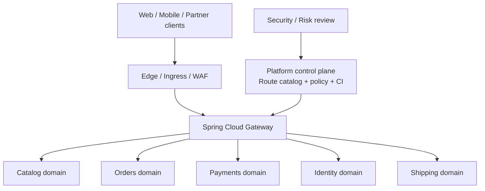

# Domain-Aligned Routing and Management Governance

## Lesson Objectives

In the **Routing Patterns** chapter of the **SPRING_CLOUD_GATEWAY** module, this lesson shows how to organize API Gateway routes by **business domain (bounded context)** and clearly define **who owns, modifies, approves, and operates each route**. As a system grows across many microservices and teams, a monolithic `application.yml` with hundreds of routes quickly becomes a hotspot for path collisions, missing authorization, misdirected upstreams, and unclear incident ownership.

Spring Cloud Gateway routes requests via **route predicates**, executes a **filter chain**, rewrites paths/headers, integrates service discovery and load balancing, and enforces authentication/authorization, rate limiting, retries, circuit breakers, TLS, and observability. Aligning routes to business domains keeps the public API stable in product terminology; management governance ensures every route change has an owner, review, and audit trail.

After this lesson, you will be able to:

- Define domain boundaries and distinguish **domain, bounded context, service, route, and API resource**.
- Design domain-aligned public API paths and hosts without exposing internal microservice layouts.
- Partition routes across **catalog, orders, payments, identity, shipping**, or your product's corresponding domains.
- Standardize route IDs, owner metadata, versions, upstreams, policies, and SLOs.
- Combine `Path`, `Host`, `Method`, `Header`, `Query`, `Version`, and other predicates while understanding logical AND and route overlap.
- Choose among YAML, Java `RouteLocatorBuilder`, `DiscoveryClient`, and dynamic `RouteDefinitionLocator`.
- Separate platform-wide filters from domain-specific filters and place authentication/authorization at the proper layer.
- Enforce route-management governance using **least privilege**, separation of duties, CODEOWNERS, reviews, and audits.
- Mitigate risks from discovery locators, Actuator route mutations, and dynamic route URIs.
- Test route ownership, predicate precedence, path rewrites, security scopes, upstream selection, route drift, and rollbacks.
- Monitor performance and errors by `routeId`, domain owner, and upstream without putting sensitive data into metric labels.

> **Scope:** Examples focus on **Spring Cloud Gateway Server WebFlux**. Gateway Server Web MVC/Servlet uses a different configuration model and runtime. Config namespaces follow the current `spring.cloud.gateway.server.webflux.*` style from Gateway 5.1 documentation; earlier lines commonly use `spring.cloud.gateway.*`. Always verify against your project's BOM and configuration properties. Values such as `lb://catalog-service`, hosts, and scopes in this lesson are illustrative.

## 1. Why Split Routes by Business Domain?

Suppose an e-commerce platform spans these domains:

```text
Catalog       — catalog, products, display prices
Orders        — carts, orders, order statuses
Payments      — payments, refunds, transactions
Identity      — accounts, login, profiles
Shipping      — shipping, delivery tracking
```

A small Gateway might start out like this:

```yaml
spring:
  cloud:
    gateway:
      server:
        webflux:
          routes:
            - id: route-1
              uri: lb://service-a
              predicates:
                - Path=/api/**
            - id: route-2
              uri: lb://service-b
              predicates:
                - Path=/admin/**
```

As routes multiply, IDs like `route-1` reveal nothing about which domain owns the route or which changes could break it. A broad `/api/**` route can also silently swallow multiple domains.

A clearer structure:

```text
Public API
  ├── /api/catalog/**  → catalog-service
  ├── /api/orders/**   → order-service
  ├── /api/payments/** → payment-service
  ├── /api/identity/** → identity-service
  └── /api/shipping/** → shipping-service
```

Each domain may be backed by one or several microservices. **A route is an API access boundary**, not necessarily a mirror of one internal service name.

### 1.1. Benefits of Domain-Aligned Routing

- **Stable vocabulary:** public APIs speak product concepts without forcing clients to track service decompositions.
- **Clear ownership:** the Orders team owns `/api/orders/**` contracts and upstreams.
- **Contextual authorization:** `orders.read` differs from `payments.refund`.
- **Change isolation:** internal service refactors need not alter public URLs.
- **Observability:** errors, latency, and traffic can be aggregated by domain and route.
- **Governance:** reviewing a route change immediately identifies which teams must sign off.
- **Migration:** a domain can move incrementally from legacy to a new service without changing client URLs.

### 1.2. Do Not Equate a Domain with a Single Microservice

One bounded context may consist of:

```text
Orders domain
  ├── order-query-service
  ├── order-command-service
  └── order-history-service
```

Meanwhile, the public API can expose one cohesive route group:

```text
/api/orders/**          → query or command service by method
/api/orders/history/**  → history service
```

Conversely, a single microservice may serve multiple API resources spanning different route groups. Never automatically expose a public route for every service merely because it appears in the registry.

### 1.3. The Gateway Routes; Domain Services Own Business Logic

The Gateway belongs in charge of:

- Upstream selection and load balancing.
- Contract-level path and header normalization.
- Token verification and edge security policies.
- Per-route rate limiting, timeouts, retries, and circuit breakers.
- Correlation IDs, logging, and metrics.

The Gateway must never house:

- Pricing rules, inventory logic, order state machines, or refund eligibility.
- Long-running multi-step business orchestration.
- Fine-grained record-level authorization where backends must check ownership.
- Data models and transactions belonging to bounded contexts.

**Splitting routes by domain does not mean moving business logic into the Gateway.** The Gateway selects paths and enforces access policies; domain services remain authoritative for their business rules and data.

## 2. Architecture Model and Ownership Boundaries

An organizational setup may look like this:



### 2.1. Three Distinct Types of Ownership

| Ownership type | Responsibilities | Example |
| --- | --- | --- |
| **Domain/API owner** | Contract, resource paths, upstream semantics, business scopes, SLOs, deprecation | Orders team |
| **Gateway/platform owner** | Runtime, shared filters, route schema, deployments, ingress, discovery, guardrails | Platform team |
| **Security owner** | Trust rules, token claims, sensitive routes, admin access, threat reviews | Security team |

A domain team may propose routes and own its backend, yet must never be able to point route URIs at arbitrary internal hosts unchecked. The platform team governs the control plane and validates policies; the security team reviews high-privilege or sensitive-data routes.

### 2.2. Recommended Permissions Matrix

| Action | Domain owner | Gateway platform | Security reviewer | SRE/operator |
| --- | --- | --- | --- | --- |
| Propose public path/method | Yes | Review | Review if sensitive | No |
| Select domain upstream | Propose | Validate allowlist | Review trust boundary | No |
| Modify shared filters | Never merge unilaterally | Own | Approve if security-impacting | Operate |
| Change scope/role policy | Propose business need | Implement integration | Approve policy | Audit |
| Create dynamic route | Per workflow | Control API | Review permissions | May execute |
| View runtime routes | Scoped access | Yes | Yes | Yes |
| Delete/refresh production route | Not by default | Per admin role | Audit if sensitive | Per change ticket |
| Roll back route | Propose | Coordinate | Join if security impact | Execute per runbook |

This is a **reference governance model**, not roles automatically created by Spring Cloud Gateway. Implement it through Git permissions, CODEOWNERS, CI approvals, management-plane security, and change-control workflows.

### 2.3. Separation of Duties

For routes reaching payments, admin, or internal services, separate:

1. Change proposer.
2. Contract and upstream reviewer.
3. Security approver for sensitive policies.
4. Deployment pipeline or operator.
5. Post-deployment effective-route verifier.

Never grant a single CI account unrestricted runtime route writes, access to all secrets, and approval bypass simultaneously. Scope permissions by environment and domain.

## 3. Designing Domain-Aligned Public APIs

Three common partitioning approaches:

| Style | Example | When appropriate |
| --- | --- | --- |
| **Path-based** | `api.example.com/api/orders/**` | Single API host serving multiple domain resources |
| **Host-based** | `orders.api.example.com/**` | Domains with separate hostnames, certs, policies, or audiences |
| **Versioned path** | `/api/v1/orders/**` | Version contract expressed directly in the URL |

You can combine `Host` + `Path` + `Method` to narrow routes precisely.

### 3.1. Path-Based Routing

Example:

```text
GET  /api/catalog/products/42
POST /api/orders
GET  /api/payments/transactions/tx-42
GET  /api/shipping/shipments/sh-42
```

Pros:

- Easy to read and document.
- One hostname and TLS certificate can serve multiple domains.
- Route predicates cleanly partition by path and method.
- Easy to keep public APIs stable across upstream swaps.

Risks:

- Broad prefixes like `/api/**` can overlap.
- Bad path rewrites can send backends the wrong resource.
- Domains with different security postures share a broad prefix.

### 3.2. Host-Based Routing

Example:

```text
catalog.api.example.com/products/**
orders.api.example.com/orders/**
payments.api.example.com/transactions/**
```

The Gateway `Host` predicate supports Ant-style host patterns and pairs with `Path` predicates. Host routing helps when domains require:

- Separate TLS certificates or DNS boundaries.
- Distinct CORS allowlists.
- Partner-specific hostnames.
- Dedicated rate limits or WAF rules.
- Separate token audiences or identity contracts.

The `Host` header must be enforced by trusted edge and proxy chains. Never treat client-supplied `Host` as authenticated user or tenant identity.

### 3.3. Versioning

Versions can be expressed via:

```text
/api/v1/orders/**
/api/v2/orders/**
```

or a version header/media type per contract. Path versions are usually simpler to observe, cache, and debug. When using a `Header` predicate, ensure clients cannot spoof version headers to bypass another API's security policy.

Spring Cloud Gateway 5.1 includes a `Version` route predicate integrated with Spring Framework's API versioning; it requires a configured `ApiVersionStrategy` bean. Documentation notes that if no strategy bean exists, the predicate still registers yet always passes. Therefore **never enable the `Version` predicate and assume it rejects versionless requests automatically**.

### 3.4. Never Couple Public URLs to Internal Service Names

Avoid forcing clients to call:

```text
/catalog-service/**
/order-command-service/**
/payment-adapter-v3/**
```

because any internal refactor breaks the public API. Prefer:

```text
/api/catalog/**
/api/orders/**
/api/payments/**
```

The Gateway maps stable public contracts onto one or more internal services—one of the primary advantages of domain-aligned routing.

## 4. A Route Is an Auditable Contract

In Spring Cloud Gateway, a route comprises:

- `id`: stable identifier.
- `uri`: upstream URI or logical service URI.
- `predicates`: request matching conditions.
- `filters`: request/response transformations and policies.
- `order`: route evaluation priority when multiple routes match.
- `metadata`: additional attributes attached to the route.

### 4.1. Route ID Naming Convention

Recommended format:

```text
<domain>-<resource>-<version>-<operation>
```

Examples:

```text
catalog-products-v1-read
catalog-products-v1-search
orders-v1-create
orders-v1-read
orders-v1-update
payments-v1-refund
identity-v1-profile-read
shipping-v1-tracking-read
```

Route IDs should:

- Remain stable across upstream changes that leave the public contract intact.
- Be unique across a Gateway route collection.
- Exclude user IDs, tenant IDs, or request-specific values.
- Be searchable across logs, traces, dashboards, and change tickets.
- Trigger review whenever route semantics change.

### 4.2. Metadata for Ownership and Policy

Example:

```yaml
metadata:
  domain: orders
  owner: team-orders
  apiVersion: v1
  authPolicy: orders.read
  dataClassification: confidential
  serviceTier: critical
  changeTicket: API-482
```

Metadata supports inventories and audits, yet **does not grant permissions or enforce policies by itself**. Writing `authPolicy: orders.read` in metadata does not make Spring Security enforce that scope automatically. Either wire code/config that translates policy metadata into enforcement, or declare explicit security matchers.

### 4.3. Route Catalog

An organizational route catalog can record:

| Field | Example | Purpose |
| --- | --- | --- |
| Route ID | `orders-v1-create` | Runtime lookup |
| Domain | `orders` | Business classification |
| Owner | `team-orders` | Accountable team |
| Public path | `POST /api/orders` | Client contract |
| Upstream | `lb://order-service` | Logical target |
| Rewrite | `StripPrefix=1` | Path mapping |
| Auth policy | `orders.write` | Required permission |
| Rate policy | `orders-write-standard` | Quota tier |
| Timeout class | `interactive-write` | Latency budget |
| Data class | `confidential` | Data sensitivity control |
| SLO | `99.9% / 1.5s` | Operational target |
| Owner contact | `team-orders` | Escalation target |
| Version/status | `v1 / active` | Lifecycle state |

This is an **organizational governance catalog**; not every field is automatically turned into runtime behavior by the Gateway.

## 5. Combining Route Predicates for Clean Domain Partitioning

Spring Cloud Gateway matches routes in WebFlux `HandlerMapping`. Multiple predicates on **one route** combine with logical **AND**. A route declaring `Path`, `Method`, and `Host` matches only when all three hold simultaneously.

### 5.1. Catalog Route Example

```yaml
spring:
  cloud:
    gateway:
      server:
        webflux:
          routes:
            - id: catalog-products-v1-read
              uri: lb://catalog-service
              order: 10
              predicates:
                - Host=api.example.com
                - Path=/api/catalog/products/**
                - Method=GET,HEAD
              filters:
                - StripPrefix=2
              metadata:
                domain: catalog
                owner: team-catalog
                apiVersion: v1
                authPolicy: catalog.read
```

Request:

```http
GET /api/catalog/products/42
Host: api.example.com
```

Path after `StripPrefix=2`:

```text
/products/42
```

### 5.2. Orders Read and Write Example

```yaml
spring:
  cloud:
    gateway:
      server:
        webflux:
          routes:
            - id: orders-v1-read
              uri: lb://order-query-service
              order: 20
              predicates:
                - Path=/api/orders/**
                - Method=GET
              filters:
                - StripPrefix=2
              metadata:
                domain: orders
                owner: team-orders
                authPolicy: orders.read

            - id: orders-v1-write
              uri: lb://order-command-service
              order: 20
              predicates:
                - Path=/api/orders/**
                - Method=POST,PUT,PATCH
              filters:
                - StripPrefix=2
                - RequestSize=1MB
              metadata:
                domain: orders
                owner: team-orders
                authPolicy: orders.write
```

Both routes share the public resource path while splitting query and command backends by HTTP method. `orders-v1-write` includes `RequestSize` as an illustrative body cap; real limits must align with the API contract and Ingress limits.

### 5.3. Payments Restricted to Partner Hostname Example

```yaml
spring:
  cloud:
    gateway:
      server:
        webflux:
          routes:
            - id: payments-partner-v1-callback
              uri: lb://payment-service
              order: 30
              predicates:
                - Host=payments.partner.example.com
                - Path=/callbacks/**
                - Method=POST
              filters:
                - StripPrefix=1
              metadata:
                domain: payments
                owner: team-payments
                dataClassification: restricted
```

The `Host` predicate only selects the route—**it does not authenticate the partner**. Callbacks require webhook signature verification, mTLS, or equivalent authentication at the domain service or Gateway security layer; never allow requests merely because `Host` matched.

### 5.4. Commonly Used Predicates

| Predicate | Used for | Caveats |
| --- | --- | --- |
| `Path` | Resource path / domain prefix | Check trailing slashes and path overlap |
| `Host` | Hostname / subdomain | `Host` must be trusted/validated |
| `Method` | `GET`/`POST`/`PUT`/`DELETE` | Separates reads and writes |
| `Header` | Header value/pattern | Never treat client-sent headers as identity |
| `Query` | Query parameter | Never put critical authorization into query params |
| `Cookie` | Cookie name/value | Cookie matching never replaces session validation |
| `RemoteAddr` | Source connection IP | Behind proxies, requires proper resolver / trusted proxy |
| `XForwardedRemoteAddr` | IP in forwarded chain | Use only when ingress sanitizes headers |
| `After`, `Before`, `Between` | Maintenance / time windows | Mind timezones and rollout timing |
| `Weight` | Canary / weighted routing | Weights sum across routes in the same group |
| `Version` | API version | Requires `ApiVersionStrategy` per docs |

### 5.5. Never Turn a `Header` Predicate Into Authorization

Unsafe example:

```yaml
predicates:
  - Header=X-Role, ADMIN
```

Clients can send that header freely. If an admin route relies solely on it, callers can self-escalate privileges. Use Spring Security to verify JWTs/sessions and authorities; `Header` predicates should only route on headers previously verified or overwritten by a trusted component.

### 5.6. `RemoteAddr` Behind a Reverse Proxy

By default, `RemoteAddr` inspects the direct remote address visible to the Gateway—which may be the Ingress IP rather than the client IP. `XForwardedRemoteAddr` or a custom `RemoteAddressResolver` requires a trusted proxy chain. Never trust `X-Forwarded-For` injected by public clients.

## 6. Managing Route Overlap and Ordering

A frequent bug occurs when a broad route matches before a specific route:

```yaml
routes:
  - id: generic-api
    uri: lb://generic-service
    predicates:
      - Path=/api/**

  - id: orders-api
    uri: lb://order-service
    predicates:
      - Path=/api/orders/**
```

Both match `/api/orders/42`. Route `order` controls evaluation precedence; never rely vaguely on YAML line order.

### 6.1. Design Rules

- Place **specific** routes ahead of fallback/catch-all routes via explicit `order`.
- Assign explicit `order` values rather than leaving overlapping routes at the same default.
- Avoid a generic `/api/**` route pointing to a catch-all service unless explicitly intended.
- Keep fallback routes narrowly scoped without exposing internal APIs.
- Test requests where multiple routes could match by path, method, and host.
- Inspect effective routes via Actuator in test and staging environments.

`order` is part of the route definition; Gateway Actuator displays `order` alongside route ID, predicates, filters, and URI. After changes, verify **which route actually matched**, not just that YAML contains the route.

### 6.2. Expressing OR Across Multiple Routes

Predicates within one route combine with AND. When you need:

```text
Host A OR Host B
```

you can pass multiple host patterns to a single `Host` predicate where appropriate, or declare separate routes with matching targets and policies. When you need:

```text
GET /api/orders/** OR POST /api/orders/**
```

`Method=GET,POST` works in one route if filters and policies are identical; when reads and writes require different scopes or rate limits, split them into two routes.

### 6.3. Trailing Slashes and Path Matching

The `Path` predicate supports `matchTrailingSlash` (current docs default to `true`), so `/api/orders/42` and `/api/orders/42/` both match by default. If your backend or security layer distinguishes trailing slashes, align the contract and write tests for both.

### 6.4. Route Order Does Not Override Security Matcher Order

Gateway route `order` picks the route. Spring Security `authorizeExchange` matcher order decides which authorization rule applies. These are **two separate orderings**. Giving a route `order: 1` does not cause `.pathMatchers("/api/admin/**").hasRole("ADMIN")` to run ahead of earlier security matchers.

## 7. Organizing Filters: Platform vs. Domain

The filter chain runs **pre** logic before proxying and **post** logic after the response returns. The Gateway merges `GlobalFilter`s and route-level `GatewayFilter`s into one `Ordered`-sorted chain.

### 7.1. Shared Platform Filters

Concerns usually owned by the platform:

- Correlation/request IDs.
- Sanitizing or stripping disallowed headers.
- Security response headers.
- Shared logging, metrics, and tracing.
- Default timeouts and standardized error mapping.
- Blocking disallowed destinations or routes per policy.

Use `default-filters` for filters applied across all routes, and `GlobalFilter` for conditional global concerns. Never duplicate identical filter blocks across every domain when the policy is truly shared.

### 7.2. Domain-Specific Filters

Examples:

| Domain | Filters / policies that may differ |
| --- | --- |
| Catalog | Read-only caching, public read rate limits |
| Orders | Request body size, write timeouts, idempotency contract handling |
| Payments | Strict timeouts, audit metadata, callback signature verification contract |
| Identity | Cookies/sessions, OAuth2 login, token relay |
| Shipping | Partner headers, webhook verification, long-polling policy |

These are **directional examples**—not all belong in `GatewayFilter`s. Business-level idempotency, payment signatures, and ownership checks generally belong in the service/domain layer.

### 7.3. `default-filters` Example

```yaml
spring:
  cloud:
    gateway:
      server:
        webflux:
          default-filters:
            - name: AddResponseHeader
              args:
                name: X-Gateway
                value: public-api
          routes:
            - id: catalog-v1-read
              uri: lb://catalog-service
              predicates:
                - Path=/api/catalog/**
                - Method=GET
              filters:
                - StripPrefix=2
```

`default-filters` apply across Gateway routes as configured; do not confuse them with single-domain filters. If internal or health/actuator routes also traverse the Gateway, review scope and management separation carefully.

### 7.4. Do Not Let Domain Teams Add Arbitrary `GlobalFilter` Beans

A `GlobalFilter` affects every route. If a domain team drops custom global behavior into the shared Gateway app, a PR labeled “Orders” can impact Catalog, Payments, and Identity.

Governance best practices:

- Keep global filters in a platform-owned module/package reviewed by the platform team.
- Use route-specific filters for narrow domain policies.
- Maintain integration tests covering filter ordering.
- Specify pre/post behavior, exception handling, and cancellation clearly.
- Never allow one route to bypass shared security filters via unreviewed config.

## 8. Domain-Scoped Authorization in Spring Security WebFlux

Route selection and authorization work together without replacing one another. Example:

```text
GET  /api/catalog/**  → catalog.read
GET  /api/orders/**   → orders.read
POST /api/orders/**   → orders.write
POST /api/payments/** → payments.charge
POST /api/refunds/**  → payments.refund
```

### 8.1. `SecurityWebFilterChain` Example

```java
import org.springframework.context.annotation.Bean;
import org.springframework.context.annotation.Configuration;
import org.springframework.http.HttpMethod;
import org.springframework.security.config.Customizer;
import org.springframework.security.config.web.server.ServerHttpSecurity;
import org.springframework.security.web.server.SecurityWebFilterChain;

@Configuration
class ApiSecurityConfiguration {

    @Bean
    SecurityWebFilterChain apiSecurity(ServerHttpSecurity http) {
        return http
            .authorizeExchange(exchanges -> exchanges
                .pathMatchers(
                    HttpMethod.GET,
                    "/api/catalog/**"
                ).hasAuthority("SCOPE_catalog.read")
                .pathMatchers(
                    HttpMethod.GET,
                    "/api/orders/**"
                ).hasAuthority("SCOPE_orders.read")
                .pathMatchers(
                    HttpMethod.POST,
                    "/api/orders/**"
                ).hasAuthority("SCOPE_orders.write")
                .pathMatchers(
                    HttpMethod.POST,
                    "/api/payments/**"
                ).hasAuthority("SCOPE_payments.charge")
                .pathMatchers(
                    HttpMethod.POST,
                    "/api/refunds/**"
                ).hasAuthority("SCOPE_payments.refund")
                .anyExchange().denyAll()
            )
            .oauth2ResourceServer(oauth2 ->
                oauth2.jwt(Customizer.withDefaults())
            )
            .build();
    }
}
```

This is a **bearer-JWT API policy template**; add CORS, client-appropriate CSRF, management endpoint rules, and real JWT issuer/audience validation. Spring Security maps scopes to `SCOPE_`-prefixed authorities by default; if you customize the claim converter, test authority mapping explicitly.

### 8.2. Why `.anyExchange().denyAll()` Matters

When someone adds a new route without updating security rules, requests fail closed instead of falling into a permissive rule. Just remember to declare explicit matchers ahead of the final rule for health, actuator, or login endpoints if hosted on the same listener.

### 8.3. Domain Owners Propose Scopes; Security Owners Govern Semantics

Example:

| Scope | Domain owner description | Security policy |
| --- | --- | --- |
| `catalog.read` | Browse catalog | Public or authenticated depending on data |
| `orders.read` | View orders for user/tenant | Backend still verifies ownership |
| `orders.write` | Create/update orders | Authorized actor only |
| `payments.charge` | Initiate payment | Audience, idempotency, and risk checks |
| `payments.refund` | Issue refund | Privileged scope + approval/audit |

Holding `orders.read` never entitles a user to view every customer's orders. The backend must compare `sub`/tenant against resource ownership and domain rules.

### 8.4. Never Use Route Predicates for Fine-Grained Authorization

Never design:

```yaml
predicates:
  - Header=X-User-Role, ADMIN
```

as a substitute for verified JWT authorities. Never route/authorize from `?isAdmin=true`, unverified cookies, or client-controlled headers. A predicate picks routes; it is not an identity provider.

## 9. Organizing YAML by Domain

### 9.1. One Big File or Multiple Route Sources?

Two common approaches:

**Single application YAML:** suits small/medium systems with few routes and centralized platform changes.

**Multiple domain modules/config sources:** suits larger organizations distributing route ownership by domain, backed by validation and aggregation pipelines.

Spring Cloud Gateway loads definitions through `RouteDefinitionLocator` beans, defaulting to `PropertiesRouteDefinitionLocator` backed by Spring Boot properties. Additional sources can plug in custom `RouteDefinitionLocator`/repository beans.

### 9.2. File Organization Convention

Illustrative repository layout:

```text
gateway-config/
  platform/
    defaults.yml
    global-filters.yml
    security-baseline.yml
  domains/
    catalog/
      routes.yml
      policy.yml
    orders/
      routes.yml
      policy.yml
    payments/
      routes.yml
      policy.yml
    identity/
      routes.yml
      policy.yml
  tests/
    route-contracts/
    security-matrix/
```

This is a **team-chosen repo structure**; Spring Cloud Gateway does not automatically discover arbitrary files across directories. CI/CD or a config loader must assemble them into Gateway-supported configuration, Java beans, or dynamic route definitions.

### 9.3. Prevent Duplicate Route IDs

In CI validation, verify:

- Unique `id` values.
- `uri` belongs to an allowlist of service IDs/schemes.
- No unintended Path/Host/Method collisions.
- Owner metadata is present and valid.
- Auth policies/scopes are declared.
- No route exposes an internal admin endpoint publicly.
- Referenced filter factories exist on the classpath/version.
- Timeouts, body/header limits, and rate policies are set.

A malformed route can fail startup or silently drop routing. Current `configprops` docs include `fail-on-route-definition-error`; never disable it just to hide broken routes without cause and alerting.

## 10. Java `RouteLocatorBuilder` for Domain-Specific Routes

YAML fits declarative configs well. When programmatic composition is needed, `RouteLocatorBuilder` offers a fluent Java DSL:

```java
import org.springframework.cloud.gateway.route.RouteLocator;
import org.springframework.cloud.gateway.route.builder.RouteLocatorBuilder;
import org.springframework.context.annotation.Bean;
import org.springframework.context.annotation.Configuration;
import org.springframework.http.HttpMethod;

@Configuration
class DomainRouteConfiguration {

    @Bean
    RouteLocator domainRoutes(RouteLocatorBuilder builder) {
        return builder.routes()
            .route("catalog-products-v1-read", route -> route
                .host("api.example.com")
                .and()
                .path("/api/catalog/products/**")
                .and()
                .method(HttpMethod.GET)
                .filters(filters -> filters
                    .stripPrefix(2)
                )
                .uri("lb://catalog-service")
            )
            .route("orders-v1-read", route -> route
                .path("/api/orders/**")
                .and()
                .method(HttpMethod.GET)
                .filters(filters -> filters
                    .stripPrefix(2)
                )
                .uri("lb://order-query-service")
            )
            .build();
    }
}
```

This mirrors **the exact same predicate-AND and filter model** as YAML. For production, add metadata, `order`, shared policies, unique route IDs, security tests, and real URI/discovery configuration. Avoid letting a single multi-thousand-line Java class accumulate every domain's routes.

### 10.1. Splitting Java Config by Domain

You can create separate `@Configuration` classes:

```text
CatalogRoutesConfiguration
OrdersRoutesConfiguration
PaymentsRoutesConfiguration
IdentityRoutesConfiguration
PlatformGlobalFiltersConfiguration
```

Scan/import each per module, and enforce checks preventing duplicate route IDs or ambiguous Path/Host/Method precedence across beans.

### 10.2. When to Prefer Java vs. YAML?

| YAML | Java DSL |
| --- | --- |
| Easy to review and diff | Supports programmatic composition |
| Ideal for static route catalogs | Ideal for complex dynamic route construction |
| Easy to generate from config repos | Easy to inject beans and custom filters |
| Decouples route-only edits from recompiles | Couples route changes to app builds/deploys |
| Needs schema/config validation | Needs unit/integration tests per bean |

Never choose Java merely because route counts are high; a route registry/catalog generating declarative YAML often scales cleaner. Choose based on lifecycle, ownership, and audit requirements.

## 11. `DiscoveryClient` Routes: Convenient, Yet Never Expose Every Service

Spring Cloud Gateway provides a `DiscoveryClient` Route Definition Locator. When enabled, it auto-generates routes from registry entries—defaulting to `lb://service-name`, path `/serviceId/**`, and a rewrite filter stripping the service ID prefix.

### 11.1. Discovery Configuration

```yaml
spring:
  cloud:
    gateway:
      server:
        webflux:
          discovery:
            locator:
              enabled: true
              lower-case-service-id: true
```

Requires a `DiscoveryClient` implementation (Eureka, Consul, ZooKeeper, Kubernetes, etc.) and Spring Cloud LoadBalancer when routing via `lb://`.

### 11.2. Default Path Mapping

If the registry lists `catalog-service`, the default route maps:

```text
/catalog-service/**
  → lb://catalog-service
  → rewrite strips /catalog-service
```

This is handy for internal tooling or labs, yet public APIs should stick to stable domain paths like `/api/catalog/**`.

### 11.3. Risk of Auto-Exposing Every Registered Service

If every service in the registry gets a public route automatically, a newly registered internal service can become reachable from outside immediately. Registry membership **does not equal public API approval**.

Prefer:

- `include-expression` / service ID allowlists.
- Restrictive Host/Path predicates.
- Separating public and internal Gateway instances where appropriate.
- Network policies preventing the public edge from reaching admin/internal services.
- Explicit per-domain security rules.

### 11.4. When Customizing Discovery Filters, Do Not Drop the Default `RewritePath`

Spring Cloud Gateway docs warn that configuring `discovery.locator.filters` **replaces the entire default filter list**. If you omit the default `RewritePath`, the service ID stays in the path and backends return 404.

Common real-world bug:

```text
Client path: /catalog-service/products/42
Expected backend: /products/42
Gateway mis-forwards: /catalog-service/products/42
```

Whenever customizing discovery filters, re-declare the needed rewrite filter and verify the actual backend path in tests.

### 11.5. Discovery Routes Still Need Domain Ownership

A service registry knows:

```text
catalog-service
order-command-service
payment-adapter
admin-console
```

Whereas Gateway route governance needs to know:

```text
public domain?
owner team?
allowed methods?
required scope?
data classification?
allowed client population?
```

Discovery answers **which service instances exist**; the route catalog answers **which APIs are exposed, to whom, and under what contract**.

## 12. Dynamic Routes and Management Permissions

When routes must change without rebuilding images, you can use dynamic route sources such as a custom `RouteDefinitionLocator`/repository or version-supported Actuator APIs. Because this power is high-impact, wrap it in a **dedicated control plane**.

### 12.1. Safe Dynamic Route Workflow

```text
Domain owner proposes
  ↓
Schema + policy validation
  ↓
Security/platform approval
  ↓
Persist route definition + revision
  ↓
Refresh route cache / distribute event
  ↓
Read back effective routes
  ↓
Smoke tests + audit
```

### 12.2. Actuator Gateway Endpoints

Current Gateway documentation notes `/actuator/gateway` **access is disabled by default**. To inspect routes safely, configure read-only access:

```yaml
management:
  endpoint:
    gateway:
      access: read-only
  endpoints:
    web:
      exposure:
        include: health,info,gateway
```

Read-only mode supports route/version visibility while forbidding create, delete, or refresh mutations. If you ever enable write access (`unrestricted` or version equivalent), lock Actuator behind strong authentication, authorization, and network isolation.

### 12.3. Never Expose Route Mutation APIs Publicly

Anyone who can create arbitrary routes can:

- Point upstreams to internal admin or cloud metadata services.
- Bypass an existing domain route's auth policy.
- Exfiltrate credentials to unapproved hosts.
- Introduce overlapping paths that shadow safe routes.
- Swap payment or identity routes during peak traffic.

Enforce:

- Dedicated management port or private ingress.
- RBAC scoped by role, environment, and domain.
- URI scheme and host allowlists.
- Path, method, and predicate validation.
- Rejecting arbitrary unvalidated SpEL, regexes, or filter arguments from callers.
- Auditing actor, ticket, diff, timestamp, revision, and outcome.
- Approvals, rollbacks, and per-instance readback verification.

### 12.4. Config-Defined Routes Are Read-Only to Actuator Mutations

Actuator documentation notes that routes defined in `application.yml` or `@Bean` methods are config-defined routes and cannot be deleted arbitrarily via actuator mutation endpoints like dynamically created routes. Never build operational runbooks assuming `DELETE` can remove every route source.

## 13. Route Lifecycle and Change Governance

Every route should follow an explicit lifecycle:

```text
PROPOSED
  → REVIEWED
  → APPROVED
  → DEPLOYED
  → VERIFIED
  → ACTIVE
  → DEPRECATED
  → REMOVED
```

These states belong to an **organizational workflow**, not a built-in Spring Cloud Gateway status field.

### 13.1. Creating a Route

Minimum required artifacts:

- Route ID, domain, and owner.
- Public host, path, and method.
- Upstream service ID from the allowlist.
- Explicit path rewrite mapping.
- Authentication and authorization policy.
- Rate-limit and timeout classes.
- Data classification.
- SLO and runbook.
- Test cases and rollback plan.

### 13.2. Changing an Upstream

Never switch:

```text
lb://order-query-service
```

to:

```text
https://arbitrary-host.example
```

via an unreviewed YAML tweak. Changing an upstream can alter trust boundaries, TLS verification, network paths, token audiences, data residency, and error semantics.

### 13.3. Deprecating a Route

Procedure:

1. Notify clients and owners.
2. Publish a migration deadline.
3. Monitor legacy route traffic.
4. Emit deprecation/sunset metadata if supported by the contract.
5. Block onboarding new clients.
6. After cutoff, remove the route via an approved pipeline.
7. Confirm zero remaining dependent clients.

Never delete a route simply because one week showed zero traffic if batch or partner clients run on monthly or quarterly cycles.

### 13.4. Route Owners Do Not Need Direct Production Mutation Rights

Domain owners can own contracts and review PRs while the platform pipeline executes production deployments. This eliminates ad-hoc manual edits and preserves a clean audit trail.

## 14. Route Ordering, Canaries, and Migration

### 14.1. Two Upstreams for One Domain

During a migration:

```text
orders-v1 → order-service-v1
orders-v2 → order-service-v2
```

Use versioned paths:

```text
/api/v1/orders/** → order-service-v1
/api/v2/orders/** → order-service-v2
```

or the `Weight` predicate to split traffic across routes in the same group once canary criteria are defined.

### 14.2. Weighted Routes

Illustrative example:

```yaml
spring:
  cloud:
    gateway:
      server:
        webflux:
          routes:
            - id: orders-canary-v2
              uri: lb://order-service-v2
              predicates:
                - Path=/api/orders/**
                - Weight=orders-rollout,10
              filters:
                - StripPrefix=1

            - id: orders-stable-v1
              uri: lb://order-service-v1
              predicates:
                - Path=/api/orders/**
                - Weight=orders-rollout,90
              filters:
                - StripPrefix=1
```

`Weight` distributes probabilistically according to group weights rather than guaranteeing an exact 10%/90% split in short windows. Never run weighted canaries if the two backends lack request/response/schema compatibility or a safe rollback path.

### 14.3. Route `order` and `Weight` Are Separate Concepts

- `order` resolves precedence when predicates overlap.
- `Weight` selects one route inside a weighted group.

Never put a higher-priority catch-all `Path=/api/**` ahead of your domain routes expecting `Weight` to work. Test both selected route IDs and traffic splits.

### 14.4. Never Canary on Untrusted Client Headers

If you use `Header=X-Canary, true`, that header must be set by a trusted gateway/edge or governed by canary policy. Never let public clients opt into sensitive unreleased backends by sending arbitrary headers.

## 15. Managing API Versions and Domain Contracts

### 15.1. Public Versions Are Not Internal Service Versions

```text
Public API v1
  → Gateway route
  → Adapter / compatibility layer
  → Internal service v3
```

Clients do not need to know about internal service v3. The domain owner ensures the adapter/contract preserves v1 semantics or announces breaking changes explicitly.

### 15.2. Path Versioning

```yaml
routes:
  - id: orders-api-v1
    uri: lb://order-service-v1
    predicates:
      - Path=/api/v1/orders/**
  - id: orders-api-v2
    uri: lb://order-service-v2
    predicates:
      - Path=/api/v2/orders/**
```

This snippet is abbreviated; nest it under `spring.cloud.gateway.server.webflux.routes` in real app config.

### 15.3. Versioning via Spring's API Version Support

Gateway 5.1 documents a `Version` predicate integrated with Spring Framework's `ApiVersionStrategy`, supporting fixed versions or baseline versions (`version+`). Remember:

- Configure the strategy, version source, and resolver explicitly.
- Test missing, malformed, and unsupported versions.
- Never rely on the predicate without activating the strategy.
- Ensure security scopes and rate policies align across versions.

### 15.4. Domain-Level Deprecation Policy

Each domain publishes:

- Deprecation start date.
- End-of-support (sunset) date.
- Replacement endpoint.
- Breaking changes.
- Migration guide.
- Owner and contact channel.

The Gateway can keep old version routes alive during migration, while domain services manage semantics and data compatibility.

## 16. Testing Domain Routes and Ownership

Tests must confirm **right route**, **right filters**, **right owner/policy**, and **right backend**. Asserting HTTP 200 alone is insufficient.

### 16.1. Route Contract Tests

For every route:

```text
Input:
  method
  host
  path
  required headers
  principal/scopes

Expected:
  selected route ID
  upstream service
  outbound path
  outbound headers
  auth result
  rate policy
  response contract
```

### 16.2. Backend Stubs

Use MockWebServer, WireMock, or dedicated HTTP stubs to record:

```text
method
path
Host
selected synthetic request ID
safe headers
body length
```

Never log JWTs, cookies, or PII. Stubs can return distinct responses per path to prove routing unambiguously.

### 16.3. Route Overlap Matrix

| Request | Expected route | What to verify |
| --- | --- | --- |
| `GET /api/catalog/products/42` | `catalog-products-v1-read` | Path + Method + Host |
| `POST /api/orders` | `orders-v1-write` | Write route |
| `GET /api/orders/42` | `orders-v1-read` | Read route |
| `DELETE /api/orders/42` | No match or dedicated delete route | Not captured by broad write route |
| `GET /api/admin/users` | Dedicated-policy admin route | Does not match generic API |
| `GET /api/payments/transactions/42` | Payment read route | Not shadowed by generic `/api/**` |
| Wrong host + matching path | Does not match host-specific route | Host validation |
| Matching path + wrong method | Does not match method-specific route | Method restriction |
| Spoofed canary header | Stable/default route | Header trust boundary |

### 16.4. Security Test Matrix

| Principal | Route | Expected outcome |
| --- | --- | --- |
| Anonymous | Public catalog GET | Per public policy |
| Anonymous | Orders GET | 401/redirect per API contract |
| `catalog.read` | Catalog GET | Allowed |
| `catalog.read` | Orders GET | 403 |
| `orders.read` | Orders GET | Passes Gateway; backend still checks ownership |
| `orders.write` | Orders POST | Passes Gateway |
| `orders.read` | Orders POST | 403 |
| `payments.charge` | Payments POST | Passes Gateway and payment risk checks |
| `payments.charge` | Refund POST | 403 without `payments.refund` |
| `payments.refund` | Admin management endpoint | Not automatically permitted |

### 16.5. Testing Route Ownership Metadata

CI pipelines can validate:

```text
Every route has:
  id
  domain
  owner
  uri from approved service registry
  authPolicy
  version
  dataClassification
  change reference
```

This is a **custom policy-as-code test**, not a built-in Gateway validator. Run it pre-deploy and fail builds when required metadata is missing.

### 16.6. Testing Path Rewrites

Example:

```text
Public:   /api/orders/42
Filter:   StripPrefix=2
Backend:  /42
```

If the backend expects `/orders/42`, use `StripPrefix=1` instead of 2. Write explicit before/after tables for every route and assert paths at the stub.

### 16.7. Testing `DiscoveryClient` Exposure

When enabling the discovery locator:

- Allowlisted services receive routes.
- Admin/internal services get zero public routes.
- Lowercase service IDs resolve properly when registries use uppercase.
- Custom filters retain the default `RewritePath` where needed.
- Deregistered services stop being selected per discovery semantics.

### 16.8. Testing Route Refreshes and Rollbacks

For dynamic setups:

- Insert a new route in the test repository.
- Refresh the route cache.
- Verify the new route matches.
- Send a smoke request.
- Delete the route and refresh.
- Verify the route is gone.
- Test failed refreshes so bad configs never silently take effect.

## 17. Domain-Level Route Observability

### 17.1. Route Metrics

With Actuator/Micrometer configured, Gateway docs describe the route timer `spring.cloud.gateway.requests` and the route-definition gauge `spring.cloud.gateway.routes.count` on supported releases.

Useful dimensions:

```text
routeId=orders-v1-read
domain=orders
owner=team-orders
method=GET
status=200
```

Exporting owner/domain metadata as metric tags may require custom instrumentation; never assume route metadata automatically becomes Prometheus labels.

### 17.2. Avoid High-Cardinality Labels

Never use:

```text
userId
orderId
sessionId
JWT
full request URL with IDs
arbitrary query strings
```

as metric labels. They create high cardinality and leak sensitive data. Stick to `routeId`, domain, method, status, bounded error categories, and trace IDs inside retention-governed tracing.

### 17.3. Route Inventory via Actuator

The Actuator Gateway endpoint lists:

- Route ID.
- Predicates.
- Filters.
- URI.
- Order.

`/actuator/gateway/routes` is invaluable for verifying effective runtime config. Access is disabled by default; docs recommend `read-only` for inspection. Enable mutation rights only inside a secured admin plane.

### 17.4. Per-Owner Dashboards

A domain dashboard might display:

| Domain | RPS | p95 | 5xx rate | 429 rate | Owner |
| --- | ---: | ---: | ---: | ---: | --- |
| Catalog | 1,200 | 85ms | 0.1% | 0.4% | team-catalog |
| Orders | 450 | 220ms | 0.3% | 1.2% | team-orders |
| Payments | 120 | 310ms | 0.05% | 0.1% | team-payments |
| Identity | 800 | 110ms | 0.2% | 0.8% | team-identity |

Figures are illustrative. Tie dashboards to stable route IDs and verified metric sources.

## 18. Common Design Mistakes

### 18.1. One `/api/**` Route Pointing to a Monolithic Aggregator

When one generic route absorbs every domain, policies, upstreams, and metrics blur together. Prefer domain-specific routes or an explicitly contracted API composition layer.

### 18.2. Route IDs That Hide Ownership

`route-42` tells nobody who owns it. Enforce naming conventions and owner metadata.

### 18.3. Turning On the Discovery Locator for All Services

A registry is not a public API catalog. Allowlist exposed services, restrict hosts/paths, and enforce security reviews.

### 18.4. Letting Domain Teams Add Global Filters Freely

Global filters impact the entire Gateway. Keep shared filters platform-owned and regression-tested.

### 18.5. Routing Admin Traffic on Client-Sent Headers

`Header` predicates never verify identity. Use Spring Security JWT/session authorities.

### 18.6. Ignoring Route Ordering and Overlap

A catch-all can intercept requests ahead of domain routes. Use explicit `order` and assert selected route IDs.

### 18.7. Allowing Arbitrary Route URIs

Dynamic route APIs can become SSRF vectors. Allowlist schemes, hosts, and service IDs; validate predicates/filters; audit all mutations.

### 18.8. Relying Solely on the Gateway for Authorization

Direct backend access, route misconfigurations, or service-to-service calls can bypass the edge. Backends must always verify resource ownership and business permissions.

### 18.9. Modifying Routes Without Contract Tests

A route can return 200 while sending the wrong backend path or omitting filters. Assert route ID, upstream, method, path, and safe headers.

### 18.10. Exposing Actuator Mutations Publicly

Route creation/deletion permissions can hijack targets and security boundaries. Isolate them in a private management plane and keep observation `read-only`.

### 18.11. Versioning Routes Without Syncing Security

Adding a v2 route without updating security matchers—or diverging scopes between v1 and v2—creates security gaps. Update routes and security policies in the same change.

### 18.12. Mistaking Route Metadata for Enforcement

`metadata.authPolicy: orders.read` is inert text unless code reads and enforces it. Never treat labels as authorization.

## 19. Pre-Production Governance Checklist

| Area | Questions |
| --- | --- |
| Domain boundary | Which bounded context owns the route? Does the public contract speak domain terms? |
| Owner | Are an owner team and escalation contact assigned? |
| Route ID | Unique, stable, following the naming convention? |
| Metadata | Domain, owner, version, auth policy, and data classification complete? |
| URI | Does upstream belong to the service allowlist with safe scheme/host? |
| Predicates | Do Path/Host/Method/Header/Query match precisely? |
| Overlap | Could any route shadow a specific route? Is `order` explicit and tested? |
| Rewrite | Is public-to-backend path mapping documented and verified? |
| Authorization | Do JWT/session scopes and roles match each method and domain? |
| Backend security | Does the backend independently check ownership, tenant, and identity? |
| Filters | Are global, default, and route filters owned and ordered cleanly? |
| Rate/timeouts | Do policies match SLOs and business operations? |
| Discovery | Are only approved services exposed? |
| Dynamic routes | Private admin plane, RBAC, audits, approvals, and rollbacks enforced? |
| Versioning | Are deprecation/sunset and backward compatibility documented? |
| Testing | Contract, overlap, security, rewrite, discovery, and rollback tests passing? |
| Observability | Metrics by route/domain/owner without sensitive labels? |
| Operations | Runbooks and alert recipients ready? |
| Change control | CODEOWNERS, CI approvals, and route revisions tracked? |
| Recovery | Rollback leaves backends, schemas, and security aligned? |

## 20. Exercises with Answers

### Exercise 1 — Choosing Route Boundaries

A system runs `order-query-service` and `order-command-service`. Should you expose two public paths named after those services?

**Answer:** Not necessarily. Keep `/api/orders/**`, routing `GET` to the query service and `POST`/`PUT`/`PATCH` to the command service. Public contracts should reflect the Orders domain rather than internal service splits.

### Exercise 2 — Who Owns the Route?

The Orders team wants to repoint `/api/orders/**` to a new upstream; the Platform team operates the Gateway runtime.

**Answer:** The Orders owner proposes and owns contract/upstream semantics; Platform validates allowlists, filters, and runtime impact before deploying; Security reviews whenever trust, scope, or data policies change.

### Exercise 3 — Admin Header Predicate

A route requires `Header=X-Role, ADMIN`.

**Answer:** Unsafe if that header originates from clients. Rely on Spring Security verified principals/authorities. A header predicate is only a secondary routing aid once the header source is trusted and sanitized.

### Exercise 4 — Path Overlap

You have `/api/**` at order 0 and `/api/orders/**` at order 10. What should you do?

**Answer:** Check actual precedence and set explicit `order` so the specific Orders route evaluates first—better yet, narrow the generic route. Write an integration test asserting the selected route ID.

### Exercise 5 — Discovery Locator

The registry contains `catalog-service`, `admin-service`, and `secret-manager`. Should you enable the discovery locator unfiltered?

**Answer:** No. Registry membership does not grant public exposure. Use include allowlists, predicates, and strict security/network boundaries.

### Exercise 6 — Custom Discovery Filters

After adding `CircuitBreaker` to `discovery.locator.filters`, backends return 404 because paths still contain the service ID.

**Answer:** Configuring `filters` replaced the default filter list; re-declare the default `RewritePath` filter to strip the service ID prefix.

### Exercise 7 — Metadata Authorization

A route sets `metadata.authPolicy: payments.refund`, yet Security config never reads metadata.

**Answer:** Metadata is not enforcing permissions. Declare an explicit security matcher or implement a real policy resolver.

### Exercise 8 — Arbitrary Route URIs

An admin API lets teams submit any `uri` string.

**Answer:** Creates SSRF and data-exfiltration risks. Restrict to approved service IDs, schemes, and hosts; validate and audit every entry.

### Exercise 9 — Header-Based Canary

Public clients can send `X-Canary: true` to reach v2.

**Answer:** Unsafe unless v2 is ready for general public access. Canary headers must be injected by a trusted routing layer or governed by policy.

### Exercise 10 — Actuator Route Mutations

A domain owner wants to POST routes directly to `/actuator/gateway/routes`.

**Answer:** Permit mutations only through a private control plane with RBAC, approvals, and auditing. Keep observation `read-only` and never expose mutations publicly.

### Exercise 11 — New Versioned Route

`/api/v2/orders/**` is added without a matching scope matcher.

**Answer:** Update routes and security contracts in the same change; `.anyExchange().denyAll()` ensures unmatched routes stay closed until explicitly authorized.

### Exercise 12 — Route Returns 200 with Wrong Backend Path

The Gateway strips two segments while the backend expected one.

**Answer:** Assert the outbound path at a backend stub and maintain a public-to-internal mapping table per route; HTTP 200 alone proves nothing.

## 21. Step-by-Step Implementation Workflow

### Step 1 — Map Domains

Document bounded contexts, service owners, public resources, and security scopes. Never start directly from the raw service registry list.

### Step 2 — Design the Public API

Standardize host, path, and versioning conventions. Specify methods, trailing-slash rules, rewrites, and deprecation policies.

### Step 3 — Build the Route Catalog

Record ID, domain, owner, URI, predicates, filters, auth policy, rate policy, timeout class, and data classification.

### Step 4 — Author Route Definitions

Use YAML or Java DSL per your lifecycle. Avoid catch-all routes and auto-exposing unapproved services.

### Step 5 — Author Authorization Rules

Map methods, paths, and domains to verified JWT authorities/scopes. Backends continue enforcing resource ownership.

### Step 6 — Enforce Ownership and CI Checks

Wire CODEOWNERS, platform/security approvals, schema validation, upstream allowlists, and route-overlap tests.

### Step 7 — Test End-to-End

Use `WebTestClient` + backend stubs to verify route ID, upstream, path, headers, scopes, and rate limits.

### Step 8 — Canary Rollout

Verify route state via read-only Actuator, per-domain metrics, p95/p99, 4xx/5xx rates, and backend versions.

### Step 9 — Rollback and Deprecation

Version route revisions, drill rollbacks, notify clients early, and delete legacy routes only after migration cutoffs pass.

## 22. Official References

- [Spring Cloud Gateway Server WebFlux — Configuration](https://docs.spring.io/spring-cloud-gateway/reference/spring-cloud-gateway-server-webflux/configuration.html): `RouteDefinitionLocator`, YAML properties, route definition sources, and metrics.
- [Spring Cloud Gateway Server WebFlux — Route Predicate Factories](https://docs.spring.io/spring-cloud-gateway/reference/spring-cloud-gateway-server-webflux/request-predicates-factories.html): `Path`, `Host`, `Method`, `Header`, `Query`, `RemoteAddr`, `Weight`, `Version`, and additional predicates.
- [Spring Cloud Gateway Server WebFlux — How It Works](https://docs.spring.io/spring-cloud-gateway/reference/spring-cloud-gateway-server-webflux/how-it-works.html): route matching and pre/post filter chains.
- [Spring Cloud Gateway Server WebFlux — DiscoveryClient Route Definition Locator](https://docs.spring.io/spring-cloud-gateway/reference/spring-cloud-gateway-server-webflux/the-discoveryclient-route-definition-locator.html): registry-backed routes, `lb://`, default `Path`/`RewritePath`, and filter-override behavior.
- [Spring Cloud Gateway Server WebFlux — Actuator API](https://docs.spring.io/spring-cloud-gateway/reference/spring-cloud-gateway-server-webflux/actuator-api.html): route inspection, refresh, mutation, and access controls.
- [Spring Cloud Gateway — Configuration Properties](https://docs.spring.io/spring-cloud-gateway/reference/configprops.html): Server WebFlux namespaces and release-specific property names.
- [Spring Security — Reactive Authorization](https://docs.spring.io/spring-security/reference/reactive/authorization/authorize-http-requests.html): authorization rules in WebFlux.
- [Spring Cloud LoadBalancer](https://docs.spring.io/spring-cloud-commons/reference/spring-cloud-commons/loadbalancer.html): selecting service instances for `lb://`.

## Summary

**Domain-aligned routing and management governance** turn the Gateway into a structured API boundary: public paths and hosts speak domain concepts, route IDs and metadata name explicit owners, predicates match exact resources/methods/hosts, filters apply policies at the right scope, and domain services retain business rules and resource authorization. One bounded context may span multiple services behind the scenes without leaking internal topology into public contracts.

In **Spring Cloud Gateway Server WebFlux**, routes can be declared via YAML, Java `RouteLocatorBuilder`, `DiscoveryClient`, or dynamic `RouteDefinitionLocator` sources—each requiring its own lifecycle and governance. Predicates within a route combine via AND; overlapping routes demand explicit `order` and integration tests. Discovery never implies public exposure; `Header` predicates never replace authentication; route metadata never enforces authorization by itself; and Actuator mutations belong strictly inside a private control plane.

A route belongs in production only with a **domain owner, upstream allowlist, security policy, contract tests, observability, approvals, and a rollback plan**. Pairing platform guardrails with controlled domain-team proposals lets route catalogs scale cleanly while preserving consistency, security, and operational accountability.
