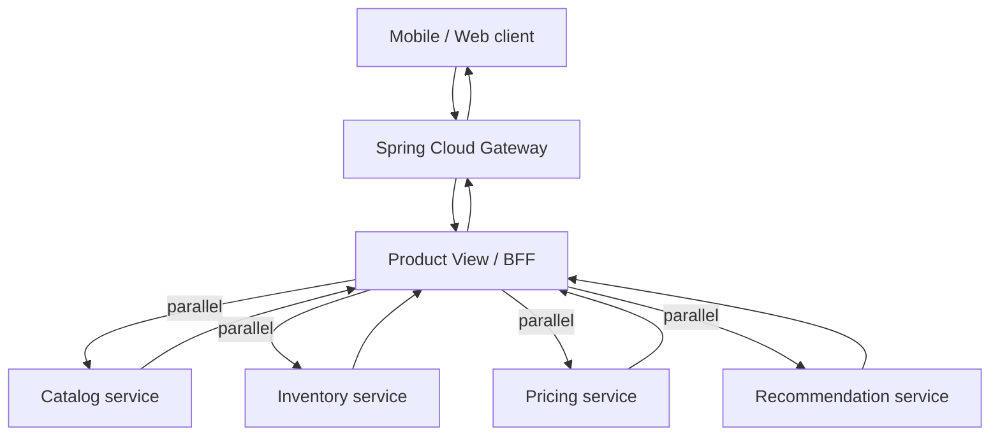
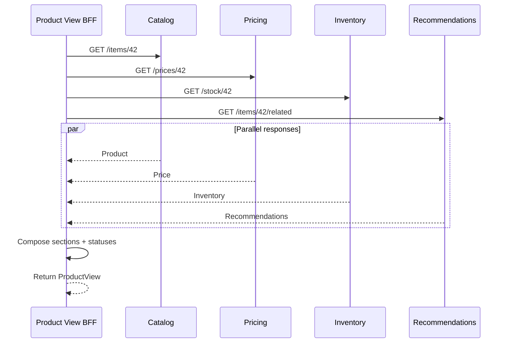
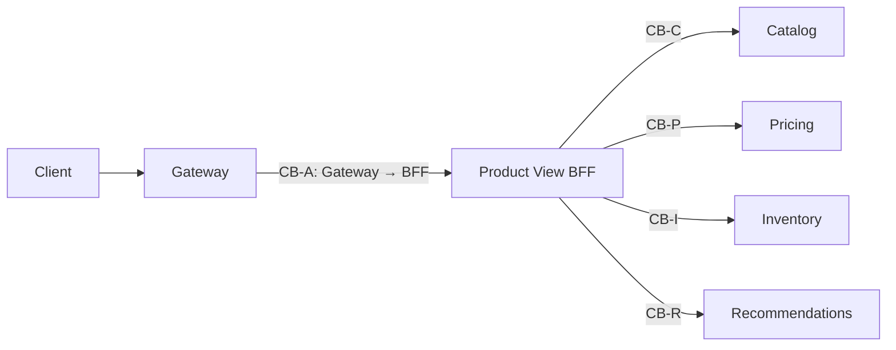

# Gateway Data Aggregation Limits and Partial Failure Handling

## 1. When One API Needs Data from Multiple Microservices

A product detail screen often needs data from several services: catalog supplies the name and description, pricing supplies the price, inventory supplies stock count, and recommendations supplies related items. Forcing the client to call each service directly exposes internal topology and forces the client to stitch data, set timeouts, and handle failures per call. That burdens browser and mobile clients and breaks client code whenever backend topology changes.

An **API Gateway** provides a unified entry point. Still, distinguish two distinct responsibilities:

- **Routing at the Gateway:** receiving requests, matching route predicates, running the filter chain, rewriting paths/headers, picking backends via service discovery, and enforcing auth, rate limits, TLS, circuit breakers, retries, and observability.
- **Data aggregation (composition):** calling multiple services, combining results by business rules, deciding which parts are mandatory vs. optional, and returning one consistent response.

A standard architecture is **having the Gateway route to a BFF or composition service** that performs the fan-out and aggregation. If you have a compelling reason to aggregate inside the Gateway itself, build a dedicated custom filter or handler managing timeouts, body lifecycle, and backpressure—never turn a shared `GlobalFilter` into a dumping ground for every API's business logic.

### Running Example

The client sends:

```http
GET /api/product-view/42
```

The Gateway forwards to `product-view-service`. The composition service fans out in parallel:



**Catalog is the required source** establishing whether the product exists and its name. Inventory, pricing, and recommendations may be marked optional depending on the API contract. If an optional source times out, the API can still return catalog details alongside an explicit degraded status. If catalog reports not found, return 404; if catalog is unavailable, return 503 or 504 according to cause.

### Learning Objectives

After this lesson, you will be able to:

1. Draw the boundary between Gateway routing and a BFF/composition service.
2. Design bounded fan-out calling upstreams in parallel with reactive `WebClient`.
3. Isolate failures per branch instead of letting one optional dependency fail the whole response.
4. Set an overall request deadline and per-downstream timeouts so a single call never holds resources indefinitely.
5. Design response contracts distinguishing `COMPLETE`, `PARTIAL`, `NOT_FOUND`, and `UNAVAILABLE`.
6. Combine rate limiting, circuit breakers, retries, and caching without amplifying outages.
7. Test partial failures, cancellation, empty responses, service discovery, and slow-backend scenarios.

> **Scope:** Spring Cloud Gateway Server WebFlux 5.0.x, Spring Boot 4.x, Reactor, and `WebClient`. Hostnames, service IDs, and responses in this lesson are illustrative. Code snippets are architectural templates that must be integrated with your production DTOs, authentication, service discovery, and error policies.

## 2. Define the Aggregation Contract Before Calling Multiple Services

### 2.1. Classify Data Sources by Criticality

Not every fan-out branch carries equal weight. Before writing code, build a dependency table:

| Source | Data | Role in API | When unavailable |
|---|---|---|---|
| Catalog | ID, name, description | **Required** | Product cannot be identified; fail the whole request |
| Pricing | Current price, currency | Depends on use case; optional in this example | Mark unavailable; never fabricate price `0` |
| Inventory | Stock availability | Optional | Mark unavailable; never assume out-of-stock |
| Recommendations | Suggested items list | Optional | Omit recommendations while keeping product usable |

This classification is a **business contract**, not merely a technical detail. If the API confirms checkout, price and inventory become **required**; if it renders a browsing page, they may degrade gracefully. Never apply a blanket “return 200 on any backend failure” rule across all endpoints.

### 2.2. Design Responses Never to Mask Missing Data

Response when all services succeed:

```json
{
  "overallStatus": "COMPLETE",
  "product": {
    "status": "AVAILABLE",
    "data": {
      "id": 42,
      "name": "Wireless Headphones"
    },
    "reason": null
  },
  "price": {
    "status": "AVAILABLE",
    "data": {
      "amount": 129.99,
      "currency": "USD"
    },
    "reason": null
  },
  "inventory": {
    "status": "AVAILABLE",
    "data": {
      "available": 8
    },
    "reason": null
  },
  "recommendations": {
    "status": "AVAILABLE",
    "data": [
      {"id": 51, "name": "Travel Case"}
    ],
    "reason": null
  }
}
```

Example when pricing times out:

```json
{
  "overallStatus": "PARTIAL",
  "product": {
    "status": "AVAILABLE",
    "data": {"id": 42, "name": "Wireless Headphones"},
    "reason": null
  },
  "price": {
    "status": "UNAVAILABLE",
    "data": null,
    "reason": "TIMEOUT"
  },
  "inventory": {
    "status": "AVAILABLE",
    "data": {"available": 8},
    "reason": null
  },
  "recommendations": {
    "status": "AVAILABLE",
    "data": [],
    "reason": null
  }
}
```

`data: null` with `status: UNAVAILABLE` differs from `data: []` with `status: AVAILABLE`: the latter means the service responded cleanly with zero recommendations. Similarly, `available: 0` is confirmed zero stock, whereas `inventory.status=UNAVAILABLE` means stock is unknown.

### 2.3. Choose Semantically Accurate HTTP Status Codes

| Scenario | Suggested HTTP status | Body / contract |
|---|---:|---|
| Required source returns the product | 200 | `overallStatus=COMPLETE` or `PARTIAL` |
| Optional source fails while core product is valid | 200 | `overallStatus=PARTIAL`, failed section marked `UNAVAILABLE` |
| Catalog confirms product does not exist | 404 | No product view |
| Required catalog source is unavailable | 503 | Optional stable error envelope, no leaked exceptions |
| Overall request deadline exceeded | 504 | Gateway/composition deadline exceeded |
| Upstream violates contract | 502 or upstream-error policy | Record contract error; never substitute fake defaults |

**Never use HTTP 206 Partial Content** simply to mean “one microservice failed.” 206 carries HTTP Range/partial-representation semantics. 207 Multi-Status belongs to WebDAV and is likewise rarely suitable for standard API composition. Use an HTTP status reflecting the overall outcome plus `overallStatus`/per-section status fields in JSON.

### 2.4. Never Substitute Plausible-Looking Fake Data for Errors

Dangerous fallbacks:

- Pricing fails → return `amount: 0`: users may think the item is free.
- Inventory fails → return `available: 0`: turns “unknown” into “out of stock.”
- Catalog fails → return a default empty-name object: hides outages and poisons caches.
- Recommendations fail → return `[]` without a status flag: clients cannot tell “no suggestions” apart from “service unreachable.”

Fallbacks must **preserve data semantics**. When data cannot be obtained, return `null`/unavailable with a reason code; if serving cached stale data, label it explicitly as `STALE` with a timestamp per the contract.

## 3. Route to a BFF at the Gateway Instead of Absorbing All Aggregation Logic

### 3.1. Routing to the Composition Service

The Gateway needs only one public route for product view:

```yaml
spring:
  cloud:
    gateway:
      server:
        webflux:
          routes:
            - id: product-view
              uri: lb://product-view-service
              predicates:
                - Path=/api/product-view/**
                - Method=GET
              filters:
                - StripPrefix=2
```

For `/api/product-view/42`, `StripPrefix=2` removes `api` and `product-view`; the BFF receives `GET /42`. `lb://product-view-service` requires Spring Cloud LoadBalancer and a discovery source (Eureka, Consul, Kubernetes integration, or configured service instances). When targeting Kubernetes DNS directly, use an HTTPS/HTTP Service DNS URI instead of `lb://`.

The Gateway still handles:

- Authenticating clients and enforcing route authorization.
- Rate limiting the aggregate API so one client cannot trigger excessive fan-out.
- Inbound TLS and outbound policies toward the BFF.
- Correlation IDs, metrics, tracing, and access logs.
- Circuit breaking **the Gateway → BFF hop** if the BFF stops responding.

### 3.2. The BFF Owns Composition

The composition service decides:

- Which data sources to call for each use case.
- Which branches are mandatory vs. optional.
- Per-branch timeouts, overall deadlines, and concurrency caps.
- Response schema, partial statuses, and business error mapping.
- Cache keys, TTLs, and consistency rules.

Keeping this logic inside the BFF keeps Gateway routes simple, allows independent service reuse, and prevents a shared filter from parsing and merging response bodies on every route.

### 3.3. Why Avoid Assembling Response Bodies Inside a `GlobalFilter`?

Gateway filters are built to inspect or transform **one proxied exchange**. Aggregating multiple upstream bodies inside a custom filter forces you to manage:

- Consuming and releasing `DataBuffer` instances without memory leaks.
- Backpressure and response-size caps.
- Cancellation when the client disconnects.
- Conflicting statuses, headers, and content types across upstreams.
- Propagating authentication and tenant contexts to each downstream.
- Error handling once response headers/body are partially committed.

That belongs in an explicitly contracted composition endpoint. If strict latency or ownership constraints force aggregation inside the Gateway itself, build **a dedicated handler/module** thoroughly tested for memory, backpressure, and cancellation—never cram it into logging or path-rewrite filters.

### 3.4. Securing the Gateway → BFF Hop

If the BFF exists solely behind the Gateway, restrict network access and enforce service-to-service auth (mTLS, workload identity, or a dedicated token audience). Never trust a header like `X-Internal-Request: true` that an Internet client could spoof. Strip/overwrite client-sent internal headers at the Gateway, and still verify caller identity inside the BFF.

## 4. Parallel Fan-Out with Reactive `WebClient`

### 4.1. Why Not Call Sequentially?

If four services take 120 ms, 180 ms, 240 ms, and 300 ms respectively, sequential calls take ~840 ms plus overhead. Parallel calls take roughly the slowest branch (~300 ms) plus overhead, provided threads/event-loop resources and connection pools suffice.



In Reactor, `Mono.zip(...)` combines independent publishers. Understand its semantics: **a single branch emitting an error or completing empty prevents `zip` from emitting a combined tuple**. To prevent one failed branch from aborting the response, convert branch errors into `Part.UNAVAILABLE` **inside each branch** before zipping.

### 4.2. Dependencies for the Composition Service

A Spring Boot WebFlux service can use:

```xml
<dependencies>
  <dependency>
    <groupId>org.springframework.boot</groupId>
    <artifactId>spring-boot-starter-webflux</artifactId>
  </dependency>
  <dependency>
    <groupId>org.springframework.cloud</groupId>
    <artifactId>spring-cloud-starter-loadbalancer</artifactId>
  </dependency>
</dependencies>
```

When using Eureka, Consul, or Kubernetes discovery, include the corresponding discovery client. `spring-cloud-starter-loadbalancer` lets `WebClient` resolve service IDs when the builder is annotated `@LoadBalanced`. If the BFF uses DNS or a service mesh directly, omit `@LoadBalanced` and configure explicit URLs.

### 4.3. Creating a Load-Balanced `WebClient.Builder`

```java
package com.example.productview;

import org.springframework.cloud.client.loadbalancer.LoadBalanced;
import org.springframework.context.annotation.Bean;
import org.springframework.context.annotation.Configuration;
import org.springframework.web.reactive.function.client.WebClient;

@Configuration(proxyBeanMethods = false)
class DownstreamClientConfiguration {

    @Bean
    @LoadBalanced
    WebClient.Builder loadBalancedWebClientBuilder() {
        return WebClient.builder();
    }
}
```

Service IDs `catalog-service`, `pricing-service`, `inventory-service`, and `recommendation-service` must be registered/resolvable by your discovery mechanism. **Never** invent arbitrary service names expecting DNS to resolve them automatically without matching discovery/load-balancing support.

### 4.4. Data Types Representing Per-Branch Status

```java
package com.example.productview;

enum PartStatus {
    AVAILABLE,
    NOT_FOUND,
    UNAVAILABLE
}

record Part<T>(PartStatus status, T data, String reason) {

    static <T> Part<T> available(T data) {
        return new Part<>(PartStatus.AVAILABLE, data, null);
    }

    static <T> Part<T> notFound() {
        return new Part<>(PartStatus.NOT_FOUND, null, null);
    }

    static <T> Part<T> unavailable(String reason) {
        return new Part<>(PartStatus.UNAVAILABLE, null, reason);
    }
}

record CatalogItem(long id, String name) {}
record Price(java.math.BigDecimal amount, String currency) {}
record Inventory(int available) {}
record Recommendation(long id, String name) {}

record ProductView(
    String overallStatus,
    Part<CatalogItem> product,
    Part<Price> price,
    Part<Inventory> inventory,
    Part<java.util.List<Recommendation>> recommendations
) {}
```

`reason` holds a stable code such as `TIMEOUT`, `UPSTREAM_5XX`, `CONNECTIVITY`, or `INVALID_RESPONSE`; **never expose stack traces, internal hostnames, credential-bearing URLs, or raw exception messages to clients**.

## 5. Common Design Mistakes and How to Fix Them

### 5.1. Placing `onErrorResume` Too Late

**Wrong:**

```java
return Mono.zip(loadCatalog(id), loadPrice(id), loadInventory(id))
    .onErrorResume(error -> Mono.just(defaultView()));
```

An error in any branch fails `zip`; the outer fallback only knows **the entire composition failed** and wipes out successful data from all other branches.

**Right for partial composition:** map errors to `Part.UNAVAILABLE` inside each publisher before `zip`. Reserve outer fallbacks for unrecoverable overall errors, such as exceeding the overall deadline or unexpected programming errors.

### 5.2. Using `zipDelayError` Expecting a Partial Response

`Mono.zipDelayError(...)` delays emitting an error until all sources complete, yet **never converts an error into a JSON section**. If any branch errors, the combined `Mono` still terminates with an error. Partial responses require branches to turn errors into explicit **status values** or a `Result` wrapper.

### 5.3. Running Retries and Circuit Breakers Without a Budget

If the Gateway retries twice, the BFF retries twice, and each dependency retries too, one client request triggers a flood of upstream attempts—and circuit breakers counting per-attempt failures trip prematurely. Agree on:

- Which layer owns retries for each dependency.
- Maximum end-to-end attempts.
- Retryable exceptions and status codes.
- Backoff, jitter, and deadlines.
- Distinguishing **logical requests** from **physical attempts** in metrics.

### 5.4. Using `onErrorContinue` to Swallow Branch Errors

`onErrorContinue` is not a general-purpose fan-out error handler. It depends heavily on operators and upstream behavior, can skip errors on unintended elements, and creates unpredictable behavior. Use `onErrorResume` **on the specific branch**, mapping errors to an explicit status type.

### 5.5. Omitting Timeouts Because a Circuit Breaker Exists

A circuit breaker does not replace timeouts. If an upstream hangs without replying, the breaker will not trip immediately; it needs completed/failed events to evaluate thresholds. Timeouts bound individual requests, while breakers stop calling an already-failing dependency.

### 5.6. Setting Only an Overall Timeout with No Per-Branch Timeouts

If the BFF only enforces an 800 ms overall timeout, a stalled pricing call can hold a connection for nearly the entire budget while `zip` waits. Set per-downstream timeouts alongside an overall deadline, and monitor pools/queues so requests do not stall waiting for connections.

### 5.7. Ignoring Response Size Limits

A recommendations service returning 100,000 items can exhaust BFF memory even if it responds quickly. Bound:

- Maximum items and page sizes.
- Response payload byte limits where supported by the client stack.
- Nesting depth and object sizes.
- Timeouts and concurrency.
- Serialization output and compression policies.

For large lists, expose a dedicated paginated/streaming endpoint rather than stuffing everything into one screen aggregate.

### 5.8. Ignoring Service Discovery and Load Balancer Failures

`lb://product-view-service` works only when the Gateway finds an instance. Similarly, BFF `WebClient` calls to `http://catalog-service` require a `@LoadBalanced` builder and a working discovery source. When zero instances exist, errors like `ServiceInstanceNotFoundException` surface; map them to `UPSTREAM_UNAVAILABLE` without leaking class names or stack traces.

Configure sensible health checks, discovery refresh intervals, and timeouts; never fall back to non-allowlisted hostnames when discovery fails.

### 5.9. Returning Partial 200s While Dashboards Stay All Green

Overall HTTP status stays 200 when an optional source is unavailable. If alerts watch only 5xx rates, pricing could be down for hours unnoticed. Track:

- Share of `PARTIAL` responses out of all aggregate responses.
- Unavailable rate per dependency.
- p95/p99 latency and timeout rate per dependency.
- Circuit breaker open/half-open transitions.
- Cached stale response age distribution.

Define error budgets around **API data completeness**, not HTTP 5xx alone.

### 5.10. Returning Partial Responses Without a Versioned Contract

Clients must know which fields can be `null`, what `NOT_FOUND` vs. `UNAVAILABLE` means, reason codes, and `overallStatus`. Govern schema evolution with versioning and compatibility policies—never abruptly swap `data: null` to `[]` or `amount: 0`. Maintain client/server contract tests and clear documentation.

## 6. Symptom-Based Troubleshooting

| Symptom | Likely cause | How to verify |
|---|---|---|
| One service timeout makes whole API return 500 | `zip` received an error before branch fallback | Put `onErrorResume` on each branch; test single-branch failures |
| `zip` produces no `ProductView` with no exception | A `Mono` completed empty | Check 204/empty bodies; use `switchIfEmpty` or `Optional` |
| Product view latency equals sum of upstreams | Sequential calls or chained dependencies | Inspect trace spans and parallelize independent branches |
| Response 200 shows price 0 when pricing is down | Fallback emits plausible-looking default | Return `UNAVAILABLE` + `data=null`; never fake price 0 |
| Inventory shows out-of-stock on timeout | Timeout mapped to `available=0` | Distinguish `UNKNOWN` from confirmed quantity `0` |
| Catalog 404 yields 200 empty object | Required source given a default fallback | Preserve business 404 |
| Catalog timed out yet `overallStatus` is `COMPLETE` | Status computed from optional branches only | Required branch unavailable must set overall `UNAVAILABLE` |
| Gateway returns 504 even though BFF finished partial | Gateway `response-timeout` shorter than BFF deadline | Align timeouts along the end-to-end budget |
| BFF keeps calling downstreams after client disconnects | Manual `subscribe()` or detached async task | Return the publisher and verify cancellation propagation |
| Single request triggers hundreds of calls | `N+1` fan-out or unbounded ID list | Use batch APIs, pagination, and concurrency limits |
| Downstreams overload while Gateway shows 200 | Aggregate QPS × fan-out × retries too high | Add rate limits, bulkheads, pool caps, and fewer retries |
| Circuit breaker stays closed despite hanging upstream | Missing timeout or misconfigured thresholds | Add per-branch timeouts; inspect breaker metrics/config |
| Open circuit breaker marks all sections unavailable | One shared breaker for all dependencies | Use a dedicated breaker per downstream |
| Pricing 404 fails the whole product view | 404 not classified per semantics | Decide if optional 404 is `NOT_FOUND` or fatal |
| Empty recommendations flagged unavailable | Empty list confused with empty `Mono` | Use `collectList()` and separate empty body from empty array |
| BFF fails to resolve `catalog-service` | Missing LoadBalancer/discovery client or wrong service ID | Check dependencies, service registry, and instance list |
| Gateway route returns 404 | Wrong `Path`/`StripPrefix` mapping | Check request path, stripped segments, and BFF mapping |
| Gateway route returns 503 | BFF down, no discovery instances, or breaker open | Check Gateway route logs, LB metrics, and BFF readiness |
| Metrics miss partial responses | Instrumented only HTTP status | Record `aggregate_status` and dependency outcomes |
| Prometheus cardinality explodes | Product or user IDs in metric labels | Keep labels bounded: service, outcome, `routeId` |
| Traces lack downstream spans | `WebClient` uninstrumented or context dropped | Check Micrometer Observation / tracing bridge |
| Cache serves `PARTIAL` long after recovery | Long TTL on partial responses | Use short/no TTL and never promote partial to complete |
| Tenant A's cached price appears for Tenant B | Cache key omits tenant/market/currency | Add scope dimensions to key; purge stale cache |
| Retries create duplicate orders | Non-idempotent `POST` retried | Require idempotency keys and single workflow owner |
| BFF error leaks internal hostname | Error payload prints raw exception message | Emit standardized reason codes; log sanitized details internally |

## 7. Pre-Production Checklist for API Aggregation

### 7.1. Contracts and Boundaries

- [ ] Decided whether Gateway solely routes to a BFF/composition service or uses a dedicated aggregation handler.
- [ ] Documented all dependencies and labeled each **required** or **optional**.
- [ ] Response contract distinguishes `COMPLETE`, `PARTIAL`, `NOT_FOUND`, and `UNAVAILABLE`.
- [ ] Never use HTTP 206 to indicate partial upstream failure.
- [ ] Never replace timeouts with fake values like price `0` or inventory `0`.
- [ ] Versioning and client contract tests are in place.

### 7.2. Resilience and Bounds

- [ ] Configured per-downstream timeouts and an overall deadline.
- [ ] Timeout budgets align with Gateway/client limits, leaving room for queueing, TLS, and serialization.
- [ ] Independent branches run in parallel with errors isolated before composition.
- [ ] Empty bodies and 204 responses handled per contract semantics.
- [ ] Bounded concurrency, connection pools, payload sizes, and list/page sizes.
- [ ] Gateway rate limits and BFF/downstream bulkheads configured.
- [ ] Retries are bounded with backoff/jitter and restricted to idempotent operations.
- [ ] Circuit breakers configured per dependency plus Gateway → BFF where appropriate.
- [ ] Cancellation bound to request lifecycle with zero manual `subscribe()` calls.

### 7.3. Security and Data

- [ ] Gateway, BFF, and downstreams authenticate identity at each appropriate hop.
- [ ] Never relay raw client bearer tokens to every downstream by default.
- [ ] Client-supplied internal headers stripped or overwritten per trust policy.
- [ ] Every service enforces tenant and resource authorization.
- [ ] Cache keys isolate tenants, users, currencies, and markets.
- [ ] Logs and traces exclude tokens, PII, raw queries, and internal exceptions.

### 7.4. Observability and Testing

- [ ] Metrics record `COMPLETE`/`PARTIAL`/`UNAVAILABLE` and per-dependency outcomes.
- [ ] Latency histograms/p95/p99, timeout rates, breaker states, and retry attempts tracked.
- [ ] Distributed traces connect Gateway through BFF to every downstream call.
- [ ] Tests cover full success, optional failures, required failures, 404, timeouts, empty bodies, and cancellation.
- [ ] Load tests simulate a slow upstream, a 5xx upstream, and rate-limited clients.
- [ ] Alerts watch partial ratios and dependency SLOs, not HTTP 5xx alone.
- [ ] Rollback or feature disablement works cleanly without surprising semantic shifts.

## 8. Extended Test Matrix

| ID | Scenario | Assertion |
|---|---|---|
| T13 | Pricing 404 means no price exists | Section `NOT_FOUND`; not flagged as a system error if contract allows |
| T14 | Optional `Mono` completes with empty body | `UNAVAILABLE`/`INVALID_RESPONSE` or defined empty semantics |
| T15 | Recommendations returns 200 with empty array | `AVAILABLE`, `data=[]` |
| T16 | Catalog 404 while recommendations is slow | 404 per contract; verify latency/cancellation policy |
| T17 | Catalog 5xx | Never returns a default product object |
| T18 | Pricing 5xx | Product returned if catalog succeeded; overall `PARTIAL` |
| T19 | All optional branches time out | Partial product returned without exceeding deadline |
| T20 | Overall deadline expires | 504; remaining publishers canceled via lifecycle |
| T21 | Client disconnects mid-fan-out | No detached manual subscriptions keep running |
| T22 | LoadBalancer finds zero catalog instances | Required source unavailable with safe reason code |
| T23 | One discovery instance unhealthy | Traffic never routes outside allowlisted endpoints |
| T24 | Gateway rate limit exceeded | 429 before BFF fan-out executes |
| T25 | BFF concurrency cap reached | Rejects/queues per policy without unbounded memory growth |
| T26 | 100 IDs in one request | Bounded by page/batch size or concurrency cap |
| T27 | Oversized recommendations payload | Response-size/item cap enforced |
| T28 | Single GET retry on transient error | Bounded attempts within overall deadline |
| T29 | Non-idempotent POST retry | No retry, or guarded by idempotency key |
| T30 | Pricing circuit breaker OPEN | Only price section unavailable; catalog still succeeds |
| T31 | Gateway BFF circuit breaker OPEN | Endpoint-level fallback with explicit status |
| T32 | Gateway timeout shorter than BFF timeout | Tests catch budget mismatch before release |
| T33 | Cached `PARTIAL` response | Short/no TTL; never served as `COMPLETE` |
| T34 | Tenant-specific cached response | Other tenants never receive cached copy |
| T35 | Inventory timeout | Never coerced into `available=0` |
| T36 | Optional 404 | Contract distinguishes missing data from upstream failure |
| T37 | Trace propagation over `WebClient` | Single trace links all downstream spans |
| T38 | Per-dependency metric labels | Bounded cardinality; zero user/product IDs |
| T39 | Dependency recovers post-outage | Partial ratio drops and stale cache expires/refreshes |
| T40 | BFF hits internal exception | Public body shows reason code only; internal logs sanitized |

Tests T01–T12 in Section 11.1 and T13–T40 here form a reference matrix. Execute them using mock services in isolated staging—never induce intentional outages in production.

## 9. Exercises and Self-Check Questions

**Exercise 1 — Architectural boundaries.** Why does a Gateway usually route to a BFF/composition service rather than having `GlobalFilter`s stitch response bodies directly?

**Exercise 2 — Required vs. optional.** Catalog returns 404, pricing times out, and inventory returns 200. What should the product view API return under this lesson's contract, and why not return an empty object?

**Exercise 3 — HTTP semantics.** Why avoid HTTP 206 solely because the pricing service failed?

**Exercise 4 — Empty vs. unavailable.** Contrast recommendations returning 200 with `[]`, returning 204, timing out, and returning 500. How should each be represented?

**Exercise 5 — `Mono.zip`.** What happens if one source inside `Mono.zip` emits an error? Why cannot an `onErrorResume` outside `zip` produce a partial response?

**Exercise 6 — Partial handling.** Sketch how to place `onErrorResume` on each branch to map timeouts into `Part.unavailable("TIMEOUT")`.

**Exercise 7 — Timeout budgets.** If client timeout is 1.5 s, Gateway→BFF timeout is 1 s, BFF deadline is 800 ms, and each branch timeout is 300 ms, how do these timeouts relate?

**Exercise 8 — Parallel fan-out.** Four upstreams take 120/180/240/300 ms. Why is parallel composition usually faster than sequential? Name at least two remaining overheads.

**Exercise 9 — N+1.** A page lists 50 products and fetches price + inventory per product individually. How many downstream calls can that generate? Propose two ways to reduce it.

**Exercise 10 — Concurrency.** What does `flatMap(fetch, 8)` bound? Why can 500 concurrent HTTP requests still produce thousands of in-flight calls?

**Exercise 11 — Cancellation.** Why never call `subscribe()` manually inside a controller to fetch recommendations?

**Exercise 12 — Required failure.** Catalog times out while all other branches succeed. Why should the controller return 504/503 per cause rather than `PARTIAL` 200?

**Exercise 13 — Optional failure.** Pricing times out while catalog succeeds. How should you structure the response section so clients do not mistake the price for 0?

**Exercise 14 — Retry amplification.** Gateway, BFF, and pricing each retry twice. Why does this multiply attempts, and how should retries be governed?

**Exercise 15 — Circuit breakers.** How does a Gateway→BFF breaker differ from a BFF→pricing breaker?

**Exercise 16 — Fallbacks.** When the BFF is completely down, can a Gateway fallback assemble partial pricing and inventory? Why or why not?

**Exercise 17 — Caching.** Why never cache a `PARTIAL` response like a `COMPLETE` response with a long TTL?

**Exercise 18 — Tenants.** A composed view varies currency and promotions by tenant. What elements belong in the cache key?

**Exercise 19 — Transactions.** Why does aggregating catalog, pricing, and inventory not yield a consistent transactional snapshot for confirming an order?

**Exercise 20 — Rate limiting.** One request fans out into four downstream calls. Does a Gateway rate limit replace a bulkhead inside the BFF?

**Exercise 21 — Authorization.** Why avoid relaying the client's raw JWT to every downstream service blindly?

**Exercise 22 — Observability.** Which metrics reveal that an API returning HTTP 200 is actually suffering a dependency outage?

**Exercise 23 — Tracing.** How do you make one trace span Gateway → BFF → four upstream calls?

**Exercise 24 — Error details.** Why never return a raw `ConnectException` or internal hostname in the response?

**Exercise 25 — Service discovery.** What discovery/load-balancing components do `lb://product-view-service` and `WebClient` `http://catalog-service` require?

**Exercise 26 — Response size.** Recommendations returns 100,000 items. Why are timeouts alone insufficient to protect the BFF?

**Exercise 27 — Status semantics.** Optional pricing returns 404. When should it be marked normal `NOT_FOUND` vs. `UNAVAILABLE`/`UPSTREAM_ERROR`?

**Exercise 28 — Test strategy.** List a minimal test suite covering success, optional timeout, required timeout, 404, and client cancellation.

### Suggested Answers

1. Gateway filters are ill-suited for business composition, body lifecycles, backpressure, cancellation, and response contracts. A BFF offers an owned domain endpoint that is easy to test and reuse.
2. Catalog 404 means the mandatory resource does not exist; return 404. A pricing timeout does not change that 404. Never return an empty object, as it obscures semantics.
3. 206 is defined for HTTP Range partial representations; partial microservice failures belong in the JSON contract paired with an appropriate overall status.
4. 200 `[]` means zero items exist; 204 may be a valid empty response if contracted; timeout is `UNAVAILABLE`/`TIMEOUT`; 500 is an upstream error. Never conflate them.
5. `zip` terminates on error or empty completion; an outer fallback replaces the entire composition. Map errors to status wrappers per branch before `zip`.
6. `branch.timeout(...).map(Part::available).onErrorResume(e -> Mono.just(Part.unavailable(classify(e))))`.
7. Each branch gets up to 300 ms; the 800 ms BFF deadline caps the entire aggregate; the Gateway waits up to 1 s; the client waits up to 1.5 s including overhead. Measure p95/p99 and tune budgets.
8. Calls overlap in time, so duration tracks the slowest branch instead of the sum. DNS/discovery, queueing, TLS, connection acquisition, and serialization still add overhead.
9. Up to 100 downstream calls. Use batch endpoints, pagination, caching, or drop unneeded sources.
10. Caps at 8 concurrent calls within one subscription. Parallel HTTP requests multiply that cap; enforce application- and dependency-level bulkheads.
11. Manual subscriptions detach from the HTTP request lifecycle, continuing after client disconnect and breaking error/cancellation propagation.
12. Catalog is required; you cannot build a valid product view without identifying the product. Return 504 for timeout and 503 for other unavailability.
13. `status=UNAVAILABLE`, `data=null`, `reason=TIMEOUT`; never set `amount=0`.
14. Multi-layer retries multiply attempts and amplify outages. Pick one retry owner, bound attempts, add backoff/jitter, restrict to retryable errors, and respect deadlines.
15. The Gateway breaker protects the entire BFF; the BFF's pricing breaker isolates pricing alone while allowing other branches to succeed.
16. No. The Gateway received no partial payload from the BFF to assemble; it can only return an endpoint-level error or fallback.
17. It preserves degraded state long after recovery and misleads clients into treating stale omissions as complete data. Skip caching or use a short TTL preserving `PARTIAL`.
18. Tenant, currency, market/region, user/customer tier, locale, permission/feature flags, and product ID depending on response variance.
19. Services respond at different instants with no distributed snapshot transaction. Write transactions must be coordinated by the owning workflow/service.
20. No. Gateway rate limits gate inbound requests; the BFF still needs concurrency caps, connection pools, and per-dependency bulkheads.
21. Audiences/scopes may not match, and tokens may leak to services that should not see them. Use service identities, token exchange, or policy-governed relay.
22. Partial ratio, per-dependency unavailable ratio, dependency timeout/error rates, p95/p99 latency, breaker states, and stale cache age.
23. Use Micrometer Tracing/Observation, context propagation across Gateway and `WebClient`, and separate spans per downstream.
24. Leaks internal topology/hostnames and operational internals; emit stable reason codes and keep sanitized diagnostics in internal logs.
25. Gateway needs LoadBalancer/discovery for `lb://`; `WebClient` needs a `@LoadBalanced` builder with Spring Cloud LoadBalancer/discovery, or matching service DNS names.
26. Large payloads exhaust memory, serialization CPU, and network bandwidth even when fast. Cap item counts/bytes, paginate, and bound concurrency.
27. `NOT_FOUND` when having no price is a valid business state; `UNAVAILABLE`/`UPSTREAM_ERROR` when 404 signals broken ID mapping, contract mismatch, or inability to serve required data.
28. One all-success test; one optional-branch timeout returning `PARTIAL`; one required-branch timeout returning 504; catalog 404 returning 404; client disconnect propagating cancellation with no manual subscription.

## 10. Rate Limiting, Authentication, and Service-to-Service Context

### 10.1. Rate Limiting the Aggregate Endpoint at the Gateway

Because one request fans out into four or more downstream calls, aggregate endpoints usually need dedicated quotas. A Gateway route can add `RequestRateLimiter` (requiring a Redis rate limiter or matching implementation plus a configured `KeyResolver`):

```yaml
spring:
  cloud:
    gateway:
      server:
        webflux:
          routes:
            - id: product-view
              uri: lb://product-view-service
              predicates:
                - Path=/api/product-view/**
                - Method=GET
              filters:
                - StripPrefix=2
                - name: RequestRateLimiter
                  args:
                    key-resolver: "#{@principalKeyResolver}"
                    redis-rate-limiter.replenishRate: 20
                    redis-rate-limiter.burstCapacity: 40
```

Values `20/40` are illustrative only. `principalKeyResolver` must be defined in the Gateway app and extract an authenticated key (e.g., tenant or client ID); **never use IP addresses or client-supplied headers as identity without a trust policy**. Handle Redis/`KeyResolver` failures under an approved fail-open or fail-closed policy.

Gateway rate limits guard the front door, yet the BFF still needs:

- A cap on total concurrent aggregations.
- Concurrency caps per downstream.
- Maximum ID list and page sizes.
- Internal quotas per caller/service.

### 10.2. Never Forward Every Client Credential to Every Branch

The Gateway may authenticate users via JWT/OAuth2. Calling four downstreams from the BFF does not mean relaying the user's bearer token to all four. Determine:

- Does each downstream need **service identity** or **user identity**?
- If user context is needed, does the token hold the right audience and scopes for that service?
- Should you use token exchange / on-behalf-of instead of relaying the raw incoming token?
- Does the source service enforce tenant/owner authorization?

The BFF must ensure every downstream validates data access rather than trusting a client-supplied `X-User-Id` header. Strip client-supplied identity headers at the Gateway/BFF boundary, set trusted context cleanly, and still verify caller identity downstream.

### 10.3. Never Fan Out to Services the User Is Unauthorized to View

If a pricing field is restricted to certain customer tiers, do not fetch pricing for every user and merely strip the field afterward as your sole control. Evaluate authorization beforehand or let the owning service enforce access. This prevents:

- Sensitive data entering BFF memory or logs even when omitted from responses.
- Shared caches leaking cross-tenant data.
- Traces or debug payloads capturing restricted pricing or details.

### 10.4. The Gateway Filter Chain Does Not Replace BFF Business Authorization

The Gateway can enforce scope rules on `/api/product-view/**`, yet the BFF still checks product/tenant authorization and downstreams still check resource permissions. Matching a route proves only that predicates matched—not that the caller is allowed to read product ID 42.

## 11. Testing Aggregation and Partial Failures

### 11.1. Matrix of Critical Scenarios

| Test | Catalog | Pricing | Inventory | Recommendations | Overall result |
|---|---|---|---|---|---|
| T01 | 200 | 200 | 200 | 200 | 200 `COMPLETE` |
| T02 | 200 | Timeout | 200 | 200 | 200 `PARTIAL`, price unavailable |
| T03 | 200 | 500 | Timeout | 200 | 200 `PARTIAL`, two sections unavailable |
| T04 | 200 | 404 | 200 | 204/empty list | Per contract: `COMPLETE` if 404/empty are normal |
| T05 | 404 | any | any | any | 404 product not found |
| T06 | Timeout | 200 | 200 | 200 | 504 when required source exceeds deadline |
| T07 | 500 | 200 | 200 | 200 | 503 when required catalog is unavailable |
| T08 | Unexpected empty body | 200 | 200 | 200 | 503/502 per error mapping; no fake empty product |
| T09 | 200 | 200 | 200 | 500 | 200 `PARTIAL` when recommendations is optional |
| T10 | 200 | 200 | 200 | 200 with oversized body | Payload/response size capped; bounded memory |
| T11 | 200 | 200 | 200 | 200, BFF deadline expires | 504; cancellation observed |
| T12 | 200 | 200 | 200 | 200, client disconnects | Cancellation; no bogus ERROR logs |

These status codes follow this lesson's contract; align production contracts with clients and business owners. In particular, an upstream 404 can mean either “no supplementary data” or a broken reference—never hardcode one meaning for every service.

### 11.2. Testing with `WebTestClient` and Mock Upstreams

In integration tests, run the BFF on a random port with `MockWebServer` or WireMock per downstream:

1. Return success from all four mocks; assert all sections present and `COMPLETE`.
2. Delay pricing past its branch timeout; assert HTTP 200 with `price.status=UNAVAILABLE` and `reason=TIMEOUT`.
3. Return 500 from inventory; assert inventory unavailable while other sections remain intact.
4. Return 404 from catalog; assert HTTP 404.
5. Delay catalog past the required timeout; assert 504.
6. Return an unexpected empty body; assert the contract error with zero fabricated defaults.
7. Record call counts to verify parallel fan-out and concurrency limits.
8. Disconnect the client mid-request; assert cancellation and zero detached background subscriptions.

### 11.3. Partial Response Test Example with `WebTestClient`

The snippet below assumes the BFF boots in a Spring Boot test with the mock pricing server configured to respond slower than the timeout. This is a **test template**; mock server startup and dynamic port wiring depend on your project:

```java
package com.example.productview;

import org.junit.jupiter.api.Test;
import org.junit.jupiter.api.BeforeEach;
import org.springframework.boot.test.context.SpringBootTest;
import org.springframework.boot.test.web.server.LocalServerPort;
import org.springframework.test.web.reactive.server.WebTestClient;

@SpringBootTest(webEnvironment = SpringBootTest.WebEnvironment.RANDOM_PORT)
class ProductViewPartialFailureTest {

    @LocalServerPort
    int port;

    WebTestClient webTestClient;

    @BeforeEach
    void setUp() {
        webTestClient = WebTestClient.bindToServer()
            .baseUrl("http://127.0.0.1:" + port)
            .build();
    }

    @Test
    void returnsProductWhenOptionalPricingTimesOut() {
        // Test fixture must configure:
        // catalog -> 200 product JSON
        // pricing -> delay > 300 ms
        // inventory -> 200 inventory JSON
        // recommendations -> 200 list JSON

        webTestClient.get()
            .uri("/42")
            .exchange()
            .expectStatus().isOk()
            .expectHeader().valueEquals(
                "X-Aggregation-Status", "PARTIAL")
            .expectBody()
            .jsonPath("$.overallStatus").isEqualTo("PARTIAL")
            .jsonPath("$.product.status").isEqualTo("AVAILABLE")
            .jsonPath("$.price.status").isEqualTo("UNAVAILABLE")
            .jsonPath("$.price.reason").isEqualTo("TIMEOUT")
            .jsonPath("$.inventory.status").isEqualTo("AVAILABLE");
    }
}
```

`@LocalServerPort` binds `WebTestClient` to the BFF's ephemeral port. In a real project, wire the `WebClient` service IDs/URLs to your mock servers via `@DynamicPropertySource` or test config; if mocks are not wired in, tests may accidentally call another environment.

### 11.4. Distinguish Cancellation from Timeout in Tests

- **Timeout:** a specific deadline elapsed; returns 504 or marks a section unavailable.
- **Cancellation:** the client/subscriber unsubscribed; the reactive pipeline cancels. Usually no response is sent since the socket closed.
- **Upstream error:** HTTP 5xx/4xx or connectivity failure; handled per dependency contract.
- **Empty response:** upstream completed with no body; either valid empty or invalid response depending on API.

Never assert that every bodyless outcome is a timeout. Inspect signal/exception types and the HTTP exchange lifecycle.

### 11.5. Load Testing to Verify Aggregation Limits

Construct a workload exercising:

- Normal and peak expected aggregate request rates.
- One deliberately slow dependency.
- One dependency returning 5xx at a controlled rate.
- A client exceeding its rate limit.
- A max-sized valid list payload and an oversized payload.

Monitor aggregate p95/p99, downstream attempts, in-flight counts, connection-pool pending acquires, CPU/memory, timeout/partial ratios, and Gateway 429/5xx counts. An API serving elevated `PARTIAL` 200s still signals a pricing or inventory availability incident; alert on **dependency SLOs**, not overall HTTP status alone.

## 12. Fan-Out Implementation Pattern with `WebClient`

### 12.1. Per-Branch Fan-Out and Error Isolation

The service below injects a `@LoadBalanced` `WebClient.Builder`. Each client targets its own service ID:

```java
package com.example.productview;

import java.time.Duration;
import java.util.List;
import java.util.concurrent.TimeoutException;

import org.springframework.beans.factory.annotation.Qualifier;
import org.springframework.stereotype.Service;
import org.springframework.web.reactive.function.client.WebClient;
import org.springframework.web.reactive.function.client.WebClientRequestException;
import org.springframework.web.reactive.function.client.WebClientResponseException;

import reactor.core.publisher.Mono;

@Service
public class ProductAggregator {

    private static final Duration REQUIRED_TIMEOUT = Duration.ofMillis(250);
    private static final Duration OPTIONAL_TIMEOUT = Duration.ofMillis(300);

    private final WebClient catalog;
    private final WebClient pricing;
    private final WebClient inventory;
    private final WebClient recommendations;

    public ProductAggregator(
            @Qualifier("loadBalancedWebClientBuilder")
            WebClient.Builder builder) {
        this.catalog = builder.clone()
            .baseUrl("http://catalog-service").build();
        this.pricing = builder.clone()
            .baseUrl("http://pricing-service").build();
        this.inventory = builder.clone()
            .baseUrl("http://inventory-service").build();
        this.recommendations = builder.clone()
            .baseUrl("http://recommendation-service").build();
    }

    public Mono<ProductView> aggregate(long productId) {
        Mono<Part<CatalogItem>> product = loadCatalog(productId);
        Mono<Part<Price>> price = optional(
            pricing.get().uri("/prices/{id}", productId)
                .retrieve().bodyToMono(Price.class));
        Mono<Part<Inventory>> stock = optional(
            inventory.get().uri("/stock/{id}", productId)
                .retrieve().bodyToMono(Inventory.class));
        Mono<Part<List<Recommendation>>> related = optional(
            recommendations.get()
                .uri("/items/{id}/related", productId)
                .retrieve().bodyToFlux(Recommendation.class)
                .collectList());

        // Each branch handles errors individually before zipping.
        return Mono.zip(product, price, stock, related)
            .map(tuple -> {
                Part<CatalogItem> p = tuple.getT1();
                Part<Price> pr = tuple.getT2();
                Part<Inventory> in = tuple.getT3();
                Part<List<Recommendation>> rec = tuple.getT4();

                boolean partial =
                    pr.status() == PartStatus.UNAVAILABLE
                    || in.status() == PartStatus.UNAVAILABLE
                    || rec.status() == PartStatus.UNAVAILABLE;

                String overallStatus =
                    p.status() == PartStatus.UNAVAILABLE
                        ? "UNAVAILABLE"
                        : (partial ? "PARTIAL" : "COMPLETE");

                return new ProductView(
                    overallStatus,
                    p, pr, in, rec);
            });
    }

    private Mono<Part<CatalogItem>> loadCatalog(long id) {
        return catalog.get().uri("/items/{id}", id)
            .retrieve()
            .bodyToMono(CatalogItem.class)
            .switchIfEmpty(Mono.error(
                new IllegalStateException("EMPTY_CATALOG_RESPONSE")))
            .timeout(REQUIRED_TIMEOUT)
            .map(value -> Part.available(value))
            .onErrorResume(
                WebClientResponseException.NotFound.class,
                error -> Mono.just(Part.notFound()))
            .onErrorResume(error ->
                Mono.just(Part.unavailable(reason(error))));
    }

    private <T> Mono<Part<T>> optional(Mono<T> request) {
        return request
            .switchIfEmpty(Mono.error(
                new IllegalStateException("EMPTY_UPSTREAM_RESPONSE")))
            .timeout(OPTIONAL_TIMEOUT)
            .map(value -> Part.available(value))
            .onErrorResume(
                WebClientResponseException.NotFound.class,
                error -> Mono.just(Part.notFound()))
            .onErrorResume(error ->
                Mono.just(Part.unavailable(reason(error))));
    }

    private static String reason(Throwable error) {
        if (error instanceof TimeoutException) {
            return "TIMEOUT";
        }
        if (error instanceof WebClientResponseException response) {
            return response.getStatusCode().is5xxServerError()
                ? "UPSTREAM_5XX" : "UPSTREAM_ERROR";
        }
        if (error instanceof WebClientRequestException) {
            return "CONNECTIVITY";
        }
        return "INVALID_RESPONSE";
    }
}
```

**How it works:**

1. All four requests are built as reactive publishers; `Mono.zip` subscribes to each independently so they execute concurrently.
2. Each branch enforces its own timeout.
3. `onErrorResume` sits **on each branch**, converting failures into `Part.unavailable(...)` instead of letting an error propagate into `zip`.
4. A catalog 404 maps to `Part.notFound()` so the controller can emit 404.
5. Recommendations uses `collectList()`: an empty array is a valid `[]` result, distinct from an HTTP error or timeout.
6. `reason()` emits standardized codes only, never forwarding exception details to clients.

Here, if catalog returns 404, optional branches were still launched in parallel and `zip` waits for them within their timeouts. If 404s are frequent and optional branches are expensive, **query catalog first before fanning out**, or add explicit cancellation when catalog reports missing.

### 12.2. Controller Enforcing the Overall Request Deadline and Status

```java
package com.example.productview;

import java.time.Duration;
import java.util.concurrent.TimeoutException;

import org.springframework.http.HttpStatus;
import org.springframework.http.ResponseEntity;
import org.springframework.web.bind.annotation.GetMapping;
import org.springframework.web.bind.annotation.PathVariable;
import org.springframework.web.bind.annotation.RequestMapping;
import org.springframework.web.bind.annotation.RestController;

import reactor.core.publisher.Mono;

@RestController
@RequestMapping
public class ProductViewController {

    private static final Duration REQUEST_DEADLINE =
        Duration.ofMillis(800);

    private final ProductAggregator aggregator;

    public ProductViewController(ProductAggregator aggregator) {
        this.aggregator = aggregator;
    }

    @GetMapping("/{id}")
    public Mono<ResponseEntity<ProductView>> get(
        @PathVariable("id") long id) {

        return aggregator.aggregate(id)
            .map(view -> {
                Part<CatalogItem> product = view.product();

                if (product.status() == PartStatus.NOT_FOUND) {
                    return ResponseEntity
                        .<ProductView>status(HttpStatus.NOT_FOUND)
                        .build();
                }

                if (product.status() == PartStatus.UNAVAILABLE) {
                    HttpStatus status =
                        "TIMEOUT".equals(product.reason())
                            ? HttpStatus.GATEWAY_TIMEOUT
                            : HttpStatus.SERVICE_UNAVAILABLE;
                    return ResponseEntity.status(status).body(view);
                }

                return ResponseEntity.ok()
                    .header("X-Aggregation-Status", view.overallStatus())
                    .body(view);
            })
            .timeout(REQUEST_DEADLINE)
            .onErrorResume(TimeoutException.class, error ->
                Mono.just(ResponseEntity
                    .<ProductView>status(HttpStatus.GATEWAY_TIMEOUT)
                    .build()));
    }
}
```

To match the Section 3 route, the controller maps `GET /42` because the Gateway applied `StripPrefix=2`. If the BFF should receive `/products/42`, adjust the route filter or controller mapping—**never let both sides assume paths blindly**.

### 12.3. Status Meanings in Code

| Catalog status | Controller behavior | Meaning |
|---|---|---|
| `AVAILABLE` | Proceed with 200 or partial 200 | Primary source has data |
| `NOT_FOUND` | 404 | Catalog confirmed item does not exist |
| `UNAVAILABLE` + `TIMEOUT` | 504 | Required source exceeded deadline |
| `UNAVAILABLE` + other error | 503 | Required source unavailable |

For optional sections:

- `AVAILABLE` + `data: []`: service succeeded with zero entries.
- `NOT_FOUND`: upstream confirmed no record/offer exists for this item; governed by the API contract.
- `UNAVAILABLE`: data could not be retrieved due to timeout, connectivity, or upstream error; sets `overallStatus=PARTIAL`.

If an optional source returns 404—for instance, no price yet for an unreleased item—that need not count as degraded. Define explicitly whether `NOT_FOUND` is a normal business state.

### 12.4. Avoid Common Reactive Mistakes

**Do not write:**

```java
// ANTI-PATTERN: blocks the event-loop thread.
Price price = pricingClient.get()
    .uri("/prices/{id}", id)
    .retrieve()
    .bodyToMono(Price.class)
    .block();

// ANTI-PATTERN: manual subscribe detaches the request from the response lifecycle.
pricingClient.get()
    .uri("/prices/{id}", id)
    .retrieve()
    .bodyToMono(Price.class)
    .subscribe(this::savePrice);
```

`block()` stalls the event-loop thread when invoked on a reactive request path. Manual `subscribe()` detaches errors, cancellation, and fan-out lifetime from the HTTP exchange—the response may complete while side effects continue running. Always **return the publisher** so the framework manages subscription lifecycles.

### 12.5. Never Let a Publisher Complete Empty Unexpectedly

`Mono.zip` requires every input to emit a value. If `bodyToMono(...)` completes empty (e.g., upstream returned 204 or an empty body), `zip` completes empty without building a `ProductView`. Use `switchIfEmpty(...)` to turn unexpected empty bodies into a controlled error caught by the branch fallback. Where empty is normal, map it explicitly to `Optional.empty()` or an empty list **with the appropriate status**.

## 13. Bounding Timeouts and Concurrency So Fan-Out Does Not Amplify Load

### 13.1. One Aggregate Request Multiplies Internal Requests

If a client calls the endpoint 100 times/s and each fans out to four services, the backend sees ~**400 downstream calls/s** before retries. If clients send 1,000 req/s, one aggregate endpoint can overwhelm services never sized for that fan-out multiplier.

Enforce limits at multiple layers:

| Layer | Limit | Purpose |
|---|---|---|
| Gateway | Rate limit by client/tenant/API key | Stop bursts before BFF fan-out |
| BFF | Concurrent requests / in-flight aggregations | Keep active aggregations safe |
| BFF → each service | Timeout, connection pool, per-dependency concurrency | Stop one upstream from starving others |
| Downstream | Server-side quotas, bulkheads, queue caps | Protect the service from other callers |
| Infrastructure | CPU, memory, network, and connection caps | Keep the platform stable under load |

**Gateway rate limits do not replace internal BFF limits.** Even authorized requests multiply calls; the BFF needs its own budgets and bulkheads.

### 13.2. Overall Deadline Must Exceed Branch Timeouts Yet Stay Below Client Budget

Example budget:

```text
Client timeout:                    1,500 ms
Gateway → BFF response timeout:    1,000 ms
BFF aggregate deadline:             800 ms
Each downstream timeout:            300 ms
Response serialization/overhead:   remaining budget
```

Because branches run in parallel, composition latency tracks the slowest branch rather than the sum of all timeouts. Still reserve headroom for DNS/discovery, connection acquisition, TLS handshakes, serialization, and queueing. Size deadlines from measured p95/p99—never stack timeouts exceeding outer hop budgets.

Gateway HTTP client example:

```yaml
spring:
  cloud:
    gateway:
      server:
        webflux:
          httpclient:
            connect-timeout: 200
            response-timeout: 1s
```

Here `response-timeout` bounds the **Gateway → BFF** hop; it does not override BFF timeouts toward catalog or pricing. Configure and measure the BFF's `250/300 ms` branch timeouts and `800 ms` deadline separately. Never set the Gateway timeout shorter than the BFF deadline, or the Gateway will abort requests while the BFF is still finishing work.

### 13.3. Cancel Requests When Clients Disconnect

Reactive pipelines propagate cancellation upstream whenever the downstream subscriber cancels—such as when a client closes its socket. Keep `WebClient` publishers **bound to the request lifecycle**; never call `subscribe()` manually and keep hitting downstreams after the client leaves.

Cancellation is not the same business failure as a timeout. Do not turn cancellations into `PARTIAL` or log them at `ERROR`. Metrics should distinguish:

- Completed normally.
- Deadline timeout.
- Upstream error.
- Client disconnect/cancel.

Downstream calls already dispatched may continue executing on the backend after cancellation arrives; never assume cancellation rolls back side effects. That is why fan-out fits read endpoints far more naturally than write endpoints.

### 13.4. Bounding Concurrency on Dynamic Lists

When calling a service across a list of IDs, never launch unbounded concurrent calls for thousands of elements. Bound `flatMap` concurrency explicitly:

```java
Flux.fromIterable(productIds)
    .flatMap(this::loadOneProduct, 8)
    .collectList();
```

This caps concurrent in-flight calls within that `flatMap` subscription at 8 (use `flatMapSequential` with matching concurrency if input order matters). Per-request concurrency is **not** a service-wide cap: 500 concurrent requests can still launch 4,000 in-flight calls. Add bulkheads, semaphores, and connection-pool caps per dependency and service.

### 13.5. Avoid `N+1` Fan-Out

If a product view shows 50 items and fetches price and inventory separately for each, one request triggers 100 downstream calls. Prefer:

- Batch endpoints (`POST /prices:batch` or `GET /prices?ids=...`) under a clear contract.
- Bulk read APIs on the data-owning service.
- Scoped/TTL caching for stable data.
- Page-size and ID-count caps.
- Dropping data sources unnecessary for the use case.

Never use batch endpoints to bypass quotas or per-record authorization; downstreams must still validate tenant/ownership and bound payload sizes.

## 14. Circuit Breakers, Retries, and Fallbacks at the Right Boundaries

### 14.1. Two Distinct Circuit Breaker Layers



- **Gateway circuit breaker** protects the hop to **the entire composition service**. If the BFF is down or sluggish, the Gateway serves an endpoint-wide fallback/error.
- **BFF circuit breakers** isolate individual downstreams. If pricing trips open while catalog stays healthy, the BFF still returns a `PARTIAL` product view.

With a breaker only at the Gateway, pricing failures take down the entire API unless the BFF isolates branches. With breakers only inside the BFF, the Gateway still needs timeouts/breakers to protect clients if the BFF itself dies.

### 14.2. Optional Gateway Route with Circuit Breaker

Once `spring-cloud-starter-circuitbreaker-reactor-resilience4j` and a fallback handler are configured:

```yaml
spring:
  cloud:
    gateway:
      server:
        webflux:
          routes:
            - id: product-view
              uri: lb://product-view-service
              predicates:
                - Path=/api/product-view/**
                - Method=GET
              filters:
                - StripPrefix=2
                - name: CircuitBreaker
                  args:
                    name: productViewGateway
                    fallbackUri: forward:/fallback/product-view
```

`forward:/fallback/product-view` targets an internal handler **inside the Gateway app**, not an automatic upstream route. Have it return a clean error contract (e.g., 503) without leaking exceptions. It triggers when **the whole BFF is unavailable**, so it lacks branch data to return `PARTIAL`.

### 14.3. Retry Only When Safe and Bounded

Retries help ride out transient blips, yet easily amplify load:

```text
1 client request
  └─ Gateway retries 2x
       └─ BFF retries 2x
            └─ Pricing retries 2x

Attempt counts multiply when multiple layers retry independently.
```

Guidelines:

- Retry only recoverable transient errors (selected network errors / 5xx) per measured policy.
- Never retry 400, 401, 403, or 404 as a general rule.
- Retry only **idempotent** operations or requests carrying designed idempotency keys.
- Cap attempts and use backoff with jitter to avoid synchronized storms.
- Stop retrying once the overall deadline has passed.
- Never configure independent retries at every layer without bounding total attempts.

For product-view GETs, one fast retry on brief connection errors may be acceptable. For order/payment `POST`s, never retry blindly when the backend may have committed and lost the response.

### 14.4. Fallbacks Must Never Disguise Outages as Success

| Fallback pattern | Acceptable? | Condition |
|---|---|---|
| Recommendations unavailable → section unavailable | Yes | Optional section; client handles partial |
| Pricing unavailable → cached stale price | Conditional | Carries timestamp, TTL, and `STALE` label; business-approved |
| Inventory unavailable → fake `available=0` | No | Corrupts semantics; blocks legitimate sales |
| Catalog unavailable → empty object, 200 | No | Masks mandatory-source outage |
| BFF down → Gateway returns stable 503 | Yes | Clean error contract; hides internals |
| Backend failing → infinite retries | No | Amplifies outage |

A good fallback **explicitly states what is unknown**. It never tricks the client into assuming data was confirmed.

## 15. Caching and Consistency of Aggregated Data

### 15.1. Cache Individual Parts or the Whole View?

You can cache at downstreams, the BFF, or Gateway/CDN depending on ownership:

| Location | Suitable data | Notes |
|---|---|---|
| Catalog service cache | Infrequently changing product metadata | Key/version by product and locale |
| Pricing cache | Short-TTL prices | Must include region, currency, customer tier, promotions |
| Inventory cache | Rapidly changing counts | Never use cached counts to commit orders |
| BFF composed-view cache | Read-heavy UI screens | TTL must respect the shortest component freshness |
| Gateway/CDN cache | Public, cacheable responses | Mind `Authorization`, tenant, cookies, and `Vary` |

### 15.2. Never Cache a Partial Response as a Complete Response

If pricing timed out and the BFF returned `PARTIAL`, never store it in a long-TTL “complete product view” cache. Options:

- Skip caching partial responses.
- Cache partials with a very short TTL while preserving `overallStatus=PARTIAL`.
- Cache successful components individually per each source's policy.
- Stamp refreshed views with clear timestamps and versions.

Never cache `UNAVAILABLE` as if missing data were a valid business result. If caching negative 404s, keep TTLs short with explicit invalidation so newly created items do not stay 404 too long.

### 15.3. Cache Keys Must Include Every Dimension Affecting Output

Whenever responses vary by tenant, user, locale, currency, market, permissions, or feature flags, include those dimensions in the cache key. **Never share personalized cached responses across tenants** just because the product ID matches. Never put raw JWTs or access tokens into cache-key logs or metrics.

### 15.4. Aggregated Data Does Not Create a Distributed Transaction

Parallel calls capture **different points in time** across services—for instance, inventory already decremented while pricing has not applied a new promo. Read composition provides no cross-service snapshot transaction.

Whenever business decisions require strict consistency (placing orders, capturing payments, reserving stock), use **domain transaction workflows** in the owning service with idempotency, reservations/sagas, and explicit consistency guarantees. BFF read aggregation is not a transaction coordinator.

## 16. Observing Per-Branch Failures and Protecting Data

### 16.1. Recording Dependency Outcomes

Instrument every dependency with metrics and trace spans:

| Metric/field | Example | Purpose |
|---|---|---|
| `dependency` | `catalog`, `pricing`, `inventory` | Group by fixed upstream name |
| `outcome` | `success`, `timeout`, `5xx`, `not_found`, `connectivity` | Identify which branch caused partial responses |
| `duration` | timer/histogram | Per-dependency p50/p95/p99 |
| `aggregate_status` | `complete`, `partial`, `unavailable` | Track response completeness |
| `route_id` | `product-view` | Correlate with Gateway route |
| `trace_id` | W3C trace ID | Link Gateway, BFF, and downstream spans |

Never put product IDs, user IDs, emails, tokens, raw URLs/queries, or exception messages into metric labels; cardinality explodes and sensitive data leaks.

### 16.2. Logging Partial Responses at the Right Severity

Example structured log:

```text
event=aggregation.completed
aggregate=product-view
status=PARTIAL
dependency=pricing
reason=TIMEOUT
duration_ms=312
trace_id=...
```

Exclude `Authorization`, cookies, full request/response bodies, and raw exception messages. Because `PARTIAL` is an expected degraded mode on read APIs, avoid logging every single partial response at `ERROR`; alert on partial ratios and error budgets via metrics instead.

### 16.3. Fan-Out Tracing

Expected trace tree:

```text
Client span
  └─ Gateway server span (routeId=product-view)
       └─ BFF server span
            ├─ catalog client span
            ├─ pricing client span
            ├─ inventory client span
            └─ recommendation client span
```

Link spans cleanly via Micrometer Tracing/Observation (or equivalent instrumentation) with context propagation across `WebClient`. Never mint disconnected trace IDs per branch or forward end-user tokens to every downstream needlessly; every service still verifies caller identity/audience.

### 16.4. Never Leak Internal Errors Through Reason Codes

Return only stable public codes to clients:

- `TIMEOUT`
- `UPSTREAM_UNAVAILABLE`
- `UPSTREAM_ERROR`
- `INVALID_RESPONSE`
- `NOT_FOUND`

Keep exception types, service identities, and sanitized diagnostics inside access-controlled operator logs/traces. Never return `ConnectException: connection refused to pricing-prod-7.internal:8443` to public callers.

## Official References

- [Spring Cloud Gateway Server WebFlux 5.0 — How It Works](https://docs.spring.io/spring-cloud-gateway/reference/5.0/spring-cloud-gateway-server-webflux/how-it-works.html) — route selection, handler mapping, and filter chain.
- [Spring Cloud Gateway Server WebFlux 5.0 — Route Predicate Factories](https://docs.spring.io/spring-cloud-gateway/reference/5.0/spring-cloud-gateway-server-webflux/request-predicates-factories.html) — `Path`/`Method` and predicate factories.
- [Spring Cloud Gateway Server WebFlux 5.0 — GatewayFilter Factories](https://docs.spring.io/spring-cloud-gateway/reference/5.0/spring-cloud-gateway-server-webflux/gatewayfilter-factories.html) — `StripPrefix`, `RequestRateLimiter`, `CircuitBreaker`, `Retry`, and filters.
- [Spring Cloud Gateway 5.0 — Configuration Properties](https://docs.spring.io/spring-cloud-gateway/reference/5.0/configprops.html) — WebFlux HTTP client timeouts, pools, and route properties.
- [Spring Framework — WebClient](https://docs.spring.io/spring-framework/reference/web/webflux-webclient.html) — reactive HTTP client, response handling, and error mapping.
- [Project Reactor — Reactor Core Reference](https://projectreactor.io/docs/core/release/reference/) — `Mono`/`Flux`, `zip`, error handling, timeouts, cancellation, backpressure, and concurrency.
- [Spring Cloud LoadBalancer](https://docs.spring.io/spring-cloud-commons/reference/spring-cloud-commons/loadbalancer.html) — service instance selection and load-balanced clients.
- [Spring Boot — WebTestClient](https://docs.spring.io/spring-boot/reference/testing/spring-boot-applications.html) — reactive HTTP integration testing.
- [Resilience4j — Reactor Operators](https://resilience4j.readme.io/docs/examples-1) — circuit breaker and bulkhead operators for Reactor.
- [HTTP Semantics — RFC 9110](https://www.rfc-editor.org/rfc/rfc9110.html) — semantics of HTTP status codes.
