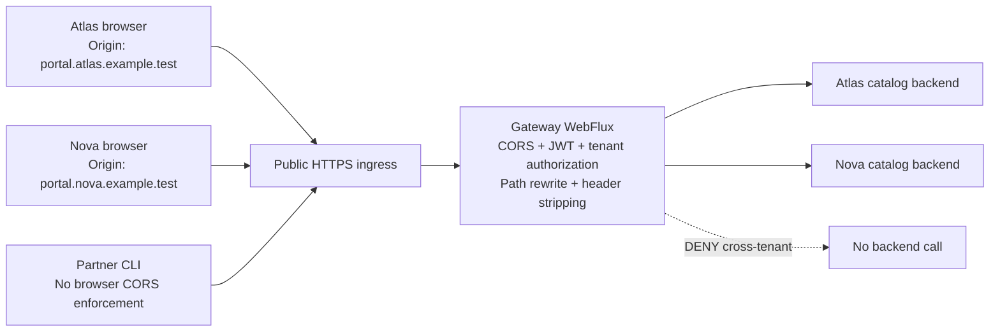
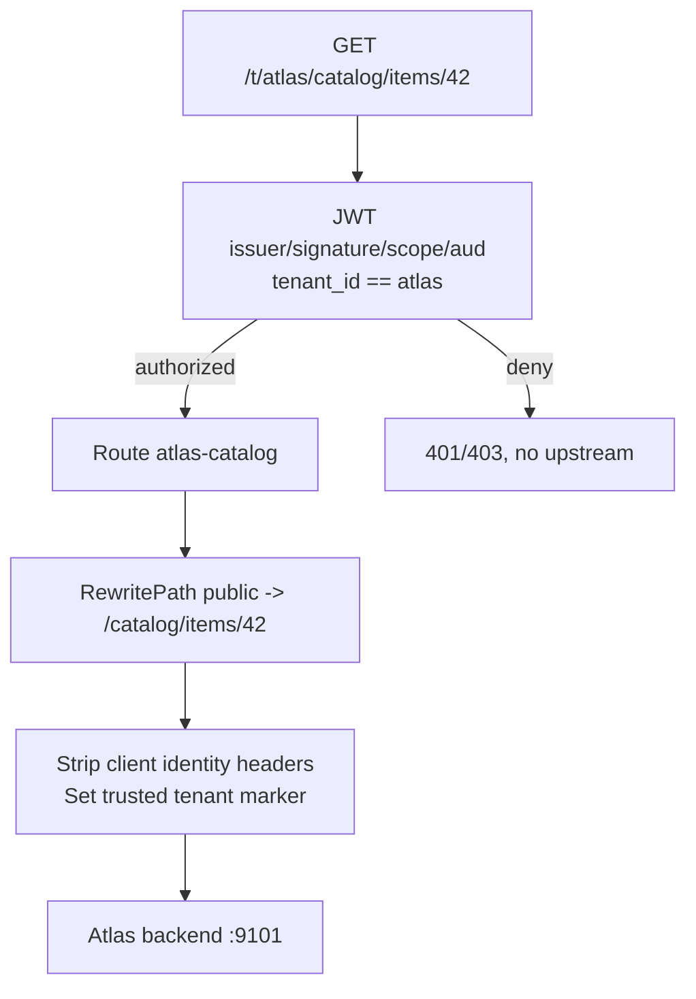
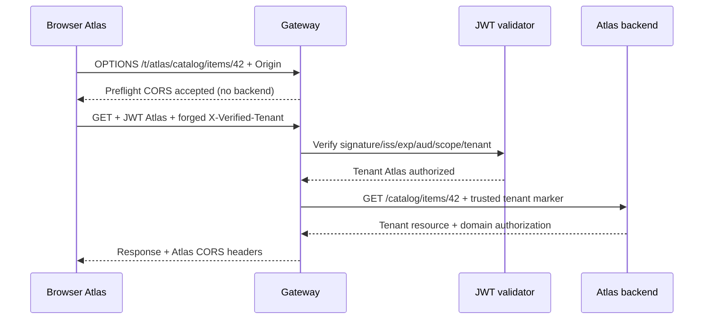
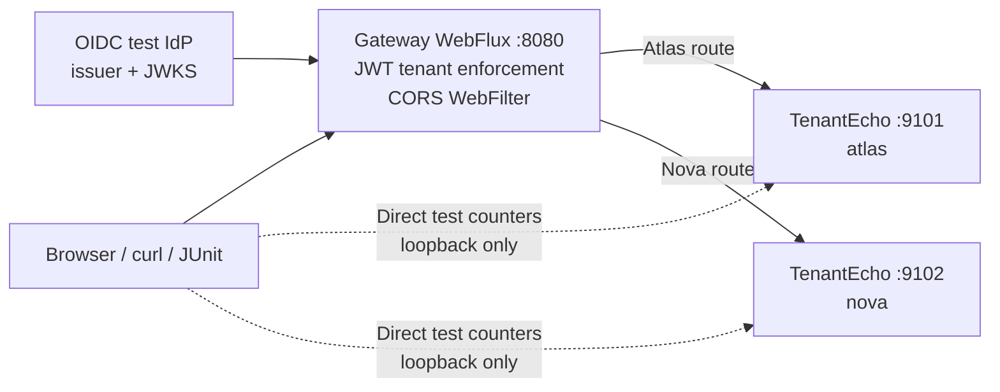
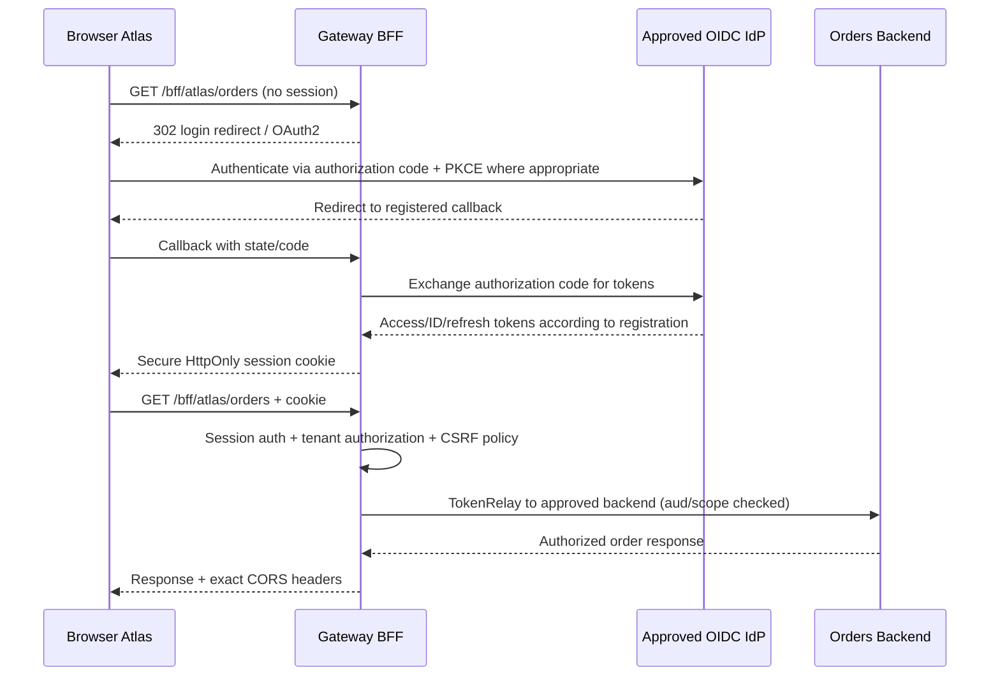

# Managing CORS, Tokens, and Rewrites in a Multi-Tenant Spring Cloud Gateway

In a multi-tenant SaaS architecture, a single API Gateway may serve hundreds of organizations, multiple web apps, mobile apps, partners, and downstream microservices. **Spring Cloud Gateway** selects routes with predicates, runs the filter chain, rewrites paths and headers, integrates discovery, OAuth2/JWT, rate limiting, circuit breakers, retries, TLS, and metrics. Yet a single misconfigured routing rule can send Customer A's request to Backend B or allow a browser to read responses outside its authorized scope.

This lesson in the **Routing Patterns** chapter of the `SPRING_CLOUD_GATEWAY` module focuses on coordinating three mechanisms that are frequently conflated:

- **CORS** governs *whether a browser at a given web origin may read a cross-origin resource response*; it is neither authentication nor tenant authorization.
- **Tokens** (OAuth2 access tokens, JWTs, session credentials) prove identity, permissions, issuer, and audience; they must be validated and checked against the tenant before forwarding requests upstream.
- **Rewrites** map public URLs to backend paths; they must never erase tenant boundaries or cause Security to check a different URL than the client actually sent.

Examples use **Spring Cloud Gateway Server WebFlux 5.0.x**, **Spring Boot 4.x**, and **Spring Security 7.x** compatible releases, organized around `/t/{tenant}/...` paths. Later sections cover `Host`-based routing variants and comparisons with **Server Web MVC**. Domains like `*.example.test` and `*.example.invalid` are illustrative placeholders, not real endpoints.

> **Key takeaway:** Request path, `Origin`, `Host`, JWT issuer, and tenant claim are **distinct pieces of information**. Never treat an allowed CORS `Origin` or a matching `Host` route as proof that the caller is authorized to read that tenant's data. Backends must still enforce resource and tenant authorization.

## 1. Learning Objectives

After this lesson, you will be able to:

1. Distinguish **tenant, OAuth2 client, browser origin, API resource, route ID, audience**, and target service.
2. Design a route and policy matrix spanning tenant, origin, method, audience/scope, and upstream.
3. Intentionally configure global CORS, per-route CORS, or a `CorsWebFilter`, handling `OPTIONS` preflights cleanly before Security.
4. Combine `Path`/`Host` predicates with `RewritePath`/`StripPrefix` while testing exact backend paths and route precedence.
5. Build a `SecurityWebFilterChain` validating JWTs (`iss`, `exp`, `nbf`, audience, scope) and verifying **the tenant claim matches the tenant in the URL**.
6. Contrast a **Bearer Resource Server** with an **OAuth2 Login / `TokenRelay` BFF**, avoiding relaying tokens to the wrong audience or leaking cookies.
7. Explain why untrusted `Origin`, `Host`, or `X-Tenant` headers must never select upstreams or grant permissions.
8. Test cross-tenant attempts, CORS preflights, header spoofing, rewrites, cookies, CSRF, and cache/rate-limit isolation.
9. Operate safely when onboarding tenants dynamically, rotating IdPs, updating routes, and scaling Gateway replicas.
10. Diagnose 401/403/404/CORS failures by identifying **which layer rejected the request**, not just the status in DevTools.

## 2. Concepts You Must Never Conflate

### 2.1. Example with Three Customers and Two Client Types

Suppose a SaaS exposes Catalog, Orders, and Reporting APIs:

| Entity | Example | Controlled by | Role |
|---|---|---|---|
| **Tenant** | `atlas`, `nova`, `harbor` | SaaS platform / tenant registry | Data and policy boundary |
| **Browser origin** | `https://portal.atlas.example.test` | Frontend deployment / browser URL | Origin of JS initiating `fetch` |
| **Public API origin** | `https://api.example.test` | Gateway/ingress operator | Public API entry point |
| **OAuth2 client** | `atlas-spa`, `partner-cli` | IdP/admin | Client registration and grant type |
| **Issuer** | `https://idp.example.test/realms/saas` | Trusted IdP | Issues and signs tokens |
| **Token audience** | `gateway-api`, `orders-api` | IdP/resource server | Which resource server the token targets |
| **Tenant claim** | `tenant_id=atlas` | Trusted IdP post-signature verification | Asserts authorized tenant |
| **Public path** | `/t/atlas/catalog/items/42` | Client-editable | **Untrusted** routing input |
| **Backend path** | `/catalog/items/42` | Gateway rewrite | Microservice path |
| **Upstream service** | `catalog-atlas.internal:8443` | Trusted control plane / discovery | Serves tenant Atlas |

A browser sitting on `portal.atlas.example.test` **can send** a request to `/t/nova/...`, spoof `Origin` with a custom HTTP client, or inject `X-Tenant: nova`. Policies must catch mismatches between the **token-verified tenant** and the **requested tenant**.

### 2.2. Trust Boundaries



Policy layers:

| Layer | Question | Trust source | Outcome |
|---|---|---|---|
| TLS ingress | Is the client talking to the real Gateway? | CA / certs / ingress | Stops MITM; enforces TLS origin |
| CORS | Which browser JS origins may read responses? | `Origin` + server allowlist | CORS headers / preflight rejection |
| Authentication | Is the credential valid? | Signature / JWK / issuer / expiry | 401 when bearer missing/invalid |
| Audience/scope | Is the token valid for this API/capability? | **Verified** token claims | 403 or auth failure per policy |
| Tenant authorization | May the caller access `/t/atlas/**`? | Auth claims + tenant registry/ACL | 403 on token/tenant mismatch |
| Route matching | Atlas route or Nova route? | `Path`/`Host`/`Method` post-Security | Picks the matching route |
| Rewrite | Which URI/path does the backend see? | Approved route config | Maps public path to internal path |
| Upstream authorization | May the user access object ID 42? | Domain ACL / ownership | Backend 403/404 when unauthorized |

**CORS is a browser safeguard, never a substitute for authentication or authorization.** `curl`, Postman, mobile apps, and attackers using non-browser HTTP clients can issue requests even when the server omits `Access-Control-Allow-Origin`. CORS never blocks non-browser HTTP requests.

### 2.3. Two Valid Architectures with Distinct Token Handling

**Model A — Stateless bearer API:** SPAs, mobile apps, or CLIs send `Authorization: Bearer ...`. The Gateway acts as an OAuth2 **Resource Server**, verifying the token and enforcing tenant authorization. It may **strip** the bearer token before upstream forwarding—replacing it with a protected/mTLS-bound identity assertion—or forward/exchange it only when downstreams need it and audiences match.

**Model B — BFF / OAuth2 login:** Browsers talk to the Gateway via an **`HttpOnly` session cookie**; the Gateway acts as an OAuth2 **Client**, handling authorization-code login and calling backends via `TokenRelay` or token exchange. This requires CSRF protection, a session store, and persistent OAuth2 authorized-client storage when scaled horizontally.

**Never combine “disable CSRF + browser cookie auth + `TokenRelay`” merely because JWTs appear somewhere in the stack.** CSRF exposure depends on whether the browser sends credentials automatically, not on whether the downstream backend accepts bearer tokens.

## 3. Designing the Tenant × Origin × Route × Permission Matrix

Illustrative policy:

| Tenant | Approved frontend origin | Public route | Backend | Required scope |
|---|---|---|---|---|
| Atlas | `https://portal.atlas.example.test` | `/t/atlas/catalog/**` | Catalog Atlas | `catalog.read` |
| Nova | `https://portal.nova.example.test` | `/t/nova/catalog/**` | Catalog Nova | `catalog.read` |
| Atlas | `https://admin.atlas.example.test` | `/t/atlas/orders/**` | Orders Atlas | `orders.read`/`orders.write` |
| Nova | `https://portal.nova.example.test` | `/t/nova/orders/**` | Orders Nova | `orders.read`/`orders.write` |
| Partner | Independent of browser origin | `/partner/**` | Partner API | `partner.access` + tenant relationship |

In real deployments, permissions depend on **user memberships, roles, resource ownership, and tenant status**, and cannot always be collapsed into one `tenant_id` if users belong to multiple tenants. This lab uses a single `tenant_id` for clarity; multi-membership setups should resolve entitlements from a trusted source post-authentication.

Core rules:

1. A control-plane-managed **tenant registry** is the source of truth mapping tenant ID → approved origins → routes → service identities.
2. **`Origin`** never selects a tenant; it is checked solely against allowed origins for the requested route/path.
3. The **public path** states what the client **requests**, while the verified token/ACL decides whether it is allowed.
4. Never construct a **route destination** by interpolating an untrusted `tenant` string into a hostname, such as `http://${tenant}.internal`.
5. **Token issuers** must belong to a trusted allowlist—never fetch JWKs from an arbitrary unverified `iss` URL.
6. **Backends** must still verify data permissions or trust Gateway identity assertions only over a secured channel.
7. All tenant variations in caches, rate limits, retries, traces, and audits must preserve boundaries; caching solely by `/items/42` leaks data when two tenants share object IDs.

## 4. CORS: Preflight, Actual Requests, and Credential Modes

### 4.1. Browser CORS Uses the Scheme–Host–Port Triple

These two URLs are **cross-origin**:

```text
Frontend: https://portal.atlas.example.test
API:      https://api.example.test
```

A browser origin consists of **scheme, hostname, and effective port**—excluding path, query, and fragment. `https://portal.atlas.example.test` differs from both `http://portal.atlas.example.test` and `https://portal.atlas.example.test:8443`.

The browser sends:

```http
Origin: https://portal.atlas.example.test
```

This is an **HTTP header providing browser CORS context**, **never proof that the caller belongs to Atlas**. Any standalone HTTP client can set `Origin` arbitrarily.

### 4.2. Preflight `OPTIONS`

When JavaScript makes a cross-origin `fetch` with `Authorization` or non-safelisted headers, browsers normally send a preflight:

```http
OPTIONS /t/atlas/catalog/items/42 HTTP/1.1
Origin: https://portal.atlas.example.test
Access-Control-Request-Method: GET
Access-Control-Request-Headers: authorization
```

If permitted, the Gateway replies:

```http
HTTP/1.1 200 OK
Access-Control-Allow-Origin: https://portal.atlas.example.test
Access-Control-Allow-Methods: GET,POST,OPTIONS
Access-Control-Allow-Headers: Authorization,Content-Type
Access-Control-Max-Age: 600
Vary: Origin, Access-Control-Request-Method, Access-Control-Request-Headers
```

The status may be 200 or 204 depending on WebFlux/handler; assert that **preflight completes before hitting upstreams and without requiring a JWT**, since preflights omit the actual request's `Authorization` header. In some stacks, `Vary` headers may span multiple lines or merge tokens; avoid brittle exact-string comparisons when validating CORS.

Then comes the **actual request**:

```http
GET /t/atlas/catalog/items/42 HTTP/1.1
Origin: https://portal.atlas.example.test
Authorization: Bearer <synthetic-atlas-token>
```

This still passes through **JWT validation, scope checks, and tenant authorization**. Passing preflight **never implies the `GET`/`POST` will succeed**.

### 4.3. `Access-Control-Allow-Origin` and Credentials

| Model | CORS policy | Caveats |
|---|---|---|
| Browser with bearer header | Exact allowed origin; `allowedHeaders` includes `Authorization` | Token validation mandatory |
| Browser with session cookie | Exact origin, `allowCredentials=true`, `Secure`/`SameSite` cookies | **CSRF protection mandatory** per threat model |
| Public read-only endpoint | May use `allowedOrigins=*` if genuinely public | Never use wildcard on private data |
| Multiple tenant origins | Specific allowlists per URL path/tenant | Never blindly echo request `Origin` |
| Server-to-server / CLI | CORS does not govern access | Enforce tokens, mTLS, and client auth |
| WebSocket | Separate browser `Origin`/handshake policy | HTTP CORS does not automatically secure WebSockets |

**Never combine `allowedOrigins=*` with `allowCredentials=true`.** Origin patterns with credentials require careful scrutiny; Spring's `allowedOriginPatterns` can still leak tenant data if overly broad. For B2B SaaS, prefer exact origin allowlists approved by tenant admins.

### 4.4. Preflight May Not Match a `Method=GET` Route

If a Gateway route specifies `Method=GET`, a preflight uses **`OPTIONS`** and will miss the route. Under Gateway 5.0.x docs, setting `spring.cloud.gateway.server.webflux.globalcors.add-to-simple-url-handler-mapping=true` applies global CORS even to preflight requests matching no route predicates.

Never “fix” this by:

- Letting `OPTIONS` pass unrestricted to every upstream.
- Requiring bearer tokens on preflights because “every request needs auth.”
- Opening `/**` with `allowedOrigins=*` so every preflight returns 200.
- Disabling CORS in Security without configuring `CorsWebFilter` or Gateway CORS ahead of Security.

Spring Security WebFlux recommends handling CORS **before** Security because preflights omit cookies and bearer tokens. Designate **one authoritative CORS source** and verify each layer so Gateway, Security, backends, and ingress never emit conflicting CORS headers.

## 5. Three Ways to Configure CORS Policy and When to Use Each

### 5.1. Gateway Global CORS by Path Pattern

Gateway WebFlux 5.0 provides official properties:

```yaml
spring:
  cloud:
    gateway:
      server:
        webflux:
          globalcors:
            add-to-simple-url-handler-mapping: true
            cors-configurations:
              '[/t/atlas/**]':
                allowedOrigins:
                  - https://portal.atlas.example.test
                allowedMethods:
                  - GET
                  - POST
                  - OPTIONS
                allowedHeaders:
                  - Authorization
                  - Content-Type
                exposedHeaders:
                  - X-Request-Id
                allowCredentials: false
                maxAge: 600

              '[/t/nova/**]':
                allowedOrigins:
                  - https://portal.nova.example.test
                allowedMethods:
                  - GET
                  - POST
                  - OPTIONS
                allowedHeaders:
                  - Authorization
                  - Content-Type
                exposedHeaders:
                  - X-Request-Id
                allowCredentials: false
                maxAge: 600
```

Keys like `'[/t/atlas/**]'` follow the Gateway's URL-pattern map syntax, and inner fields configure Spring Framework `CorsConfiguration`. For browser bearer APIs, `allowCredentials=false` fits when JS **does not send cookies**; programmatic `Authorization` headers still require `allowedHeaders` and JWT validation. If using cookies/sessions, enable credentials carefully alongside CSRF protection.

**Use when:** policies align cleanly with URL path prefixes and you want the Gateway to handle preflights even when `Method=GET`/`POST` predicates skip `OPTIONS`.

**Never layer another `CorsWebFilter` with differing policies** on the same paths, nor let backends or ingress append duplicate `Access-Control-Allow-Origin` headers—browsers reject responses with duplicate CORS headers.

### 5.2. Per-Route CORS Metadata

An alternative is `metadata.cors`:

```yaml
spring:
  cloud:
    gateway:
      server:
        webflux:
          routes:
            - id: atlas-catalog
              uri: https://catalog.atlas.internal.example.test:8443
              predicates:
                - Path=/t/atlas/catalog/**
                - Method=GET
              metadata:
                cors:
                  allowedOrigins:
                    - https://portal.atlas.example.test
                  allowedMethods:
                    - GET
                  allowedHeaders:
                    - Authorization
                  allowCredentials: false
                  maxAge: 600
```

**Use when:** each route needs a simple, non-overlapping CORS policy and you have verified preflight behavior when route predicates omit `OPTIONS`.

**Caution:** route CORS metadata can rely on `Path` patterns to look up CORS configs; if multiple tenants share **the same `Path` and differ only by `Host`**, verify how the CORS source selects policies. Never assume “the matched route's metadata” handles `OPTIONS` if `Method` or `Host` misses. When policies depend on **Host + Path + Origin**, use a custom `CorsConfigurationSource` checking trusted `Host`, or separate tenant path prefixes.

### 5.3. Programmatic `CorsWebFilter` Backed by a Tenant Registry

When many tenants update policies dynamically at runtime, register a single `CorsWebFilter` backed by a `CorsConfigurationSource` checking canonicalized path/Host against approved origins.

Requirements for this option:

1. **Single authoritative CORS source:** disable Gateway `globalcors` and route `metadata.cors` on overlapping URLs.
2. Tenant policy store **reads solely from the trusted control plane**, never trusting request `Origin` to populate allowlists.
3. Preflight executes **before Spring Security**.
4. Config updates use immutable/versioned snapshots; new tenants activate only post-approval.
5. Cross-tenant tests verify Host/Path overlaps and dynamic route refreshes.

In the lab below, we use `CorsWebFilter` with **two fixed path prefixes** to make boundaries obvious. Production systems can extract policies into a registry/service, but never run blocking database lookups on the Reactor Netty event loop for each `OPTIONS` request.

### 5.4. Minimum CORS Test Cases

| Request | Correct outcome for Atlas route |
|---|---|
| `Origin: https://portal.atlas.example.test` | Permitted when method/headers match |
| `Origin: https://portal.nova.example.test` | No allow-origin for Atlas API; preflight rejected |
| `Origin: http://portal.atlas.example.test` | Rejected (scheme mismatch) |
| `Origin: https://portal.atlas.example.test:8443` | Rejected (port mismatch) |
| `Origin: https://portal.atlas.example.test.evil.test` | Rejected (host mismatch) |
| Missing `Origin` from CLI/backend client | **No CORS decision**; token still required |
| `OPTIONS` asks for `DELETE` when only `GET`/`POST` allowed | Preflight rejected |
| `OPTIONS` asks for `X-Unapproved` header | Preflight rejected |
| `OPTIONS` without JWT | Should succeed; never 401 solely for missing bearer |
| Actual `GET` with valid `Origin` but Nova token | **403** from tenant authorization |
| Actual `GET` with valid `Origin` but no token | **401** from authentication |
| Cookies/credentials from another origin | Never widen allowlists just to “make login work” |

**Never curl a single request with a valid `Origin` and declare CORS tested.** Test `OPTIONS` preflights with `Access-Control-Request-Method`/`Access-Control-Request-Headers`, actual responses, and real browser `fetch` calls. `curl` itself does not enforce browser same-origin policy.

## 6. Routing and Rewrite Patterns That Preserve Tenant Boundaries

### 6.1. Path-Based Multi-Tenancy

Define public URLs:

```text
GET https://api.example.test/t/atlas/catalog/items/42
GET https://api.example.test/t/nova/catalog/items/42
```

To preserve backend contracts:

```text
Gateway route atlas-catalog --> http://127.0.0.1:9101/catalog/items/42
Gateway route nova-catalog  --> http://127.0.0.1:9102/catalog/items/42
```

`/t/atlas` and `/t/nova` are stripped from the **upstream path**, yet must be validated **before rewriting**.



Never write a Security rule `pathMatchers("/catalog/**")` to guard **public requests to `/t/atlas/catalog/**`** expecting `RewritePath` to run first. Reactive Security `WebFilter`s normally execute **before** Gateway routing and filter rewrites. Always write authorization matchers against **the inbound URL the client actually calls**.

### 6.2. `RewritePath` and Escaping `$` in YAML

Sample route:

```yaml
- id: atlas-catalog
  order: -10
  uri: http://127.0.0.1:9101
  predicates:
    - Path=/t/atlas/catalog/**
    - Method=GET
  filters:
    - 'RewritePath=/t/atlas/(?<segment>.*), /$\{segment}'
    - RemoveRequestHeader=Cookie
    - RemoveRequestHeader=Authorization
    - SetRequestHeader=X-Verified-Tenant,atlas
```

In YAML, keep `$\{segment}` in the replacement as documented by Spring Cloud Gateway. Use a **single-quoted YAML scalar** so YAML does not strip the backslash, and verify the resulting URI at the backend. Never apply JS string interpolation or shell expansion to this snippet; in Spring config, it is a **route filter argument**.

Examples:

| Public request | After `RewritePath` | Route |
|---|---|---|
| `/t/atlas/catalog/items/42` | `/catalog/items/42` | `atlas-catalog` |
| `/t/atlas/catalog/items/42?lang=vi` | `/catalog/items/42?lang=vi` | `atlas-catalog` |
| `/t/nova/catalog/items/42` | **Does not match Atlas** | `nova-catalog` |
| `/t/atlas/orders/42` | Does not match catalog route | Orders route if defined |
| `/t/atlas/catalog/../admin` | Depends on normalization/firewall; never allow bypass | Reject/deny per policy |

`RewritePath` uses Java regex: keep patterns simple and test encoded slashes, duplicate slashes, percent-encoding, trailing slashes, Unicode, and traversal edge cases that might evade route or security matchers. Never relax `StrictHttpFirewall` just to admit ambiguous encodings.

### 6.3. `StripPrefix` Is Simpler When Segments Are Fixed

To drop exactly `t` and `atlas`, this filter:

```yaml
filters:
  - StripPrefix=2
```

also transforms `/t/atlas/catalog/items/42` into `/catalog/items/42`. **Never combine `StripPrefix=2` and `RewritePath` on the same route unless two passes are genuinely intended**: filter ordering can accidentally strip down to `/items/42`.

Use `StripPrefix` when prefix segment counts are fixed; use `RewritePath` when regex capture or restructuring is needed, always backed by per-route tests.

### 6.4. Host/Subdomain-Based Routing

Alternative pattern:

```yaml
- id: atlas-host-catalog
  uri: https://catalog.atlas.internal.example.test:8443
  predicates:
    - Host=atlas.api.example.test
    - Path=/catalog/**
    - Method=GET
  filters:
    - SetRequestHeader=X-Verified-Tenant,atlas
```

For `GET https://atlas.api.example.test/catalog/items/42`, the `Host` predicate matches the virtual host. Still, **`Host` is not proof of tenant ownership**: HTTP clients control `Host`/`:authority`, and reverse proxies may forward `X-Forwarded-Host`. Verify `tenant=atlas` in the token, sanitize forwarded headers at ingress, and lock down TLS/SNI/virtual hosts.

When multiple tenants share **the same path `/catalog/**`** differentiated solely by `Host`, path-only CORS configuration is insufficient. The CORS source must evaluate **ingress-verified host + path + allowed browser origins**, or split public paths by tenant. Never let one `/catalog/**` rule emit origins for all tenants.

### 6.5. Route Order and Catch-Alls

| Route ID | Path | Order | Risk |
|---|---|---:|---|
| `atlas-catalog` | `/t/atlas/catalog/**` | -10 | Atlas permissions |
| `nova-catalog` | `/t/nova/catalog/**` | -10 | Nova permissions |
| `tenant-generic` | `/t/**` | 100 | Risks shadowing or misrouting tenants |
| `unsafe-catchall` | `/**` | -100 | Can hijack every request ahead of specific routes |

Avoid defining catch-all proxy routes to sensitive backends. If a fallback is unavoidable, give it strict Security denial, explicit `order`, and expected 404/403 behavior. **Route precedence never replaces authorization**; a generic route reaching the right backend while omitting tenant filters is still a security vulnerability.

### 6.6. Identity Headers Across Rewrites

When backends expect a tenant marker:

- Strip client-sent `X-Tenant`, `X-Verified-Tenant`, and `X-User-Id` if untrusted.
- **Set** (never merely `Add`) the canonical value after Security verifies the tenant and token.
- Let backends trust that marker only when **untrusted clients cannot reach the backend directly** and the Gateway→backend link is protected by mTLS or network policy.
- For high-sensitivity services, prefer backend verification of signed tokens or token exchange rather than unsigned headers.
- Preserve correlation/trace IDs while never logging raw bearer tokens or cookies.

Putting `SetRequestHeader=X-Verified-Tenant,atlas` on a route does not authenticate clients on its own. It is meaningful **only when the route is genuinely protected** and no alternate route bypasses Security.

## 7. Tokens: Issuer, Audience, Tenant, and Scope Are Four Separate Checks

### 7.1. Valid Access Tokens Must Be **Verified**, Not Merely Decoded

An API JWT might contain:

```json
{
  "iss": "https://idp.example.test/realms/saas",
  "sub": "user-42",
  "aud": ["gateway-api"],
  "tenant_id": "atlas",
  "scope": "catalog.read orders.read",
  "exp": 1900000000,
  "nbf": 1800000000
}
```

This is an **illustrative payload, not a signed JWT or real credential**. Never reuse these timestamps in production. Gateway and backends may trust claims only after:

1. Verifying the signature, signing algorithm, and public key from an **approved issuer**.
2. Validating `exp`, `nbf`, `iss`, and standard claims in the Resource Server.
3. Validating **audience** against the receiving resource; default JWT Resource Server setup does not automatically enforce your business audience.
4. Confirming `tenant_id` or verified membership matches **the tenant requested in the path/Host**.
5. Checking required `scope`/roles for the operation and backend object permissions.

A validly signed Nova token must never reach the Atlas backend just because the caller changed the URL to `/t/atlas/**`. An Atlas token lacking `orders.write` must never modify orders. A signed token with `aud=mobile-app` must never be accepted by `orders-api` when audiences differ.

### 7.2. Authorization Decision Matrix

| Request | Token | Outcome |
|---|---|---|
| `GET /t/atlas/catalog/items` | Valid issuer, tenant atlas, aud `gateway-api`, scope `catalog.read` | Allow through |
| `GET /t/atlas/catalog/items` | **Missing** `Authorization` | 401 |
| `GET /t/atlas/catalog/items` | Bad signature / expired / wrong issuer | 401 |
| `GET /t/atlas/catalog/items` | Nova token with valid scope | **403** (wrong tenant) |
| `GET /t/atlas/catalog/items` | Atlas token with wrong `aud` | **403** per access policy, or 401 if validator rejects token |
| `GET /t/atlas/catalog/items` | Atlas token missing scope | 403 |
| `GET /t/nova/catalog/items` | Nova token with valid scope | Allow through to Nova |
| `GET /t/unknown/catalog/items` | Any token | Deny / no route; never auto-open new tenant |
| `GET /t/atlas/orders/42` | Atlas, `catalog.read` without `orders.read` | 403 |
| `POST /t/atlas/orders` | Atlas, `orders.read` without `orders.write` | 403 |
| Atlas browser `Origin` with Nova token | Preflight may pass for Atlas URL, yet actual request returns 403 | **CORS does not grant authorization** |

Exact HTTP status codes depend on your authentication entry point and exception handlers; in this lesson's example, **401 signals missing/invalid credentials**, while **403 signals an authenticated caller lacking tenant, audience, or scope**. Verify actual exception mapping in production instead of assuming all 401/403s come from one place.

### 7.3. Bearer Forwarding Is a Trust-Boundary Decision

Three distinct options:

| Pattern | Gateway → Backend | When to use |
|---|---|---|
| **Gateway-only validation** | Strip `Authorization`; send signed/mTLS-bound assertion or trusted header | Backends share trust domain and still enforce domain ACLs |
| **Pass-through bearer** | Forward access token to backend | Backends independently validate token, audience, and tenant |
| **Token exchange** | Exchange inbound token for one with `aud=orders-api` | Backends require distinct audiences under least privilege |

Never forward an `aud=gateway-api` token to `payments-api` and configure `payments-api` to accept any audience. Never forward refresh tokens to backends in headers. When the Gateway acts as an OAuth2 Client, `TokenRelay` forwards the **authorized client's** access token—it does not escalate permissions or alter audiences automatically. Design token exchange explicitly in your OAuth2 Authorization Server / IdP.

### 7.4. Multi-Issuer / Multi-IdP

Some SaaS platforms let Atlas and Nova use separate IdPs:

```text
Atlas token iss = https://idp.atlas.example.test/issuer
Nova token  iss = https://idp.nova.example.test/issuer
```

Spring Security Reactive Resource Server provides `JwtIssuerReactiveAuthenticationManagerResolver.fromTrustedIssuers(...)`. Configuration excerpt (illustrating two approved issuers):

```java
JwtIssuerReactiveAuthenticationManagerResolver resolver =
    JwtIssuerReactiveAuthenticationManagerResolver
        .fromTrustedIssuers(
            "https://idp.atlas.example.test/issuer",
            "https://idp.nova.example.test/issuer");

return http
    .authorizeExchange(exchange -> exchange
        .anyExchange().authenticated())
    .oauth2ResourceServer(oauth2 ->
        oauth2.authenticationManagerResolver(resolver))
    .build();
```

This is **a fragment inside `SecurityWebFilterChain`**, not a standalone class. And **trusted issuers do not replace tenant authorization**: once an Atlas token validates, still verify the approved issuer-to-tenant mapping, `aud`, scopes, and customer path/Host. Never resolve an untrusted `iss` from an unverified JWT to fetch arbitrary JWKs—that introduces SSRF and accepts rogue issuers.

When onboarding a tenant, verify issuer URL, audience, CA trust, and JWK policies in the control plane and register them safely—never let a tenant submit an arbitrary `issuer-uri` to spawn authentication managers unchecked.

## 8. OAuth2 `TokenRelay` and the Two Browser Models

### 8.1. What Does `TokenRelay` Actually Do?

Spring Cloud Gateway Server WebFlux offers the `TokenRelay` `GatewayFilter`, accepting an optional `clientRegistrationId`. With Spring Security OAuth2 Client/authorized-client configuration in place, the filter grabs the OAuth2 access token of the authenticated principal or client registration and puts it in the outbound `Authorization` header. Route example:

```yaml
- id: bff-orders
  uri: https://orders.svc.example.test:8443
  predicates:
    - Path=/bff/orders/**
  filters:
    - StripPrefix=1
    - TokenRelay=
```

**Note:** This assumes the **OAuth2 Client/BFF model**, requiring `spring-boot-starter-oauth2-client`, matching `spring.security.oauth2.client.registration.*`/`provider.*` settings, and `oauth2Login()` or client authorization. Without `ReactiveClientRegistrationRepository`/authorized-client beans, do not assume the filter exists or relays tokens automatically.

`TokenRelay` is **not** a tenant authorization filter; even when an access token is relayed, both Gateway and backend must enforce permissions. If the BFF picks the wrong client registration or audience, the backend must reject it.

### 8.2. Two Common Client Models

**Bearer SPA model:**

```text
Browser (Atlas) -- Authorization: Bearer JWT --> Gateway Resource Server
Gateway -- remove inbound bearer / exchange if needed --> Atlas backend
```

- Browser holds tokens in memory and sends them via JS; requires strong XSS and token-leak defenses.
- Exact CORS origins, `Authorization` in `allowedHeaders`, HTTPS.
- Stateless Gateway without browser session cookies.
- CSRF can be disabled **only on bearer-only endpoints carrying zero ambient browser credentials** after validating the threat model.

**BFF cookie session model:**

```text
Browser (Atlas) -- HttpOnly Secure session cookie --> Gateway OAuth2 Client
Gateway -- TokenRelay / authorized client token --> Approved backend
```

- Browser never stores access tokens directly.
- CORS may need `allowCredentials=true` with exact origins; frontend uses `fetch(..., {credentials:"include"})` only where cookie policy permits.
- Cookies enforce `Secure`, `HttpOnly`, `SameSite`, `Domain`, and `Path`.
- **CSRF must stay enabled** for cookie-authenticated state-changing requests, even though the Gateway sends bearer tokens downstream.
- Test session fixation, login/logout, timeouts, and multi-replica session persistence.

### 8.3. `TokenRelay` Does Not Solve Multi-Replica Lifecycle Automatically

Gateway 5.0 docs state that the default `ReactiveOAuth2AuthorizedClientService` uses an in-memory store. If Gateway A stores the authorized client and the next request hits Gateway B, `TokenRelay` can fail or drift.

Architectural fixes include a shared, secured authorized-client repository/service, Spring Session for associated session/auth state, or redesigned token acquisition/exchange—verify which bean actually persists authorized-client state. **Never assume adding Redis HTTP session alone gives `TokenRelay` a distributed authorized-client store.**

Test matrix must cover login on A, request routed to B, token refresh, logout/revocation, key rotation, login callbacks after ingress restarts, and Redis/IdP outages. Never log refresh or access tokens.

### 8.4. CORS and CSRF in a BFF

CORS is a **browser read policy**. CSRF protects state-changing requests when browsers **automatically attach** session cookies without user intent. Example Atlas BFF call:

```text
POST https://api.example.test/bff/orders
Cookie: SESSION=...
X-CSRF-TOKEN: <synthetic-token>
Origin: https://portal.atlas.example.test
```

Configure a WebFlux-compatible CSRF repository/handler and cookie/header strategy if the frontend reads tokens, paired with `Origin`/`Referer` checks where appropriate. Never disable CSRF globally just to make OAuth2 login or CORS preflight “work easily.” Preflights carry no session credentials, whereas actual requests carry cookies and require both authentication and CSRF validation.

### 8.5. Where to Normalize Tokens and Headers

- With a Gateway Resource Server, **verify before proxying**; forward tokens only under explicit policies rather than assuming all backends parse JWTs.
- With `TokenRelay`, ensure no other filter accidentally overwrites `Authorization`.
- Always strip and overwrite client-supplied `X-User-Id` / `X-Tenant` from verified identity.
- On static tenant routes, `SetRequestHeader=X-Verified-Tenant,atlas` never replaces JWT validation. Backends may trust it only when routes are protected and Gateway→backend uses mTLS/network isolation.
- Scope identity headers to the expected outbound `Host`/scheme, and never forward bearer tokens or cookies across redirects or fallback origins.
- Object-level authorization on orders/invoices still belongs in the backend.

## 9. A Solid Route Satisfies Three Contracts Simultaneously

Suppose the client sends:

```http
GET /t/atlas/catalog/items/42 HTTP/1.1
Origin: https://portal.atlas.example.test
Authorization: Bearer <atlas-token>
X-Verified-Tenant: nova
```

The Gateway handles this in **conceptual order**:

1. CORS evaluates the Atlas origin against the **public path** `/t/atlas/**`.
2. Resource Server verifies JWT signature, issuer, expiry, and audience.
3. Authorization verifies `tenant_id=atlas` and scope `catalog.read`.
4. Route `atlas-catalog` matches `/t/atlas/catalog/**`.
5. Rewrite strips `/t/atlas` so the backend sees `/catalog/items/42`.
6. Strip `Cookie`/`Authorization` (under Gateway-only validation) and overwrite `X-Verified-Tenant=atlas`, ignoring spoofed `nova`.
7. Proxy solely to the **approved Atlas backend** protected by mTLS/`NetworkPolicy`.
8. Backend verifies item 42 belongs to Atlas and returns the response.
9. Response emits exact, non-duplicated CORS headers; caching never mixes Nova and Atlas data.



**If any check fails:** never call the sensitive backend. 401/403/404 statuses must pinpoint the rejecting layer rather than being turned into 200 by retries/fallbacks or diverted to another tenant's backend.

## 10. Lab: Multi-Tenant WebFlux Gateway with Two Independent Upstreams

This lab runs **one Gateway application** and **two independent backends**. Goal: prove Atlas/Nova traffic never misroutes, CORS preflights succeed/fail accurately, and wrong-tenant JWTs are rejected **before hitting upstreams**.



**Lab safety constraints:**

- All Gateway and backend servers bind strictly to `127.0.0.1`; never expose to the Internet.
- CORS uses **only one lab-defined `CorsWebFilter`**; do **not** also enable `globalcors` or `metadata.cors` on those paths.
- Exposes only `GET /t/{tenant}/catalog/**`. No session/BFF/`TokenRelay` is mixed into this lab so credential models stay isolated.
- JWTs are issued by a **real test IdP** with valid signatures, JWKs, and issuer—never fabricate unsigned JWTs or disable signature verification.
- Use solely synthetic tenant identities, synthetic tokens, and synthetic items.
- Routes are pinned strictly per tenant ID, never interpolating arbitrary hostnames from paths or headers.

### 10.1. Minimum Maven Dependencies

Create a Spring Boot 4.x project with a compatible Spring Cloud BOM 2025.1.x. Core dependencies:

```xml
<dependencies>
    <dependency>
        <groupId>org.springframework.cloud</groupId>
        <artifactId>spring-cloud-starter-gateway-server-webflux</artifactId>
    </dependency>
    <dependency>
        <groupId>org.springframework.boot</groupId>
        <artifactId>spring-boot-starter-oauth2-resource-server</artifactId>
    </dependency>
    <dependency>
        <groupId>org.springframework.boot</groupId>
        <artifactId>spring-boot-starter-actuator</artifactId>
    </dependency>
    <dependency>
        <groupId>org.springframework.boot</groupId>
        <artifactId>spring-boot-starter-test</artifactId>
        <scope>test</scope>
    </dependency>
</dependencies>
```

This is **not a complete `pom.xml`**: include a compatibility-checked Boot parent/build plugin and Spring Cloud BOM. Spring Security JWT pulls in JOSE via the starter; never add Servlet Security Web MVC into a reactive project.

Main class `TenantGatewayApplication.java`:

```java
import org.springframework.boot.SpringApplication;
import org.springframework.boot.autoconfigure.SpringBootApplication;

@SpringBootApplication
public class TenantGatewayApplication {
    public static void main(String[] args) {
        SpringApplication.run(TenantGatewayApplication.class, args);
    }
}
```

### 10.2. Gateway `application.yml` — Two Non-Overlapping Routes

```yaml
server:
  address: 127.0.0.1
  port: 8080

spring:
  application:
    name: gateway-multitenant-routing-lab

  security:
    oauth2:
      resourceserver:
        jwt:
          # Must be a real issuer of the test IdP.
          # Example does not bundle an IdP; set the environment variable when running.
          issuer-uri: "${TEST_ISSUER_URI}"

  cloud:
    gateway:
      server:
        webflux:
          routes:
            - id: atlas-catalog
              order: -10
              uri: http://127.0.0.1:9101
              predicates:
                - Path=/t/atlas/catalog/**
                - Method=GET
              filters:
                - 'RewritePath=/t/atlas/(?<segment>.*), /$\{segment}'
                - RemoveRequestHeader=Authorization
                - RemoveRequestHeader=Cookie
                - SetRequestHeader=X-Verified-Tenant,atlas
                - SetRequestHeader=X-Gateway-Route,atlas-catalog

            - id: nova-catalog
              order: -10
              uri: http://127.0.0.1:9102
              predicates:
                - Path=/t/nova/catalog/**
                - Method=GET
              filters:
                - 'RewritePath=/t/nova/(?<segment>.*), /$\{segment}'
                - RemoveRequestHeader=Authorization
                - RemoveRequestHeader=Cookie
                - SetRequestHeader=X-Verified-Tenant,nova
                - SetRequestHeader=X-Gateway-Route,nova-catalog

management:
  endpoints:
    web:
      exposure:
        include: health,info
```

No `/t/{tenant}/**` wildcard route exists to synthesize URIs, and no `/**` catch-all exists. Both `routeId` and backend URL are operator-controlled configuration.

`issuer-uri: "${TEST_ISSUER_URI}"` is a **Spring Boot placeholder** expecting an environment variable; therefore the Gateway cannot serve **actual authenticated GETs** until an IdP/JWKS and valid tokens are provided. Never “fix” this by disabling signature verification or permitting all requests. CORS preflights can be tested independently of JWTs right after the app starts.

`RemoveRequestHeader=Authorization` fits this lab's **Gateway-only JWT validation** contract with an echo backend. **Never apply it blindly** if production backends are OAuth2 Resource Servers expecting bearer tokens—in that case use token exchange or pass-through with strict audience/issuer checks at the backend.

### 10.3. Choosing the Lab's Single CORS Authority

Do not add YAML `spring.cloud.gateway.server.webflux.globalcors` for this lab. Instead, register one Spring Framework `CorsWebFilter` ordered ahead of Spring Security with two distinct `CorsConfiguration` entries by public URL.

Create `TenantCorsConfig.java`:

```java
import java.util.List;

import org.springframework.context.annotation.Bean;
import org.springframework.context.annotation.Configuration;
import org.springframework.core.Ordered;
import org.springframework.core.annotation.Order;
import org.springframework.web.cors.CorsConfiguration;
import org.springframework.web.cors.reactive.CorsWebFilter;
import org.springframework.web.cors.reactive.UrlBasedCorsConfigurationSource;

@Configuration
public class TenantCorsConfig {

    @Bean
    @Order(Ordered.HIGHEST_PRECEDENCE)
    CorsWebFilter corsWebFilter() {
        UrlBasedCorsConfigurationSource source =
                new UrlBasedCorsConfigurationSource();

        source.registerCorsConfiguration(
                "/t/atlas/**",
                cors("https://portal.atlas.example.test"));

        source.registerCorsConfiguration(
                "/t/nova/**",
                cors("https://portal.nova.example.test"));

        return new CorsWebFilter(source);
    }

    private static CorsConfiguration cors(String origin) {
        CorsConfiguration config = new CorsConfiguration();

        config.setAllowedOrigins(List.of(origin));
        config.setAllowedMethods(List.of("GET", "OPTIONS"));
        config.setAllowedHeaders(List.of(
                "Authorization", "Content-Type", "X-Request-Id"));
        config.setExposedHeaders(List.of("X-Request-Id"));

        // Stateless bearer lab: no browser session cookies.
        config.setAllowCredentials(false);
        config.setMaxAge(600L);
        return config;
    }
}
```

This CORS source matches **public request paths**, so `/t/atlas/**` permits only Atlas's origin and similarly for Nova. `CorsWebFilter` handles `OPTIONS` ahead of the JWT security filter; the `Method=GET` Gateway routes never need to match preflights.

**This is a lab choice, not a rule that “every Gateway must use `CorsWebFilter` instead of `globalcors`.”** If your project uses Gateway `globalcors` or `metadata.cors` and passes tests cleanly, keep it—just never add a second layer emitting conflicting headers. For **`Host`-based routing** on a shared path, build a tenant-aware source checking trusted `Host`/ingress rather than copying this `/t/...`-keyed source verbatim.

### 10.4. Where Security Runs vs. Where Rewrites Run

For each actual GET:

1. `TenantCorsConfig` evaluates browser CORS against the public path.
2. `SecurityWebFilterChain` verifies the JWT and checks tenant, scope, and audience.
3. `RoutePredicateHandlerMapping` picks the Atlas or Nova route.
4. `RewritePath` strips `/t/{tenant}` for the backend path.
5. Outbound filters strip `Authorization`/`Cookie` and set the identity marker.
6. Netty proxies to the configured backend; the backend response flows back to the client.

These steps reflect the **logical order** for the lab; exact execution of framework filters and Netty routing depends on runtime ordering. The invariants to test are **zero upstream calls on missing/invalid tokens** and **rewrites never altering tenant authorization decisions**.

## 11. Spring Security: JWT Resource Server + Tenant Authorization

Create `TenantSecurityConfig.java`:

```java
import org.springframework.context.annotation.Bean;
import org.springframework.context.annotation.Configuration;
import org.springframework.http.HttpMethod;
import org.springframework.security.authorization.AuthorizationDecision;
import org.springframework.security.authorization.ReactiveAuthorizationManager;
import org.springframework.security.config.annotation.web.reactive.EnableWebFluxSecurity;
import org.springframework.security.config.web.server.ServerHttpSecurity;
import org.springframework.security.core.Authentication;
import org.springframework.security.oauth2.jwt.Jwt;
import org.springframework.security.web.server.SecurityWebFilterChain;
import org.springframework.security.web.server.authorization.AuthorizationContext;

@Configuration
@EnableWebFluxSecurity
public class TenantSecurityConfig {

    @Bean
    SecurityWebFilterChain apiSecurity(ServerHttpSecurity http) {
        return http
            // ONLY for the stateless bearer API in the lab.
            // Cookie-based BFFs must protect against CSRF.
            .csrf(ServerHttpSecurity.CsrfSpec::disable)
            .httpBasic(ServerHttpSecurity.HttpBasicSpec::disable)
            .formLogin(ServerHttpSecurity.FormLoginSpec::disable)
            .authorizeExchange(exchanges -> exchanges
                // CORS WebFilter placed ahead of Security handles preflight;
                // OPTIONS is not a way to bypass GET authorization.
                .pathMatchers(HttpMethod.OPTIONS, "/t/**")
                    .permitAll()
                .pathMatchers(HttpMethod.GET,
                        "/t/atlas/catalog/**")
                    .access(requireTenant("atlas"))
                .pathMatchers(HttpMethod.GET,
                        "/t/nova/catalog/**")
                    .access(requireTenant("nova"))
                .anyExchange().denyAll())
            .oauth2ResourceServer(oauth2 -> oauth2.jwt(jwt -> { }))
            .build();
    }

    private static ReactiveAuthorizationManager<AuthorizationContext>
    requireTenant(String expectedTenant) {

        return (authenticationMono, context) ->
            authenticationMono
                .map(auth -> new AuthorizationDecision(
                    permitted(auth, expectedTenant)))
                .defaultIfEmpty(new AuthorizationDecision(false));
    }

    private static boolean permitted(
            Authentication auth, String expectedTenant) {

        if (!auth.isAuthenticated()
                || !(auth.getPrincipal() instanceof Jwt jwt)) {
            return false;
        }

        boolean tenantMatches = expectedTenant.equals(
                jwt.getClaimAsString("tenant_id"));

        // Audience check is an explicit application requirement.
        boolean audienceMatches =
                jwt.getAudience().contains("gateway-api");

        boolean hasScope = auth.getAuthorities().stream()
            .anyMatch(authority ->
                "SCOPE_catalog.read".equals(authority.getAuthority()));

        return tenantMatches && audienceMatches && hasScope;
    }
}
```

**Important points about this code:**

- `issuer-uri` configures the Resource Server to verify signatures, `iss`, and timestamps via issuer/JWK metadata per Spring Security. Never use APIs that merely *decode payloads* without verifying signatures.
- `jwt.getAudience().contains("gateway-api")` is an **explicit application check**; in larger systems, register a trusted `OAuth2TokenValidator<Jwt>` so wrong-audience tokens fail **during authentication**. Here it runs in authorization and returns 403.
- `jwt.getClaimAsString("tenant_id")` assumes the IdP contract includes a signed claim. If the IdP omits it or users hold multiple memberships, enforce registry/ACL lookups rather than reading `tenant_id` from an HTTP header.
- `SCOPE_catalog.read` assumes default `scope`/`scp` authority mapping; verify against your real IdP and converter.
- Anything outside the two GET prefixes hits `denyAll`. New routes never become public accidentally.
- Because this lab accepts **bearer tokens only** with no session credentials, disabling CSRF is scoped strictly to the lab. **Never copy this into cookie-auth BFFs.**

In production resource servers, monitor signature-verification CPU cost, JWK caching/rotation, timeouts, and issuer discovery. Never build a custom JWT parser from scratch or perform blocking JWK fetches on the Reactor Netty event loop.

### 11.1. Authorizing Host-Based Tenants

When using `Host=atlas.api.example.test` with a shared path, build an authorization manager that reads the tenant from **an ingress-normalized host** and checks it against both the JWT and tenant registry. Never trust client-sent `X-Forwarded-Host`.

In this lab, static `Path` prefixes identify the tenant, minimizing error surface. For production custom domains, maintain a **verified custom domain → tenant** table with domain-ownership verification and versioned caching—never parse arbitrary `Host.substring(...)` strings to infer tenants.

### 11.2. Audience Checks and Backend Authorization Are Two Separate Fences

An `aud=gateway-api` access token accepted by the Gateway **should not be forwarded blindly to an Orders Backend** expecting `aud=orders-api`. Clean pattern:

- Gateway verifies the `aud=gateway-api` JWT and strips inbound `Authorization`.
- Gateway sends a **signed internal assertion** or audience-exchanged token to Orders over mTLS.
- Backend verifies the assertion/service identity and enforces object-level ACLs.

In the lab, the backend simply echoes `X-Verified-Tenant`; that **is not a complete production security model**. Never expose a backend directly to the Internet and trust forgeable headers.

## 12. Standalone Java Backends Proving Zero Cross-Tenant Routing

Create `TenantEchoBackend.java` in a separate lab directory (outside the Gateway package):

```java
import com.sun.net.httpserver.HttpExchange;
import com.sun.net.httpserver.HttpServer;
import java.net.InetSocketAddress;
import java.nio.charset.StandardCharsets;
import java.util.concurrent.Executors;
import java.util.concurrent.atomic.AtomicInteger;

public class TenantEchoBackend {

    public static void main(String[] args) throws Exception {
        if (args.length != 2) {
            throw new IllegalArgumentException(
                "Usage: java TenantEchoBackend.java <port> <tenant>");
        }

        int port = Integer.parseInt(args[0]);
        String tenant = args[1];
        AtomicInteger calls = new AtomicInteger();

        HttpServer server = HttpServer.create(
            new InetSocketAddress("127.0.0.1", port), 0);

        server.createContext("/__lab/count", exchange -> {
            reply(exchange, 200, "calls=" + calls.get(), tenant);
        });

        server.createContext("/__lab/reset", exchange -> {
            if (!"POST".equals(exchange.getRequestMethod())) {
                reply(exchange, 405, "method-not-allowed", tenant);
                return;
            }
            calls.set(0);
            reply(exchange, 200, "reset=ok", tenant);
        });

        server.createContext("/", exchange -> {
            calls.incrementAndGet();
            String path = exchange.getRequestURI().getRawPath();

            String marker = exchange.getRequestHeaders()
                    .getFirst("X-Verified-Tenant");
            String route = exchange.getRequestHeaders()
                    .getFirst("X-Gateway-Route");

            boolean cookie = exchange.getRequestHeaders()
                    .containsKey("Cookie");
            boolean authorization = exchange.getRequestHeaders()
                    .containsKey("Authorization");

            String body = "backendTenant=" + tenant
                + "\npath=" + path
                + "\nverifiedTenant=" + marker
                + "\nroute=" + route
                + "\ncookiePresent=" + cookie
                + "\nauthorizationPresent=" + authorization + "\n";

            reply(exchange, path.startsWith("/catalog/")
                    ? 200 : 404, body, tenant);
        });

        server.setExecutor(Executors.newFixedThreadPool(4));
        server.start();
        System.out.println(
            "Tenant backend " + tenant + " on 127.0.0.1:" + port);
    }

    private static void reply(HttpExchange exchange, int status,
                              String body, String tenant)
            throws java.io.IOException {

        byte[] bytes = body.getBytes(StandardCharsets.UTF_8);
        exchange.getResponseHeaders().set(
            "Content-Type", "text/plain; charset=utf-8");
        exchange.getResponseHeaders().set(
            "Cache-Control", "no-store");
        exchange.getResponseHeaders().set(
            "X-Upstream-Lab", tenant);

        exchange.sendResponseHeaders(status, bytes.length);
        try (var out = exchange.getResponseBody()) {
            out.write(bytes);
        }
    }
}
```

Run in two separate terminals:

```bash
# Atlas backend terminal
java --add-modules jdk.httpserver TenantEchoBackend.java 9101 atlas

# Nova backend terminal
java --add-modules jdk.httpserver TenantEchoBackend.java 9102 nova
```

The backends bind **loopback** and intentionally leave `/__lab/count` and `/__lab/reset` unauthenticated. These endpoints exist solely for local HTTP test verification; never deploy them to production or public networks.

### 12.1. Starting the Gateway Requires a Test IdP

Before starting, prepare an OIDC/JWT test issuer issuing valid signed JWTs/JWKs and two **synthetic** tokens:

```text
ATLAS_TOKEN:
  iss = value of TEST_ISSUER_URI
  aud contains gateway-api
  tenant_id = atlas
  scope contains catalog.read

NOVA_TOKEN:
  iss = value of TEST_ISSUER_URI
  aud contains gateway-api
  tenant_id = nova
  scope contains catalog.read
```

On Linux/macOS:

```bash
export TEST_ISSUER_URI="https://your-controlled-test-idp.example.test/issuer"
./mvnw spring-boot:run
```

On Windows PowerShell:

```powershell
$env:TEST_ISSUER_URI = 'https://your-controlled-test-idp.example.test/issuer'
.\mvnw.cmd spring-boot:run
```

**The domain above is a placeholder.** Substitute your actual test IdP's issuer; never fabricate JWTs or disable validation for convenience. The snippets above form the core of the lab, while the Maven project and test IdP/JWK fixture must be created or wired to your test infrastructure. Token issuance follows your chosen IdP's workflow.

Without an IdP yet, you can still **test CORS preflight rules** once the Gateway boots with a valid issuer config, though you cannot verify authenticated GETs yet. A nonexistent issuer URI will fail when the first token triggers metadata/JWK discovery.

## 13. Hands-On Verification of CORS, Tokens, and Rewrites with `curl`

### 13.1. Reset Backend Counters

Before each test group:

```bash
curl -s -X POST http://127.0.0.1:9101/__lab/reset
curl -s -X POST http://127.0.0.1:9102/__lab/reset

curl -s http://127.0.0.1:9101/__lab/count
curl -s http://127.0.0.1:9102/__lab/count
```

Expect `calls=0` on each backend. If running tests in parallel, give each test its own stub server or correlation-tagged request journal—shared global counters race and prove nothing.

### 13.2. Atlas Preflight **Without a Token**

```bash
curl -i -X OPTIONS \
  -H "Origin: https://portal.atlas.example.test" \
  -H "Access-Control-Request-Method: GET" \
  -H "Access-Control-Request-Headers: authorization" \
  http://127.0.0.1:8080/t/atlas/catalog/items/42
```

Expect:

- Successful preflight status (typically `200`/`204` depending on runtime), requiring no bearer token.
- `Access-Control-Allow-Origin: https://portal.atlas.example.test`.
- Method `GET` and header `Authorization` permitted.
- No upstream `X-Upstream-Lab`; Atlas and Nova counters stay at 0.
- `Vary` distinguishes `Origin` and requested method/headers so preflights never bleed across tenants in caches.

**Passing preflight does not authorize `GET`.** The browser next sends the actual `GET`, where Spring Security enforces the JWT and tenant.

### 13.3. Cross-Tenant Preflight Rejected

```bash
curl -i -X OPTIONS \
  -H "Origin: https://portal.nova.example.test" \
  -H "Access-Control-Request-Method: GET" \
  -H "Access-Control-Request-Headers: authorization" \
  http://127.0.0.1:8080/t/atlas/catalog/items/42
```

Nova's origin is **not** allowlisted on Atlas's public path. Spring `CorsWebFilter` returns 403 `Invalid CORS request` or omits the allow-origin header (depending on handler); crucially, the browser **receives zero CORS approval** and **no backend is called**.

This enforces browser policy only. CLIs can still send HTTP with spoofed `Origin` headers; never treat CORS as tenant authorization.

### 13.4. Disallowed Method/Header

```bash
curl -i -X OPTIONS \
  -H "Origin: https://portal.atlas.example.test" \
  -H "Access-Control-Request-Method: DELETE" \
  -H "Access-Control-Request-Headers: x-unapproved" \
  http://127.0.0.1:8080/t/atlas/catalog/items/42
```

Expect preflight rejection. Do not test only both violations combined and assume both rules work; test disallowed `DELETE` and disallowed `X-Unapproved` separately to prove each check works.

### 13.5. `GET` Missing Bearer Token

```bash
curl -i \
  -H "Origin: https://portal.atlas.example.test" \
  http://127.0.0.1:8080/t/atlas/catalog/items/42
```

Expect `401 Unauthorized` from Resource Server / Security (unless misconfigured CORS rejected it first). Atlas and Nova counters remain unchanged. Note that browser DevTools may display a CORS error if auth error responses omit CORS headers; inspect both CORS and Security rather than jumping to conclusions.

### 13.6. `GET` with Valid Atlas Token

**Run only after obtaining a valid synthetic token signed by your test IdP:**

```bash
# Set from the lab environment's credential store;
# never type real tokens into terminal history on shared machines.
curl -i \
  -H "Origin: https://portal.atlas.example.test" \
  -H "Authorization: Bearer $ATLAS_TOKEN" \
  -H "X-Verified-Tenant: nova" \
  http://127.0.0.1:8080/t/atlas/catalog/items/42
```

Here `$ATLAS_TOKEN` is a **placeholder**: the command **does not fetch a token**, and Bash only sends a real token if your shell variable is populated. Never paste real tokens into logs, CI reports, or docs.

Expected response from the Atlas backend:

```http
HTTP/1.1 200 OK
X-Upstream-Lab: atlas
Content-Type: text/plain; charset=utf-8

backendTenant=atlas
path=/catalog/items/42
verifiedTenant=atlas
route=atlas-catalog
cookiePresent=false
authorizationPresent=false
```

`verifiedTenant=atlas` despite the client sending `X-Verified-Tenant: nova` proves `SetRequestHeader` overwrote it. `authorizationPresent=false` reflects the **lab's bearer-stripping policy**. That alone does not prove backend data safety if the backend exposes a public port or trusts headers from untrusted callers.

### 13.7. Atlas Token Targeting Nova Route

```bash
curl -i \
  -H "Origin: https://portal.nova.example.test" \
  -H "Authorization: Bearer $ATLAS_TOKEN" \
  http://127.0.0.1:8080/t/nova/catalog/items/42
```

Here **Nova CORS passes** because `Origin` matches Nova's public path, yet authentication/tenant authorization must return **403 Forbidden** because the token has `tenant_id=atlas`. The Nova counter **stays 0**; zero calls reach Nova.

This is one of the most important tests in the lesson. Never equate “preflight permitted” with “token permitted.”

### 13.8. `GET` with Valid Nova Token

```bash
curl -i \
  -H "Origin: https://portal.nova.example.test" \
  -H "Authorization: Bearer $NOVA_TOKEN" \
  http://127.0.0.1:8080/t/nova/catalog/items/42
```

Expect `X-Upstream-Lab: nova`, `backendTenant=nova`, `path=/catalog/items/42`, `verifiedTenant=nova`, and `route=nova-catalog`.

### 13.9. CLI Without `Origin` Still Requires a Token

```bash
curl -i \
  -H "Authorization: Bearer $ATLAS_TOKEN" \
  http://127.0.0.1:8080/t/atlas/catalog/items/42
```

A `curl` request omitting `Origin` needs no browser CORS approval; with a valid JWT and matching scope/tenant, the GET succeeds normally. **Never** add a rule requiring `Origin` on all API calls to “block scripts”; rely on authentication, authorization, rate limits, and anomaly detection instead.

### 13.10. Unknown Tenant and Unmapped Paths

```bash
curl -i \
  -H "Authorization: Bearer $ATLAS_TOKEN" \
  http://127.0.0.1:8080/t/unknown/catalog/items/42

curl -i \
  -H "Authorization: Bearer $ATLAS_TOKEN" \
  http://127.0.0.1:8080/t/atlas/orders/42
```

Because `TenantSecurityConfig` ends with `anyExchange().denyAll()`, unmapped/unprotected paths are blocked (typically 403 post-authentication) instead of slipping into a catch-all or another backend. An app without `denyAll` might return 404 route-not-found; **what matters is zero backend calls** and zero bypass paths.

### 13.11. Why Proving “Not Forwarded” Requires Counters and Traces

A 403 can come from CORS, Security, a Gateway filter, a WAF, or a backend. To prove **the request was stopped prior to proxying**, check Atlas and Nova counters before and after each negative test on an idle test environment.

In CI, use MockWebServer/WireMock request journals keyed by test ID and assert `upstream attempts = 0`. In production tracing, inspect `routeId`, absence of upstream spans, and the rejecting stage without logging raw JWTs, cookies, or personal data.

## 14. JUnit 5: Shared HTTP Contract Test Across Tenants

A black-box integration suite using `java.net.http.HttpClient` tests CORS, routing, and Security against the real HTTP server without coupling to Gateway internals.

Note: This suite expects both backends on `9101`/`9102`, the Gateway on `8080`, and valid synthetic Atlas/Nova JWTs issued by your test IdP. It **does not** spin up an IdP or mint JWTs itself. Run sequentially or isolate counters, and never use real user tokens.

Create `TenantGatewayContractTest.java` in a JUnit 5 test project:

```java
import static org.junit.jupiter.api.Assertions.*;

import java.net.URI;
import java.net.http.HttpClient;
import java.net.http.HttpRequest;
import java.net.http.HttpResponse;
import java.nio.charset.StandardCharsets;
import java.time.Duration;

import org.junit.jupiter.api.BeforeEach;
import org.junit.jupiter.api.Test;

public class TenantGatewayContractTest {

    private static final HttpClient CLIENT = HttpClient.newBuilder()
        .connectTimeout(Duration.ofSeconds(3))
        .followRedirects(HttpClient.Redirect.NEVER)
        .build();

    private static final String API = "http://127.0.0.1:8080";

    private static HttpRequest.Builder req(String path) {
        return HttpRequest.newBuilder(URI.create(API + path))
            .timeout(Duration.ofSeconds(5));
    }

    private static HttpResponse<String> send(HttpRequest request)
            throws Exception {
        return CLIENT.send(request,
            HttpResponse.BodyHandlers.ofString(StandardCharsets.UTF_8));
    }

    private static String token(String name) {
        String value = System.getenv(name);
        if (value == null || value.isBlank()) {
            throw new IllegalStateException(
                "Test-only env token missing: " + name);
        }
        return value;
    }

    private static int calls(int port) throws Exception {
        HttpRequest request = HttpRequest.newBuilder(
            URI.create("http://127.0.0.1:" + port + "/__lab/count"))
            .timeout(Duration.ofSeconds(3)).GET().build();
        String body = send(request).body();
        return Integer.parseInt(body.replace("calls=", "").trim());
    }

    private static void reset(int port) throws Exception {
        HttpRequest request = HttpRequest.newBuilder(
            URI.create("http://127.0.0.1:" + port + "/__lab/reset"))
            .timeout(Duration.ofSeconds(3))
            .POST(HttpRequest.BodyPublishers.noBody()).build();
        assertEquals(200, send(request).statusCode());
    }

    @BeforeEach
    void resetFixture() throws Exception {
        reset(9101);
        reset(9102);
    }

    @Test
    void atlasPreflightNeedsNoJwtOrBackendCall() throws Exception {
        HttpRequest request = req("/t/atlas/catalog/items/42")
            .header("Origin", "https://portal.atlas.example.test")
            .header("Access-Control-Request-Method", "GET")
            .header("Access-Control-Request-Headers", "authorization")
            .method("OPTIONS", HttpRequest.BodyPublishers.noBody())
            .build();

        var response = send(request);

        assertTrue(response.statusCode() >= 200
                && response.statusCode() < 300);
        assertEquals("https://portal.atlas.example.test",
            response.headers().firstValue(
                "Access-Control-Allow-Origin").orElse(null));
        assertEquals(0, calls(9101));
        assertEquals(0, calls(9102));
    }

    @Test
    void crossTenantPreflightIsNotApproved() throws Exception {
        var request = req("/t/atlas/catalog/items/42")
            .header("Origin", "https://portal.nova.example.test")
            .header("Access-Control-Request-Method", "GET")
            .header("Access-Control-Request-Headers", "authorization")
            .method("OPTIONS", HttpRequest.BodyPublishers.noBody())
            .build();

        var response = send(request);
        assertNotEquals("https://portal.nova.example.test",
            response.headers().firstValue(
                "Access-Control-Allow-Origin").orElse(null));
        assertEquals(0, calls(9101));
    }

    @Test
    void unauthenticatedAtlasRequestHasNoBackendSideEffect()
            throws Exception {
        var response = send(req("/t/atlas/catalog/items/42")
            .header("Origin", "https://portal.atlas.example.test")
            .GET().build());

        assertEquals(401, response.statusCode());
        assertEquals(0, calls(9101));
        assertEquals(0, calls(9102));
    }

    @Test
    void atlasTokenCannotReadNovaBackend() throws Exception {
        var response = send(req("/t/nova/catalog/items/42")
            .header("Origin", "https://portal.nova.example.test")
            .header("Authorization", "Bearer " + token("ATLAS_TOKEN"))
            .GET().build());

        assertEquals(403, response.statusCode());
        assertEquals(0, calls(9101));
        assertEquals(0, calls(9102));
    }

    @Test
    void atlasPathIsRewrittenAndSpoofedHeaderOverwritten()
            throws Exception {
        var response = send(req("/t/atlas/catalog/items/42")
            .header("Origin", "https://portal.atlas.example.test")
            .header("Authorization", "Bearer " + token("ATLAS_TOKEN"))
            .header("X-Verified-Tenant", "nova")
            .GET().build());

        assertEquals(200, response.statusCode());
        assertEquals("atlas", response.headers()
            .firstValue("X-Upstream-Lab").orElse(null));
        assertTrue(response.body().contains("backendTenant=atlas"));
        assertTrue(response.body().contains("verifiedTenant=atlas"));
        assertTrue(response.body().contains("path=/catalog/items/42"));
        assertTrue(response.body().contains("authorizationPresent=false"));
        assertEquals(1, calls(9101));
        assertEquals(0, calls(9102));
    }

    @Test
    void novaTokenRoutesOnlyToNovaBackend() throws Exception {
        var response = send(req("/t/nova/catalog/items/42")
            .header("Authorization", "Bearer " + token("NOVA_TOKEN"))
            .GET().build());

        assertEquals(200, response.statusCode());
        assertTrue(response.body().contains("backendTenant=nova"));
        assertTrue(response.body().contains("verifiedTenant=nova"));
        assertEquals(0, calls(9101));
        assertEquals(1, calls(9102));
    }
}
```

**Purpose of this suite:** verifies **CORS preflight**, authn/authz, routing, rewriting, and upstream selection under one contract. Resetting counters in `@BeforeEach` is easy to read, yet this class **must not run concurrently** alongside other suites sharing the same backends. In production CI, start isolated per-test stubs or use correlation-ID request journals.

To run JUnit 5 against a running lab:

```bash
# ATLAS_TOKEN and NOVA_TOKEN obtained from test IdP and exported in environment.
./mvnw -Dtest=TenantGatewayContractTest test
```

Never pass access tokens via `-Datlas.token=...` on the command line—they leak into process listings, shell history, and CI logs. Restrict permissions/retention on env variables, use **short-lived test credentials**, and rely on CI secret injection and log masking.

### 14.1. Lower-Level Security Testing Utilities

Alongside live HTTP tests, use `WebTestClient` + Spring Security reactive test support to:

- Mock authenticated `JwtAuthenticationToken` instances with and without scopes/tenant claims.
- Test `ReactiveAuthorizationManager` across issuer, audience, and tenant combinations.
- Verify URL matchers evaluate **before `RewritePath`**.
- Verify `anyExchange().denyAll()` stays active as new routes are added.

A mocked JWT principal test **does not prove real signature verification works**. Keep integration tests against a test issuer/JWKS to verify signatures, issuers, expiry, and audiences on the real runtime.

## 15. Scaling the Pattern from Two Tenants to Many Customers

### 15.1. Never Dynamically Interpolate Route URIs Unchecked

Unsafe configuration:

```java
// ANTI-PATTERN - never construct targets from unvalidated paths.
String tenant = requestPathVariable;
URI destination = URI.create(
    "http://" + tenant + ".internal:8080");
```

If an attacker controls `tenant`, this leads to SSRF, route spoofing, DNS manipulation, or hitting another namespace. Instead:

1. Require `tenantId` to be a normalized key in an **approved tenant registry**.
2. Map `tenantId` → canonical public host/path → trusted IdP/issuer/audience → approved backend origin/service ID.
3. Treat client input as a requested tenant ID only, verified against user membership and backend mappings.
4. Require approval, versioning, and rollback for dynamic routes.
5. Enforce scheme–host–port allowlists and egress rules on any route/filter altering outbound URIs.

### 15.2. Driving CORS and Routes from One Source of Truth

A tenant registry schema might look like:

```yaml
tenants:
  atlas:
    status: ACTIVE
    allowed-browser-origins:
      - https://portal.atlas.example.test
    api-prefix: /t/atlas
    trusted-issuers:
      - https://idp.example.test/realms/saas
    allowed-token-audience: gateway-api
    catalog-backend: https://catalog.atlas.internal.example.test:8443

  nova:
    status: ACTIVE
    allowed-browser-origins:
      - https://portal.nova.example.test
    api-prefix: /t/nova
    trusted-issuers:
      - https://idp.example.test/realms/saas
    allowed-token-audience: gateway-api
    catalog-backend: https://catalog.nova.internal.example.test:8443
```

**This is a custom illustrative schema, not a Spring Cloud Gateway property.** From an approved snapshot, the control plane generates route definitions, CORS policies, and authorization mappings together. Updating CORS before updating JWT tenant policies causes inconsistent behavior, so use **versioned config activation** with tests and rollbacks.

### 15.3. Tenant Onboarding / Offboarding

| Stage | Required actions |
|---|---|
| Register tenant | Prove domain ownership; validate tenant ID, owner, and allowed origins |
| Register IdP | Verify issuer/JWK/CA, auth policy, audience, and algorithms |
| Register backend | Allowlist scheme/host/port, mTLS, egress, and service identity |
| Generate routes | Unique IDs; verify `order`/Host/Path never shadow other tenants |
| Build CORS source | Exact origins, methods, headers, credentials, and `Vary` |
| Update authorization | Tenant membership/scope mapping plus `denyAll` catch-all |
| Activate | Atomic/versioned policy snapshot; refresh across all Gateway replicas |
| Test | Positive Atlas, negative Nova, preflight, bad tokens, zero-upstream checks |
| Observe | Route metrics, CORS denials, 401/403s, cache/rate-limit keys |
| Suspend tenant | Halt routing, revoke tokens/sessions, purge tenant caches |
| Offboard tenant | Retain audits/records per policy; delete routes/keys/config and verify replicas |

Browser CORS preflight caches can persist up to `maxAge`. When revoking a tenant or origin, **actual authorization must reject requests immediately**, never relying on preflight cache expiration.

### 15.4. Multi-Issuer Trust and SSRF Risks

Never inspect an unverified JWT's `iss` claim to fetch `https://{iss}/.well-known/jwks.json` dynamically. Spring Security's issuer resolver uses a **trusted-issuers** list; dynamic issuer onboarding must validate domains, TLS, issuer allowlists, and egress.

Un-allowlisted issuers must be rejected **even if they serve JWKS with seemingly valid signatures**. Never let tenants self-register browser-submitted issuer domains without approval.

## 16. BFF / OAuth2 Client Pattern Across Multiple Frontend Origins

The earlier lab used a **stateless Bearer Resource Server**. Some SaaS apps prefer giving browsers only an `HttpOnly` cookie while holding OAuth2 access tokens server-side on the Gateway. That demands a **separate configuration**—never mash it haphazardly into the bearer Security chain.

### 16.1. Per-Tenant BFF Architecture



Both login callback `redirect_uri` and post-login redirects must be pinned to **approved client registrations and origins**. Never build OAuth2 callback URLs from arbitrary `return_to` parameters or `Origin` headers. With custom tenant domains, validate domain ownership before registering redirect URIs.

### 16.2. Client Registration Skeleton

Using OAuth2 Client requires `spring-boot-starter-oauth2-client` and real IdP configuration:

```yaml
spring:
  security:
    oauth2:
      client:
        registration:
          saas:
            provider: saas-idp
            client-id: "${OIDC_CLIENT_ID}"
            client-secret: "${OIDC_CLIENT_SECRET}"
            authorization-grant-type: authorization_code
            scope:
              - openid
              - profile
        provider:
          saas-idp:
            issuer-uri: "${OIDC_ISSUER_URI}"
```

**This is a non-standalone skeleton.** You still need exact redirect URIs registered at the IdP, an OAuth2-login Security chain, cookie/CSRF setup, and token persistence. Never hard-code client secrets in committed YAML; inject them from a secrets manager at runtime.

`TokenRelay` route example:

```yaml
spring:
  cloud:
    gateway:
      server:
        webflux:
          routes:
            - id: atlas-orders-bff
              uri: https://orders.atlas.svc.example.test:8443
              predicates:
                - Path=/bff/atlas/orders/**
              filters:
                - StripPrefix=2
                - RemoveRequestHeader=Cookie
                - TokenRelay=
```

`StripPrefix=2` removes `bff` and `atlas`, leaving `/orders/**` for the backend. `TokenRelay=` attaches the configured authorized client's/user's token; it **does not** guarantee the token carries Orders's audience. Backends must validate tokens, audiences, and tenants—or use token exchange to mint an Orders-scoped token.

**Do not copy `RemoveRequestHeader=Authorization` from the earlier lab after `TokenRelay` if you want the relayed token to reach the backend**; verify filter ordering carefully. On BFF routes, strip browser `Cookie`s while sending the server-managed OAuth2 token—never leak Gateway session cookies to Orders.

### 16.3. CORS Credentials in a BFF

If the Atlas frontend genuinely needs to send cookies cross-origin:

```java
CorsConfiguration atlasBff = new CorsConfiguration();
atlasBff.setAllowedOrigins(
    List.of("https://portal.atlas.example.test"));
atlasBff.setAllowedMethods(
    List.of("GET", "POST", "PUT", "DELETE", "OPTIONS"));
atlasBff.setAllowedHeaders(
    List.of("Content-Type", "X-CSRF-TOKEN"));
atlasBff.setAllowCredentials(true);
atlasBff.setMaxAge(300L);
```

Register **separate** rules for Nova and never use `allowedOrigins("*")`. Cross-origin `fetch` needs `credentials: "include"`, while cookie transmission also obeys `SameSite`, `Secure`, `Domain`, and `Path`.

**Cross-origin does not always mean cross-site.** Two subdomains sharing scheme and registrable domain can be *same-site* while remaining *cross-origin*; do not assume every CORS call needs `SameSite=None`. When two sites truly differ and require cross-site cookies, `SameSite=None; Secure` is typically needed alongside strict CSRF, XSS, and tracking considerations.

### 16.4. CSRF and OAuth2 Login State

In a cookie-based BFF:

- Enforce CSRF protection on state-changing methods (`POST`/`PUT`/`PATCH`/`DELETE`) and test missing/invalid CSRF tokens.
- Keep OAuth2 login `state`/PKCE/registration checks distinct from business-endpoint CSRF tokens.
- Store only an opaque session ID in the session cookie—never put access tokens in JS-readable cookies without dedicated security design.
- Enforce session fixation defense, logout invalidation, idle timeouts, absolute lifetimes, and refresh-token revocation.
- When scaling Spring Session Redis/JDBC across replicas, test sharing both HTTP sessions and **OAuth2 authorized-client state**; the default `TokenRelay` service may be in-memory.
- Ensure login redirect locations and cookie domains align behind reverse proxies that **sanitize** `Forwarded`/`X-Forwarded-*`.

A single Gateway can host both bearer-only APIs and cookie-based BFF routes, provided you declare **two `SecurityWebFilterChain` beans with explicit `securityMatcher` and `@Order`**, each with matching CSRF, session, and entry-point rules. Never apply a global `csrf.disable()` just because one group of routes is stateless.

### 16.5. Token Relay and Downstream Privacy

| Backend | Required token audience | Strategy |
|---|---|---|
| Catalog Atlas | `catalog-api` | Token exchange or Catalog-scoped token |
| Orders Atlas | `orders-api` | Token exchange / dedicated authorized-client registration |
| Reporting Nova | `reporting-api` | Never relay an Atlas token |
| Public assets | No user token needed | Strip `Authorization` and `Cookie` |
| Internal admin | Admin token + mTLS + separate route | Never use a catch-all relay |

Backends must still enforce entity-level authorization (order belongs to tenant, user holds membership). If a Gateway misroutes or a token is over-scoped, backend ACLs remain a vital defense against cross-tenant access.

## 17. How CORS, Tokens, and Rewrites Affect Caching, Rate Limits, and Resilience

### 17.1. Cache Keys and `Vary`

Two tenants can share **the exact same backend path** after rewriting:

```text
Atlas public: /t/atlas/catalog/items/42 --> /catalog/items/42
Nova public:  /t/nova/catalog/items/42  --> /catalog/items/42
```

If Gateway, CDN, or backend caches key **only on the rewritten path**, Atlas data can leak to Nova. Rules:

- For private data, default to `Cache-Control: private, no-store` until tenant/identity key partitioning is proven.
- When caching public data, partition keys by tenant, resource, and representation (`Origin`, `Accept-Language`, query, `Vary`).
- CORS responses varying by `Origin` must emit `Vary: Origin` (plus requested headers/methods where needed); CDNs must never serve Atlas's `Access-Control-Allow-Origin` to Nova.
- `LocalResponseCache` can be instance-local; scaling out changes hit behavior. **Never assume one cache hit proves all replicas share identical freshness or policies.**
- Never share caches across authenticated callers without identity/tenant partitioning—never strip `Authorization` upstream and forget the cache layer.

### 17.2. Partition Rate-Limit Keys Properly

A `RequestRateLimiter` `KeyResolver` must derive keys from **verified principals/tenants** or trusted client identities, never `Origin` or path strings alone:

```text
GOOD: tenant_id + verified-subject + route-class
RISKY: only X-Tenant header (client-controlled)
RISKY: only Origin (can be spoofed outside browsers)
RISKY: only backend rewritten path (/catalog/items/42)
```

With Redis rate limiters, namespace keys by tenant/client with approved quotas and account for multi-replica concurrency. Keep Redis keys and metric labels free of raw user IDs and unbounded cardinality. Reject or rate-limit unauthenticated calls in a separate pre-auth bucket—**never let unauthenticated callers burn another tenant's quota**.

### 17.3. Circuit Breakers and Fallbacks Must Preserve Tenant Context

When a fallback serves cached or default data during an Atlas Catalog outage, verify:

- Atlas fallbacks never return Nova data.
- Retries never cross into Nova instances or other service IDs just because backend paths look alike.
- Auth failures (`401`/`403`) never trigger availability fallbacks returning 200.
- Business statuses (`404`/`409`/`422`) are never swallowed by fallbacks.
- Order/payment `POST`s never retry blindly without idempotency keys.
- Timeouts and circuit breakers preserve correlation IDs and verified tenant context.

Reactor `GlobalFilter`/`GatewayFilter` `Ordered` priorities affect pre/post execution. Integration tests must exercise the **full effective route and filter chain**, not isolated filter unit tests alone.

### 17.4. CORS Preflights Are Real Traffic

SPA traffic bursts generate extra `OPTIONS` preflights. Plan for:

- Sensible `maxAge` values to curb preflight volume, recognizing browsers cache old policies until TTL expires.
- Rate-limiting/protecting against preflight floods at ingress without requiring JWTs on preflights.
- Separate metrics for preflight vs. actual requests, error rates, 4xx, p95, and route IDs where relevant.
- Keeping CORS checks free of upstream calls or synchronous DB lookups per `OPTIONS`.
- No wildcards “for speed”; exact origin allowlists are negligible overhead when compiled/cached in memory.

### 17.5. WebSockets Differ from HTTP CORS

Browser WebSocket handshakes include `Origin`, yet **WebSockets do not use HTTP CORS preflight**. When proxying `ws`/`wss`, enforce a dedicated `Origin` allowlist, handshake token/session checks, per-message authorization, and message size/rate caps. Never treat a passing HTTP `CorsWebFilter` as proof that WebSockets are secured.

### 17.6. Redirect URLs and `Location` Response Headers

Post-rewrite, backends may return `Location: http://internal-service/login` or `Location: /catalog/items/42`. Verify:

- `RewriteLocationResponseHeader` / `Location` rewriting maps internal hosts cleanly to the public HTTPS origin.
- `Host` and `X-Forwarded-Host` are normalized at ingress so spoofed headers never cause open redirects.
- Each tenant's OAuth2 login/callback `redirect_uri` is **allowlisted at the IdP**.
- CORS headers are preserved on 302/401/403 responses where browsers expect them.
- Cookie/status rewrites never leak a session onto another tenant's domain.

CORS, redirects, and token relay are **distinct trust boundaries**. Never slap `SetResponseHeader=Access-Control-Allow-Origin,*` on responses to “fix” a browser-blocked login redirect.

## 18. Tenant Observability Without Leaking Data

An operational dashboard must separate failure sources:

| Metric / event | Question answered |
|---|---|
| `spring.cloud.gateway.requests` | Which route, status, and outcome are spiking? |
| Custom CORS denied counter | Which origins/routes are rejected pre-auth? |
| JWT validation failures | Bad issuer, signature, expiry, or audience? |
| Custom tenant authorization denials | Token tenant mismatched requested path/Host? |
| Route not found | Tenant not onboarded, or broken `Path`/`Host` predicate? |
| Backend request journal | Did any rejected request accidentally proxy upstream? |
| Rate-limit rejections | Is a verified tenant/client exhausting its quota? |
| Cache hit/miss/eviction | Any cross-tenant or cross-Origin response leaks? |
| `TokenRelay` authorized-client errors | Missing session or client-registration state? |
| IdP/JWK latency | Are JWKS rotations, discovery, or timeouts causing 401/5xx? |
| Effective config revision | Do all Gateway replicas share the same CORS/routes/Security policy? |

**Custom metrics in this table must be instrumented explicitly** if not emitted by the framework. Never log or export `Authorization` headers, refresh tokens, raw session cookies, raw `X-CSRF-TOKEN`, or PII-bearing JWT claims. Large tenant counts make `tenant_id` high-cardinality for Prometheus—track bounded route classes/plans/tiers in metrics, and store opaque tenant IDs inside RBAC-protected audit logs for investigations.

Illustrative structured audit event:

```json
{
  "event": "gateway.tenant.authorization.denied",
  "routeId": "nova-catalog",
  "requestedTenant": "nova",
  "reason": "VERIFIED_TENANT_MISMATCH",
  "configRevision": "tenant-r42",
  "upstreamAttempted": false,
  "correlationId": "opaque-test-trace-id"
}
```

This is a **project-defined schema**, not automatic Gateway output. Omit tokens and raw identifiers from evidence whenever unnecessary.

## 19. Multi-Client / Multi-Tenant Pre-Release Test Matrix

Every test case must record **inputs, verified tenant source, expected route, HTTP outcome, and upstream call count**. Never rely on 200 or 403 alone, since both Gateway and backend can emit identical status codes.

| ID | Category | Input / scenario | Expected outcome |
|---|---|---|---|
| T01 | CORS | Atlas preflight to Atlas API | 2xx + Atlas ACAO; backend 0 |
| T02 | CORS | Nova preflight to Atlas API | Denied; no Nova ACAO; backend 0 |
| T03 | CORS | Atlas origin using `http` instead of `https` | Denied |
| T04 | CORS | Atlas origin with unapproved port `8443` | Denied |
| T05 | CORS | `portal.atlas.example.test.evil.test` | Exact origin check denies |
| T06 | CORS | `OPTIONS` requesting `DELETE` | Method denied |
| T07 | CORS | `OPTIONS` requesting `X-Unapproved` | Header denied |
| T08 | CORS | `OPTIONS` without bearer JWT | Succeeds without JWT on valid preflight |
| T09 | CORS | `OPTIONS` to wrong URL/tenant path | No cross-route CORS approval |
| T10 | CORS | Actual `GET` valid `Origin` + invalid JWT | 401/403; not proxied |
| T11 | CORS | CLI `GET` omitting `Origin` + valid token | 200 permitted; CORS does not replace auth |
| T12 | CORS | Backend also emits ACAO | Zero duplicate headers; single CORS authority |
| T13 | CORS | `Vary` / CDN cache across Atlas & Nova origins | Atlas ACAO never served to Nova |
| T14 | CORS | Browser preflight cache `maxAge` expires | Fresh `OPTIONS` picks up updated policy |
| T15 | Auth | Missing `Authorization` | 401; backend 0 |
| T16 | Auth | Bad JWT signature | 401; backend 0 |
| T17 | Auth | Expired JWT / future `nbf` | 401; backend 0 |
| T18 | Auth | Wrong JWT issuer | 401; backend 0 |
| T19 | Auth | JWT `aud` != `gateway-api` | 403 in lab; not proxied |
| T20 | Auth | JWT missing `tenant_id` | 403; never defaults to a tenant |
| T21 | Auth | Atlas JWT to Atlas path with scope | 200 from Atlas backend |
| T22 | Auth | Nova JWT to Nova path with scope | 200 from Nova backend |
| T23 | Auth | Atlas JWT to Nova path | 403; Nova backend 0 |
| T24 | Auth | Nova JWT to Atlas path | 403; Atlas backend 0 |
| T25 | Auth | Atlas JWT missing `catalog.read` | 403 |
| T26 | Auth | Token with `orders.read` only calling Catalog | 403 |
| T27 | Auth | Client edits decoded JWT `tenant_id` | Signature fails; 401 |
| T28 | Auth | Unknown issuer URL in dynamic-issuer mode | Rejected before trusted resolver |
| T29 | Route | `GET /t/atlas/catalog/items/42` | Atlas backend sees `/catalog/items/42` |
| T30 | Route | `GET /t/nova/catalog/items/42` | Nova backend sees `/catalog/items/42` |
| T31 | Route | Client sends `X-Verified-Tenant: nova` to Atlas | Backend sees `atlas` |
| T32 | Route | Client sends `Cookie`/`Authorization` in lab | Both headers stripped before echo backend |
| T33 | Route | Query `?lang=vi` | Query preserved; route unchanged |
| T34 | Route | Path `/t/unknown/catalog/**` | `denyAll`/no route; backend 0 |
| T35 | Route | `POST` to GET-only route | Denied; backend 0 |
| T36 | Route | High-priority `/**` route added | CI catches shadowing / authz bypass |
| T37 | Route | Trailing-slash variations | Matches signed contract |
| T38 | Route | Encoded slash / double slash / path traversal | Never bypasses Security or tenant routing |
| T39 | Route | Spoofed `Host` header on Atlas path | Never routes to Nova backend |
| T40 | Route | Unverified custom domain | `Host` route stays inactive |
| T41 | Route | Broken `$\{segment}` in YAML rewrite | Regression test catches wrong path |
| T42 | Tenant | Atlas token with Nova `Origin` on Atlas API | `Origin` never selects tenant; CORS may deny |
| T43 | Tenant | Atlas user does not own item 42 | Backend ACL denies despite valid JWT scope |
| T44 | Tenant | User holds two tenant memberships | Policy verifies selected tenant + membership |
| T45 | Tenant | Tenant recently suspended | Actual requests rejected even if preflight cached |
| T46 | Tenant | One Gateway replica missed policy refresh | Revision drift detected/denied |
| T47 | TokenRelay | Valid BFF session and authorized client present | Relays token for right client/audience |
| T48 | TokenRelay | Authorized client missing on replica B | Never fails open; investigate store/session |
| T49 | TokenRelay | OAuth2 callback `redirect_uri` unapproved | IdP/Gateway rejects; zero open redirects |
| T50 | TokenRelay | Expired refresh/access token | Refreshes/re-auths or denies per policy |
| T51 | Cookie/CSRF | BFF `POST` missing CSRF token | 403; zero writes |
| T52 | Cookie/CSRF | BFF session cookie reused post-logout | Rejected |
| T53 | Cookie/CSRF | Cross-site cookie from unapproved `Origin` | Rejected by CORS/CSRF/authz |
| T54 | Headers | `PreserveHostHeader` receives spoofed `Host` | Cannot corrupt tenant or redirect trust |
| T55 | Cache | Two tenants share backend path | Atlas responses never cached for Nova |
| T56 | Cache | `private,no-store` response | Never stored in shared cache |
| T57 | Rate limit | Two tenants with concurrent users | Quota keys partitioned cleanly |
| T58 | Retry | Atlas backend timeout/fallback | Never fails over to Nova or wrong-tenant data |
| T59 | Security | `TokenRelay` enabled on unapproved route | Never sends tokens to wrong-audience services |
| T60 | Streaming | WebSocket from unknown `Origin` or wrong-tenant token | Handshake/message auth denies |
| T61 | Control plane | Unapproved new tenant route | Inactive; audit rejects |
| T62 | Control plane | Route and CORS revisions out of sync | Fails safe; alerts drift |
| T63 | Metrics | Raw tenant IDs or tokens used as tags | Security/observability tests fail |
| T64 | TLS | Gateway→backend downgraded from `https` to `http` | Egress/TLS policy denies |
| T65 | Failure | Redis/session/JWKs unavailable | Auth/quotas never fail open; alerts fire |
| T66 | MVC parity | Ported to Gateway Server MVC | Re-test full CORS/Security/route contract |

**Status codes can vary by processing layer and Gateway variant.** For example, an unknown route yields 404 when Gateway routing runs, or 403 before routing when `anyExchange().denyAll()` intercepts first. Record the **expected rejecting stage** and backend call count in your matrix rather than forcing one HTTP status across every setup.

### 19.1. P0/P1/P2 Triage Priorities

| Tier | Examples | Release gate |
|---|---|---|
| **P0** | Cross-tenant data leak, auth bypass, wrong-audience token relay, cookie/CSRF bypass, cross-tenant cache leak | Blocks release immediately |
| **P1** | CORS preflight regression, wrong backend rewrite, bad `Host` forwarding, cross-tenant retry/fallback | Blocks release until mitigated |
| **P2** | Cosmetic header ordering, log message wording, minor preflight `maxAge` variance | Handled per policy |

This is a **project-defined priority scheme**, not an official Spring classification. A single P0 failure blocks release even if 99% of other tests pass.

### 19.2. Coverage Across Two Key Axes

\[
\text{Tenant-Route Coverage} =
\frac{\text{tenant-route pairs passing positive and negative cases}}
{\text{total in-scope tenant-route pairs}} \times 100\%.
\]

\[
\text{Cross-Tenant Isolation Coverage} =
\frac{\text{critical attacker/victim tenant pairs verified denied}}
{\text{tenant pairs required by threat model}} \times 100\%.
\]

With thousands of tenants, you do not need every quadratic pair—cover **representative tenant classes**, pairwise combinations, and high-risk targets (admins, cross-region, regulated tenants, external IdPs). Always include checks proving **no shared cache key or wildcard route** breaches boundaries rather than cherry-picking convenient cases.

## 20. Common Pitfalls: Red CORS in DevTools Is Not Always a CORS Bug

| Symptom | Likely cause | Verification step |
|---|---|---|
| DevTools shows CORS error; backend returns 401 | Security ran ahead of CORS, or error responses lack CORS headers | Test preflight separately; check filter order and actual 401 |
| `OPTIONS` returns 404 while `GET` matches | `Method=GET` route skips `OPTIONS` | Use `CorsWebFilter` or `globalcors.add-to-simple-url-handler-mapping` |
| `OPTIONS` returns 401 | Auth filter demands JWT/cookie on preflight | Order CORS ahead of Security without disabling auth on actual requests |
| `OPTIONS` returns 200 while `GET` returns 403 | Invalid token tenant, scope, or audience | Decode only to inspect, **verify** with Resource Server, log denial reason |
| Atlas browser reads Nova responses | `allowedOrigins=*`, `Origin` reflection, or bad cache/CORS | Enforce exact tenant origin + path, `Vary`, and cross-tenant tests |
| Browser omits BFF cookie | Wrong `SameSite`, `Secure`, `Domain`, `Path`, or `fetch` credentials | Inspect cookie flags, HTTPS, and site vs. origin |
| BFF `POST` returns 403 despite `GET` 200 | CSRF protection working while frontend omits token | Supply valid CSRF token/handler; never disable CSRF |
| Unexpected cross-site BFF `POST` succeeds | CSRF disabled or overly broad `Origin` trust | Enable CSRF + exact origins and test |
| Validly signed JWT gets 403 | `tenant_id`, `aud`, or scope mismatch | Compare verified claims against requested public path |
| JWT from nonexistent issuer hangs or 5xxs | Network failure fetching IdP/JWK metadata | Restrict to trusted issuers with timeouts/caching/alerts |
| Missing `TokenRelay` filter bean | OAuth2 Client registration/repository absent | Add Boot OAuth2 client deps and `spring.security.oauth2.client.*` |
| `TokenRelay` works intermittently at scale | In-memory authorized client / session affinity | Use shared authorized-client store + cross-replica tests |
| Backend sees Bearer despite lab strip rule | Missing or misordered `RemoveRequestHeader=Authorization` | Inspect outbound request journal |
| Backend misses `TokenRelay` token | Wrong filter order, authorized client, or registration | Inspect relay output, audience, and route config |
| Spoofed `X-Verified-Tenant` accepted | Used `Add` instead of `Set`, or backend directly reachable | Strip/set from verified claims + mTLS/network policy |
| Atlas token reaches Nova backend | Security matcher lacks tenant check or fallback route hit | **P0**; enforce `denyAll`, endpoint ownership, backend ACLs |
| `GET` to Atlas sends `/items/42` to backend | `StripPrefix`/`RewritePath` stripped too many segments | Inspect effective filters and upstream path |
| Atlas route shadowed by `/**` | Catch-all `order` too high | Inspect effective routes/orders and regression matrix |
| Duplicate CORS headers | Gateway + Security + backend + ingress all inject headers | Keep one CORS authority; inspect raw response |
| `Access-Control-Allow-Origin: *` breaks cookies | Credentials + wildcard origin invalid in CORS | Use exact origins and intentional `allowCredentials=true` |
| Newly added custom-domain CORS fails | Policy not refreshed across all replicas | Use versioned snapshots and per-instance probes |
| Host-based tenant route hits wrong tenant | Ingress didn't sanitize forwarded host, or `Host` predicates overlap | Validate domain ownership + JWT tenant claim |
| Backend `Location` leaks internal host | Bad `RewriteLocationResponseHeader` / forwarded host | Test 302/`Location` against public HTTPS origin |
| Cache serves Nova JSON on Atlas URL | Keyed on post-rewrite path or shared store | Disable private caching; partition by tenant/identity; audit |
| `RateLimiter` keys on `Origin` | CLIs spoof `Origin`, and users share origins | Key on verified principal/tenant |
| Microservices accept `aud=gateway-api` tokens | Backends skip audience validation | Validate downstream `aud` in Resource Servers or exchange tokens |
| SSO login works on one pod, fails on next | Non-distributed Spring Session / authorized-client store | Use Redis/JDBC shared stores; test rolling updates |
| `OPTIONS` consumes actual `GET` rate quota | Rate limiter/ingress ignores HTTP method | Separate preflight rate limits/bulkheads |
| Spring Cloud Gateway MVC uses wrong properties | Copied `webflux` prefix into `webmvc` | Verify starter and route namespace |
| 403 has no `routeId` | Spring Security or CORS blocked ahead of Gateway routing | Check filter stage; do not blame backend |
| Trailing/encoded slash bypasses rule | Inconsistent path normalization/regex/firewall | Match Security paths pre-rewrite and add negative tests |

### 20.1. Six-Step Browser Error Debugging Workflow

1. **Verify exact URLs:** browser page origin, API origin, method, path, scheme, port, and headers.
2. **Test preflight in isolation:** run `curl -i -X OPTIONS`, inspecting `Access-Control-Request-*` and `Access-Control-Allow-*`.
3. **Separate the actual request:** once preflight passes, check whether the actual response is 401, 403, 404, or 5xx and whether credentials were sent.
4. **Inspect the verified token:** issuer, signature, expiry, audience, scope, and tenant claim post-verification—never print raw tokens.
5. **Inspect routing and rewrites:** matched `routeId`, effective upstream path, `Host`/headers, and backend call count.
6. **Inspect caches and ingress:** duplicate CORS headers, `Vary` stripped by CDN, policy drift, or wrong-tenant fallbacks.

**Never** solve failures by slapping on `allowedOrigins=*`, `anyExchange().permitAll()`, disabling CSRF, disabling JWT signatures, or skipping tenant checks. Those hide bugs while opening data breaches.

## 21. Multi-Tenant Gateway Deployment Checklist

### 21.1. CORS and Frontend Origins

- [ ] Inventoried all browser origins (scheme, host, port) per tenant and client.
- [ ] Allowed origins come from an **approved** tenant registry/control plane, never blindly echoing `Origin`.
- [ ] Wildcard `*` prohibited on APIs serving private tenant data.
- [ ] `allowCredentials=true` enabled only on justified cookie-based routes, never combined with wildcard origins.
- [ ] Allowed methods and headers minimized to actual contract needs.
- [ ] Exposed headers exclude secrets, signed URLs, and private internal metadata.
- [ ] `OPTIONS` preflight handled **before Security**, requiring no JWT or cookie.
- [ ] Verified `Method=GET`/`POST` routes never block `OPTIONS` preflights unintentionally.
- [ ] Single CORS authority chosen (Gateway global/route metadata **or** custom `CorsWebFilter`) with zero duplicates.
- [ ] `Vary` and CDN caching tested whenever responses differ by `Origin`.
- [ ] Tested wrong schemes, wrong ports, lookalike subdomains, and cross-tenant origins.
- [ ] Preflight `maxAge` aligns with revocation expectations; actual authorization rejects immediately.

### 21.2. Authentication, Tokens, and Tenant Authorization

- [ ] Correct `SecurityWebFilterChain` (Server WebFlux) or `SecurityFilterChain` (Server Web MVC) used.
- [ ] JWTs verified for signature/algorithm, `iss`, `exp`, `nbf`, audience, and scopes per contract.
- [ ] Trusted issuers and JWK endpoints allowlisted; arbitrary client/token `iss` URIs rejected.
- [ ] Tenant in path/Host matched against verified tenant claim or membership registry.
- [ ] Multi-tenant users governed by explicit policy—never selecting tenants from raw headers alone.
- [ ] Roles/scopes enforced per HTTP method and resource (`GET`/`POST`/`DELETE` separated).
- [ ] Backends enforce domain/resource authorization with object ownership and tenant checks.
- [ ] CORS never relied on as authentication or tenant isolation.
- [ ] Client-sent `X-Tenant`/`X-User-Id` never treated as trusted identity.
- [ ] Client-supplied identity headers stripped and overwritten from authenticated principals.
- [ ] `aud=gateway-api` tokens never forwarded blindly to backends expecting another audience; token exchange used where needed.
- [ ] Access/refresh tokens, session IDs, and CSRF tokens excluded from logs and metrics.
- [ ] WebSocket handshakes and per-message authorization tested separately.

### 21.3. Routes and Rewrites

- [ ] Unique route IDs, allowlisted backend URIs/`lb://` service IDs, explicit `order` and predicates.
- [ ] Public-path Security matchers match **pre-rewrite** URLs, not only backend paths.
- [ ] `RewritePath` regex and YAML escaping tested with queries, encoded paths, and trailing slashes.
- [ ] `StripPrefix` and `RewritePath` never duplicated unintentionally on the same route.
- [ ] No `/**` catch-all route steals traffic ahead of sensitive routes.
- [ ] Tenant routes never build upstream hostnames from untrusted tenant/query/header values.
- [ ] Host-based routing backed by trusted ingress, domain-ownership checks, and `Host` tests.
- [ ] Gateway→backend TLS/mTLS/`NetworkPolicy` protects backends trusting Gateway identity assertions.
- [ ] `Authorization`/`Cookie` forwarding follows per-route trust boundaries rather than “always relay.”
- [ ] `Location`/redirect headers never leak internal hosts or permit open redirects.
- [ ] Dynamic routes require approvals, revisions, per-replica refreshes, and rollbacks.

### 21.4. BFF / OAuth2 `TokenRelay` (When Used)

- [ ] OAuth2 Client registrations and `redirect_uri`s strictly match registered allowlists.
- [ ] `TokenRelay` enabled only on routes needing access tokens, with accurate `clientRegistrationId` or user authorized client.
- [ ] Relayed token audience fits the downstream; refresh tokens never sent to backends.
- [ ] Browser session cookies set `Secure`, `HttpOnly`, `SameSite`, `Domain`, and `Path` properly.
- [ ] Cookie-based state-changing operations enforce **CSRF protection** with missing/bad token tests.
- [ ] Session fixation, logout, revocation, timeouts, and authorized-client persistence tested.
- [ ] Multiple Gateway replicas share distributed session and authorized-client stores rather than relying on in-memory state.
- [ ] Bearer-only chains and BFF cookie chains use separate matchers/ordering; CSRF never disabled app-wide.

### 21.5. Caching, Resilience, Observability, and Release

- [ ] Shared cache keys and `Vary` partition cleanly by tenant, `Origin`, and identity; private responses stay uncached.
- [ ] Rate-limit `KeyResolver` uses verified principal/tenant, never `Origin`.
- [ ] Retries, circuit breakers, and fallbacks never cross tenants or turn 401/403 into 200.
- [ ] Per-route RPS/p95/p99/status metrics tracked without unbounded raw tokens or tenant IDs as tags.
- [ ] CORS, JWT, tenant denials, route misses, and upstream failures have clear source auditing.
- [ ] Security tests run whenever adding tenants, custom domains, IdPs, or backends.
- [ ] CI regression suite covers cross-tenant isolation, route order, CORS preflight, cache leaks, `TokenRelay`, and CSRF.
- [ ] Protected read-only Actuator exposes route introspection; write/refresh endpoints never public.
- [ ] Rollback plan covers CORS/route/`TokenRelay` drift across replicas.
- [ ] Boot/Spring Cloud/Security versions aligned, patched, and SBOM-tracked.

## 22. Self-Check Questions

**Question 1.** Is a browser on `https://portal.atlas.example.test` calling `https://api.example.test` same-origin?

**Answer:** No. Different hosts make it cross-origin (even if considered *same-site* for cookies). CORS is required for JS to read cross-origin responses.

**Question 2.** Does an allowed CORS origin prove the user belongs to that tenant?

**Answer:** No. `Origin` is browser context; callers/CLIs can send arbitrary headers, so tenant identity must be verified separately via tokens, sessions, and authorization.

**Question 3.** Why do `OPTIONS` preflights normally omit the JWT?

**Answer:** Browsers send preflights to ask permission for methods and headers before sending the actual request, omitting the actual request's `Authorization` bearer header. Handle CORS ahead of Security.

**Question 4.** How do you fix a `Method=GET` route returning 404 on `OPTIONS`?

**Answer:** Ensure `CorsWebFilter` or Gateway `globalcors` handles preflights before routing (e.g., `add-to-simple-url-handler-mapping=true` for global CORS). Never open catch-all proxies or disable JWT auth on actual requests.

**Question 5.** Why is `allowedOrigins=*` dangerous on a private SaaS API?

**Answer:** It lets any browser origin read cross-origin responses (subject to credential rules), overly widening browser exposure. Even with backend auth, never turn a private tenant API into a wildcard CORS endpoint.

**Question 6.** Can `allowCredentials=true` be combined with `allowedOrigins=*`?

**Answer:** No—that violates CORS credential rules. Use exact allowed origins paired with proper cookie and CSRF policies.

**Question 7.** Does route `metadata.cors` always handle preflights when the route requires `Method=GET`?

**Answer:** Never assume it does. `OPTIONS` may fail to match the route; verify your exact mapping or use `CorsWebFilter`/`globalcors`.

**Question 8.** What backend path does public `/t/atlas/catalog/items/42` become after the lab's rewrite?

**Answer:** `/catalog/items/42`. The Gateway strips `/t/atlas`, after Security already validated the tenant on the public path.

**Question 9.** Why not write a Security matcher `/catalog/**` when clients call `/t/atlas/catalog/**`?

**Answer:** Security runs before Gateway `RewritePath`, so `/catalog/**` would fail to match the inbound URL. Always write Security matchers against the public path.

**Question 10.** Should `StripPrefix=2` and this lab's `RewritePath` appear together on one route?

**Answer:** Not if both strip `/t/atlas`, as double stripping corrupts the path. Pick one mechanism with a clear contract.

**Question 11.** Does `Host=atlas.api.example.test` prove the JWT belongs to Atlas?

**Answer:** No. Clients control `Host`; verify identity and tenant from signed tokens and the approved tenant registry.

**Question 12.** Distinguish `iss`, `aud`, `scope`, and `tenant_id`.

**Answer:** `iss` identifies the issuer, `aud` identifies the intended API/resource, `scope` specifies functional permissions, and `tenant_id` states tenant context per IdP contract. Validate all four within scope.

**Question 13.** Is a validly signed token with the wrong `aud` automatically acceptable?

**Answer:** No. A valid signature proves only who signed it; validate `aud` specifically for each receiving API/backend.

**Question 14.** What happens when an Atlas token with `catalog.read` calls a Nova path?

**Answer:** 403 due to tenant mismatch, with zero calls proxied to Nova. Even if Nova's CORS preflight succeeded, that does not authorize an Atlas token.

**Question 15.** A client sends `X-Verified-Tenant: nova` to the Atlas route. What must happen?

**Answer:** The Gateway ignores it; once authenticated for Atlas, `SetRequestHeader` overwrites it from the verified tenant/route mapping so the lab backend sees `atlas`.

**Question 16.** Does a backend receiving `X-Verified-Tenant` need additional protection?

**Answer:** Yes. If directly reachable, attackers can forge the header. Enforce mTLS/network isolation or signed identity assertions plus domain authorization.

**Question 17.** Is `TokenRelay` a JWT verifier or tenant authorization manager?

**Answer:** No. It merely relays the configured authorized client's OAuth2 access token. Authentication, authorization, audiences, and backend ACLs are separate controls.

**Question 18.** Why can `TokenRelay` fail when requests move between Gateway replicas?

**Answer:** The default authorized-client service can store state in memory; horizontal scaling needs a shared persistent store. Spring Session does not automatically persist all `TokenRelay` authorized-client state.

**Question 19.** Can you disable CSRF for browsers using `HttpOnly` session cookies just because backends accept bearer tokens?

**Answer:** No. Browsers attach session cookies automatically; state-changing BFF requests still require CSRF protection.

**Question 20.** Are `SameSite` and CORS `Origin` identical?

**Answer:** No. CORS checks scheme/host/port origins; `SameSite` checks schemeful site / registrable domain. Two subdomains can be cross-origin while remaining same-site.

**Question 21.** Why is keying caches solely on the rewritten path `/catalog/items/42` dangerous?

**Answer:** Atlas and Nova share the same rewritten path, risking cross-tenant cache leaks unless partitioned by tenant/identity/`Origin`. Default private responses to `no-store` unless safe partitioning is proven.

**Question 22.** Should `Origin` serve as a Redis rate-limiter key?

**Answer:** Not as identity. `Origin` can be spoofed outside browsers and is shared across many users/tenants. Key on verified principal/tenant per policy.

**Question 23.** Why does HTTP CORS not protect WebSockets the same way as `fetch`?

**Answer:** WebSocket handshakes include `Origin` with their own rules and skip HTTP CORS preflight; enforce dedicated `Origin`, auth, and per-message checks.

**Question 24.** Why never let a new tenant supply an arbitrary `issuer-uri` for Gateway JWT verification?

**Answer:** It opens trust to unvetted issuers and creates SSRF via metadata/JWK fetches. Onboard issuers strictly via an approved allowlist.

**Question 25.** DevTools shows a CORS error while backend/Gateway logs show 401. What should you do?

**Answer:** Separate preflight from the actual request, inspect ACAO headers on error responses, check Security/CORS ordering, and validate tokens. Never open wildcard CORS to “fix” a 401.

**Question 26.** What risk arises if a `/**` route has too high a priority (`order`)?

**Answer:** It can shadow tenant routes, run wrong filters, and proxy to the wrong backend. Enforce route-precedence tests and default-deny authorization on unapproved paths.

**Question 27.** When changing an allowed origin in the tenant registry, do preflight caches update instantly?

**Answer:** Not necessarily. Browsers cache preflights up to `maxAge`; actual auth/authz must reject immediately while replicas synchronize the new revision.

**Question 28.** Why does the lab's JUnit suite assert backend call counters?

**Answer:** Because 403 can come from multiple layers; counters prove rejected requests never reached any upstream and never leaked across tenants.

**Question 29.** Is a test JWT created by base64-editing `tenant_id` in the payload valid?

**Answer:** No. Tampering breaks the signature. Real integration tests require signed JWTs from a test IdP/JWK fixture; mock JWTs belong strictly in unit tests.

**Question 30.** Why must both the Gateway and backends verify tenant context?

**Answer:** Defense-in-depth: the Gateway protects routes, tokens, and headers, while backends protect domain ownership and ACLs so a single routing bug never leaks another tenant's data.

## 23. Extended Hands-On Exercises

### 23.1. Exercise 1 — CORS Preflight Matrix

Build a matrix for Atlas and Nova across `GET`/`POST`/`DELETE` and three origins (matching, wrong tenant, wrong scheme). Send `OPTIONS` via `curl` and record status, ACAO, allowed methods/headers, and `upstreamCalls`. Test disallowed methods and headers individually.

Pass criteria: Nova's origin never receives ACAO on Atlas's public path; preflights need no bearer token, while actual requests still pass Security checks.

### 23.2. Exercise 2 — JWT Tenant Isolation

Use two properly signed test JWTs from your test IdP. Test Atlas→Atlas, Nova→Nova, Atlas→Nova, Nova→Atlas, missing audience, and missing scope.

Pass criteria: both cross-tenant cases return 403 with zero backend counter increments and no 200 fallbacks.

### 23.3. Exercise 3 — `RewritePath` vs. `StripPrefix`

Try replacing `RewritePath` with `StripPrefix=2` in the lab and compare backend paths across item IDs, Unicode queries, trailing slashes, and encoded slashes. Never run both simultaneously when stripping the prefix once.

Pass criteria: zero `/t/{otherTenant}/...` paths ever rewrite onto the wrong tenant's backend.

### 23.4. Exercise 4 — Host-Based Tenant Routing

Set up local loopback domains under your control (hosts file or local DNS) and two `Host`-differentiated routes. Build a CORS source validating **trusted `Host` + path + `Origin`** rather than path alone.

Pass criteria: Atlas `Host` + Nova JWT is denied; client-sent `X-Forwarded-Host` cannot alter the selected tenant.

### 23.5. Exercise 5 — BFF OAuth2 Client and `TokenRelay`

Create a **separate** project/profile with a test IdP, OAuth2 login, `TokenRelay`, and cookie-based sessions. Test callback `redirect_uri`, CSRF on `POST`, relayed token audiences, and logout.

Pass criteria: session cookies never reach the backend, backends receive only authorized tokens, and logout invalidates both session and authorized client per policy.

### 23.6. Exercise 6 — Token Exchange for Backend Audiences

Assume the Gateway validates `aud=gateway-api` while Orders requires `aud=orders-api`. Implement token exchange with your test IdP without forwarding the raw Gateway token to Orders.

Pass criteria: Orders validates its exact audience, tenant, and scopes without trusting client-sent headers.

### 23.7. Exercise 7 — Cache Leak Test

Enable controlled caching on public GET fixtures with item ID 42 returning distinct values for Atlas and Nova. Warm Atlas's cache, then query Nova. Verify zero cross-tenant cache hits, and keep private routes `no-store` until safe key partitioning is verified.

### 23.8. Exercise 8 — Rate Limiter Partitioned by Verified Tenant

Use a dedicated test Redis and synthetic principals. Build a `KeyResolver` keyed on verified tenant + principal and burst across two Gateway replicas. Never trust `Origin` or client-supplied `X-Tenant` as keys.

### 23.9. Exercise 9 — Dynamic Tenant Onboarding

Onboard tenant Harbor into the approved registry; generate versioned CORS origin, backend route, trusted issuer mapping, and authorization policy. Test fail-closed pre-activation, positive/negative post-activation, and rollback when one replica lags refresh.

### 23.10. Exercise 10 — Security Logging and Auditing

Emit structured audit events for tenant mismatches, CORS denials, `TokenRelay` failures, and unexpected routes. Add tests confirming logs exclude JWTs, session cookies, refresh tokens, and CSRF tokens, and keep raw tenant/user IDs out of high-cardinality Prometheus tags.

### 23.11. Exercise 11 — WebSockets / Streaming

Add an Atlas WebSocket or SSE route. Verify separate WebSocket `Origin`/handshake/per-message auth and SSE CORS/streaming. Ensure buffering or body rewrites never break streams or drop tenant identity post-handshake.

### 23.12. Exercise 12 — WebFlux → Web MVC Migration

Build a standalone Gateway Server Web MVC app matching the HTTP CORS/tenant/route contract using Servlet `SecurityFilterChain` and WebMvc.fn filters. Build a comparison table for 401/403/`OPTIONS`/route precedence/`TokenRelay`, never porting reactive `GlobalFilter`s into MVC blindly.

## 24. References and Decision Map

### 24.1. Choosing Patterns by Scenario

| Question | Starting choice | What never to skip |
|---|---|---|
| Multiple SPAs/browser origins using bearer API | Exact per-path CORS + Resource Server JWT | Tenant claim/aud/scope + backend ACLs |
| Browser should not hold access tokens | OAuth2 Client BFF + `HttpOnly` session + `TokenRelay`/token exchange | CSRF, session and authorized-client persistence |
| Tenants separated by path | `Path=/t/<tenant>/**` + `RewritePath`/`StripPrefix` | Authorize against public path before rewriting |
| Tenants use custom domains | Verified Host/domain registry + host-aware CORS source | Host spoofing, TLS/SNI, tenant claim matching |
| Multiple IdPs | Trusted issuer resolver + tenant mapping | Reject arbitrary issuer URIs / SSRF |
| Backends need per-resource permissions | Downstream Resource Server or signed assertion/mTLS | Object-level authorization |
| Per-tenant rate limits needed | `KeyResolver` from verified identity | Partitioned Redis keys, multi-replica testing |
| Edge caching needed | Public/tenant-aware key + `Vary` | Never cache private or cross-tenant data |
| Fallbacks/retries needed | Route/tenant-bound resilience policy | Never mask 401/403 or cross tenants |
| Moving Gateway to MVC | Redesign Servlet Security/CORS/functional filters | Never port reactive APIs straight to MVC |

### 24.2. Official Sources

1. [Spring Cloud Gateway 5.0 — Overview](https://docs.spring.io/spring-cloud-gateway/reference/5.0/index.html). Overview of Server WebFlux and Server Web MVC variants, dependencies, and release scope.
2. [Spring Cloud Gateway 5.0 — CORS Configuration](https://docs.spring.io/spring-cloud-gateway/reference/5.0/spring-cloud-gateway-server-webflux/cors-configuration.html). `globalcors`, `add-to-simple-url-handler-mapping`, and route `metadata.cors`.
3. [Spring Cloud Gateway 5.0 — RewritePath Filter](https://docs.spring.io/spring-cloud-gateway/reference/5.0/spring-cloud-gateway-server-webflux/gatewayfilter-factories/rewritepath-factory.html). Regex replacements and `$\{segment}` escaping in YAML.
4. [Spring Cloud Gateway 5.0 — StripPrefix Filter](https://docs.spring.io/spring-cloud-gateway/reference/5.0/spring-cloud-gateway-server-webflux/gatewayfilter-factories/stripprefix-factory.html). Stripping leading path segments.
5. [Spring Cloud Gateway Server WebFlux — Host Route Predicate](https://docs.spring.io/spring-cloud-gateway/reference/spring-cloud-gateway-server-webflux/route-predicate-factories/host-route-predicate-factory.html). `Host` predicate matching public hostnames.
6. [Spring Cloud Gateway Server WebFlux — Path Route Predicate](https://docs.spring.io/spring-cloud-gateway/reference/spring-cloud-gateway-server-webflux/route-predicate-factories/path-route-predicate-factory.html). Path matching and URI variables.
7. [Spring Cloud Gateway Server WebFlux — TokenRelay Filter](https://docs.spring.io/spring-cloud-gateway/reference/spring-cloud-gateway-server-webflux/gatewayfilter-factories/tokenrelay-factory.html). OAuth2 Client, `clientRegistrationId`, authorized-client service, and relaying access tokens.
8. [Spring Cloud Gateway Server Web MVC — TokenRelay](https://docs.spring.io/spring-cloud-gateway/reference/spring-cloud-gateway-server-webmvc/filters/tokenrelay.html). Servlet/MVC implementation and state persistence.
9. [Spring Cloud Gateway 5.0 — Configuration Properties](https://docs.spring.io/spring-cloud-gateway/reference/5.0/configprops.html). `spring.cloud.gateway.server.webflux` prefix and filter/actuator flags.
10. [Spring Cloud Gateway Server WebFlux — How It Works](https://docs.spring.io/spring-cloud-gateway/reference/5.0/spring-cloud-gateway-server-webflux/how-it-works.html). `RoutePredicateHandlerMapping`, `GatewayFilter` chain, and route handling.
11. [Spring Cloud Gateway Server Web MVC — How It Works](https://docs.spring.io/spring-cloud-gateway/reference/5.0/spring-cloud-gateway-server-webmvc/how-it-works.html). Servlet/WebMvc.fn routing; do not mix with reactive filters.
12. [Spring Security 7.0 — Reactive CORS](https://docs.spring.io/spring-security/reference/7.0/reactive/integrations/cors.html). CORS before Security, `CorsWebFilter`, and `CorsConfigurationSource`.
13. [Spring Security 7.0 — Reactive OAuth2 Resource Server JWT](https://docs.spring.io/spring-security/reference/7.0/reactive/oauth2/resource-server/jwt.html). JWT signature, issuer, timestamp validation, and scope mapping.
14. [Spring Security 7.0 — Reactive OAuth2 Resource Server Multi-tenancy](https://docs.spring.io/spring-security/reference/7.0/reactive/oauth2/resource-server/multitenancy.html). `JwtIssuerReactiveAuthenticationManagerResolver` and trusted issuers.
15. [Spring Security — OAuth2 Reactive Client and Login](https://docs.spring.io/spring-security/reference/reactive/oauth2/index.html). Resource Server vs. OAuth2 Client, login, and token acquisition.
16. [Spring Security — Reactive CSRF](https://docs.spring.io/spring-security/reference/reactive/exploits/csrf.html). Protecting browser sessions/cookies and state-changing requests.
17. [Spring Framework — CORS](https://docs.spring.io/spring-framework/reference/web/webflux-cors.html). `CorsConfiguration`, preflight, and allowed origins/headers/methods.
18. [Spring Security — Reactive Authorization](https://docs.spring.io/spring-security/reference/reactive/authorization/authorize-http-requests.html). Path/method authorization rules and default deny.
19. [Spring Session — Reactive WebSession](https://docs.spring.io/spring-session/reference/webflux.html). Shared session state for scaled WebFlux deployments.
20. [RFC 9110 — HTTP Semantics](https://www.rfc-editor.org/rfc/rfc9110). HTTP methods, status codes, headers, and preflight/redirect semantics.
21. [WHATWG Fetch Standard — CORS protocol](https://fetch.spec.whatwg.org/). Origin, credentials, preflight caching, and browser enforcement.
22. [RFC 9700 — Best Current Practice for OAuth 2.0 Security](https://www.rfc-editor.org/rfc/rfc9700). OAuth2 threat mitigation, redirect URIs, token handling, and client security.
23. [OWASP — Cross-Site Request Forgery Prevention Cheat Sheet](https://cheatsheetseries.owasp.org/cheatsheets/Cross-Site_Request_Forgery_Prevention_Cheat_Sheet.html). CSRF tokens, `SameSite`, and cookie-based authentication.
24. [OWASP — API Security: Broken Object Level Authorization](https://owasp.org/API-Security/editions/2023/en/0xa1-broken-object-level-authorization/). Domain ACLs and cross-tenant resource access.
25. [OWASP — Server-Side Request Forgery Prevention](https://cheatsheetseries.owasp.org/cheatsheets/Server_Side_Request_Forgery_Prevention_Cheat_Sheet.html). Never construct backend URIs, issuers, or redirects from untrusted input.
26. [Spring Boot 4 — Actuator Metrics](https://docs.spring.io/spring-boot/4.0/reference/actuator/metrics.html). Request metrics and Micrometer; bounding tag cardinality.
27. [Kubernetes — Network Policies](https://kubernetes.io/docs/concepts/services-networking/network-policies/). Egress/ingress isolation for the Gateway and backend microservices.

**Key takeaway:** In a **multi-tenant Spring Cloud Gateway**, **CORS** governs only which browser origins may read responses; **JWT/OAuth2** proves *who is calling, which API the token targets, and which tenant is permitted*; and **`RewritePath`/`StripPrefix`** determines which URL the upstream receives. Never treat unverified `Origin`, `Host`, path, or header values as authorization. Validate tokens and tenants on **the pre-rewrite public request path**, strip or relay tokens **along strict trust boundaries**, enforce exact per-tenant CORS policies, isolate caches/rate limits/fallbacks across customers, and prove with **both HTTP responses and zero-call backend counters** that unauthorized requests never reach upstreams. When deploying cookie-authenticated BFFs, treat CSRF protection and distributed session/`TokenRelay` persistence as mandatory foundations—never afterthoughts.
