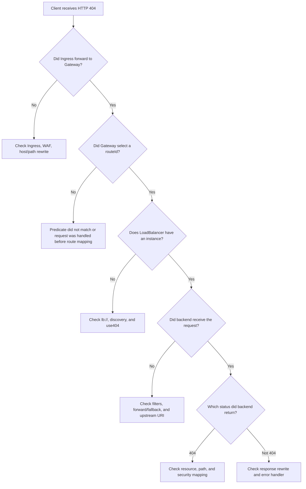
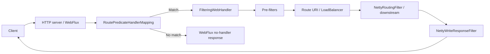

# 404 at the Gateway: Route Mismatch or Downstream Service Error

HTTP **404 Not Found** returned by an API Gateway is not enough to conclude that a route is missing. In Spring Cloud Gateway, the same 404 status can occur when a request fails to match a route predicate; when a route matches but a filter rewrites the path incorrectly; when the backend receives the request and returns 404; when service discovery finds no instance and LoadBalancer is configured to return 404; or when Security/fallback/custom filters intentionally hide a resource. Looking solely at the response body or a single `curl` call can easily lead to fixing the wrong layer.

This lesson belongs to the **Troubleshooting** chapter of the **SPRING_CLOUD_GATEWAY** module. The context is an API Gateway with route predicates, filter chain, path/header rewriting, service discovery/load balancing, authentication, rate limiting, circuit breaker, retry, TLS, and observability. The goal is to determine **whether the Gateway selected a route, which path the upstream received, which layer produced the 404, and what evidence confirms the root cause**.

> **Scope:** Examples focus on **Spring Cloud Gateway Server WebFlux** with Reactor Netty. Configuration namespaces, Actuator, and loggers may differ between Gateway 4.x/5.x and Spring Boot/Cloud release trains. Verify against your actual version before applying.

## 1. One 404 Status, Multiple Possible Origins

| Source of 404 | Route Matched? | Backend Received Request? | First Indicator |
| --- | --- | --- | --- |
| **No route matched** | No. | No. | No routeId; no corresponding backend access log. |
| **Gateway filter/fallback generated 404** | Usually matched or handled locally. | Possibly not. | Filter/fallback/controller has a log or trace. |
| **Downstream service returned 404** | Yes. | Yes. | Backend access log records the request and status 404. |
| **LoadBalancer found no instance** | Matched lb:// route. | No instance to send to. | Default is typically 503; `use404=true` can change it to 404. |
| **Upstream Security/Ingress returned 404** | May not have reached route mapping. | No. | Ingress/Security logs have the request; Gateway route log may not appear. |

### Decision Tree



**404 is the final outcome observed by the client, not an origin label.** A filter, fallback controller, backend, or LoadBalancer can all produce this status. Use a correlation request ID across Ingress, Gateway, and backend to connect the evidence.

## 2. Where Does the Gateway Process a Request Before Proxying?

In Gateway Server WebFlux, the simplified flow is:



When a route matches, the Gateway sends the request into the Gateway Web Handler and the route's filter chain. If no route matches, the route-specific filter chain does not execute as a selected-route request.

- **No route:** no Route is attached to the exchange via the normal routing flow.
- **Route selected:** the exchange carries route metadata and the Gateway can construct the downstream URI.

A GlobalFilter only runs inside the Gateway filtering chain after a route is selected. Not seeing its log is a clue that the request never entered the chain, but it **does not by itself prove** the Path predicate was wrong: a Security WebFilter, custom WebFilter, Ingress, or another handler could have handled it earlier.

## 3. Reading a 404 Response Systematically

When testing:

```bash
curl -i "https://api.example.com/api/catalog/products/42"
```

record the HTTP status, response headers, redacted body, method, Host, path, query, scheme, request/correlation ID, timestamp/Gateway pod receiving the request, and corresponding backend access log/status.

### Do Not Rely on the Body or Server Header Alone

A body like:

```json
{"timestamp":"...","status":404,"error":"Not Found","path":"/api/catalog/products/42"}
```

may be produced by Spring Boot error handling, but it does not prove whether the Gateway or the backend originated the status. The backend can return the exact same body; an Ingress or custom error handler can also normalize responses.

Headers such as `Server: nginx` or `Server: ReactorNetty` can be stripped or altered in transit. Use them only as clues, never as conclusive proof.

### Compare Hop by Hop

| Test Point | Purpose |
| --- | --- |
| Direct backend in lab network | Does the resource exist for that exact method/path? |
| Direct Gateway pod, bypassing Ingress | Are the route, filters, and upstream path correct? |
| Internal Gateway Service | Are Service endpoints, DNS, and networking healthy? |
| Public hostname via CDN/Ingress/WAF | Does edge host/path/TLS/header rewriting alter the request? |

If calling the backend directly already returns 404 for the same method/path, changing Gateway routes will not make the resource appear. If calling the backend directly returns 200 while going through the Gateway returns 404, inspect route matching, upstream path, instance selection, and response rewriting.

## 4. Route Predicate Mismatch

A route consists of an ID, destination URI, predicates, filters, and order. **All combined predicates must be satisfied** for a route to be selected. Do not check only Path and assume the route will definitely match.

| Predicate | What to Verify | Common Mistake |
| --- | --- | --- |
| Path | The path Gateway actually receives after proxy prefix/context path. | Client calls /catalog/** while route declares /api/catalog/**. |
| Host | The Host or :authority Gateway actually receives. | Ingress rewrites Host or client uses a different hostname. |
| Method | GET/POST/PUT/DELETE/OPTIONS. | Browser preflight sends OPTIONS while route only allows GET. |
| Header | Header name and regex/value. | Missing X-API-Version or sending v1 instead of v2. |
| Query | Query parameter name/value. | Missing version=2 or different encoding. |
| Cookie | Cookie name and regex. | Browser/proxy does not send the expected cookie. |
| RemoteAddr | Peer address seen by Gateway. | Gateway sees only the Ingress IP, not the client IP. |
| After/Before | Timestamp and timezone. | Route is not yet active or maintenance window already expired. |

### Multiple Predicates Example

```yaml
spring:
  cloud:
    gateway:
      server:
        webflux:
          routes:
            - id: catalog-v2
              order: 10
              uri: http://localhost:8081
              predicates:
                - Path=/api/catalog/**
                - Method=GET
                - Host=api.example.com
                - Header=X-API-Version, v2
```

This route requires Path, Method, Host, and Header to all match simultaneously. A GET request with the right path but missing X-API-Version still will not match; if no other route matches, the Gateway may return 404.

### Test Each Condition Individually

```bash
curl -i -H "Host: api.example.com" -H "X-API-Version: v2" \
  "http://localhost:8080/api/catalog/products/42"

curl -i -H "Host: api.example.com" \
  "http://localhost:8080/api/catalog/products/42"

curl -i -H "Host: api.example.com" -H "X-API-Version: v2" \
  -X POST "http://localhost:8080/api/catalog/products/42"
```

The first command satisfies all predicates; the second lacks Header; the third uses the wrong Method. If results differ from expectations, inspect the headers **actually received by the Gateway**, not just the headers in the client command.

## 5. Path Mismatch: Public URL Differs from Backend Path

Suppose a client calls GET /api/catalog/products/42 while the backend only exposes GET /products/42. The route can use:

```yaml
spring:
  cloud:
    gateway:
      server:
        webflux:
          routes:
            - id: catalog
              uri: http://localhost:8081
              predicates:
                - Path=/api/catalog/**
              filters:
                - StripPrefix=2
```

StripPrefix=2 removes the first two segments (api and catalog), so the backend receives /products/42. Without this filter, the backend may receive /api/catalog/products/42 and return 404.

### Do Not Confuse Route URI Path with Path Filters

A route URI such as `http://localhost:8081/catalog` **does not mean** the Gateway automatically prepends /catalog to the request path. Per Gateway documentation, the path declared in a route URI is ignored when building the destination URI. To add/remove prefixes, use PrefixPath, StripPrefix, SetPath, or RewritePath and verify the actual upstream path.

| Public Path | Predicate | Filter | Expected Backend Path |
| --- | --- | --- | --- |
| /api/catalog/products/42 | Path=/api/catalog/** | StripPrefix=2 | /products/42 |
| /api/v2/orders/123 | Path=/api/v2/orders/** | StripPrefix=2 | /orders/123 |
| /legacy/items/7 | Path=/legacy/** | RewritePath/SetPath per contract | /items/7 or defined path |

## 6. Trailing Slash, Encoding, and Normalization

Very similar requests can be handled differently by clients, Ingress, HTTP servers, Gateway matchers, and backends: paths with/without trailing slashes, query strings, encoded slashes (%2F), duplicate slashes, dot segments (%2e/%2e%2e), Unicode, or double encoding.

Current Gateway Path predicate documentation includes the matchTrailingSlash parameter; its default depends on the version (some versions default to true). Check your version and test both /products/42 and /products/42/. Standardize according to the API contract at one intentional layer.

When investigating path encoding:

- Record the raw request target at the edge and the parsed path in Gateway.
- Record the post-filter upstream URI, redacted.
- Test the backend directly with the same representation in the lab.
- Check whether Ingress decodes/normalizes paths before forwarding.
- Ensure the authorization matcher and backend mapping share the same semantics.

Inconsistent normalization does not just cause 404; it can also create **authorization bypass/path traversal**. Do not test exploit payloads in production.

## 7. Host, Forwarded Headers, and Ingress Rewrites

If a route has Host=api.example.com and Path=/api/catalog/** while Ingress forwards Host=api-gateway.default.svc.cluster.local, the Host predicate may fail to match. Some Ingress controllers preserve the original Host; some proxies/services rewrite it.

| Hop | Values Needed |
| --- | --- |
| Client → Ingress | URL hostname and Host/:authority sent by the client. |
| Ingress → Gateway | Actual Host and forwarded headers. |
| Gateway route matching | Which value does the Host predicate see? |
| Gateway → backend | Is the Host header preserved, replaced, or reset? |

Check Host/:authority, Forwarded, X-Forwarded-Host, X-Forwarded-Proto, X-Forwarded-Prefix, and X-Forwarded-Port. Only trust forwarded headers from **proxies explicitly configured as trusted**; do not allow Internet clients to dictate the upstream host or security context via forged headers.

### CORS Preflight

Browsers may send OPTIONS before a cross-origin request. If a route only specifies Method=GET/POST, OPTIONS may fail to match and return 404. Check whether the preflight request reaches the Gateway, global/route CORS config, and Security WebFlux CORS integration. Do not arbitrarily enable wildcard origins + credentials just to make requests pass.

**An OPTIONS 404 does not necessarily mean the backend lacks the resource**; the route predicate may simply allow only other methods.

## 8. Route Order, Route Overlap, and Unloaded Routes

Some systems have overlapping routes:

```yaml
spring:
  cloud:
    gateway:
      server:
        webflux:
          routes:
            - id: catalog-specific
              order: 0
              uri: http://localhost:8081
              predicates:
                - Path=/api/catalog/**
            - id: api-catch-all
              order: 100
              uri: http://localhost:8082
              predicates:
                - Path=/api/**
```

Both routes can match `/api/catalog/products/42`; route order determines evaluation/selection per Gateway semantics. During investigation, do not merely see that a specific route exists and assume it was selected. **Record the actual routeId** in logs/traces and check order in the route inventory.

### A Route Definition Might Not Exist at Runtime

Route sources may include:

- `application.yml` or Java `RouteLocator` beans.
- `RouteDefinitionLocator` from properties/config sources.
- Dynamic `RouteDefinitionRepository`.
- DiscoveryClient route locator.
- Routes managed via the Actuator API.

A route present in a configuration file may be missing at runtime due to an inactive profile, wrong namespace, route definition parse/bind failure, bean not created, or refresh not having occurred yet. For dynamic routes, inspect the **active route snapshot/revision**, not just files in Git.

### Route Refresh

Gateway maintains a route cache. Actuator provides a refresh endpoint in supported versions; triggering a refresh updates route definitions, but **POST refresh should not be invoked casually in production**. Before refreshing, verify that the config source is fixed and rollback-ready; record the route revision before and after.

## 9. Downstream Returns 404: Prove It Using the Request Actually Received by the Backend

If the route matched and LoadBalancer selected an instance, the Gateway can send the request via the Netty HTTP client. When the backend returns HTTP 404, the Gateway usually proxies that status back to the caller unless a filter or error handler alters the response.

### Common Backend Causes

| Cause | Example | Evidence to Collect |
| --- | --- | --- |
| **Wrong path** | Backend serves `/products/42`, Gateway sends `/api/catalog/products/42`. | Backend access log recording exact request URI. |
| **Wrong HTTP method** | Backend only handles GET while Gateway receives POST. | Backend method/path mapping and access log. |
| **Context path/base path** | Backend runs under `/catalog` while Gateway strips or adds the wrong prefix. | Runtime context path and upstream URI. |
| **Different API version** | Gateway sends `/v2/products`, backend only has `/v1` deployed. | Service revision/API contract. |
| **Resource does not exist** | ID 42 is missing from the data store. | Backend domain response/lookup, not just route config. |
| **Backend Security hides resource** | Anonymous or different tenant receives 404 instead of 403. | Redacted authorization decision/audit log. |
| **Wrong backend host/instance** | LoadBalancer picks an older instance or wrong service ID. | Instance ID, pod/revision, backend access log. |
| **Headers affecting mapping** | Different Accept, Content-Type, tenant/version header. | Header allowlist and handler negotiation. |

### Test the Backend Directly with the Computed Path

Suppose the Gateway route uses `StripPrefix=2`:

```bash
curl -i "http://localhost:8081/products/42"
curl -i "http://localhost:8081/api/catalog/products/42"
```

If the first command returns 200 and the second returns 404 while the Gateway is sending the second path, the root cause is the prefix/filter mapping. If both return 404, check the resource, API version, context path, and backend security.

### The Backend May Intentionally Return 404 to Unauthorized Callers

Some applications return 404 to avoid disclosing whether a resource exists. Therefore:

- Do not turn 404 into 200 or disable authorization to "fix the error".
- Verify tenant/principal/scope and resource ownership.
- Compare the same resource with an authorized test identity in the lab.
- Keep bodies, logs, and traces free of tokens/PII.

## 10. The Filter Chain Can Generate or Modify 404

A matched route does not guarantee the request is sent to the backend. Filters can short-circuit, redirect, forward locally, rewrite paths, or replace responses.

| Filter / Filter Group | How It Can Relate to 404 |
| --- | --- |
| `StripPrefix`, `RewritePath`, `SetPath`, `PrefixPath` | Produces an upstream path different from the backend endpoint. |
| `SetStatus` or custom response filter | Generates 404 without calling the backend. |
| `CircuitBreaker` + fallback | Fallback controller/route may return 404. |
| `Retry` | May repeat requests if status 404 is configured as a retryable status. |
| `ForwardRoutingFilter` / `forward:` | Forwards request to a local handler; local handler may not exist and return 404. |
| Custom `GlobalFilter` / `GatewayFilter` | Can short-circuit the chain, set status, or modify path/headers. |
| Security/WebFilter | Can return 404 to conceal an endpoint or block before route mapping. |

### DiscoveryClient Route Locator: A Very Common 404 Pitfall

Gateway can auto-generate routes from a service registry. Default routes take the form `/serviceId/**` and include a default filter that rewrites the path to strip the service ID before forwarding to the backend.

For example, a client calls `GET /CATALOG-SERVICE/products/42`; the default Gateway discovery route strips the service ID segment and forwards `/products/42` to the backend.

**Critical pitfall:** when configuring `spring.cloud.gateway.discovery.locator.filters[x]`, the custom filter list can **replace the entire default filter list**. If you only add CircuitBreaker/RequestRateLimiter and forget to re-declare RewritePath, the service ID remains in the upstream path; the backend receives `/CATALOG-SERVICE/products/42` and returns 404.

Therefore, when a discovery-generated route returns 404:

1. Inspect the active route predicates/filters via Actuator.
2. Determine whether the route is discovery-generated or static.
3. Verify the filter list still contains the RewritePath stripping the service ID.
4. Record the exact upstream path in the backend access log.
5. Check service ID capitalization; some registries return uppercase service IDs while client paths use lowercase.

### Check Filter Order

Gateway merges `GlobalFilter` and route-specific `GatewayFilter` instances into a filter chain ordered by `Ordered`. Pre-phase and post-phase run in opposite directions in certain respects. If rewrite, security, fallback, and routing filters execute in the wrong order, the final response can differ from expectations.

Do not infer filter order solely from YAML ordering during an investigation. Inspect the runtime filter list and test on the exact Gateway version.

## 11. lb:// Finds No Instance: 404 or 503?

A route such as:

```yaml
spring:
  cloud:
    gateway:
      server:
        webflux:
          routes:
            - id: catalog
              uri: lb://catalog-service
              predicates:
                - Path=/api/catalog/**
              filters:
                - StripPrefix=2
```

already matches the route even when the service registry has no healthy instances. This is a **downstream instance resolution failure**, not a "route predicate mismatch".

According to current Spring Cloud Gateway WebFlux documentation, when Reactor LoadBalancer cannot find a service instance, Gateway defaults to returning **503 Service Unavailable**. You can configure:

```yaml
spring:
  cloud:
    gateway:
      loadbalancer:
        use404: true
```

to turn the no-instance case into **404**. The property namespace/binding path should be verified against your release train; current documentation describes the name `spring.cloud.gateway.loadbalancer.use404`.

### Distinguish Three Cases

| Case | Route ID | Instance Selected? | Backend Access Log? | Typical Status |
| --- | --- | --- | --- | --- |
| No route predicate match | No. | No. | No. | 404. |
| Route matched, no `lb://` instance | Yes. | No. | No. | 503 default; can be 404 if use404 is enabled. |
| Route matched, backend instance exists but resource missing | Yes. | Yes. | Yes. | Backend 404 proxied back. |

### Checklist When Service Discovery Fails

- Does the service ID in `lb://` match the registry name?
- Are the Spring Cloud LoadBalancer and appropriate DiscoveryClient implementation dependencies present?
- Has the service registered instances, and are they healthy/ready?
- Does the registry return uppercase or lowercase service IDs?
- Is there a cached/stale instance list or namespace/zone filter?
- Are `StripPrefix`/`RewritePath` correct after resolving the service?
- Is `use404` enabled and causing alerts/clients to misinterpret the error?

**Do not enable use404 to mask discovery failures.** When no instance is available, 503 usually communicates more accurately that the service is temporarily unavailable; only use 404 if required by the API/compatibility contract and the system distinguishes the cause in logs/metrics.

## 12. Use Actuator to Inspect Route Definitions and Filter Chain

In Spring Cloud Gateway, the Actuator Gateway endpoint reveals **which routes are registered**, their predicates, filters, destination URIs, and order. This endpoint is disabled/not exposed by default in some setups; expose it read-only only on a secured management network.

Example configuration for versions supporting the newer access control style:

```yaml
management:
  endpoint:
    gateway:
      access: read-only
  endpoints:
    web:
      exposure:
        include: health,info,gateway
```

This is a **version-sensitive** example. Verify the Actuator endpoint access model for your Spring Boot/Gateway version. If an older version does not support the access property above, use the corresponding enable/exposure/security settings; never expose all Actuator endpoints to the Internet.

### Useful Requests

```http
GET /actuator/gateway/routes
GET /actuator/gateway/routes/catalog
GET /actuator/gateway/globalfilters
GET /actuator/gateway/routefilters
```

`GET /actuator/gateway/routes` can show route_id, predicate, filters, URI, and order. `GET /actuator/gateway/globalfilters` shows global filters and their order; `routefilters` lists available filter factories. Exact detail formatting depends on the Gateway version and verbose settings.

### Actuator Routes Are Not a Request Log

`/actuator/gateway/routes` reports **registered route definitions**, not which route a specific request matched. A route may exist yet fail to match because its predicates were not satisfied. To trace an individual request, use request-ID-correlated logs/traces or route instrumentation.

### Protect Management Endpoints

- Allow access only to internal operators/scrapers.
- Prefer read-only access during investigations.
- Never expose POST/DELETE/refresh/create route actions to public clients.
- Do not expose URIs containing credentials or internal topology in public responses.
- Log audit trails if operators modify dynamic routes.

## 13. Logging, DEBUG/TRACE, and Reactor Netty Wiretap

The Spring Cloud Gateway troubleshooting guide recommends checking these loggers during investigations:

```yaml
logging:
  level:
    org.springframework.cloud.gateway: DEBUG
    org.springframework.http.server.reactive: DEBUG
    org.springframework.web.reactive: DEBUG
    org.springframework.boot.autoconfigure.web: DEBUG
    reactor.netty: DEBUG
    redisratelimiter: DEBUG
```

These loggers provide insight into route matching, WebFlux handling, auto-configuration, network client/server activity, and the Redis rate limiter. Specific logger names and granularity depend on the version.

### Enable Wiretap Under Control

Reactor Netty HttpServer/HttpClient can enable wiretap to observe traffic passing through the Gateway. Property names in current documentation include:

```yaml
spring:
  cloud:
    gateway:
      httpserver:
        wiretap: true
      httpclient:
        wiretap: true
```

**Property names may use an older namespace** in some Gateway lines; verify configprops/reference for your exact version. Wiretap combined with Reactor Netty DEBUG/TRACE logging can capture headers and bodies on the wire.

**Security warning:** wiretap can expose Authorization headers, Cookies, API keys, request bodies, and personal data. Only enable it briefly in lab/staging or during an approved incident window with clear redaction, access control, and retention policies. Never leave TRACE wiretap running long-term on a public Gateway.

### Read Logs by Question

| Question | Evidence to Find |
| --- | --- |
| Did Gateway receive the request? | Ingress access log, main HTTP server log, request ID. |
| Which route was selected? | Route ID in Gateway logs/custom filter/tracing. |
| Why did the route match? | Predicate config/runtime route inventory and request attributes. |
| Which upstream URI/path was built? | Routing filter logs or redacted instrumentation. |
| Did backend receive the request? | Backend access log with matching request ID/trace ID. |
| Who returned 404? | Backend status, Gateway response status, filter/fallback logs, and ingress response. |

## 14. Recording routeId and Response Status for Matched Requests

A small GlobalFilter can log the route ID and final response status in diagnostic environments. This filter only runs **after a route is selected**, so it does not capture requests that matched no route.

```java
package com.example.gateway.diagnostics;

import org.slf4j.Logger;
import org.slf4j.LoggerFactory;
import org.springframework.cloud.gateway.filter.GatewayFilterChain;
import org.springframework.cloud.gateway.filter.GlobalFilter;
import org.springframework.cloud.gateway.route.Route;
import org.springframework.cloud.gateway.support.ServerWebExchangeUtils;
import org.springframework.core.Ordered;
import org.springframework.stereotype.Component;
import org.springframework.web.server.ServerWebExchange;
import reactor.core.publisher.Mono;

@Component
public class RouteResponseLogFilter implements GlobalFilter, Ordered {

    private static final Logger log =
        LoggerFactory.getLogger(RouteResponseLogFilter.class);

    @Override
    public Mono<Void> filter(
            ServerWebExchange exchange,
            GatewayFilterChain chain) {

        Route route = exchange.getAttribute(
            ServerWebExchangeUtils.GATEWAY_ROUTE_ATTR);

        String routeId = route == null ? "unknown" : route.getId();
        String method = exchange.getRequest().getMethod() == null
            ? "unknown"
            : exchange.getRequest().getMethod().name();

        return chain.filter(exchange)
            .doFinally(signal -> {
                var status = exchange.getResponse().getStatusCode();
                log.debug(
                    "gateway route completed routeId={} method={} status={} signal={}",
                    routeId, method, status, signal);
            });
    }

    @Override
    public int getOrder() {
        return Ordered.LOWEST_PRECEDENCE;
    }
}
```

The example uses modern Java `var`; if your project targets an older Java baseline, replace it with the concrete return type of `getStatusCode()`. This is a **diagnostic filter**, not a complete production logging solution.

### Limitations of This Filter

- Does not run if the request fails to match a route and never enters the Gateway filter chain.
- HTTP 404 is a response status, not a Reactor error; `doOnError` cannot catch all 404s.
- The filter only records the final status seen by the Gateway; to know whether the backend actually returned 404, correlate with the upstream/backend access log or tracing span.
- Do not log raw queries, full URIs, cookies, tokens, or bodies. Only attach controlled request IDs/trace IDs.
- If another filter sets the status afterward, filter order and post-phase behavior can affect the final status; verify runtime filter order.

### Correlation ID

Have a request ID/trace ID propagate across:

```text
Ingress request ID
    -> Gateway inbound span / routeId
        -> Gateway outbound client span
            -> Backend server span / access log
```

If a client sends X-Request-ID, validate its length/characters and avoid using arbitrary values as metric tags. Generate an internal ID when missing; never use a request ID as a high-cardinality Prometheus label.

## 15. Distinguishing Gateway 404 from Backend 404 with Evidence

| Evidence | No Route Matched | Downstream 404 |
| --- | --- | --- |
| Route ID logged by GlobalFilter | Absent. | Route ID present. |
| Backend access log with same request ID | Absent. | Present. |
| Upstream client span | No corresponding outbound span. | Outbound span present with status 404. |
| Gateway route timer/metrics | May lack routeId because no route matched. | Has routeId and final status may be 404. |
| Direct backend call with upstream path | Irrelevant if no upstream request was made. | Usually reproduces 404 given same instance/path/identity. |

**Note:** not every setup exports these exact spans/metrics; sampling, Security filters, custom routing, and instrumentation can create gaps. Absence of a backend log alone does not prove no request was sent: logs may be sampled/dropped or the request may have been blocked on the network before reaching the app.

### When the Gateway Route Timer Lacks a routeId

This may be a request handled before route mapping or one that matched no route. Compare against HTTP server metrics/access logs, WebFlux handler/Security logs, and Ingress logs. Do not use a route timer metric as the denominator for all inbound traffic if the timer only measures matched requests.

## 16. Ordered 404 Diagnostic Workflow

### Step 1 — Reproduce One Specific Request

Pick one specific method/path/host/query/header combination and record a request ID. Avoid using an uncontrolled batch of requests because routes may differ by tenant, API version, or method.

```bash
curl -i \
  -H "X-Request-ID: diag-404-001" \
  -H "Host: api.example.com" \
  -H "X-API-Version: v2" \
  "http://localhost:8080/api/catalog/products/42"
```

The request ID above is for lab use only; production should generate/validate IDs according to policy.

### Step 2 — Bypass Ingress and Call the Gateway Directly

If the public endpoint returns 404 while calling the Gateway pod directly returns 200, investigate Ingress/WAF/TLS/Host/path rewrites. If both return 404, continue investigating Gateway route matching and downstream.

### Step 3 — Inspect Runtime Routes

Read the list of routes/predicates/filters/order via secured Actuator. Confirm the route exists on the exact pod, profile, and revision. Do not just read configuration files in the repository.

### Step 4 — Confirm the routeId

Use DEBUG logs, tracing, or the diagnostic GlobalFilter. If there is no routeId, inspect predicates and WebFilters executing prior to route mapping. If a routeId is present, continue.

### Step 5 — Compute the Upstream URI/Path

Check StripPrefix, RewritePath, SetPath, PrefixPath, context path, discovery locator, and route URI. Record the post-filter path rather than guessing from the public URL.

### Step 6 — Confirm Instance and Backend Request

For lb://, check service instances and LoadBalancer resolution. Match the backend access log using the request ID; if the backend received the request, capture the exact redacted method/path/headers.

### Step 7 — Check Backend and Response Filters

Test the backend directly with the exact instance/path/identity. If the backend returns 200 while the Gateway returns 404, inspect post-filters, fallbacks, SetStatus, local forwards, or error handlers.

### Step 8 — Fix One Cause, Run Regression

Change one variable at a time (predicate, path filter, discovery rewrite, Host forwarding, or security mapping), re-run tests, and verify other routes are unaffected.

## 17. Test Matrix for Separating Route 404 from Downstream 404

The following table is a test plan for lab/staging environments. Responses reflect expected outcomes for the example configuration; each system's backend, Security, and error handler may use different statuses/bodies.

| ID | Change / Scenario | Expected Route ID | Backend Received Request? | Outcome to Verify |
| --- | --- | --- | --- | --- |
| T01 | GET with valid Path/Host/Method/Header | catalog-v2 | Yes. | Backend returns 200 for an existing resource. |
| T02 | Missing X-API-Version | No matching route. | No. | 404 due to no route match if no other route applies. |
| T03 | Wrong Host | No matching route. | No. | Verify the Host actually received by the Gateway. |
| T04 | POST to a GET-only route | No matching route. | No. | OPTIONS/POST is not mistaken for a backend 404. |
| T05 | Different trailing slash | Depends on matchTrailingSlash/version. | Depends on route. | Verify actual predicate behavior. |
| T06 | Missing StripPrefix=2 | catalog | Yes. | Backend receives extra prefix and may return 404. |
| T07 | Correct StripPrefix | catalog | Yes. | Backend receives /products/42 and returns 200. |
| T08 | Backend lacks resource ID | catalog | Yes. | Downstream 404 is proxied back. |
| T09 | Backend security hides resource | catalog | Possibly. | 404 due to authorization policy; do not disable auth to fix. |
| T10 | Discovery locator without RewritePath | discovery-generated route | Yes. | Backend receives serviceId in path and returns 404. |
| T11 | Discovery locator with RewritePath | discovery-generated route | Yes. | Service ID is stripped; backend path is correct. |
| T12 | lb:// with no instances | catalog | No. | 503 default or 404 if use404 is enabled. |
| T13 | Fallback forwards to wrong local endpoint | catalog/fallback | Probably not. | Fallback handler returns 404; backend receives no request. |
| T14 | SetStatus=404 in custom filter | Route matched. | Not necessarily. | Gateway filter itself sets status 404. |
| T15 | Retry configured for status 404 | Route matched. | Possibly multiple times. | Verify retry count and final status. |
| T16 | OPTIONS preflight without CORS handling | Possibly no. | No. | 404 may originate before the backend. |
| T17 | Public Ingress rewrites path | May change. | Depends. | Compare direct pod request with public hostname. |
| T18 | Route not yet refreshed after config change | Old runtime route. | Depends. | Actuator route snapshot/revision differs from expected file. |
| T19 | Overlapping routes/order | One specific route selected. | Yes. | Actual routeId matches configured order. |
| T20 | Security WebFilter returns 404 before route mapping | No routeId. | No. | Security audit log proves request was hidden. |

### Evidence to Save for Each Test

```text
test ID + test timestamp
request method / host / path / query
request ID / trace ID
Gateway pod + image/config revision
selected routeId (if any)
upstream service ID / instance ID (if any)
upstream path (redacted)
backend received? + backend status
client final status
logs / trace references
```

Do not store Authorization headers, Cookies, raw JWTs, API keys, or bodies containing PII in test results. Use synthetic identities and test data.

## 18. Quick Troubleshooting Table by Symptom

| Symptom | Possible Cause | First Verification Step |
| --- | --- | --- |
| 404 and no routeId | Predicate did not match; Security/WebFilter handled earlier. | Compare Host/Path/Method/Header and WebFlux/Security logs. |
| RouteId present but no backend log | LB has no instance, filter short-circuited, local forward/fallback. | Check LoadBalancer, filter chain, and outbound trace. |
| Backend log shows path with extra /api/catalog | Missing StripPrefix/RewritePath. | Compare upstream path against backend endpoint. |
| Direct backend 200 but Gateway 404 | Path/header/Host rewrite, wrong instance, or post-filter. | Call the exact instance with the exact upstream request. |
| One specific route always 404 after deploy | Route config/profile/revision not loaded or order changed. | Check Actuator routes on each pod. |
| Only OPTIONS returns 404 | Method predicate/CORS preflight not handled. | Send OPTIONS with Origin and Access-Control-Request-Method. |
| Only Host-predicated route returns 404 after Ingress change | Host rewritten or forwarded headers untrusted. | Capture Host/:authority on Ingress → Gateway. |
| Discovery-generated routes return 404 | Default RewritePath replaced when custom filters were declared. | Check active discovery route filters and backend path. |
| lb:// returns 404, backend has no log | use404 enabled and LoadBalancer has no instances. | Check service registry/instance list and property. |
| 404 happens only for specific users/tenants | Backend Security or tenant resource mapping. | Compare authorization decisions with test identities. |
| 404 appeared after adding CircuitBreaker | Fallback URI/handler returns 404 or wrong filter order. | Call local fallback handler in lab; check breaker logs. |
| Actuator shows route but request does not match | Predicate condition differs from actual incoming request. | Do not confuse route definition with route selection; enable diagnostics. |
| One pod returns 200, another returns 404 | Route revision/config drift or different backend instance. | Compare pod image, route snapshot, discovery instances. |
| 404 after changing service ID capitalization | Discovery service ID and path casing mismatch. | Compare registry service ID, locator settings, and URL. |
| Response body looks like Spring Boot error but layer unclear | Body normalized across multiple layers. | Trace correlation ID across Gateway/backend/Ingress; do not guess from body. |

## 19. Common Bad Fixes to Avoid

### Adding a Catch-All Route to Turn Every 404 into 200

A `Path=/**` route pointing to a generic backend can hide legitimate route mismatches and accidentally send traffic to the wrong service. Only add a fallback/catch-all if required by the API contract, with explicit ordering, security, and observability.

### Removing Host/Method/Header Predicates Just to Make Requests Succeed

If a route relies on Host or API version to separate backends, removing predicates can cause route overlap or route traffic to the wrong tenant/version. Fix the header source at Ingress/client or configure predicates properly.

### Using RewritePath Arbitrarily

A regex rewrite can turn valid paths into broken ones or normalize encoded segments differently from the backend. Write input/output tests for paths before deploying the filter to production.

### Disabling Security Because the Backend Returns 404

A backend may intentionally return 404 to hide resources from unauthorized users. Never turn an authorization failure into broader access. Check principal, scope, tenant, and ownership.

### Enabling use404 to Mask No-Instance Failures

When LoadBalancer has no instances, returning 404 tricks clients into thinking the resource does not exist. Unless the API contract mandates 404, keeping 503 clearly distinguishes availability from resource lookup; even if use404 is used, maintain dedicated metrics/logs for no-instance events.

### Exposing Actuator or Wiretap Publicly

Route inventory can leak service IDs, internal URIs, and filter configurations; wiretap can record tokens/bodies. Only expose management endpoints internally, read-only, and with access control; keep wiretap short-lived and redacted.

## 20. Short Runbook for 404 Incidents

1. **Determine blast radius:** one route, one method, one tenant, one pod, or all APIs?
2. **Capture a sample request:** method, Host, path, query, request ID, timestamp.
3. **Compare Ingress and Gateway:** did the request reach the right pod; were Host/path rewritten?
4. **Inspect runtime routes:** routeId, predicates, filters, URI, order, revision.
5. **If routeId is present:** verify LoadBalancer instance and upstream path.
6. **Check backend access log:** did the backend receive the request and return 404?
7. **Check Security/fallback/custom filters:** did any of them intentionally return 404?
8. **Make one small config change:** do not add a catch-all or disable auth to mask the error.
9. **Regression test:** positive route, negative predicate, path rewrite, backend 404, no-instance 503/404, and Security.
10. **Monitor after fix:** 404s by route, 5xx, backend request counts, route revision, and p95/p99.

If the incident shows signs of path traversal, cross-tenant access, or routing to untrusted hosts, escalate to the security incident process and preserve redacted evidence. Do not run exploit payloads in production to verify.

## 21. Self-Check Questions

1. Why is an HTTP 404 from the Gateway insufficient to prove a route predicate mismatch?
2. At which stage of Gateway Server WebFlux do route matching and the filter chain begin?
3. Why does a GlobalFilter not log anything for a request that matches no route?
4. For a route with Path, Host, Method, and Header predicates, which conditions must be true simultaneously?
5. Why can an OPTIONS preflight receive 404 even though the GET route works?
6. How can an Ingress Host rewrite prevent a Host predicate from matching?
7. How does StripPrefix=2 transform the path /api/catalog/products/42?
8. Why does a path inside a route URI not replace StripPrefix/RewritePath?
9. When can a trailing slash or percent-encoding alter route matching?
10. How do you distinguish an existing route definition from a request actually matching that route?
11. What information does Actuator /actuator/gateway/routes provide, and what does it NOT provide?
12. Why should the Actuator Gateway endpoint be read-only and exposed only on an internal network?
13. When does the Gateway proxy a downstream 404 verbatim back to the caller?
14. In what scenario might a backend intentionally return 404 instead of 403?
15. What does the DiscoveryClient route locator do by default with the service ID in the path?
16. Why can configuring custom discovery locator filters accidentally remove the default RewritePath?
17. What status does LoadBalancer return by default when it finds no instance according to current Gateway docs?
18. How does the use404 property alter no-instance behavior?
19. Why is a no-instance 404 different from a downstream resource 404 even when the client sees the same status?
20. Can a CircuitBreaker fallback or ForwardRoutingFilter produce a 404 without calling the backend?
21. When can Retry repeat a 404 request?
22. Which loggers are useful to enable at DEBUG/TRACE when investigating route matching?
23. What data can wiretap expose, and why should it only be enabled briefly?
24. Why can't doOnError be used to catch every HTTP 404?
25. What evidence is needed to conclude that the backend actually received the request?
26. If direct backend returns 200 while Gateway returns 404, what should the investigation sequence be?
27. If one pod returns 200 while another pod returns 404, which runtime data should be compared?
28. Why are adding a catch-all route or disabling Security unsafe fixes?
29. When should 503 be kept instead of changing no-instance responses to 404?
30. Which test cases are needed in a minimal regression suite for 404 troubleshooting?

## 22. References

The official Spring sources below describe route matching, filter chains, Actuator, LoadBalancer, discovery locator, and troubleshooting. **Verify against the deployed Gateway version** as namespaces/properties and Actuator formats may change:

- [Spring Cloud Gateway Server WebFlux — How It Works](https://docs.spring.io/spring-cloud-gateway/reference/spring-cloud-gateway-server-webflux/how-it-works.html) — route handler mapping, Gateway Web Handler, and filter chain.
- [Spring Cloud Gateway Server WebFlux — Route Predicate Factories](https://docs.spring.io/spring-cloud-gateway/reference/spring-cloud-gateway-server-webflux/request-predicates-factories.html) — Path, Host, Method, Header, and predicate arguments.
- [Spring Cloud Gateway Server WebFlux — Global Filters](https://docs.spring.io/spring-cloud-gateway/reference/spring-cloud-gateway-server-webflux/global-filters.html) — Netty routing, LoadBalancer, and no-instance behavior.
- [Spring Cloud Gateway Server WebFlux — Actuator API](https://docs.spring.io/spring-cloud-gateway/reference/spring-cloud-gateway-server-webflux/actuator-api.html) — routes, predicates, filters, order, and access control.
- [Spring Cloud Gateway Server WebFlux — Troubleshooting](https://docs.spring.io/spring-cloud-gateway/reference/spring-cloud-gateway-server-webflux/troubleshooting.html) — DEBUG/TRACE loggers and Reactor Netty wiretap.
- [Spring Cloud Gateway Server WebFlux — DiscoveryClient Route Definition Locator](https://docs.spring.io/spring-cloud-gateway/reference/spring-cloud-gateway-server-webflux/the-discoveryclient-route-definition-locator.html) — default Path predicate, RewritePath, and custom filter list.
- [Spring Cloud Gateway Server WebFlux — GatewayFilter Factories](https://docs.spring.io/spring-cloud-gateway/reference/spring-cloud-gateway-server-webflux/gatewayfilter-factories.html) — StripPrefix, RewritePath, SetPath, PrefixPath, and other filters.
- [Spring Cloud Commons — LoadBalancer](https://docs.spring.io/spring-cloud-commons/reference/spring-cloud-commons/loadbalancer.html) — service instance selection and integration.
- [Spring Framework WebFlux](https://docs.spring.io/spring-framework/reference/web/webflux.html) — WebFlux handler mapping and reactive request processing.

**Key takeaway:** When encountering a 404 at an API Gateway, classify it in order: **Ingress → route matching → filter/path transformation → LoadBalancer/discovery → backend → response/fallback**. An unmatched route usually has no routeId and generates no backend request; a matched route can still send the wrong path; a LoadBalancer with no instances defaults to 503 but can be configured to return 404; a backend can return 404 due to resource lookup, API version, or authorization. **Only apply a fix after identifying the status-producing layer using routeId, exact upstream path, backend access logs, and correlated request/trace IDs.** Never use a catch-all route, disable Security, wildcard Host, or use404 to hide an uninvestigated routing bug.
