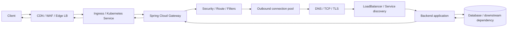

# 502, 504, and Hop-by-Hop Timeout Errors

When a request passes through **Spring Cloud Gateway** and receives HTTP **502 Bad Gateway**, **504 Gateway Timeout**, or times out on the client, looking only at the status code is usually not enough to find the root cause. The failure can start at Ingress, Gateway, DNS, TCP/TLS, connection pool, service discovery, backend application, database, or a dependency behind the backend. A 504 response can also be generated by **Ingress** before the Gateway has time to respond; a 502 can be a Gateway proxy error, or the backend itself could have returned that status.

This lesson belongs to the **Troubleshooting** chapter, focusing on **502, 504, and hop-by-hop timeout errors** in an API Gateway system. Its scope connects route predicates, filter chains, path/header rewriting, `lb://` service discovery, authentication, Redis rate limiting, Retry, CircuitBreaker, TLS, and observability. The goal is to locate the **first hop that starts slowing down or failing**, identify which component emits the status code, and choose the fix at the right layer.

The primary examples use **Spring Cloud Gateway Server WebFlux with Reactor Netty**. If deploying Gateway Server Web MVC, cross-check the Servlet container, HTTP client, and timeout settings of the MVC stack. Property names, metrics, and exception mappings may change across Spring Boot/Spring Cloud Gateway/Reactor Netty versions; always verify against the version pinned in your system.

> **Investigation rule:** Do not raise timeouts, enlarge connection pools, add retries, or restart all pods before knowing which hop the failure occurred at. Such changes can mask symptoms, increase concurrency, and overload the backend/Redis further. Commands and fault injections in this lesson should only be run in authorized environments.

## 1. Path of a Request Through the Gateway



Each hop can have its own queues, timeouts, and statuses:

| Hop | Responsibility | Common Failures |
| --- | --- | --- |
| Client → Edge | Public DNS, TCP/TLS, sending request | DNS error, connect timeout, client deadline |
| Edge → Ingress | Load balancing, WAF, TLS termination | Edge/ingress 502/503/504 |
| Ingress → Gateway | Selecting Gateway pod, upstream connection | No endpoint, connect/reset, timeout |
| Gateway filters | Security, predicates, rewrite, rate limit | 401/403/404/429, custom 5xx |
| Gateway outbound pool | Acquire connection/stream | Pending acquire, pool acquire timeout |
| Gateway → backend network | DNS, TCP, TLS/mTLS | Unknown host, refused, handshake failure |
| Service discovery/LB | Select backend instance | No instance, stale instance |
| Backend HTTP server | Accept, queue, parse, dispatch | Connection reset, server overload |
| Backend application | Business logic, thread/event loop | Slow handler, internal timeout, exception |
| Backend dependencies | DB, Redis, external API | Pool wait, query timeout, downstream 5xx |
| Response path | Serialize, stream, reverse proxy | Broken pipe, premature close, slow consumer |

**Key point:** An HTTP status only describes the outcome at a boundary. It does not by itself tell you which hop is the root cause.

## 2. Distinguishing 502, 504, and Related Statuses

### 502 Bad Gateway

A proxy/gateway received an invalid response or could not complete its proxy role with the upstream. Situations that can lead to 502 depending on implementation:

- TCP connection reset or closed abnormally.
- Backend closes the socket before sending a valid response.
- Upstream returns a malformed HTTP response.
- TLS handshake/certificate/hostname verification fails on the outbound hop.
- DNS/connect failure mapped to 502 by the proxy error handler.
- An upstream reverse proxy cannot use the response from the Gateway.

**502 does not necessarily mean the backend returned HTTP 502.** The proxy itself may generate a 502 response because it could not obtain a valid response from upstream.

### 504 Gateway Timeout

A gateway/proxy did not receive a timely response from the upstream within its timeout policy. Examples:

- Gateway waits for backend past `response-timeout`.
- Ingress waits for Gateway past `proxy-read-timeout`.
- Edge LB waits for Ingress past idle/response timeout.
- Backend waits for DB too long, causing an outer proxy layer to time out before the backend finishes.

**504 does not prove the backend stopped processing.** The client may have already received 504 while the backend continues executing the transaction or external API call.

### Statuses Not to Confuse

| Status | Typical Meaning | Direction to Investigate |
| --- | --- | --- |
| **401** | Missing or invalid credentials | AuthN, JWT issuer/audience/expiry |
| **403** | Authenticated but insufficient permissions | Scope, role, tenant, resource authorization |
| **404** | Route/resource missing or hidden by policy | Predicate, rewrite, backend mapping |
| **405** | Method not supported by endpoint | Method predicate/controller/security |
| **429** | Rejected by rate limit/admission policy | Redis limiter, key resolver, quota |
| **500** | Internal application/proxy error | Exception, filter, backend logs |
| **502** | Proxy failed to get a valid upstream response | TCP/TLS/reset/malformed response |
| **503** | Service unavailable/no instance/breaker/load shedding | Discovery, readiness, CircuitBreaker |
| **504** | Gateway/proxy waited for upstream past deadline | Find timeout at the status-emitting hop |
| **499** | Used by some proxies (e.g., Nginx) to log client closing request | Client cancellation; not a standard backend status |

Exact status mapping depends on error handlers and the proxy chain. A backend can also intentionally return 502 or 504. You must identify **who emitted the status**, not guess from the code number.

## 3. What Does "Hop by Hop" Mean?

Suppose a client sends a request at `t0` and receives 504 at `t1`. We need to know where time was spent:

```text
t0  Client starts request
t1  Edge receives request
t2  Ingress forwards to Gateway
t3  Gateway matches route / runs filters
t4  Gateway acquires outbound connection
t5  DNS/TCP/TLS completes
t6  Backend receives request
t7  Backend starts processing
t8  Backend calls database/dependency
t9  Backend returns response
t10 Gateway completes proxying response
t11 Ingress/Edge returns response
t12 Client receives response
```

This is a conceptual timeline. In practice some steps overlap; DNS may be cached, TLS may be reused, and body upload/download runs concurrently with processing.

Do not subtract timestamps across multiple systems if **clocks are not synchronized**. Distributed tracing or monotonic durations within a single process are usually more reliable than subtracting two wall-clock timestamps from different pods.

## 4. Separate Where the Status Is Emitted from Where the Cause Originates

Example:

```text
Backend starts processing the request and waits 5 seconds on the database.
Ingress times out after 2 seconds.
Client receives 504 from Ingress.
Backend continues the query until second 5 and commits.
```

- **Status emitter:** Ingress.
- **Root cause:** DB latency or uncontrolled backend deadline.
- **Consequence:** The client may retry and create duplicate operations, even though the initial request already committed.

Another example:

```text
Gateway sends request to backend.
Backend closes connection immediately without sending an HTTP response.
Gateway maps the transport error to 502.
Client receives 502 from Gateway.
```

- **Status emitter:** Gateway.
- **Cause:** Backend process/connection lifecycle, network reset, or protocol issue.

Both must be identified to avoid fixing the wrong component.

## 5. Gather Evidence Before Making Changes

When receiving a 502/504 incident, record:

1. Start/end timestamps, timezone, and clock accuracy.
2. URL/method/route ID, without recording sensitive data in query/body.
3. Request/correlation ID and trace ID if available.
4. Status code, response headers, and sanitized response body.
5. Client connect/TTFB/total timings.
6. Ingress/Gateway/backend logs from the same time window.
7. Gateway pod that received the request and selected backend instance.
8. Pool active/idle/pending/acquire timeouts.
9. DNS/TCP/TLS timings and errors.
10. Backend handler/DB/external dependency durations.
11. Retry attempts, CircuitBreaker state, Redis limiter latency.
12. Deploys/scaling/route config changes coinciding with the window.

**Do not ask customers to send bearer tokens, cookies, passwords, or full sensitive payloads for debugging.** Use request IDs and synthetic reproduction.

## 6. Read Response Headers, Without Trusting Them Blindly

A response might contain:

```http
HTTP/1.1 504 Gateway Timeout
content-type: application/json
date: Tue, 24 Nov 2026 08:00:00 GMT
server: edge-proxy
x-request-id: synthetic-req-123
```

`Server` or `Via` can hint at which proxy emitted the response, but headers can be stripped, overwritten, or forged. Correlate the request ID with **each hop's logs** to pinpoint the origin.

If the response has no Gateway request metric while Ingress logs 504, the request may not have reached the Gateway or was blocked before instrumentation. If Gateway has a request span while the backend has no server span, investigate pool/DNS/TCP/TLS/routing before the backend application.

## 7. Latency Budget and Deadline Chain

A request crosses multiple timeouts. Illustrative example:

| Layer | Illustrative Deadline/Timeout |
| --- | ---: |
| DB query | 300 ms |
| Backend operation budget | 700 ms |
| Gateway upstream response timeout | 1,000 ms |
| Ingress upstream read timeout | 1,300 ms |
| Client total deadline | 1,600 ms |

Design from the inside out: dependencies need enough room to complete within the backend budget; the backend should finish or return an error before the Gateway times out; the Gateway should respond before Ingress; Ingress should respond before the client deadline. Leave margin for serialization, response transfer, scheduling, and network jitter.

This is a **pattern**, not a rule that every hop must strictly step upward. Uploads/streaming, async processing, and long polling require different budgets.

### Total End-to-End Time

This can be modeled as:

\[
T_{\text{client}} =
T_{\text{edge}} + T_{\text{ingress}} +
T_{\text{gateway}} + T_{\text{network}} +
T_{\text{backend}} + T_{\text{return}}
\]

Here `T_gateway` can include filter execution, pool acquire, routing, and proxy overhead; `T_backend` can include queueing, application logic, and dependencies. Do not double-count the same interval measured by two nested spans.

### Deadline vs. Timeout

- **Timeout** is a limit on a single operation or wait interval.
- **Deadline** is the final point in time when the request is still useful.
- One request can have multiple smaller timeouts inside an overall deadline.
- Retry/backoff must share the overall deadline; never reset the entire budget on each attempt.

A sequence of 1-second timeout × 3 attempts + 2-second backoff will no longer fit within a 2-second client deadline.

## 8. Which Timeout Is Expiring?

| Type | Waiting For What? | Manifestation |
| --- | --- | --- |
| DNS resolution timeout | Resolving hostname | UnknownHost, resolver timeout |
| TCP connect timeout | Establishing socket to address | Connection refused/timeout |
| TLS handshake timeout | Completing TLS negotiation | Handshake timeout, certificate error |
| Pool acquire timeout | Borrowing connection/stream from pool | Pending acquire timeout |
| Response timeout | Waiting for upstream response per client policy | Read/response timeout |
| Backend server queue timeout | Waiting for worker/event loop/thread pool | Queue timeout or server 503/504 |
| DB connection pool timeout | Waiting for DB connection | Pool acquisition timeout |
| DB statement/query timeout | Waiting for SQL query | SQL timeout/cancel |
| External API timeout | Waiting for another dependency | Connect/read timeout |
| Ingress upstream timeout | Waiting for Gateway response | Ingress 504 |
| Client total timeout | Waiting for entire request | Client abort/timeout |

**"Timeout" is not a single error type.** Logs should record the exact operation and phase whenever possible.

## 9. Timeouts Are Not Connection Refused or Connection Reset

| Error | Meaning | Hint |
| --- | --- | --- |
| **Connection refused** | Target refuses connection or nothing listening | Wrong port, pod not listening, stale endpoint |
| **Connection timed out** | TCP connect failed to finish within budget | Network path, firewall, packet drop, overload |
| **Connection reset** | Connection reset abnormally | Backend restart, proxy reset, stale socket |
| **Premature close** | Upstream closed before response completed | Backend crash, protocol/stream abort |
| **Read/response timeout** | Connection established, but response did not arrive on time | Slow backend queue/handler/dependency |
| **Pool acquire timeout** | Failed to obtain connection from pool | Pool full, requests held too long |
| **TLS handshake failure** | TLS negotiation/certificate verification failed | Truststore, SNI, expiry, protocol/cipher |

If TCP refuses immediately, raising `response-timeout` usually does nothing. If pool acquire times out, raising connect timeout will not help either because no new connect has even begun.

## 10. Distinguishing DNS, Service Discovery, and LoadBalancer

An `lb://order-service` route typically needs two distinct steps:

1. Spring Cloud LoadBalancer/DiscoveryClient selects a **service instance**.
2. The HTTP client connects to that instance's host/port via DNS/TCP/TLS according to the URI/metadata.

Failure modes:

- No healthy instances → can typically return `503` or configured status.
- Stale instance list → selects an already terminated pod.
- Instance DNS hostname fails to resolve → transport error.
- Pod IP reachable, but application not listening → refused.
- Wrong endpoint port/protocol → connect/TLS failure.
- Skewed load balancing → one instance runs hot while others sit idle.

**No instance** differs from **instance exists but cannot be reached**. Do not lump both together as "DNS error".

### Inspecting Kubernetes Endpoints

In an authorized namespace:

```bash
kubectl -n shop get svc order-service
kubectl -n shop get endpointslices \
  -l kubernetes.io/service-name=order-service
kubectl -n shop get pods -l app=order-service -o wide
kubectl -n shop describe svc order-service
```

Check:

- Does the Service selector match the backend pods?
- Does EndpointSlice list the right addresses and ports?
- Are Pods Ready, or only Running?
- Does targetPort match the backend listener?
- Are new or terminating Pods still being selected?
- Does a service mesh sidecar have compatible policies/port interception?

A Service can exist without having any ready endpoints.

## 11. Gateway Route Match and Rewrite: A 404 Is Not a 502

Example:

```yaml
spring:
  cloud:
    gateway:
      routes:
        - id: orders
          uri: lb://order-service
          predicates:
            - Path=/api/orders/**
            - Method=GET
          filters:
            - StripPrefix=1
```

Request:

```text
GET /api/orders/42
Gateway StripPrefix=1
Backend receives /orders/42
```

If the backend only exposes `/api/orders/42` or the Gateway strips the wrong number of segments, the backend may return 404. This is usually a **routing/contract issue**, not an upstream timeout.

Inspect route ID, Path/Method/Host predicates, RewritePath/StripPrefix/SetPath, backend access logs, HTTP method, query strings, and encoded paths.

**Do not retry 404 or raise timeouts to fix a wrong path.**

## 12. Non-Existent Route vs. Missing Service Instance

Distinguish:

- **No route matched:** Gateway may return 404 because no route applies.
- **Route matched, service has no instances:** LoadBalancer usually reports no instances and may map to 503.
- **Route matched, instance exists, connect fails:** Can become 502/503 depending on error handler.
- **Backend receives request, resource missing:** Backend returns 404.

All of these can look like "the API isn't working", yet require different fixes. Inspect Gateway route actuator/route definitions only in a secured management environment; never expose the full route table publicly.

## 13. Outbound Connection Pool: The Bottleneck Often Mistaken for Backend Timeout

The Reactor Netty HTTP client reuses connections via `ConnectionProvider`. A request may have to **wait for the pool to grant a connection** before DNS/TCP/TLS or sending the request.

```text
Gateway request
    |
    v
ConnectionProvider
    |
    +-- idle connection -> reuse
    |
    +-- available capacity -> create connection
    |
    +-- pool at max -> pending acquire queue
                              |
                              +-- available before deadline -> continue
                              +-- acquire timeout -> fail
```

Common metrics (exact meter names depend on version/registry):

- `reactor.netty.connection.provider.active.connections`
- `reactor.netty.connection.provider.idle.connections`
- `reactor.netty.connection.provider.total.connections`
- `reactor.netty.connection.provider.max.connections`
- `reactor.netty.connection.provider.pending.connections`
- `reactor.netty.connection.provider.pending.connections.time`

### Failure Pattern

```text
Backend responds slowly
  -> active connections held longer
  -> idle drops
  -> active approaches max
  -> pending acquire climbs
  -> acquire wait climbs
  -> pool acquire timeout
  -> client sees 5xx/timeout
```

Gateway can report a pool acquisition timeout even though the backend **never received the new request**. That is why you cannot conclude the backend timed out solely from a client 504.

## 14. Pool Pending Timeout vs. Response Timeout

| Observation | Pool Acquire Timeout | Response Timeout |
| --- | --- | --- |
| Did request get an outbound connection? | Possibly not | Usually already sent/awaiting response |
| Does backend access log show request? | Possibly not | Usually yes if already sent |
| Active pool | May be near max | May be high |
| Pending acquire | Usually rising | Not necessarily |
| Backend handler duration | May have no span | May be long |
| Direction to fix | Pool/concurrency/response duration | Backend/dependency/response budget |

Do not increase `maxConnections` right away. If the backend is already overloaded, raising the pool max lets more concurrent requests through and can crash the backend/DB faster.

## 15. Spring Cloud Gateway HTTP Client Timeout Configuration

In common Spring Cloud Gateway WebFlux versions, configuration looks like:

```yaml
spring:
  cloud:
    gateway:
      httpclient:
        connect-timeout: 500
        response-timeout: 2s
        pool:
          type: fixed
          max-connections: 500
          acquire-timeout: 1000
```

Illustrative meanings:

- `connect-timeout` is typically the TCP connection setup limit, specified in milliseconds in this property.
- `response-timeout` is the wait limit for a response per HTTP client policy; typically accepts a Duration.
- With Reactor Netty, `responseTimeout` generally bounds the wait between consecutive network reads when receiving a response; it is not by default a total deadline for the entire request/stream. Measure and verify the semantics of your running version.
- `pool.max-connections` bounds connections per pool configuration.
- `pool.acquire-timeout` bounds how long to wait for a connection when the pool is bounded.

**Critically important:** Property prefixes and supported pool fields change across Gateway lines. Newer releases may place properties under a prefix like `spring.cloud.gateway.server.webflux.httpclient`. Check configuration metadata and reference docs for your exact version before copying. Never define both prefixes expecting both to work together.

### Connect Timeout Is Not Total Request Timeout

A `connect-timeout: 500` does not mean the whole request times out after 500 ms. A request can reuse a connection, wait in the pool, execute in the backend, or stream a response for much longer. Measure each phase and the outer deadline.

### Response Timeout Is Not DB Timeout

The Gateway cannot directly know whether the backend is waiting on a DB, Redis, or external API. It only sees that the upstream response has not arrived within budget. Backends need their own dependency timeouts and tracing.

## 16. Per-Route Timeouts

Some Spring Cloud Gateway versions support route metadata:

```yaml
spring:
  cloud:
    gateway:
      routes:
        - id: orders-fast
          uri: lb://order-service
          predicates:
            - Path=/api/orders/**
          metadata:
            connect-timeout: 300
            response-timeout: 1200
```

Illustrative values: 300 ms connect and 1,200 ms response. Verify units and support for your version.

Use route-specific timeouts when workloads differ clearly: catalog reads, report generation, uploads/downloads, and WebSocket/SSE need separate policies. For long reports, consider async jobs + polling rather than holding HTTP connections open.

**Do not set huge route timeouts just to avoid 504.** Long-waiting requests tie up concurrency, memory, and connection resources.

## 17. Backends Need Their Own Internal Deadlines

A backend also needs bounds on:

- Thread/worker queue wait.
- DB connection pool acquire.
- DB query/statement.
- Redis commands.
- External HTTP connect/read.
- Total business operation budget.
- Serialization/response streaming.

Illustrative example:

```text
Backend total budget:      700 ms
  DB pool acquire:          50 ms
  DB query:                250 ms
  external API:            250 ms
  business/serialize:      100 ms
  margin:                   50 ms
```

Phases do not necessarily execute sequentially; this is a design budget, not a mandatory sum for every request.

If a backend has no internal timeout, a request can hold threads/connections long after the Gateway/client has given up. **Cancellation propagation must be verified**; do not assume a client timeout automatically stops a database query.

## 18. Ingress Timeout Can Emit 504 Before Gateway

Nginx Ingress example:

```yaml
metadata:
  annotations:
    nginx.ingress.kubernetes.io/proxy-connect-timeout: "2"
    nginx.ingress.kubernetes.io/proxy-read-timeout: "3"
    nginx.ingress.kubernetes.io/proxy-send-timeout: "3"
```

This is an annotation example **specific to the Nginx Ingress Controller** and does not apply to every Ingress implementation. Verify units/semantics against your controller version.

In Nginx, `proxy_read_timeout` and `proxy_send_timeout` generally bound the interval between two consecutive read/write operations on the upstream connection, **not the absolute total duration of the entire response**. A stream emitting data steadily can live longer than this value; a response that emits no new bytes within the timeout window gets closed. Check your controller's exact semantics before comparing against the client's total deadline.

If Gateway response timeout is 5 seconds while Ingress read timeout is only 3 seconds, Ingress can return 504 to the client at second 3; Gateway/backend still keep processing. **An outer timeout shorter than an inner timeout** can cause the outer layer to terminate the request before the inner layer has a chance to return a detailed error.

Do not copy Nginx annotations into Traefik, Envoy, cloud load balancers, or Kubernetes Gateway API expecting them to work.

## 19. Client Deadline Can Mask the Error Source

Suppose the client has `timeout=1s` while Gateway/Ingress timeouts are 2s/3s. The client aborts itself after 1 second, so:

- Gateway may log cancellation/client disconnect.
- Backend may still be processing.
- Ingress may log client closed request.
- The client does not receive 504 from the server; the client library throws a timeout exception.

Conversely, if client timeout is 10 seconds while Gateway response timeout is 2 seconds, the client typically receives HTTP 504 sooner. Distinguish an **HTTP status received from the server** from a **timeout exception raised by the client itself**.

## 20. Client Disconnect and Cancellation

Possible sequence:

```text
t=0.0s Client sends request
t=0.8s Client times out / closes socket
t=0.9s Gateway detects cancel (possibly delayed)
t=2.0s Backend still querying DB
t=3.0s Backend completes write
```

For GET, continuing backend work wastes resources. For POST/charge/refund, it can become a correctness bug if the client retries thinking the request never ran.

Verify Gateway cancellation, backend server cancellation, DB driver statement cancellation, external HTTP aborts, transaction rollbacks, and idempotency keys.

**A client timeout does not prove the server has not committed.** Write APIs must have idempotency and a way to look up operation results.

## 21. DNS Timeouts and Misconfigurations

When routes use hostnames directly or a service instance returns a hostname, DNS becomes a distinct phase.

Symptoms:

- `UnknownHostException`.
- Resolver timeout or NXDOMAIN.
- DNS returns stale/old IPs.
- Only one Gateway pod fails to resolve.
- DNS latency spikes during scale-out due to more pods/connection churn.

Test from the exact Gateway network namespace/pod or a test pod under the same policy:

```bash
kubectl -n edge exec deploy/api-gateway -- \
  getent hosts order-service.shop.svc.cluster.local
```

This command assumes the image includes `getent`; distroless containers may lack a shell/tools. Use an ephemeral debug container or an authorized test pod instead of installing tools into production images.

Compare DNS resolution, Kubernetes Service/EndpointSlice, CoreDNS metrics, the hostname chosen by LoadBalancer, resolver cache/TTL, and IPv4/IPv6. Do not switch to hard-coded Pod IPs as a permanent fix; pod IPs change across their lifecycle.

## 22. TCP Connect Timeout, Refused, and Reset

Once you have an IP address:

```bash
nc -vz -w 2 10.20.1.15 8080
```

This is an example connectivity test to a backend IP/port in the lab. Interpretation:

- **Succeeded:** TCP handshake worked; does not prove HTTP route/AuthZ/backend health.
- **Connection refused:** Host reachable, but no listener or firewall actively rejects.
- **Timed out:** Did not complete within budget; could be packet drop, network path, security policy, or overloaded endpoint.
- **Reset:** Connection closed/reset by peer or middlebox.

Check listener/backend container port, Service targetPort, readiness, and NetworkPolicy/CNI. Do not open firewalls/NetworkPolicies wide "just to see if the error goes away".

## 23. TLS Handshake and Certificate Failures

When Gateway calls an HTTPS backend, errors can occur before any HTTP request:

- Certificate expired.
- Certificate SAN does not match hostname/SNI.
- CA/intermediate chain missing from truststore.
- Mutual TLS requires a client certificate, but Gateway does not send one or the cert is expired.
- Backend/sidecar only supports a different protocol/cipher.
- Service discovery changed hostname, but trust config did not follow.
- TLS handshake is slow or reset.

Lab command:

```bash
openssl s_client \
  -connect order-service.shop.svc.cluster.local:8443 \
  -servername order-service.shop.svc.cluster.local \
  -showcerts
```

Run only in authorized environments from an authorized network. Inspect chain, SAN, expiry, and handshake; this command alone does not verify the full application trust policy without appropriate CA options.

**Do not enable an insecure trust manager or disable hostname verification to fix 502.** Doing so turns a TLS misconfiguration into a MITM vulnerability.

## 24. Service Discovery, Stale Connections, and Rolling Deploys

When backend pods roll out:

1. Old pod begins terminating.
2. Readiness/EndpointSlice updates.
3. Gateway/LoadBalancer refreshes its instance list per cache policy.
4. Connection pool may still hold sockets to the old pod.
5. Backend closes connections or the process exits.
6. Requests using old sockets may hit reset/premature close.

If errors occur only for a few seconds during rollouts, examine **connection draining, endpoint propagation, stale pool entries, and graceful shutdown**. Do not raise response timeout by default.

Test backend graceful shutdown, readiness false prior to termination, discovery cache refresh, connection max idle/lifetime, HTTP keep-alive, safe retries, and in-flight request handling.

## 25. Backend Queues and Application Latency

Successful TCP/TLS does not mean the backend processes immediately. A request may wait on:

- Tomcat/Jetty worker threads.
- WebFlux event loop/scheduler.
- Application semaphore/bulkhead.
- DB connection pool.
- Locks, synchronized blocks, or thread contention.
- GC pauses/CPU throttling.
- Downstream HTTP connection pool.
- Internal rate limiter.

For example, if a backend has 100 worker threads and all are waiting 4 seconds on an external API, new requests sit in the accept/worker queue even while CPU stays low.

Measure **queue wait** separately from **handler execution time**. A 2-second backend span does not tell you whether the handler burned 2 seconds of CPU or waited 1.9 seconds on the DB.

## 26. Database Timeouts Often Surface as Gateway 504

One path:

```text
Gateway request
  -> order-service HTTP handler
      -> Hikari connection pool acquire
          -> SQL query
              -> lock wait / disk / DB overload
      <- query result or timeout
  <- backend response
<- Gateway response
```

Metrics to watch: Hikari active/idle/pending connections, connection acquisition timeouts, query duration, slow queries, lock waits, DB CPU/IOPS/connections, transaction duration, and Gateway response timeout.

If Gateway times out after 1 second while a DB query has a 5-second timeout, the backend can keep holding DB resources after the client has given up. **Align backend/DB deadlines and cancellation** instead of only raising the Gateway timeout.

## 27. Redis Rate Limiter Is Not an Upstream Backend Timeout

Gateway may run `RequestRateLimiter` with Redis. If Redis is slow:

- Gateway waits for the allow/deny decision.
- The request may not have reached the backend yet.
- Redis connection pool/command latency rises.
- Clients may see timeouts or 5xx depending on error handling.
- Redis unavailability does not necessarily always return 429; behavior depends on version and custom policy.

| Observation | Rate Limiter / Redis Issue | Backend Issue |
| --- | --- | --- |
| Redis command p95 | High | Possibly normal |
| Backend access log | Possibly no request | Usually has request if proxied |
| Gateway route duration | High before upstream | High after calling upstream |
| Outbound backend pool | Possibly normal | Active/pending may be high |
| 429 | May rise if quota denies | Not a default symptom |
| Redis errors | Present | Not necessarily |

Do not bypass the limiter/fail-open to debug production. Use a synthetic test key and a test Redis instance, and confirm fail-open/closed policy upfront.

## 28. Authentication/Authorization Latency and Errors Are Not Upstream Timeouts

JWT verification can use cached JWK public keys; initial requests or key rotation may call the JWKS endpoint. Opaque token introspection may call the Authorization Server per request or per cache policy.

Failures: JWKS/IdP timeout, TLS/DNS failure to IdP, slow opaque token introspection, auth service rate limiting, slow custom authorization service tenant/ACL lookups.

If the Gateway filter/Security chain times out before routing, the backend never receives the request. Tracing should expose the **security/auth span** and its dependencies. Do not mistake an IdP timeout for an order-service 504.

**Do not automatically fail-open authentication** because an IdP is unresponsive. Choose failure policies based on risk and contract; privileged APIs must never be allowed through without credential verification.

## 29. Body Upload/Download and Streaming Timeouts

A request with a large body or streaming response spans multiple timings: client upload, Gateway read/aggregation, Gateway body rewrite, backend receiving body, backend streaming response, and slow client reading response.

A timeout measuring wait for response headers can differ from an **idle timeout between chunks** and **total stream lifetime**. Do not apply a short response timeout to long-lived WebSocket/SSE/downloads if the semantics conflict.

Check body size limits at Edge/Gateway/backend, upload/read idle timeouts, first-byte time and inter-chunk gaps, backpressure/slow consumers, DataBuffer memory, client cancellation, HTTP/2 flow control, and Gateway body aggregation.

If a stream has already sent headers and part of the body before resetting, the server cannot change the response into a fresh 504; the client usually sees an **incomplete response/stream reset**. Check transport logs.

## 30. HTTP/2, Keep-Alive, and Connection Reuse

HTTP/1.1 typically uses connection reuse via keep-alive; HTTP/2 multiplexes multiple streams over a single connection. Consequently:

- Active TCP connection count does not equal request concurrency.
- An HTTP/2 stream reset may not tear down the whole TCP connection.
- Connection idle timeout and max lifetime affect reuse.
- A backend rollout can reset many streams.
- TLS handshake rate climbs if connections churn.
- Connection-based pool metrics do not always reflect logical requests.

During investigations, capture both **request/stream counts**, statuses, and connection-level errors if the stack exposes them. Never conclude "the pool still has 50% connections free so there is no bottleneck" when pending streams/requests are climbing.
## 31. Retry Can Mask Errors or Amplify Load

A single request can trigger multiple upstream attempts:

```text
Client GET /orders/42
  attempt 1 -> backend A: timeout
  attempt 2 -> backend B: 503
  attempt 3 -> backend C: 200
Client receives 200
```

Client-visible success hides two upstream failures. At 500 logical RPS averaging 2 attempts/request, the backend receives around 1,000 attempts/s. Retry helps for transient errors and idempotent operations, but when the backend is saturated it triggers a **retry storm**.

Rules:

- Only retry explicitly defined statuses/exceptions.
- Prefer GET/HEAD or operations with an idempotency contract.
- Set max retries, backoff, and jitter.
- Enforce a shared total deadline.
- Never unconditionally retry 401/403/404 or 429.
- Never retry payment/refund POSTs unless the backend enforces idempotency.
- Measure logical requests and upstream attempts separately.
- Coordinate with CircuitBreaker/bulkheads.

## 32. Illustrative Retry Configuration for GET

```yaml
spring:
  cloud:
    gateway:
      routes:
        - id: orders-read
          uri: lb://order-service
          predicates:
            - Path=/api/orders/**
            - Method=GET
          filters:
            - name: Retry
              args:
                retries: 1
                methods:
                  - GET
                statuses:
                  - BAD_GATEWAY
                  - SERVICE_UNAVAILABLE
                backoff:
                  firstBackoff: 50ms
                  maxBackoff: 150ms
                  factor: 2
                  basedOnPreviousValue: false
            - StripPrefix=1
```

Syntax and enum values must be verified against your Gateway version. This example allows only one retry for a small set of statuses; it is **not a recommendation to retry every 502/503**. If the backend is genuinely unavailable, retries may simply add load.

**Counting attempts:** `retries: 1` usually means at most one retry after the initial attempt (at most two total attempts) when conditions match. Verify with integration tests and metrics for your version.

## 33. CircuitBreaker and Fallback Can Alter Statuses

The Gateway CircuitBreaker filter can protect backends:

```yaml
spring:
  cloud:
    gateway:
      routes:
        - id: orders
          uri: lb://order-service
          predicates:
            - Path=/api/orders/**
          filters:
            - name: CircuitBreaker
              args:
                name: orders
                fallbackUri: forward:/fallback/orders
            - StripPrefix=1
```

A fallback handler can return 503, a cached response, or a degraded response per the API contract. A fallback returning 200 does not mean the backend is healthy; track breaker state, fallback activations, and upstream calls.

- OPEN: calls are not sent to the backend per the protected boundary.
- HALF_OPEN: a limited number of probe calls are allowed.
- CLOSED: calls pass through and outcomes are recorded.

When CircuitBreaker and Retry are nested, filter/decoration ordering affects attempt counts and whether the breaker records a logical request or each attempt. **Inspect the actual filter order and test it**, rather than guessing from simple YAML order.

## 34. Do Not Retry Rejected Requests or Timeouts Infinitely

Anti-patterns:

- Retrying `429` immediately without backoff.
- Retrying `401`/`403`.
- Retrying 404 caused by a wrong path.
- Retrying every exception, including certificate mismatches.
- Retrying POSTs with side effects without idempotency.
- Giving each attempt a 5-second timeout across 3 attempts inside a 2-second client deadline.
- CircuitBreaker OPEN while an outer Retry still generates additional calls.
- Retrying after the client has already disconnected.
- Retrying the same unhealthy backend instance without proper LB behavior.

Retry should only apply to **transient errors, safe operations, and remaining deadline budget**.

## 35. Overly Large Timeouts Can Worsen Outages

Suppose backend capacity is 300 concurrent requests. When backend latency jumps from 100 ms to 5 seconds:

```text
300 RPS × 0.1s ≈ 30 in-flight requests
300 RPS × 5s   ≈ 1500 in-flight requests
```

By Little's Law:

\[
L=\lambda W
\]

Raising the timeout from 1 second to 30 seconds lets requests hold resources longer, lengthens queues, increases pool pending counts, and slows down retries. **Longer timeouts do not increase backend capacity.**

Address root-cause latency, bounded concurrency, queue limits, bulkheads, admission control, and appropriate deadlines.

## 36. Timeout vs. Idle Timeout vs. Total Timeout

Some configurations distinguish:

- **Connect timeout:** TCP connect phase.
- **Response/read timeout:** Waiting for response or data per client semantics.
- **Idle timeout:** Connection with no traffic for an interval.
- **Pool acquire timeout:** Waiting for a connection.
- **Total request deadline:** Entire request.
- **Stream idle timeout:** Interval with no chunk/message on a stream.
- **Keep-alive timeout:** Duration a connection is kept open for reuse.

A streaming response emitting a chunk every 10 seconds can stay alive long without idling; a stream that stops emitting chunks for 30 seconds may hit an idle timeout even though the request is unfinished.

Do not assume `response-timeout` and `keep-alive timeout` are the same setting.

## 37. Client-Side Timing with curl

```bash
curl -sS -o /dev/null \
  --connect-timeout 2 \
  --max-time 5 \
  -w 'http=%{http_code} dns=%{time_namelookup}s connect=%{time_connect}s tls=%{time_appconnect}s ttfb=%{time_starttransfer}s total=%{time_total}s\n' \
  https://gateway.test.example.invalid/api/orders/42
```

Values: `time_namelookup` is DNS lookup duration; `time_connect` is when TCP connection completed; `time_appconnect` is when TLS handshake completed; `time_starttransfer` is when the first byte was received; `time_total` is total curl time.

These time fields are generally **cumulative timestamps from start**, not independent durations to sum up. You can subtract consecutive milestones if you understand their exact semantics.

This command measures **client → Gateway endpoint**, not Gateway → backend separately. Repeat the direct backend test from an authorized network for comparison, keeping the same identity, route/operation, and synthetic data.

## 38. Use curl to Separate Client Timeout from HTTP 504

```bash
curl -v \
  --connect-timeout 2 \
  --max-time 4 \
  https://gateway.test.example.invalid/api/orders/42
```

- If curl prints an `HTTP/1.1 504` response, that is an HTTP response received from a proxy/server.
- If curl reports Operation timed out without an HTTP status, the client hit its own deadline.
- If the TLS handshake fails before HTTP, there is no application HTTP status yet.
- If the connection resets, the client may report a transport error.

**Never write "the API returned 504" when the client library actually timed itself out after 4 seconds.**

## 39. Compare Via Gateway vs. Direct Backend

In staging, using the same synthetic token/operation:

```bash
# Via Gateway.
curl -sS -o /dev/null \
  -w 'gateway status=%{http_code} ttfb=%{time_starttransfer}s total=%{time_total}s\n' \
  -H "Authorization: Bearer $TEST_ACCESS_TOKEN" \
  https://gateway.test.example.invalid/api/orders/42

# Directly to backend from an authorized network.
curl -sS -o /dev/null \
  -w 'backend status=%{http_code} ttfb=%{time_starttransfer}s total=%{time_total}s\n' \
  -H "Authorization: Bearer $TEST_ACCESS_TOKEN" \
  http://order-service.shop.svc.cluster.local:8080/orders/42
```

Do not use direct paths to bypass production security. Direct tests must only be run from authorized test pods/operators. If direct backend is fast while Gateway is slow, inspect Gateway filters, Redis, pool, DNS/TLS, or Ingress. If both are similarly slow, suspect backend/dependencies, though traces are still required.

## 40. Kubernetes Commands for Layer-by-Layer Investigation

In an authorized namespace:

```bash
kubectl -n edge get pods -l app=api-gateway -o wide
kubectl -n edge get svc
kubectl -n shop get pods -l app=order-service -o wide
kubectl -n shop get endpointslices \
  -l kubernetes.io/service-name=order-service
kubectl -n edge describe pod <gateway-pod>
kubectl -n shop describe pod <order-pod>
```

Check logs with a request ID (substitute synthetic ID):

```bash
kubectl -n edge logs <gateway-pod> --since=15m
kubectl -n shop logs <order-pod> --since=15m
```

If multiple containers/sidecars exist, specify the right container. Do not dump entire environment variables/config secrets into incident channels. Use filtered and redacted log queries.

### Watch Events Carefully

`kubectl describe pod` and events can reveal readiness probe failures, OOMKilled/restarts, ImagePullBackOff, scheduling/CPU pressure, node not ready, container termination during rollouts, or startup/liveness failures.

A Gateway pod restarting right when 502s occur may be the proximate cause; still investigate why the pod restarted (OOM, rollout, liveness, node).

## 41. Actuator and Route/Metric Inspection

In a secured management environment, you can query:

```bash
curl -sS http://127.0.0.1:9090/actuator/health
curl -sS http://127.0.0.1:9090/actuator/metrics
curl -sS http://127.0.0.1:9090/actuator/prometheus
```

Common meters:

- `spring.cloud.gateway.requests`: Gateway request duration/count by tags, if instrumentation is enabled.
- `http.server.requests`: HTTP server request metrics.
- `reactor.netty.connection.provider.*`: outbound connection pool.
- `reactor.netty.eventloop.*`: event loop metrics.
- `jvm.*`: JVM heap/GC.
- `resilience4j.circuitbreaker.*`: breaker metrics if the binder is integrated.

**Prometheus series names and tags depend on Micrometer/version/exporter.** Inspect the raw endpoint or `/actuator/metrics` to verify before writing alerts/PromQL. Never expose Actuator publicly; protect the management port via network controls/authentication.

## 42. PromQL: RPS and Status Distribution

Example exported Gateway request count:

```promql
sum by (routeId) (
  rate(spring_cloud_gateway_requests_seconds_count[5m])
)
```

5xx ratio by route, if the exporter includes the `httpStatusCode` label:

```promql
sum by (routeId) (
  rate(spring_cloud_gateway_requests_seconds_count{
    httpStatusCode=~"5.."
  }[5m])
)
/
clamp_min(
  sum by (routeId) (
    rate(spring_cloud_gateway_requests_seconds_count[5m])
  ),
  0.001
)
```

p95 if histogram buckets are enabled:

```promql
histogram_quantile(
  0.95,
  sum by (le, routeId) (
    rate(spring_cloud_gateway_requests_seconds_bucket[5m])
  )
)
```

Do not average per-pod p95 values. Aggregate histogram buckets across the right dimensions. Verify actual tag names before using queries.

## 43. PromQL: Pool Saturation and Pending Acquire

If corresponding series exist:

```promql
reactor_netty_connection_provider_active_connections
```

```promql
reactor_netty_connection_provider_pending_connections
```

```promql
reactor_netty_connection_provider_pending_connections_time_seconds_max
```

Exported timer names may differ. Pending is a gauge; do not apply `rate(pending_connections[5m])` and call it pending RPS.

When comparing active vs. max, numerator and denominator labels must match the exact same pool/remote scope. A saturated pool to backend-A should not be masked by an idle pool to backend-B.

## 44. Distributed Tracing: Finding the First Prolonged Span

Illustrative trace:

```text
GET /api/orders/42
  ingress/server span             12 ms
  gateway route/filter span       18 ms
  outbound acquire/connect         5 ms
  order-service server span     1,450 ms
    DB connection acquire         20 ms
    SQL query                   1,380 ms
  gateway response                4 ms
```

In this example, the DB query is the first prolonged span. A 1-second Gateway response timeout can trigger before the backend span finishes at 1.45 seconds. Backend logs may show the query completing after the client already received 504.

Traces are effective when context propagation works, sampling retains error/high-latency traces, spans have accurate boundaries and durations, trace IDs correlate with logs, and tokens/PII are kept out of span attributes.

**A trace missing a backend span does not by itself prove Gateway never called the backend**: instrumentation might be missing, sampling might differ, or propagation might be broken. Combine with access logs/metrics.

## 45. Logging Exceptions by Layer

Exceptions commonly seen in WebFlux/Reactor Netty stacks:

| Error / Exception Pattern | Where to Look |
| --- | --- |
| `UnknownHostException` | DNS/service hostname |
| `ConnectException: Connection refused` | Listener/port/endpoint |
| `ConnectTimeoutException` | TCP/network connect |
| `SslHandshakeTimeoutException` / SSL errors | TLS handshake/trust/SNI |
| `PrematureCloseException` | Peer closed early/stale connection |
| `PoolAcquireTimeoutException` | ConnectionProvider capacity |
| `ReadTimeoutException` | Read/response wait |
| `TimeoutException` | Check which operation emitted it |
| `DataBufferLimitException` | Body aggregation limit, not upstream timeout |
| `RejectedExecutionException` | Scheduler/event loop/thread pool pressure |
| `CancellationException` | Client/outer layer cancel or pipeline cancellation |

Names/classes may vary by version. Do not rely solely on exception strings. Log route ID (if matched), selected backend service/instance, phase/operation, timeout value and elapsed duration, request ID/trace ID, pod/version, status/source, exception class, and redacted cause chain.

## 46. Building a Timeline for a Failing Request

A 504 incident might record:

| Event | Timestamp/Duration | Source |
| --- | --- | --- |
| Client request start | 08:00:00.000 | Client |
| Ingress received | 08:00:00.014 | Ingress |
| Gateway route start | 08:00:00.022 | Gateway |
| Redis rate decision | 08:00:00.028, 6 ms | Gateway/Redis |
| Pool acquire complete | 08:00:00.032, 4 ms | Gateway |
| Backend request received | 08:00:00.040 | Backend |
| DB query start | 08:00:00.060 | Backend |
| Ingress timeout | 08:00:01.314 | Ingress |
| Client receives 504 | 08:00:01.320 | Client |
| DB query completes | 08:00:02.400 | Backend |

This example shows Ingress timing out before the DB query finishes. Gateway may still be waiting on the backend, and the backend may continue working.

When timestamps come from multiple hosts, synchronize via NTP/chrony and rely on trace durations. Do not draw conclusions about 6 ms/4 ms phases if clock skew exceeds those intervals.

## 47. Separating TLS/Connect 502 from Backend-Response 502

### TLS/Connect Failure

- No backend HTTP access log entry.
- Gateway outbound log shows connect/handshake error.
- Trace lacks a backend server span.
- DNS/TCP/TLS probes fail.
- Backend listener may see no connection.

### Backend Returns HTTP 502

- Backend access log records the request and status 502.
- Backend application logs may show its own upstream failure.
- Gateway may proxy status 502 verbatim.
- Gateway route metrics show 502 while transport connection succeeded.

Inspect response headers/body, backend logs, and traces. A Gateway 502 and a backend 502 can look identical to the client while having completely different causes.

## 48. Separating Gateway 504 from Ingress 504

### Gateway-Generated 504

- Gateway records a route/request metric and logs response timeout.
- Gateway outbound client logs a timeout.
- Ingress access log shows upstream status 504 (if logged by controller).
- Backend may show a long-running request or no request if it timed out in the pool.

### Ingress-Generated 504

- Ingress logs upstream timed out/response timeout.
- Gateway may keep processing after Ingress stops waiting.
- Gateway may log cancellation later or lack HTTP response completion.
- Client receives Ingress-specific body/headers (a clue only, not absolute proof).

**Determine the source from both Ingress and Gateway logs**, not solely from the `Server` header.

## 49. Backend Returning Its Own 504

A backend may have its own deadline to a DB or external API and return 504 itself. In that case:

- Gateway's upstream connection/response still succeeds.
- Gateway may record status 504 as the upstream response.
- Backend logs record the dependency timeout.
- Backend server span shows an error or corresponding status.
- DB/external client logs show query/call timeout.

If Gateway timeout is shorter than backend timeout, Gateway may return 504 before the backend emits 504. If backend timeout is shorter, the client may receive the backend's 504 response. **Choose deadlines per contract, rather than blindly making all numbers identical.**

## 50. Errors That Occur Only Under High Load

Signs:

- Pool pending acquire rises.
- CPU throttling or event loop pending tasks rise.
- Backend DB pool active=max.
- Redis command latency rises.
- Retry attempts climb alongside 5xx.
- Ingress queues or upstream connections climb.
- Certain pods show markedly higher latency.
- Autoscaling desired replicas rise while Ready replicas have not increased yet.

This is likely **saturation**, not an overly small timeout value. Examine offered vs. admitted vs. completed RPS, p95/p99 by route/status, in-flight/pending queues, per-pod pool/CPU/memory, backend per-instance/DB pools, Redis/IdP latency, retry amplification, and HPA desired/current/ready replicas.

Raising timeouts when a system is already saturated usually holds requests longer and grows queues further.

## 51. Errors That Occur Only After Deploy or Scale Events

Check backend readiness and EndpointSlice updates, Gateway route refresh/config versions, DNS/discovery caches, stale keep-alive connections, TLS certificate/secret rotation, JVM startup/warm-up, HPA scale-out and cold connection pools, scale-in termination/graceful drain, Ingress endpoint propagation, Redis route ID/KeyResolver drift, and backend response contracts.

If 502/504 concentrates on specific pods/versions, group errors by pod and deployment revision. Do not restart all replicas before preserving logs/events needed for root-cause analysis.

## 52. Hop-by-Hop Timeout Test Matrix

| ID | Fault Injection in Lab | Expected Evidence |
| --- | --- | --- |
| T01 | DNS NXDOMAIN | Resolver error, no backend HTTP request |
| T02 | DNS delay | Resolver phase increases |
| T03 | TCP connection refused | Connect error, listener/port verified |
| T04 | TCP packets dropped | Connect timeout/network policy |
| T05 | TLS cert expired | Handshake/validation failure |
| T06 | TLS hostname mismatch | Trust/SAN/SNI failure |
| T07 | Low pool max connections | Pending acquire increases |
| T08 | Slow backend accept | TCP succeeds, backend queue grows |
| T09 | Backend 500 ms delay | Response duration increases predictably |
| T10 | Backend delay exceeds Gateway timeout | Gateway response timeout |
| T11 | Ingress timeout shorter than Gateway | Ingress emits 504 first |
| T12 | Client deadline shorter than Ingress | Client timeout/cancel |
| T13 | Backend intentionally returns 502 | Upstream status 502, valid connection |
| T14 | Backend closes socket before response | Premature close/reset |
| T15 | No service instances | LB no-instance/503 per policy |
| T16 | One backend instance unhealthy | LB/discovery selection and errors |
| T17 | DB pool exhausted | Backend pool acquisition timeout |
| T18 | Slow DB query | High backend DB span/query duration |
| T19 | Slow Redis limiter | Admission latency, backend may not receive request |
| T20 | Slow JWKS/introspection | Security phase latency, route may not have run |
| T21 | Retry enabled on GET | Measurable attempts and deadline |
| T22 | Retry on non-idempotent POST (negative test) | Policy prevents duplicate writes |
| T23 | CircuitBreaker OPEN | Calls blocked/fallback per contract |
| T24 | Client disconnect | Cancellation/cleanup recorded |
| T25 | Large response/slow consumer | Stream idle/backpressure/memory |
| T26 | Backend rollout | Endpoint drain/stale connection behavior |
| T27 | HTTP/2 stream reset | Distinguish stream vs. connection errors |
| T28 | High-load pool saturation | Pending/acquire/timeout correlation |
| T29 | HPA scale-out | Desired vs. Ready vs. served traffic |
| T30 | Recovery after fault | Latency/queues/resources return to baseline |

Only inject faults into **test** backend/Redis/network resources. Record fault start/end timestamps and stop conditions.

## 53. Runbook: Gateway Returns 502

1. Collect request ID, route ID, Gateway pod, backend service/instance, and timestamp.
2. Determine whether 502 came from Gateway, Ingress, or backend.
3. Inspect Gateway log exception/cause chain.
4. Check backend access logs to see whether the request arrived.
5. If not received: check DNS, Service/EndpointSlice, TCP, TLS, and pool.
6. If received: check backend status, connection close, response protocol, and logs.
7. Check certificate expiry/SAN/SNI/truststore if HTTPS.
8. Check backend rollouts/restarts/OOMs and stale connections.
9. Look for `PrematureCloseException`, resets, refused, unknown host, or pool acquire errors.
10. Never disable TLS verification or add infinite retries to "get rid of 502".
11. After mitigation, verify a synthetic route/request and watch per-pod error rates.

## 54. Runbook: Gateway Returns 504

1. Determine whether HTTP 504 was received from the server or the client timed out locally.
2. Identify the status emitter: edge, Ingress, Gateway, or backend.
3. Compare timeout configs per hop against actual elapsed times.
4. Check Gateway route span and outbound response timer.
5. Check pool pending/acquire timeouts; did the backend receive the request?
6. If backend received it: inspect handler queues, DB pool, queries, and external dependencies.
7. Compare client deadline, Ingress read timeout, Gateway response timeout, and backend total budget.
8. Check whether retry attempts/backoff exceed the deadline.
9. Check whether client cancellation leaves the backend continuing writes.
10. Do not raise every timeout simultaneously; fix the slow phase.
11. Re-measure p95/p99, in-flight counts, queues, and recovery.

## 55. Runbook: Client Times Out Without Server Logging 504

1. Confirm client exception and `--max-time`/SDK deadline.
2. Search Ingress/Gateway logs for the request ID.
3. Verify whether Gateway received and routed the request.
4. Inspect client disconnect/cancellation logs.
5. Check whether the backend kept processing after the client timed out.
6. For writes, verify transactions/idempotency/result lookup.
7. Check timeouts on each HTTP client/DB inside the backend.
8. Check whether proxies logged 499/client-closed equivalents.
9. Never treat "no 504" as "no error".
10. Add observability for cancellations and unfinished work.

## 56. Runbook: 504 Spikes Only Under High Load

1. Inspect offered/admitted/completed RPS and dropped load-generator iterations.
2. Check per-pod CPU/throttling, memory/GC, and event loops.
3. Check pool active/max/pending/acquire durations.
4. Check backend concurrency, queues, DB pool, and query latency.
5. Check Redis/IdP dependencies.
6. Count Retry attempts per logical request.
7. Check HPA desired/current/ready replicas and node scheduling lag.
8. Pinpoint the first bottleneck from traces.
9. Apply bounded concurrency/admission/load shedding if needed.
10. Scale only the component that genuinely increases capacity.
11. Run controlled load/recovery tests after changes.

## 57. Runbook: 502/504 After Rolling Deployment

1. Record which version/pod generates errors.
2. Inspect pod termination/restart/rollout events.
3. Check readiness and EndpointSlice propagation.
4. Check whether connection pools still hold sockets to old backend pods.
5. Check graceful shutdown and in-flight requests.
6. Check route config, service ID, port, scheme, and TLS trust.
7. Compare image/config/secret versions across replicas.
8. If canary exists, compare error rates by version.
9. Roll back per procedure if the release caused an incident.
10. Keep regression tests covering stale connections/drain/config before the next release.

## 58. Evidence-Based Quick Decision Table

| First Evidence | Priority Suspect | Next Action |
| --- | --- | --- |
| No Gateway access/route metric | Edge/Ingress/DNS before Gateway | Ingress logs, endpoints, client timings |
| Gateway route metric present, no backend log | Pool/DNS/TCP/TLS/LB | Gateway outbound logs/traces |
| Pool pending rising | Outbound pool or backend holding connections long | Active/max, acquire duration, backend latency |
| Backend receives request, long handler span | Backend app/dependency | DB/Redis/external spans |
| DB pool pending rising | DB connection capacity/query | Hikari/DB metrics, slow queries |
| High Redis decision latency, backend receives nothing | Rate limiter dependency | Redis commands/connections |
| Ingress 504 while Gateway keeps processing | Outer timeout shorter than inner | Align deadline chain |
| Client timeout while server continues | Client deadline/cancellation | Idempotency/cancel propagation |
| Errors only on one pod | Pod/node/config skew | Per-pod metrics, restarts, versions |
| Errors after rollout | Readiness/drain/stale pools | EndpointSlice, connection lifecycle |
| 503 no instance | Discovery/readiness | Instance list and service endpoints |
| 404 | Route/path/method/resource | Predicate/rewrite/controller |
| 429 | Rate policy | Key resolver, Redis, quota |

This table prioritizes investigation; it is not an automated conclusion rule.

## 59. Reproducible Incident Report

A thorough 502/504 report records:

```text
Incident ID:
Environment / namespace:
Gateway version / WebFlux or MVC:
Ingress / edge implementation:
Route ID / method / path template:
Gateway pod / backend instance:
Client request ID / trace ID:
First observed / recovered time:

Client:
  connect / TLS / TTFB / total:
  HTTP status vs client timeout:
  request body/response size:

Timeout policy:
  client deadline:
  edge/Ingress connect/read timeout:
  Gateway pool acquire/connect/response timeout:
  backend total budget:
  DB/Redis/external timeouts:

Evidence:
  Ingress logs:
  Gateway logs / exception cause:
  Backend access/application logs:
  DNS/TCP/TLS checks:
  pool active/idle/pending:
  backend queue/DB pool:
  Retry attempts / CircuitBreaker state:
  trace first slow span:

Root cause:
  first failing/slow hop:
  status producer:
  contributing factors:
  why alerts did/did not detect:

Mitigation:
  change:
  owner:
  rollback:
  validation:
  residual risk:
```

Do not put raw access tokens, cookies, passwords, database URLs, or full PII payloads into incident documents. Use synthetic reproduction and redacted identifiers.

## 60. Prevention Checklist

- [ ] Timeouts/deadlines defined for client, edge, Ingress, Gateway, backend, and dependencies.
- [ ] Gateway response timeout is smaller than or properly coordinated with outer timeouts.
- [ ] Backend/DB have their own timeouts and bounded pools/queues.
- [ ] Pool acquire/connect/response phases have metrics.
- [ ] DNS/Service/EndpointSlice are monitored.
- [ ] TLS certificates/SAN/SNI/truststores are verified and rotated.
- [ ] No-instance, connection refused, reset, 502, 503, and 504 are distinctly classified.
- [ ] Route predicates/rewrite paths have integration tests.
- [ ] Retries apply only to safe operations/statuses/exceptions.
- [ ] Retry budgets do not exceed the client deadline.
- [ ] CircuitBreaker/fallback have explicit contracts and metrics.
- [ ] Client cancellation/idempotency is tested for writes.
- [ ] Ingress/Gateway/backend logs carry sanitized correlation IDs.
- [ ] Tracing spans cover every hop/dependency.
- [ ] Prometheus labels have low cardinality and consistent units.
- [ ] Actuator/management endpoints are secured.
- [ ] Load tests include pool saturation, backend delays, and Redis/DNS/TLS faults.
- [ ] Rolling deploys/scale-in have graceful drain tests.
- [ ] Streaming/WebSockets have appropriate idle/total timeouts.
- [ ] Runbooks identify the status producer and first failing hop.

## 61. Synthesis Exercise: Investigating an Orders API 504

Lab setup:

- Spring Cloud Gateway Server WebFlux has an `orders` route to `lb://order-service`.
- Gateway uses JWT Resource Server, RedisRateLimiter, `StripPrefix=1`.
- Ingress has a 2-second proxy read timeout.
- Gateway HTTP client response timeout is 1.5 seconds.
- Backend order-service calls a DB with a 4-second query timeout.
- Client SDK total deadline is 3 seconds.
- GET `/api/orders/42` occasionally returns 504 when traffic increases.

### Task A — Identify the Source

Pull the same request ID from Ingress/Gateway/backend. Determine whether 504 was emitted by Ingress, Gateway, or backend; do not rely solely on the `Server` header to conclude.

### Task B — Inspect Each Phase

Measure Redis admission, pool acquire, DNS/connect/TLS, backend handler, and DB pool/query. Confirm whether the request reached the backend.

### Task C — Compare Deadlines

Ingress 2s is shorter than client 3s and longer than Gateway response timeout 1.5s. Predict which layer can emit the status first, then verify in practice using logs and fault tests. A 4-second DB timeout can leave the backend still executing after the Gateway has timed out.

### Task D — Check Retry

If the Gateway retries GET once, total upstream attempts can increase. Check backoff and total deadline; ensure outer timeouts do not expire before attempts complete.

### Task E — Reproduce the Fault

In staging, slow the backend by 2 seconds, then slow the DB query by 5 seconds. Observe backend access logs, Gateway timeout, DB query continuation after client 504, pool pending counts, and retry attempts.

### Task F — Remediate

Pick a proven root cause, such as DB pool/query saturation or an Ingress timeout mismatch. Tune the right layer, add alerts, and re-run the same traffic profile. Confirm p95/p99, 5xx, pool pending, DB load, and recovery all improve.

## 62. Self-Check Questions

1. How do 502 and 504 differ in proxy semantics?
2. Why does a 502 not necessarily mean the backend returned status 502?
3. Why does a 504 not prove the backend stopped processing?
4. Which hops can emit a 504?
5. How do you identify the status producer?
6. How does a DNS timeout differ from a TCP connect timeout?
7. How does connection refused differ from connection reset?
8. Can a TLS handshake failure occur before an HTTP request?
9. How does a pool acquire timeout differ from a response timeout?
10. Why might backend access logs have no entry when the Gateway times out?
11. How does service discovery no-instance differ from a stale endpoint?
12. Why does a wrong route rewrite usually produce 404 rather than 504?
13. Is `connect-timeout` a total request timeout?
14. Is the Gateway response timeout the DB query timeout?
15. Why should timeout budgets be designed from dependencies outward?
16. What behavior occurs when the client deadline is shorter than the Gateway timeout?
17. What can happen when the Ingress timeout is shorter than the Gateway timeout?
18. Why might a client that times itself out not receive an HTTP 504?
19. Does a client disconnect guarantee the backend/DB query is cancelled?
20. Why do POST/payment endpoints need idempotency when timeouts occur?
21. Why can setting timeouts too high worsen saturation?
22. How does Little's Law explain concurrency rising when latency rises?
23. Which metric should be read alongside high active/max connection pool counts?
24. Why should maxConnections not be increased when the backend is already saturated?
25. Is hard-coding a DNS IP a sustainable fix?
26. Why must TLS verification never be disabled to fix 502?
27. How can retries amplify upstream attempts?
28. Why should 401/403/404/429 never be retried unconditionally?
29. What status might a client receive when CircuitBreaker is OPEN per the fallback contract?
30. Does a fallback 200 prove the backend is healthy?
31. How does a Redis rate limiter timeout differ from an order-service timeout?
32. Can JWKS/introspection latency slow down requests before routing?
33. Why is response timeout not synonymous with stream idle timeout?
34. Does HTTP/2 connection count reflect logical request concurrency?
35. Why can Ingress return 504 while Gateway/backend continue processing?
36. How do you distinguish a Gateway-generated 502 from a backend-generated 502?
37. Which metrics help detect pool saturation?
38. Does a distributed trace missing a backend span prove the backend never received the request?
39. Why must you not double-count durations of nested spans?
40. When 504 spikes only under load, how should offered/admitted/completed RPS be checked?
41. How does rising HPA desired replicas while Ready replicas lag affect an incident?
42. Why should 404 and 429 not be treated the same as 502/504?
43. How can a deployment/scale event cause stale connections?
44. How do you use curl to distinguish client timeout from HTTP response timeout?
45. Why does curl measuring client-to-Gateway not reveal Gateway-to-backend duration?
46. Why must a direct backend comparison use the same identity and operation?
47. What information must be recorded in an incident report to ensure reproducibility?
48. Why must raw tokens/PII never be placed into logs/traces?
49. When should cancellation and body streaming be tested?
50. What proves you have found the first failing hop?

**Key takeaway:** When encountering **502, 504, or timeouts**, determine **who emitted the status, which hop the request reached, and which phase began slowing down or failing**. Separate pool acquire, DNS, TCP, TLS, service discovery, backend queues, database, and client/Ingress deadlines; correlate logs, metrics, and traces by request ID. Configure timeouts along a budgeted deadline chain, keep queues/concurrency bounded, apply conditional retries with idempotency, and pair CircuitBreaker with clear fallbacks. **Fix the first failing hop rather than raising timeouts everywhere** to avoid masking root causes and worsening system overload.

