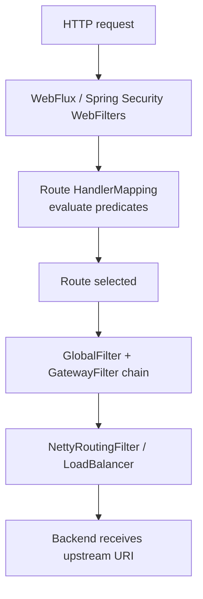

# Missing Path Segments, Duplicate Prefixes, or Encoding Errors After Rewriting

A **Spring Cloud Gateway** route can match properly, the backend can be healthy, and the Gateway can still return an HTTP response, yet the URL sent to the backend is wrong. For example, the client calls `GET /api/v1/orders/42` while the backend receives `/orders/42` instead of `/v1/orders/42`; another route sends `/api/api/orders/42` because both Ingress and Gateway prepend the prefix; or a path containing spaces/Unicode/`%2F` gets double-encoded into `%252F`. These bugs frequently appear after changing `StripPrefix`, `PrefixPath`, `SetPath`, `RewritePath`, context path, or reverse proxy configurations.

This lesson walks through diagnosing **missing path segments, duplicate prefixes, or encoding errors after rewriting** in **Spring Cloud Gateway Server WebFlux**. Follow a single request through client → CDN/Ingress/reverse proxy → Spring WebFlux context path → route predicate → Gateway filter chain → Reactor Netty HTTP client → backend. Once you know exactly which layer altered the path, you can fix the single right place and avoid stacking another rewrite on top to mask the bug.

In the **SPRING_CLOUD_GATEWAY** module, this topic relates directly to route predicates, the filter chain, path/header transformations, service discovery, authentication, rate limiting, circuit breakers, retries, TLS, and request observability. **Path rewriting is part of the routing contract and security boundary**: altering a path can send requests to the wrong resource, bypass protective prefixes, or change authorization semantics.

**Learning objectives:**

1. Distinguish the original request target, post-Ingress path, context path, route-matching path, and upstream URL.
2. Choose properly among `StripPrefix`, `PrefixPath`, `SetPath`, and `RewritePath`.
3. Calculate stripped/added segments and filter ordering.
4. Diagnose double prefixes, missing segments, wrong regex captures, and trailing slashes.
5. Understand raw paths, decoded paths, percent encoding, Unicode, encoded slashes, and double decoding.
6. Separate path from query string, fragment, and forwarded headers.
7. Determine whether a bug belongs to the reverse proxy, Gateway, LoadBalancer, or backend using request IDs and logs.
8. Write integration tests using WebTestClient/WireMock to verify the **actual path received by the backend**.
9. Prevent path traversal, open redirects, authorization bypasses, and canonicalization mismatches across proxies.
10. Build a safe runbook for restoring route/path configurations.

> **Scope:** Primary examples use **Spring Cloud Gateway Server WebFlux 5.x**, with routes under `spring.cloud.gateway.server.webflux.routes`. Gateway WebFlux 4.x typically uses the `spring.cloud.gateway.routes` prefix. Gateway Server Web MVC uses a different stack. Spring Framework, Reactor Netty, Ingress, and backend servers can differ in how they handle encoded slashes, trailing slashes, and forwarded headers; always test on your actual release train and infrastructure. Paths in this lesson are lab examples.
## 1. Identifying the Three Main Symptoms

| Symptom | Request Sent by Client | Received by Backend | First Suspect |
| --- | --- | --- | --- |
| **Missing segment** | `/api/v1/orders/42` | `/orders/42` | `StripPrefix` drops too many segments |
| **Duplicate prefix** | `/api/orders/42` | `/api/api/orders/42` | Ingress + Gateway both prepend/rewrite |
| **Broken encoding** | `/api/files/a%20b` | `/files/a%2520b` | `%` encoded a second time |
| **Wrong prefix placement** | `/public/api/orders` | `/api/orders` or `/public/public/api/orders` | Confusing context path with route prefix |
| **Wrong path variable** | `/api/orders/42` | `/orders/{id}` or `/orders/` | Incorrect `RewritePath` capture/replacement |
| **Trailing slash mismatch** | `/api/orders/42/` | `/orders/42` | Inconsistent slash normalization |
| **Encoded slash split into segments** | `/files/a%2Fb` | `/files/a/b` or 400/404 | Proxy/server decodes `%2F` |
| **Lost query** | `/api/search?q=a%20b` | `/search` | Custom filter replaces URI without preserving query |
| **Wrong route matched** | `/api/admin/orders` | Public backend | Predicate overlap/order or canonicalization |

**Do not fix immediately by adding yet another `RewritePath`.** First capture the path at each boundary. If Ingress already stripped `/api`, Gateway should not strip another segment without verifying the contract.

## 2. Mapping the Path Across Layers

Use an illustrative request:

```text
Client:
  GET https://edge.example.com/store/api/v1/orders/42?expand=items

Ingress:
  external prefix /store
  forwards /api/v1/orders/42?expand=items

Gateway WebFlux:
  base path: empty
  Path predicate: /api/v1/orders/**
  StripPrefix=1
  upstream: lb://orders-service

Backend receives:
  GET /v1/orders/42?expand=items
```

| Layer | Example | Meaning |
| --- | --- | --- |
| External URL | `https://edge.example.com/store/api/v1/orders/42` | URL visible to the client |
| Proxy forwarded URI | `/api/v1/orders/42` | Path proxy sends to Gateway after rewrite |
| WebFlux application path | `/api/v1/orders/42` | Path within the application context |
| Route predicate | `Path=/api/v1/orders/**` | Condition for selecting a route |
| Gateway filter output | `/v1/orders/42` | Path after transformation |
| Upstream request URI | `http://orders-host/v1/orders/42` | URI sent by Reactor Netty |
| Backend request target | `/v1/orders/42?expand=items` | Path/query received by backend |

Each layer can add, strip, or normalize parts of the path. Using a single request with a correlation ID, collect the request target sent by the client, URI/forwarded headers at Gateway ingress, matched Route ID/predicates, path before/after custom filters, upstream URI, and backend request target. Never log raw Authorization headers, cookies, or PII inside paths.

## 3. Path, Query, and Fragment Are Three Distinct Components

A URI has the structure:

```text
scheme://authority/path?query#fragment
```

- **Path** identifies the resource, e.g., `/api/orders/42`.
- **Query** holds parameters, e.g., `?expand=items&page=2`.
- **Fragment** `#...` is handled by the client/browser; it is not sent as part of a normal HTTP request target.

`StripPrefix`/`RewritePath` act on the path. If custom code constructs a new URI from the path without preserving the query, the backend can lose `?page=2`.

Client sends:

```http
GET /api/search?q=coffee%20shop&sort=price HTTP/1.1
Host: edge.example.com
```

Backend expects:

```http
GET /search?q=coffee%20shop&sort=price HTTP/1.1
Host: search-service
```

The `/api` path prefix can be stripped, but queries `q` and `sort` must be preserved. Check the query inside the backend request journal, not just the path.
## 4. Which Path Does the Route Predicate Match?

In Gateway WebFlux, `Path` is a **Route Predicate Factory**. It evaluates the path within the WebFlux context to decide whether a route qualifies. Predicates do not rewrite paths themselves; they only select routes.

```yaml
spring:
  cloud:
    gateway:
      server:
        webflux:
          routes:
            - id: orders-api
              uri: lb://orders-service
              predicates:
                - Path=/api/v1/orders/**
```

The route matches the `/api/v1/orders/**` namespace according to the path matching rules of the running Gateway/Spring Framework version. It does not automatically strip `/api/v1` before forwarding to the backend.

**Distinction:** "Did the request match a route?" → predicates. "Which path does the backend receive?" → filters and upstream URI. A request matching the right route while the backend receives the wrong path is a **rewrite/filter issue**, not necessarily a predicate issue.

### Route Order and Overlap

If multiple routes match the same path, route order can govern which route gets selected. Lower `order` values have higher precedence. Prevent broad catch-all routes from matching before specific routes.

```yaml
spring:
  cloud:
    gateway:
      server:
        webflux:
          routes:
            - id: admin-orders
              order: -10
              uri: lb://admin-service
              predicates:
                - Path=/api/admin/**
            - id: public-api
              order: 0
              uri: lb://public-service
              predicates:
                - Path=/api/**
```

`/api/admin/orders` must hit `admin-orders`. If the catch-all had higher priority, requests could reach the public backend and create a security vulnerability.

## 5. Gateway Filters Run After Route Selection

A request flows through these general steps:



**Route predicates select the route before the filter chain runs.** Standard GatewayFilters do not alter the path and cause route predicates to be re-evaluated. If you want route matching based on a normalized path, design normalization prior to HandlerMapping or at the proxy layer; do not assume a GatewayFilter changes route selection after matching.

Code before `chain.filter(exchange)` is typically pre-phase; code in `then(...)`/`doOnSuccess` may run in post-phase. Filter order determines execution sequence. For custom filters, verify relative ordering against `RouteToRequestUrlFilter`/LoadBalancer using debug logs and integration tests.

## 6. `StripPrefix`: Strips Segments, Not Characters

`StripPrefix=n` removes the **first n path segments** from the request path before sending upstream.

| Path Before Filter | Filter | Path After Filter |
| --- | --- | --- |
| `/api/v1/orders/42` | `StripPrefix=1` | `/v1/orders/42` |
| `/api/v1/orders/42` | `StripPrefix=2` | `/orders/42` |
| `/api/v1/orders/42` | `StripPrefix=3` | `/42` |
| `/orders/42` | `StripPrefix=1` | `/42` |

Configuration:

```yaml
filters:
  - StripPrefix=1
```

If the public API is `/api/v1/orders/**` and the backend controller maps `/v1/orders/**`, stripping one segment `api` is right. If the backend maps `/orders/**`, you must strip two segments: `api` and `v1`.

Suppose the client calls `/api/v1/orders/42`, the backend logs `/orders/42`, yet the team wanted `/v1/orders/42`. The route may have `StripPrefix=2` when only `StripPrefix=1` is needed. Adjust the segment count to match the public → backend contract, then verify the backend receives the right request target.

`StripPrefix` counts segments according to the Gateway's path parser. For paths with duplicate slashes, trailing slashes, or encoded slashes, segmentation may differ from naive assumptions on the raw string. Create test vectors for `/api/orders`, `/api/orders/`, `/api//orders/42`, and `/api/files/a%2Fb`.

## 7. `PrefixPath`: Prepends a Prefix to the Path

`PrefixPath=/prefix` prepends a path prefix to the request before proxying.

```yaml
filters:
  - PrefixPath=/internal
```

| Path Before | PrefixPath | Path After |
| --- | --- | --- |
| `/orders/42` | `/internal` | `/internal/orders/42` |
| `/v1/catalog` | `/api` | `/api/v1/catalog` |

Use it when the backend has a different base path from the public API. If Ingress already added `/internal` or the application base path already includes an equivalent prefix, the Gateway can produce `/internal/internal/orders/42`.

**PrefixPath is not a tool for arbitrarily patching missing segments.** Before adding a prefix, verify the expected backend path and every layer that already prepended upstream.

## 8. `SetPath`: Sets the Path via Template Variables

`SetPath` replaces the path with a URI template that can use variables captured by the route predicate.

```yaml
spring:
  cloud:
    gateway:
      server:
        webflux:
          routes:
            - id: legacy-order-path
              uri: lb://orders-service
              predicates:
                - Path=/legacy/orders/{orderId}
              filters:
                - SetPath=/v1/orders/{orderId}
```

Request `/legacy/orders/42` is rewritten to `/v1/orders/42` provided the `orderId` path variable is captured properly.

Use `SetPath` when the public path and backend path have simple, clearly corresponding structures; when changing prefixes/versions while preserving variables; or when complex regex rewrites are unnecessary. Verify that template variables exist in the predicate, query parameters are preserved per contract, and SetPath does not collide with RewritePath/PrefixPath.

## 9. `RewritePath`: Replaces the Path via Regular Expression

`RewritePath` uses a Java regular expression to capture and build a new path.

```yaml
spring:
  cloud:
    gateway:
      server:
        webflux:
          routes:
            - id: rewrite-orders
              uri: lb://orders-service
              predicates:
                - Path=/api/**
              filters:
                - name: RewritePath
                  args:
                    regexp: "/api/(?<remaining>.*)"
                    replacement: "/<capture>"
```

In real configurations, capture group references in the replacement have escaping syntax depending on the property source; Gateway docs illustrate escaping the opening brace/dollar construct to prevent Spring placeholder resolution. Verify actual bound values across YAML, environment variables, Java DSL, or Config Server; never blindly add backslashes to runtime replacements without testing.

Regex `/api/(?<remaining>.*)` captures everything after `/api/`. If the path is `/api/orders/42`, remaining is `orders/42` and the intended replacement is `/orders/42`. Other regexes such as `/api/(.*)/(.*)` with greedy groups can capture more than expected. Test short paths, multi-segment paths, trailing slashes, and encoded characters.

## 10. Choosing the Right Filter: Decision Table

| Goal | Suitable Filter | Example |
| --- | --- | --- |
| Strip first N segments | `StripPrefix=N` | `/api/v1/x` → `/v1/x` |
| Prepend a fixed prefix | `PrefixPath=/internal` | `/x` → `/internal/x` |
| Replace entire path via template | `SetPath=/v1/orders/{id}` | `/legacy/{id}` → `/v1/orders/{id}` |
| Replace path via regex/capture | `RewritePath` | `/api/(?<r>.*)` → captured remainder |
| Modify query parameters | Query filter/custom query logic | Do not use path rewrite |
| Change host/authority | URI/Host filter per goal | Do not confuse with path |
| Rewrite response Location | `RewriteLocationResponseHeader` | Not a request path rewrite |
| Inform backend of public prefix | Forwarded header policy | Do not assume header rewrites path |

**Prefer the simplest explainable filter.** For a route that only needs to drop `/api`, `StripPrefix=1` is usually easier to review than a complex regex. A route turning `/legacy/orders/{id}` into `/v1/orders/{id}` can use `SetPath` much more legibly than multiple capture groups.
## 11. Duplicate Prefixes: Caused by Multiple Prepending Layers

Example:

```text
External URL:
  /store/api/orders/42

Ingress:
  rewrite-target -> /api/orders/42

Gateway:
  PrefixPath=/api

Backend receives:
  /api/api/orders/42
```

Operations sees `/api/api` and adds `StripPrefix=1`. Later, if Ingress behavior changes or the Gateway prefix is removed, the bug resurfaces.

### How to Investigate

1. Check Ingress rewrite annotations/config and the actual upstream path it sends.
2. Check Gateway request path before filters.
3. Inspect the route filter list: are there other `PrefixPath`/`SetPath`/`RewritePath` filters?
4. Check `spring.webflux.base-path` or context path.
5. Check backend controller/base path.
6. Draw a single mapping **external → gateway → backend**.

### How to Fix

Assign a single owner to each transformation:

- Ingress: strip external prefix `/store` if that is an edge responsibility.
- Gateway: strip `/api` if the public API has a prefix the backend does not use.
- Backend: do not re-prepend a prefix if the Gateway already sends the expected path.

Never let both Ingress and Gateway own the same rewrite without an explicit contract.

## 12. Missing Path Segments: StripPrefix, Regex, or Base Path

For example, the backend expects `/v1/orders/42` but receives `/orders/42`.

Check step by step:

- Did `StripPrefix=2` remove both `api` and `v1`?
- Does `RewritePath` have a replacement starting with a slash whose capture omitted `v1`?
- Does `SetPath` mistakenly use the template `/orders/{id}`?
- Did Ingress already strip `/v1` before Gateway matched?
- Was `spring.webflux.base-path` accounted for twice in tests/proxies?
- Did a custom GlobalFilter mutate the request URI a second time?

**Do not add or subtract segment counts until you know the exact path at each boundary.** If Gateway already receives `/orders/42` straight from Ingress, StripPrefix is not what dropped `v1`.

## 13. Trailing Slashes and Repeated Slashes

The following paths may not be equivalent across all proxies/servers/frameworks:

```text
/api/orders
/api/orders/
/api//orders/42
/api/orders//42
```

Depending on path matchers and upstream servers, trailing slashes may resolve to the same route or a different one; repeated slashes may be preserved, collapsed, or rejected. Do not rely on default behavior when the API contract requires exactness.

### Recommended Rules

- Pick one canonical form, e.g., no trailing slash except root.
- Explicitly define whether repeated slashes are rejected or normalized.
- If redirecting to a canonical path, use appropriate status/method semantics; never redirect POST arbitrarily.
- Do not let a proxy normalize one way while Gateway normalizes differently from the backend.
- Test paths with/without trailing slashes and encoded separators.

**Do not blindly apply regex `/{2,}` replacement on paths** if it could alter segment data or encoded slashes. Normalization must be URI-aware and aligned with security policy.

## 14. Context Path / Base Path Is Not a Route Prefix

Some WebFlux applications run with a base path, such as `spring.webflux.base-path=/edge`. In that case the public path and in-application path can differ depending on request processing/configuration.

**Do not confuse:**

- `spring.webflux.base-path`: base path of a WebFlux application.
- `server.servlet.context-path`: property for the Servlet stack; do not apply mechanically to WebFlux.
- `Path=/api/**`: Gateway route predicate.
- `PrefixPath=/internal`: filter prepending an upstream path.
- `X-Forwarded-Prefix`: header describing a prefix at a proxy boundary; not by default a route rewrite.
- Ingress rewrite: modifies the request path before it reaches the Gateway.

If Gateway runs under a base path and route predicates also include a base path, verify which path HandlerMapping actually sees on your version. Do not copy an external path into predicates and prepend it again without testing.

Example to verify:

```yaml
spring:
  webflux:
    base-path: /edge
  cloud:
    gateway:
      server:
        webflux:
          routes:
            - id: orders
              uri: lb://orders-service
              predicates:
                - Path=/api/orders/**
```

In an actual deployment, send `/edge/api/orders/42` through the server and verify the route matches as expected. If context path/prefix handling runs in ingress/forwarded transformers, behavior can differ from proxy-less tests.

## 15. Forwarded Headers Do Not Automatically Equal Path Rewrites

Reverse proxies commonly send:

```http
X-Forwarded-Proto: https
X-Forwarded-Host: edge.example.com
X-Forwarded-Port: 443
X-Forwarded-Prefix: /store
Forwarded: proto=https;host=edge.example.com
```

These headers can describe the external URL when a proxy altered scheme/host/prefix. However, **do not assume `X-Forwarded-Prefix` automatically makes Gateway strip or prepend paths as you expect**. Behavior depends on:

- Whether the proxy/Ingress actually rewrites the path.
- Whether Spring Framework forwarded-header handling is enabled.
- Gateway ForwardedHeadersFilter and related settings.
- Trusted proxy chain and proxy ordering.
- Path/context path evaluated at route-matching time.

**Security:** Never trust `X-Forwarded-*` headers sent directly by Internet clients. Trusted proxies must strip/overwrite client-supplied forwarded headers before adding their own values; trust only hops inside the trust boundary.
## 16. Percent Encoding: `%20` and `%2520` Are Different

In URIs:

- `%20` is a percent-encoded space.
- `%2520` is `%` encoded as `%25`, followed by `20`. Decoding once produces the literal string `%20`, not a space.
- `%2F` is an encoded slash.
- `%252F` is an encoded literal `%2F` (double-encoded relative to representing a slash).

Example client request:

```text
GET /api/files/my%20report.pdf
```

The backend expects a path segment named `my report.pdf` (depending on framework decoding). If a custom filter reads the raw encoded path and invokes an encoder a second time, the backend may see:

```text
/files/my%2520report.pdf
```

This is a **double-encoding** bug.

Rules:

1. Distinguish encoded URI representations from decoded application paths.
2. Encode only when converting path segment data into a URI component; never encode an already-encoded URI.
3. Never call `URLEncoder` on paths; `URLEncoder` is for form/query encoding and has different `+` semantics.
4. Avoid decoding manually and passing the string into a URI builder without specifying the encoding mode.
5. Verify the raw upstream request target in WireMock/backend logs.

## 17. `URI.getRawPath()` and `URI.getPath()` Are Not the Same

Java `java.net.URI` provides:

- `getRawPath()`: path still percent-encoded.
- `getPath()`: path already percent-decoded by the URI parser.

Example:

```java
URI uri = URI.create("https://edge.example.com/files/a%20b");

System.out.println(uri.getRawPath()); // /files/a%20b
System.out.println(uri.getPath());    // /files/a b
```

If code reads `getPath()` and passes it into an API expecting a raw encoded URI string and re-encodes, `%`/spaces can be transformed further. If code reads `getRawPath()` and runs whole-path encoding, `%` becomes `%25`.

### When Debugging WebFlux

Note the distinct representations:

- `exchange.getRequest().getURI().getRawPath()`: raw URI path from the request URI.
- `exchange.getRequest().getURI().getPath()`: decoded URI path per Java URI.
- `exchange.getRequest().getPath()`: Spring Framework RequestPath abstraction; inspect `value()` and path elements per API version.
- `exchange.getRequest().getPath().pathWithinApplication()`: path portion within the application context, if a context path exists.

**Do not assume all of the above APIs return the same string.** Spring Framework may parse context path/pathWithinApplication and decode path elements using its own rules. When logging, name the exact field; never log one field and generically label it "raw path".

## 18. Encoded Slash `%2F`: A Sensitive Boundary

`%2F` can be handled differently across CDN, Ingress, Gateway HTTP server, Spring path parser, and backend. Some proxies/servers may:

- Preserve `%2F` as part of a single segment.
- Decode it to `/` before route matching.
- Reject the request because encoded slashes are forbidden.
- Turn it into a different path when proxying upstream.

Example:

```text
/files/a%2Fb
```

This can be interpreted as **one segment** containing an encoded slash, or **two segments** `a` and `b`, depending on the layer. If authorization matches `/files/{fileId}` while the backend decodes to `/files/a/b`, policies can be bypassed.

How to handle:

- Only allow encoded slashes if the business API contract truly requires them.
- Enforce the same policy across CDN/Ingress/Gateway/backend.
- Test `%2F`, `%2f`, `%252F`, and malformed percent encodings.
- Never decode paths multiple times.
- Base authorization on canonical resource identity and always enforce resource ownership in the backend.
- For file/object IDs, consider base64url or UUIDs instead of embedding slashes in a path segment.

**Never enable "allow encoded slash" on a server/proxy just to fix a 404** without analyzing the security implications.

## 19. Unicode, Spaces, and Normalization

Paths can contain Unicode:

```text
/api/customers/Nguyễn-Văn-A
/api/files/café menu.pdf
```

In HTTP request targets, non-ASCII characters are normally UTF-8 percent-encoded. Unicode strings can have multiple visually equivalent representations with different byte sequences (such as composed vs. decomposed accents).

Align across layers:

- Client encodes using UTF-8.
- Proxies preserve encoded paths per contract.
- Gateway and backend use matching decoding rules.
- If business identity requires Unicode normalization (NFC/NFKC), perform it explicitly in the domain layer under clear policy; never normalize arbitrarily during routing.
- Do not log or compare raw byte paths and normalized strings as if they were always identical.
- Test Vietnamese diacritics, emojis if the API allows, spaces, and reserved characters.

**Never lowercase the entire path** if resource IDs are case-sensitive or signed URLs depend on exact casing.

## 20. Plus (`+`), `?`, `#`, `%`, and Reserved Characters

Certain characters carry different semantics depending on the URI component:

| Character | In Path | In Query/Form | Risk |
| --- | --- | --- | --- |
| Space | Must be percent-encoded, usually `%20` | Form encoding may use `+` | `+` in path is not a space by default |
| `+` | Can be a literal plus | Form decoder usually decodes to space | Using URLDecoder on paths is wrong |
| `?` | Starts query if unencoded | Query delimiter | Literal path data needs `%3F` |
| `#` | Starts client URI fragment, not sent | Not a normal query separator | Literal path data needs `%23` |
| `%` | Starts escape sequence | Starts escape sequence | Literal `%` must encode as `%25` |
| `/` | Segment separator | Can be data inside query | `%2F` semantics differ |
| `;` | May act as path parameters depending on framework | Data | Parsers differ |
| `&`/`=` | Can be data in path if encoded | Separates query key/value | Encode per component |

### Common Mistake: URLDecoder on Paths

```java
// WRONG for URI paths: URLDecoder handles application/x-www-form-urlencoded,
// so '+' characters can turn into spaces.
String path = java.net.URLDecoder.decode(
    rawPath, java.nio.charset.StandardCharsets.UTF_8);
```

Use an API designed to decode URI/path components exactly once. Never take a string containing both path and query and feed it to a form decoder.

## 21. Double Decoding and Path Traversal

A path can be decoded across multiple layers:

```text
Client sends:      /files/%252e%252e%252fsecret
Proxy decodes:     /files/%2e%2e%2fsecret
Backend decodes:   /files/../secret
```

If Gateway inspects the path before the second decode, the backend can see `..` and slashes afterward. This is a **path traversal / canonicalization mismatch**, not just a formatting bug.

Prevention:

- Never decode paths multiple times across layers.
- Canonicalize and validate resource identifiers under a single contract.
- Reject malformed percent escapes, dot segments, or encoded traversals per policy.
- Use allowlisted route patterns and backend authorization.
- Never concatenate paths from user input assuming a Gateway predicate protects the backend.
- Test `%2e`, `%2e%2e`, `%252e`, `%2f`, `%5c`, and mixed-case encodings if supported.
- Ensure file services/object storage do not normalize paths differently from the Gateway.

**A matching route predicate does not prove a path is safe.** The backend must still authorize access on the final resolved resource after any normalization it performs.
## 22. Do Not Build URIs via String Concatenation

Anti-pattern:

```java
String target = "http://orders-service/api/" + userPath;
URI uri = URI.create(target);
```

If `userPath` contains `?`, `#`, `%`, `..`, or encoded slashes, string concatenation can alter authority/path/query semantics or construct an invalid URI.

Prefer an appropriate URI builder API and distinguish a **path segment** from a **whole path**:

```java
URI target = UriComponentsBuilder
    .fromUriString("http://orders-service")
    .pathSegment("api", "orders", orderId)
    .build()
    .encode()
    .toUri();
```

Here `orderId` is added as a single **segment**, letting the builder encode special characters properly. If you already hold a fully and properly encoded URI, do not encode it again. URI builder APIs/encoding modes vary across Spring Framework versions; test spaces, plus signs, Unicode, percent signs, and slashes, and reject slashes if IDs must not contain slashes.

## 23. Route Rewrites and Security Authorization Must Share the Same Canonical Path

A dangerous mistake:

```text
Public request: /api/admin/users/42
Gateway route: Path=/api/**
RewritePath removes /api
Security rule checks only /admin/**
Backend sees /admin/users/42
```

If the security matcher and routing matcher evaluate **two different path representations**, a bypass can occur—especially when Ingress/Gateway/backend decode encoded separators or normalize `..` differently.

Security invariants:

1. Authentication happens before route selection.
2. Authorization binds to identity and resource, not raw prefixes alone.
3. Route configs must never expose admin endpoints through rewrites.
4. Gateway never trusts forwarded paths/headers from clients outside a trusted proxy.
5. Backend still verifies authorization against the canonical resource.
6. Test encoded path variants and slash normalization across the **entire chain**, not just predicate unit tests.

## 24. Combining Multiple Filters: Calculate Order, Never Guess

A route has:

```yaml
filters:
  - PrefixPath=/internal
  - StripPrefix=1
  - name: RewritePath
    args:
      regexp: "/internal/orders/(?<id>.*)"
      replacement: "/<capture>"
```

Each filter can read the path mutated by preceding filters, so order changes the result. Illustrative trace:

```text
Initial path: /api/orders/42
PrefixPath=/internal:
  /internal/api/orders/42
StripPrefix=1:
  /api/orders/42
RewritePath=/api/orders/(?<id>.*) -> /orders/42
```

This is an illustrative calculation; verify actual filter ordering and path representations for your Gateway version. Usually the same outcome can be achieved with **a single simpler rewrite filter**.

Recommendations: each route should have one canonical public path and one canonical backend path; avoid chaining multiple path-mutating filters; document before/after states per filter in tests; verify custom GlobalFilter ordering relative to built-in filters and `RouteToRequestUrlFilter`. Do not tweak `@Order` blindly just to patch a path without knowing which phase constructs the request URI.

## 25. Query String Lost After Custom Rewrite

A custom filter might replace the URI with a new path while accidentally dropping the query:

```java
// Pseudocode illustrating bug: builds URI from path only,
// losing original query params.
URI newUri = URI.create("http://orders-service" + rewrittenPath);
```

For `/api/orders?q=abc&page=2`, the backend only receives `/orders`. To fix:

- Preserve the query component when mutating URIs, if required by contract.
- Use builder APIs capable of copying query parameters.
- Never concatenate query strings from raw text.
- Test empty queries, multi-value params, encoded `&`, `=`, `+`, and Unicode.
- Verify fragments are not forwarded as HTTP request targets.

Built-in `StripPrefix`/`RewritePath` generally preserve queries per Gateway filter behavior; custom filters/URI mutations require dedicated tests.

## 26. Path Rewriting with Service Discovery and LoadBalancer

When a route uses `lb://orders-service`, path transformation still executes before the request is sent to a backend instance. LoadBalancer selects **host/port**; it does not decide prefix stripping.

```yaml
spring:
  cloud:
    gateway:
      server:
        webflux:
          routes:
            - id: orders
              uri: lb://orders-service
              predicates:
                - Path=/api/v1/orders/**
              filters:
                - StripPrefix=1
```

If backend instance A receives `/v1/orders/42` while instance B receives `/orders/42`, suspect backend instances running different versions/path mappings, per-pod sidecar rewrites, different Gateway config revisions, or logs capturing paths at different boundaries.

**Never patch Gateway with random per-instance path rewrites** to mask backend contract drift. Ensure every instance under a service ID honors a compatible path contract, or separate service IDs/versions.

## 27. Distinguish Route URI Path from Request Path

A route URI can contain a path component, e.g., `http://orders-service/internal`. Gateway may combine the URI path with the request path according to URI/filter pipeline rules. This can introduce unexpected extra prefixes.

```yaml
spring:
  cloud:
    gateway:
      server:
        webflux:
          routes:
            - id: orders-base-uri
              uri: http://orders-service/internal
              predicates:
                - Path=/api/orders/**
              filters:
                - StripPrefix=1
```

Do not assume the backend will receive `/internal/orders/42` or `/internal/api/orders/42` just by mental string concatenation. Verify the resolved route URI, the post-filter-chain request URI, and the raw request target received by the backend. In production, prefer route URIs without a base path when possible, and use an explicit filter to build the backend path.

## 28. WebFlux Base Path and Servlet Context Path Differ

If the module runs Gateway Server WebFlux:

- `spring.webflux.base-path` belongs to WebFlux application configuration.
- `server.servlet.context-path` is a Servlet stack property and should not be applied mechanically to WebFlux Gateway.
- Gateway Server Web MVC uses the Servlet stack and has different context-path behavior.
- Reverse proxies can prepend/rewrite paths ahead of both.

Example to verify:

```yaml
spring:
  webflux:
    base-path: /edge
  cloud:
    gateway:
      server:
        webflux:
          routes:
            - id: orders
              uri: lb://orders-service
              predicates:
                - Path=/api/orders/**
```

In a real deployment, send `/edge/api/orders/42` through the server and verify the route matches as expected. When context paths/prefixes are handled in ingress/forwarded transformers, outcomes can differ from proxy-less tests.

## 29. Forwarded Prefix and Public URL Generation

Reverse proxies typically send:

```http
X-Forwarded-Proto: https
X-Forwarded-Host: edge.example.com
X-Forwarded-Port: 443
X-Forwarded-Prefix: /store
Forwarded: proto=https;host=edge.example.com
```

These headers describe the external URL when a proxy altered scheme/host/prefix. Still, **do not assume `X-Forwarded-Prefix` automatically causes Gateway to strip or prepend paths as desired**. Behavior depends on proxy/Ingress rewrites, Spring forwarded-header handling, Gateway ForwardedHeadersFilter, trusted proxy chains, and path/context path at route-matching time.

**Security:** Never trust `X-Forwarded-*` headers sent directly by Internet clients. Trusted proxies must strip/overwrite client-supplied forwarded headers before adding their own values; trust only hops inside the trust boundary.

Sometimes a backend generates an absolute URL in a response:

```http
Location: http://orders-service:8080/orders/42
```

External clients need:

```http
Location: https://edge.example.com/store/api/orders/42
```

This is **response Location header rewriting**, not a request path rewrite. Gateway offers `RewriteLocationResponseHeader` for certain cases. Check whether the backend emits relative or absolute Locations; whether forwarded host/proto are trusted; whether redirects preserve queries; and whether user input can control the host inside Location. Never leak internal hostnames or insecure `http` schemes to the Internet.

## 30. Observing Paths Across Every Boundary

A good diagnostic log uses clearly named fields:

```text
requestId=...
gatewayPod=edge-gateway-7b8d...
routeId=orders-api
method=GET
requestUriRawPath=/api/v1/orders/42
requestUriDecodedPath=/api/v1/orders/42
contextPath=
pathWithinApplication=/api/v1/orders/42
upstreamService=orders-service
upstreamPath=/v1/orders/42
status=200
```

**Never leave full wiretap enabled indefinitely in production** if logs can capture Authorization, Cookie, request bodies, or PII. Wiretap is valuable in lab/staging, provided logs are redacted and time-bounded.

Actuator/Gateway metrics usually record `routeId`, status, outcome, and method; timers do not necessarily capture the upstream path. Use request-ID-correlated logs/traces for exact paths. Avoid putting raw path variables like order IDs, tenant IDs, or filenames into metric labels due to high cardinality and privacy.

Backend access logs must record the actual request target/path received by the server, along with the correlation ID forwarded through Gateway. If Gateway logs the right upstream URI while backend logs differ, inspect any service mesh/sidecar/ingress behind the Gateway.

## 31. Debug Logging and Actuator Route Inspection

In development environments, you can selectively enable logging:

```yaml
logging:
  level:
    org.springframework.cloud.gateway: DEBUG
    org.springframework.web.reactive: DEBUG
```

Detailed logger names may change across versions. Use logging to see which route ID matched, which filter chain applied, which URI/path was built prior to routing, and which service instance LoadBalancer chose.

**Actuator Gateway endpoint** (if enabled and authorized):

- `GET /actuator/gateway/routes` to view active routes.
- `GET /actuator/gateway/routes/{id}` to view a specific route.
- Route details can expose URI/filter topology; protect on the management network.
- Production should prefer **read-only**; never expose route-mutating endpoints publicly.

Actuator route definitions show configuration; they **do not replace backend request logs** as proof of the final delivered path.
## 32. Testing Path Rewrites with WebTestClient and WireMock

Unit tests for predicates/filters help, yet path bugs often emerge when multiple filters/URI components combine. Use integration tests with:

- Spring Boot Gateway WebFlux running on a **real HTTP port**.
- WebTestClient sending requests through the listener.
- WireMock backend on a dynamic port.
- WireMock request journal verifying the **actual received path/query**.
- A test through Ingress/staging if production performs proxy rewrites.

Test route configuration:

```yaml
spring:
  cloud:
    gateway:
      server:
        webflux:
          routes:
            - id: orders-strip-one
              uri: ${test.backend-url}
              predicates:
                - Path=/api/v1/orders/**
              filters:
                - StripPrefix=1
```

For request `/api/v1/orders/42?expand=items`, the backend expects `/v1/orders/42?expand=items`.

Java integration test:

```java
import static com.github.tomakehurst.wiremock.client.WireMock.*;

import org.junit.jupiter.api.Test;

@Test
void stripOneSegmentAndPreserveQuery() {
    backend.stubFor(get(urlPathEqualTo("/v1/orders/42"))
        .withQueryParam("expand", equalTo("items"))
        .willReturn(aResponse()
            .withStatus(200)
            .withBody("{\"id\":42}")));

    webTestClient.get()
        .uri("/api/v1/orders/42?expand=items")
        .exchange()
        .expectStatus().isOk()
        .expectBody()
        .jsonPath("$.id").isEqualTo(42);

    backend.verify(1,
        getRequestedFor(urlPathEqualTo("/v1/orders/42"))
            .withQueryParam("expand", equalTo("items")));
}
```

This is a **test snippet** requiring a SpringBootTest/WebTestClient/WireMock fixture and a `test.backend-url` dynamic property. Key assertion: the backend received `/v1/orders/42`, not merely that the client received HTTP 200.

## 33. Test Matrix for StripPrefix, PrefixPath, SetPath, and RewritePath

Write independent tests, one behavior per test:

| Test | Input Path | Filter | Expected Backend Path |
| --- | --- | --- | --- |
| T01 | `/api/v1/orders/42` | `StripPrefix=1` | `/v1/orders/42` |
| T02 | `/api/v1/orders/42` | `StripPrefix=2` | `/orders/42` |
| T03 | `/orders/42` | `PrefixPath=/internal` | `/internal/orders/42` |
| T04 | `/legacy/orders/42` | `SetPath=/v1/orders/{id}` | `/v1/orders/42` |
| T05 | `/api/orders/42` | `RewritePath` capture remainder | `/orders/42` |
| T06 | `/api/api/orders/42` | No rewrite (diagnostic) | Preserved to identify which layer added prefix |
| T07 | `/api/orders/42?x=1` | `StripPrefix=1` | `/orders/42?x=1` |
| T08 | `/api/files/a%20b` | Single rewrite | Does not become `%2520` |
| T09 | `/api/files/a%2Fb` | No decode/re-encode | Preserved or rejected per policy |
| T10 | `/api/orders/42/` | Explicit slash policy | Expected canonical form |
| T11 | `/api//orders/42` | Reject/normalize per policy | Does not create route bypass |
| T12 | `/api/files/caf%C3%A9` | UTF-8 | Backend decodes `café` properly |
| T13 | `/api/search?q=a+b` | Path rewrite | Query semantics preserved |
| T14 | `/api/search?q=a%2Bb` | Path rewrite | Query value is literal `a+b` |
| T15 | `/api/files/%252e%252e%252fsecret` | Security policy | Rejected if traversal encoding disallowed |

**Never assert response status alone.** Two different paths can both return 200 while reading the wrong resource. Assertions must verify backend path, query, headers, and resource identity.

## 34. Testing Percent Encoding at the Right Layer

WireMock APIs may expose decoded URLs/paths depending on the matcher; therefore, tests for encoded paths should also check the **raw request target** in the backend fixture or a test HTTP server logging URI/raw URI. Never assume `urlPathEqualTo` always preserves every percent-escape representation.

Test cases should include:

```text
/files/a%20b
/files/a%2520b
/files/a%2Fb
/files/a%252Fb
/files/a+b
/files/a%2Bb
/files/caf%C3%A9
/files/%2e%2e/secret
/files/%252e%252e%252fsecret
```

Expected behavior must be defined by contract:

- A space is a character inside a segment.
- Literal `%20` in a filename differs from a space.
- Encoded slashes may be rejected.
- Plus in a path differs from plus in a form query.
- Unicode is decoded via UTF-8 once.
- Traversal encodings are rejected or handled safely.

If an HTTP client library normalizes URIs before sending, use a **raw socket/test server** or suitable fixture to verify actual bytes/request targets; do not blame Gateway for mis-encoding based on a test client that altered the URL itself.

## 35. Testing Route Matching and Filter Ordering

An integration test suite should verify:

1. Specific route `/api/admin/**` matches before catch-all `/api/**`.
2. Route predicate matches the exact external path after ingress rewrite.
3. `StripPrefix` applies only after route selection.
4. `PrefixPath` does not cause another route to re-match.
5. `RewritePath` captures path variables accurately.
6. Custom GlobalFilters do not mutate URIs unexpectedly.
7. Query strings are preserved.
8. LoadBalancer URI/path reaches the intended service.
9. No-route returns responses per contract.
10. Security policies still protect resources after canonicalization.

**If a custom GlobalFilter alters the path before the routing URI is created**, you must understand exact filter ordering; do not just assert `getOrder()` without executing real requests. The backend journal provides reliable proof.

## 36. Testing Behind Ingress / Reverse Proxy

Local WebTestClient calls directly to the Gateway **do not reproduce** rewrites performed at CDN/Ingress. If production uses a path prefix:

```text
Client -> CDN -> Ingress -> Gateway -> backend
```

Create a staging smoke test passing through the **exact ingress host/TLS/listener**:

- Send the real external URL.
- Capture Ingress request URI/upstream URI (if supported by controller).
- Capture Gateway incoming raw path and route ID.
- Verify Gateway upstream path.
- Verify backend request target.
- Check forwarded headers from trusted proxies.
- Send encoded/Unicode/trailing-slash path variants.

**Never let a staging ingress rewrite differently from production** and then treat the results as proof of production behavior.

## 37. Troubleshooting: Missing Path Segments

**Symptom:** Backend receives `/orders/42`, while the contract requires `/v1/orders/42`.

Investigate:

1. Did the client send `/api/v1/orders/42` or already `/api/orders/42`?
2. Did Ingress strip `/v1` or rewrite the target?
3. Which path is the Gateway route predicate matching?
4. Is `StripPrefix=2` or a `RewritePath` capture dropping `v1`?
5. Is `SetPath` using a template missing `/v1`?
6. Does the route URI have a different base path?
7. What request target does the backend access log confirm?

**Fix:** adjust only the layer dropping the segment. Write a regression test asserting exact input → exact backend path.

## 38. Troubleshooting: Duplicate Path Prefixes

**Symptom:** Backend receives `/api/api/orders/42`.

Investigate:

1. Does the Ingress rewrite prepend `/api`?
2. Does Gateway have `PrefixPath=/api`?
3. Does Gateway `RewritePath` replacement prepend `/api`?
4. Does the backend/sidecar add a base path?
5. Is `spring.webflux.base-path` applied alongside a route prefix?
6. Does a custom filter mutate the request URI twice?
7. Is pod config drift causing one pod to use new config and another old config?

**Fix:** choose one owner for the prefix; remove the duplicate prepend step. Do not casually add `StripPrefix=1`, as it can strip a valid segment whenever ingress behavior changes.
## 39. Troubleshooting: Broken `%252F`, `%2520`, or Unicode

**Symptom:** Backend receives `%252F` instead of `%2F` or spaces; Vietnamese filenames are corrupted.

Investigate:

1. Did the client percent-encode using UTF-8 properly?
2. Did a proxy decode and then re-encode?
3. Does a custom filter read `getPath()` or `getRawPath()`?
4. Does a URI builder encode an already-encoded URI again?
5. Is `URLDecoder` being used on paths?
6. Does the backend decode an extra time?
7. Do Ingress/server encoded-slash policies differ?

**Fix:** standardize a single decode/encode pass per component; never double-decode. For encoded slashes or traversals, prefer rejecting if not needed for business logic.

## 40. Runbook: Isolating the Layer Causing Wrong Path Rewrites

When production reports wrong paths:

**Step 1 — Pick a representative request.** Capture correlation ID, method, route, and redacted path; never capture raw Authorization/Cookie.

**Step 2 — Gather boundary evidence.** Compare client/edge, Ingress upstream URI, Gateway incoming path, route ID/filter config, upstream request URI, and backend access log.

**Step 3 — Classify.**

- Missing segment → count StripPrefix/regex/SetPath.
- Duplicate prefix → locate every PrefixPath/Ingress/context path.
- Broken encoding → compare raw/decoded, decode/encode count, encoded slash.
- Lost query → custom URI mutation dropping query.
- Only one pod affected → config drift/version mismatch.
- Only one backend instance affected → inconsistent backend versions/sidecars.

**Step 4 — Mitigate impact.** If data integrity or security is affected, revert traffic to last-known-good route/config or disable the route via a controlled release.

**Step 5 — Fix the source of truth.** Update Git/config revisions; never just patch manually on a single pod.

**Step 6 — Add a regression test.** Include the failing input path and assert exact backend path/query/headers.

**Step 7 — Promote with gates.** Canary and watch 404/5xx, p95, route IDs, and backend access logs.

**Step 8 — Close out.** Confirm all pods share the same config, no manual overrides remain, and the runbook is updated.

## 41. Reinforcement Exercises

### Exercise 1 — StripPrefix

Client calls `/api/v1/orders/42`. Backend expects `/v1/orders/42`. Which filter should be used?

**Answer:** `StripPrefix=1` to drop the `api` segment.

### Exercise 2 — PrefixPath

Backend expects `/internal/orders/42`, public path is `/orders/42`.

**Answer:** `PrefixPath=/internal`, after verifying neither Ingress nor a base path already added that prefix.

### Exercise 3 — Double Prefix

Backend receives `/api/api/orders/42`. Gateway has `PrefixPath=/api`.

**Answer:** Check Ingress and application base path first; if another layer already prepends `/api`, remove one owner rather than blindly adding StripPrefix.

### Exercise 4 — RewritePath

Input `/api/orders/42`, regex `/api/(?<r>.*)`, replacement is a path starting with slash using capture group `r`.

**Answer:** Expected output `/orders/42` provided the replacement binding is configured/escaped properly for the property source in use.

### Exercise 5 — Raw and Decoded Paths

`URI.getRawPath()` returns `/files/a%20b`; `URI.getPath()` returns `/files/a b`.

**Answer:** Two different representations. Do not re-encode the decoded string as a raw URI if you do not intend to alter the encoding.

### Exercise 6 — Plus Sign

A file named `a+b.txt` is sent in the path. Code calls `URLDecoder.decode` and the backend receives `a b.txt`.

**Answer:** Form decoder misused; `+` in a path is not a space by default.

### Exercise 7 — Encoded Slash

`/files/a%2Fb` turns into `/files/a/b` after Ingress.

**Answer:** The proxy decoded or normalized the encoded slash. Align policies across layers and review security rather than just tweaking Gateway regexes.

### Exercise 8 — Route Matches Right, Backend Receives Wrong Path

Gateway Path predicate matches `/api/v1/orders/**`, backend receives `/orders/42`.

**Answer:** Investigate post-match filters such as StripPrefix/RewritePath/SetPath and URI paths; predicates do not rewrite paths themselves.

### Exercise 9 — Query Disappears

Custom filter replaces the path with a new URI, and the backend does not receive `?page=2`.

**Answer:** The URI mutation failed to preserve the query component; the builder must copy query params per contract.

### Exercise 10 — One Pod Has Double Prefix

Two pods are correct, one pod is wrong.

**Answer:** Compare config revisions, route caches, custom filters/images, and ingress target mapping per pod. Likely config drift or a mixed-version rollout.

### Exercise 11 — Security and Path Traversal

Client sends `/files/%252e%252e%252fsecret`; proxy/backend decode multiple times.

**Answer:** Canonicalization mismatch can enable path traversal. Reject malformed/traversal encodings, decode only per policy, and verify resource ownership in the backend.

### Exercise 12 — Weight and Path Rewrite

Routes v1/v2 share the same Path predicate, one route adds `PrefixPath=/v2`. The same client request hits two different backend paths.

**Answer:** This is route/version-specific behavior. Ensure backend contracts are compatible and test each route; Weight only splits traffic, it does not make paths identical.

## 42. Checklist Before Changing Path Rewrites

- [ ] Map external URL → Ingress → Gateway → backend.
- [ ] Identify who owns each prefix/context path.
- [ ] Distinguish Path predicates from rewrite filters.
- [ ] Count StripPrefix by **segments**, not characters.
- [ ] Use PrefixPath only when a real prefix must be added.
- [ ] Use SetPath for simple templates, RewritePath when regex is necessary.
- [ ] Check replacement placeholder escaping per config source/version.
- [ ] Avoid chaining multiple path-mutating filters on one route needlessly.
- [ ] Check route order and catch-all overlap.
- [ ] Check URI base paths and context paths.
- [ ] Accept forwarded headers only from trusted proxies.
- [ ] Preserve query strings when mutating URIs.
- [ ] Test trailing slashes and repeated slashes.
- [ ] Test `%20`, `%2520`, `%2F`, `%252F`, `+`, `%2B`.
- [ ] Test UTF-8 Vietnamese Unicode.
- [ ] Reject or explicitly handle dot-segment/path traversal encodings.
- [ ] Never use URLDecoder on raw paths.
- [ ] Never encode an already-encoded URI a second time.
- [ ] Never decode paths across multiple layers.
- [ ] Verify the backend request target, not just Gateway response status.
- [ ] Use real HTTP integration tests and staging through Ingress.
- [ ] Test that all backend instances under a service ID share a compatible path contract.
- [ ] Never log secrets/PII in paths/headers.
- [ ] Have canary/rollback for route configs.
- [ ] Add regression tests for exact failing paths and queries.
- [ ] Verify effective routes/config revisions across all Gateway pods.

## Conclusion

Missing segments, duplicate prefixes, or encoding errors after rewriting usually happen when **multiple layers modify the same URI without a clear contract**. Ingress may rewrite the path, WebFlux may have a base path, Gateway route predicates select the route, Gateway filters alter the path further, and the backend decodes/normalizes using its own rules. Looking only at the client URL or final HTTP status is not enough to find the root cause.

The reliable approach is to **trace the request across every boundary**, separate route matching from path transformation, understand `StripPrefix` by segments, `PrefixPath` for prepending prefixes, `SetPath` for templates, and `RewritePath` for regex replacements. When percent encoding is involved, separate raw paths from decoded paths, avoid double encoding/decoding, test encoded slashes/Unicode/traversal, and preserve query strings per contract.

Finally, the path is part of the **security boundary**. Authorization, tenant ownership, and backend resource checks must rely on canonical resource identity; never let forwarded headers, raw cookies, or encoded separators alter access control. Maintain regression tests verifying the **exact path/query the backend receives**, deploy route configs by revision, and monitor every Gateway pod. When each layer owns one clear responsibility, fixing rewrites becomes verifiable and avoids breaking other microservices.

## References

- [Spring Cloud Gateway Server WebFlux — Route Predicate Factories](https://docs.spring.io/spring-cloud-gateway/reference/spring-cloud-gateway-server-webflux/request-predicates-factories.html)
- [Spring Cloud Gateway Server WebFlux — StripPrefix GatewayFilter](https://docs.spring.io/spring-cloud-gateway/reference/spring-cloud-gateway-server-webflux/gatewayfilter-factories/stripprefix-factory.html)
- [Spring Cloud Gateway Server WebFlux — PrefixPath GatewayFilter](https://docs.spring.io/spring-cloud-gateway/reference/spring-cloud-gateway-server-webflux/gatewayfilter-factories/prefixpath-factory.html)
- [Spring Cloud Gateway Server WebFlux — SetPath GatewayFilter](https://docs.spring.io/spring-cloud-gateway/reference/spring-cloud-gateway-server-webflux/gatewayfilter-factories/setpath-factory.html)
- [Spring Cloud Gateway Server WebFlux — RewritePath GatewayFilter](https://docs.spring.io/spring-cloud-gateway/reference/spring-cloud-gateway-server-webflux/gatewayfilter-factories/rewritepath-factory.html)
- [Spring Cloud Gateway Server WebFlux — How It Works](https://docs.spring.io/spring-cloud-gateway/reference/spring-cloud-gateway-server-webflux/how-it-works.html)
- [Spring Cloud Gateway Server WebFlux — Global Filters and Routing Filters](https://docs.spring.io/spring-cloud-gateway/reference/spring-cloud-gateway-server-webflux/global-filters.html)
- [Spring Framework — URI Components and UriComponentsBuilder](https://docs.spring.io/spring-framework/reference/web/webmvc/mvc-uri-building.html)
- [Java URI — Raw and Decoded Components](https://docs.oracle.com/en/java/javase/21/docs/api/java.base/java/net/URI.html)
- [Spring Framework — ForwardedHeaderTransformer](https://docs.spring.io/spring-framework/docs/current/javadoc-api/org/springframework/web/server/adapter/ForwardedHeaderTransformer.html)
- [Spring Boot — Forwarded Headers](https://docs.spring.io/spring-boot/reference/how-to/webserver.html)
- [OWASP — Path Traversal](https://owasp.org/www-community/attacks/Path_Traversal)
- [OWASP — Input Validation Cheat Sheet](https://cheatsheetseries.owasp.org/cheatsheets/Input_Validation_Cheat_Sheet.html)
- [OWASP — REST Security Cheat Sheet](https://cheatsheetseries.owasp.org/cheatsheets/REST_Security_Cheat_Sheet.html)
