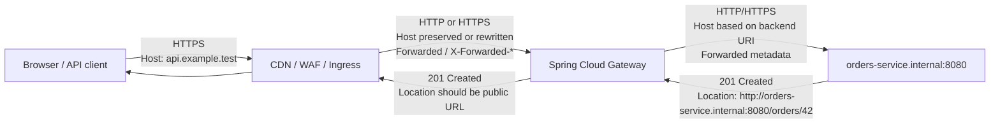

# Incorrect Host, Forwarded, or Location Headers Behind a Proxy

**Chapter:** Troubleshooting  
**Module:** `SPRING_CLOUD_GATEWAY` — Build an API Gateway with Spring Cloud Gateway using route predicates, filter chains, path/header transformations, and service discovery; practice authentication, rate limiting, circuit breakers, retries, TLS, and request observability.

An application running standalone may generate valid redirects and recognize hostnames properly, yet when placed behind a CDN, load balancer, ingress, and Spring Cloud Gateway, clients see internal URLs, redirects to HTTP, the wrong domain, or routes matching the wrong tenant. The root cause usually lies in **three distinct pieces of information**:

- **`Host`**: the authority of the current HTTP request. It can be used for route selection, virtual host resolution, and URL construction.
- **`Forwarded` / `X-Forwarded-*`**: metadata proxies use to describe the original request (client, host, scheme, port, prefix) after intermediate hops alter connection details.
- **`Location`**: a response header specifying the URI the client should visit next after a redirect or certain other responses.

These are not three names for the same thing. The inbound request `Host` might be `api.example.test`, while the Gateway HTTP client typically sets the outbound `Host` to the backend URI such as `orders.internal:8080`. `Forwarded` may preserve `host=api.example.test;proto=https`, while the backend's `Location` still points to `http://orders.internal:8080/orders/42`. To fix this properly, you must know **at which hop the wrong value appears, who generated it, and which component consumes it**.

This lesson focuses on diagnosing:

1. Route `Host` predicate failing to match or matching the wrong domain.
2. Backend receiving an internal `Host` when it needs the public host (or vice versa).
3. Missing, duplicated, misordered, or spoofed `Forwarded`/`X-Forwarded-Host`/`X-Forwarded-Proto`.
4. Redirect `Location` leaking internal hostname/port/path, wrong HTTPS scheme, or missing prefix.
5. Generated URLs in HTML/JSON/OpenAPI/OAuth2 callbacks being wrong behind a proxy.
6. Behavioral differences between Spring Cloud Gateway Server WebFlux and Server Web MVC, or across release trains.

> **Version examples:** Primary YAML uses **Spring Cloud Gateway Server WebFlux 5.1.0**, namespace `spring.cloud.gateway.server.webflux`. The Gateway 4.x line uses older prefixes such as `spring.cloud.gateway.*`; Gateway Server Web MVC uses `spring.cloud.gateway.server.webmvc.*` and a different HTTP stack/Java DSL. Some MVC/API reference pages are currently published under 5.0.3; verify against your project's exact Boot/Cloud BOM before copying configuration.

## 1. Request and Redirect Flow Diagram

Suppose a client accesses:

```text
https://api.example.test/api/orders/42
```

The infrastructure has three hops:



**Information changes at each hop:**

| Attribute | Client Sends to Edge | Edge Sends to Gateway | Gateway Sends to Backend |
|---|---|---|---|
| TCP peer/remote address | Client IP or previous proxy | Ingress/load balancer IP | Gateway IP |
| Actual connection scheme | HTTPS | May be internal HTTP or HTTPS | Per backend URI |
| `Host` | `api.example.test` | May preserve public host or rewrite to `gateway:8080` | Usually the authority of the backend URI |
| `Forwarded` | Untrusted if sent by client | Ingress must sanitize and create trusted metadata | Gateway can append metadata per trusted-proxy policy |
| `X-Forwarded-*` | Do not trust client-supplied values | Ingress creates canonical values | Gateway can create/append per configuration |
| `Location` | — | — | Backend generates response header; Gateway can rewrite before returning to client |

### 1.1. Distinguish Three Hostnames

In a single request:

```text
Public authority:  api.example.test:443
Gateway listener:  gateway-7f9c:8080
Backend authority: orders-service.internal:8080
```

- **Public authority** is the name the client expects to see.
- **Gateway listener** is the internal network address where Gateway accepts requests.
- **Backend authority** is the address Gateway's HTTP client uses to connect upstream.

All three values can legitimately differ. Do not force every `Host` to equal `api.example.test`: a backend virtual host might require `orders.internal`, while client redirects must use `api.example.test`.

### 1.2. Four Places Where URLs Can Be Generated

1. **Ingress/CDN:** HTTP → HTTPS redirects, canonical domains, trailing slashes, host rewrites.
2. **Gateway:** `RedirectTo`, `RewriteLocationResponseHeader`, custom filters, OAuth2 login redirects.
3. **Backend:** Spring MVC/WebFlux generating absolute redirects, links, pagination URLs, form actions.
4. **Frontend/API documentation:** OpenAPI `servers`, Swagger UI, HTML/JSON links, config-built absolute URLs.

If you only fix `Location` at the Gateway, absolute URLs in the body can still be wrong. Before changing filters, check whether the **response header or response body** contains the wrong URL.

## 2. Understand `Host`, `Forwarded`, `X-Forwarded-*`, and `Location` Accurately

### 2.1. `Host` in the Request

`Host` (or the `:authority` pseudo-header in HTTP/2/HTTP/3) indicates the target authority of the request. Servers use it to distinguish virtual hosts. In Spring Cloud Gateway, the **Host Route Predicate** matches the `Host` header of the inbound request:

```yaml
spring:
  cloud:
    gateway:
      server:
        webflux:
          routes:
            - id: public-api
              uri: lb://api-service
              predicates:
                - Host=api.example.test
                - Path=/api/**
```

If ingress changes Host to `gateway.default.svc.cluster.local`, the route above may **fail to match**, even though the client sent `Host: api.example.test`. Conversely, if a route uses an overly broad `Host=**.example.test`, an unintended host can match. Inspect the exact header **received by the Gateway**, not just the domain in the browser.

### 2.2. RFC 7239 `Forwarded`

Example:

```http
Forwarded: for=198.51.100.24;proto=https;host=api.example.test
```

Common parameters:

- `for=`: client/proxy address of the described hop.
- `proto=`: scheme in front of the proxy (e.g., `https`).
- `host=`: public authority observed in front of the proxy.
- `by=`: proxy that added/adjusted this element.

A header may contain multiple elements, for example:

```http
Forwarded: for=198.51.100.24;proto=https;host=api.example.test, for=10.10.0.12;proto=http;host=gateway.internal
```

**Never blindly pick the first or last element.** The chain reflects traversed proxies, yet a client can also inject a fake header prior to the first proxy. Only hops controlled and verified by the system are trustworthy.

### 2.3. `X-Forwarded-*` Headers

| Header | Information Typically Carried |
|---|---|
| `X-Forwarded-For` | Chain of client/proxy addresses |
| `X-Forwarded-Host` | Original public host/authority |
| `X-Forwarded-Port` | Public port |
| `X-Forwarded-Proto` | Public scheme (`http`/`https`) |
| `X-Forwarded-Prefix` | Public prefix stripped from path by proxy |
| `X-Forwarded-Ssl` | Used by some legacy proxies to signal TLS |

`Forwarded` is standardized in RFC 7239; `X-Forwarded-*` is a de facto family of headers. Many proxies support `X-Forwarded-*` more broadly, yet the application must know **which type it consumes** and which proxy creates it. Do not configure Spring to read conflicting sources simultaneously without an explicit policy.

### 2.4. `Location` in the Response

`Location` can contain:

| Form | Example | How Browsers Interpret It |
|---|---|---|
| Absolute URI | `https://api.example.test/orders/42` | Navigate to specified scheme + host + path |
| Root-relative | `/orders/42` | Keep current scheme/host |
| Path-relative | `orders/42` | Resolve relative to current URL |
| Network-path reference | `//api.example.test/orders/42` | Keep current scheme, switch host |

Not every `Location` contains a hostname to rewrite. A host-rewriting filter may not affect relative paths; test the exact response shape returned by your backend.

**HTTP status also matters:** `201 Created` can carry the `Location` of a new resource; `301/302/303/307/308` use `Location` for redirects. Never rewrite every `Location` to the homepage URL just to hide a hostname — that can break REST contracts or redirect flows.

## 3. Start Diagnostics: Pinpoint Which Hop Produced the Wrong Header

### 3.1. Quick Symptom Table

| Symptom | First Check | Common Cause |
|---|---|---|
| Host predicate does not match | `Host` Gateway receives from ingress | Ingress replaces Host with internal service name or different port |
| Tenant/domain selects wrong route | Host predicate + route order + wildcard | Overly broad wildcard, client Host not allowlisted |
| Backend sees internal Host | Recorded request on backend | HTTP client uses route URI authority; PreserveHostHeader not enabled |
| Backend sees public Host but needs backend virtual host | Recorded request + backend config | Inbound Host preserved while upstream needs its own Host |
| `Forwarded` missing | Gateway `trusted-proxies`, remote peer, ingress output | Proxy not trusted, filter inactive, or ingress did not create header |
| `X-Forwarded-Host` wrong/duplicated | Headers at edge/Gateway/backend | Ingress did not reset, Gateway appends, multiple proxies generate header |
| Backend thinks request is HTTP | `Forwarded: proto` / `X-Forwarded-Proto` | TLS terminated at edge without properly passing scheme metadata |
| Redirect leaks `*.internal` | Response `Location` from backend and Gateway | Backend builds URLs from internal Host/scheme |
| Redirect downgrades to HTTP | `Location` protocol + app forwarded handling | Backend does not receive trusted HTTPS proto |
| Redirect points to wrong domain | `Location` host, inbound Host, hostValue | Rewrite uses un-allowlisted Host or backend returns internal host |
| Redirect loses `/api` prefix | `Location` path and `X-Forwarded-Prefix` | Gateway strips path without backend knowing public prefix |
| Redirect has extra/missing `/v2` | Version in request path and response Location | Wrong `RewriteLocationResponseHeader` mode chosen |
| Internal OpenAPI/Swagger URLs | JSON body `servers`/HTML links | Backend ignores forwarded metadata or hardcodes OpenAPI server URL |
| OAuth2 callback has wrong scheme/host | Redirect URI in IdP and app | External base URL/proxy trust/callback registration mismatch |
| Fails only when going through CDN | Compare edge direct vs. CDN request | CDN adds/overwrites Host/Forwarded or performs its own redirects |

### 3.2. Capture Requests at Three Points

In a test environment, capture:

1. **Client → edge:** URL, scheme, Host, and actual response Location received by client.
2. **Edge → Gateway:** Host and all Forwarded/X-Forwarded headers actually received by Gateway, plus remote socket address.
3. **Gateway → backend:** outbound Host, Forwarded/X-Forwarded headers, path, and backend response Location.

Never log full headers containing cookies, Authorization, API keys, or PII into production logs. Use a diagnostic endpoint strictly in lab environments, or a mock backend logging **selected fields** with credentials stripped.

Sample measurement table:

| Capture Point | Host | Proto | Forwarded Host | X-Forwarded-Host | Location |
|---|---|---|---|---|---|
| Client | `api.example.test` | https | — | — | — |
| Gateway inbound | `api.example.test` | internal http | `api.example.test` | `api.example.test` | — |
| Backend inbound | `orders.internal` | http | `api.example.test` | `api.example.test` | `http://orders.internal:8080/orders/42` |
| Client response | `api.example.test` | https | — | — | `https://api.example.test/api/orders/42` |

If Gateway inbound already has the wrong Host, do not fix response Location first. If Gateway inbound is right while backend lacks forwarded metadata, inspect `trusted-proxies` and `HttpHeadersFilters`. If backend response is right while client sees wrong values, inspect response filters, ingress response rewriting, and CDN.

### 3.3. A Targeted Test Request

```bash
curl -i \
  -H "Host: api.example.test" \
  -H "X-Debug-Request: host-forwarded-lab" \
  https://gateway-test.example.test/api/orders/42
```

This example relies on test-environment DNS/`--resolve`/TLS per real config if needed; setting `Host` with `-H` alone **does not change TLS SNI or the DNS target**. When testing virtual hosts over TLS, ensure URL hostname, certificate/SNI, and Host all align. Never send arbitrary Host headers to production to probe sensitive routes.

## 4. `Host` Errors: Route Predicate and Outbound Host Are Separate Concerns

### 4.1. Host Route Predicate Reads Inbound Host

Example route:

```yaml
spring:
  cloud:
    gateway:
      server:
        webflux:
          routes:
            - id: tenant-api
              uri: lb://tenant-service
              predicates:
                - Host={tenant}.api.example.test
                - Path=/v1/**
```

With `Host: north.api.example.test`, Gateway can match and extract URI variable `tenant=north` for use in filters. If ingress changes Host to `gateway.namespace.svc.cluster.local`, the predicate no longer sees the public hostname. **`Forwarded: host=...` does not automatically become the Host header for the Host predicate**: per docs, the predicate matches the inbound request's Host.

Check:

- Is ingress configured to preserve external Host (e.g., Nginx `proxy_set_header Host $host;`) or intentionally rewriting it?
- Does the CDN send a port inside Host?
- Are multiple `Host` headers/invalid authorities rejected at the edge?
- Is there a trailing dot or hostname casing difference?
- Does a route pattern use an overly broad wildcard or match an admin domain?
- Do route order and other predicates (Path/Method/Header) match together?

Gateway config property `spring.cloud.gateway.server.webflux.predicate.host.include-port` affects port handling when matching Host; **the default documented in the config reference is true** in the reference version. When Host includes `:443` or a test port, verify exact version behavior instead of guessing port stripping.

**Do not use the Host predicate as authentication.** Clients can send any valid request authority Host; a host match only selects a route. Verify JWT/API keys/mTLS/authorization separately.

### 4.2. Default Outbound Host Typically Follows Backend URI

Suppose route:

```yaml
routes:
  - id: orders
    uri: http://orders.internal:8080
    predicates:
      - Path=/api/orders/**
```

Inbound request has `Host: api.example.test`. Gateway HTTP client needs to connect to `orders.internal:8080`; outbound Host usually follows **the backend URI authority**, without automatically keeping the public Host. This is sensible behavior for most microservices.

If a backend performs virtual hosting based on the public host, use the `PreserveHostHeader` filter:

```yaml
filters:
  - PreserveHostHeader
```

This filter sets a request attribute telling the routing filter to send the **original Host** rather than the Host determined by the HTTP client. Apply it per route and only when the backend genuinely needs the public host.

If the backend needs a **different fixed Host**:

```yaml
filters:
  - name: SetRequestHostHeader
    args:
      host: orders.internal
```

`SetRequestHostHeader` replaces Host with the configured value. Never put both `PreserveHostHeader` and `SetRequestHostHeader` on the same route expecting order-dependent luck; choose one explicit policy.

### 4.3. The Host Header Does Not Change DNS Target or TLS SNI the Way You Might Assume

Distinguish three values:

| Value | Controls |
|---|---|
| Route URI `https://orders.internal:8443` | HTTP client resolves/connects to backend authority and typically uses the URI hostname for TLS peer/SNI verification |
| Outbound `Host: api.example.test` | HTTP virtual host/authority seen by the backend application |
| `Forwarded: host=api.example.test` | Metadata telling the backend the public host at the previous hop |

`PreserveHostHeader` or `SetRequestHostHeader` primarily alter the **HTTP Host**. They are not a mechanism to alter DNS records, route URIs, or certificate hostnames/SNI. If the backend TLS certificate is valid only for `orders.internal`, changing HTTP Host to `api.example.test` does not fix certificate verification. Check TLS URI/hostname/certificate separately.

### 4.4. When to Preserve vs. Set Host

| Backend | Appropriate Policy |
|---|---|
| Single-host microservice without virtual hosting | Let Host follow the backend URI |
| Legacy server selecting tenant by public Host | `PreserveHostHeader` after inbound Host is allowlisted |
| Backend requiring a fixed canonical host | `SetRequestHostHeader` with a statically configured host |
| Gateway routing multi-tenant traffic via `lb://` | Preserve Host only if backend contract requires it; never let clients pick internal hosts |
| Backend building redirects from public URL | Prefer trusted Forwarded metadata and external base URL; do not rely solely on Host |

### 4.5. Testing Host Predicates and Outbound Host

A mock backend should echo **only safe fields**:

```json
{
  "receivedHost": "orders.internal",
  "forwardedHost": "api.example.test",
  "forwardedProto": "https",
  "path": "/orders/42"
}
```

Minimum tests:

1. `Host: api.example.test` matches the expected route.
2. `Host: attacker.example` does not match the public route.
3. Ingress replaced Host with internal → test catches Host predicate mismatch; fix ingress or route design.
4. Route without PreserveHostHeader → backend receives Host matching URI.
5. Route with PreserveHostHeader → backend receives allowlisted inbound Host.
6. Route with SetRequestHostHeader → backend receives fixed host.
7. TLS hostname validation remains valid when changing HTTP Host.

## 5. `Forwarded`/`X-Forwarded-*` Errors: Trusting Wrong Proxies or Appending Incorrectly

### 5.1. The Trust Boundary Starts at the First Proxy

A malicious client can send:

```http
GET /api/orders HTTP/1.1
Host: api.example.test
Forwarded: for=127.0.0.1;proto=https;host=admin.internal
X-Forwarded-For: 127.0.0.1
X-Forwarded-Host: admin.internal
X-Forwarded-Proto: https
```

If ingress keeps these headers and merely appends its own values, downstream can misinterpret IP/host/scheme. Per RFC 7239, `Forwarded` cannot be trusted by default because every node on the path, including the client, can modify it.

**At the trust boundary edge:**

1. Strip both `Forwarded` and all `X-Forwarded-*` headers arriving from external clients (at least every header the system consumes).
2. Reconstruct metadata from the actual connection and verified listener/host configuration.
3. Allow Gateway to accept connections only from approved ingress/load balancers (network policy/firewall).
4. Gateway marks only genuinely trusted proxy addresses in `trusted-proxies`.
5. Downstream parses forwarded headers strictly according to the trusted proxy/hop count, never blindly grabbing the first element.

With CDN → WAF → ingress → Gateway, design the trust chain per hop. Never allowlist only the CDN while forgetting WAF/ingress, or allow arbitrary internal services to forge headers that get trusted.

### 5.2. Enabling Forwarded/XForwarded Headers Filters on Gateway WebFlux

In Spring Cloud Gateway Server WebFlux 5.x:

```yaml
spring:
  cloud:
    gateway:
      server:
        webflux:
          # Java regular expression: only ingress IPs in this example range.
          trusted-proxies: "^10\\.20\\.0\\.[0-9]{1,3}$"
```

`trusted-proxies` is a **Java regular expression**, not CIDR notation. Per Gateway docs, the regex describes proxy addresses trusted when appearing in Forwarded/X-Forwarded processing; this is **not a firewall rule** and does not replace a network allowlist for TCP peers. The `10.20.0.x` private-range regex only illustrates dot escaping; match the actual proxy address checked by your implementation/version. In particular, `server.forward-headers-strategy` or `ForwardedHeaderTransformer` can transform the effective remote address before Gateway filters run; **never assume `request.getRemoteAddress()` is always the raw socket peer**. Record both the raw peer and effective remote address in a test environment, and verify your release's behavior. **Never set `.*`** to trust all proxies.

When this property is configured, Gateway can activate:

- `Forwarded Headers Filter`: creates/appends `Forwarded` containing the current request's Host, scheme, port, and existing metadata.
- `XForwarded Headers Filter`: creates `X-Forwarded-*` headers based on the request's Host, scheme, port, and path.

X-Forwarded components have individual enable/append flags, defaulting to true in 5.1.0 docs:

```yaml
spring:
  cloud:
    gateway:
      server:
        webflux:
          x-forwarded:
            for-enabled: true
            host-enabled: true
            port-enabled: true
            proto-enabled: true
            prefix-enabled: true
            for-append: true
            host-append: true
            port-append: true
            proto-append: true
            prefix-append: true
```

**Do not copy all `true` settings mechanically.** If the architecture has only one edge ingress that sanitizes headers and Gateway is the final proxy before the backend, appending can be helpful for the chain. If downstream only understands a single canonical value, or multiple layers already emit headers, make an explicit append/replace decision. Never allow client-supplied values to be appended to the chain.

### 5.3. Reading `trusted-proxies` Properly

Common misconfigurations:

| Configuration | Problem |
|---|---|
| `trusted-proxies: ".*"` | Trusts every proxy/peer per regex; destroys trust boundary |
| `trusted-proxies: "10.20.0.0/16"` | Wrong data type: property expects Java regex, not CIDR |
| `trusted-proxies: "10.20.*"` | Regex `.` means any character, not a literal dot; missing anchors |
| Allowlisting only CDN public IP | The proxy address checked by the filter may be another hop (ingress/WAF) or transformed by forwarded-header processing |
| Property omitted | Forwarded/XForwarded filters are not activated per docs |
| Allowlisting a dynamic pod IP | Pod/replica IP changes suddenly break the header filter |

Capture both the **raw TCP peer** and the **effective remote address** seen by Gateway/filters after server forwarded-header processing; compare against proxy addresses in the forwarded chain for your exact release. Use stable subnets/identities, network segmentation, and mTLS to restrict who can connect directly to Gateway. `trusted-proxies` does not replace firewalls/network policies.

### 5.4. Why Do Headers Get Duplicated?

Suppose ingress sends:

```http
X-Forwarded-For: 198.51.100.24
X-Forwarded-Host: api.example.test
X-Forwarded-Proto: https
```

Gateway appends:

```http
X-Forwarded-For: 198.51.100.24, 10.20.0.15
X-Forwarded-Host: api.example.test, gateway.internal
X-Forwarded-Proto: https, http
```

Having multiple values is **not necessarily an error**: it can represent the proxy chain. Failures happen when downstream:

- Picks the wrong first/last value;
- Does not know how many hops are trusted;
- Reads the first `X-Forwarded-Proto` when the final proxy appended `http`;
- Uses a client-spoofed `X-Forwarded-Host` at the front of the chain;
- Mixes `Forwarded` and `X-Forwarded-*` when each describes a different chain.

Choose **one primary forwarded metadata standard** per trust boundary and standardize parsing downstream. At the edge, reset client-supplied values; at internal hops, append or replace according to topology and policy.

### 5.5. Diagnosing HTTP Scheme When TLS Terminates at Ingress

Flow:

```text
Browser --HTTPS--> Ingress --HTTP--> Gateway --HTTP--> Backend
       public proto=https
```

If Gateway only sees internal sockets, the actual incoming request scheme may be `http`. For the backend to build public URLs, Gateway must receive **proto=https** from a trusted proxy and forward accurate metadata downstream. Check:

1. Does Ingress set `X-Forwarded-Proto: https` or `Forwarded: proto=https`?
2. Does Ingress strip client-supplied values before setting them?
3. Does the proxy address used in Gateway's trusted-proxy check match `trusted-proxies`? Compare raw TCP peer vs. effective remote address after Boot forwarded-header processing.
4. Does Gateway's outbound request carry accurate `Forwarded`/`X-Forwarded-Proto`?
5. Does the backend parse forwarded metadata, or is it still reading the internal request scheme?
6. Is another filter/proxy behind it overwriting scheme back to HTTP?

**Do not fix this by forcing every `Location` to HTTPS if genuine internal HTTP routes exist.** Configure the public scheme at the edge and external base URL per app; use controlled rewrites only for backends incapable of understanding forwarded metadata.

### 5.6. Spring Boot Forwarded-Header Strategy Differs from Gateway HttpHeadersFilters

Two places easily get overlapping configs:

| Mechanism | Effect |
|---|---|
| Gateway `HttpHeadersFilters` | Creates/adjusts metadata **on the outbound request sent to the backend** |
| Spring Boot server forwarded-header strategy | Lets the embedded server/framework understand original scheme/host/port when processing requests and building URLs |
| Spring Framework `ForwardedHeaderFilter` (Servlet) | Wraps Servlet requests to apply forwarded metadata; can run in `removeOnly` mode |
| Spring Framework `ForwardedHeaderTransformer` (Reactive) | Transforms reactive server requests per forwarded headers |

In Boot, releases with `server.forward-headers-strategy` typically support `NONE`, `NATIVE`, and `FRAMEWORK` (names/properties can vary by Boot release). `FRAMEWORK` uses Spring Framework support; `NATIVE` relies on the container/server. In Gateway WebFlux, the reactive counterpart is `ForwardedHeaderTransformer`; in MVC/Servlet, it is `ForwardedHeaderFilter`.

**Do not enable multiple mechanisms simultaneously without knowing whether they consume the same headers.** Doing so can process forwarded metadata twice, produce wrong prefixes/ports, or strip headers at one layer before another layer reads them. When Gateway both receives requests and generates outbound headers, test separately:

1. The request URI/Host/scheme seen by the Gateway WebFlux handler after server processing.
2. Outbound `Forwarded`/`X-Forwarded-*` produced by Gateway HttpHeadersFilters.
3. Backend-generated URLs and response `Location`.

If you only need Gateway to **create metadata sent to the backend**, focus on `trusted-proxies` and Gateway HttpHeadersFilters. If you need Gateway or the backend to **construct public absolute URLs themselves**, pick the right forwarded-header strategy for the server/app and trust boundary. Never use `ForwardedHeaderFilter` `removeOnly` at one layer and expect a downstream layer to still read those removed headers.

### 5.7. Identify Who Is Overwriting Forwarded Headers

Inspect hop by hop:

| Hop | Questions |
|---|---|
| CDN | Does it preserve Host? Does it add X-Forwarded-For/Proto/Host? Does it strip client-supplied values? |
| WAF/Ingress | Does it append or replace? Does it alter scheme/port? Is external URL configured? |
| Gateway inbound | What are raw TCP peer and effective remote address? Are there duplicate/suspicious leading values? |
| Gateway filters | Does `trusted-proxies` match? Do `x-forwarded.*-enabled/append` flags match policy? |
| Backend | Does it read RFC 7239 or X-Forwarded? Which hop does it pick? Is another Boot forwarded strategy enabled? |
| Egress proxy | Does it strip or rewrite Forwarded/X-Forwarded before returning to the client? |

If both Gateway and backend emit forwarded metadata, do not let both **unintentionally add a hop**. Redraw the topology and decide which layer canonicalizes, which appends, and which consumes/strips.

### 5.8. Check CVE-2025-41235 Before Investigating Forwarded Headers

Spring published **CVE-2025-41235 — Spring Cloud Gateway Server Forwards Headers from Untrusted Proxies**, rated HIGH. Affected lines listed in the advisory:

| Line | Affected Versions | Fixed Version |
|---|---|---|
| 4.2.x | 4.2.0–4.2.2 | 4.2.3 |
| 4.1.x | 4.1.0–4.1.7 | 4.1.8 |
| 4.0.x | 4.0.0–4.0.11 | 4.0.12 (Enterprise Support) |
| 3.1.x | 3.1.9 and older | 3.1.10 (Enterprise Support) |

The advisory states that forwarded-header functions are **disabled by default** in the fixed versions. If needed after upgrading, declare `trusted-proxies` with a Java regex strictly for trusted proxies. Prefixes in the Gateway 4.x line per the advisory are:

```yaml
# Gateway Server 4.x
spring:
  cloud:
    gateway:
      trusted-proxies: "^10\\.20\\.0\\.[0-9]{1,3}$"

# Gateway Server MVC 4.x
spring:
  cloud:
    gateway:
      mvc:
        trusted-proxies: "^10\\.20\\.0\\.[0-9]{1,3}$"
```

In Gateway 5.x, use the current flavor namespace such as `spring.cloud.gateway.server.webflux.trusted-proxies` or `spring.cloud.gateway.server.webmvc.trusted-proxies` per the config reference. **Never copy 4.x prefixes into 5.x**.

If an affected version cannot be upgraded immediately, the advisory describes mitigations via disabling the corresponding forwarded filters per starter/flavor/version; however, prioritize upgrading to a fixed release and keep forwarded metadata only with an explicit trust policy. Never disable filters and assume the backend still knows the public scheme/host — re-test redirects, OAuth2 callbacks, and absolute URLs.

A Host/Forwarded bug behind a proxy on an affected version may be a **security issue**, not just a misconfiguration. Verify your dependency tree/runtime artifacts and patch level before re-enabling forwarded header processing.

## 6. Fixing `Location` That Leaks Backend Hostnames or Uses the Wrong Public Host

### 6.1. Reproducing the Common Bug

Backend receives a request and returns:

```http
HTTP/1.1 201 Created
Location: http://orders-service.default.svc.cluster.local:8080/orders/42
Content-Type: application/json
```

External clients cannot resolve Kubernetes service DNS. The public URL must be:

```http
HTTP/1.1 201 Created
Location: https://api.example.test/api/orders/42
```

Before rewriting, check **why the backend generated an internal Location**:

- Did the backend build URLs from the internal socket's request scheme/Host?
- Did the backend hardcode the service hostname/base URL?
- Did Ingress strip the `/api` prefix without the backend knowing the public prefix?
- Did Gateway alter the path with `StripPrefix`/`RewritePath` while the backend still builds locations using the internal path?

Fixing URL generation at the source (trusted forwarded metadata or external base URL) is usually more durable. Rewriting at the Gateway can serve as a compatibility bridge for legacy services, provided contract tests exist.

### 6.2. `RewriteLocationResponseHeader` in WebFlux

Spring Cloud Gateway Server WebFlux provides the filter:

```yaml
spring:
  cloud:
    gateway:
      server:
        webflux:
          routes:
            - id: orders-public
              uri: lb://orders-service
              predicates:
                - Host=api.example.test
                - Path=/api/orders/**
              filters:
                - StripPrefix=1
                - RewriteLocationResponseHeader=AS_IN_REQUEST, Location, api.example.test, https?
```

The `RewriteLocationResponseHeader` filter modifies the `Location` response header, typically to strip backend-specific details. Parameters:

1. `Mode`: how to strip version from the path.
2. `locationHeaderName`: header to rewrite (usually `Location`).
3. `hostValue`: new host:port; if omitted, the filter uses the request Host.
4. `protocols`: protocol regex; default `https?|ftps?`, and if it does not match, the filter does nothing.

Modes:

| Mode | Meaning |
|---|---|
| `NEVER_STRIP` | Do not strip version even when the request path had no version |
| `AS_IN_REQUEST` | Strip version only if the original request path lacked a version (default) |
| `ALWAYS_STRIP` | Always strip version from Location |

In the example, `api.example.test` is a **fixed** public host for the route. If there are multiple public domains, define routes per allowlisted host or build dedicated external-host mapping; never let an arbitrary client Host header dictate the redirect domain. Leaving `hostValue` blank causes the filter to use the request Host header — safe only when inbound Host is strictly controlled.

### 6.3. Why Rewrite Filters Do Not Fix Every URL

`RewriteLocationResponseHeader` is scoped to **a single response header**. It does not automatically fix:

- Absolute links inside JSON bodies or HTML;
- `Content-Location`, `Link`, `Refresh`, or custom headers;
- `Set-Cookie` Domain/Path;
- OAuth2 `redirect_uri` registered at the IdP;
- URLs inside emails/messages or persisted in databases;
- Stripped public path prefixes (e.g., `/api`) in all cases.

If a JSON body returns `{"self":"http://orders.internal/orders/42"}`, the Location filter does not alter the body. Fix backend external URL generation or apply a schema-aware response transformation; avoid blind regex hostname replacement across every response body.

### 6.4. Dynamic Public Host and Host-Header Injection Risk

When `hostValue` is blank, the filter uses the request `Host`. If Gateway receives:

```http
Host: attacker.example
```

and a wildcard route still matches, the response can be rewritten to:

```http
Location: https://attacker.example/orders/42
```

This is a form of **host-header poisoning / open redirect** if the app or filter reflects an untrusted host. Mitigations:

- Allowlist public hosts at ingress and Gateway.
- Use specific Host predicates for each public domain.
- Set a fixed `hostValue` per route when there is a single canonical domain.
- For multi-tenant setups, map tenant/domain via trusted configuration; never reflect arbitrary Hosts.
- Test `Host: attacker.example`, `Host: api.example.test:443`, hostnames with trailing dots, and casing variants.
- Never build absolute redirects from `X-Forwarded-Host` before the proxy chain is verified.

### 6.5. Protocol Regex Is Not an HTTPS Enforcer Switch

The filter's `protocols` parameter is a **regex deciding which protocols are processed**. It does not turn a `Location: http://...` into `https://...` merely because the regex contains `https`. `hostValue` replaces host:port; the filter does not override the overall public scheme policy.

If the backend returns `http://orders.internal/...` while the public endpoint is HTTPS:

1. Prefer having the backend receive trusted `proto=https` and generate `https://api.example.test/...` itself.
2. Check Gateway's inbound scheme after TLS termination and forwarded metadata.
3. If legacy Location rewriting is necessary, test exact version/filter behavior and ensure the public scheme comes from trusted configuration, not client-claimed request headers.
4. Never broaden a regex assuming all schemes are fixed.

### 6.6. `RedirectTo` and Query Parameters

Gateway `RedirectTo` can generate a fixed redirect:

```yaml
filters:
  - RedirectTo=302, https://api.example.test/docs
```

`includeRequestParams` defaults to false. When set to true, request query parameters are appended to Location:

```yaml
filters:
  - RedirectTo=302, https://api.example.test/docs, true
```

**Be careful:** request queries can contain OAuth2 authorization codes, reset tokens, emails, search terms, or PII. Do not enable `includeRequestParams=true` on general routes without query-parameter allowlisting. `RedirectTo` uses the configured URL; it is not a tool for rewriting backend Location responses.

## 7. Path Prefix: Host Is Right in the Redirect, Yet the Path Is Still Wrong

### 7.1. Stripped Public Prefix

Example:

```text
Public request:   https://api.example.test/api/orders/42
Gateway strips:   /api
Backend receives: http://orders.internal/orders/42
Backend returns:  Location: /orders/43
Client follows:   https://api.example.test/orders/43
Expected:         https://api.example.test/api/orders/43
```

Host/scheme may be right, yet the path prefix was lost. `RewriteLocationResponseHeader` focuses on host and version stripping; do not expect it to automatically restore the `/api` public prefix for every Location shape.

### 7.2. Passing the Prefix to the Backend

Gateway WebFlux includes an X-Forwarded Prefix component. When `trusted-proxies` and `x-forwarded.prefix-enabled` are enabled, the filter can produce `X-Forwarded-Prefix` from the request's path/prefix per config. The backend must actually support/consume this prefix when building links. Example:

```http
X-Forwarded-Prefix: /api
X-Forwarded-Proto: https
X-Forwarded-Host: api.example.test
```

Do not send a prefix if Gateway did not strip a prefix, or the backend may prepend `/api` twice. Verify inbound path, post-filter path, outbound forwarded prefix, and backend path generation together.

### 7.3. Boot/Spring Framework Forwarded-Prefix Support

Spring Boot/Spring Framework provides forwarded-header support so apps know the original URL and build self-reference links. `X-Forwarded-Prefix` is not handled identically across every version/stack; some setups require enabling prefix support explicitly. On the reactive stack, `ForwardedHeaderTransformer` applies; on the Servlet stack, `ForwardedHeaderFilter`. Pick one place to consume the prefix and test against double-prefixing.

### 7.4. Testing Path Prefixes

| Public Request | Gateway Backend Path | Forwarded Prefix | Expected Backend Location |
|---|---|---|---|
| `/api/orders/42` | `/orders/42` | `/api` | `/api/orders/43` |
| `/orders/42` | `/orders/42` | None | `/orders/43` |
| `/gateway/v2/orders/42` | `/v2/orders/42` | `/gateway` | `/gateway/v2/orders/43` |

If the backend already configures `context-path=/api` while Gateway also sends `/api` prefix, URLs can become `/api/api/...`. Do not combine application base paths with forwarded prefixes without defining a single owner for the path prefix.

## 8. Testing Host, Forwarded, and Location Over Real HTTP

Diagnosing from config logs alone often misses HTTP client behavior. Run a real Gateway on a test port with a mock backend (WireMock/MockWebServer) to inspect the **actual request sent by the Gateway**.

### 8.1. Create a Lab Route

WebFlux 5.x configuration example:

```yaml
spring:
  cloud:
    gateway:
      server:
        webflux:
          trusted-proxies: "^127\\.0\\.0\\.1$"
          routes:
            - id: host-forwarded-lab
              uri: ${test.backend.base-url}
              predicates:
                - Host=api.example.test
                - Path=/api/orders/**
                - Method=GET
              filters:
                - StripPrefix=1
                - PreserveHostHeader
                - RewriteLocationResponseHeader=AS_IN_REQUEST, Location, api.example.test, https?
```

`test.backend.base-url` is a placeholder provided by the test from a random-port mock server; never put this literal into production config. The `127.0.0.1` regex is strictly for a test profile running directly over loopback **when the effective remote address used by Gateway in the trusted-proxy check is actually loopback**. If `server.forward-headers-strategy`/`ForwardedHeaderTransformer` altered the effective remote address, the checked value may differ from the raw socket peer; measure on your exact version. Better yet, for forwarded-chain tests, run a dedicated ingress/proxy test and declare the exact proxy address evaluated by the filter. Production must restrict TCP peers via dedicated network policy/firewalls. `PreserveHostHeader` in this route is **an intentional lab choice** so the backend sees the public Host; if the backend needs its own host, replace with `SetRequestHostHeader` or remove the filter.

### 8.2. Mock Backend Returning a Location Response

Illustrative WireMock stub:

```java
backend.stubFor(get(urlEqualTo("/orders/42"))
    .willReturn(aResponse()
        .withStatus(201)
        .withHeader("Location",
            "https://orders.internal:8443/orders/43")
        .withHeader("Content-Type", "application/json")
        .withBody("{\"id\":43}")));
```

With `RewriteLocationResponseHeader` and `hostValue=api.example.test`, the response header is expected to use the public host in place of `orders.internal:8443`, while the HTTPS scheme remains the scheme from the backend's Location. **Do not return an HTTP backend Location if the test expects HTTPS**, because this filter replaces host:port and handles versions per mode; it is not a scheme-enforcing policy.

### 8.3. Calling Gateway with the Public Host

```java
client().get()
    .uri("/api/orders/42")
    .header("Host", "api.example.test")
    .exchange()
    .expectStatus().isCreated()
    .expectHeader().valueEquals(
        "Location", "https://api.example.test/orders/43");
```

This is a **test method snippet** using `WebTestClient.bindToServer()` pointed at a random Gateway port. Because the route uses `StripPrefix=1`, the backend must receive `/orders/42`. If a test route has a `Host` predicate while the test client sends default Host `localhost`, the route will not match; thus the Host header must be set explicitly.

### 8.4. Verifying the Request on the Backend

```java
backend.verify(1, getRequestedFor(urlEqualTo("/orders/42"))
    .withHeader("Host", equalTo("api.example.test")));
```

If **not** using `PreserveHostHeader`, change expected Host to the backend authority from the route URI rather than hardcoding `api.example.test`. If using `SetRequestHostHeader`, verify the configured fixed host. Never assume inbound Host, outbound Host, and Forwarded host are identical.

### 8.5. Checking the Forwarded Chain

In the lab, the mock backend can check:

```java
backend.verify(1, getRequestedFor(urlEqualTo("/orders/42"))
    .withHeader("X-Forwarded-Host", containing("api.example.test"))
    .withHeader("X-Forwarded-Proto", containing("https")));
```

This is a **directional assertion**: actual values depend on the proxy address used by your implementation/version in the trusted-proxy check, `trusted-proxies`, XForwarded enable/append flags, and whether an ingress simulation ran ahead of the Gateway. If Boot forwarded-header handling transformed `request.getRemoteAddress()`, the effective address can differ from the raw TCP peer. When testing directly over loopback, simulate a trusted proxy hop or use a fixture matching your stack; never assume a `Host` header creates `X-Forwarded-Host` by itself.

### 8.6. Testing Negative Cases

| Test | Expected |
|---|---|
| `Host: api.example.test` | Public route matches |
| `Host: attacker.example` | No route match; backend not called |
| Client sends spoofed `X-Forwarded-Host: admin.internal` | Edge test proxy strips and regenerates canonical value |
| Proxy address checked in trusted-proxy check fails regex | Forwarded chain is not treated as coming from a trusted proxy per policy |
| Backend Location uses internal host | Response rewritten to allowlisted public host |
| Backend Location is a relative path | No host rewrite expected; verify browser resolution |
| Backend Location has protocol outside regex | Filter does not rewrite per docs |
| Backend Location has version prefix | Test `NEVER_STRIP`/`AS_IN_REQUEST`/`ALWAYS_STRIP` per contract |
| Location includes query string | Query is not lost/duplicated and carries no secrets |
| Host has port/case/trailing dot | Matches per defined public host policy |

**Count downstream calls:** when Host does not match or a request is rejected at the edge, the backend must receive 0 calls. Asserting 404 on the client alone is insufficient because the backend itself can also return 404 after Gateway misrouted the request.

## 9. Other URLs That Can Also Break Behind a Proxy

### 9.1. OpenAPI `servers` and Swagger UI

An OpenAPI document may contain:

```yaml
servers:
  - url: http://orders-service.default.svc.cluster.local:8080
```

The browser loads Swagger UI through the public Gateway, yet API `servers` points to Kubernetes service DNS. Fixes:

- Configure the OpenAPI server URL with an environment-appropriate public base URL; or
- Ensure the backend/framework generates URLs from trusted forwarded metadata if supported by the library;
- For multiple public hosts, use allowlisted external URL mappings per environment/tenant;
- Never replace every `http://` string in JSON bodies blindly, as that can break external callbacks/links.

Check HTML, OpenAPI JSON, Swagger UI configuration, and the browser network tab. A correct `Location` does not guarantee OpenAPI `servers` is correct.

### 9.2. OAuth2/OIDC Redirect URI

OAuth2 login typically redirects to an IdP and calls back to the Gateway. When Gateway runs behind a TLS-terminating ingress:

- Gateway may think the scheme is internal HTTP and generate redirect URI `http://gateway.internal/login/oauth2/code/...`.
- The IdP only registered `https://api.example.test/login/oauth2/code/...`, returning a redirect URI mismatch.
- Public host/port is wrong if forwarded metadata is untrusted or callback base URL is hardcoded.

Check:

1. Callback URI registered in the IdP.
2. Redirect URI Gateway actually sends to the IdP (log sanitized URLs only, without authorization codes/state).
3. Host/proto/port seen by Spring Security / OAuth2 Client.
4. Whether ingress prefix stripping or path rewriting alters the callback URI.
5. Whether cookie/session SameSite and CSRF allow the callback flow.

Never solve a redirect mismatch by giving the IdP a wildcard `http://*` or allowing arbitrary redirect hosts. Redirect URIs must be allowlisted and match the exact public URL.

### 9.3. `Set-Cookie` Domain/Path Can Also Be Wrong

Backend returns:

```http
Set-Cookie: SESSION=opaque; Domain=orders.internal; Path=/orders; Secure; HttpOnly
```

Browsers visiting public domain `api.example.test` reject the cookie because Domain mismatches. `RewriteLocationResponseHeader` **does not** fix `Set-Cookie`. Options:

- Configure backend cookie domain/path to match the public origin if the backend genuinely owns the cookie;
- Use a BFF/session cookie at the Gateway instead of letting every backend set cookies;
- Apply intentional response cookie rewriting if your release provides a supporting filter and clear contract;
- Never widen Domain to `.example.test` just "to make cookies work" without assessing subdomain trust.

When a path prefix is stripped, cookie Path also needs inspection. A `Path=/orders` cookie will not be sent for `/api/orders` if the browser path mismatches; align with the public path contract.

### 9.4. `Content-Location`, `Link`, `Refresh`, and HTML/JSON

A backend may emit:

```http
Link: <http://orders.internal:8080/orders?page=2>; rel="next"
Content-Location: http://orders.internal:8080/orders/42
Refresh: 0; url=http://orders.internal:8080/login
```

Gateway does not automatically rewrite these headers simply because `Location` was handled. Identify which headers belong to the API contract, then configure backend external URLs or custom response mapping **strictly for permitted headers/formats**. Note that `Refresh` triggers browser redirects yet is rarely tested.

### 9.5. Do Not Fix URLs by Replacing Across the Entire Response Body

A custom filter replacing `orders.internal` with `api.example.test` in all response text can:

- Alter business data the client needed intact;
- Break signatures/HMACs or content lengths;
- Corrupt JSON escaping/Unicode/compression;
- Rewrite hostnames inside user-supplied content;
- Introduce un-allowlisted redirects/links.

If body modification is unavoidable, restrict it to explicit content types/schemas, bound payload sizes, parse/serialize properly, handle compression/streaming, and write tests for every allowed field. Prefer configuring the external base URL in the backend.

## 10. Gateway Server Web MVC: Same Goals, Different Configuration

Gateway Server Web MVC uses Servlet/WebMvc.fn and a different HTTP client from WebFlux. Host/Forwarded/Location principles remain identical, yet property namespaces and Java DSL/filter APIs must follow the MVC flavor.

### 10.1. `trusted-proxies` Namespace

For Server Web MVC 5.x:

```yaml
spring:
  cloud:
    gateway:
      server:
        webmvc:
          trusted-proxies: "^10\\.20\\.0\\.[0-9]{1,3}$"
```

MVC's HttpHeadersFilters also include Forwarded and XForwarded filters along with header creation/append flags. Match the right property namespace:

| Flavor | Prefix |
|---|---|
| Server WebFlux 5.x | `spring.cloud.gateway.server.webflux.*` |
| Server Web MVC 5.x | `spring.cloud.gateway.server.webmvc.*` |
| Certain Gateway 4.x lines | Older prefix per 4.x reference; do not add `server.*` |

Do not set `spring.cloud.gateway.server.webflux.trusted-proxies` in an MVC app and conclude the filter is broken. Likewise, never copy XForwarded properties across flavors without checking the config reference.

### 10.2. Preserve/Set Host in MVC

MVC has corresponding `PreserveHostHeader` and `SetRequestHostHeader` filters. Illustrative WebMvc.fn Java DSL:

```java
import static org.springframework.cloud.gateway.server.mvc.filter.BeforeFilterFunctions.preserveHostHeader;
import static org.springframework.cloud.gateway.server.mvc.filter.BeforeFilterFunctions.uri;
import static org.springframework.cloud.gateway.server.mvc.handler.GatewayRouterFunctions.route;
import static org.springframework.cloud.gateway.server.mvc.handler.HandlerFunctions.http;

@Bean
RouterFunction<ServerResponse> preserveHostRoute() {
    return route("preserve-host")
        .GET("/**", http())
        .before(uri("https://orders.internal"))
        .before(preserveHostHeader())
        .build();
}
```

This is an MVC Java DSL snippet; full imports and the Gateway Server Web MVC dependency are required. For a fixed host, use `BeforeFilterFunctions.setRequestHostHeader("orders.internal")` per MVC docs; this filter replaces the Host header with the specified value. Never use WebFlux `GatewayFilterFactory` Java APIs inside MVC.

### 10.3. Rewrite Location in MVC

Gateway Server Web MVC also includes `RewriteLocationResponseHeader` with similar mode, header name, host value, and protocol regex:

```yaml
spring:
  cloud:
    gateway:
      server:
        webmvc:
          routes:
            - id: mvc-orders
              uri: http://orders.internal:8080
              predicates:
                - Path=/api/orders/**
              filters:
                - RewriteLocationResponseHeader=AS_IN_REQUEST, Location, api.example.test, https?
```

MVC Java DSL uses `RewriteLocationResponseHeaderFilterFunctions.rewriteLocationResponseHeader(...)` and `.after(...)` per your version's API; never copy WebFlux static imports. MVC documentation examples use `config.setLocationHeaderName("Location")` and `config.setStripVersion(StripVersion.AS_IN_REQUEST)`. Check docs for your exact patch release for builder options.

### 10.4. Boot Forwarded Strategy and Servlet Filters

In the Servlet stack, `ForwardedHeaderFilter` is a Servlet Filter; it wraps the request so the application sees restored scheme/host/port and can strip forwarded headers afterward. The filter must be ordered properly ahead of filters reading the request URL. When using `server.forward-headers-strategy=FRAMEWORK`, Spring Boot may auto-configure framework support; never register an extra manual filter without checking for duplicate processing.

In the reactive stack, the counterpart is `ForwardedHeaderTransformer`, not a Servlet Filter. Gateway WebFlux HttpHeadersFilters remain a separate step generating outbound forwarded metadata.

## 11. Edge Proxy Configuration Examples and Common Pitfalls

### 11.1. Nginx at the First Trust Boundary

A conceptual example when **Nginx is the first proxy seeing the real client**:

```nginx
location / {
    proxy_pass http://gateway_upstream;

    # Preserve public authority so Host predicates can match.
    proxy_set_header Host $host;

    # Overwrite forwarded metadata that clients might forge.
    proxy_set_header Forwarded "";
    proxy_set_header X-Forwarded-For $remote_addr;
    proxy_set_header X-Forwarded-Host $host;
    proxy_set_header X-Forwarded-Proto $scheme;
    proxy_set_header X-Forwarded-Port $server_port;
}
```

This example applies **only when Nginx is the direct edge** and `$remote_addr` is the client address to record. If a CDN/load balancer sits in front of Nginx, configure trust/real-IP for the upstream before using `$remote_addr`; never blindly use `$proxy_add_x_forwarded_for`, as it can retain client-supplied X-Forwarded-For values. Also configure ingress/networking so Gateway only accepts traffic from Nginx.

**Distinguish two trust layers:** network policy/firewall restricts which TCP peers can connect to Gateway; `trusted-proxies` controls how Gateway handles forwarded metadata based on the proxy address checked by your implementation/version. Never assume both layers inspect the same value. Boot's forwarded-header strategy/`ForwardedHeaderTransformer` can transform the effective remote address; verify both raw peer and effective address in deployment tests.

If Nginx strips the `/api` prefix, agree on whether to send `X-Forwarded-Prefix: /api` or configure a dedicated external base path on the backend. Never keep `/api` in the path while also reporting `/api` prefix if the backend will prepend it a second time.

### 11.2. A Proxy Does Not Automatically Know the Public Scheme

If a CDN terminates TLS and calls Nginx over HTTP, Nginx's `$scheme` is `http` even though the client used HTTPS. In this topology, Nginx may trust the CDN's scheme only when:

- The CDN is a trusted upstream and the CDN → Nginx link is secured;
- The CDN strips client-supplied values and sets canonical scheme headers;
- Nginx verifies the header sender via network/identity policy.

Never set `X-Forwarded-Proto $scheme` at a hop behind TLS termination assuming it always reflects the public scheme.

### 11.3. Common Edge Configuration Mistakes

| Config / Mistake | Consequence |
|---|---|
| Ingress sends `Host $proxy_host` instead of public `$host` | Host predicate misses, backend sees internal Host |
| Client `Forwarded` not stripped | Attacker can spoof public host/proto/client IP |
| `X-Forwarded-For` appends raw client header | IP spoofing if downstream picks wrong element |
| Gateway `trusted-proxies` overly broad | Untrusted proxies get treated as trusted |
| Backend reads first value | Backend uses stale/spoofed data |
| Backend ignores forwarded scheme | Absolute redirects downgrade to HTTP |
| `Location` filter uses un-allowlisted request Host | Host-header poisoning/open redirect |
| HostValue mistakenly set to backend host | Clients get redirected to internal host |
| Prefix stripped without informing backend | Redirects/API links lose public prefix |
| Body rewritten with regex | JSON/signatures/content lengths break |

### 11.4. Do Not Let Forwarded Headers Decide Access Control

Never use `X-Forwarded-For`/`Forwarded` alone as proof of authentication, tenant membership, or admin privileges. Remote IP can assist rate limiting/abuse detection once the trust chain is verified; it never replaces JWT, mTLS, API key verification, or authorization.

Likewise, `X-Forwarded-Host` is not a verified tenant identity. If multi-tenant routes rely on host, validate domain ownership/tenant mapping in the control plane and enforce authorization after route matching.

## 12. Layer-by-Layer Troubleshooting Table

| Symptom | Likely Cause | Remediation |
|---|---|---|
| Route Host fails to match behind ingress | Ingress replaced public Host with upstream host | Preserve/normalize Host at ingress or adjust route design; verify Host Gateway receives |
| Host predicate matches wrong tenant | Overly broad wildcard or un-allowlisted host | Host-specific routes, canonical hostname mapping, and tenant authorization |
| Backend receives public Host unexpectedly | `PreserveHostHeader` enabled globally or on wrong route | Enable per route only; remove filter or set `SetRequestHostHeader` for backend |
| Backend needs public Host but gets internal | HTTP client uses route URI host | Enable `PreserveHostHeader` after validating inbound Host |
| Backend virtual host fails to pick app | Host header and backend URI/virtual host mismatch | Check outbound `Host`; if setting fixed Host, keep TLS URI/SNI separate |
| Forwarded filter emits no headers | Proxy address checked in trusted-proxy check fails regex or filter inactive | Measure raw peer and effective remote address; verify exact version/property and avoid `.*` |
| Forwarded contains internal Host | Gateway uses internal inbound Host or appends wrong value | Fix ingress Host; check XForwarded config and public host mapping |
| Forwarded/XFF has multiple elements | Multiple proxies append | Standardize hop trust and parser; do not arbitrarily wipe valid chains |
| Client XFF spoofing bypasses rate limit | Edge failed to reset header or resolver trusts all | Reset header at edge; use trusted-proxy resolver/index properly |
| Backend thinks proto is HTTP | TLS terminated at edge, proto metadata missing/wrong | Edge sets proto from TLS listener; Gateway trusts right peer; backend consumes properly |
| Backend emits `http://` Location | Backend reads internal request scheme or hardcoded base URL | Configure external URL/trusted forwarded support; test responses |
| Location contains internal hostname | Backend returns absolute URI from service DNS | External base URL or `RewriteLocationResponseHeader` with allowlisted hostValue |
| Location contains attacker-chosen host | Blank hostValue reflects untrusted request Host | Host allowlist/static hostValue; negative test attacker Host |
| Location remains HTTP after rewrite | Filter replaces host, not a scheme-enforcing policy | Backend receives right proto; rewrite scheme only with explicit tested logic |
| Location loses `/api` | Gateway strips prefix, backend unaware of public prefix | Forward `X-Forwarded-Prefix` properly or configure base path; avoid double prefix |
| Location has extra `/v2` | Version strip mode unsuitable | Check whether request contains version; pick AS_IN_REQUEST/NEVER_STRIP/ALWAYS_STRIP |
| Relative Location path is wrong | Browser resolves against current public URL | Verify path semantics; do not apply host rewrite to relative paths |
| OAuth2 redirect URI mismatch | Gateway sees wrong scheme/host/port/prefix | Trusted forwarded headers, IdP callback allowlist, and external URL |
| Swagger `servers` internal | Hardcoded OpenAPI config or ignoring forwarded base URL | Configure public server URL per environment or backend URL customizer |
| Browser does not send cookie | Wrong Set-Cookie Domain/Path/Secure/SameSite | Fix cookie attributes; Location filter does not handle Set-Cookie |
| Only CDN path breaks | CDN rewrites Host/path/proto differently | Compare edge headers and CDN logs; normalize at first trust boundary |
| WebFlux works, MVC fails | Different property prefix/Servlet filter/HTTP client | Use `server.webmvc` config and MVC integration tests |
| Boot upgrade alters URLs | Forwarded strategy/property semantics changed | Check release notes, `server.forward-headers-strategy`, and filter registration |
| Duplicate forwarded processing | Boot Framework strategy + manual filter + Gateway headers filter | Map consumer per layer; remove duplicate processing and test URLs |
| HTTP↔HTTPS redirect loop | Backend/ingress disagree on proto | Verify X-Forwarded-Proto, TLS termination, and app redirect policy |
| Redirect to internal port | Backend builds absolute URI from internal listener | Public base URL/hostValue/port mapping; do not fix hostname alone |

### 12.1. Diagnosing Redirect Loops

Example:

1. Browser reaches ingress over HTTPS.
2. Ingress calls Gateway over HTTP.
3. Backend sees non-HTTPS proto and redirects to HTTPS.
4. Ingress calls Gateway over HTTP again and backend keeps redirecting.

Or the reverse: ingress redirects HTTPS → HTTP due to wrong forwarded scheme. Inspect each response status/Location and stop after 5–10 redirects in the lab to avoid infinite loops. `curl -L` follows redirects automatically; when diagnosing, run first **without** `-L` to inspect Location at each step.

### 12.2. Separating Gateway Bugs from Backend Bugs

| Observation | Likely Conclusion |
|---|---|
| Gateway logs no route ID, backend receives 0 calls | Host/path/method predicate missed or request rejected before routing |
| Gateway route matched, backend gets 1 call with wrong Host/path | Outbound Host/path filters or HTTP client behavior |
| Backend returns internal Location, Gateway outbound logs look right | Backend external URL generation is misconfigured |
| Backend Location is right public URL, client Location is wrong | Gateway response filter/ingress/CDN is rewriting it |
| Client Location is right yet browser omits cookie | Cookie attributes/origin/path issue, not Location rewrite |
| Both Gateway and backend are right, CDN client gets wrong response | CDN/edge response manipulation or caching |

## 13. Lab Testing Tools

### 13.1. `curl --resolve`: Keep Hostname, Host, and TLS SNI Consistent

When testing a local Gateway with a certificate for `api.example.test`:

```bash
curl -i --resolve api.example.test:443:127.0.0.1 \
  https://api.example.test/api/orders/42
```

`--resolve` maps hostname/port to a test IP while keeping `api.example.test` in the URL; this ensures both HTTP Host and TLS SNI use the public name. Only point to appropriate lab IPs/ports, and never disable certificate verification.

### 13.2. Inspect Response Location Without Auto-Following

```bash
curl -sS -D - -o /dev/null \
  https://api.example.test/api/orders/42
```

Read status, `Location`, `Set-Cookie`, `Cache-Control`, and required public headers. Avoid pasting raw cookies/tokens into issues or chat.

### 13.3. Inspect Redirect Chains Once Proven Safe

```bash
curl -sS -L --max-redirs 5 -D - -o /dev/null \
  https://api.example.test/api/orders/42
```

Use `--max-redirs` to cap loops; curl does not automatically forward Authorization headers across different origins. When investigating auth redirects, use synthetic credentials and inspect hop by hop.

### 13.4. Inspect TLS SNI/Certificate

```bash
openssl s_client \
  -connect api.example.test:443 \
  -servername api.example.test \
  -showcerts
```

This command inspects the certificate returned by the TLS endpoint for the chosen SNI. It does not verify Gateway's outbound TLS to the backend; for that hop, inspect the route URI, certificate trust, and Gateway HTTP client logs.

### 13.5. Safe Diagnostic Logging

In a lab, the backend can log:

```text
routeId=orders-public
requestId=req-0f8a...
requestHost=api.example.test
forwardedHost=api.example.test
forwardedProto=https
forwardedPrefix=/api
backendPath=/orders/42
responseLocation=https://api.example.test/api/orders/43
```

Never log raw `Cookie`, `Authorization`, API keys, session IDs, or query strings containing secrets. In production, consider logging route ID, trace ID, status, and sanitized metadata; avoid logging the full Forwarded chain if it leaks internal network topology.

## 14. Integration Test Matrix for Host, Forwarded, and Location

A public route behind a reverse proxy needs both **positive tests** and **negative tests**. Do not only test a single request with a valid host.

| ID | Case | Client Side | Gateway / Backend Side |
|---|---|---|---|
| H01 | Valid public Host | 2xx per stub | Host predicate matches expected route |
| H02 | Host outside allowlist | 404/421/403 per contract | Backend receives 0 calls |
| H03 | Host with default port | Matches per host include-port policy | Does not hit an unintended route |
| H04 | Host with non-default port | Matches/fails per clear contract | Does not accidentally ignore port |
| H05 | Host rewritten by ingress | Request passes through proxy | Gateway receives expected host |
| H06 | PreserveHostHeader disabled | Successful response | Backend Host follows backend URI |
| H07 | PreserveHostHeader enabled | Successful response | Backend receives allowlisted inbound Host |
| H08 | SetRequestHostHeader | Successful response | Backend receives fixed host |
| F01 | Forwarded from trusted ingress | Normal public request | Backend receives accurate proto/host |
| F02 | Client sends spoofed Forwarded | Request gains no privilege | Edge resets; backend never sees spoofed values |
| F03 | Client sends spoofed X-Forwarded-Host | Does not misroute tenant | Gateway/backend see canonical value only |
| F04 | Multi-hop X-Forwarded-For | Accurate client IP policy | Resolver selects the right trusted hop |
| F05 | Proxy address in trusted-proxy check fails regex | Forwarded cannot bypass policy | Gateway does not treat that forwarded metadata as from a trusted proxy |
| F06 | Multi-proxy append | Auth decision unchanged | Backend parses chain per policy |
| F07 | HTTPS terminated at edge | Client URLs remain HTTPS | Backend receives trusted proto=https |
| L01 | Internal absolute backend Location | Client sees public host | Host/port rewritten properly |
| L02 | Relative backend Location path | Client resolves path properly | Does not attempt to rewrite nonexistent host |
| L03 | Location with `/v2` version | Version matches contract | Strip mode works properly |
| L04 | Location with `/api` prefix | Client follows valid public path | Prefix neither lost nor duplicated |
| L05 | Location with query | Query preserved, no secret leaks | Params neither duplicated nor dropped |
| L06 | Location protocol outside regex | Per defined contract | Filter skips rewrite when unmatched |
| L07 | Attacker Host + blank hostValue | No open redirect | Host allowlist/route policy blocks |
| L08 | Redirect loop | Client does not loop infinitely | Each hop has diagnostic status/Location |
| L09 | Backend Set-Cookie | Cookie matches origin/path | Dedicated response cookie policy |
| L10 | OpenAPI servers | Swagger calls public URL | JSON body contains no internal hostnames |
| L11 | OAuth2 callback | IdP redirects to valid URI | Accurate host/proto/port/prefix |
| V01 | Gateway WebFlux | Accurate route/header behavior | `server.webflux` namespace |
| V02 | Gateway Web MVC | Same contract | `server.webmvc` namespace, Servlet APIs |

### 14.1. Mandatory Assertions

- **Client response:** status, `Location`, `Set-Cookie`, `Cache-Control`, content type.
- **Gateway inbound:** Host, scheme, remote socket peer, sanitized forwarded metadata.
- **Gateway outbound:** Host, Forwarded/X-Forwarded, path/prefix.
- **Backend:** exact method/path/Host/headers, call count.
- **Security:** requests with spoofed Host/Forwarded must never bypass auth, rate limits, or tenant authorization.
- **Browser flow:** redirect chain, cookie Domain/Path/SameSite/Secure, and OAuth2 callback.

### 14.2. Run Tests Over Both HTTP and HTTPS

Running Gateway tests only over HTTP loopback tests Host/route/Location logic, yet **does not** adequately test TLS SNI/certificates. Separate:

1. HTTP integration tests for filter/path/header logic.
2. HTTPS tests with a test certificate whose SAN matches the hostname and a client calling the public hostname.
3. Tests through ingress/staging to verify the real proxy chain.

Never use `curl -k` to conclude TLS works. `-k` skips certificate verification and can mask hostname/SAN/trust-chain errors.

## 15. 10-Step Troubleshooting Workflow

1. **Record the exact URL called by the client:** scheme, host, port, path, and status.
2. **Read the first response Location:** do not follow redirects right away; record each hop and compare host/scheme/path.
3. **Verify the edge:** Host and forwarded headers sent by ingress to Gateway; confirm client-supplied values were reset.
4. **Verify Gateway inbound:** remote socket peer, Host, scheme, and forwarded chain; never log secrets.
5. **Check route match:** Host/Path/Method predicates, route order, `include-port`, base path.
6. **Check outbound request:** PreserveHostHeader/SetRequestHostHeader, trusted-proxies, XForwarded append/enable flags, StripPrefix/RewritePath.
7. **Check the backend:** Host/proto/prefix seen by the app; are absolute URLs built from config or forwarded metadata?
8. **Check the response:** original backend Location, Gateway rewrite, ingress/CDN response rewrite, and cookie/body links.
9. **Compare direct vs. proxied:** call test backend directly, via Gateway, and via ingress to isolate the offending hop.
10. **Add regression tests:** retain tests for Host spoofing, forwarded spoofing, public redirect host/prefix, and zero backend calls on unmatched routes.

### 15.1. Incident Record Template

```text
Incident: Redirect exposes internal service host

Public URL:
  https://api.example.test/api/orders/42

Expected:
  https://api.example.test/api/orders/43

Observed:
  http://orders-service.default.svc.cluster.local:8080/orders/43

Last correct hop:
  Gateway -> orders-service request path and trusted proto/host

First incorrect hop:
  Backend response Location

Root cause:
  Backend constructs absolute URI from internal request authority

Fix:
  Configure external base URL / trusted forwarded handling
  and keep Gateway response rewrite as compatibility guard

Regression:
  WireMock Location test + ingress HTTPS smoke test
```

This template uses synthetic data. When filling in real incidents, never store Authorization headers, cookies, session IDs, full query parameters, or raw forwarded chains with internal IPs if the document is not access-restricted.

## 16. Hands-On Practice Exercises

Execute in a lab Gateway project with mock proxies/backends. Never send spoofed Host or forwarded headers to production; never enable trust-all proxies just to make a test pass.

### Exercise 1 — Draw the Topology

Draw Client → CDN → Ingress → Gateway → Backend. At each hop, record socket peer, scheme, Host, Forwarded, and X-Forwarded headers. **Pass** when you distinguish public authority, Gateway listener, and backend authority.

### Exercise 2 — Host Predicate Mismatch

Create route `Host=api.example.test`. Send requests directly to Gateway with a valid Host then an invalid Host. Then simulate ingress rewriting Host to an internal service name. **Pass** when you explain why the route failed to match and fix ingress/route design.

### Exercise 3 — Host with Port

Test Host with `api.example.test`, `api.example.test:443`, and another test port. Check `spring.cloud.gateway.server.webflux.predicate.host.include-port` for your version. **Pass** when you document actual behavior instead of arbitrarily stripping ports.

### Exercise 4 — PreserveHostHeader

Use WireMock backend to log Host. Run a route without PreserveHostHeader and then enable the filter. **Pass** when outbound Host changes as expected and you explain why the backend URI remains the connection address.

### Exercise 5 — SetRequestHostHeader

Set fixed backend Host `orders.internal`. Client sends public Host `api.example.test`. **Pass** when backend receives the configured Host while route URI/TLS hostname remains intact.

### Exercise 6 — Spoofed Forwarded

Send `Forwarded: for=127.0.0.1;proto=https;host=admin.internal` and spoofed X-Forwarded headers. Build a test edge proxy that strips client-sent headers and creates fresh metadata. **Pass** when the backend never sees the spoofed values.

### Exercise 7 — trusted-proxies Regex

Have Gateway receive requests over loopback through a controlled test setup. Declare a regex for the proxy address checked by your exact Gateway version in the trusted-proxy check; record raw TCP peer and effective remote address. Try a non-matching proxy address or omit the property. **Pass** when you explain filter activation, the difference between network allowlists and trusted-proxy metadata, and why `.*` is unsafe.

### Exercise 8 — Multi-Proxy Chain

Simulate CDN → ingress → Gateway. Have two proxies append Forwarded/X-Forwarded. **Pass** when you identify which hops are trustworthy and ensure the backend never picks client-supplied elements.

### Exercise 9 — X-Forwarded-Proto After TLS Termination

Ingress accepts HTTPS and calls Gateway over HTTP. Test without proto metadata and then when ingress sets `X-Forwarded-Proto: https` after stripping client headers. **Pass** when the backend generates accurate public HTTPS redirects.

### Exercise 10 — Internal Absolute Location

WireMock returns `Location: https://orders.internal:8443/orders/43`. Apply `RewriteLocationResponseHeader` with a fixed hostValue. **Pass** when clients see the public host and path per contract.

### Exercise 11 — Host Header Injection via Location

Leave hostValue blank and send Host `attacker.example` on a lab wildcard route. Observe Location. Then add a host allowlist or fixed hostValue. **Pass** when the open redirect is eliminated.

### Exercise 12 — Wrong Location Protocol

Backend returns Location `http://orders.internal/...` while the public route is HTTPS. Verify whether the host-rewrite filter automatically switches schemes. **Pass** when you explain why backend forwarded handling or scheme policy must be fixed.

### Exercise 13 — Location Version Modes

Test request paths with/without versions and response Locations containing `/v2`. Compare `NEVER_STRIP`, `AS_IN_REQUEST`, `ALWAYS_STRIP`. **Pass** when you pick the mode matching the API contract.

### Exercise 14 — Missing Path Prefix

Public route `/api/orders/**`, Gateway StripPrefix. Backend returns relative Location `/orders/43`. **Pass** when you identify the lost public prefix and fix it using base path/forwarded prefix via a single mechanism.

### Exercise 15 — OpenAPI Servers URL

Fetch OpenAPI JSON through the Gateway. Check whether `servers` points to an internal host. **Pass** when you configure a public base URL or forwarded-aware server URL and verify in browser/Swagger UI.

### Exercise 16 — OAuth2 Callback URL

In a test IdP, register the public callback URL. Test Gateway behind a TLS-terminating proxy with wrong proto/host, then fix the trust chain. **Pass** when callback scheme/host/path match without opening wildcard redirect URIs.

### Exercise 17 — Cookie Domain/Path

Mock backend returns Set-Cookie with an internal Domain and backend Path. Verify browsers reject sending the cookie to the public origin. **Pass** when you fix cookie policy properly without expecting the Location filter to handle Set-Cookie.

### Exercise 18 — Boot Forwarded Strategy

Compare `NONE`, `NATIVE`, and `FRAMEWORK` in your exact stack/Boot version. Check for duplicate ForwardedHeaderFilter/Transformer. **Pass** when you explain how server request processing differs from Gateway outbound HttpHeadersFilters.

### Exercise 19 — Gateway WebFlux and Web MVC

Stand up both lab apps and run identical Host/Forwarded/Location tests. **Pass** when using the proper `server.webflux` and `server.webmvc` namespaces, filter APIs, and security stacks.

### Exercise 20 — Integration Regression Suite

Implement tests H01–H08, F01–F07, and L01–L11. **Pass** when assertions cover client behavior, backend request journal, downstream call counts, anti-spoofing cases, and sanitized logs.

### Self-Assessment Table

| Competency | Passing Criteria |
|---|---|
| HTTP Host | Distinguishes inbound Host, outbound Host, and backend URI |
| Host predicate | Knows how to match request Host without treating it as authentication |
| Preserve/Set Host | Chooses the right filter for the backend contract |
| Forwarded chain | Trusts only allowlisted proxies; edge resets client values |
| trusted-proxies | Uses Java regex matching the proxy address checked by filter; separates from network allowlist |
| X-Forwarded append | Understands multi-hop behavior and parsing order |
| Location rewrite | Knows hostValue, protocol regex, and version strip modes |
| Path prefix | Avoids dropping or duplicating public prefixes |
| OAuth2/OpenAPI | Public base URL and callback URI are accurate |
| MVC/WebFlux | Uses proper property prefixes and filter APIs |
| Testing | Includes positive/negative tests over real HTTP |
| Operations | Maintains runbooks, sanitized logs, and regression tests |

## 17. Review Questions and Guided Answers

**1. What is `Host` in an HTTP request used for?**  
It indicates the target authority of the request and helps the origin server distinguish virtual hosts. In HTTP/2/HTTP/3, authority information may live in the `:authority` pseudo-header.

**2. Which value does Gateway's Host predicate read?**  
The inbound request's Host header per the route predicate. It does not automatically use `Forwarded: host=...` in place of Host.

**3. Why can a Host predicate fail behind ingress?**  
Ingress may replace the public Host with an internal upstream name or different port. You must check the header Gateway actually receives.

**4. Must outbound Host equal inbound Host by default?**  
No. HTTP clients typically use the backend URI's authority; to send the original Host when needed by the backend, use `PreserveHostHeader`.

**5. Does PreserveHostHeader change the DNS target?**  
No. It instructs the routing filter to send the original Host instead of the Host chosen by the HTTP client. The route URI still determines the upstream destination.

**6. How does SetRequestHostHeader differ from PreserveHostHeader?**  
Preserve keeps the inbound Host; SetRequestHostHeader replaces Host with a configured value.

**7. Does changing HTTP Host automatically change TLS SNI?**  
Never assume that. TLS peer/hostname verification typically relies on the route URI/backend authority; verify certificates and SNI separately.

**8. How does `Forwarded` differ from `X-Forwarded-*`?**  
Forwarded is the RFC 7239 standard with `for`, `proto`, `host`, and `by` parameters; X-Forwarded is the de facto header family separating each attribute.

**9. Can client-supplied Forwarded headers be trusted?**  
No. Clients can send or tamper with headers. Edge proxies must strip untrusted values and regenerate metadata.

**10. What data type does Gateway's `trusted-proxies` accept?**  
A Java regular expression, not CIDR. The regex must match the proxy address used by your implementation/version in the trusted-proxy check; verify both raw TCP peer and effective remote address after forwarded-header processing.

**11. Why should `trusted-proxies: .*` never be used?**  
It extends trust to every proxy address matching the regex and destroys the trust boundary for forwarded metadata. Network firewalls/TCP peer allowlists remain a separate layer.

**12. Why do X-Forwarded headers appear repeated?**  
Multiple proxies append values at each hop. This can be valid, provided downstream parses according to the trusted hop count.

**13. Why can the first value in `X-Forwarded-For` be spoofed?**  
A client can prepend a value before the first proxy. Never use a trust-all resolver; configure trusted proxy hops.

**14. Does Gateway automatically generate Forwarded headers when `trusted-proxies` is not configured?**  
Per the referenced Gateway WebFlux docs, Forwarded/XForwarded filters are activated via `trusted-proxies`. Check your exact release and configuration properties.

**15. What does the `Forwarded` filter do?**  
Generates a downstream Forwarded header with the current request's Host, scheme, and port, combined with existing metadata per trust policy.

**16. Where does the XForwarded Headers Filter get its data?**  
From the current request's Host, scheme, port, and path to build the corresponding X-Forwarded-* headers.

**17. Why might the backend still think the scheme is HTTP when the browser uses HTTPS?**  
TLS may terminate at ingress while Gateway receives internal HTTP; if HTTPS proto is not passed via trusted forwarded metadata, the backend only sees HTTP.

**18. Is Boot's `server.forward-headers-strategy` the same as Gateway HttpHeadersFilters?**  
No. Boot/framework strategy helps the server understand forwarded metadata on inbound requests; Gateway HttpHeadersFilters generate metadata on outbound requests to backends.

**19. Which stacks do `ForwardedHeaderFilter` and `ForwardedHeaderTransformer` belong to?**  
ForwardedHeaderFilter is for Servlet; ForwardedHeaderTransformer is for the reactive stack.

**20. Why should ForwardedHeaderFilter not be registered manually if Boot already configures FRAMEWORK?**  
It can process forwarded headers twice or remove/transform data before another layer needs to read it. Check bean registrations and filter ordering.

**21. What does `RewriteLocationResponseHeader` do?**  
Modifies the Location response header, typically to strip backend-specific host/version details.

**22. What does `hostValue` in RewriteLocationResponseHeader do?**  
Replaces the host:port portion of Location. If left blank, the filter uses the request Host; hence Host must be allowlisted.

**23. Does the protocols regex automatically force HTTP into HTTPS?**  
No. It decides which protocols the filter processes; the filter replaces host:port and version per mode, not as a scheme-enforcing policy.

**24. What does AS_IN_REQUEST mean?**  
Strip version from Location only if the original request path lacked a version. ALWAYS_STRIP always strips; NEVER_STRIP never strips.

**25. Does RewriteLocationResponseHeader automatically restore an `/api` prefix removed by StripPrefix?**  
Never assume that. The backend needs to know the forwarded prefix/base path or have a dedicated, tested response path mapping.

**26. Does a relative Location `/orders/43` have a hostname to rewrite?**  
No. Browsers resolve it against the current public scheme/host; inspect path/prefix instead of hostValue.

**27. Why can Location become an open redirect?**  
If hostValue is blank and request Host is not allowlisted, the filter can reflect an attacker-supplied host into Location.

**28. Why does Set-Cookie remain unchanged when Location is rewritten?**  
RewriteLocationResponseHeader only processes the Location header. Cookie Domain/Path requires a different policy/filter or backend fix.

**29. Why can OpenAPI servers URLs still point to an internal host?**  
Those URLs live inside the JSON response body, not the Location header. Configure OpenAPI external server URLs or backend URL generation.

**30. Why do OAuth2 redirect URIs mismatch behind a proxy?**  
Gateway sees the wrong scheme/host/port/prefix or the IdP callback registration does not match the public URL. Trusted forwarded metadata and allowlisted callback URIs are required.

**31. Should a Host predicate be used for tenant authorization?**  
No. Host only selects a route. Tenant/domain mapping and user authorization must be verified independently.

**32. Why must Host be tested with ports?**  
The Host predicate has an `include-port` property; Hosts carrying default/custom ports can affect matching depending on version/config.

**33. Why does `curl -H 'Host: ...'` not test TLS SNI?**  
It only changes the HTTP Host, not the hostname in the URL used by the TLS client for SNI/DNS. Use `--resolve` when keeping the hostname while targeting a test IP.

**34. Why is "backend 0 calls" an important assertion?**  
It proves the route did not match or was blocked prior to proxying. A client 404 alone cannot distinguish a Gateway 404 from a backend 404.

**35. How do you distinguish a Gateway error from a CDN error?**  
Compare responses/headers directly at Gateway vs. through CDN; if Gateway/backend are right while client via CDN is wrong, investigate CDN response rewriting/caching.

**36. Does Gateway Server Web MVC use the WebFlux namespace?**  
No. MVC uses `spring.cloud.gateway.server.webmvc.*` in 5.x and Servlet/WebMvc.fn APIs.

**37. When should PreserveHostHeader be used?**  
When the backend needs the original public Host to select a virtual host or build URLs, after inbound Host has been allowlisted.

**38. When should SetRequestHostHeader be used?**  
When the backend needs a fixed Host different from inbound Host/URI, and that value comes from trusted configuration.

**39. Should regex replacement across the entire response body be used to fix hostnames?**  
Not by default. It can corrupt JSON/signatures/encoding or alter user data; prefer external base URLs and schema-specific transformations.

**40. What is the most effective diagnostic workflow?**  
Measure Host/Forwarded/Location at client, edge, Gateway, and backend; locate the first wrong hop; fix the right owner; add integration regression tests.

## 18. Pre-Deployment Checklist Behind a Proxy

### 18.1. Host and Route Selection

- [ ] Ingress/CDN preserves or normalizes public Host per contract.
- [ ] Host predicate matches allowlisted hostnames without overly broad wildcards.
- [ ] Host with ports and `include-port` property verified per release.
- [ ] Host predicate is not used for authentication/tenant authorization.
- [ ] Outbound Host policy is explicit: backend URI default, PreserveHostHeader, or SetRequestHostHeader.
- [ ] PreserveHostHeader is not enabled if the backend does not need the public Host.
- [ ] SetRequestHostHeader is not used to mask wrong route URIs/TLS hostnames.
- [ ] Route order, Path/Method predicates, and wildcards do not shadow protected routes.

### 18.2. Forwarded Trust Chain

- [ ] Edge strips Forwarded and X-Forwarded headers sent by clients.
- [ ] Edge regenerates metadata from verified connections/listeners.
- [ ] Gateway accepts traffic only from approved ingress/proxies.
- [ ] `trusted-proxies` is a narrow Java regex matching the proxy address actually checked by the Gateway implementation; raw TCP peers are restricted separately by network policy; `.*` is never used.
- [ ] X-Forwarded enabled/append components match proxy/hop count.
- [ ] Downstream knows whether it reads RFC 7239 or X-Forwarded without parsing conflicting headers.
- [ ] Client IP/rate limiting does not rely on spoofable first values.
- [ ] Backend does not use forwarded host/proto as access authorization.
- [ ] No duplicate forwarded-header processing across Boot, Spring Framework, and Gateway.

### 18.3. Location, Path, and URL Generation

- [ ] Backend builds public URLs from trusted forwarded metadata or external base URL.
- [ ] Response Location does not leak internal service DNS/ports.
- [ ] `RewriteLocationResponseHeader` uses allowlisted hostValue/Host.
- [ ] Protocol regex and version strip mode tested with requests with and without versions.
- [ ] Host rewriting is not expected to change schemes or restore every path prefix automatically.
- [ ] Public prefix is handled in exactly one place, preventing drops or duplication.
- [ ] RedirectTo does not accidentally append query params containing tokens/PII.
- [ ] OpenAPI `servers`, Swagger UI, OAuth2 callbacks, and absolute links use public URLs.
- [ ] `Set-Cookie` Domain/Path/Secure/SameSite align with the public origin.
- [ ] `Content-Location`/`Link`/`Refresh` evaluated if emitted by the backend.

### 18.4. Testing and Operations

- [ ] Tests cover valid/invalid Host and port/case/trailing-dot variants.
- [ ] Tests cover spoofed Forwarded/X-Forwarded at the edge.
- [ ] Tests cover outbound Host with and without PreserveHostHeader.
- [ ] Tests cover SetRequestHostHeader when backend requires a fixed virtual host.
- [ ] Tests cover absolute, relative, query, version, prefix, and external-host Locations.
- [ ] HTTP/HTTPS tests run through real ingress or equivalent test proxy.
- [ ] WebFlux and Web MVC tested separately if both are deployed.
- [ ] Mock backend verifies request headers/path/call count; assertions do not stop at client status.
- [ ] Logs/traces do not store cookies, Authorization headers, secrets, or unnecessary full forwarded chains.
- [ ] Runbooks exist for redirect loops/Host mismatches/proto mismatches with owners per proxy hop.
- [ ] Regression tests run after every ingress, CDN, Gateway, or Boot version change.

## 19. Summary

When `Host`, `Forwarded`, or `Location` is wrong behind a proxy, the right fix starts with **pinpointing at which hop the wrong value appears**. Inbound `Host` selects virtual hosts/routes; outbound Host is normally set by the HTTP client from the backend URI unless the route intentionally preserves or sets another Host. `Forwarded` and `X-Forwarded-*` describe the request ahead of proxies, yet are trustworthy only when the edge resets client-supplied values and each proxy hop is allowlisted. `trusted-proxies` is a regex for forwarded-header trust per implementation/version; it does not replace network policies for raw TCP peers, and the effective remote address can be transformed by server forwarded-header processing. `Location` is a response URI for the client; host rewriting does not automatically fix schemes, path prefixes, cookies, OpenAPI bodies, or OAuth2 callbacks.

Key points to remember:

1. **Do not conflate Host, Forwarded, and Location.** They appear at different stages and are consumed by different components.
2. **Start at the trust boundary.** Edge proxies must strip client-claimed metadata; Gateway `trusted-proxies` should include only authorized proxies.
3. **Host predicates are not authorization.** Host only selects routes; authn/authz, domain ownership, and tenant checks remain mandatory.
4. **PreserveHostHeader and SetRequestHostHeader are distinct policies.** Pick one per backend contract; never confuse HTTP Host with DNS/SNI.
5. **RewriteLocationResponseHeader handles only Location.** Use allowlisted hostValue/Host, pick the right mode, and do not expect the filter to switch schemes or restore prefixes.
6. **Public URLs must be generated properly at the backend.** Forwarded metadata, external base URLs, OpenAPI servers, OAuth2 callbacks, and cookie attributes all require verification.
7. **Measure across multiple hops and test negative cases.** Client responses, Gateway inbound, backend outbound, and downstream call counts are what separate routing bugs, proxy trust issues, backend URL generation, and CDN behavior.

A proper proxy configuration does more than make redirects cleaner; it prevents host-header poisoning, spoofed client IPs, open redirects, misrouted tenants, and internal topology leaks. After fixing, retain regression tests for Host, forwarded chains, and Location so future ingress/Gateway changes do not reintroduce the bug.

## Official References

1. [Spring Cloud Gateway Server WebFlux — HttpHeadersFilters](https://docs.spring.io/spring-cloud-gateway/reference/spring-cloud-gateway-server-webflux/httpheadersfilters.html) — Forwarded/XForwarded filters, trusted-proxies, and append/enabled flags.
2. [Spring Cloud Gateway Server WebFlux — Host Route Predicate](https://docs.spring.io/spring-cloud-gateway/reference/spring-cloud-gateway-server-webflux/request-predicates-factories.html) — Host predicate, URI template variables, and predicates.
3. [Spring Cloud Gateway Server WebFlux — PreserveHostHeader](https://docs.spring.io/spring-cloud-gateway/reference/spring-cloud-gateway-server-webflux/gatewayfilter-factories/preservehostheader-factory.html) — preserving original Host instead of HTTP-client-determined Host.
4. [Spring Cloud Gateway Server WebFlux — SetRequestHostHeader](https://docs.spring.io/spring-cloud-gateway/reference/spring-cloud-gateway-server-webflux/gatewayfilter-factories/setrequesthostheader-factory.html) — setting outbound Host to a configured value.
5. [Spring Cloud Gateway Server WebFlux — RewriteLocationResponseHeader](https://docs.spring.io/spring-cloud-gateway/reference/spring-cloud-gateway-server-webflux/gatewayfilter-factories/rewritelocationresponseheader-factory.html) — hostValue, protocol regex, and version strip modes.
6. [Spring Cloud Gateway Server WebFlux — RedirectTo](https://docs.spring.io/spring-cloud-gateway/reference/spring-cloud-gateway-server-webflux/gatewayfilter-factories/redirectto-factory.html) — creating Location and includeRequestParams.
7. [Spring Cloud Gateway Server Web MVC — HttpHeadersFilters](https://docs.spring.io/spring-cloud-gateway/reference/spring-cloud-gateway-server-webmvc/httpheadersfilters.html) — Forwarded/XForwarded, trusted-proxies, and MVC namespace.
8. [Spring Cloud Gateway Server Web MVC — PreserveHostHeader](https://docs.spring.io/spring-cloud-gateway/reference/spring-cloud-gateway-server-webmvc/filters/preservehostheader.html) — PreserveHostHeader in WebMvc.fn.
9. [Spring Cloud Gateway Server Web MVC — RewriteLocationResponseHeader](https://docs.spring.io/spring-cloud-gateway/reference/spring-cloud-gateway-server-webmvc/filters/rewritelocationresponseheader.html) — Location response filter for MVC.
10. [Spring Cloud Gateway — Configuration Properties](https://docs.spring.io/spring-cloud-gateway/reference/configprops.html) — exact property names/defaults per release train.
11. [Spring Boot — Embedded Web Servers / Forwarded Headers](https://docs.spring.io/spring-boot/how-to/webserver.html) — forwarded-header strategy and framework support.
12. [Spring Framework — Forwarded Headers](https://docs.spring.io/spring/reference/web/webmvc/filters.html) — ForwardedHeaderFilter and security considerations; reactive equivalent.
13. [RFC 7239 — Forwarded HTTP Extension](https://www.rfc-editor.org/rfc/rfc7239.html) — syntax and security considerations of Forwarded chains.
14. [RFC 9110 — HTTP Semantics](https://www.rfc-editor.org/rfc/rfc9110.html) — Host/authority, Location, and URI semantics.
15. [OWASP — Host Header Injection](https://owasp.org/www-community/attacks/Host_header_injection) — risk of reflected Host in absolute URLs/redirects.
16. [Spring Security Advisory — CVE-2025-41235](https://spring.io/security/cve-2025-41235/) — Spring Cloud Gateway Server forwards headers from untrusted proxies; affected/fixed versions and trusted-proxies mitigation.

> **Version note:** Primary WebFlux YAML examples are based on Gateway 5.1.0 documentation; 5.0.x/4.3.x/4.2.x releases may differ in namespaces or defaults. Gateway Server Web MVC has its own filter APIs/namespaces. Cross-check your exact Spring Boot, Spring Cloud Gateway, and Spring Framework BOM before applying. This lesson is a STEP 4 document and does not replace STEP 6 academic QA or testing ingress/CDN/security on a real system.

