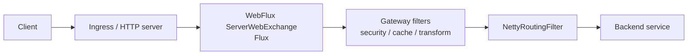

# Empty Request Body, Double-Read Body, or Exceeded Buffer Limit

## Lesson Objectives

In the **Troubleshooting** chapter of the **SPRING_CLOUD_GATEWAY** module, this lesson covers resolving three common bug groups whenever an API Gateway needs to inspect, transform, or forward request bodies:

1. **Empty body:** client sends data, yet the backend receives an empty body, or code reads `null`/`Mono.empty()`.
2. **Body read twice:** a filter, predicate, or logger consumes the body before the routing filter sends the request to the backend.
3. **Body exceeds buffer limit:** `DataBufferLimitException`, HTTP 413, multipart upload errors, memory pressure, or Netty direct-buffer leaks occur.

Spring Cloud Gateway Server WebFlux builds on **Spring WebFlux, Reactor, and Reactor Netty**. Request bodies flow as a `Flux<DataBuffer>` stream, which can consist of multiple buffers rather than one complete string. Reading a body, caching a body, replaying a body, and limiting size are distinct operations. A filter that innocently calls `bodyToMono(String.class)` can accidentally turn a large upload stream into an in-memory payload.

After this lesson, you will be able to:

- Understand why WebFlux request bodies can normally only be consumed once.
- Distinguish requests that genuinely have no body from bodies already read earlier by another filter.
- Diagnose `Mono.empty()`, `null`, `Content-Length: 0`, empty bodies, and mismatched `Content-Type`s.
- Choose properly among `CacheRequestBody`, `ReadBody` predicate, and `ModifyRequestBody`.
- Order filters so consumers reading cached bodies run after the caching filter.
- Understand how `Retry` caches bodies and why retrying requests with bodies consumes Gateway memory.
- Manage pooled/direct `DataBuffer` memory, reference counts, `retain`, `release`, and `doOnDiscard`.
- Distinguish `RequestSize`, codec `maxInMemorySize`, multipart limits, and Ingress/HTTP server limits.
- Recognize an easily missed nuance: `RequestSize` enforces `Content-Length` but should not be assumed to count actual bytes for every streaming/Content-Length-less request.
- Preserve streaming and backpressure for large uploads/downloads, avoiding full-body aggregation unless needed.
- Test bodies through Gateway with WebTestClient and backend stubs, covering empty bodies, single-read, cache/replay, retries, multipart, and over-limit requests.

> **Scope:** examples use **Spring Cloud Gateway Server WebFlux** and Reactor Netty. Gateway Server Web MVC uses Servlet/InputStream and has different cache/replay APIs. Never grab MVC's `ByteArrayInputStream` or `HttpServletRequestWrapper` examples to fix `Flux<DataBuffer>` errors in WebFlux. YAML examples use the current `spring.cloud.gateway.server.webflux.*` namespace; projects on older release trains may use `spring.cloud.gateway.*`. Check your exact Spring Boot/Spring Cloud BOM before applying.

## 1. Identify Symptoms Before Fixing

A request can travel through:



If a component consumes the body at step `F`, downstream steps need a **cached/replayed body** or a decorated request that replays the bytes. Forwarding an already-consumed body stream directly usually causes the backend to receive zero bytes or an empty publisher.

### 1.1. Symptoms and Investigation Directions

| Symptom | Common Cause | First Check |
| --- | --- | --- |
| Client sends JSON, yet backend receives empty body | Filter subscribed/consumed body before routing | Search for all `getBody()`, `bodyToMono()`, `subscribe()` |
| Backend receives body only when custom filter is removed | Filter fails to replay body or wrong decorator | Disable filters one by one; compare outbound body |
| `IllegalStateException` about receive subscriber | Multiple components subscribe to the same inbound Netty receive stream | Check manual `subscribe()` and multiple reads |
| `DataBufferLimitException` | Codec or `DataBufferUtils.join` aggregates past threshold | Inspect stack trace to see which codec aggregates |
| `413 Payload Too Large` | Ingress/server/Gateway size policy | Identify which hop emitted 413 |
| Large uploads fail at Gateway while direct backend works | Gateway caches body, filter size limit, codec aggregation, or timeout | Compare request size, protocol, and filter chain |
| After minutes of traffic, direct memory grows steadily | `DataBuffer`/Netty `ByteBuf` not released properly | Leak detection, heap/direct memory, and cancellation |
| First retry attempt has body, next attempt has empty body | Body not cached/replayed properly or wrong filter order | Check Retry and body caching |
| Log filter sees JSON, yet backend receives no JSON | Logger read or advanced buffer read position | Stop reading buffers directly; use cache |
| Request has no body, yet callback receives `null` | Normal `ModifyRequestBody` behavior | Handle the null branch explicitly |
| Oversized HTTP/2 or streaming request still reaches backend | Checked only `Content-Length` or lacks streamed byte-count guard | Test without Content-Length and chunked |

### 1.2. Quick Diagnostic Flow

```text
Backend receives empty body?
  ├─ No body from client → check client method/body/serialization
  └─ Client sent body
       ├─ Gateway sees no body → check ingress, request decoding, body publisher
       ├─ First Gateway filter sees body
       │    └─ Later filter/backend misses it → check consume/replay/order
       └─ Gateway fails to aggregate
            └─ DataBufferLimitException → identify codec/cache/aggregation limit

Request gets 413?
  └─ Identify whether Ingress, HTTP server, or Gateway filter returned the status

Direct memory growing?
  └─ Check retain/release/discard/cancel and cached body lifetime
```

Never start by raising `max-in-memory-size` or setting `RequestSize` to hundreds of MB. First determine **where the body is read, whether it is aggregated, and which limit actually triggered the error**.

## 2. A WebFlux Request Body Is a Stream, Not a Ready-Made String

In Spring Cloud Gateway Server WebFlux, `ServerHttpRequest.getBody()` returns `Flux<DataBuffer>`. Each `DataBuffer` represents a chunk of bytes received from the HTTP connection. A small JSON payload may arrive in one buffer or multiple buffers; a file upload may arrive across many buffers over time.

```java
Flux<DataBuffer> body = exchange.getRequest().getBody();
```

Never assume:

```text
Flux<DataBuffer> == complete byte[]
Flux<DataBuffer> == JSON String
One onNext == one HTTP request
One buffer == one fixed-size file chunk
```

### 2.1. Why Can a Body Normally Be Read Only Once?

The body comes from the HTTP connection's data stream. Once a consumer drains the publisher, inbound bytes have been consumed. Another component cannot by default ask Netty to replay old bytes like an in-RAM `List`.

Example:

```java
Flux<DataBuffer> firstRead = exchange.getRequest().getBody();
```

One filter subscribes to `firstRead`, and afterward `NettyRoutingFilter` tries to forward the same inbound request body. Outcomes depend on publisher/decorators and consumption order, yet **you cannot assume the original body replays itself**.

Spring Cloud Gateway documentation explicitly states that when the request body needs to be read, it must be cached before forwarding downstream; the `CacheRequestBody` filter is provided for this purpose. [`CacheRequestBody` documentation](https://docs.spring.io/spring-cloud-gateway/reference/spring-cloud-gateway-server-webflux/gatewayfilter-factories/cacherequestbody-factory.html).

### 2.2. Distinguish Body Publisher from Subscription

In Reactor:

- **Publisher** describes how data is emitted.
- **Subscription** begins consuming data.
- `map`, `flatMap`, `filter`, and `reduce` build a pipeline; they do not read anything until subscribed.
- `subscribe()` starts an independent consumer; calling it directly inside a Gateway filter is usually a red flag.
- `block()` waits synchronously, which can block the Netty event loop and break non-blocking execution.

Never write:

```java
exchange.getRequest().getBody().subscribe(buffer -> {
    // Reads body in a separate subscription.
});

return chain.filter(exchange);
```

`chain.filter(exchange)` will cause the routing filter to need the body again. The ad-hoc subscription above does not produce a replayable copy.

### 2.3. Do Not Read the Body for Logging by Mutating the Buffer

A `DataBuffer` has a read position. If a custom filter reads bytes—advancing the read position—and passes that same buffer downstream, the backend may see only remaining bytes or an empty body.

For debugging, prefer:

- Logging only content type, content length if present, route ID, request ID, and body byte count.
- If content inspection is required, use `CacheRequestBody` with a small bound and only in authorized routes/tests.
- Never log Authorization headers, cookies, access tokens, personal data, or sensitive payloads.
- Never retain `DataBuffer` instances longer than their required lifecycle.

### 2.4. Bodies Can Arrive Across Multiple Buffers and Timestamps

Example 12 KB request body:

```text
Flux<DataBuffer>
  ├── buffer #1: 4 KB
  ├── buffer #2: 4 KB
  └── buffer #3: 4 KB
```

Never treat `buffer #1` as the entire JSON or try to parse each buffer individually when JSON can split mid-token/string. If decoding a complete object is required, use message codecs or bounded aggregation; if merely proxying uploads/downloads, keep streaming.

## 3. Empty Body: When Is It Normal vs. a Bug?

A request with no body can be represented as:

- A request sending no body bytes.
- HTTP/1.1 `Content-Length: 0`.
- A publisher completing without emitting any `DataBuffer`.
- An HTTP/2 request with no DATA frames.
- An endpoint/method using only headers/path/query.

**`Content-Type: application/json` does not prove a JSON body is present.** Likewise, POST is not guaranteed to carry a body.

### 3.1. Cases to Distinguish

| Scenario | Interpretation |
| --- | --- |
| `Content-Length: 0` | Client declared a zero-length body |
| No CL and body publisher completes immediately | Could be a valid bodyless request |
| `Content-Type: application/json` with zero bytes | Header specifies content type yet body is empty |
| JSON body contains literal `null` | Bytes containing JSON token `null`, distinct from zero bytes |
| Body is `{}` | Bytes for an empty JSON object |
| Body is `""` | Bytes for an empty JSON string |
| Filter drained body before routing | Backend receives no copy of the original body |

### 3.2. `Mono.empty()` Differs from `Mono.just("")`

```java
Mono<String> absent = Mono.empty();
Mono<String> emptyText = Mono.just("");
```

- `Mono.empty()` emits no value.
- `Mono.just("")` emits a zero-length String.
- `Mono.just("{}")` emits a JSON object representation.

When code calls `defaultIfEmpty("")`, it intentionally merges "no body" and "empty text body" into one value. Do this only if the API contract permits.

### 3.3. `ModifyRequestBody` Passes `null` When the Request Has No Body

Spring Cloud Gateway docs state that the `ModifyRequestBody` callback receives `null` when the request has no body. The callback can return `Mono.empty()` to indicate the request continues without a body. Never call `s.toUpperCase()` or deserialize DTOs without null checks. [`ModifyRequestBody` documentation](https://docs.spring.io/spring-cloud-gateway/reference/spring-cloud-gateway-server-webflux/gatewayfilter-factories/modifyrequestbody-factory.html).

Handling example:

```java
.modifyRequestBody(
    String.class,
    String.class,
    MediaType.TEXT_PLAIN_VALUE,
    (exchange, body) -> {
        if (body == null) {
            return Mono.empty(); // Keep request bodyless
        }
        return Mono.just(body.trim());
    }
)
```

This is an illustrative route Java DSL snippet; import `Mono` and `MediaType` and supply actual route URI/predicates. If an application needs to turn a bodyless request into a default body, make that explicit in the contract and return `Mono.just("...")` or an appropriate DTO.

### 3.4. Check the Client Before Fixing Gateway

For JSON requests, verify:

- Did the client actually send body bytes or only set `Content-Type`?
- Were `bodyValue`, `body`, `BodyInserters`, or serializers invoked?
- Does the HTTP method permit a body per contract and proxy path?
- Did the HTTP client generate `Content-Length`/Transfer-Encoding properly?
- Did a client-side filter/interceptor consume the body?
- Is there a `Content-Encoding` such as gzip that the backend/test stub did not decode?

Never inject a default body at the Gateway just to paper over a client failing to send a payload.

## 4. Why Is a Body Read Twice?

Errors typically occur when one filter reads the body to inspect/log/route, and another filter or the routing filter needs the original body again.

### 4.1. Error-Prone Patterns

```java
// Unsafe: creating an independent subscription to read the body.
exchange.getRequest().getBody().subscribe(this::inspect);

// Unsafe: blocking the event loop while waiting on the body.
String value = exchange.getRequest().getBody()
    .map(this::decode)
    .reduce("", String::concat)
    .block();
```

Or:

```java
Mono<String> first = exchange.getRequest().getBody()
    .map(this::decode)
    .reduce("", String::concat);

return first.flatMap(body -> {
    // Later code calls bodyToMono/getBody a second time.
    return chain.filter(exchange);
});
```

These examples do not create a replayable body. They consume the inbound stream or block the event loop.

### 4.2. Clues in Logs

- `Only one connection receive subscriber allowed` or similar Reactor Netty error.
- `IllegalStateException` when multiple subscribers try to read an inbound receive stream.
- Backend receives body length 0 after adding a new filter.
- Request succeeds once a logger or custom validation filter is disabled.
- Body is readable in the first `GlobalFilter` yet unreadable in a later filter.

Exact exception names depend on Reactor Netty versions and how subscription happens; never hardcode a diagnosis on a single exception class name.

### 4.3. `ReadBody` Predicate Runs Before Route Filters

The `ReadBody` route predicate reads the body to decide whether a route matches and caches the body in memory after the first read. It can only be configured in Java DSL because it requires a Java `Predicate<T>`; that lambda cannot be expressed in YAML. [Route predicates documentation](https://docs.spring.io/spring-cloud-gateway/reference/spring-cloud-gateway-server-webflux/request-predicates-factories.html).

Example:

```java
@Bean
RouteLocator routes(RouteLocatorBuilder builder) {
    return builder.routes()
        .route("body-based-route", route -> route
            .readBody(String.class, body -> body.contains("\"priority\""))
            .uri("lb://priority-service")
        )
        .build();
}
```

**Note:** this is a body-based routing decision, not a filter running after route selection. The body is cached so processing can continue. Use only for small, bounded payloads when content-based routing is genuinely needed. Never use it to classify file uploads or large streams.

### 4.4. `CacheRequestBody` Is a Route Filter Running After Route Match

`CacheRequestBody` cannot supply a cached body to a predicate that already ran ahead of it. If you need to pick a route based on the body, check the `ReadBody` predicate; if you need a post-match filter to read the body and still forward the request, use `CacheRequestBody`.

This is a difference in **lifecycle and ordering**, not merely filter naming.

## 5. Using `CacheRequestBody` Properly

Spring Cloud Gateway provides `CacheRequestBody` to read the request body once, convert it to the specified type, and store the cached value in exchange attributes. The standard key is:

```java
ServerWebExchangeUtils.CACHED_REQUEST_BODY_ATTR
```

### 5.1. YAML Configuration

```yaml
spring:
  cloud:
    gateway:
      server:
        webflux:
          routes:
            - id: orders-inspect-body
              uri: lb://order-service
              predicates:
                - Path=/api/orders/**
              filters:
                - name: CacheRequestBody
                  args:
                    bodyClass: java.lang.String
                - StripPrefix=1
```

In this example, `CacheRequestBody` caches the body as a `String`. Subsequent filters/logic can read the value from `exchange.getAttributes()`, and Gateway uses the cached body to continue sending the request downstream.

`bodyClass` must be compatible with the content type/codec and request size. Complex JSON can use a DTO, though deserialization adds object-graph and memory overhead. Choosing `String` does not mean large binary files should be turned into a String.

### 5.2. Java DSL

```java
@Bean
RouteLocator routes(RouteLocatorBuilder builder) {
    return builder.routes()
        .route("orders-inspect-body", route -> route
            .path("/api/orders/**")
            .filters(filters -> filters
                .cacheRequestBody(String.class)
                .stripPrefix(1)
            )
            .uri("lb://order-service")
        )
        .build();
}
```

### 5.3. Reading the Cached Attribute in a Filter

Example filter ordered **after** the cache filter:

```java
import org.springframework.cloud.gateway.filter.GatewayFilter;
import org.springframework.cloud.gateway.support.ServerWebExchangeUtils;
import org.springframework.web.server.ServerWebExchange;
import reactor.core.publisher.Mono;

final class InspectCachedBodyFilter implements GatewayFilter {

    @Override
    public Mono<Void> filter(
            ServerWebExchange exchange,
            org.springframework.cloud.gateway.filter.GatewayFilterChain chain) {

        String body = exchange.getAttribute(
            ServerWebExchangeUtils.CACHED_REQUEST_BODY_ATTR
        );

        if (body != null) {
            // Process safe metadata only; never log raw payloads.
            exchange.getAttributes().put("bodyPresent", Boolean.TRUE);
        }

        return chain.filter(exchange);
    }
}
```

This illustrates `CacheRequestBody(String.class)`, so the code expects a `String` cached attribute. Never cast blindly across every route: the `Retry` filter can cache the body as a `DataBuffer`, while other body-caching filters store the type configured by `bodyClass`. Verify the producer/consumer and actual filter order before reading the attribute.

### 5.4. Controlling Order

A filter reading the attribute ahead of `CacheRequestBody` will see `null`:

```text
Filter A: reads CACHED_REQUEST_BODY_ATTR → null
CacheRequestBody: reads + caches body
Filter B: reads CACHED_REQUEST_BODY_ATTR → data present
NettyRoutingFilter: forwards request
```

Use proper filter ordering/route filter ordering and integration tests. If a custom `GlobalFilter` needs the attribute, never assume it automatically runs after a route-specific `GatewayFilter`; verify `Ordered` and the effective combined filter chain for your version.

### 5.5. CacheRequestBody Is for HTTP/HTTPS Only

Gateway documentation states `CacheRequestBody` only works with HTTP, including HTTPS. Do not treat it as a payload cache for WebSocket frames or other protocol streams.

### 5.6. Cache Only When Genuinely Needed

Caching the body fits when:

- A filter needs to inspect a small JSON field before forwarding.
- Gateway needs to verify an HMAC on a small payload while still forwarding the body.
- A route needs a deserialized body value for controlled application logic.

Do not cache the entire body when:

- Gateway merely proxies file uploads/downloads.
- Payloads can reach hundreds of MB.
- Bodies are streaming media or large multipart files.
- The backend can validate without Gateway reading the body.

## 6. `ModifyRequestBody`: Transform the Body Without Manual Stream Reading

`ModifyRequestBody` is the choice when Gateway **genuinely needs to transform the representation** before sending downstream. Server WebFlux docs note this filter is configured in Java DSL.

Example:

```java
record OrderInput(String productCode) {}
record OrderCommand(String sku) {}

@Bean
RouteLocator routes(RouteLocatorBuilder builder) {
    return builder.routes()
        .route("rewrite-order-command", route -> route
            .path("/api/orders")
            .filters(filters -> filters
                .modifyRequestBody(
                    OrderInput.class,
                    OrderCommand.class,
                    MediaType.APPLICATION_JSON_VALUE,
                    (exchange, input) -> {
                        if (input == null) {
                            return Mono.empty();
                        }
                        return Mono.just(
                            new OrderCommand(input.productCode())
                        );
                    }
                )
            )
            .uri("lb://order-command-service")
        )
        .build();
}
```

This is a condensed example; import `Mono`, `MediaType`, `RouteLocator`, `RouteLocatorBuilder`, and ensure DTOs fit the active Jackson/codec config. The filter deserializes the body into `OrderInput`, the callback produces `OrderCommand`, and Gateway re-serializes it for downstream.

### 6.1. Body With No Data

The callback receives `null` when the request has no body. To keep the request bodyless:

```java
if (input == null) {
    return Mono.empty();
}
```

If the callback unconditionally executes:

```java
return Mono.just(input.productCode());
```

a bodyless request will throw a NullPointerException. Never turn `null` into an empty object unless the API contract requires it.

### 6.2. Metadata That May Need Updating After Changing the Body

If the body changes, check:

- Does `Content-Type` accurately describe the new representation?
- Does the HTTP client recalculate `Content-Length` for the new bytes?
- Is `Content-Encoding` still valid?
- Did digests, signatures, or ETags depend on the old body?
- Does downstream require a specific charset?
- Is any response/trace logger recording a sensitive representation?

Never copy incoming `Content-Length` manually after deserializing/re-serializing the body.

### 6.3. Distinguish the Three Tools

| Tool | Timing | Purpose | Primary Cost |
| --- | --- | --- | --- |
| `ReadBody` predicate | Before route selection | Match route based on body | Reads and caches body in memory |
| `CacheRequestBody` filter | After route match | Read body in filter and still forward | Caches/deserializes body |
| `ModifyRequestBody` filter | Inside filter chain | Change representation sent downstream | Decodes, transforms, and encodes body |

Never use `ModifyRequestBody` merely to log bodies. Never use `CacheRequestBody` in place of `RequestSize` or a streaming byte-count limit.

## 7. Retry Filter and Body Caching

The Retry filter can re-execute an upstream attempt upon matching statuses/exceptions. Since a request body is a stream, replaying the request on the next attempt requires Gateway to cache the body.

Spring Cloud Gateway's `Retry` documentation notes:

- Retry applies to configured methods/statuses/exceptions.
- Filters ordered **after Retry** may be re-executed.
- When Retry is used with an HTTP method carrying a body, the body is cached.
- The cached body is stored in `ServerWebExchangeUtils.CACHED_REQUEST_BODY_ATTR` as a `DataBuffer`.
- Caching bodies can make Gateway **memory-constrained**.

Source: [Retry GatewayFilter Factory](https://docs.spring.io/spring-cloud-gateway/reference/spring-cloud-gateway-server-webflux/gatewayfilter-factories/retry-factory.html).

### 7.1. Configuration Example

```yaml
spring:
  cloud:
    gateway:
      server:
        webflux:
          routes:
            - id: orders-read-retry
              uri: lb://order-service
              predicates:
                - Path=/api/orders/**
                - Method=GET
              filters:
                - name: Retry
                  args:
                    retries: 2
                    statuses:
                      - BAD_GATEWAY
                      - SERVICE_UNAVAILABLE
                    methods:
                      - GET
                    backoff:
                      firstBackoff: 20ms
                      maxBackoff: 100ms
                      factor: 2
```

This example retries only GET. If configuring Retry for a POST with a body, consider body caching, idempotency keys, and the risk that the backend already committed side effects on the first attempt. **Body replay does not mean the business operation is safe to re-run.**

### 7.2. Retry Filter Order

Suppose the filter chain is:

```text
Filter A
  → Retry
      → Filter B
      → NettyRoutingFilter
```

Retry can re-run filters placed after it. Therefore:

- Filter B must be safe to invoke multiple times.
- Do not trigger duplicate business side effects in custom filters.
- Do not emit misleading audit events treating each attempt as a brand-new operation.
- Track attempt numbers separately from the inbound request ID.
- Do not assume filters before Retry also re-execute.

### 7.3. Avoid Retrying Large Body Uploads

If an upload is 50 MB and Gateway caches it entirely for retries, each in-flight request holds substantial memory. With 20 concurrent uploads, payload caches alone reach ~1 GB before accounting for buffer copies, object overhead, decoded representations, and direct memory.

For uploads:

- Prefer disabling body retries on large uploads at the Gateway.
- Use resumable/chunked upload protocols if the product needs retries.
- Use upload sessions/object storage so clients resume from an offset.
- Use idempotency tokens or upload IDs.
- Cap concurrent uploads and body bytes.
- Let the backend/object store handle durable upload retries.

### 7.4. A POST Timeout Does Not Prove the Backend Did Not Process It

If the backend wrote data while the response was lost, Gateway may not know whether the first attempt committed. Retrying POST can create duplicate records or double charges.

Before retrying any request with a body, require:

- Backend-enforced idempotency keys.
- Atomic deduplication.
- Operation status lookup when outcomes are ambiguous.
- Retry policies limited to recoverable transient failures.
- Capped attempts and total retry budgets.

## 8. `DataBuffer` Lifecycle: Preventing Leaks and Double Releases

`DataBuffer` is Spring's byte buffer abstraction. With Reactor Netty, the implementation is typically backed by Netty `ByteBuf` and can use **pooled direct memory**.

### 8.1. Reference Counting

`PooledDataBuffer` uses reference counting:

```text
allocate → refCount = 1
retain   → refCount increments
release  → refCount decrements
refCount = 0 → buffer returns to pool
```

Failing to release buffers properly causes direct-memory leaks. Releasing too many times causes `IllegalReferenceCountException` or reads on freed buffers.

Spring Framework recommends using `DataBufferUtils.release(...)` and `DataBufferUtils.retain(...)` to apply proper pooled `DataBuffer` semantics. [Data Buffers and Codecs](https://docs.spring.io/spring-framework/reference/core/databuffer-codec.html).

### 8.2. When Must Buffers Be Released?

Core rules:

- If code consumes a buffer without passing it to another consumer, release it promptly.
- If code holds a buffer for later use, manage retain/release and cancellation.
- If a Reactor operator drops buffers via `filter`, `skip`, `prefetch`, `flatMap`, errors, or cancellation, ensure discarded buffers are released.
- Spring docs recommend `doOnDiscard(DataBuffer.class, DataBufferUtils::release)` for compositions that may discard pooled buffers.
- With `DataBufferUtils.join`, input buffers are absorbed into the resulting buffer; after reading, release the resulting buffer per its lifecycle.

### 8.3. Example Reading a Buffer in Code That Owns the Buffer

```java
DataBuffer buffer = ...; // Example: buffer allocated/owned by this code
try {
    byte[] bytes = new byte[buffer.readableByteCount()];
    buffer.read(bytes);
    // Process bytes within needed scope.
}
finally {
    DataBufferUtils.release(buffer);
}
```

This pattern only applies to a buffer owned by the current code. **Never paste this release call into every Gateway `map`**: if the buffer is forwarded downstream, ownership/lifecycle may belong to another component. Identify buffer ownership before releasing.

### 8.4. `DataBufferUtils.join` for Bounded Aggregation

When a complete body is genuinely needed for parsing, Spring provides:

```java
DataBufferUtils.join(publisher, maxByteCount)
```

The overload taking `maxByteCount` caps total buffered bytes and emits `DataBufferLimitException` when exceeded. This API is safer than unbounded concatenation of `String`/`byte[]` across buffers.

Still, `join` is **aggregation**: it holds data until the stream completes. Do not use it on large uploads when forwarding suffices. Because `join` consumes the original body, if downstream still needs the body you must build a new/replayable representation and manage buffer lifecycles properly.

### 8.5. `doOnDiscard` and Cancellation

A pipeline can cancel when:

- Client disconnects.
- Gateway times out.
- Retry/CircuitBreaker switches to fallback.
- Request exceeds limits.
- Upstream connection resets.

Buffers prefetched by operators before downstream consumption may be discarded. If a custom filter handles pooled buffers across operators, test cleanup along **success, error, and cancel paths**.

Do not test only the happy path; buffer leaks often surface only after many requests or under load when clients disconnect mid-stream.

## 9. Distinguish Size Limits Across Layers

A common design mistake is raising one property thinking every body limit increased accordingly. In reality, multiple distinct layers exist.

| Limit | What It Protects | What It Does NOT Mean |
| --- | --- | --- |
| Ingress/proxy max body bytes | Total request bytes through the edge | That Gateway codecs can aggregate large bodies |
| HTTP server/protocol limits | Headers, connections, protocol parsing, and transport bounds | Global business body-size policy |
| Gateway `RequestSize` | Checks request size per implementation/filter | Always counts every byte of streamed/chunked bodies |
| WebFlux codec `maxInMemorySize` | Bytes aggregated inside certain codec operations | Total body limit for all streaming routes |
| Multipart `max-in-memory-size` | Per-part RAM threshold before spilling to disk | Maximum total multipart request size |
| Multipart max-parts/disk usage | Part counts and disk storage per config | Limit across all upload traffic |
| Application validation | Business limits like item counts/field lengths | Protection before HTTP bodies enter the system |

### 9.1. Gateway `RequestSize`

Example:

```yaml
spring:
  cloud:
    gateway:
      server:
        webflux:
          routes:
            - id: document-upload
              uri: lb://document-service
              predicates:
                - Path=/api/documents/**
                - Method=POST
              filters:
                - name: RequestSize
                  args:
                    maxSize: 10MB
```

Gateway docs describe `maxSize` as a `DataSize`, with the filter returning `413 Payload Too Large` and an `errorMessage` header when rejected. Current docs also state a default of 5 MB if no filter argument is passed. [`RequestSize` documentation](https://docs.spring.io/spring-cloud-gateway/reference/spring-cloud-gateway-server-webflux/gatewayfilter-factories/requestsize-factory.html).

**Important caveat before relying on it as a security control:** official issue/PR [#3843](https://github.com/spring-cloud/spring-cloud-gateway/issues/3843) / [#3844](https://github.com/spring-cloud/spring-cloud-gateway/pull/3844) note that `RequestSize` checks only `Content-Length` if the header is present, rather than counting actual streamed body bytes. This matters for HTTP/2 or chunked HTTP/1.1 requests lacking `Content-Length`. The referenced PR showed status **Open / branch not deployed** at lookup time; inspect your exact running source/version and test before trusting this filter as a strict byte-count guard.

Therefore:

- `RequestSize` can quickly reject requests declaring a large `Content-Length`.
- Never assume the filter protects every request lacking `Content-Length`.
- Explicitly test chunked and HTTP/2 streaming requests.
- Enforce real body-size limits at Ingress/proxy or via a verified streaming byte-count guard.
- If the entire body must be buffered to decide 413 before reaching the backend, cap concurrency and size memory/disk budgets.

### 9.2. Codec `maxInMemorySize`

Spring WebFlux codecs bound data **aggregated in memory**. Many codecs default to around **256 KB**; exceeding it triggers:

```text
org.springframework.core.io.buffer.DataBufferLimitException:
Exceeded limit on max bytes to buffer
```

This limit applies to operations that buffer bodies, such as decoding JSON/String into objects, `bodyToMono(...)`, `ReadBody`, `CacheRequestBody`, or custom `DataBufferUtils.join`. It does not mean every proxied large body fails at 256 KB; a streaming route forwards buffers individually without full-body aggregation.

You can customize default codecs with `WebFluxConfigurer`:

```java
@Configuration
class GatewayCodecConfiguration implements WebFluxConfigurer {

    @Override
    public void configureHttpMessageCodecs(
            ServerCodecConfigurer configurer) {
        configurer.defaultCodecs()
            .maxInMemorySize(512 * 1024);
    }
}
```

This example raises the aggregation threshold to 512 KiB. In Spring Boot, codec config property names and scope vary by Boot generation; newer Boot versions offer `spring.http.codecs.max-in-memory-size`. Use Java config when you want explicit `ServerCodecConfigurer` control and verify actual application beans.

**Never set `-1` or huge values as a blanket fix.** When many concurrent requests aggregate simultaneously, memory scales with the sum of held bodies.

### 9.3. Multipart Limits

Spring Boot WebFlux provides multipart properties such as:

```yaml
spring:
  webflux:
    multipart:
      max-in-memory-size: 256KB
      max-parts: 50
      max-headers-size: 10KB
      max-disk-usage-per-part: 20MB
```

These values are lab policy examples only. `max-in-memory-size` is the memory threshold **per part** before file data spills to disk per multipart handling; it is not the total request body max. `max-parts`, headers, and disk usage are separate bounds. Exact property behavior depends on Spring Boot version and how the endpoint consumes multipart.

When using `PartEvent` streaming, data can be processed directly as events and several memory/disk part-buffering options no longer apply in the same way as standard aggregation. Consult multipart/streaming docs for your exact version.

### 9.4. Header Limits Are Not Body Limits

`server.max-http-request-header-size` or Ingress header limits only bound headers/request lines per implementation. They do not cap total request body bytes.

Never adjust header-size properties when the real error is `DataBufferLimitException` from JSON body aggregation.

## 10. Why Increasing Buffers Can Exhaust Gateway Memory

Suppose:

```text
Cached body per request:  10 MB
Concurrent requests:      100
```

Payload caches alone consume:

\[
10\ \text{MB} \times 100 = 1.000\ \text{MB} \approx 1\ \text{GB}
\]

Not yet counting:

- Original buffers and cached copies.
- Deserialized byte arrays/Strings/DTOs.
- JSON object graphs and temporary allocations.
- Netty pooled direct memory.
- Retries holding bodies across attempts.
- Response buffers and other active requests.

One cached body can exist in multiple representations at once. Thus `maxInMemorySize=10MB` does not mean a Gateway pod stays safe under 100 concurrent uploads.

### 10.1. Backpressure Does Not Protect Once You Aggregate

Streaming with backpressure:

```text
Receive buffer → process → emit downstream → buffer released
```

Aggregation/caching:

```text
Receive multiple buffers → retain all → build object/cached body → process
```

Once you hold the whole body for replay or full-object parsing, backpressure cannot shrink the payload. You must bound:

- Maximum size per request.
- Concurrent requests permitted to aggregate/cache.
- Retries allowed to hold bodies.
- Cache lifetime and cleanup.
- Direct memory and heap sizing.
- Upload concurrency/rate per tenant/client.

### 10.2. A Practical Policy

| Endpoint Type | Body Handling Approach |
| --- | --- |
| Small JSON, inspect one field | `CacheRequestBody` with small max size |
| JSON schema transformation | `ModifyRequestBody` and codec limit |
| Large file uploads | Streaming, ingress byte limit, no full-body cache/retry |
| Multi-part uploads | Multipart limits + disk/streaming policy |
| HMAC-signed webhooks | Bounded body read, verify exact raw bytes/representation |
| Body-based route selection | `ReadBody` only for small, bounded payloads |
| Retrying requests with bodies | Only with clear idempotency + body caching + memory budget |

## 11. Keep Streaming for Large Uploads/Downloads

If Gateway merely proxies files to the backend, never deserialize the whole body into `byte[]` or `String`. Let the HTTP client consume `Flux<DataBuffer>` and forward on demand.

### 11.1. Avoid Operations That Turn Streaming into Buffering

These operations typically require aggregation:

```java
bodyToMono(String.class)
bodyToMono(byte[].class)
DataBufferUtils.join(body)
collectList()
CacheRequestBody(String.class)
ReadBody(String.class, ...)
Retry with request body
```

Not all of these hold bodies unboundedly; some enforce limits. Still, they read/cache the body rather than proxying buffer by buffer. Use them deliberately.

### 11.2. When Content Verification Is Needed During Upload

If an HMAC/signature covers the entire body, you may need all bytes to compute the digest. Three architectural choices exist:

1. **Bounded aggregation:** allow only small payloads, read up to the cap, verify, then replay.
2. **Streaming digest:** update the hash per buffer while forwarding, yet the final verification result is only known after partial bytes were sent; the backend must avoid committing until verification passes.
3. **Signed metadata / chunk signatures:** design the protocol to verify per chunk or via trusted metadata signatures.

Never drain the whole body to compute an HMAC and accidentally deliver an empty body to the backend. Nor should you forward payloads to a backend and detect bad signatures afterward if the backend can trigger side effects before verification.

### 11.3. Multipart and File Uploads

For large uploads:

- Enforce real ingress max body size.
- Cap per-file/per-part sizes and max part counts.
- Use disk-backed multipart or streaming APIs as appropriate.
- Cap temporary directory disk usage and tighten permissions.
- Clean up temporary files on client disconnect/error.
- Never log file contents.
- Never retain `DataBuffer` after downstream finishes.
- Design resume/retry at the upload protocol level rather than retrying full request bodies inside Gateway.

## 12. If You Must Write a Custom Filter to Read or Limit Bodies

Prefer built-in filters and codec APIs. Write a custom `GlobalFilter`/`GatewayFilter` only when standard filters cannot meet requirements.

### 12.1. Rules for Custom Filters

1. Never call `subscribe()` or `block()` on inbound bodies inside filters.
2. Never subscribe to the body twice to both inspect and proxy.
3. If replay is needed, cache within bounds and decorate the request to replay cached bytes.
4. If only counting bytes, use a backpressure-aware streaming counter; never aggregate the whole body just to compute length.
5. Define clear buffer ownership and cleanup on success/error/cancel.
6. When altering bodies, update representation headers and let the outbound HTTP client handle framing.
7. Verify filter ordering relative to `CacheRequestBody`, `Retry`, and `NettyRoutingFilter`.
8. Never retry requests exceeding size limits or whose body was partially consumed.
9. If a size limit is exceeded after partial bytes reached downstream, handle cancellation/connection abort and ensure the backend never commits partial input.
10. Write integration tests for bodies without `Content-Length`, chunked, and HTTP/2.

### 12.2. Streaming Byte Counters and Response Limitations

A custom `ServerHttpRequestDecorator` can wrap `getBody()` to sum `DataBuffer.readableByteCount()` as buffers flow through. Yet this takes more than an `AtomicLong`:

- Ensure only a single counting subscription runs per request.
- Handle integer overflow and safe `long` arithmetic.
- Release dropped buffers when exceeding limits or cancelling.
- Stop downstream from receiving further body chunks once the limit trips.
- If downstream already received partial bytes, you cannot assume a clean 413 response like pre-routing rejection.
- The backend may already be processing streamed chunks; endpoints/protocols must not commit side effects until the full body completes and passes validation.
- The response may already be committed, preventing Gateway from altering status/body normally.

If the requirement is **guaranteed rejection before the backend sees a single body byte**, buffer the body up to a strict limit before forwarding, or enforce the size limit at Ingress ahead of Gateway. Buffering consumes memory/disk and requires bounded concurrency.

### 12.3. `DataBufferUtils.join` Does Not Automatically Enable Replay

Example:

```java
Mono<DataBuffer> joined =
    DataBufferUtils.join(exchange.getRequest().getBody(), 1024 * 1024);
```

This consumes the inbound stream and caps aggregation at 1 MiB. It **does not reattach the body to the request** for the routing filter to read again. If downstream needs the body:

1. Convert the joined buffer into the needed representation within limits.
2. Release the joined buffer per lifecycle rules.
3. Create a fresh publisher from cached bytes.
4. Use `ServerHttpRequestDecorator` to expose the new publisher.
5. Update headers/Content-Length if needed for outbound encoding.
6. Test that the backend receives the body exactly once.

That is why `CacheRequestBody` is usually safer than hand-rolled join/decorator code.

### 12.4. Avoid Using a `DataBuffer` After Release

Common bug:

```java
DataBufferUtils.release(buffer);
return Mono.just(buffer); // Wrong: buffer was already released
```

Or:

```java
DataBufferUtils.retain(buffer);
// Missing corresponding release after final consumer finishes.
```

Both violate ownership. `retain` only increments the reference count; it never removes the need to release after use completes.

## 13. Testing Bodies with WebTestClient and Backend Stubs

A test verifying only Gateway returning 200 is insufficient. Verify **what body the backend actually received**, how many bytes arrived, and how many times the backend was called.

### 13.1. Test Topology

```text
WebTestClient
  ↓
Gateway WebFlux (test profile)
  ↓
Backend stub (MockWebServer/WireMock)
```

The backend stub should record:

```text
method
path
Content-Type
Content-Length (if present)
body byte count
synthetic request ID
number of calls
```

Never log Authorization, Cookies, JWTs, API keys, or payloads containing personal data.

### 13.2. Test Forwarding a JSON Body

Scaffold:

```java
@SpringBootTest(
    webEnvironment = SpringBootTest.WebEnvironment.RANDOM_PORT
)
class GatewayRequestBodyIntegrationTest {

    @LocalServerPort
    int port;

    private WebTestClient client() {
        return WebTestClient.bindToServer()
            .baseUrl("http://localhost:" + port)
            .responseTimeout(Duration.ofSeconds(3))
            .build();
    }

    @Test
    void forwardsJsonBodyToBackend() {
        client().post()
            .uri("/api/orders")
            .contentType(MediaType.APPLICATION_JSON)
            .bodyValue("""
                {"orderId":"test-42","quantity":2}
                """)
            .exchange()
            .expectStatus().is2xxSuccessful();

        // Assert backend stub received exactly one call,
        // with the expected path and body bytes.
    }
}
```

This scaffold requires an `/api/orders` route pointing to the stub, `@LocalServerPort`, imports, backend stub lifecycle, and security test fixtures. The `WebTestClient` timeout here is a test-client timeout, not a Gateway body-size limit.

### 13.3. Test Empty Body

Call the same route without `.bodyValue(...)`:

```java
client().post()
    .uri("/api/orders")
    .contentType(MediaType.APPLICATION_JSON)
    .exchange();
```

Expectations depend on the API contract:

- If empty bodies are allowed, the backend receives zero bytes and returns the expected status.
- If a body is required, Gateway/backend returns 400/422 per contract.
- No NullPointerException in `ModifyRequestBody`.
- Do not fabricate `{}` or an empty string unless required by contract.

### 13.4. Test Double-Read Bodies

Build a test route with `CacheRequestBody(String.class)` and a filter reading the cached attribute. Assert:

1. The post-cache filter reads the body.
2. The backend still receives the exact original body.
3. The backend receives exactly one call when Retry is disabled.
4. No `Only one connection receive subscriber allowed`.
5. Direct memory does not grow continuously across many requests.

Then run the same test with `CacheRequestBody` temporarily removed to demonstrate that a custom filter cannot read the body and expect the routing filter to replay it automatically. Run this only in test environments, never deploy an intentionally body-consuming filter to production.

### 13.5. Test Boundary Limits

If policy caps bodies at 1 MiB, test:

| Case | Payload | Expected |
| --- | ---: | --- |
| Below limit | 1 MiB - 1 byte | Accepted |
| At limit | 1 MiB | Per boundary policy |
| Over limit | 1 MiB + 1 byte | Rejected |
| Empty body | 0 bytes | Per endpoint contract |
| CL larger than limit | Header declares oversized payload | Can reject early |
| No CL / chunked | Streamed bytes exceed limit | Actual byte guard / Ingress must reject |
| HTTP/2 DATA frames | Does not rely on CL | Actual byte guard must trigger |

For cases without `Content-Length`, use an HTTP client/protocol fixture capable of streaming bodies without setting CL. `WebTestClient.bodyValue` may compute Content-Length automatically; never rely on it alone to prove chunked/H2 limits.

### 13.6. Test `DataBufferLimitException`

Create a test route that forces codec aggregation, such as `CacheRequestBody(String.class)` or a bounded custom `join`. Send payloads:

- Below codec max-in-memory.
- Exactly at the limit.
- One byte over the limit.
- A large body streamed through a non-aggregating route.

Expectations:

- The aggregating route throws the limit error when exceeded.
- The streaming route does not aggregate the whole body.
- Error mapping never leaks stack traces/exception internals publicly.
- Zero memory leaks after rejected requests.

### 13.7. Test Multipart

Verify:

- Files smaller than the memory threshold.
- Files larger than the threshold handled per disk/streaming policy.
- Part count exceeding `max-parts`.
- Oversized part headers.
- Disk usage exceeding threshold.
- Client disconnect mid-upload.
- Temporary files cleaned up.

Do not test file size alone; a request can combine many parts and metadata headers.

## 14. Diagnostic Matrix by Exception / Status

| Signal | Possible Meaning | How to Verify |
| --- | --- | --- |
| `DataBufferLimitException` | A codec/aggregation operation exceeded max bytes | Stack trace shows which decoder/reader/filter aggregated |
| `Only one connection receive subscriber allowed` | Multiple subscribers on one inbound receive stream | Search for manual `subscribe()` / multiple body readers |
| `IllegalStateException` reading body | Publisher already consumed or invalid request lifecycle | Check filter order and request decorators |
| `IllegalReferenceCountException` | Used released buffer or over-released | Audit ownership, retain/release |
| `OutOfDirectMemoryError` | Pooled/direct buffers over-allocated or leaked | Netty leak detection, active requests, cache sizes |
| HTTP 413 | A layer enforced a body-size limit | Determine whether Ingress, Gateway, or backend responded |
| HTTP 400/415 | Invalid JSON/body format/content type | Compare content type, codec, and payload |
| HTTP 500 | Body decoding/filter exception unmapped | Trace exception class, not status alone |
| HTTP 502 | Backend got partial body/connection reset or upstream error | Backend access logs and Netty client errors |
| Backend receives empty body | Body never sent or already consumed | Compare client bytes, Gateway filter order, and backend byte count |
| Backend receives duplicate body | Retry or broken custom replay | Count outbound attempts and check idempotency |

**Never infer the error source solely from the status code.** Ingress, Gateway, backend, and exception handlers can emit the same status for different reasons.

## 15. Scenario-by-Scenario Troubleshooting

### 15.1. Backend Receives Empty Body After Adding Logging Filter

**Common cause:** logger subscribes to `getBody()` or calls `bodyToMono()`, leaving nothing when the routing filter reads again.

**Resolution:**

1. Disable the logging filter to confirm.
2. Remove manual `subscribe()`/`block()`.
3. If inspecting small payloads is required, place `CacheRequestBody` ahead of the reading filter.
4. Read the attribute with the right type and filter order.
5. Verify the backend receives the intact body.

### 15.2. `CacheRequestBody` Runs Yet Custom GlobalFilter Still Sees Null

**Cause:** GlobalFilter runs before the route-specific filter or before route matching; `CACHED_REQUEST_BODY_ATTR` is not set yet when read.

**Resolution:** check effective filter ordering, move the consumer after caching or use a route-specific filter. If deciding routes based on the body, `CacheRequestBody` is too late; use the `ReadBody` predicate.

### 15.3. `ReadBody` Predicate Matches Yet Backend Receives Empty Body

**Cause:** other custom logic consumed the publisher, or another filter broke body cache/replay.

**Resolution:** remove manual subscriptions; inspect built-in predicates and body-mutating filters; add an echo-backend integration test. `ReadBody` caches the body per docs, yet custom filters can break its lifecycle if they overwrite the request.

### 15.4. `DataBufferLimitException` When Sending 400 KB JSON

**Cause:** a codec operation is aggregating the body and the default codec limit is ~256 KB.

**Resolution:**

- Pinpoint the exact filter/codec aggregating.
- If the API contract permits larger payloads, increase the codec max conservatively.
- Pair it with real request-size/concurrency limits.
- If a full object is unnecessary, keep streaming.

Never raise the global codec limit just because one upload route needs 20 MB.

### 15.5. `RequestSize` Returns 413 with Content-Length Yet Lets Chunked Through

**Possible cause:** the filter checks Content-Length without counting streamed body bytes. This limitation is documented in Spring Cloud Gateway issue/PR #3843/#3844.

**Resolution:**

- Check the source/behavior of your exact Gateway release.
- Test requests without Content-Length, chunked, and HTTP/2.
- Enforce real body-size limits at ingress or with a tested custom streaming guard.
- If rejection must happen before upstream receives any bytes, do bounded buffering prior to routing or enforce at the edge.

### 15.6. Large Uploads Exhaust Gateway Direct Memory

**Cause:** Retry/CacheRequestBody/ReadBody/ModifyRequestBody or custom joins hold bodies in memory; concurrent uploads multiply usage.

**Resolution:** remove unnecessary caching/retries, cap concurrency, use streaming/disk-backed multipart, audit pooled buffer lifecycles, and measure direct memory. Never just bump `-XX:MaxDirectMemorySize`.

### 15.7. Backend Receives Body Twice When Retry Is Enabled

**Cause:** Retry executes multiple upstream attempts; this is intentional when failures match policy. If the operation is non-idempotent, the backend can create duplicate side effects.

**Resolution:** check attempt counts, status/exception triggers, filter ordering, and idempotency keys. Do not confuse legitimate retry attempts with accidental double-subscription of an inbound body.

### 15.8. `ModifyRequestBody` Throws NullPointerException

**Cause:** callback assumed the body is non-null.

**Resolution:** handle `null` explicitly and return `Mono.empty()` to preserve a bodyless request. Test both with-body and bodyless cases.

### 15.9. Body Readable in First Filter Yet Missing in Later Filter

**Cause:** the first filter consumed the publisher without caching/replaying; or the later filter ran ahead of `CacheRequestBody`.

**Resolution:** check ordering, cache the body properly, and avoid wrapping the request multiple times with inconsistent publishers.

### 15.10. `IllegalReferenceCountException` Appears Under High Load

**Cause:** releasing a buffer too early, double-releasing, retaining without releasing, or operator discards skipping cleanup.

**Resolution:** audit ownership; use `DataBufferUtils`; add `doOnDiscard` where appropriate; enable Netty leak detection in test/staging; test error/cancel paths.

### 15.11. Gateway Returns 500 Instead of 413 When Body Is Too Large

**Cause:** `DataBufferLimitException` or custom `RequestSizeLimitException` is not mapped to the right status; or the exception occurred after the response committed.

**Resolution:** locate which layer throws the exception, configure explicit error mapping, test uncommitted responses, and handle mid-stream failures. Never map every exception to 413, as that can mask unrelated system errors.

### 15.12. Backend Receives Truncated Body After Timeout / Client Disconnect

**Cause:** upstream connection cancelled mid-stream, or a custom filter forwarded partial body bytes before noticing an error.

**Resolution:** backends must handle incomplete bodies/cancellations safely, never committing transactions before receiving and validating the entire payload. Use upload sessions/resume for large files.

### 15.13. JSON Body Corrupted After Gateway Rewrite

**Cause:** wrong content type/charset, mismatched serializer contract, stale Content-Length, or inconsistent compression/decompression.

**Resolution:** assert exact backend bytes, `Content-Type`, `Content-Encoding`, and charset. Use proper `ModifyRequestBody`/codecs rather than string manipulation on raw buffers.

## 16. Safe Observability and Logging

### 16.1. Useful Metrics

Track:

- Request body bytes per route (histograms/buckets; never use raw request IDs as labels).
- Requests rejected by size policies and 413 origin.
- `DataBufferLimitException` counts.
- Decode/serialization error counts.
- Active uploads, concurrent body caches, and request durations.
- Heap usage, direct memory, and Netty pooled allocator metrics if exposed.
- Buffer leak warnings in test/staging.
- Retry attempts on routes with bodies.
- Client disconnects/cancellations and upstream aborted requests.
- Multipart temp disk usage, part counts, and cleanup failures.

Metric names depend on Spring Boot, Micrometer, Reactor Netty, and custom instrumentation; inspect `/actuator/metrics`/Prometheus exporter rather than assuming metrics exist automatically.

### 16.2. Log Metadata, Never Raw Payloads

Safe event example:

```json
{
  "routeId": "document-upload",
  "requestId": "synthetic-req-42",
  "contentType": "application/octet-stream",
  "declaredContentLength": 1048576,
  "observedBodyBytes": 1048576,
  "bodyCached": false,
  "retryAttempt": 1,
  "outcome": "forwarded"
}
```

These fields must be added by application/custom instrumentation; not every field is emitted by Gateway out of the box.

Avoid logging:

- `Authorization`, Cookies, JWTs, API keys.
- Raw multipart contents or file data.
- PII, payment details, secrets.
- Full JSON bodies in production.

If payload debugging is unavoidable, use synthetic data in isolated environments with short retention and restricted access.

### 16.3. Distinguish Declared Bytes from Observed Bytes

The two values mean different things:

```text
declaredContentLength = Content-Length header if present
observedBodyBytes     = actual bytes passing through a counting stream
```

If you only have declared length, never label the metric as "actual request size". For chunked/H2 streaming, actual byte counts must be measured on the body publisher or at a supporting ingress/server.

## 17. Pre-Release Checklist for Body-Reading Filters

| Check | Question |
| --- | --- |
| Body lifecycle | Does the filter subscribe to the body multiple times or call `block()`? |
| Replay | If the filter reads the body, does downstream still receive the body? |
| Filter order | Does the consumer run after CacheRequestBody in the right route phase? |
| Body class | Does the codec support the content type and DTO? |
| Empty body | Does the callback handle null/Mono.empty per contract? |
| Size | Is there a real max body bytes guard for CL, chunked, and HTTP/2? |
| Codec | Are aggregation limits bounded rather than raised globally without limit? |
| Memory | Do concurrent cached bodies fit within heap/direct memory budgets? |
| Retry | Is the body cached for retries? Is the operation idempotent? |
| DataBuffer | Are all retain/release/ownership/cancel paths sound? |
| Streaming | Do large uploads preserve streaming/backpressure? |
| Multipart | Are part count, per-part memory/disk, and cleanup bounded? |
| Content headers | Are Content-Type/Encoding/Length accurate after rewrites? |
| Security | Are payloads kept out of logs and short-lived in caches? |
| Tests | Do backend stubs verify bytes and request counts? |
| Protocols | Were HTTP/1.1 known CL, chunked no CL, and HTTP/2 tested? |
| Operations | Are metrics present for 413, DataBufferLimitException, direct memory, and retries? |

## 18. Exercises with Answers

### Exercise 1 — Why Does the Backend Receive an Empty Body?

A GlobalFilter calls `exchange.getRequest().getBody().subscribe(...)` to log JSON, then calls `chain.filter(exchange)`.

**Answer:** the filter consumed the inbound body with a separate subscription. Place `CacheRequestBody` ahead of the reading filter, or stop reading the payload if only metadata is needed.

### Exercise 2 — `Content-Type` Is JSON, Yet Body Is Null

**Answer:** Content-Type only declares the intended representation. Clients can send requests with no body; `ModifyRequestBody` callbacks receive `null`. Check actual bytes and handle null per contract.

### Exercise 3 — Calling bodyToMono Twice

**Answer:** `bodyToMono` consumes the body. Calling it twice does not produce two copies. Use a single pipeline or cache the body and reuse the cached value.

### Exercise 4 — How Do ReadBody and CacheRequestBody Differ?

**Answer:** `ReadBody` is a route predicate running before route selection to match on body content; `CacheRequestBody` is a route filter running after route match so filters can read the body and still forward.

### Exercise 5 — `DataBufferLimitException` at 300 KB

**Answer:** a codec is likely aggregating and the default in-memory limit is around 256 KB. Find which operation triggers aggregation, then either raise the codec limit within bounds or keep streaming.

### Exercise 6 — RequestSize Set to 5 MB Yet an 8 MB Chunked Body Reaches the Backend

**Answer:** the filter may check only Content-Length when present. Gateway issue/PR #3843/#3844 document this limitation. Verify your release and enforce actual byte-count limits at ingress/stream guards.

### Exercise 7 — Retrying POST Creates Two Orders

**Answer:** the body was replayed while the backend already committed the first attempt. Require idempotency keys and backend deduplication; never enable retries blindly for write operations.

### Exercise 8 — Direct Memory Grows After Adding `retain`

**Answer:** retain increments the reference count. Without a matching release after the final consumer finishes, pooled buffers never return to the pool.

### Exercise 9 — 100 MB Upload with Codec max-in-memory at 256 KB

**Answer:** if the route streams directly without aggregating, the codec aggregation limit does not necessarily block the body. If a filter decodes/caches the body into an object, it fails at the codec threshold. Distinguish streaming from aggregation.

### Exercise 10 — Multipart with 10 MB Files and 256 KB Memory Threshold

**Answer:** that threshold is per-part in-memory buffering; bulk part data spills to disk per multipart configuration. You still must cap total request bytes, part count, and disk usage.

### Exercise 11 — Why Avoid `collectList()`?

**Answer:** `collectList()` retains every buffer until the stream completes, losing streaming/backpressure benefits and scaling memory with body size. Aggregate only for small, bounded payloads when required.

### Exercise 12 — Gateway Returns 500 When Exceeding Limits

**Answer:** identify the exception and originating layer. `DataBufferLimitException` does not automatically map to 413 in every setup. Configure proper error mapping and check whether the response already committed.

### Exercise 13 — Is the CacheRequestBody Attribute a String or DataBuffer?

**Answer:** it depends on which caching mechanism set it. `CacheRequestBody` converts per `bodyClass` and stores that object; Retry docs describe its cached body as a `DataBuffer`. Never cast the attribute without knowing the producer and filter order.

### Exercise 14 — Client Disconnects Mid-Upload

**Answer:** the body publisher cancels. All custom buffers/temp file resources must clean up; the backend must never commit incomplete payloads.

## 19. Workflow for Handling an Empty-Body or Over-Limit Incident

1. Record route ID, method, content type, declared Content-Length if any, protocol version, and status.
2. Identify which layer raised the error: Ingress, Reactor Netty, Gateway filter, codec, backend, or exception handler.
3. Temporarily disable custom body readers/loggers in tests to isolate.
4. Search for `getBody()`, `bodyToMono()`, `subscribe()`, `block()`, `join()`, `CacheRequestBody`, `ReadBody`, `ModifyRequestBody`, and `Retry`.
5. Verify actual filter order and request decorators.
6. Use a backend stub to measure bytes/call counts; never log raw production payloads.
7. Test empty bodies, small bodies, exact-threshold bodies, over-threshold bodies, and bodies without Content-Length.
8. Test multipart and HTTP/2 if supported by the endpoint.
9. Verify DataBuffer ownership/cleanup on success, error, retry, and cancellation.
10. Tune memory/size/concurrency policies, deploy canary, and monitor direct memory alongside 413/5xx.

## 20. Official References

- [Spring Cloud Gateway Server WebFlux — `CacheRequestBody` GatewayFilter Factory](https://docs.spring.io/spring-cloud-gateway/reference/spring-cloud-gateway-server-webflux/gatewayfilter-factories/cacherequestbody-factory.html): single-read request body, caching into exchange attribute, and `bodyClass`.
- [Spring Cloud Gateway Server WebFlux — `ModifyRequestBody` GatewayFilter Factory](https://docs.spring.io/spring-cloud-gateway/reference/spring-cloud-gateway-server-webflux/gatewayfilter-factories/modifyrequestbody-factory.html): Java DSL, decode/transform/encode, and null body behavior.
- [Spring Cloud Gateway Server WebFlux — `Retry` GatewayFilter Factory](https://docs.spring.io/spring-cloud-gateway/reference/spring-cloud-gateway-server-webflux/gatewayfilter-factories/retry-factory.html): retry scope/order, body caching, and memory warning.
- [Spring Cloud Gateway Server WebFlux — `RequestSize` GatewayFilter Factory](https://docs.spring.io/spring-cloud-gateway/reference/spring-cloud-gateway-server-webflux/gatewayfilter-factories/requestsize-factory.html): maxSize, DataSize, and 413 behavior.
- [Spring Cloud Gateway Server WebFlux — Route Predicate Factories](https://docs.spring.io/spring-cloud-gateway/reference/spring-cloud-gateway-server-webflux/request-predicates-factories.html): `ReadBody` predicate and body caching.
- [Spring Framework — Data Buffers and Codecs](https://docs.spring.io/spring-framework/reference/core/databuffer-codec.html): `DataBuffer`, pooled buffers, `DataBufferUtils`, release/retain, and `doOnDiscard`.
- [Spring Framework — WebFlux Configuration](https://docs.spring.io/spring-framework/reference/web/webflux/config.html): configuring `ServerCodecConfigurer` and `maxInMemorySize`.
- [Spring Boot — Reactive Web Applications](https://docs.spring.io/spring-boot/reference/web/reactive.html): WebFlux auto-configuration and HTTP codecs.
- [Spring Boot — Application Properties](https://docs.spring.io/spring-boot/appendix/application-properties/index.html): codec and multipart limits per Boot version.
- [Reactor Netty — HTTP Server Reference](https://projectreactor.io/docs/netty/release/reference/http-server.html): receiving bodies, multipart decoder, `maxInMemorySize`, `maxSize`, and streaming.
- [Spring Cloud Gateway issue #3843](https://github.com/spring-cloud/spring-cloud-gateway/issues/3843) and [PR #3844](https://github.com/spring-cloud/spring-cloud-gateway/pull/3844): `RequestSize` limitation when `Content-Length` is absent; check current status and release branch before relying on it.

## Summary

In **Spring Cloud Gateway Server WebFlux**, a request body is a `Flux<DataBuffer>` stream that can normally be consumed only once. A filter reading the body to log or inspect without caching/replaying can leave the backend receiving an empty body. Distinguish the `ReadBody` predicate (reads to select a route), `CacheRequestBody` (caches for later filters while still forwarding), and `ModifyRequestBody` (decodes/transforms/encodes representations). `Retry` on requests with bodies also caches the body for replay, so memory and idempotency must be accounted for.

`DataBuffer` can be pooled/direct memory; manage ownership, `retain`, `release`, `doOnDiscard`, errors, and cancellations carefully. Clearly separate **actual body-size limits**, **codec `maxInMemorySize`**, **multipart per-part thresholds**, and **Gateway `RequestSize`**. In particular, never assume `RequestSize` counts actual bytes for streaming requests lacking `Content-Length`; test HTTP/1.1 chunked and HTTP/2 on your exact release. For large uploads, preserve streaming/backpressure, enforce limits at the edge, and avoid caching entire bodies. Combining backend stub tests, request byte-count metrics, direct-memory monitoring, and safe metadata logging enables accurate diagnostics without exposing payloads.
