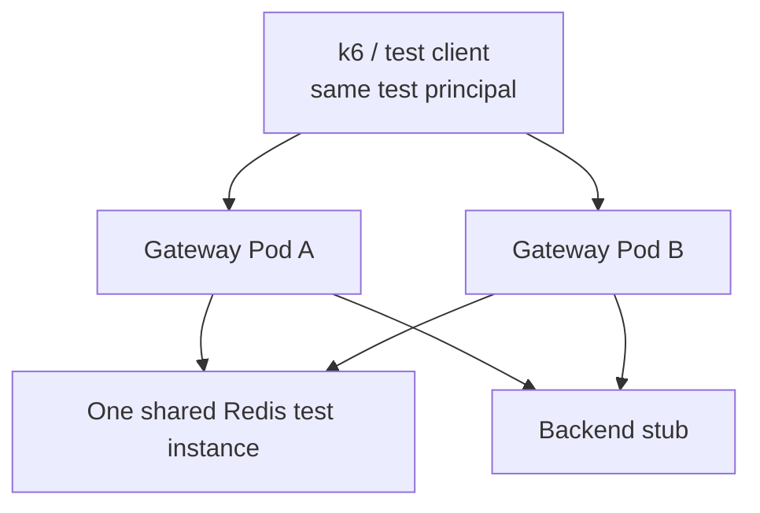

# Inconsistent Rate Limits Across Replicas or Unavailable Redis

An API Gateway runs three replicas behind a Kubernetes Service. Operations configured a limit of **10 requests/second per API key**, yet customers report receiving `429 Too Many Requests` after only a few requests in some moments while sending dozens of requests past the limit in others. When scaling Gateway replicas from three to six, total backend traffic nearly doubles. During one Redis restart, the API keeps returning `200` even past the quota; in another outage, requests return `500` or hang for a long time.

This is a **distributed rate limiting** failure class: rate limits must mean the same thing when requests cross multiple processes, multiple routes, and a shared state store. With **Spring Cloud Gateway Server WebFlux**, `RequestRateLimiter` can use `RedisRateLimiter` with the **token bucket** algorithm. Still, outcomes depend on `KeyResolver`, Redis key construction, per-route configuration, Gateway version, Redis health, and the policy when the store fails.

This lesson belongs to the **Troubleshooting** chapter of the **SPRING_CLOUD_GATEWAY** module. The goal is to find out why quotas diverge across replicas or stop enforcing when Redis is unavailable, then design tests and runbooks to protect backends. Content focuses on Spring Cloud Gateway WebFlux; **Gateway Server Web MVC has its own version-dependent rate limiter mechanism**—never copy WebFlux configurations/implementations into the Servlet stack.

**After this lesson, you will be able to:**

1. Distinguish local per-Gateway-instance limits from shared Redis limits.
2. Explain token buckets, `replenishRate`, `burstCapacity`, `requestedTokens`, and why 429s can vary.
3. Verify `KeyResolver`, identity, route scope, Redis endpoints, clock skew, and configs across replicas.
4. Separate **exhausted quota**, **missing key**, **Redis errors**, and **Redis failover** using statuses, logs, and metrics.
5. Evaluate fail-open vs. fail-closed, impact on availability, and downstream protection.
6. Test multiple Gateway replicas sharing Redis, simulate Redis outages/failover, and verify aggregate quotas.
7. Write runbooks to remediate, monitor, and recover rate limiters without causing extra traffic spikes.

> **Version note:** Primary examples use Spring Cloud Gateway Server WebFlux configuration under the newer `spring.cloud.gateway.server.webflux.*` namespace. Older Gateway 4.x uses `spring.cloud.gateway.*`. Property names, route structures, key namespaces, and some Redis error behaviors may vary across release trains. Use a Spring Boot-compatible Spring Cloud BOM, inspect config metadata, and test against your exact deployed artifact. Hosts, quotas, and replica counts here are lab values, not production recommendations.

## 1. Identify Symptoms Before Editing Configuration

Do not lump every "inconsistent rate limit" report into a single Redis bug. First determine **where requests are rejected and why**.

| Symptom | Possible Cause | Evidence to Gather |
| --- | --- | --- |
| Pod A returns 429, Pod B returns 200 for same principal | Local limiter, two pods pointing to different Redis, different keys, or config drift | Pod/route ID, Redis endpoint, masked resolved key, route revision. |
| Total quota scales nearly linearly with replicas | Each pod keeps an in-memory token bucket | Compare allowed counts with one pod vs. multiple pods. |
| One user calling API A exhausts API B's quota | Two routes share the same key/bucket or unintended scope | Actual Redis keys and route IDs. |
| One user exceeds quota yet another user gets 429 | KeyResolver reads wrong IP/tenant, key collision, or all callers share one key | Masked principal/tenant, trusted client IP, key dimension. |
| Anonymous requests get 403 immediately | KeyResolver returns empty; empty keys are denied by default | KeyResolver logs, `deny-empty-key` setting. |
| Redis disconnects yet requests still pass | Limiter is fail-open or another fallback runs | Redis script error logs, `X-RateLimit-Remaining`, status, and version-exact source code. |
| Redis disconnects and API returns errors/timeouts | Fail-closed, unhandled exception, or excessive timeout | Stack trace, Redis latency, error mapping, and policy. |
| Quota suddenly loosens after Redis failover | Token bucket keys lost or replica lacked latest writes | Redis replication/failover timeline, key TTL, and allowed spike. |
| 429s rise after deploy while Redis stays healthy | Rate/burst configs differ across replicas or route IDs changed | Config hashes, route tables, and deployment revisions. |
| IP-based quota blocks an entire office at once | Gateway sees only the shared ingress/proxy IP | `remoteAddress`, forwarded headers, and trusted proxy config. |

### 1.1. Distinguish HTTP Statuses

| HTTP Status | Meaning in This Problem | What NOT to Infer |
| --- | --- | --- |
| **429 Too Many Requests** | Rate limiter decided the request exceeded the active limit policy. | Does not prove Redis is healthy; a custom limiter may use local state. |
| **403 Forbidden** | May be default empty-key denial or a security policy rejection. | Do not assume this means quota is exhausted. |
| **401 Unauthorized** | Invalid authentication/token or custom empty-key status set to 401. | Not the default for Redis quota exhaustion. |
| **500/502/503/504** | May be Redis/custom limiter, upstream, or a timeout at one hop. | Do not assume Redis outages always return 503. |
| **200/2xx while Redis is down** | May be fail-open, local fallback, or request bypassed the limiter. | Does not prove quotas are still enforced. |

Spring Cloud Gateway `RequestRateLimiter` returns **429 by default when `RateLimiter` returns a deny decision**. `KeyResolver` failing to find a key is a separate branch; by default requests are denied with **403**. Redis unavailability is yet another error branch whose behavior must be verified for your exact implementation/version.

### 1.2. First Four Questions on Any Incident

1. **Which route/filter did the request traverse?** Record `routeId`, method, path template, and Gateway instance.
2. **Which dimension does KeyResolver produce?** Principal, tenant, API key, IP, or an empty key?
3. **Do all replicas share the same Redis and the same route/config?** Verify endpoint, logical DB/cluster, namespace, and revision.
4. **Is Redis actually making decisions or is the limiter failing open / falling back?** Cross-check statuses, logs, metrics, and version-exact tests.

Never ask customers to send raw API keys/JWTs for debugging. Use test identities, masked key fingerprints, and correlation IDs.

## 2. Token Bucket: What Is the Limiter Actually Measuring?

Spring Cloud Gateway WebFlux's `RedisRateLimiter` uses the **Token Bucket Algorithm**. Each bucket has:

- **`replenishRate`**: tokens added per second.
- **`burstCapacity`**: maximum capacity of the bucket.
- **`requestedTokens`**: tokens consumed per request; default is `1`.

When a request arrives:

1. The rate limiter fetches bucket state (remaining tokens and timestamp).
2. Computes tokens replenished over elapsed time, capped at `burstCapacity`.
3. If at least `requestedTokens` are available, deducts tokens and allows the request.
4. Otherwise, denies the request; `RequestRateLimiter` typically returns 429.

### 2.1. Example: 10 Requests/Second, Burst 20

```yaml
redis-rate-limiter.replenishRate: 10
redis-rate-limiter.burstCapacity: 20
redis-rate-limiter.requestedTokens: 1
```

When the bucket starts full, a client can burst up to 20 requests. After that burst, the bucket refills at roughly 10 tokens per second. Therefore, do not write tests assuming "exactly the 11th request in the first second must return 429" when the bucket starts with 20 tokens.

### 2.2. One Request Can Consume Multiple Tokens

To model a more expensive operation, `requestedTokens` can exceed 1. For instance, Gateway docs show:

```yaml
redis-rate-limiter.replenishRate: 1
redis-rate-limiter.burstCapacity: 60
redis-rate-limiter.requestedTokens: 60
```

With each request consuming 60 tokens and the bucket refilling 1 token/second, this averages one request per minute when full and no other requests compete. Actual sizing must reflect operation cost and burst needs.

### 2.3. Do Not Confuse Token Bucket with Fixed Window

| Property | Token Bucket | Fixed Window Counter |
| --- | --- | --- |
| State | Remaining tokens and last update timestamp | Counter per time window |
| Burst | Permits bursts up to bucket capacity | Can spike at window boundaries |
| Refill | Continuous based on elapsed time | Resets/increments per window |
| Quota interpretation | Average refill rate with burst allowance | Request count inside each window |

Do not use fixed-window math to explain a Redis token bucket. In SCG, `burstCapacity` and `requestedTokens` directly govern admission.

## 3. Why Are Local Limits Inconsistent Across Replicas?

Suppose three Gateway pods sit behind a load balancer:

```text
                     Load Balancer
                    /      |      \
                   v       v       v
             Gateway A  Gateway B  Gateway C
                 |          |          |
              Local A    Local B    Local C
              bucket     bucket     bucket
```

If each process keeps a token bucket in memory, **A, B, and C have no visibility into each other's tokens**. The same API key gets a fresh bucket whenever the load balancer sends requests to another pod.

### 3.1. Quotas Can Multiply by Replica Count

Suppose each pod has:

- `replenishRate = 10` requests/second.
- `burstCapacity = 20`.
- Replicas `N = 3`.

If each pod holds an independent bucket and traffic spreads roughly evenly:

\[
\text{Theoretical total refill} \approx N \times 10 = 30 \text{ requests/s}
\]

\[
\text{Theoretical total burst} \approx N \times 20 = 60 \text{ requests}
\]

This is an **approximation when each pod maintains its own bucket**. Load balancers may distribute unevenly, and sticky sessions may keep a client mostly on one pod, yet a client can still exceed the intended system-wide quota by hitting multiple replicas.

Scaling from 3 to 6 pods nearly doubles local quotas. That is why you must never deploy `Guava RateLimiter`, a local `Bucket4j` cache, or a per-process `ConcurrentHashMap` and call it a **global per-user quota**.

### 3.2. Distinguish Local Limiters from Distributed Limiters

| Implementation | Where State Lives | When Scaling Gateway |
| --- | --- | --- |
| `ConcurrentHashMap`/local token bucket | Each pod's heap | Each pod enforces its own quota; total quota scales with replicas. |
| Bucket4j with Caffeine local cache | Per-process local cache | Also a local quota unless backed by real distributed persistence/proxy. |
| `RedisRateLimiter` with shared Redis | Shared Redis state | Replicas hit the same bucket/key; decisions stay consistent cluster-wide. |
| Custom limiter with distributed store | Shared store | Depends on atomicity, key design, and store consistency. |
| Limiter at ingress/API management | Ingress control plane/store | Inspect the platform's own scope and semantics. |

**Having a Redis dependency in the project does not prove the rate limiter is distributed.** Confirm `RequestRateLimiter` actually uses `RedisRateLimiter` or a distributed backend, and every Gateway pod points to the same store.

### 3.3. Bucket4j Can Also Be Local or Distributed

Newer Spring Cloud Gateway WebFlux releases also support a `RateLimiter` implementation based on **Bucket4j**. It requires Bucket4j core and a persistence option. Documentation examples may configure `AsyncProxyManager` with a **Caffeine local cache** for testing; if each Gateway pod has its own Caffeine cache, buckets remain **local per pod** and quotas scale with replicas.

To make Bucket4j distributed, configure an `AsyncProxyManager` backed by an appropriate shared/persistent store (such as a supported Redis integration) and test concurrency/failover. Simply switching from `RedisRateLimiter` to Bucket4j **does not automatically make quotas global**.

Gateway Server Web MVC has its own **RateLimiter Filter** built on Bucket4j Java DSL, using `Function<ServerRequest, String>` as its key resolver; configuration and runtime differ from WebFlux. Consult Web MVC docs before applying.

## 4. How Does RedisRateLimiter Solve the Multi-Replica Problem?

Spring Cloud Gateway WebFlux's `RedisRateLimiter` uses **Reactive Redis** and a Lua script to atomically check and update buckets on Redis. Executing the script atomically inside Redis prevents concurrent requests from reading the same token count and all believing quota remains.

```text
Gateway A ----\
Gateway B -----+----> Shared Redis primary / cluster
Gateway C ----/          |
                          +-- token state
                          +-- timestamp state
                          +-- atomic Lua decision
```

Conditions for replicas to share quotas accurately:

1. All use **the same Redis deployment/cluster** and intended logical namespace/DB.
2. Pods share identical `KeyResolver` semantics, route policies, and compatible versions/configs.
3. Redis clients send rate-limit write commands to a writable primary/shard, never reading potentially stale replicas.
4. Redis keys are generated consistently; in Redis Cluster, keys touched by one Lua script must hash to the same slot.
5. No custom fallback silently switches some pods to local buckets.

### 4.1. Two Redis Keys for Token Bucket State

The Redis implementation uses keys for token state and timestamp state. Some versions follow a pattern like:

```text
request_rate_limiter.{bucket-key}.tokens
request_rate_limiter.{bucket-key}.timestamp
```

The `{...}` portion is a **Redis hash tag**. Redis Cluster uses hash tags so two keys sharing identical text inside braces map to the same hash slot, allowing a Lua script to access both on the same node.

**Exact key patterns vary by Gateway version or custom RateLimiter.** Older implementations built keys mostly from `KeyResolver` output; newer versions/implementations may include `routeId` or scope in the bucket key. Never guess solely from route names or old blog posts: inspect the source of your exact artifact and observe keys in a Redis test environment.

### 4.2. Shared Redis Configuration for Gateway WebFlux

Required dependency for the Redis limiter:

```xml
<dependency>
    <groupId>org.springframework.boot</groupId>
    <artifactId>spring-boot-starter-data-redis-reactive</artifactId>
</dependency>
```

Example `application.yml` for Spring Boot 3.x and the newer Gateway Server WebFlux namespace:

```yaml
spring:
  application:
    name: edge-gateway
  data:
    redis:
      host: redis-ratelimit.internal
      port: 6379
      timeout: 500ms
      connect-timeout: 500ms
  cloud:
    gateway:
      server:
        webflux:
          routes:
            - id: customer-api
              uri: lb://customer-service
              predicates:
                - Path=/api/customer/**
              filters:
                - name: RequestRateLimiter
                  args:
                    key-resolver: "#{@principalKeyResolver}"
                    redis-rate-limiter.replenishRate: 10
                    redis-rate-limiter.burstCapacity: 20
                    redis-rate-limiter.requestedTokens: 1

server:
  port: 8080
```

This is an illustrative configuration for **one route**. Before using:

- Ensure the Redis hostname resolves from every Gateway pod.
- Configure TLS/ACLs/credentials per environment; never store passwords in Git.
- Verify the property namespace for your exact Gateway release. Older Gateway 4.x uses `spring.cloud.gateway.routes`; newer lines use `spring.cloud.gateway.server.webflux.routes`.
- Do not expose public route-management/Actuator write endpoints just to inspect the limiter.
- If Redis runs as Cluster/Sentinel/managed service, configure the matching topology and client connection factory instead of assuming a single host.

### 4.3. Route Limiter Configuration Must Use Expanded Form

`RequestRateLimiter` does not use shortcut notation like:

```properties
spring.cloud.gateway.routes[0].filters[0]=RequestRateLimiter=10, 20
```

Use `name: RequestRateLimiter` and `args:` as shown in the YAML example. If the filter factory fails to load due to a missing dependency/starter or wrong Gateway variant, the app may fail to build the route; that is a **filter configuration issue**, not a Redis outage.
## 5. KeyResolver: The Same User Must Produce the Same Key

Redis may be shared properly, yet quotas still diverge if **Gateway A and Gateway B compute different keys** for the same caller. `KeyResolver` defines the dimension controlled by the rate limiter.

A key can represent:

- **Principal/user:** limit per authenticated account.
- **Tenant/organization:** one shared quota across all users in a tenant.
- **API key/client ID:** quota per integrating application.
- **IP address:** quota for anonymous traffic, provided the real client IP is resolved through trusted proxies.
- **Route + principal:** separate bucket per API route and user, if required by policy.

### 5.1. Key by Authenticated Principal

Simple `KeyResolver` example for protected APIs:

```java
package com.example.gateway.ratelimit;

import org.springframework.cloud.gateway.filter.ratelimit.KeyResolver;
import org.springframework.context.annotation.Bean;
import org.springframework.context.annotation.Configuration;
import org.springframework.util.StringUtils;

@Configuration
public class RateLimitKeyConfiguration {

    @Bean
    KeyResolver principalKeyResolver() {
        return exchange -> exchange.getPrincipal()
            .flatMap(principal ->
                reactor.core.publisher.Mono.justOrEmpty(principal.getName()))
            .filter(StringUtils::hasText);
    }
}
```

Meaning:

- Gateway WebFlux provides `PrincipalNameKeyResolver` as its default implementation; it extracts `Principal` from `ServerWebExchange` and uses `Principal.getName()`.
- Once Spring Security authenticates a request, `Principal.getName()` becomes the key.
- If no principal exists, the `Mono` is empty and Gateway applies its **empty-key policy**.
- The same principal across all replicas must use identical representation/casing/issuer semantics.

**Never return a shared constant string like `anonymous` for every request** unless you genuinely intend all anonymous callers to share one global bucket. Nor should you trust client-supplied `?user=alice` or `X-User-Id` as identity proof.

### 5.2. Key by Tenant in JWT

If a tenant shares one quota across all its members, derive the key from a verified claim:

```java
import org.springframework.security.oauth2.server.resource.authentication.JwtAuthenticationToken;
import org.springframework.util.StringUtils;

@Bean
KeyResolver tenantKeyResolver() {
    return exchange -> exchange.getPrincipal()
        .ofType(JwtAuthenticationToken.class)
        .map(authentication ->
            authentication.getToken().getClaimAsString("tenant_id"))
        .filter(StringUtils::hasText);
}
```

**Use only claims verified by the JWT decoder** (signature, issuer, expiry, and audience per policy). If a token lacks `tenant_id`, never fall back to a shared default tenant. When supporting multiple issuers, namespace tenant keys by issuer/realm so `tenant_id=42` in two systems never collides on one bucket.

### 5.3. Key by IP and Trusted Proxies

A resolver using TCP peer addresses can read `exchange.getRequest().getRemoteAddress()`. Yet if Gateway receives traffic only through ingress, the peer address will always be the **ingress IP**, forcing every user into one bucket.

Before using IP:

1. Identify which ingress/load balancers are trusted.
2. Configure Gateway to honor forwarded headers only from **trusted proxies**.
3. Ensure ingress strips client-supplied `X-Forwarded-For`/`Forwarded` headers before writing canonical values.
4. Test multiple clients behind the same ingress plus one client sending spoofed headers.
5. Never allow clients to alter keys via arbitrary queries/headers.

**Never trust raw `X-Forwarded-For` from the Internet.** If callers pick their own IP in the key, they can mint endless buckets and bypass limits.

### 5.4. Empty Key Differs from Redis Outage

`RequestRateLimiter` documentation notes the default: if `KeyResolver` returns no key, the request is denied. Two common properties:

- `deny-empty-key`: whether to allow requests when no key resolves.
- `empty-key-status-code`: HTTP status when an empty key is denied.

In older releases, prefixes were written as `spring.cloud.gateway.filter.request-rate-limiter.*`; newer Gateway Server WebFlux releases may bind under `spring.cloud.gateway.server.webflux.filter.request-rate-limiter.*`. Check config metadata for your exact release.

**Never disable `deny-empty-key` just to silence 403s** when routes require principal/tenant keys. Letting keyless requests through bypasses intended limits. Moreover, this property **does not govern fail-open/fail-closed behavior during a Redis outage**.

### 5.5. Avoid Putting Raw PII in Redis Keys Unnecessarily

If `Principal.getName()` is an email, username, or customer ID, Redis keys will store identifying data. Consider stable, namespaced, pseudonymized keys:

```text
raw identity = verified issuer + ":" + verified subject
bucket key   = "user:" + HMAC-SHA256(secret, raw identity)
```

This is a **design pattern**, not a complete KeyResolver. The HMAC secret must be shared securely across replicas with a rotation plan; never use a per-pod random salt, as that creates distinct buckets per pod.

## 6. Same Redis, Yet Quotas Still Differ: Check Scope and Configuration

Even when all replicas point to the same Redis, the following issues can still cause "inconsistent limits".

### 6.1. Route Configuration Differs Across Replicas

| Replica | replenishRate | burstCapacity | Behavior |
| --- | ---: | ---: | --- |
| Gateway A | 10 | 20 | Bucket refills 10 tokens/s, burst 20. |
| Gateway B | 20 | 40 | Bucket allows twice as fast/high. |
| Gateway C | 10 | 20 | Same policy as A. |

If A/B/C share a key yet each pod passes different refill/burst args to the Lua script, bucket state gets updated using **the parameters of whichever request just hit Redis**. Outcomes depend on which pod handled the request and when. Never assume shared Redis makes policy configuration uniform automatically.

Check:

- ConfigMap/Secret/Helm values and environment overrides on every pod.
- Spring Cloud BOM, Gateway artifact version, and image digest.
- Whether route definitions share identical `routeId`, filter args, and `KeyResolver`.
- Whether dynamic route repositories/config refreshes have converged.
- Whether a canary/rolling deploy leaves two versions with different rate configs serving traffic simultaneously.

**A Redis key stores only bucket state; it does not store or enforce a uniform policy across replicas.**

### 6.2. Route ID Can Be Part of Bucket Scope

Rate limiters may need quotas scoped:

- **Per user globally:** one shared budget across multiple routes.
- **Per user + route:** each API has its own budget.
- **Per tenant + route group:** certain APIs share a budget while others stay isolated.

Do not assume routes for the same principal share a bucket, nor that route IDs are always included in Redis keys. Key composition depends on Gateway version/implementation and custom `RateLimiter`s.

**Verify directly in a test environment:**

1. Send requests for the same principal to two routes carrying the filter.
2. Inspect created Redis keys (with identities masked).
3. Drain route A's bucket.
4. Call route B and see whether it shares the bucket.
5. Repeat on your exact deployed Gateway version.

If you need **global per-user quotas across routes**, use a key/limiter with global user semantics. If you need **per-route quotas**, the bucket key must include a route dimension. A custom `RateLimiter` may be required when built-in behavior does not match policy; never try to hack around this solely by tweaking `KeyResolver` without understanding current route scoping.

### 6.3. Two Routes with the Same User Yet Different Rates

Suppose:

| Route | Intended Policy |
| --- | --- |
| `/api/search/**` | 10 requests/s, burst 20 |
| `/api/export/**` | 1 request/s, burst 2 |

If both routes accidentally share one bucket key while passing different configurations, `/api/search/**` requests can refill/burst under a different policy than `/api/export/**`. Inspect the real bucket namespace or design two explicit quota keys.

**Never attach two rate limiter filters to the same route with the same key thinking they enforce two independent quotas.** Depending on implementation, config maps or key states can overwrite/collide; test thoroughly or use a custom limiter supporting multiple bandwidths.

### 6.4. Clock Skew Across Gateway Pods

Token buckets compute refill based on elapsed time. Some implementations pass the current JVM timestamp into the Lua script. If Gateway A's clock runs ahead of Gateway B's:

- A may compute more refill than actually elapsed.
- B may send a timestamp older than the one just written by A.
- This can cause anomalous refills or unexpected bucket updates depending on script/version.

Ensure nodes run NTP/chrony and monitor clock offset. **Never manually tweak clocks in production** to "sync" without understanding side effects; measure offset with standard ops tooling and share a single time source.

### 6.5. Mismatched Redis Endpoints / Namespaces

Replicas may be pointing to:

- Two different Redis deployments due to wrong env/profile.
- Two different logical database indexes.
- Different Redis clusters across regions/clusters.
- One pod reading from a replica or different proxy endpoint.
- One pod using credentials/ACLs scoped to a different key prefix/database.
- A group of pods holding stale config caches after secret/endpoint rotation.

Compare **host/cluster identity, database index, key prefix, TLS/ACL identity, and topology** without logging passwords or full connection URIs containing secrets.

## 7. Redis Unavailable: Fail-Open or Fail-Closed?

This is the most critical design decision when Redis sits on **the critical path of every request**.

### 7.1. Two Competing Policies

| Policy | When Redis Cannot Return a Decision | Pros | Risks |
| --- | --- | --- | --- |
| **Fail-open** | Allow request through or use permissive fallback | API stays available during Redis outages | Quotas disabled; backends exposed to floods/abuse. |
| **Fail-closed** | Reject requests when quota cannot be verified | Strict downstream and quota protection | Redis outage rejects even legitimate customers. |

No single policy fits every route:

- Catalog GETs might prioritize availability if backends have capacity and secondary protections.
- Order creation, payments, OTP, or costly third-party calls may require strict fail-closed or coarse fallback protection.
- Global anti-DDoS rate limits may belong at ingress/WAF rather than depending solely on an application Redis.

### 7.2. RedisRateLimiter May Fail Open on Redis Script Errors

**Do not assume `RedisRateLimiter` always fails closed when Redis is unavailable.** Some Spring Cloud Gateway implementations handle Lua/Redis errors by returning `allowed=true` with an unknown remaining count (such as `-1`), intentionally avoiding a hard dependency on Redis to keep traffic flowing. This behavior is **version/source-code dependent**, not a universal guarantee across all releases or custom limiters.

Gateway docs state 429 when the limiter denies a request, yet that description does not specify how every Redis connection error is handled. Therefore:

1. Inspect the `RedisRateLimiter` source for the exact artifact/version in your dependency tree.
2. Write an integration test forcing Redis timeouts/connection refused.
3. Record statuses, response headers, logs, and backend hit counts.
4. Confirm whether actual policy is fail-open, fail-closed, or exception-to-5xx.
5. Keep this as a regression test whenever upgrading Spring Cloud Gateway.

**If requests still return 200 during a Redis error, that may be intentional fail-open behavior, not proof that quotas still work.** Pair fail-open with alerts and backup protections if backends cannot survive unlimited traffic.

### 7.3. Empty-Key Policy Is Not Redis Outage Policy

Keep these two branches separate:

| Branch | Example | Handling |
| --- | --- | --- |
| KeyResolver returns empty | Unauthenticated request, missing API key, or missing tenant claim | Default denies empty key; inspect identity/KeyResolver. |
| Redis unreachable | DNS/ACL/TLS/timeout/primary down | Fail-open/fail-closed per implementation and approved policy. |

`deny-empty-key=true` **does not turn Redis outages into fail-closed**. Conversely, `deny-empty-key=false` can let keyless requests pass unthrottled.

### 7.4. Why 429 Is Not Appropriate for Every Redis Error

429 means the client exceeded its quota. When Redis is down and the system **cannot evaluate** quotas, returning 429 misleads clients into inappropriate retry schedules.

In a custom fail-closed design, you can return:

- **503 Service Unavailable** when the quota store is unavailable and requests are temporarily rejected.
- **429 Too Many Requests** when the bucket is genuinely exhausted.
- `Retry-After` only when a meaningful retry delay can be provided.

`RequestRateLimiter` defaults to 429 whenever `RateLimiter` returns deny. Separating "quota exhausted" from "store unavailable" usually requires a custom `RateLimiter`/filter or explicit error mapping. **Never turn every Redis failure into 429 without distinguishing the cause.**

### 7.5. Pseudocode for Custom Fail-Closed

The snippet below illustrates the **idea**, not drop-in compilable code:

```java
return delegate.isAllowed(routeId, key)
    .onErrorResume(redisError -> {
        redisLimiterErrors.increment();
        if (policy == FAIL_CLOSED) {
            return Mono.just(denyWithServiceUnavailable());
        }
        return Mono.just(allowWithUnknownRemaining());
    });
```

A production implementation must:

- Separate Redis failures from programming/config/validation errors.
- Avoid catching every `Throwable` and letting requests pass.
- Enforce bounded timeouts on Redis calls.
- Count/log errors and fallback state.
- Keep raw keys/tokens out of logs.
- Test Redis timeouts, connection refused, ACL denied, and recovery.
- Ensure fallbacks do not quietly spin up per-pod local buckets when policy requires cluster-wide quotas.
## 8. Redis HA/Failover Does Not Equal Strong Consistency

Shared Redis state lets multiple Gateway replicas share one bucket under normal conditions. Still, Redis replication/failover introduces caveats that must be accounted for.

### 8.1. Redis Replication Is Asynchronous by Default

In typical replication setups, the primary acknowledges writes before replicas have definitely received them. If the primary fails right after replying, recent updates may not have reached the replica. After failover:

- Token counts may revert slightly backward.
- Bucket timestamps may miss a recent update.
- A just-drained bucket may suddenly show more tokens than expected.
- Bursts above target may briefly slip through.

**A Redis rate limiter is a distributed traffic shaper, not a strongly consistent billing/quota ledger.** For hard financial quotas or regulatory limits that must never be exceeded, enforce transactional/consistent limits at the business layer.

Redis provides the `WAIT` command to block until a number of replicas acknowledge prior writes, yet Redis docs emphasize `WAIT` **does not make Redis a strongly consistent system**. Do not assume Spring Cloud Gateway `RedisRateLimiter` invokes `WAIT` automatically; inspect the actual implementation/client.

### 8.2. Redis Cluster and Hash Slots

Token buckets typically update multiple keys (token state and timestamp state) inside one Lua script. In Redis Cluster, every key touched by a script must reside in the same hash slot. Redis hash tags in key patterns ensure that:

```text
request_rate_limiter.{customer-42}.tokens
request_rate_limiter.{customer-42}.timestamp
```

Both keys share the hash tag `customer-42`, placing them in the same slot. If a custom RateLimiter constructs keys without shared hash tags, scripts fail with `CROSSSLOT` errors in Redis Cluster.

Verify in a test cluster:

```bash
redis-cli -c CLUSTER KEYSLOT 'request_rate_limiter.{customer-42}.tokens'
redis-cli -c CLUSTER KEYSLOT 'request_rate_limiter.{customer-42}.timestamp'
```

Both results must match when a single script accesses both keys. **Always take real key patterns from your exact version/custom limiter**, rather than blindly copying this example if your implementation formats keys differently.

### 8.3. Eviction Can Reset Buckets to Full

If Redis is shared with caches/sessions under memory pressure, token-bucket keys can be evicted prematurely. Once evicted, the next request initializes a fresh bucket, usually granting a full burst again.

Check:

- `maxmemory` and `maxmemory-policy`.
- `evicted_keys`, `expired_keys`, memory fragmentation, and used memory.
- Rate of newly seen identities/keys per minute.
- TTL of token/timestamp keys for your exact implementation.
- Whether Redis shares space with high-cardinality caches.

**Never switch Redis to `noeviction` mechanically.** Once memory fills up, write scripts fail; if the limiter fails open, all traffic passes unthrottled. Prefer provisioning memory headroom, isolating rate-limit Redis from caches/sessions if needed, monitoring evictions, and testing rejected writes.

### 8.4. One Key per Caller Can Create Massive Cardinality

If KeyResolver reads arbitrary query parameters or headers, attackers can mint unlimited keys:

```text
?user=a1
?user=a2
?user=a3
...
```

Every key allocates token/timestamp state and consumes memory. Rely on verified identities, bound key length/charset, use clear namespaces, and never let clients pick arbitrary bucket IDs. For anonymous traffic, use coarse IP/device identities at a trusted edge paired with an aggregate fallback quota.

### 8.5. Multi-Region Redis Does Not Automatically Enforce One Strict Global Quota

When each region has its own Redis or uses async replication:

| Design | Consequence |
| --- | --- |
| One central Redis primary | Single shared bucket, yet all regions incur cross-region latency and network dependency. |
| Separate Redis per region | Per-region quotas; global total equals the sum of regional budgets. |
| Active-Active/CRDT per product | Semantics depend on implementation; converges globally, yet not a strict atomic hard cap for simultaneous requests. |
| Pre-allocated regional budgets | Total quota stays bounded by allocations, though uneven regional traffic needs handling. |

If strict global semantics are required, choose a control plane/store with matching consistency or pre-partition quotas by region. **Never assume multi-region Redis replicas instantaneously see identical token counts.**

## 9. Observing Redis and Gateway to Pinpoint Root Causes

### 9.1. Essential Metrics

| Category | Metrics / Logs to Watch | Question Answered |
| --- | --- | --- |
| Gateway requests | Rate by `routeId`, method, status; 429/403/5xx | Which route is affected? |
| Rate limiter decisions | Allowed/denied counts, empty-key count, fallback count | Is quota exhausted or key missing? |
| Redis client | Command latency, connection failures, timeouts, pending acquires | Is Redis slow or unreachable? |
| Redis server | `used_memory`, `evicted_keys`, rejected connections, ops/s | Is the store under pressure or evicting keys? |
| Redis HA | Replication offset/lag, primary changes, failover events | Were updates lost during failover? |
| Gateway replicas | Image/config hash, route revision, instance ID | Do pods share identical policies? |
| Identity | KeyResolver empty/error count, issuer/tenant mapping version | Are keys consistent across pods? |
| Downstream | RPS, concurrency, 5xx, saturation | Did fail-open overload the backend? |

### 9.2. Use Rate-Limit Headers Properly

RedisRateLimiter can emit headers such as:

```http
X-RateLimit-Remaining: 4
X-RateLimit-Replenish-Rate: 10
X-RateLimit-Burst-Capacity: 20
```

Header names are configurable. Under fail-open, `Remaining` may report a sentinel like `-1` depending on implementation. Therefore:

- Never treat `Remaining=-1` as "unlimited quota" without verifying version semantics.
- Never trust client-supplied rate-limit headers for quota decisions.
- Evaluate whether rate/burst settings should be exposed to public clients.
- Log headers and statuses in tests; never log Authorization/Cookies/API keys.

### 9.3. Gateway Metrics Do Not Replace Redis Error Metrics

`spring.cloud.gateway.requests` tracks requests by route/status/latency when Actuator/Micrometer are configured. Yet if Redis fails and the limiter **fails open**, Gateway still logs 2xx normally. A dashboard watching only 2xx/5xx misses that quotas went offline.

Add dedicated counters/alerts for:

- Redis rate-limit script errors.
- Redis connection/timeout failures.
- Active fallback mode.
- Empty KeyResolver results.
- Requests allowed while the limiter store is unhealthy.
- Redis eviction/failover events.

For custom limiters, example metric names could be `gateway.ratelimiter.redis.errors`, `gateway.ratelimiter.fallback.allowed`, and `gateway.ratelimiter.empty_key`; these are **suggested names**, not built-in defaults.

### 9.4. Cardinality and Privacy

Never attach raw user IDs, tenant IDs, API keys, IPs, full URIs, or Redis bucket keys as Prometheus labels. Use:

- `routeId`, status, method, environment, limiterMode.
- Logs/traces with correlation IDs and masked key fingerprints.
- Dashboard drill-downs gated by RBAC, retention, and auditing.

## 10. Runbook: Diagnosing Inconsistent Quotas

Proceed step by step; never wipe all Redis keys right away when unexpected 429s appear.

### Step 1 — Classify Status and Scope

1. Grab a sample request ID from the customer or test.
2. Identify the status: 429/403/5xx/2xx.
3. Record route ID, method, Gateway pod, image version, and timestamp.
4. Determine whether the caller is a principal, tenant, API key, or anonymous.
5. Verify the request traversed the expected route and filter.

### Step 2 — Compare Gateway Replicas

Inspect the deployment:

```bash
kubectl -n gateway get pods -l app=edge-gateway -o wide
kubectl -n gateway get deployment edge-gateway -o yaml
```

Compare across pods:

- Image digest and Spring Boot/Cloud/Gateway versions.
- ConfigMap/Secret revisions and environment variables.
- Route IDs, filter args, KeyResolver bean, and security config.
- Redis host/cluster endpoint, DB index, and credential identity (never print secrets).
- Clock offset/NTP status.

### Step 3 — Verify Redis Primary/Cluster

In an environment where Redis admin access is authorized:

```bash
redis-cli -h redis-ratelimit.internal -p 6379 PING
redis-cli -h redis-ratelimit.internal -p 6379 INFO replication
redis-cli -h redis-ratelimit.internal -p 6379 INFO memory
```

If using Redis Cluster:

```bash
redis-cli -c -h redis-ratelimit.internal -p 6379 CLUSTER INFO
redis-cli -c -h redis-ratelimit.internal -p 6379 CLUSTER NODES
```

These are lab examples; authenticate with ACLs/TLS per environment. Never write credentials into shell history or logs.

### Step 4 — Inspect Keys Safely

To locate keys in a lab or authorized environment:

```bash
redis-cli --scan --pattern 'request_rate_limiter.*' | head -n 50
```

In production, use bounded `SCAN` while watching load; **never run `KEYS *`** on live traffic Redis. Once you have a masked key:

```bash
redis-cli -c TYPE 'request_rate_limiter.{masked-key}.tokens'
redis-cli -c TTL 'request_rate_limiter.{masked-key}.tokens'
redis-cli -c CLUSTER KEYSLOT 'request_rate_limiter.{masked-key}.tokens'
redis-cli -c CLUSTER KEYSLOT 'request_rate_limiter.{masked-key}.timestamp'
```

Never blindly run `GET`/`HGETALL` on keys before knowing your version's types and structure. Never delete token/timestamp keys in production "to reset quotas"; that immediately grants fresh bursts to every caller.

### Step 5 — Verify KeyResolver

In a test environment:

1. Send the same principal to Pod A and Pod B.
2. Log the key fingerprint (never raw identity).
3. Confirm both pods generate identical keys.
4. Send a request without token/claims and verify empty-key behavior.
5. Send spoofed `X-Forwarded-For`, `X-User-Id`, `X-Tenant-Id` and confirm they cannot alter the key.

### Step 6 — Separate Local State from Shared Redis State

Temporarily target two Gateway pods directly in a test cluster (or use an internal test ingress allowing pod selection):

- Use the same API key/principal.
- Use the same route ID and policy.
- Alternate traffic between A and B.
- Observe total allowed/429 counts and Redis keys.

If each pod enforces its own independent quota and total throughput scales with pod count, the limiter is either using local state or pods disagree on keys/stores.

### Step 7 — Test Redis Outage Policy

In an isolated staging environment:

1. Capture baseline with Redis healthy.
2. Block Gateway → Redis connectivity or take the test Redis endpoint down.
3. Replay the identical known workload.
4. Record statuses, latencies, logs, rate-limit headers, and backend hit counts.
5. Verify fail-open/fail-closed matches approved policy.
6. Restore Redis and check reconnection and bucket state.

**Never stop production Redis for testing.** Use a dedicated test Redis with bounded firewall/network fault injection and active observation.

### Step 8 — Recover

- If config drift: bring all replicas onto the same route/policy revision via controlled rollout.
- If wrong Redis endpoint: fix the config/secret source of truth and confirm all pods reload.
- If Redis failover: verify primary/replication/keys before ramping traffic back up.
- If fail-open is active: apply coarse ingress/WAF limits or downstream protections per incident plan.
- If fail-closed blocks all traffic: communicate the dependency incident clearly; never silently bypass quotas without approval.
- Monitor 429/5xx/backend RPS post-recovery; never bulk-delete keys to make graphs look clean.

## 11. Testing Two Gateway Replicas Sharing Redis

The goal is proving **quota applies cluster-wide**, not independently per pod.

### 11.1. Lab Topology



Setup:

- Two Gateway instances with identical image/config, `routeId`, and `KeyResolver`.
- One shared test Redis instance/cluster.
- One backend stub counting forwarded requests.
- One single test principal/API key.
- A low rate for easy observation, e.g., refill 1 token/s, burst 10, requestedTokens 1.

### 11.2. Try a Local Limiter to See Quota Multiplication

First, run a local limiter holding a separate bucket per process:

| Pod | Initial Bucket | Allowed in Burst |
| --- | ---: | ---: |
| A | 10 tokens | 10 |
| B | 10 tokens | 10 |
| **Total** | **20 tokens** | **Can admit up to 20 requests** |

This is expected for **two local buckets**, not the desired cluster-wide quota of 10.

### 11.3. Test Shared RedisRateLimiter

With identical Redis keys and policies:

1. Send 6 requests through Pod A.
2. Immediately send 6 more requests through Pod B.
3. Verify the backend stub receives only as many requests as the single shared bucket allows (accounting for elapsed refill).
4. Reverse A/B order and repeat.
5. Scale up a third Gateway replica C and repeat.

With burst 10 and refill 1 token/s, admitted requests over a short window **approximate initial burst plus tokens refilled during that window**. Never hardcode "reject exactly on request 11" if runtime latency/scheduling varies.

### 11.4. Verify Route Scope

When the same principal calls two routes:

1. Send requests to route A until 429 appears.
2. Call route B.
3. Check whether route B still has its own quota or shares the bucket.
4. Cross-check Redis key patterns and source code for your exact Gateway version.

Behavior must match your system's **quota contract**: per-user global, per-user-per-route, or per-tenant. There is no single default scope right for every API.
## 8. Redis HA/Failover Does Not Equal Strong Consistency

Shared Redis state lets multiple Gateway replicas share one bucket under normal conditions. Still, Redis replication/failover introduces caveats that must be accounted for.

### 8.1. Redis Replication Is Asynchronous by Default

In typical replication setups, the primary acknowledges writes before replicas have definitely received them. If the primary fails right after replying, recent updates may not have reached the replica. After failover:

- Token counts may revert slightly backward.
- Bucket timestamps may miss a recent update.
- A just-drained bucket may suddenly show more tokens than expected.
- Bursts above target may briefly slip through.

**A Redis rate limiter is a distributed traffic shaper, not a strongly consistent billing/quota ledger.** For hard financial quotas or regulatory limits that must never be exceeded, enforce transactional/consistent limits at the business layer.

Redis provides the `WAIT` command to block until a number of replicas acknowledge prior writes, yet Redis docs emphasize `WAIT` **does not make Redis a strongly consistent system**. Do not assume Spring Cloud Gateway `RedisRateLimiter` invokes `WAIT` automatically; inspect the actual implementation/client.

### 8.2. Redis Cluster and Hash Slots

Token buckets typically update multiple keys (token state and timestamp state) inside one Lua script. In Redis Cluster, every key touched by a script must reside in the same hash slot. Redis hash tags in key patterns ensure that:

```text
request_rate_limiter.{customer-42}.tokens
request_rate_limiter.{customer-42}.timestamp
```

Both keys share the hash tag `customer-42`, placing them in the same slot. If a custom RateLimiter constructs keys without shared hash tags, scripts fail with `CROSSSLOT` errors in Redis Cluster.

Verify in a test cluster:

```bash
redis-cli -c CLUSTER KEYSLOT 'request_rate_limiter.{customer-42}.tokens'
redis-cli -c CLUSTER KEYSLOT 'request_rate_limiter.{customer-42}.timestamp'
```

Both results must match when a single script accesses both keys. **Always take real key patterns from your exact version/custom limiter**, rather than blindly copying this example if your implementation formats keys differently.

### 8.3. Eviction Can Reset Buckets to Full

If Redis is shared with caches/sessions under memory pressure, token-bucket keys can be evicted prematurely. Once evicted, the next request initializes a fresh bucket, usually granting a full burst again.

Check:

- `maxmemory` and `maxmemory-policy`.
- `evicted_keys`, `expired_keys`, memory fragmentation, and used memory.
- Rate of newly seen identities/keys per minute.
- TTL of token/timestamp keys for your exact implementation.
- Whether Redis shares space with high-cardinality caches.

**Never switch Redis to `noeviction` mechanically.** Once memory fills up, write scripts fail; if the limiter fails open, all traffic passes unthrottled. Prefer provisioning memory headroom, isolating rate-limit Redis from caches/sessions if needed, monitoring evictions, and testing rejected writes.

### 8.4. One Key per Caller Can Create Massive Cardinality

If KeyResolver reads arbitrary query parameters or headers, attackers can mint unlimited keys:

```text
?user=a1
?user=a2
?user=a3
...
```

Every key allocates token/timestamp state and consumes memory. Rely on verified identities, bound key length/charset, use clear namespaces, and never let clients pick arbitrary bucket IDs. For anonymous traffic, use coarse IP/device identities at a trusted edge paired with an aggregate fallback quota.

### 8.5. Multi-Region Redis Does Not Automatically Enforce One Strict Global Quota

When each region has its own Redis or uses async replication:

| Design | Consequence |
| --- | --- |
| One central Redis primary | Single shared bucket, yet all regions incur cross-region latency and network dependency. |
| Separate Redis per region | Per-region quotas; global total equals the sum of regional budgets. |
| Active-Active/asynchronous replication | Divergence can occur during partitions/failover; never treat as a strict global counter. |
| Pre-allocated regional budgets | Total quota stays bounded by allocations, though uneven regional traffic needs handling. |

If strict global semantics are required, choose a control plane/store with matching consistency or pre-partition quotas by region. **Never assume multi-region Redis replicas instantaneously see identical token counts.**

## 9. Observing Redis and Gateway to Pinpoint Root Causes

### 9.1. Essential Metrics

| Category | Metrics / Logs to Watch | Question Answered |
| --- | --- | --- |
| Gateway requests | Rate by `routeId`, method, status; 429/403/5xx | Which route is affected? |
| Rate limiter decisions | Allowed/denied counts, empty-key count, fallback count | Is quota exhausted or key missing? |
| Redis client | Command latency, connection failures, timeouts, pending acquires | Is Redis slow or unreachable? |
| Redis server | `used_memory`, `evicted_keys`, rejected connections, ops/s | Is the store under pressure or evicting keys? |
| Redis HA | Replication offset/lag, primary changes, failover events | Were updates lost during failover? |
| Gateway replicas | Image/config hash, route revision, instance ID | Do pods share identical policies? |
| Identity | KeyResolver empty/error count, issuer/tenant mapping version | Are keys consistent across pods? |
| Downstream | RPS, concurrency, 5xx, saturation | Did fail-open overload the backend? |

### 9.2. Use Rate-Limit Headers Properly

RedisRateLimiter can emit headers such as:

```http
X-RateLimit-Remaining: 4
X-RateLimit-Replenish-Rate: 10
X-RateLimit-Burst-Capacity: 20
```

Header names are configurable. Under fail-open, `Remaining` may report a sentinel like `-1` depending on implementation. Therefore:

- Never treat `Remaining=-1` as "unlimited quota" without verifying version semantics.
- Never trust client-supplied rate-limit headers for quota decisions.
- Evaluate whether rate/burst settings should be exposed to public clients.
- Log headers and statuses in tests; never log Authorization/Cookies/API keys.

### 9.3. Gateway Metrics Do Not Replace Redis Error Metrics

`spring.cloud.gateway.requests` tracks requests by route/status/latency when Actuator/Micrometer are configured. Yet if Redis fails and the limiter **fails open**, Gateway still logs 2xx normally. A dashboard watching only 2xx/5xx misses that quotas went offline.

Add dedicated counters/alerts for:

- Redis rate-limit script errors.
- Redis connection/timeout failures.
- Active fallback mode.
- Empty KeyResolver results.
- Requests allowed while the limiter store is unhealthy.
- Redis eviction/failover events.

For custom limiters, example metric names could be `gateway.ratelimiter.redis.errors`, `gateway.ratelimiter.fallback.allowed`, and `gateway.ratelimiter.empty_key`; these are **suggested names**, not built-in defaults.

### 9.4. Cardinality and Privacy

Never attach raw user IDs, tenant IDs, API keys, IPs, full URIs, or Redis bucket keys as Prometheus labels. Use:

- `routeId`, status, method, environment, limiterMode.
- Logs/traces with correlation IDs and masked key fingerprints.
- Dashboard drill-downs gated by RBAC, retention, and auditing.

## 10. Runbook: Diagnosing Inconsistent Quotas

Proceed step by step; never wipe all Redis keys right away when unexpected 429s appear.

### Step 1 — Classify Status and Scope

1. Grab a sample request ID from the customer or test.
2. Identify the status: 429/403/5xx/2xx.
3. Record route ID, method, Gateway pod, image version, and timestamp.
4. Determine whether the caller is a principal, tenant, API key, or anonymous.
5. Verify the request traversed the expected route and filter.

### Step 2 — Compare Gateway Replicas

Inspect the deployment:

```bash
kubectl -n gateway get pods -l app=edge-gateway -o wide
kubectl -n gateway get deployment edge-gateway -o yaml
```

Compare across pods:

- Image digest and Spring Boot/Cloud/Gateway versions.
- ConfigMap/Secret revisions and environment variables.
- Route IDs, filter args, KeyResolver bean, and security config.
- Redis host/cluster endpoint, DB index, and credential identity (never print secrets).
- Clock offset/NTP status.

### Step 3 — Verify Redis Primary/Cluster

In an environment where Redis admin access is authorized:

```bash
redis-cli -h redis-ratelimit.internal -p 6379 PING
redis-cli -h redis-ratelimit.internal -p 6379 INFO replication
redis-cli -h redis-ratelimit.internal -p 6379 INFO memory
```

If using Redis Cluster:

```bash
redis-cli -c -h redis-ratelimit.internal -p 6379 CLUSTER INFO
redis-cli -c -h redis-ratelimit.internal -p 6379 CLUSTER NODES
```

These are lab examples; authenticate with ACLs/TLS per environment. Never write credentials into shell history or logs.

### Step 4 — Inspect Keys Safely

To locate keys in a lab or authorized environment:

```bash
redis-cli --scan --pattern 'request_rate_limiter.*' | head -n 50
```

In production, use bounded `SCAN` while watching load; **never run `KEYS *`** on live traffic Redis. Once you have a masked key:

```bash
redis-cli -c TYPE 'request_rate_limiter.{masked-key}.tokens'
redis-cli -c TTL 'request_rate_limiter.{masked-key}.tokens'
redis-cli -c CLUSTER KEYSLOT 'request_rate_limiter.{masked-key}.tokens'
redis-cli -c CLUSTER KEYSLOT 'request_rate_limiter.{masked-key}.timestamp'
```

Never blindly run `GET`/`HGETALL` on keys before knowing your version's types and structure. Never delete token/timestamp keys in production "to reset quotas"; that immediately grants fresh bursts to every caller.

### Step 5 — Verify KeyResolver

In a test environment:

1. Send the same principal to Pod A and Pod B.
2. Log the key fingerprint (never raw identity).
3. Confirm both pods generate identical keys.
4. Send a request without token/claims and verify empty-key behavior.
5. Send spoofed `X-Forwarded-For`, `X-User-Id`, `X-Tenant-Id` and confirm they cannot alter the key.

### Step 6 — Separate Local State from Shared Redis State

Temporarily target two Gateway pods directly in a test cluster (or use an internal test ingress allowing pod selection):

- Use the same API key/principal.
- Use the same route ID and policy.
- Alternate traffic between A and B.
- Observe total allowed/429 counts and Redis keys.

If each pod enforces its own independent quota and total throughput scales with pod count, the limiter is either using local state or pods disagree on keys/stores.

### Step 7 — Test Redis Outage Policy

In an isolated staging environment:

1. Capture baseline with Redis healthy.
2. Block Gateway → Redis connectivity or take the test Redis endpoint down.
3. Replay the identical known workload.
4. Record statuses, latencies, logs, rate-limit headers, and backend hit counts.
5. Verify fail-open/fail-closed matches approved policy.
6. Restore Redis and check reconnection and bucket state.

**Never stop production Redis for testing.** Use a dedicated test Redis with bounded firewall/network fault injection and active observation.

### Step 8 — Recover

- If config drift: bring all replicas onto the same route/policy revision via controlled rollout.
- If wrong Redis endpoint: fix the config/secret source of truth and confirm all pods reload.
- If Redis failover: verify primary/replication/keys before ramping traffic back up.
- If fail-open is active: apply coarse ingress/WAF limits or downstream protections per incident plan.
- If fail-closed blocks all traffic: communicate the dependency incident clearly; never silently bypass quotas without approval.
- Monitor 429/5xx/backend RPS post-recovery; never bulk-delete keys to make graphs look clean.

## 11. Testing Two Gateway Replicas Sharing Redis

The goal is proving **quota applies cluster-wide**, not independently per pod.

### 11.1. Lab Topology


Setup:

- Two Gateway instances with identical image/config, `routeId`, and `KeyResolver`.
- One shared test Redis instance/cluster.
- One backend stub counting forwarded requests.
- One single test principal/API key.
- A low rate for easy observation, e.g., refill 1 token/s, burst 10, requestedTokens 1.

### 11.2. Try a Local Limiter to See Quota Multiplication

First, run a local limiter holding a separate bucket per process:

| Pod | Initial Bucket | Allowed in Burst |
| --- | ---: | ---: |
| A | 10 tokens | 10 |
| B | 10 tokens | 10 |
| **Total** | **20 tokens** | **Can admit up to 20 requests** |

This is expected for **two local buckets**, not the desired cluster-wide quota of 10.

### 11.3. Test Shared RedisRateLimiter

With identical Redis keys and policies:

1. Send 6 requests through Pod A.
2. Immediately send 6 more requests through Pod B.
3. Verify the backend stub receives only as many requests as the single shared bucket allows (accounting for elapsed refill).
4. Reverse A/B order and repeat.
5. Scale up a third Gateway replica C and repeat.

With burst 10 and refill 1 token/s, admitted requests over a short window **approximate initial burst plus tokens refilled during that window**. Never hardcode "reject exactly on request 11" if runtime latency/scheduling varies.

### 11.4. Verify Route Scope

When the same principal calls two routes:

1. Send requests to route A until 429 appears.
2. Call route B.
3. Check whether route B still has its own quota or shares the bucket.
4. Cross-check Redis key patterns and source code for your exact Gateway version.

Behavior must match your system's **quota contract**: per-user global, per-user-per-route, or per-tenant. There is no single default scope right for every API.
## 12. Testing Redis Outage and Recovery with k6

Tests must use **one fixed principal/API key** and send traffic across multiple Gateway replicas. The script below targets two direct Pod URLs in a **test cluster**. Both pods must share identical routes/configs and the same test Redis store.

### 12.1. k6 Script

```javascript
import http from 'k6/http';
import { check } from 'k6';
import { Counter, Rate } from 'k6/metrics';

const GATEWAY_A = __ENV.GATEWAY_A;
const GATEWAY_B = __ENV.GATEWAY_B;
const TOKEN = __ENV.TEST_BEARER_TOKEN;

const expectedStatus = new Rate('rate_limit_expected_status');
const limitedCount = new Counter('rate_limit_429_total');
const unexpectedCount = new Counter('rate_limit_unexpected_total');

export const options = {
  scenarios: {
    shared_bucket: {
      executor: 'constant-arrival-rate',
      rate: 20,
      timeUnit: '1s',
      duration: '30s',
      preAllocatedVUs: 30,
      maxVUs: 60,
    },
  },
  thresholds: {
    rate_limit_expected_status: ['rate==1'],
    rate_limit_unexpected_total: ['count==0'],
    dropped_iterations: ['count<1'],
  },
};

export default function () {
  if (!GATEWAY_A || !GATEWAY_B || !TOKEN) {
    throw new Error('Missing test Gateway URLs or bearer token');
  }

  // Same identity, alternating across two Gateway replicas.
  const baseUrl = (__VU % 2 === 0) ? GATEWAY_A : GATEWAY_B;
  const response = http.get(baseUrl + '/api/limited/resource', {
    headers: {
      Authorization: 'Bearer ' + TOKEN,
    },
    timeout: '5s',
    tags: { operation: 'shared-rate-limit-test' },
  });

  const expected = response.status === 200 || response.status === 429;
  expectedStatus.add(expected);

  if (response.status === 429) {
    limitedCount.add(1);
  }
  if (!expected) {
    unexpectedCount.add(1);
  }

  check(response, {
    'response is allowed or rate-limited': (r) =>
      r.status === 200 || r.status === 429,
  });
}
```

Run in lab/staging:

```bash
k6 run \
  --env GATEWAY_A=http://gateway-a.test.internal:8080 \
  --env GATEWAY_B=http://gateway-b.test.internal:8080 \
  --env TEST_BEARER_TOKEN=<TEST_TOKEN_FROM_SECRET_STORE> \
  shared-rate-limit.js
```

**Never put real tokens in command history, Git, or CI logs.** In real pipelines, inject tokens from the test runner's secret store.

### 12.2. Reading the Results

- If both pods share one Redis bucket, total allowed requests must match **one bucket**, not two independent buckets.
- If total allowed nearly doubles across two pods, check local limiters, Redis endpoints, key namespaces, and route configs.
- 429 is the expected response when quota runs out; custom Rate metrics prevent confusing intentional 429s with test failures.
- `dropped_iterations` must be 0 or within approved bounds; if the load generator failed to drive target traffic, results do not prove quota enforcement.
- If Gateway returns 401/403, check token/KeyResolver/empty-key policy before blaming Redis.

### 12.3. Estimating an Upper Bound for a Token Bucket

For a bucket with initial burst `B`, refill rate `R` tokens/second, test duration `T` seconds, and 1 token per request, admitted requests over a measurement interval approximate:

\[
\text{Allowed} \le B + R \times T
\]

For example, `B=10`, `R=1`, `T=30s` yields roughly 40 requests max under the simplified model. Real runs depend on whether the bucket started full, first/last request timestamps, clock granularity, request cost, retries, and script scheduling. Use the formula as a **sanity bound**, not an exact equality assertion.

### 12.4. Testing Redis Outages in Staging

Run the same test workload across three states:

| State | Purpose | Evidence |
| --- | --- | --- |
| Redis healthy | Baseline quota | 200 before exhaustion, 429 when bucket empties, Redis keys/metrics updated. |
| Redis timeout/unreachable | Confirm actual fail-open/closed | Statuses, backend hit count, Redis error logs, fallback metrics. |
| Redis recovered | Verify recovery | Connection pool reconnects, latency stabilizes, quota enforcement resumes. |

**Never hardcode expected 429 for a Redis outage before verifying policy.** If the current version fails open, requests still hit the backend. If a custom limiter fails closed, requests are rejected. Both behaviors must be documented in the incident policy.

## 13. Redis Failure Injection and Failover Testing

Good tests simulate multiple failure modes; "shutting down Redis" covers only one case.

### 13.1. Failure Modes

| Scenario | Safe Simulation | What to Verify |
| --- | --- | --- |
| Redis process stopped | Stop test Redis container | Timeouts, fail-open/closed, and alerts. |
| Network packet drops | Network fault injection between Gateway and test Redis | Bounded timeouts, no event-loop blocking. |
| DNS failure | Use unresolvable test hostname | Connection error classified properly without a retry storm. |
| ACL denied | Test Redis user lacks script/write rights | ACL error logged and fail-open/closed enforced. |
| Invalid/expired TLS cert | Test Redis endpoint with invalid cert | Gateway rejects TLS rather than trusting all. |
| Redis primary failover | Promote replica in test cluster | Potential state loss, allowed spikes, and reconnect. |
| Redis Cluster resharding | Reshard test slots | MOVED/ASK redirections and script slot behavior. |
| Memory pressure/eviction | Memory-capped test Redis | Whether bucket keys evict and how the limiter reacts. |
| Slow Redis | Inject bounded latency | Gateway latency/pool pending counts and timeouts. |
| Stale replica | Test reading from replica to compare | Confirm rate limiter never reads stale state. |

Never run `FLUSHALL`, stop primaries, or alter ACLs on shared/production Redis to test. Use an isolated test Redis and disposable test data.

### 13.2. Redis Failover Can Loosen Quotas

Suppose a bucket holds 0 tokens on the primary, yet the replica has not received the last update. The primary fails and the replica promotes with an older state still holding 8 tokens. Gateway continues using the new Redis cluster and extra requests pass unexpectedly.

This is inherent to asynchronous replication. **Never treat Redis Sentinel/Cluster as a guarantee against ever losing token updates.** Test failover to quantify acceptable divergence.

### 13.3. Do Not Use Unbounded Local Fallbacks When Redis Is Down

A per-pod local fallback can keep traffic flowing, provided you account for:

- Each pod gets its own bucket.
- Scaling up/down changes total quota.
- Pod restarts wipe state.
- Uneven load balancing can cause one pod to return 429 early.
- HPA/autoscaling fluctuates the effective budget.

If an emergency fallback is needed, define **per-instance budget**, maximum replicas, scaling behavior, and fallback expiration. For instance, with a 100 RPS global budget and at most 5 pods, you can cap local fallback around 20 RPS/pod; when pod count changes, adjust or accept total budget variance. This is coarse protection only, not an exact global quota.

## 14. Diagnosing by Symptom

### 14.1. Pod A Returns 429, Pod B Returns 200 for the Same Principal

Check in order:

1. Do A and B genuinely point to the same Redis primary/cluster and logical DB?
2. Are KeyResolver fingerprints identical?
3. Are route IDs and key namespaces identical?
4. Is one pod using a local Bucket4j/Caffeine/custom limiter?
5. Do A and B share identical replenish/burst/requestedTokens settings?
6. Is clock offset exceeding acceptable bounds?
7. Is one pod running a different version mid-rolling deployment?

If Redis state/keys match while decisions still differ, enable diagnostic logs in a test environment to see which rate parameters each request passes to the script. Never log raw identities/tokens.

### 14.2. Total Quota Roughly Equals Replicas Multiplied by Config

This strongly indicates **per-instance local state** or separate Redis stores. Check:

- Which limiter class is actually injected into RequestRateLimiter.
- Whether Caffeine/Guava/Bucket4j configs use local caches.
- Whether pods use different Redis hostnames.
- Whether a local fallback activated after a Redis error.
- Whether route/key scope accidentally creates fresh buckets per pod/version.

### 14.3. One Route's Quota Affects Another Route

Two routes may share a bucket key. Check:

- Does KeyResolver return the same principal/tenant for both?
- Does the Redis key include `routeId` in your exact version?
- Does a custom RateLimiter use a shared namespace?
- Does the product contract expect a global or per-route quota?

For per-route quotas, include a route dimension. For global quotas, use a shared namespace intentionally. **Never rename route IDs casually in production**, as key namespaces can change and fresh buckets start with full state.

### 14.4. Anonymous Gets 403 While Authenticated Users Get 429

This can be completely expected:

- Anonymous requests fail to resolve a key and get rejected by the empty-key policy.
- Authenticated users resolve a principal key and enter the token bucket, receiving 429 only when exhausted.

Verify the security chain, JWT principal mapping, and default empty-key behavior. Never disable `deny-empty-key` to hide 403s unless another safe key exists.

### 14.5. Redis Down Yet 2xx Spikes Unexpectedly

Check:

1. Redis connection/command error logs at that exact timestamp.
2. Whether `RedisRateLimiter` source for your exact version has an allow-on-error branch.
3. Whether `X-RateLimit-Remaining` shows a sentinel value.
4. Whether backend RPS climbed when Redis became unavailable.
5. Whether a local fallback or another ingress limiter took over.

If confirmed fail-open, trigger alerts and emergency traffic controls; never assume the limiter "is working normally" simply because HTTP statuses stay 200.

### 14.6. Redis Down and the Whole API Returns 500

Exceptions may be escaping the limiter, Redis ACL/TLS/config may be misconfigured, or custom error handlers fail to classify errors. Inspect stack traces and timeouts. Under a fail-closed policy, choose an explicit status contract (commonly 503 for dependency unavailable) instead of letting every error surface as an unexplained 500.

### 14.7. Redis Healthy Yet Unexpected 429s Occur

Check:

- KeyResolver reads the ingress IP instead of the client IP.
- Multiple users share a principal name because issuer/realm is not namespaced.
- Missing or mis-mapped tenant claim.
- Client retries amplifying request attempts.
- `requestedTokens` set greater than 1.
- `burstCapacity` smaller than expected or overridden in config.
- Another route shares the same key and already drained the bucket.
- Clock skew skewing token refills.

### 14.8. 429s Appear Right After a Deployment

Check for config drift:

- Image digest / Boot / Cloud / Gateway versions.
- ConfigMap revision / Secret version.
- Changed Route ID.
- Changed `replenishRate`, `burstCapacity`, `requestedTokens`.
- Changed KeyResolver bean / claim converter.
- Changed Redis key format after an upgrade.

During a rolling deployment, if two versions serve traffic simultaneously with different key namespaces, some requests hit old buckets and some hit new ones. Bring all replicas onto a single consistent policy/version and monitor bucket states before scaling traffic.

### 14.9. Redis Memory Grows Even When Traffic Is Flat

Possible causes:

- KeyResolver generates a new key per request.
- Identity/header carries variable or attacker-controlled values.
- Keys lack proper TTL/cleanup due to a custom script.
- Redis is shared with caches/sessions whose cardinality grew in another workload.

Count keys by prefix in a test environment, inspect TTL/evictions, and confirm KeyResolver uses stable identities. Never run `KEYS` across the entire database in production.

### 14.10. After Failover, Quotas Stabilize Only After a Delay

A promoted replica may hold stale bucket state, keys may be missing, Gateway clients may still be reconnecting, DNS/cluster topology may still be converging, or clock timestamps may differ. Compare Redis failover events, replication offsets, bucket keys, and rate-limit headers. Never wipe all keys "to resync"; that reinitializes every bucket and triggers a burst.

### 14.11. Rising Redis Latency Drives Up Gateway p99

Because the rate limiter sits on the request path, every request needing a Redis decision incurs network/store latency. Check:

- Redis command p95/p99, connection pool pending counts, and timeouts.
- Redis CPU/ops/s, hot keys, and network throughput.
- Gateway event loop/CPU and Redis client retry behavior.
- Whether key distribution funnels all traffic onto a single hot key.
- Whether pods sit in the same region/AZ as Redis or cross regions.

Never raise timeouts indefinitely to mask 5xx; holding requests longer increases concurrency. Set bounded deadlines, right-sized capacity, and explicit outage policies.

### 14.12. 429s Climb Without Backend Traffic Increasing

The rate limiter may simply be working as designed, or quotas are unintentionally shared across routes/users due to KeyResolver collisions. Compare key fingerprints and route scopes rather than just total 429s. If legitimate users are impacted, verify bucket ownership and config contracts before raising quotas.

## 15. Regression Test Matrix

Divide these tests across unit/integration, staging fault injection, and release gates. Each test must capture fixtures, actual results, backend hit counts, and relevant logs/metrics.

### 15.1. KeyResolver and Identity

| ID | Scenario | Expected Outcome |
| --- | --- | --- |
| K01 | Same principal across Gateway A and B | Identical key fingerprint. |
| K02 | Two distinct principals | Two independent buckets if policy is per-user. |
| K03 | Two users in the same tenant | Shared bucket if policy is per-tenant. |
| K04 | JWT missing tenant claim | Empty-key policy; never falls back to a default tenant. |
| K05 | Different JWT issuers, same subject | Key namespace does not collide when issuer is a dimension. |
| K06 | Anonymous request with no key | 403 / default empty-key status per policy. |
| K07 | Client sends spoofed X-User-Id/X-Tenant-Id | Cannot control key/identity. |
| K08 | Client spoofs X-Forwarded-For | Cannot bypass IP quota. |
| K09 | Overlong key / odd charset | Normalized/rejected per policy without key injection. |
| K10 | HMAC key rotation | Stable mapping or migration plan without unintended mass bucket resets. |

### 15.2. Multiple Replicas and Route Scope

| ID | Scenario | Expected Outcome |
| --- | --- | --- |
| R01 | Single Gateway pod with local limiter | Baseline local quota measured. |
| R02 | Two pods with local limiter | Detects total quota scaling with replicas. |
| R03 | Two pods sharing RedisRateLimiter/Redis | Total quota matches one bucket. |
| R04 | Scale from 2 to 5 Gateway replicas | Global bucket does not multiply with pod count. |
| R05 | Two routes with same principal | Shared or isolated strictly per quota contract. |
| R06 | Route ID changed | Detects key namespace change and handles bucket migration. |
| R07 | One pod has different rate config | CI/config drift test catches before rollout. |
| R08 | Rolling deploy of two Gateway versions | No unplanned divergence in key format/config. |
| R09 | Gateway pods in different AZ/region | Latency/store topology remains within SLO. |
| R10 | Direct pod A/B load test | Backend hits and Redis keys prove shared state. |

### 15.3. Redis Availability / HA

| ID | Scenario | Expected Outcome |
| --- | --- | --- |
| D01 | Redis healthy | Bucket refills/denies accurately. |
| D02 | Redis connection refused | Fail-open/closed matches policy; alerts fire. |
| D03 | Redis timeout | Requests never hang indefinitely. |
| D04 | Redis ACL denied | Error classified without silent bypass. |
| D05 | Invalid Redis TLS cert | Connection safely rejected. |
| D06 | Primary failover | Allowed spikes/divergence stay within acceptable bounds. |
| D07 | Redis Cluster CROSSSLOT | Test catches missing/mismatched hash tags. |
| D08 | Redis resharding | Scripts/keys keep working or alert fires. |
| D09 | Redis memory pressure/eviction | Bucket reset/eviction detected. |
| D10 | Stale Redis replica | Rate limiter never reads stale state. |
| D11 | Redis reconnects after outage | Quota enforcement resumes without a request storm. |
| D12 | High Redis latency | Gateway p95/p99 and timeout policies hold. |

### 15.4. Security, Observability, and Operations

| ID | Scenario | Expected Outcome |
| --- | --- | --- |
| O01 | Missing key | Proper empty-key status; distinguished from 429. |
| O02 | Quota exhausted | 429 and response contract accurate. |
| O03 | Redis fail-open | Fallback-active counter/alert increments. |
| O04 | Redis fail-closed | Requests rejected per approved status contract. |
| O05 | Raw API key in logs | Never appears. |
| O06 | Prometheus labels | No high-cardinality user/tenant/IP/raw bucket key labels. |
| O07 | Route metrics | 429s broken down by routeId. |
| O08 | Redis failover alert | Alert includes timeline and primary change. |
| O09 | Config rollout | All Gateway replicas share the same policy revision. |
| O10 | Redis outage recovery | No manual bucket key deletion needed. |

**A failed security-critical test is still a FAIL**, even if the load generator or backend stub hit an error. If a test fails to reach target RPS or the test Redis cluster is unstable, mark performance INCONCLUSIVE while never ignoring evidence of bypass or over-admission.
## 16. Incident Scenarios and Remediation Guides

### Scenario A — Scaling Gateway from 3 to 6 Replicas Nearly Doubles Quota

**Possible cause:** Limiter holds local token buckets per process, or groups of pods point to different Redis endpoints.

**Remediation:** Verify actual limiter implementation, Redis cluster identity, and key fingerprints across pods. Re-run tests alternating across pods. If global quotas are required, replace local caches with a shared state/central limiter.

### Scenario B — Pod A Returns 429 While Pod B Returns 200 for the Same Principal

**Possible cause:** Config drift, inconsistent key resolvers, mismatched route revisions, clock skew, or local fallback.

**Remediation:** Compare image/config hashes, principal fingerprints, routeId, Redis endpoints, and bucket keys. Verify requests hit the exact same scope before deleting any keys.

### Scenario C — Redis Down Yet Traffic Continues Reaching the Backend

**Possible cause:** Current `RedisRateLimiter` version fails open on Lua execution errors; a custom fallback may also permit traffic.

**Remediation:** Inspect source code/version, measure Redis errors and backend hit counts. If policy requires downstream protection during Redis outages, implement fail-closed or a coarse emergency limiter per operational approval and test upfront.

### Scenario D — Redis Down Causes All Requests to Return 403

**Possible cause:** KeyResolver returns empty or empty-key status is configured as 403; this is not necessarily caused by a Redis outage.

**Remediation:** Log masked resolver outputs, inspect principal/security ordering, and separate empty-key counters from Redis command errors.

### Scenario E — Redis Healthy, Yet an Entire Office Gets 429 at Once

**Possible cause:** KeyResolver uses IP while Gateway only sees the shared ingress/NAT IP.

**Remediation:** Inspect remote peers and trusted forwarded headers. Switch to principal/API keys for per-user quotas; when using client IPs, trust only configured proxies and strip client-supplied headers.

### Scenario F — API A Exhausting Quota Causes API B to Also Return 429

**Possible cause:** Bucket key contains only user identity without a route dimension; or product policy wanted global quotas while the team assumed per-route.

**Remediation:** Define the quota contract, inspect your version's key pattern, and test two routes with the same principal. Add a route dimension in a custom key/limiter if separate buckets are needed.

### Scenario G — A Route Never Returns 429 Despite Continuous Traffic

**Possible cause:** Filter not applied, another route matched earlier, empty keys allowed, rate config too high, or Redis errors failing open.

**Remediation:** Inspect effective routes/filters, routeId metrics, backend hits, resolver outputs, and Redis error logs. Test with the same identity against a small bucket in staging.

### Scenario H — Redis Cluster Returns CROSSSLOT

**Possible cause:** Two keys accessed by the Lua script lack matching hash tags/slots or a custom limiter formats keys incorrectly.

**Remediation:** Run `CLUSTER KEYSLOT` on both test keys, inspect brace hash tags and custom key builders. Never abandon Redis Cluster or disable script atomicity just to silence the error.

### Scenario I — After Failover, a User Gets an Unexpected Extra Burst

**Possible cause:** A replica was promoted with token/timestamp state missing the latest writes, keys were lost/evicted, or Gateway reconnected to a different cluster.

**Remediation:** Cross-check failover timeline, replication lag, keys/TTL, and allowed spikes. Document acceptable divergence; for hard quotas, move enforcement to a store/transaction model suited for it.

### Scenario J — Redis Memory Grows with Every New User

**Possible cause:** KeyResolver uses client-controlled values, creating unbounded key cardinality.

**Remediation:** Switch to verified identities, bound key length/charset, pseudonymize, and monitor TTL/evictions. Never run `KEYS` across the entire database in production.

### Scenario K — 429s Appear Right After Changing the JWT Issuer

**Possible cause:** Principal name changed from username to subject, or tenant claim mapping changed. New bucket keys are created while old keys retain state.

**Remediation:** Compare identity semantics, namespace by issuer, and plan key migrations if needed. Do not mistake key changes for Redis data loss.

### Scenario L — Rising Redis Latency Pushes Up Gateway p99

**Possible cause:** Redis hot keys, CPU saturation, cross-AZ networking, pending connection pools, or command timeouts.

**Remediation:** Check Redis command latency, pool metrics, key distribution, and route RPS. Isolate workloads, optimize topology, or reduce scope contention; never raise timeouts indefinitely.

### Scenario M — k6 Reports Quota Exceeded Yet Backend Receives Fewer Requests

**Possible cause:** k6 counts client requests while Gateway's limiter rejects excess requests before forwarding; or the k6 generator did not sustain the arrival rate.

**Remediation:** Compare client RPS, route decisions, backend hit counts, and dropped iterations. Distinguish sent requests, allowed requests, and requests reaching the backend.

### Scenario N — One Pod Uses Bucket4j Caffeine While Another Uses RedisRateLimiter

**Possible cause:** Two implementations with different storage/scope semantics live in the same rollout.

**Remediation:** Standardize implementations and policies before mixing pods in one pool. If migrating limiters, roll out in phased stages with metrics and rollback.

### Scenario O — Redis Recovers Yet Quotas Still Behave Abnormally

**Possible cause:** Client pool has not reconnected cleanly, primary endpoint shifted, bucket state reinitialized, or pods still run mismatched configs.

**Remediation:** Check cluster topology/connection health, route/config revisions, and key scope. Never run `FLUSHALL` or restart all Gateway pods without understanding the consequences.

## 17. Scenario Questions with Answers

### Question 1 — Three Pods, Each with a 10 RPS Local Limiter. Roughly What Is the Total Quota?

**Answer:** When each pod has an independent bucket and traffic hits all three, theoretical total refill can approach 30 RPS and total burst roughly three times bucket capacity. This is not a 10 RPS global quota.

### Question 2 — Shared Redis Yet Two Pods Return Different Decisions. Is Redis Broken?

**Answer:** Not necessarily. Check key resolvers, route/key scopes, rate parameters, Redis endpoints, version drift, and clock skew. A shared store cannot compensate for mismatched policies.

### Question 3 — Anonymous Requests Get 403, Authenticated Requests Get 429. Is That Abnormal?

**Answer:** Not necessarily. 403 can come from KeyResolver returning empty with default empty-key denial; 429 comes from the principal's bucket running dry. Both branches need separate metrics/logs.

### Question 4 — API Still Returns 200 During a Redis Outage. Are Quotas Still Running?

**Answer:** It may be failing open or using another fallback. Verify source/version and backend hit counts; 2xx does not prove Redis quotas are enforced.

### Question 5 — Redis Cluster Returns CROSSSLOT. Should We Switch to Standalone?

**Answer:** Not hastily. Check whether both bucket keys share the same hash tag/hash slot. Custom limiters must construct keys following Redis Cluster rules and pass matching key arguments to Lua.

### Question 6 — Each Route Needs Its Own Per-User Quota. What Should Be Done?

**Answer:** Verify whether your version's key namespace includes `routeId`. If not, add a route dimension in a custom key/limiter, then test two routes with the same principal.

### Question 7 — Need One Shared 100 RPS Quota Across All Routes of a Tenant. Can Two RequestRateLimiter Filters Alone Do That?

**Answer:** Not by default. You need a shared bucket key/scope per tenant across routes; if the built-in limiter keys per route, use a custom/global limiter or appropriate central quota service.

### Question 8 — Redis Replication Uses WAIT; Does That Give Strong Consistency?

**Answer:** No. `WAIT` blocks until replicas acknowledge writes on that connection and improves durability across failovers, yet Redis docs state it does not make Redis a strongly consistent store.

### Question 9 — Should `deny-empty-key=false` Be Enabled to Avoid Blocking Anonymous Traffic?

**Answer:** Only when the route has another protective layer and bypassing the limiter for empty keys is explicitly approved. Otherwise anonymous callers pass without rate limits.

### Question 10 — Can `X-Forwarded-For` Be Used as the Key?

**Answer:** Yes, provided forwarded headers are trusted only from verified proxies, ingress strips client-sent values, and Gateway configures `trusted-proxies`. Never trust raw headers from the Internet.

### Question 11 — Is Bucket4j with Caffeine Already a Distributed Limiter?

**Answer:** No. Caffeine local cache is in-process state. You must use a genuine distributed persistence/proxy backend and test across multiple pods.

### Question 12 — Quotas Are Used for Billing/Metered Entitlements. Is a Redis Token Bucket Enough?

**Answer:** Usually not as the sole financial source of truth. Use database transactions/ledgers/unique constraints at the business layer; the Gateway limiter is a traffic-protection layer.

## 18. Pre-Release Operational Checklist

1. **Right Gateway variant:** Server WebFlux vs. Server Web MVC; use matching RateLimiter implementation.
2. **Compatible BOM/version:** Spring Boot and Spring Cloud/Gateway aligned; property namespace verified.
3. **Single source of truth for policy:** Route IDs, `replenishRate`, `burstCapacity`, `requestedTokens`, and `KeyResolver` uniform across replicas.
4. **Truly shared store:** Every Gateway pod uses the same Redis primary/cluster, namespace, and logical DB per design.
5. **Trustworthy KeyResolver:** Verified principal/tenant/API key; never client-supplied queries/headers.
6. **Clear empty-key policy:** 403/401/default behavior tested; no accidental quota bypasses.
7. **Clear quota scope:** Per-user global, per-user-per-route, per-tenant, or per-IP verified by tests.
8. **Never treat local cache as global quota:** If local fallbacks exist, per-instance budgets and autoscaling limits are defined.
9. **Redis Cluster keys share slots:** Hash tags/keys share slots for Lua scripts.
10. **Redis HA understood:** Replication/failover/eviction and potential token-state loss tested.
11. **Fail-open/fail-closed decided:** Status contract, fallback-mode metrics, and alerts configured.
12. **Bounded Redis timeouts:** Requests never hang indefinitely; pool/latency SLOs defined.
13. **Bounded memory/cardinality:** Stable identities, key TTL/eviction monitored.
14. **No data leaks:** Raw API keys/JWTs/PII never appear in Redis diagnostics/logs/metric labels.
15. **429 and empty-key statuses separated:** Dashboards distinguish quota exhaustion from missing identity.
16. **Secondary backend protections:** WAF/ingress/concurrency limits/circuit breakers ready for Redis outages.
17. **Multi-replica tests:** Same principal across A/B/C yields total admitted matching one bucket.
18. **Outage/failover tests:** Redis timeouts, ACL/TLS, primary failover, resharding, and recovery tested.
19. **Config-drift checks:** Rolling deployments never leave pods running unplanned differing rate policies/key namespaces.
20. **Runbook and owners defined:** Clear ownership for fail-open/closed decisions, Redis monitoring, and quota changes.
21. **Safe rollback:** Rolling back Gateway config/version never opens unlimited quotas or unintentionally resets buckets.
22. **Never use Redis limiter as a financial ledger:** Strict business quotas maintain separate transactional consistency.

## 19. Takeaways

1. **Local limiters multiply by replica count**; three local buckets do not equal one cluster-wide bucket.
2. **Shared Redis + atomic Lua** allows Gateway replicas to share token state under normal operations.
3. **KeyResolver decides who shares quotas**; different keys mean different buckets.
4. **Route scope/versions can change Redis key patterns**; inspect source and test your exact artifact.
5. **429, 403, and Redis errors are three distinct branches**; empty-key policy does not govern outage behavior.
6. **RedisRateLimiter may fail open in some implementations**; never assume fail-closed when Redis is down.
7. **Redis replication/failover can drop recent updates**; Redis is not automatically a strongly consistent ledger.
8. **Evictions and key cardinality** can reset buckets or exhaust Redis memory.
9. **Bucket4j/Caffeine local caches remain local**; distributed semantics depend on the persistence backend.
10. **Global hard/financial quotas need a business-layer source of truth**, not solely the API Gateway.

**Practical conclusion:** When quotas diverge across Gateway replicas or stop working during Redis outages, inspect in order: **status → route/filter → KeyResolver/key scope → Redis endpoint/state → version/config drift → fail-open/fail-closed**. A limiter is truly shared only when all replicas compute identical identities/keys, enforce identical policies, and point to a shared store with verified semantics. Redis coordinates token buckets across pods, yet HA, failover, eviction, and connection failures still require design and observability. Never let an unalerted fallback turn rate limiting into an unenforced promise.

### Official References

- [Spring Cloud Gateway 5.0.5 — RequestRateLimiter GatewayFilter Factory](https://docs.spring.io/spring-cloud-gateway/reference/5.0/spring-cloud-gateway-server-webflux/gatewayfilter-factories/requestratelimiter-factory.html): default KeyResolver, empty-key behavior, Redis token bucket, Bucket4j limiter, and custom RateLimiter.
- [Spring Cloud Gateway — RequestRateLimiter GatewayFilter Factory](https://docs.spring.io/spring-cloud-gateway/reference/spring-cloud-gateway-server-webflux/gatewayfilter-factories/requestratelimiter-factory.html): RequestRateLimiter, RedisRateLimiter, refill/burst/requested tokens, and response statuses.
- [Spring Cloud Gateway — Configuration Properties](https://docs.spring.io/spring-cloud-gateway/reference/5.0/configprops.html): newer WebFlux config prefixes, Redis rate-limiter headers, and per-version properties.
- [Spring Cloud Gateway — RedisRateLimiter source](https://github.com/spring-cloud/spring-cloud-gateway/blob/main/spring-cloud-gateway-server/src/main/java/org/springframework/cloud/gateway/filter/ratelimit/RedisRateLimiter.java): verify actual implementation, key generation, and Redis error handling per branch/release.
- [Spring Cloud Gateway — RequestRateLimiter source](https://github.com/spring-cloud/spring-cloud-gateway/blob/main/spring-cloud-gateway-server/src/main/java/org/springframework/cloud/gateway/filter/factory/RequestRateLimiterGatewayFilterFactory.java): empty-key policy, status codes, and RateLimiter invocation.
- [Spring Cloud Gateway 5.0.4 — Server Web MVC RateLimiter Filter](https://docs.spring.io/spring-cloud-gateway/reference/spring-cloud-gateway-server-webmvc/filters/ratelimiter.html): Bucket4j, AsyncProxyManager, key resolver, and Servlet stack differences.
- [Redis — Scripting with Lua](https://redis.io/docs/latest/interact/programmability/eval-intro/): atomic execution, multi-key scripts, and script caching.
- [Redis — Cluster Specification](https://redis.io/docs/latest/operate/oss_and_stack/reference/cluster-spec/): hash slots and hash tags so multi-key scripts hit the same slot.
- [Redis — Replication](https://redis.io/docs/latest/operate/oss_and_stack/management/replication/): asynchronous replication, replica acknowledgements, and data safety limits.
- [Redis — WAIT](https://redis.io/docs/latest/commands/wait/): waiting for replica acknowledgements and why WAIT does not provide strong consistency.
- [Redis — Token Bucket Rate Limiter](https://redis.io/docs/latest/develop/use-cases/rate-limiter/redis-py/): shared state, token buckets, and atomic Lua operations.
- [Redis — Rate Limiter Use Case](https://redis.io/docs/latest/develop/use-cases/rate-limiter/): scoping by user/IP/API key/tenant and Redis as a shared store.
- [Spring Security — Reactive OAuth2 Resource Server JWT](https://docs.spring.io/spring-security/reference/reactive/oauth2/resource-server/jwt.html): JWT validation, issuer, and claim mapping for KeyResolver.
- [Grafana k6 — Constant Arrival Rate](https://grafana.com/docs/k6/latest/using-k6/scenarios/executors/constant-arrival-rate/): open-model workload, VUs, and dropped iterations.
- [Grafana k6 — Thresholds](https://grafana.com/docs/k6/latest/using-k6/thresholds/): defining pass/fail criteria for custom rates, errors, and latency.
