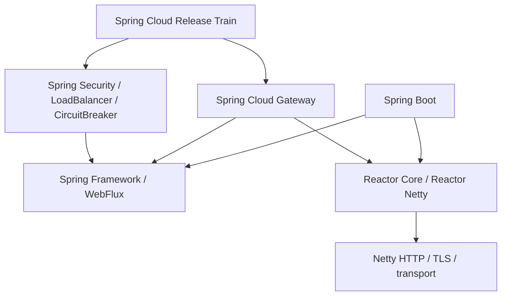

# Checking Compatibility of Custom Filters, Predicates, and HttpClient

## Lesson Objectives

In the **Upgrades** chapter of the **SPRING_CLOUD_GATEWAY** module, this lesson walks through testing and upgrading the Spring Cloud Gateway extension points that applications rely on most: **GatewayFilter/GatewayFilterFactory, GlobalFilter, RoutePredicateFactory, and custom Reactor Netty HttpClient**.

A Spring Boot/Spring Cloud upgrade may compile cleanly yet still change routing behavior, filter order, route argument binding, retry handling, TLS, connection pooling, or timeouts. These bugs often appear only when real requests flow through Gateway, under concurrent load, or when downstream fails.

Spring Cloud Gateway provides an API Gateway through route predicates, filter chains, path/header rewriting, service discovery, authentication, rate limiting, circuit breakers, retries, TLS, and observability. To operate safely, custom extensions must be compatible with the **right release train, the right server flavor, and the right HTTP runtime**.

After this lesson, you will be able to:

- Identify compatible Spring Boot/Spring Cloud/Spring Cloud Gateway version pairs by release train.
- Distinguish Server WebFlux, Server Web MVC, and Proxy Exchange before upgrading.
- Pick the right starter and configuration namespace for the new version.
- Audit `GatewayFilterFactory`, `GatewayFilter`, `GlobalFilter`, and `Ordered`.
- Audit custom `RoutePredicateFactory`, shortcut/expanded argument configs, and route matching.
- Detect custom filter names that do not follow the `GatewayFilterFactory` convention.
- Check `HttpClientCustomizer`, Reactor Netty APIs, pooling, timeouts, TLS, and proxy settings.
- Distinguish global timeouts from per-route metadata; verify millisecond vs `Duration` units.
- Recognize notable Spring Cloud Gateway 5.1 changes, including migrating internal Retry from Reactor Addons to Reactor Core.
- Design a test matrix for route matching, filter order, response/body lifecycle, connection pooling, and TLS.
- Roll out upgrades step by step with canary, rollback, and compatibility evidence.

> **Documentation cutoff in this article:** status verified as of **November 24, 2026**. Spring Cloud Gateway 5.1.0 is the latest stable version listed in official documentation; Spring Cloud 2026.0.0 (Paddington) went GA on November 20, 2026 and uses Spring Boot 4.2.0 and Spring Cloud Gateway 5.1.0. The 5.1 examples below use the current WebFlux namespace `spring.cloud.gateway.server.webflux.*`. Projects on older release trains may use different namespaces and starters. Verify against the BOM and configuration metadata of your actual artifacts.

## 1. Upgrading Gateway Means Upgrading an Ecosystem

Do not view Spring Cloud Gateway as a standalone JAR. The WebFlux runtime connects multiple components:



A custom filter may compile yet fail to run if:

- `ServerWebExchange`, `HttpHeaders`, `DataBuffer`, or reactive APIs changed.
- A bean is no longer auto-configured because the starter or property prefix changed.
- A custom factory is not discovered by Gateway because the class/bean name is wrong.
- Filter order shifted or a global filter is toggled differently.
- `HttpClientCustomizer` no longer receives the Reactor Netty API the customizer expects.
- A dependency override pulls two incompatible Reactor/Netty versions into runtime.

**A proper upgrade must verify three layers:** compile-time APIs, Spring application context/route binding, and runtime HTTP behavior.

## 2. Select the Right Release Train Before Editing Code

Spring Cloud uses a **release train** to manage a group of projects. Do not pick a Gateway version independently and pair it with an arbitrary Spring Boot version.

### 2.1. Reference version map

| Spring Cloud release train | Corresponding Spring Boot | Spring Cloud Gateway |
| --- | --- | --- |
| `2024.0.x` (Moorgate) | `3.4.x` | `4.2.x` |
| `2025.0.x` (Northfields) | `3.5.x` | `4.3.x` |
| `2025.1.x` (Oakwood) | `4.0.x` / `4.1.x` | `5.0.x` |
| `2026.0.x` (Paddington) | `4.2.x` | `5.1.x` |

This table is a **release-train compatibility guide**, not an exhaustive list of every patch release or a permanent support commitment. At the time of writing, `2026.0.0` is GA, based on Spring Boot `4.2.0`, and contains Spring Cloud Gateway `5.1.0`. The Supported Versions page also clarifies that a release train is a collection of projects whose support lifecycle is tied to the support lifecycles of its component projects.

Sources:

- [Spring Cloud 2026.0.0 release announcement](https://spring.io/blog/2026/11/20/spring-cloud-2026-0-0-has-been-released/).
- [Spring Cloud Supported Versions](https://github.com/spring-cloud/spring-cloud-release/wiki/Supported-Versions).
- [Spring Cloud Gateway version selector](https://docs.spring.io/spring-cloud-gateway/reference/).

### 2.2. Version selection rules

1. Identify the running Spring Boot version.
2. Pick the release train that supports that Boot version.
3. Use the release train's Spring Cloud BOM.
4. Let the BOM manage Spring Cloud Gateway, Spring Cloud Commons, LoadBalancer, CircuitBreaker, and other Spring Cloud dependencies.
5. Override dependencies only with a clear reason and verified compatibility tests.
6. Check the support policy and security advisories before selecting an upgrade target.

Do not upgrade `spring-cloud-gateway-server` alone to a newer version while keeping an older Spring Cloud BOM without an official compatibility matrix.

### 2.3. BOM example for Spring Cloud 2026.0.0

```xml
<properties>
    <spring-boot.version>4.2.0</spring-boot.version>
    <spring-cloud.version>2026.0.0</spring-cloud.version>
</properties>

<dependencyManagement>
    <dependencies>
        <dependency>
            <groupId>org.springframework.cloud</groupId>
            <artifactId>spring-cloud-dependencies</artifactId>
            <version>${spring-cloud.version}</version>
            <type>pom</type>
            <scope>import</scope>
        </dependency>
    </dependencies>
</dependencyManagement>

<dependencies>
    <dependency>
        <groupId>org.springframework.cloud</groupId>
        <artifactId>spring-cloud-starter-gateway-server-webflux</artifactId>
    </dependency>
</dependencies>
```

This snippet illustrates how to import the Spring Cloud BOM and the WebFlux starter. If the Spring Boot plugin/parent already manages `spring-boot.version`, do not declare a redundant second version. Use the proper Spring Boot plugin/parent and BOM per your project guidelines.

### 2.4. Gradle example

```groovy
plugins {
    id 'java'
    id 'org.springframework.boot' version '4.2.0'
    id 'io.spring.dependency-management' version '1.1.7'
}

ext {
    set('springCloudVersion', '2026.0.0')
}

dependencies {
    implementation 'org.springframework.cloud:spring-cloud-starter-gateway-server-webflux'
}

dependencyManagement {
    imports {
        mavenBom "org.springframework.cloud:spring-cloud-dependencies:${springCloudVersion}"
    }
}
```

This example follows the 2026.0.0 release announcement; check your project's plugin versions and Gradle configuration before applying changes.

### 2.5. Do not mix Server WebFlux, Server Web MVC, and Proxy Exchange

Spring Cloud Gateway offers distinct flavors:

| Flavor | 5.1 Starter | Runtime | Characteristics |
| --- | --- | --- | --- |
| Server WebFlux | `spring-cloud-starter-gateway-server-webflux` | Spring WebFlux + Reactor Netty | Reactive server, WebFlux filter chain |
| Server Web MVC | `spring-cloud-starter-gateway-server-webmvc` | Spring WebMvc.fn / Servlet runtime | Can use Tomcat/Jetty |
| Proxy Exchange WebFlux | Corresponding Proxy Exchange starter/auto-config | WebFlux handler | Handler method using `ProxyExchange` |
| Proxy Exchange Web MVC | Corresponding Proxy Exchange starter/auto-config | Web MVC handler | Handler method using `ProxyExchange` |

You cannot take a WebFlux `GatewayFilter`, `HttpClientCustomizer`, or Reactor Netty customizer and assume it works in Server Web MVC. Likewise, a `ProxyExchange` handler is neither a `RouteLocator` nor a Gateway Server filter.

Gateway Server WebFlux requires the Netty runtime provided by Spring Boot and **does not run in a traditional Servlet container or WAR packaging** according to the starter documentation.

Source: [How to Include Spring Cloud Gateway Server WebFlux](https://docs.spring.io/spring-cloud-gateway/reference/spring-cloud-gateway-server-webflux/starter.html).

## 3. Starters and Configuration Namespaces When Upgrading from 4.x to 5.x

An easily overlooked change when moving to newer Gateway lines is that **starters are split by server flavor** and the WebFlux configuration namespace adds `server.webflux`.

### 3.1. Starters

| Common config generation | WebFlux starter |
| --- | --- |
| Gateway 4.x | `spring-cloud-starter-gateway` |
| Gateway 5.1 | `spring-cloud-starter-gateway-server-webflux` |

Server Web MVC uses its own starter `spring-cloud-starter-gateway-server-webmvc`. Do not keep both server starters present if the application intends to run one flavor, unless an explicit architecture and auto-configuration setup is in place.

### 3.2. Property prefixes

| Purpose | Common legacy prefix | Server WebFlux 5.1 prefix |
| --- | --- | --- |
| Route definitions | `spring.cloud.gateway.routes` | `spring.cloud.gateway.server.webflux.routes` |
| Default filters | `spring.cloud.gateway.default-filters` | `spring.cloud.gateway.server.webflux.default-filters` |
| HTTP client | `spring.cloud.gateway.httpclient.*` | `spring.cloud.gateway.server.webflux.httpclient.*` |
| Discovery locator | `spring.cloud.gateway.discovery.locator.*` | `spring.cloud.gateway.server.webflux.discovery.locator.*` |
| Predicates | `spring.cloud.gateway.predicate.*` | `spring.cloud.gateway.server.webflux.predicate.*` |
| Filter enablement | `spring.cloud.gateway.filter.*` | `spring.cloud.gateway.server.webflux.filter.*` |
| Global filters | `spring.cloud.gateway.global-filter.*` | `spring.cloud.gateway.server.webflux.global-filter.*` |
| X-Forwarded | `spring.cloud.gateway.x-forwarded.*` | `spring.cloud.gateway.server.webflux.x-forwarded.*` |

This mapping applies to WebFlux property groups, not as a global string-replace rule across all Spring Cloud settings. Some shared properties at the root or belonging to Spring Boot/Spring Framework use different prefixes.

### 3.3. Route prefix example

Before:

```yaml
spring:
  cloud:
    gateway:
      routes:
        - id: catalog
          uri: lb://catalog-service
          predicates:
            - Path=/api/catalog/**
```

After migrating to Server WebFlux 5.1:

```yaml
spring:
  cloud:
    gateway:
      server:
        webflux:
          routes:
            - id: catalog
              uri: lb://catalog-service
              predicates:
                - Path=/api/catalog/**
```

If the legacy prefix remains, do not assume the application will fail with an obvious error. Routes may fail to bind as expected, old config may be ignored, or another route source may continue supplying routes. Verify effective configuration and the route list after startup.

### 3.4. Warning about property prefix documentation

At the time of checking, the 5.1 timeout configuration documentation page still showed illustrative examples using the old prefix `spring.cloud.gateway.httpclient.*`, whereas the **5.1 Configuration Properties** table lists active properties under `spring.cloud.gateway.server.webflux.httpclient.*`.

When encountering inconsistent documentation:

1. Prioritize configuration metadata/configprops from the exact artifact version you are running.
2. Verify property binding in `ApplicationContext`.
3. Use `/actuator/configprops` if the endpoint is secured and safely exposed.
4. Write tests confirming effective values, not merely that the YAML parses.

Do not copy property prefixes from an old doc page or a blog post that does not specify the Gateway version.

## 4. Inventory Before Changing Code

Before upgrading, build an inventory of all extension points:

| Group | What to list |
| --- | --- |
| Custom route predicates | Class, bean name, config fields, regex/path logic |
| Custom GatewayFilter factories | Class name, Config type, shortcut order, args |
| Custom GatewayFilter instances | Filter order, body/header/response behavior |
| GlobalFilter | `Ordered`, pre/post logic, exchange attributes |
| HttpHeadersFilter | Header allowlist/denylist, order, forwarded headers |
| HttpClientCustomizer | TCP options, TLS, proxy, timeouts, handlers |
| Route configuration | YAML, Java DSL, discovery, dynamic repositories |
| Retry | `Retry` imports, custom retry functions, body replay |
| Dependencies | Gateway, Reactor Core, Reactor Netty, Netty, LoadBalancer |
| Tests | Route matching, filter order, TLS, pooling, body streaming |

### 4.1. Record the resolved dependency tree

Maven:

```bash
./mvnw dependency:tree \
  -Dincludes=org.springframework.cloud,io.projectreactor,io.netty
```

Gradle:

```bash
./gradlew dependencies --configuration runtimeClasspath
```

Check:

- Are multiple versions of `reactor-core`, `reactor-netty-http`, or `netty-codec-http` present?
- Are there dependency overrides in `dependencyManagement`, `resolutionStrategy`, or a version catalog?
- Is `reactor-extra`/Reactor Addons retained solely to support legacy Retry code?
- Are both WebFlux and Web MVC Gateway starters present simultaneously?
- Does the runtime image have different dependencies than the test classpath?

Save the dependency tree output as a baseline for before/after comparison.

### 4.2. Record the runtime route inventory

In test/staging, capture:

- Route ID.
- URI.
- Predicate definitions.
- Filter names and args.
- Order.
- Metadata.
- Discovery-generated routes.

Compare the lists before and after the upgrade. Matching route counts alone are insufficient: a route ID may remain while predicate/filter args or the upstream URI changed.

### 4.3. Capture baseline HTTP behavior

For each critical route, record:

```text
method + host + path + query
→ selected route ID
→ outbound URI/path
→ outbound headers (redacted)
→ response status/headers
→ latency
→ retry attempts
→ connection/pool outcome
```

Do not save access tokens, cookies, API keys, sensitive bodies, or certificate private keys in the baseline.

## 5. Custom GatewayFilterFactory Compatibility

`GatewayFilterFactory` creates filters from route configs. This is a critical extension point when applications use custom filters in YAML.

### 5.1. Core extension API

The 5.1 Developer Guide specifies:

- Implement `GatewayFilterFactory` as a bean, typically extending `AbstractGatewayFilterFactory`.
- A `Config` class holds configuration parameters.
- `apply(Config)` returns a `GatewayFilter`.
- Custom filter class names should end with `GatewayFilterFactory`.

Skeleton example:

```java
@Component
public class AddTenantHeaderGatewayFilterFactory
        extends AbstractGatewayFilterFactory<AddTenantHeaderGatewayFilterFactory.Config> {

    public AddTenantHeaderGatewayFilterFactory() {
        super(Config.class);
    }

    @Override
    public GatewayFilter apply(Config config) {
        return (exchange, chain) -> {
            ServerHttpRequest request = exchange.getRequest()
                .mutate()
                .header(config.getHeaderName(), config.getHeaderValue())
                .build();

            return chain.filter(
                exchange.mutate().request(request).build()
            );
        };
    }

    public static class Config {
        private String headerName;
        private String headerValue;

        public String getHeaderName() {
            return headerName;
        }

        public void setHeaderName(String headerName) {
            this.headerName = headerName;
        }

        public String getHeaderValue() {
            return headerValue;
        }

        public void setHeaderValue(String headerValue) {
            this.headerValue = headerValue;
        }
    }
}
```

This example illustrates the WebFlux API structure; in practice, validate header names/values, prevent clients from overwriting identity headers, and rely only on verified tenant sources.

### 5.2. Filter names in YAML

Given class:

```java
AddTenantHeaderGatewayFilterFactory
```

the filter can be referenced by its short name:

```yaml
filters:
  - AddTenantHeader=X-Tenant,tenant-42
```

To avoid ambiguity with shortcut args, the expanded form is clearer:

```yaml
filters:
  - name: AddTenantHeader
    args:
      headerName: X-Tenant
      headerValue: tenant-42
```

Gateway documentation warns that naming a class without the `GatewayFilterFactory` suffix is an **unsupported** convention and may be removed. If legacy code has:

```java
class LegacyAuditFilter extends AbstractGatewayFilterFactory<...>
```

rename it to:

```java
class LegacyAuditGatewayFilterFactory extends AbstractGatewayFilterFactory<...>
```

Then re-check filter names in YAML, tests, and any dynamically loaded configs.

### 5.3. Shortcut field order

If a filter uses shortcut notation:

```yaml
filters:
  - AddTenantHeader=X-Tenant,tenant-42
```

the factory must have matching field order. If a class renames fields or changes `shortcutFieldOrder`, the shortcut may bind wrong values without changing the argument count.

When upgrading:

- Compare `shortcutFieldOrder()` against current configs.
- Add tests for shortcut notation.
- Add tests for expanded `name`/`args`.
- Prefer expanded notation for filters with many args or error-prone configs.
- Never change argument order without migrating YAML/remote configs.

### 5.4. Config binding and validation

Do not assume that instantiating `Config` means every value is valid. Check:

- Required fields have values.
- Default values did not change unexpectedly.
- Enum/string conversion.
- `Duration`, `DataSize`, URI, and regex parsing.
- Null/empty values.
- Exact spelling of args keys.
- Bean validation if integrated.

If a custom filter uses specialized constructor or setter binding, verify it on the new Spring Boot/Spring Framework version. Do not rely on a `Config` class lacking getters/setters or constructor binding unsupported by the factory in use.

### 5.5. Pre-filters and post-filters

Pre-filters act before `chain.filter(...)`:

```java
return (exchange, chain) -> {
    // Modify the request before proxying.
    return chain.filter(exchange);
};
```

Post-filters run after downstream completes:

```java
return (exchange, chain) ->
    chain.filter(exchange)
        .then(Mono.fromRunnable(() -> {
            // Inspect the response state after downstream.
        }));
```

After upgrading, test:

- Has the response already committed before modifying headers/status?
- Do downstream errors pass through post logic?
- Does client cancellation run cleanup properly?
- Does the filter read the body once or unintentionally consume the body?
- Does anything write response headers after the response has committed?

Do not mutate response headers/status in a post-filter once the response is committed; proper behavior must be defined and tested against the lifecycle.

### 5.6. Filters should not depend on internal implementations

Custom filters should depend only on documented interfaces/attributes. Avoid:

- Casting exchange/request/response to internal implementation classes.
- Calling private methods on built-in filters.
- Relying on implicit ordering of internal global filters without verification.
- Using reflection to access Gateway internal fields.
- Replacing `NettyRoutingFilter` with a copied version just to add a header.

If you need to extend a built-in filter, prefer public extension points or a custom filter running at a tested order.

## 6. GlobalFilter and Filter Ordering Compatibility

`GlobalFilter` applies conditionally across routes; `GatewayFilter` binds to specific routes. When a route matches, Gateway merges global filters and route-specific filters into a single chain sorted by `Ordered`.

### 6.1. Pre/post ordering

Filters with higher precedence (lower order integer in the `Ordered` convention) execute earlier in the pre-phase and later in the post-phase. Therefore, looking at bean registration order alone cannot determine the chain.

Example:

```text
Pre:
  AuthContextFilter
  RouteAuditFilter
  NettyRoutingFilter

Downstream request

Post:
  RouteAuditFilter
  AuthContextFilter
```

This is an illustrative diagram, not Gateway's default order.

### 6.2. GlobalFilter example

```java
@Component
public class RequestIdGlobalFilter implements GlobalFilter, Ordered {

    @Override
    public int getOrder() {
        return -1;
    }

    @Override
    public Mono<Void> filter(
            ServerWebExchange exchange,
            GatewayFilterChain chain) {

        ServerHttpRequest request = exchange.getRequest()
            .mutate()
            .header("X-Gateway-Request-Id", UUID.randomUUID().toString())
            .build();

        return chain.filter(exchange.mutate().request(request).build());
    }
}
```

This example adds a new request ID to illustrate the API. Production must consider preserving correlation IDs verified by trusted ingress, preventing client spoofing, avoiding high-cardinality metric labels, and avoiding logging PII.

### 6.3. When upgrading GlobalFilter

- Verify import packages of `GlobalFilter`, `GatewayFilterChain`, and `ServerWebExchange`.
- Verify `Ordered` and ordering relative to route-specific filters.
- Verify pre/post logic.
- Verify response commit state.
- Verify cancellation/error cleanup.
- Verify route caches or exchange attributes read by the filter.
- Do not assume `GlobalFilter` is a stable public API like an application service; the docs note that interfaces/usage may change across milestones.

### 6.4. Do not assign order based on an unverified number

For example, `getOrder() == -1` does not guarantee a filter runs before security, CORS, or all Gateway internals. Verify runtime ordering using:

- Unit tests for order values.
- Integration tests observing requests/responses.
- Actuator route/filter introspection in a protected environment.
- Selective logging in test profiles.

## 7. Custom RoutePredicateFactory Compatibility

Route predicates determine whether a request matches a route. A custom predicate typically implements `RoutePredicateFactory` and may extend `AbstractRoutePredicateFactory`.

### 7.1. Core API

```java
@Component
public class TenantRoutePredicateFactory
        extends AbstractRoutePredicateFactory<TenantRoutePredicateFactory.Config> {

    public TenantRoutePredicateFactory() {
        super(Config.class);
    }

    @Override
    public Predicate<ServerWebExchange> apply(Config config) {
        return exchange -> {
            String tenant = exchange.getRequest()
                .getHeaders()
                .getFirst("X-Tenant");

            return tenant != null
                && config.getAllowedTenant().equals(tenant);
        };
    }

    public static class Config {
        private String allowedTenant;

        public String getAllowedTenant() {
            return allowedTenant;
        }

        public void setAllowedTenant(String allowedTenant) {
            this.allowedTenant = allowedTenant;
        }
    }
}
```

This is an example of the predicate API. **Never use a public client-supplied `X-Tenant` header as proof of tenant identity.** If a predicate genuinely depends on tenant identity, the value must come from a verified security context/claim or a sanitized trusted proxy layer.

### 7.2. Factory names and YAML

Class name:

```java
TenantRoutePredicateFactory
```

is typically referenced as:

```yaml
predicates:
  - Tenant=tenant-42
```

Or in expanded notation:

```yaml
predicates:
  - name: Tenant
    args:
      allowedTenant: tenant-42
```

Check `shortcutFieldOrder()` if the factory uses shortcut notation. When a predicate has multiple args, expanded notation is usually easier to read and less error-prone.

### 7.3. Things prone to changing on upgrade

- `RoutePredicateFactory`/`AbstractRoutePredicateFactory` import packages.
- Generic type of `Config`.
- Constructor/setter/record binding behavior.
- `ServerWebExchange` request path/headers representation.
- Spring Framework path matching/URI APIs.
- Regex and date/time parsing.
- Null/empty behavior.
- Custom predicate ordering and route precedence.

Do not use a single predicate unit test as proof that routes match in reality; verify `RoutePredicateHandlerMapping`, route definitions, and HTTP requests together.

### 7.4. Built-in predicates needing regression testing

When upgrading Gateway, re-test the predicates your application uses:

| Predicate | Cases to test |
| --- | --- |
| `Path` | Encoded paths, trailing slashes, path variables, context paths |
| `Host` | Wildcards, ports, forwarded host, and TLS termination |
| `Method` | GET/HEAD/POST/PATCH/OPTIONS |
| `Header` | Casing, duplicate headers, regex, missing header |
| `Query` | Missing/empty/multiple query params, encoding |
| `RemoteAddr` | Direct connection and trusted reverse proxy |
| `XForwardedRemoteAddr` | XFF chain, untrusted client-supplied values |
| `Weight` | Distribution, route ordering, and stable behavior |
| `After`/`Before`/`Between` | Timezone, daylight saving, clock boundaries |
| `Version` | Missing/invalid/unsupported version and strategy binding |
| `ReadBody` | Body cache, codec limits, and request replay |

### 7.5. Route predicates combine with AND logic

Within a route:

```yaml
predicates:
  - Host=api.example.com
  - Path=/api/orders/**
  - Method=GET
```

all predicates must match together. After upgrading, check:

- Do any routes overlap and match ahead of the intended route?
- Did route `order` change?
- Does path matching keep the baseline trailing-slash behavior?
- Does the Host predicate receive the right authority behind a proxy?
- Does a custom predicate return `true` on missing headers because of `defaultIfEmpty`?

Do not treat successful application startup as proof that all predicates match correctly.

## 8. Checking Shortcut and Expanded Route Arguments

Gateway supports two configuration forms:

**Shortcut:**

```yaml
filters:
  - SetStatus=401
predicates:
  - Method=GET,POST
```

**Expanded:**

```yaml
filters:
  - name: SetStatus
    args:
      status: 401
predicates:
  - name: Method
    args:
      methods:
        - GET
        - POST
```

When upgrading custom factories, test both forms. Common bugs include:

- Shortcut argument order no longer matches.
- Field name changed while remote config still uses the old key.
- Enum values/casing differ.
- String-to-duration/data-size conversion changed.
- An args key is ignored due to a different prefix or property binding.
- Default value of a custom config changed.

If a remote route repository stores definitions created months earlier, validate them with a schema validator and test on the new Gateway version before rollout.

## 9. `HttpClientCustomizer`: Extending the Outbound HTTP Client

In Server WebFlux, Gateway uses Reactor Netty `HttpClient` to proxy downstream HTTP/HTTPS requests. `HttpClientCustomizer` lets you customize the client Gateway uses.

Gateway 5.1 documentation describes the interface:

```java
org.springframework.cloud.gateway.config.HttpClientCustomizer
```

with method:

```java
HttpClient customize(HttpClient httpClient);
```

Customizer beans are automatically applied to the Gateway HTTP client according to official docs.

### 9.1. Customizer example

```java
import io.netty.channel.ChannelOption;
import java.time.Duration;
import org.springframework.cloud.gateway.config.HttpClientCustomizer;
import org.springframework.context.annotation.Bean;
import org.springframework.context.annotation.Configuration;
import reactor.netty.http.client.HttpClient;

@Configuration
class GatewayHttpClientConfiguration {

    @Bean
    HttpClientCustomizer gatewayHttpClientCustomizer() {
        return httpClient -> httpClient
            .option(ChannelOption.CONNECT_TIMEOUT_MILLIS, 3_000)
            .responseTimeout(Duration.ofSeconds(2));
    }
}
```

This is a Gateway HTTP-client-level customizer example. Connect timeout limits TCP connection establishment; response timeout limits waiting for a response per Reactor Netty semantics. It does not replace end-to-end deadlines, pool acquire timeouts, or business timeouts.

### 9.2. Customizers are global to the Gateway HttpClient

`HttpClientCustomizer` customizes the HTTP client used by Gateway. Therefore:

- Do not assume a customizer bean affects only one route.
- Do not use a customizer to apply per-route timeouts if route metadata already handles it.
- Do not construct an independent `HttpClient.create()` and replace Gateway's client without an architectural reason.
- Do not bypass pooling, TLS, proxy, observability, or other customizers.
- If multiple customizer beans exist, check their order and combined effect at runtime; do not rely on accidental registration order.

### 9.3. Prefer properties first, customizers when API access is needed

Many settings already have configuration properties:

```yaml
spring:
  cloud:
    gateway:
      server:
        webflux:
          httpclient:
            connect-timeout: 3000
            response-timeout: 2s
            pool:
              type: fixed
              max-connections: 300
              acquire-timeout: 1500
              max-idle-time: 30s
              max-life-time: 10m
              metrics: true
```

These values are examples only; capacity planning is required. Per the 5.1 configprops table:

- `connect-timeout` is in milliseconds.
- `response-timeout` is a `Duration`.
- `pool.type` supports `elastic`, `fixed`, or `disabled`.
- `max-connections` and `acquire-timeout` apply to pool type `fixed`.
- Pool metrics are disabled by default.

Prefer supported properties when custom code is unnecessary. Use `HttpClientCustomizer` only when you need a Reactor Netty API not yet exposed as a property or specialized behavior.

### 9.4. Do not confuse HttpClientCustomizer with HttpServerCustomizer

Gateway has an outbound `HttpClient` to call backends and an inbound HTTP server to receive requests. They are two opposite directions:

| Extension | Scope |
| --- | --- |
| `HttpClientCustomizer` | Outbound Reactor Netty HTTP client |
| HttpServer customizer/configuration | Inbound Netty HTTP server |
| `GatewayFilter` | Request/response in the filter chain |
| `HttpHeadersFilter` | Header transformation on the outbound routing path |

An outbound client customizer does not configure the inbound listener, Ingress TLS termination, or server-side decoders.

## 10. Global Timeouts vs Per-Route Timeouts

During upgrades, timeouts are easily broken by unit or property prefix changes. Gateway supports connect and response timeouts at both global and per-route levels.

### 10.1. Global timeouts

In 5.1 Server WebFlux, use the namespace:

```yaml
spring:
  cloud:
    gateway:
      server:
        webflux:
          httpclient:
            connect-timeout: 1000
            response-timeout: 5s
```

Global `connect-timeout` is in milliseconds; `response-timeout` uses `java.time.Duration`.

### 10.2. Per-route timeouts

```yaml
spring:
  cloud:
    gateway:
      server:
        webflux:
          routes:
            - id: catalog-fast-read
              uri: lb://catalog-service
              predicates:
                - Path=/api/catalog/**
                - Method=GET
              metadata:
                connect-timeout: 500
                response-timeout: 1500
```

In per-route metadata, both `connect-timeout` and `response-timeout` are declared in milliseconds. This is useful when one route has a different SLO than another.

### 10.3. Do not confuse connect timeout with pool acquire timeout

| Timeout | Where does it start? |
| --- | --- |
| Pool acquire timeout | Waiting to acquire a connection from the pool |
| Connect timeout | Opening a TCP connection to upstream |
| TLS handshake timeout | Completing the TLS handshake |
| Response timeout | Waiting for a response per HTTP client semantics |
| Overall request deadline | Bounding the entire request lifecycle |

A request can time out waiting on the pool before TCP connect even begins. Increasing connect timeout alone will not resolve pool exhaustion errors.

### 10.4. Response timeout is not a total deadline

Response timeout does not guarantee every operation finishes within that exact interval, especially for streaming/SSE/WebSocket. For streaming routes, check idle timeout/response timeout semantics and test long-lived connections.

## 11. Checking TLS, Proxy, and Connection Pool After Upgrading

### 11.1. Client TLS

Gateway outbound TLS may use:

- Trust stores or trusted X.509 certificates.
- Key stores/client certificates for mTLS.
- SSL bundles per Spring Boot version.
- Handshake timeout and close-notify timeouts.

In 5.1 configprops, properties sit under:

```text
spring.cloud.gateway.server.webflux.httpclient.ssl.*
```

Key settings:

```yaml
spring:
  cloud:
    gateway:
      server:
        webflux:
          httpclient:
            ssl:
              handshake-timeout: 10s
              ssl-bundle: internal-service-client
              use-insecure-trust-manager: false
```

`use-insecure-trust-manager` is unsuitable for production. When upgrading, test certificate chains, SAN/hostname verification, trust bundle refresh, and mTLS client identity.

### 11.2. Connection pool

After changing the Reactor Netty version, test:

- Max connections and pending acquisitions.
- Pool acquire timeout.
- Max idle/lifetime and eviction.
- FIFO/LIFO leasing if configured.
- Connection reuse after upstream errors.
- HTTP/2 multiplexing if enabled.
- Pool metrics.
- Resource disposal on app shutdown/cancellation.

Do not treat a single request test as sufficient. Pool bugs typically appear only under concurrent requests, slow upstreams, or connection resets.

### 11.3. Proxy configuration

If Gateway uses an outbound proxy, verify:

- HTTP/SOCKS type.
- Proxy host/port.
- Non-proxy hosts pattern.
- Username/password secret binding.
- TLS trust between Gateway and the proxy.
- Whether proxy bypass matches the exact host allowlist.

A wrong `non-proxy-hosts-pattern` regex can send traffic directly instead of through the egress proxy or vice versa.

### 11.4. Do not enable wiretap in production just to verify an upgrade

Wiretap can log request/response headers and payloads, including cookies, bearer tokens, or PII. Use it only in test/staging with synthetic data and short retention. Production should use redacted metrics/traces.

## 12. Notable Changes in Spring Cloud 2026.0 / Gateway 5.1

When upgrading from earlier lines to 2026.0, pay attention to the following changes and patches.

### 12.1. Retry migration: Reactor Addons to Framework Core Retry

The Spring Cloud 2026.0 release announcement notes that Gateway migrated from **Reactor Addons Retry** to **Framework Core Retry**. Pull request #4290 records:

- Refactoring from `reactor.retry.Retry` to `reactor.util.retry.Retry`.
- Adding flux caching to replace what was taken from Reactor Addons.
- Removing `RetryConfig.basedOnPreviousValue` during migration.

Sources:

- [Spring Cloud 2026.0.0 release announcement](https://spring.io/blog/2026/11/20/spring-cloud-2026-0-0-has-been-released/).
- [Gateway PR #4290 — Reactor core retry caching](https://github.com/spring-cloud/spring-cloud-gateway/pull/4290).

If application code only configures the built-in `Retry` filter via YAML, the filter configuration API must still be verified against the new Gateway version docs; do not assume all Retry YAML changed. However, if custom code imports `reactor.retry.Retry` or depends on Reactor Addons Retry APIs, audit compile/runtime compatibility and migrate to the new API under the proper contract.

### 12.2. Forwarded headers from untrusted proxies

Gateway 2026.0 fixes how `ForwardedHeadersFilter` and `XForwardedHeadersFilter` handle requests from untrusted proxies: legacy headers sent by untrusted proxies are still stripped, and then the filter continues generating fresh forwarded headers based on the actual request/remote address.

Source: [Gateway PR #4271](https://github.com/spring-cloud/spring-cloud-gateway/pull/4271).

Regression tests should verify:

- Direct clients cannot spoof `X-Forwarded-For/Host/Proto`.
- Trusted proxy chains are interpreted properly.
- Untrusted proxy headers are stripped.
- Remote address/host/proto are regenerated according to the real topology.
- Backends do not use client-controlled forwarded headers for authorization.

### 12.3. Security fixes requiring behavioral re-testing

The Spring Cloud 2026.0 release announcement lists these Gateway fixes:

- `CVE-2026-59425`: `JsonToGrpc` filter leaks `ManagedChannel` resources.
- `CVE-2026-59426`: global `LocalResponseCache` leaks responses across routes.
- `CVE-2026-59427`: `LocalResponseCache` caches private/no-store responses and can expose authenticated content.
- `CVE-2026-59428`: WebSocket routing filter does not enforce same-origin by default.

This is why upgrades must include tests for resource lifecycle, cache isolation, cache-control semantics, and WebSocket Origin validation. Check official advisories for affected/fixed versions rather than relying solely on the release train name.

### 12.4. LocalResponseCache and WebSocket

If the application uses LocalResponseCache:

- Test that route A never returns route B's cached response.
- Test `Cache-Control: private` and `no-store`.
- Test that authenticated responses are never shared across users.
- Test cache keys with appropriate method/host/path/query and vary semantics.

If using WebSocket:

- Test `Origin` allowlists and same-origin policy.
- Test authentication during handshake.
- Test ping/pong, close frames, and reconnects.
- Test downstream cancellation/connection disposal.

Do not widen cache or origin allowances merely to stop a regression test from failing.

## 13. Distinguishing API Changes from Configuration Changes

A migration can succeed at one layer and fail at another:

| Layer | Example error | How to verify |
| --- | --- | --- |
| Dependency | `NoSuchMethodError` in Reactor Netty | Resolved dependency tree + runtime tests |
| Starter | Gateway auto-config does not run | Starter artifact + ApplicationContext |
| Property binding | Routes/filters are not loaded | Configprops + route list |
| Custom factory | Filter name fails to resolve | Bean registration + route startup test |
| Predicate | Route does not match | Request matrix + selected route ID |
| Filter order | Wrong header/body/response | Order-aware integration tests |
| HttpClient | Wrong TLS/connect/read timeout | Mock backend + TLS test server |
| Pool | Acquire timeout/connection leak | Concurrent load + pool metrics |
| Retry | Attempts/backoff/body replay changed | Retry integration tests |
| Observability | Metric names/tags changed | Actuator metrics/trace assertions |

## 14. Mandatory Compatibility Test Suite

Do not run only `mvn test` or `gradle test`. You need tests covering each extension point and HTTP behavior.

### 14.1. Filter factory tests

- Factory is scanned by Spring and instantiated as a bean.
- Class name follows convention.
- Shortcut args bind in the right order.
- Expanded args bind to the right field names.
- Default values are preserved.
- Pre-filters modify requests properly.
- Post-filters do not modify responses after commit.
- Error/cancel paths release resources.

### 14.2. GlobalFilter tests

- `getOrder()` returns the expected value.
- Global filters and route filters run in the right order.
- Filters do not inadvertently apply to management/internal routes unless intended.
- Principals/headers come from verified sources.
- Bodies are not unintentionally consumed once.
- Post-phase runs when downstream fails/times out.

### 14.3. Predicate tests

- Custom factory is discovered.
- Config shortcut/expanded args bind properly.
- Route matching with path/host/method/query.
- Multiple predicates on the same route retain AND semantics.
- Overlapping routes pick the right order.
- Trailing slash, encoded path, and forwarded headers behave stably.
- Custom predicates do not trust client-supplied headers as identity.

### 14.4. HttpClient tests

| Test | Expectation |
| --- | --- |
| Connect timeout | Request fails within connect budget |
| Response timeout | Request times out per policy |
| Pool acquire timeout | Does not wait indefinitely when pool is full |
| TLS valid certificate | Handshake succeeds |
| TLS expired/wrong SAN | Handshake/verification fails |
| mTLS client cert | Backend authenticates client properly |
| Proxy route | Traffic flows through the right proxy |
| Non-proxy hosts | Bypass applies only to host allowlist |
| Connection reuse | Broken connections are not reused |
| Client cancel | Outbound connection/response resources are disposed |
| HTTP/2/streaming | Body and connection lifecycle follow protocol |

### 14.5. Testing end-to-end route behavior

Use `WebTestClient` with a backend stub (MockWebServer/WireMock or equivalent test server):

```text
Test client
  → Gateway 5.1 test application
  → backend stub
```

The backend stub should record:

- Method.
- Path/query.
- Host.
- Safe headers.
- Body byte count.
- Request ID.
- Request receipt count.

Do not log JWTs, Cookies, API keys, or sensitive raw payloads.

## 15. Phased Upgrade Plan

### Phase 1 — Inventory

1. Record Spring Boot, Spring Cloud train, Gateway, Reactor Netty, and Netty versions.
2. Save the runtime dependency tree.
3. List all custom filters/predicates/`HttpClientCustomizer` beans.
4. Export route inventory and baseline HTTP behavior.
5. Confirm Server WebFlux vs Web MVC/Proxy Exchange.

### Phase 2 — Select Target and Update Dependencies

1. Pick a compatible release train.
2. Import the corresponding BOM.
3. Use the starter matching the server flavor.
4. Remove unnecessary dependency overrides.
5. Align Reactor Netty/Netty via the BOM.
6. Update property namespaces.

### Phase 3 — Fix Custom Extensions

1. Recompile custom `GatewayFilterFactory` classes.
2. Standardize class name suffixes.
3. Verify config binding and shortcut args.
4. Recompile custom `RoutePredicateFactory` classes.
5. Verify `GlobalFilter` ordering.
6. Update Retry imports if code depends on Reactor Addons.
7. Migrate `HttpClientCustomizer` to compatible Reactor Netty APIs.

### Phase 4 — Local/CI Testing

Run unit tests, ApplicationContext tests, route contract tests, filter order tests, TLS/HttpClient tests, and the regression suite.

### Phase 5 — Staging

Deploy the exact artifact/container planned for production. Verify:

- Routes are bound.
- Effective predicates/filters are accurate.
- Backend paths/headers are accurate.
- TLS, mTLS, and pooling work.
- Retries/timeouts/fallbacks behave properly.
- Metrics/traces and error rates show no anomalies.

### Phase 6 — Canary

Shift only a portion of traffic after staging passes. Compare:

- 2xx/4xx/5xx.
- p50/p95/p99 latency.
- 502/503/504 and connection resets.
- Pool pending/acquire timeouts.
- TLS handshake failures.
- Retry attempts.
- Route-level metrics.
- Cache/WebSocket security behavior.

### Phase 7 — Rollout and Rollback

Keep the old image, BOM, route config, and secrets recoverable. If rolling back:

- Roll back the compatible image and dependency set.
- Roll back property prefixes/configs.
- Check route repository/dynamic route revisions.
- Check cache/connection pool behavior.
- Never roll back a security patch without an approved mitigation.

## 16. Post-Upgrade Troubleshooting

### 16.1. Routes do not appear after startup

**Possible cause:** old property prefix, wrong starter flavor, route definition parse failure, or config source not loaded.

**Resolution:** check `spring.cloud.gateway.server.webflux.routes`, the WebFlux starter, configprops, startup logs, and the Actuator route list in a secured environment.

### 16.2. `Unable to find GatewayFilterFactory`

**Cause:** class is not a bean, missing component scan, class name lacks standard suffix, or YAML filter name mismatch.

**Resolution:** standardize on `SomethingGatewayFilterFactory`, verify bean creation, and test expanded args.

### 16.3. `NoSuchMethodError` in a custom filter

**Cause:** binary mismatch across Spring Framework/Gateway/Reactor or a dependency override.

**Resolution:** read the class/method in the stack trace, inspect the runtime dependency tree, remove unnecessary version overrides, and compile/test against an aligned BOM.

### 16.4. Custom predicate does not match

**Cause:** factory bean not discovered, config args bound improperly, predicate logic depends on changed path/header APIs, or route ordering shadows the route.

**Resolution:** test `RoutePredicateFactory` independently, check expanded args, and integration-test the selected route ID.

### 16.5. Customizer has no effect

**Cause:** bean not scanned, app is running Server MVC instead of WebFlux, customizer creates a new client without returning it, or other properties override it.

**Resolution:** confirm the `HttpClientCustomizer` bean is created and applied, check the Gateway flavor, and test outbound behavior rather than merely checking bean existence.

### 16.6. Timeouts differ from before

**Cause:** wrong prefix, wrong connect/response timeout units, pool acquire timeout overlooked, or customizer interference.

**Resolution:** check configprops; global connect is milliseconds, global response is `Duration`, per-route both are milliseconds. Measure pool acquisition, TCP connect, and response separately.

### 16.7. TLS handshake fails

**Cause:** wrong trust bundle/keystore path/alias/password, SAN mismatch, certificate chain, or wrong SSL bundle name.

**Resolution:** test real certificates in staging, inspect SSL bundle/configprops, and never enable the insecure trust manager to mask errors.

### 16.8. Pool exhaustion

**Cause:** low max connections, too-short acquire timeout, slow upstreams, or connections not disposed on cancel/error.

**Resolution:** enable pool metrics in an appropriate environment, inspect active/idle/pending counts, upstream latency, and cancellation lifecycle.

### 16.9. Retry fails to compile

**Cause:** custom code imports `reactor.retry.Retry` or uses replaced Reactor Addons APIs.

**Resolution:** read Gateway 2026.0 migration notes/PR #4290, migrate to `reactor.util.retry.Retry` per the new contract, and test retry/backoff semantics.

### 16.10. Forwarded headers differ from before

**Cause:** changed handling of trusted/untrusted proxies.

**Resolution:** test both trusted and untrusted sources, check ingress sanitization, and compare `Forwarded`/`X-Forwarded-*` received by the backend.

### 16.11. Local cache or WebSocket behavior differs

**Cause:** 2026.0 security fixes changed cache isolation/private response handling and same-origin behavior.

**Resolution:** check cache-control, route separation, authenticated users, and WebSocket Origin policy. Do not relax security just to reproduce older unsafe behavior.

## 17. Pre-Production Compatibility Checklist

| Group | Question |
| --- | --- |
| Release train | Are Spring Boot and Gateway within a compatible pair? |
| BOM | Are Spring Cloud dependencies managed under the same release train? |
| Flavor | Do WebFlux/Web MVC/Proxy Exchange match the architecture? |
| Starter | Is the starter matching the Gateway version/flavor used? |
| Properties | Are prefixes/units/defaults verified via configprops? |
| Filters | Do custom `GatewayFilterFactory` classes compile, bind args, and follow naming? |
| Global filters | Have `Ordered` and pre/post semantics been tested? |
| Predicates | Do custom `RoutePredicateFactory` and built-ins match accurately? |
| Route order | Do overlapping routes select the right route ID? |
| HttpClient | Is `HttpClientCustomizer` applied without creating an external client? |
| Pool | Are acquire/max connections/idle/lifetime/metrics appropriate? |
| Timeouts | Are global/per-route units correct and budgets reasonable? |
| TLS | Are trust chain, hostname, mTLS, and SSL bundles tested? |
| Retry | Are Reactor Retry API, body replay, and idempotency correct? |
| Discovery | Are route locator filters/`RewritePath` preserved? |
| Forwarded | Has trusted/untrusted proxy behavior been tested? |
| Cache | Are private/no-store and cross-route cache isolation intact? |
| WebSocket | Are Origin/authentication/close/reconnect working properly? |
| Observability | Have route metrics/traces avoided unintended changes? |
| Dependencies | Are there zero duplicate/incompatible Reactor/Netty versions? |
| Rollback | Can the image, BOM, config, and dynamic route revisions be restored? |

## 18. Exercises with Solutions

### Exercise 1 — Gateway 5.1 fails to load routes

An application upgraded from Gateway 4.3 to 5.1, but the YAML still uses `spring.cloud.gateway.routes`.

**Answer:** check the Server WebFlux 5.1 prefix `spring.cloud.gateway.server.webflux.routes`, the new starter, and effective configuration. Do not update dependencies while keeping old prefixes unchanged.

### Exercise 2 — Legacy starter

A 5.1 application uses `spring-cloud-starter-gateway` while expecting to run Server WebFlux.

**Answer:** consult the 5.1 starter docs; use `spring-cloud-starter-gateway-server-webflux`. If Server Web MVC is intended, use the separate MVC starter.

### Exercise 3 — Custom filter fails to resolve from YAML

A class named `AuditFilter` extends `AbstractGatewayFilterFactory`.

**Answer:** rename per convention to `AuditGatewayFilterFactory`, verify component scanning, and test YAML `Audit=...`. Class names without the suffix are an unsupported convention.

### Exercise 4 — Filter order shifted

After upgrading, a post-filter writes a response header, but the response is already committed.

**Answer:** inspect combined `GlobalFilter`/`GatewayFilter` ordering, pre/post phases, and the commit lifecycle; move the mutation to an appropriate pre-commit point or remove the invalid header write.

### Exercise 5 — Predicate matches the wrong route

A custom predicate reads `X-Tenant` and treats the value as tenant identity.

**Answer:** do not trust client-controlled headers. Use a verified principal/claim or metadata from a trusted proxy, then test missing/forged headers.

### Exercise 6 — HttpClientCustomizer applies only partially

A customizer bean sets connect timeout and response timeout; the payment route needs a different timeout than the catalog route.

**Answer:** customizers apply to the shared Gateway client. Use route metadata for per-route timeouts where appropriate; do not assume customizers are per-route.

### Exercise 7 — Per-route timeout uses the wrong unit

Global response timeout is `5s`, and per-route metadata has `response-timeout: 1500`.

**Answer:** global response timeout uses `Duration`; per-route response timeout uses milliseconds. `1500` equals 1.5 seconds.

### Exercise 8 — Retry code fails to compile

A custom extension imports `reactor.retry.Retry`.

**Answer:** Gateway 2026.0 migrated from Reactor Addons Retry to `reactor.util.retry.Retry`. Audit legacy APIs and test retry/backoff after migration.

### Exercise 9 — Pool acquire timeout

Gateway reports pending acquire timeouts, yet the team increases the TCP connect timeout.

**Answer:** those are two different stages. Check pool `max-connections`, `acquire-timeout`, upstream latency, and connection lifecycle.

### Exercise 10 — TLS temporarily fixed with insecure trust manager

After upgrading, backend certificates are no longer trusted; the team enables `use-insecure-trust-manager`.

**Answer:** do not use this as a production fix. Update the trust store/SSL bundle, inspect the certificate chain/SAN, and verify mTLS.

### Exercise 11 — LocalResponseCache returns another user's data

Post-upgrade cache tests reveal authenticated responses are being reused.

**Answer:** stop caching sensitive routes, check `private`/`no-store`, cache keys, and patched versions; refer to CVE-2026-59426/59427 in the 2026.0 release notes.

### Exercise 12 — WebSocket handshake changed

A valid client with a different origin is rejected after upgrading.

**Answer:** verify same-origin enforcement and the Origin allowlist per your security contract. Do not broadly disable checks just to make tests pass.

## 19. Practical Workflow

1. Inventory versions/BOM/dependencies and custom extensions.
2. Select the release train and starter matching your flavor.
3. Update dependency management without arbitrary overrides.
4. Migrate property namespaces and verify effective binding.
5. Standardize custom filter/predicate naming and Config binding.
6. Verify `GlobalFilter` ordering and route predicate matching.
7. Update `HttpClientCustomizer`/Retry APIs if needed.
8. Test TLS, pooling, timeouts, and proxies.
9. Run backend stub integration tests and security regression tests.
10. Canary, observe metrics, and maintain a rollback plan.

## 20. Official References

- [Spring Cloud Gateway 5.1 — Reference](https://docs.spring.io/spring-cloud-gateway/reference/): stable version, Server WebFlux, and flavors.
- [How to Include Spring Cloud Gateway Server WebFlux](https://docs.spring.io/spring-cloud-gateway/reference/spring-cloud-gateway-server-webflux/starter.html): `spring-cloud-starter-gateway-server-webflux` starter, WebFlux/Netty runtime.
- [Configuration Properties](https://docs.spring.io/spring-cloud-gateway/reference/configprops.html): `server.webflux` namespace, HTTP client/pool/TLS/predicate/filter properties.
- [Developer Guide](https://docs.spring.io/spring-cloud-gateway/reference/spring-cloud-gateway-server-webflux/developer-guide.html): custom `RoutePredicateFactory`, `GatewayFilterFactory`, `GlobalFilter`, and naming conventions.
- [The HttpClientCustomizer](https://docs.spring.io/spring-cloud-gateway/reference/spring-cloud-gateway-server-webflux/http-client.html): customizing the outbound Reactor Netty HttpClient.
- [HTTP Timeouts Configuration](https://docs.spring.io/spring-cloud-gateway/reference/spring-cloud-gateway-server-webflux/http-timeouts-configuration.html): global and per-route connect/response timeouts.
- [Global Filters](https://docs.spring.io/spring-cloud-gateway/reference/spring-cloud-gateway-server-webflux/global-filters.html): combined filter chain and ordering.
- [Spring Cloud Supported Versions](https://github.com/spring-cloud/spring-cloud-release/wiki/Supported-Versions): release train/Boot compatibility and support policy.
- [Spring Cloud 2026.0.0 release announcement](https://spring.io/blog/2026/11/20/spring-cloud-2026-0-0-has-been-released/): Boot 4.2.0, Gateway 5.1.0, Retry migration, and security fixes.
- [Gateway PR #4290 — Reactor core retry caching](https://github.com/spring-cloud/spring-cloud-gateway/pull/4290): migrating Retry from Reactor Addons to Reactor Core.
- [Gateway PR #4271 — Forwarded headers from untrusted proxies](https://github.com/spring-cloud/spring-cloud-gateway/pull/4271): handling forwarded headers when the remote proxy is untrusted.
- [Spring Boot 4.0 Migration Guide](https://github.com/spring-projects/spring-boot/wiki/Spring-Boot-4.0-Migration-Guide): foundational Spring Boot changes during the major upgrade.

## Summary

Upgrading Spring Cloud Gateway requires checking **the release train, starter/flavor, property namespaces, custom filters, route predicates, and outbound HTTP client** together. In newer lines, Server WebFlux uses its dedicated starter `spring-cloud-starter-gateway-server-webflux` and properties under `spring.cloud.gateway.server.webflux.*`. Custom filters should follow `GatewayFilterFactory` naming, custom predicates must be tested against real route matching, and `GlobalFilter` beans must have their order and pre/post behavior verified.

`HttpClientCustomizer` extends the Reactor Netty HTTP client used by Gateway; pool, TLS, and timeout settings must be verified against the exact runtime version. Separate pool acquire, connect, response, and total deadlines; distinguish global timeouts from per-route metadata. When moving to Gateway 5.1/Cloud 2026.0, review the Retry API migration, forwarded headers, LocalResponseCache, and WebSocket same-origin fixes.

Roll out only when the **dependency tree, ApplicationContext, route inventory, filter order, predicate matrix, HttpClient/TLS/pool tests, and canary metrics** all pass. An upgrade is truly compatible when observed HTTP behavior satisfies contracts and security policies—not merely when source code compiles.
