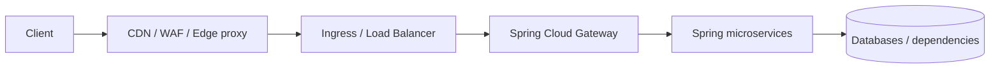
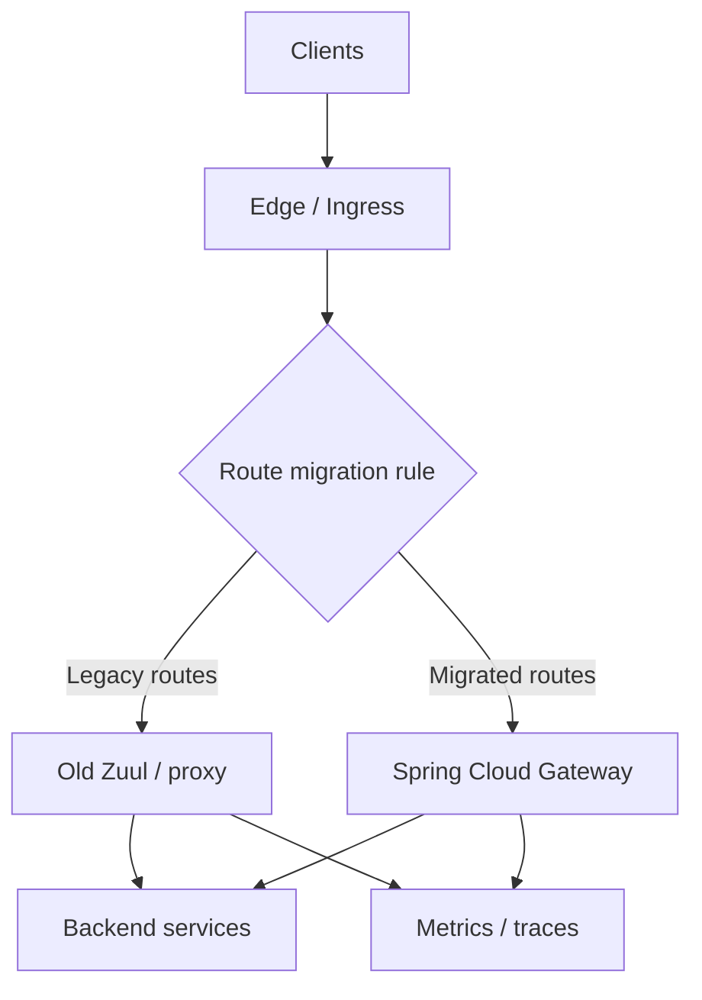

# Evaluating Migration from Zuul or Another Proxy to Gateway

Migrating from **Zuul or another reverse proxy to Spring Cloud Gateway** changes the request path, runtime, filter lifecycle, timeouts, security, and operations. A route that runs after changing YAML does not prove the migration is safe. You need to define **current behavior**, map feature equivalents, verify intentional differences, and shift traffic in stages with clear rollback criteria.

This article belongs to the **SPRING_CLOUD_GATEWAY** module: building an API Gateway with route predicates, filter chains, path/header rewriting, service discovery, authentication, rate limiting, circuit breakers, retries, TLS, and observability. The focus is evaluating migration from **Zuul** or other proxies, including replacing a legacy Java gateway and replacing part of the L7 routing of Nginx/Envoy/HAProxy.

Configuration examples primarily use **Spring Cloud Gateway Server WebFlux**. Gateway Server Web MVC is a separate runtime in supported release lines; do not assume WebFlux configs run automatically on MVC. Properties, filters, dependencies, and behaviors must be verified against the actual Spring Boot/Spring Cloud release train.

> **Migration principle:** Do not translate properties one by one mechanically. Migrate **the contracts and behaviors that must be preserved**, then design the corresponding implementation in Gateway. Differences must be documented, tested, and accepted before cutover.

## 1. When Should You Evaluate a Migration?

Valid reasons:

- The current gateway has reached end of support or is difficult to upgrade alongside the Spring/JDK platform.
- Direct route/filter integration with Spring Cloud, `DiscoveryClient`, and `LoadBalancer` is needed.
- You want to unify routing, token relay, rate limiting, circuit breakers, and observability for Spring microservices.
- Reactive I/O or streaming handling is needed under suitable workloads.
- You want to reduce proxy hops where the current architecture has overlapping components.
- Route and policy configurations need to be standardized under a version/release process.
- The system needs a gateway extensible via code/config following internal workflows.

Do not migrate just because a framework name is newer, based on a single-endpoint benchmark, or assuming reactive is automatically faster for every workload. Nor should Gateway be treated as a default replacement for a WAF, CDN, DDoS protection, or an edge load balancer.

**Migration is an architectural and operational decision**, not merely a dependency swap.

## 2. Identify the Exact Current Source

“Zuul” can refer to several different systems:

| Current source | Characteristics to identify | Migration risk |
| --- | --- | --- |
| Spring Cloud Netflix Zuul 1 | Spring integration, filter types, servlet-era lifecycle | Blocking model, Ribbon/Hystrix, and legacy config |
| Netflix Zuul 2 | Netty/async foundation, distinct architecture and APIs | Not a drop-in upgrade from Zuul 1 |
| Nginx | Reverse proxy, upstreams, buffering, headers, TLS, location matching | Different path, timeout, and streaming semantics |
| Envoy | L7 proxy, clusters, listeners, filters, xDS, telemetry | May have service-mesh/control-plane behavior outside Gateway |
| HAProxy | L4/L7 load balancing, ACLs, health checks, stickiness | Different representation of routes/filters and connection policies |
| Apache HTTP Server | Proxy modules, rewrites, auth, TLS | Different module/config semantics |
| Custom Spring MVC proxy | Servlet filters/interceptors/controller forwarding | May depend on custom-written behavior |
| Cloud API Gateway | Managed auth, quotas, WAF, private integrations | Application gateway does not automatically replace managed platform features |

**Do not assume from the word “Zuul” that the system runs Zuul 1.** Inspect actual dependencies, artifacts/versions, runtime, filter implementations, and configurations within the assigned project scope.

In particular, **Netflix Zuul 2 does not mean Spring Cloud Netflix Zuul integration automatically supports Zuul 2**. Verify the exact implementation/version and check their support lifecycle.

## 3. Evaluate the Whole Architecture Before Choosing the Target

Spring Cloud Gateway can act as the API gateway layer in a Spring application, but it does not automatically replace every edge proxy capability.



Before migrating, classify responsibilities:

- **Edge:** public IPs, public TLS, WAF, DDoS, geo/IP controls, CDN, bot protection.
- **Ingress/load balancer:** cluster entry, health checks, connection management.
- **API Gateway:** API routes, identity propagation, coarse-grained policy, rate limiting, resilience, API observability.
- **Service:** domain authorization, validation, business rules, data ownership.
- **Service mesh:** workload identity, mTLS, east-west policy, traffic management.
- **Platform:** DNS, service discovery, secrets, certificates, deployment, and scaling.

If Zuul currently handles IP filtering, TLS termination, response buffering, and internal service routing simultaneously, decide which functions move to Gateway and which stay at the edge/platform. **Do not drop a security control just because Gateway has route filters.**

## 4. Establish a Baseline Before Changing Anything

Measure the current state during a representative traffic window:

- Requests/s by route, method, and client class.
- p50/p95/p99 latency, separating upstream and gateway overhead where available.
- Status distribution 2xx/3xx/4xx/5xx.
- Connection counts, active/pending requests, keep-alive reuse.
- Payload sizes and ratio of large uploads/downloads.
- TLS handshake rate, certificate failures.
- Retry attempts, breaker state, fallback rate.
- Rate-limit allow/deny counts and Redis latency if used.
- AuthN/AuthZ outcomes.
- Cache hit/miss, body buffering.
- WebSocket/SSE sessions and lifetimes.
- Backend service selection, unhealthy instances.
- Gateway CPU/memory/GC, thread/event loop saturation.
- Logs/traces and telemetry cardinality/cost.

**Baselines must be per route and traffic class**, not just an aggregate number. A cached GET route behaves very differently from a payment POST or a long-lived WebSocket.

## 5. Inventory: What to Discover in the Legacy Gateway

Create a complete catalog before writing new configurations:

1. Static routes and dynamic routes.
2. Path, method, host, header, query, cookie, and time predicates.
3. Prefix, strip, rewrite, redirect, and URI normalization.
4. Route order/precedence and fallback routes.
5. Global/pre/post/error filters.
6. Header add/remove/rename, sensitive headers, forwarded headers.
7. Authentication, token relay, authorization, and identity context.
8. CORS, CSRF, cookies, and session behavior.
9. Service discovery, load balancing, sticky sessions.
10. Connect/read/response/idle/total timeouts.
11. Retry conditions, backoff, max attempts, idempotency.
12. Circuit breaker, bulkhead, fallback, and load shedding.
13. Rate limits, quota keys, Redis/global state.
14. Inbound/outbound TLS, mTLS, truststores, SNI.
15. Request/response body transformations and size limits.
16. Cache, compression, streaming, WebSocket/SSE.
17. Error response format, correlation IDs.
18. Metrics, tracing, access logs, and audit.
19. Actuator/admin routes and operational endpoints.
20. Deployment, scaling, health checks, graceful shutdown, and rollback.

Each inventory row should have **owner, traffic, security class, source behavior, target behavior, test evidence, and migration status**. Do not let a sensitive route slip through because it is generated dynamically or embedded in filter code.

## 6. Build a Testable Route Catalog

Example catalog structure (documentation template, not a standard Spring schema):

```yaml
routes:
  - id: orders-read
    sourcePath: /api/orders/**
    targetService: order-service
    targetPath: /orders/**
    methods: [GET]
    auth: oauth2-jwt
    requiredScopes: [orders.read]
    rateLimit: per-user
    timeoutProfile: interactive-read
    retryProfile: safe-get
    cache: disabled
    owner: commerce-team
    migrationStatus: not-started

  - id: payments-create
    sourcePath: /api/payments/**
    targetService: payment-service
    targetPath: /payments/**
    methods: [POST]
    auth: oauth2-jwt
    requiredScopes: [payments.write]
    rateLimit: per-tenant
    timeoutProfile: payment-write
    retryProfile: none-unless-idempotent
    cache: disabled
    owner: payments-team
    migrationStatus: not-started
```

The catalog must record both **behaviors to preserve** and **approved exceptions**. Do not miss a sensitive route just because it lives inside a custom filter or remote route store.

## 7. Zuul 1 and Spring Cloud Gateway: Runtime Differences

A major difference is the execution model.

| Aspect | Typical legacy Spring Zuul 1 | Gateway Server WebFlux |
| --- | --- | --- |
| Runtime | Servlet/blocking-oriented | Reactive, Reactor/Netty |
| Request abstraction | Servlet request/response | `ServerWebExchange` |
| Filter model | Zuul filter types/lifecycle | `GlobalFilter`, `GatewayFilter`, `HttpHeadersFilter`, and WebFilter/Security chain |
| Async behavior | Depends on Hystrix/servlet async integration | Reactive pipeline and non-blocking I/O |
| Blocking dependencies | Can use blocking APIs under the servlet model | Blocking on the event loop can stall the process |
| HTTP client | Ribbon/Apache/OkHttp depending on config/version | Reactor Netty HTTP client commonly used, customizable |
| Service load balancing | Ribbon in many legacy systems | Spring Cloud LoadBalancer |
| Request/response mutation | Filters and servlet wrappers | Immutable request/response mutation via exchange |
| Backpressure/streaming | Stack-dependent | Reactive Streams semantics |

This compares common models; a specific Zuul setup might already use async extensions or custom transports.

### Do not move blocking code verbatim onto the event loop

In Gateway WebFlux:

- Do not call blocking JDBC/JPA directly inside a `GlobalFilter`.
- Do not use `Thread.sleep()` to introduce delays.
- Do not buffer the entire body in memory unnecessarily.
- Do not call a blocking HTTP client on the event loop.
- Do not hold locks or run long CPU-heavy encryption/serialization on the event loop.
- If a blocking API is unavoidable, design bounded scheduler isolation and test backpressure; preferably use an appropriate reactive/non-blocking client.

**Reactive does not mean every dependency magically becomes non-blocking.** A custom filter calling a synchronous database can affect many concurrent requests on the event loop.

## 8. Zuul 2 and Gateway WebFlux Are Not the Same API

Zuul 2 is a distinct implementation with its own Netty/async architecture and filter APIs. Migrating from Zuul 2 requires:

- Inventorying Zuul 2 filters and execution model.
- Identifying custom Netty handlers/connection lifecycle behavior.
- Checking streaming/body handling and connection reuse.
- Comparing TLS, routing, health checks, and metrics.
- Writing new adapters/filters against Gateway APIs.
- Re-benchmarking; do not assume Zuul 1 benchmark results apply to Zuul 2.

There is no guarantee that Zuul 1 or Zuul 2 filter code will compile or run after swapping dependencies to Spring Cloud Gateway.

## 9. Gateway WebFlux and Gateway Server Web MVC Are Two Different Choices

Server WebFlux runs the reactive stack. Server Web MVC (in supported lines) is based on the Servlet/MVC model and has different API/filter compatibility.

Choose based on your active runtime, blocking/non-blocking dependencies, streaming/WebSocket needs, filters/extensions, observability/HTTP client behavior, Spring Boot/Cloud compatibility, and team operational readiness.

Do not add both WebFlux and MVC starters simultaneously and let auto-configuration pick an unintended runtime. Lock down the variant and verify the application boots the right server.

## 10. Comparing Route Models: Zuul vs Gateway

Common Zuul 1 route configuration example:

```yaml
zuul:
  routes:
    orders:
      path: /api/orders/**
      serviceId: order-service
      stripPrefix: true
```

Conceptually corresponding Gateway route:

```yaml
spring:
  cloud:
    gateway:
      routes:
        - id: orders
          uri: lb://order-service
          predicates:
            - Path=/api/orders/**
          filters:
            - StripPrefix=1
```

This is **not a 1:1 translation**. Verify Zuul `stripPrefix` semantics, Gateway segment count, global prefix/ignored patterns, `serviceId` vs direct URL, route order/precedence, query strings, encoded paths, trailing slashes, and fallback behavior.

Test with concrete request/target URIs, not just by reading YAML.

## 11. Route Precedence and Overlapping Patterns

Two routes can match the same path:

```yaml
spring:
  cloud:
    gateway:
      routes:
        - id: admin-orders
          order: -10
          uri: lb://admin-service
          predicates:
            - Path=/api/orders/admin/**
        - id: general-orders
          order: 0
          uri: lb://order-service
          predicates:
            - Path=/api/orders/**
```

The example intentionally gives the specific route higher precedence. Verify order semantics in your active version and ensure broad routes never swallow sensitive routes.

Compare against the legacy proxy's matching order: longest prefix vs first match, regex specificity, explicit priority, how Host/Method predicates combine, whether dynamic refresh alters order, and whether fallback routes match too broadly.

## 12. Predicate Parity: Test Every Matching Dimension

| Legacy predicate | Typical Gateway equivalent | What must be verified |
| --- | --- | --- |
| Path prefix/glob | `Path` | Wildcards, encoded paths, trailing slash |
| HTTP method | `Method` | HEAD/OPTIONS and method overrides |
| Host | `Host` | Port, wildcards, forwarded host |
| Header | `Header` | Regex, casing, duplicate headers |
| Query parameter | `Query` | Missing/empty/multiple values |
| Cookie | `Cookie` | Cookie parsing, encoding |
| Time window | `Between`, `After`, `Before` | Timezone, boundaries, clock |
| Remote address | `RemoteAddr` | Trusted proxy chain, IPv4/IPv6 |
| Weight/canary | `Weight` | Group semantics, distribution |
| Custom predicate | Custom `RoutePredicateFactory` | Side effects, order, performance |

**Do not use `RemoteAddr` as identity.** Behind an Ingress/proxy, the direct remote address may be the proxy IP. Proper trusted-proxy policies are needed, and arbitrary client forwarded headers must never be trusted.

## 13. Path Rewriting: Prove the Upstream URI with Tests

Example:

```yaml
spring:
  cloud:
    gateway:
      routes:
        - id: catalog-v2
          uri: lb://catalog-service
          predicates:
            - Path=/public/catalog/**
          filters:
            - RewritePath=/public/catalog/(?<segment>.*), /v2/catalog/$\{segment}
```

Target:

```text
Incoming: /public/catalog/items/42
Upstream: /v2/catalog/items/42
```

Regex replacement syntax may require escaping in YAML. The example illustrates the concept; verify against your exact parser and Gateway version via integration tests.

Compared with the legacy proxy, test root paths, multi-segment paths, query strings, URL-encoded characters, trailing slashes, double slashes, matrix/path parameters if any, case sensitivity, and malformed URIs.

Do not assume `StripPrefix`, `RewritePath`, Nginx rewrites, Zuul `stripPrefix`, and Envoy prefix rewrites share identical semantics.

## 14. Header Behavior: A Common Source of Regressions

Build a header table:

| Group | Examples | What to verify |
| --- | --- | --- |
| Auth | `Authorization`, `Cookie` | Relay/strip, audience, leakage |
| Forwarded | `Forwarded`, `X-Forwarded-*` | Trusted proxies, scheme, host, client IP |
| Identity | `X-User-Id`, `X-Tenant-Id` | Strip spoofed input, verified source |
| Correlation | `X-Request-Id`, trace context | Validate/propagate, duplicate behavior |
| Hop-by-hop | `Connection`, `Keep-Alive`, `Transfer-Encoding` | HTTP proxy semantics |
| Security response | `Strict-Transport-Security`, `CSP` | Edge/backend ownership, duplicate policy |
| CORS | `Origin`, `Access-Control-*` | Single owner, preflight behavior |
| Cookies | `Set-Cookie`, `SameSite`, `Secure` | Domain/path rewriting, browser behavior |

Zuul configures sensitive headers per route/globally in some versions. Gateway has filters to add/remove/set headers and dedicated header filter mechanisms. **Do not assume default sensitive-header behavior is identical.**

### Test header forwarding

For each route, capture requests at the backend test stub and assert that `Authorization` is relayed or stripped per policy, `Cookie` is not forwarded unnecessarily, clients cannot spoof identity headers, forwarded headers come from trusted proxy chains, upstream `Host`/port/scheme are accurate, correlation IDs are normalized, hop-by-hop headers are handled properly, and response security headers are not duplicated.

## 15. Authentication and TokenRelay

If legacy Zuul had a pre-filter validating JWTs and adding `X-User-Id`, moving to Gateway requires separating:

1. **Authentication:** Gateway/backend verifies the token using the right issuer/key/audience.
2. **Authorization:** Gateway coarse route scopes and backend resource/domain authorization.
3. **Identity propagation:** Token relay or signed assertion with provenance.
4. **Header hygiene:** Remove untrusted client identity headers.

Gateway OAuth2 `TokenRelay` can forward access tokens downstream when OAuth2 client/security config is set up properly. It **does not automatically rewrite audience**, mint new scopes, or replace a backend Resource Server.

If the old token targeted only the gateway and the backend requires `aud=orders-api`, you need token exchange/on-behalf-of or a formal token issuance design. Do not tamper with JWT payloads or disable audience validation just to make migration tests pass.

### Security parity matrix

| Legacy control | Target requirement | Evidence |
| --- | --- | --- |
| JWT signature | Approved key/algorithm | Invalid signature test rejected |
| Issuer | Exact trusted issuer | Wrong issuer test 401 |
| Audience | Intended backend resource | Wrong audience test 401 |
| Exp/nbf | Time validation | Expired/not-yet-valid test |
| Scope/role | Least privilege | Missing scope 403 |
| Tenant/owner | Resource authorization at service | Cross-tenant test denied |
| Header spoofing | Backend does not trust raw headers | Bob's token + Alice's header still denied |
| Service identity | Dedicated workload auth | Service token holds only operational scopes |

## 16. CORS and Preflight

If the legacy proxy handled CORS, define the post-migration owner: Edge/Ingress, Gateway, backend, or shared library.

Avoid enabling CORS at multiple layers with differing `Access-Control-Allow-Origin` values. Browsers may reject responses containing duplicate/conflicting headers.

Test allowed/disallowed origins, credentials, methods/headers, `OPTIONS` preflight, `Authorization` headers, 401/403/429/5xx error responses, cookie attributes, and route rewrites.

**CORS is not authentication**; `curl` and service-to-service clients are not constrained by browser same-origin policy.

## 17. Service Discovery: Ribbon to Spring Cloud LoadBalancer

In many legacy Spring Cloud systems, Zuul used Ribbon to pick instances; newer architectures typically use **Spring Cloud LoadBalancer**.

Gateway routes using a service ID:

```yaml
spring:
  cloud:
    gateway:
      routes:
        - id: orders
          uri: lb://order-service
          predicates:
            - Path=/api/orders/**
          filters:
            - StripPrefix=1
```

Check `DiscoveryClient` registration, service IDs, host/port/scheme, health/readiness, zone preference, sticky sessions, retry instance selection, TLS metadata, cache refresh, and no-instance behavior.

Do not swap Ribbon for LoadBalancer and assume all rules/zone/health filters are preserved. Create test instance lists and verify distribution.

## 18. Direct URI and `lb://` Are Not Equivalent

A legacy route may point to a direct URL:

```yaml
zuul:
  routes:
    legacy-report:
      path: /reports/**
      url: https://reports.internal.example.invalid
```

Conceptually corresponding Gateway route:

```yaml
spring:
  cloud:
    gateway:
      routes:
        - id: legacy-report
          uri: https://reports.internal.example.invalid
          predicates:
            - Path=/reports/**
```

If you change it to `lb://reports-service`, the system changes its destination selection mechanism. Check DNS, TLS SNI/hostname, health, load balancing, connection pooling, and failover. **Do not switch a direct URL to `lb://` until discovery has reliable service registration.**

## 19. Retry Semantics During Migration

A legacy proxy may retry in Ribbon, Hystrix, custom filters, or HTTP clients. Inventory **every retry layer**, because multi-layer retries multiply attempt counts.

```text
Client retry: 2 attempts
Gateway retry: 2 attempts
Service client retry: 3 attempts

Worst-case upstream attempts can multiply several-fold,
depending on how retry layers nest and where failures occur.
```

The target policy must specify the retry owner, total max attempts, eligible statuses/exceptions, HTTP methods and idempotency, backoff/jitter, total deadline, retry budget, and metrics for logical requests vs upstream attempts.

Gateway's Retry filter can restrict methods/statuses/exceptions and backoff by version. Test in practice; do not copy `retryable=true` from an old route without knowing its trigger conditions.

## 20. Circuit Breaker: Hystrix to Spring Cloud CircuitBreaker

A Zuul 1 system may use Hystrix isolation, timeouts, fallbacks, and circuit breakers. Gateway typically integrates with Spring Cloud CircuitBreaker using an appropriate implementation, such as Resilience4j if that dependency is chosen.

| Legacy behavior | What to decide at target |
| --- | --- |
| Circuit open threshold | Failure rate/slow call threshold |
| Sliding window | Count/time-based window |
| Minimum calls | Sample count before deciding |
| Open duration | Wait duration and half-open probes |
| Thread isolation | Bulkhead/thread pool vs semaphore |
| Timeout | Operation timeout and total deadline |
| Fallback | Status/body/cache/degraded contract |
| Metrics | State, calls, failures, slow calls |
| Exception ignore | Exceptions excluded from failures |

**Thread isolation is not automatically equivalent to reactive semaphore isolation.** If Hystrix previously isolated blocking calls with thread pools, redesign concurrency/bulkheads on the reactive stack.

Fallbacks must preserve API contracts. Do not return a fake `200` success when data was not retrieved; clients need to know what a degraded response looks like.

## 21. Timeout Mapping from Zuul/Legacy Proxy

Locate all current timeout settings:

- Client connect/read/total deadlines.
- Edge/Ingress upstream connect/read/idle.
- Zuul host connect/socket timeouts or HTTP client timeouts.
- Ribbon connect/read timeouts.
- Hystrix command timeouts.
- Backend server request/connection timeouts.
- DB pool acquire/query timeouts.
- External API timeouts.
- Streaming idle timeouts.

Gateway WebFlux has distinct timeouts: HTTP client connect timeout, response/read timeout, connection pool acquire timeout, per-route timeout metadata (if supported by the version), TLS handshake behavior, and outer Ingress/client deadlines.

**Do not map a legacy socket timeout directly to response timeout without checking semantics.** Some legacy settings bounded socket inactivity; newer settings may apply to a different phase.

### HTTP client configuration example

Some Gateway WebFlux lines support configuration like:

```yaml
spring:
  cloud:
    gateway:
      httpclient:
        connect-timeout: 500
        response-timeout: 2s
        pool:
          type: fixed
          max-connections: 300
          acquire-timeout: 1000
```

This is a **sample whose property prefix and units must be verified per version**. Newer lines may use variant-specific prefixes like `spring.cloud.gateway.server.webflux.httpclient`. `response-timeout` is not a default total deadline for every body stream; pool acquire and connect are separate phases.

Do not raise `max-connections` merely upon seeing `504` errors. If the backend/DB is already saturated, increasing concurrency can worsen failures.

## 22. Rate Limiting and Quota Parity

If the legacy system rate-limited by IP/API key/user/tenant, specify the key resolver source and identity trust, refill rate/burst, scope per route/user/tenant/global, shared Redis vs local state, behavior when Redis is down, response status/body/headers, missing-key policy, admin overrides, and metrics.

Gateway `RequestRateLimiter`/`RedisRateLimiter` can serve as the target, but check bucket semantics, Redis key format, route IDs, and `KeyResolver`. **Two different route IDs can create separate quota buckets** if key construction includes the route ID; preserve or deliberately adjust the policy.

A local limiter on each Gateway pod can multiply quotas by the number of replicas. If cluster-wide quotas are required, use shared state or a service policy with equivalent semantics.

## 23. Inbound and Outbound TLS

Separate the two hops:

```text
Client -- HTTPS --> Edge / Gateway -- HTTPS or mTLS --> backend
```

Inventory certificate owners/issuers/renewals, TLS termination points, minimum TLS versions/ciphers, SNI/host routing, truststores/CA bundles, backend SAN/hostname verification, client certificate requirements, mTLS workload identity, secret rotation/reload, HTTP→HTTPS redirects, and forwarded proto.

Gateway inbound TLS does not replace an edge WAF or public certificate automation. Outbound TLS must continue verifying backend identity. Never disable certificate verification to make migration tests pass.

### TLS parity tests

- Valid certificate matching hostname.
- Expired certificate.
- SAN/hostname mismatch.
- Unknown CA/missing intermediate.
- Missing/invalid client cert when mTLS is required.
- Certificate rotation while pods are running.
- Backend service discovery returning a different hostname.
- TLS handshake latency and connection reuse.

## 24. Request/Response Body Transformations

A legacy proxy may rewrite JSON bodies, add/remove fields, compress/decompress, buffer requests/responses, enforce body sizes, transform multipart uploads, mask sensitive fields, sign requests/responses, or support streaming.

In Gateway WebFlux, bodies are reactive streams/`DataBuffer`. Body transformations must manage **buffer lifecycle, memory limits, cancellation, and backpressure**. Do not port logic reading `ServletInputStream`/`HttpServletResponse` to `DataBuffer` merely by renaming classes.

If you only need to modify headers or paths, do not aggregate the entire body. For body rewrites, test empty/large bodies, chunked transfer, malformed JSON/encoding, content-length, cancellation, `DataBuffer` leaks, and p95/CPU/direct memory.

## 25. Compression, Buffering, and Streaming

Nginx/Envoy may buffer requests/responses depending on config; Gateway/the reactive stack behaves differently. Compare response buffering, backpressure when clients read slowly, chunked transfer, HTTP/2 flow control, gzip/Brotli at the right hop, large downloads, SSE/WebSocket, request body replay on retry, and maximum in-memory body size.

**Buffering differs from streaming.** If the legacy proxy buffered the entire response before sending, the client might not receive the first byte until the backend completed. If the target streams immediately, TTFB and mid-stream failures will differ. This may be an intentional API behavior change that needs explicit sign-off.

## 26. WebSocket and SSE

If the legacy gateway routed WebSockets:

- Confirm Gateway version and transport support WebSocket.
- Test `ws://` and `wss://` scheme mapping.
- Preserve `Upgrade`/`Connection` semantics across the proxy chain.
- Authenticate the handshake and authorize per channel/message.
- Idle timeouts and max session lifetimes.
- Sticky sessions if the backend holds state.
- Scale-in/drain/reconnect behavior.
- Connection counts and per-pod distribution.

For SSE, test flushing/chunking, Ingress buffering, idle timeouts, and client reconnects. Do not apply the same short timeout to long-lived streams and REST requests.

## 27. Caching: Response Parity and Isolation

The legacy proxy may cache at Nginx/Envoy/CDN or in a custom Zuul filter. If migrating caching, verify cache key dimensions, Authorization/cookie/tenant isolation, public/private classification, `Cache-Control`/`Vary`/`ETag`, TTL/stale-while-revalidate, post-write invalidation, error caching, local vs shared cache, warm-up/cold-start, and hit/miss metrics.

Gateway `LocalResponseCache` (where supported and configured) is not automatically equivalent to a CDN/shared cache. Caching private responses can cause cross-user/tenant leaks. Test the same URL with two different principals and disable shared caching for sensitive data until isolation is proven.

## 28. Observability Parity

| Legacy signal | What target must have |
| --- | --- |
| Access logs | Structured request logs by route/status/duration |
| Correlation ID | Propagate/validate request ID |
| Distributed trace | Ingress → Gateway → backend → dependency |
| Route metrics | RPS, status, latency per route |
| Upstream metrics | Selected instance, connect/read errors |
| Retry metrics | Logical requests vs attempts |
| Breaker metrics | State, open/half-open/fallback |
| Rate limiter metrics | Allowed/denied, Redis latency/errors |
| TLS metrics | Handshake failures/cert expiry |
| Audit | Security/privileged action outcomes |
| Health checks | Liveness/readiness/startup |

Do not carry all legacy labels straight into Prometheus mechanically. Raw paths, user IDs, tenant IDs, request IDs, and tokens can cause cardinality explosions or leak sensitive data. Use low-cardinality route ID/operation/reason category labels.

Gateway can expose actuator endpoints to inspect health/metrics/route info depending on version/config. Secure the management port and routes endpoint; never expose route definitions, service topology, or environment details publicly to clients.

## 29. Error Handling and Response Contract

The legacy gateway might standardize errors as JSON:

```json
{
  "code": "UPSTREAM_UNAVAILABLE",
  "message": "Service is currently unavailable",
  "requestId": "synthetic-request-id"
}
```

The target must verify whether status codes stay the same or are mapped, whether error schemas/codes stay compatible with clients, whether `WWW-Authenticate` and `Retry-After` are preserved, whether CORS/security headers appear on errors, whether backend bodies leak stack traces/internal hosts, whether Gateway timeouts/no-instance/breaker-open/rate-limit are distinguished, whether fallbacks return degraded data or errors only, and whether response headers are duplicated/stripped.

Never map all upstream failures to a generic `200`/`500`. Clients and monitoring need accurate `401`/`403`/`404`/`429`/`502`/`503`/`504` responses per contract.

## 30. Filter Lifecycle: Zuul Pre/Route/Post/Error to Gateway Chain

Zuul 1 typically organizes filters into types like **pre**, **route**, **post**, and **error**. Gateway uses a filter chain made of route-specific `GatewayFilter`, `GlobalFilter`, and related web filters; filter ordering and the reactive lifecycle have different semantics.

| Need in Zuul | Gateway approach | Notes |
| --- | --- | --- |
| Pre-auth/filter | Spring Security or appropriate `GlobalFilter` | AuthN belongs in the security chain |
| Route selection | Route predicates | Do not cram all logic into filters |
| Before proxy | Ordered `GatewayFilter`/`GlobalFilter` | Verify ordering |
| After upstream response | `chain.filter(exchange).then(...)` or reactive operators | Response may already be committed |
| Error filter | Reactive error handling/fallback/exception handler | Do not assume all exceptions follow one path |
| Header filter | Request/response mutation, `HttpHeadersFilter` | Proxy header semantics |
| Shared behavior | `GlobalFilter` | Applies across routes; can create coupling |
| Route-specific behavior | `GatewayFilterFactory` | Reusable per-route configuration |

### Reactive ordering to test

- `GlobalFilter` and `GatewayFilter` are combined and sorted by order.
- A filter running before `chain.filter` can modify the request.
- A filter using `then`/`doOnSuccess` runs after the chain per lifecycle.
- Error/cancel paths differ from normal completion.
- The response may already be committed; status/body cannot be modified arbitrarily post-commit.
- `Ordered` values must be chosen explicitly and tested.

Do not translate “pre filter” into `GlobalFilter` and assume Zuul's ordering.

## 31. Example Custom GlobalFilter After Migration

Example adding a validated correlation ID:

```java
@Component
public class CorrelationIdGlobalFilter implements GlobalFilter, Ordered {

    private static final Pattern SAFE_ID =
        Pattern.compile("[A-Za-z0-9._-]{1,80}");

    @Override
    public int getOrder() {
        return Ordered.HIGHEST_PRECEDENCE + 20;
    }

    @Override
    public Mono<Void> filter(
            ServerWebExchange exchange,
            GatewayFilterChain chain) {

        String supplied = exchange.getRequest()
            .getHeaders()
            .getFirst("X-Request-Id");

        String requestId = supplied != null
                && SAFE_ID.matcher(supplied).matches()
            ? supplied
            : UUID.randomUUID().toString();

        ServerHttpRequest request = exchange.getRequest()
            .mutate()
            .headers(headers -> headers.set("X-Request-Id", requestId))
            .build();

        ServerWebExchange updated = exchange.mutate()
            .request(request)
            .build();

        return chain.filter(updated);
    }
}
```

This is an illustrative example; add imports, bean scanning, and order tests. In production, trace context should follow your chosen propagation standard; a client-supplied request ID is only correlation metadata, **not identity or a security credential**. Never create high-cardinality metric tags from this ID.

### When to use `GatewayFilterFactory`?

Use a route-specific factory when behavior needs per-route configuration, such as adding response headers or policy metadata. Use `GlobalFilter` for logic that truly applies Gateway-wide. Use Spring Security for authentication/authorization; do not write a custom JWT parser inside a filter to replace the security framework.

## 32. Error Filters and Exception Mapping

During migration, build a mapping table from legacy exceptions to target contracts:

| Error | Contract to decide |
| --- | --- |
| No route | `404` |
| No service instance | `503` |
| Connection refused | `502`/`503` per API policy |
| TLS validation failure | Fail closed; public status may be generic `502`/`503` |
| Upstream response timeout | `504` |
| Pool acquire timeout | `503`/`504` depending on semantics/contract |
| Circuit breaker open | `503` or degraded fallback |
| Rate limit | `429` |
| Authentication failure | `401` |
| Authorization failure | `403`/`404` per resource disclosure policy |
| Client cancellation | Log/metric, typically no new response generated |

You do not need to expose exception classes or internal hosts publicly. However, internal logs must distinguish `PoolAcquireTimeout` from `ResponseTimeout`, TLS failures, and backend response statuses.

## 33. Deployment and Runtime Parity

Legacy Zuul may run inside the same servlet application alongside other controllers. Gateway WebFlux is typically a dedicated reactive application/runtime.

Check JDK and Spring Boot versions, Spring Cloud release train, Gateway starter variant, Netty/Servlet dependencies, JVM heap/direct memory, CPU/memory requests/limits, thread pools/event loops, startup/readiness/liveness probes, graceful shutdown/termination grace, HPA/node capacity, secrets/ConfigMaps/certificates, NetworkPolicy/Service/Ingress, and management port.

**Do not pair random Spring Boot and Spring Cloud versions.** Choose a supported release train for the Boot version, use the matching BOM, and verify dependency convergence.

## 34. Dependency Verification and Version Alignment

Before building:

1. Record Spring Boot, Spring Cloud release train, and Gateway artifact versions.
2. Verify the starter matches WebFlux or MVC.
3. Use the Spring Cloud BOM instead of arbitrarily pinning individual dependencies.
4. Check Java/JDK compatibility.
5. Check Reactor Netty and Netty versions.
6. Check Spring Security/OAuth2 Resource Server/Client versions.
7. Check Spring Cloud LoadBalancer/discovery client.
8. Check CircuitBreaker implementation and Micrometer binder.
9. Remove legacy Zuul/Ribbon/Hystrix dependencies once unused.
10. Verify transitive dependencies do not pull in an unintended Servlet runtime.
11. Run dependency tree/SBOM/security scans in the pipeline.
12. Build and integration-test with the exact artifact image to be deployed.

Do not delete legacy dependencies before verifying which code or filters still reference them. At the same time, do not keep two proxy runtimes in the same app if they cause auto-configuration conflicts or expand the operational surface.

## 35. Security Parity: Never Lower Standards at Cutover

| Control | Migration question |
| --- | --- |
| Inbound TLS | Who terminates TLS, which certs, how are they renewed? |
| Outbound TLS | Does Gateway verify backend certificates/SNI? |
| mTLS | Are workload identity and trust domain preserved? |
| JWT | Are issuer/audience/signature/exp/nbf verified? |
| OAuth2 | Are TokenRelay/exchange and scopes accurate? |
| Backend AuthZ | Does the service verify tenant/resource ownership itself? |
| Header trust | Are spoofed identity/forwarded headers stripped/verified? |
| CORS | Is there one clear owner? |
| Rate limiting | Do key/tenant quotas use shared state? |
| Actuator | Are management endpoints non-public? |
| Secrets | Are tokens/client secrets/truststores rotated? |
| Audit | Are privileged actions and denials logged safely? |

Coarse Gateway policies do not replace backend authorization. A migration must never turn an API that previously enforced JWT validation and backend ownership into one that blindly trusts an `X-User-Id` header.

## 36. Performance: Benchmark the Real Traffic Mix

Do not benchmark a single tiny GET endpoint and draw conclusions. Split workloads: small JSON GET, authenticated GET with JWT/JWK cache, Redis rate-limited route, POST with body, large response/download, body transformation, cache hit/miss, slow backend/DB wait, WebSocket/SSE, full TLS handshake vs keep-alive reuse, retry/breaker/fallback, burst and sustained load.

Measure offered/admitted/completed RPS, p50/p95/p99 TTFB and total latency, 4xx/5xx/timeouts, CPU/throttling, heap/direct memory/GC, active/pending connections, event-loop pending/blocked threads, backend/Redis/DB saturation, TLS handshake rate, retry amplification, and resource cost per 1k requests.

Use the same load generator, dataset, network path, TLS mode, cache warmup, auth mix, and backend capacity. Monitor both Gateway overhead and downstream; a target might be faster at Gateway while opening more connections on the backend.

## 37. Monitor the Reactive Event Loop

With WebFlux, one blocking filter can slow down many requests simultaneously.

Symptoms:

- CPU may be low while event-loop lag climbs.
- p99 spikes across multiple routes on the same pod.
- Thread dumps show event-loop threads waiting on blocking calls.
- `.block()` or synchronous clients appear in custom filters.
- DB/JDBC calls run directly on the event loop.

If legacy Zuul code called a blocking service in a pre-filter, do not copy it straight into a Gateway `GlobalFilter`. Port the logic to a reactive client, or isolate blocking work on a properly bounded scheduler and load-test concurrency limits.

## 38. Load Balancing and Connection Reuse

Compare distribution across backend instances, zone/region awareness, sticky sessions, connection pools per destination, HTTP/2 vs HTTP/1.1, max idle/lifetime, DNS caching, retry instance selection, backend draining, and health check semantics.

If the legacy proxy used cookie stickiness or consistent hashing, a simple `lb://` route may not preserve session affinity. If session state lives locally on backends, this regression can cause logouts or requests landing on instances missing state.

Prefer external/shared session state and stateless design where possible; if affinity is still required, document the mechanism clearly and test scaling/rollouts.

## 39. Migration Strategy: Strangler Pattern by Route

One way to reduce risk is migrating route by route or API group by group:



Benefits: limits blast radius, compares identical routes/traffic classes, rolls back a single route faster than the whole platform, and catches behavior mismatches before moving everything.

However, avoid having two gateways apply inconsistent policies or cause double rate limiting/token relay. Route ownership and precedence at the edge must be unambiguous.

## 40. Shadow Traffic: Use Only Safe Request Types

Shadow traffic can send copies of requests to the new Gateway to compare latency/route decisions, but **never send writes with side effects twice**.

Shadow only safe GET/HEAD requests, synthetic requests, test data, requests scrubbed of PII/secrets, and shadow/read-only backend environments. If POST shadowing is needed, a dedicated backend idempotency/dry-run mechanism must be designed; never just mirror raw HTTP requests.

Compare route matches, upstream URIs/methods, normalized headers, auth decisions, response statuses/schemas on test data, latency and selected instances, and log/trace completeness. Do not log full production response bodies for diffing if they contain PII.

## 41. Canary Cutover

Canary can start with a small slice of traffic:

1. Pick low-risk or GET/read-only routes.
2. Pick a stable traffic slice, avoiding a single sensitive tenant.
3. Keep enough backend capacity for combined traffic from both gateways.
4. Verify shared Redis quotas are not split.
5. Monitor statuses/latency by gateway version and route.
6. Expand in pre-defined steps.
7. Halt rollout if any security/correctness/SLO guardrail is breached.
8. After stabilization, migrate writes/privileged routes under a separate plan.

**Do not use pod count or traffic percentage as the sole metric.** Sticky sessions and long-lived connections distort linear traffic distribution.

## 42. Never Trigger Double Writes During Dual-Run

If both the old and new gateway forward a payment/refund/order creation POST to the backend, side effects may execute twice. A single client request does not mean a single backend execution when two proxies both route it.

Options:

- Route each request through only one gateway at a time.
- Shadow to a read-only/mock backend.
- Enforce backend idempotency keys at the transaction boundary.
- Use a non-mutating dry-run endpoint.
- Build dedicated dual-write orchestration and reconciliation rather than letting proxy mirroring trigger it accidentally.

**Never canary by sending write requests simultaneously to two gateways** unless the backend is explicitly built to prevent duplicates.

## 43. Cutover Checklist

Before cutover:

- [ ] Route catalog is complete and has owners.
- [ ] Every route has documented source/target behavior.
- [ ] Predicate/precedence/rewrite tests pass.
- [ ] Header/sensitive header/forwarded header tests pass.
- [ ] JWT issuer/audience/scope and backend AuthZ pass.
- [ ] CORS/preflight/cookie behavior passes.
- [ ] Discovery/LoadBalancer/instance health pass.
- [ ] Inbound/outbound/mTLS tests pass.
- [ ] Timeout/deadline chain is measured.
- [ ] Retry/breaker/fallback contracts pass.
- [ ] Rate-limit shared quotas pass.
- [ ] Body/streaming/WebSocket/SSE tests pass if used.
- [ ] Error response contracts are compatible.
- [ ] Metrics/logs/traces/alerts are ready.
- [ ] Load/performance tests meet SLOs.
- [ ] HPA/resources/probes/graceful shutdown are verified.
- [ ] Runbook/on-call/owner are clear.
- [ ] Route/proxy config rollback has been rehearsed.
- [ ] Zero double-write/shadow side effects exist.
- [ ] DNS/Ingress/edge TTL and route propagation are understood.
- [ ] Security review signed off on behavioral changes.

## 44. The Rollback Plan Must Actually Work

Rollback is not just “redeploy Zuul”. Answer:

- How fast can the edge switch routes back to the old proxy?
- Are old routes/configs still stored and compatible with backends?
- Did Gateway create new state in Redis/caches?
- Did token audience/issuer contracts change such that the old proxy can no longer call backends?
- Were any irreversible header/path/schema changes made?
- Were DB writes created that cannot be replayed/reconciled?
- Which gateway holds long-lived WebSocket sessions?
- How do DNS/connection draining affect switchback time?
- Are the old proxy's certificates/truststores still valid?
- Is observability still sufficient to confirm rollback succeeded?

Keep the old gateway ready throughout the agreed rollback window. Do not delete legacy dependencies/configs/secrets/routes right after the first canary.

## 45. Migration Does Not Have to Be “Big Bang”

A practical sequence:

```text
Phase 0: Inventory and baseline
Phase 1: Gateway skeleton + non-production routes
Phase 2: Read-only low-risk routes
Phase 3: Authenticated reads + discovery/rate limits
Phase 4: Writes with idempotency and business validation
Phase 5: Streaming/WebSocket and special routes
Phase 6: Gradual canary
Phase 7: Full cutover + observation window
Phase 8: Decommission legacy proxy after rollback window
```

Each phase has entry criteria, exit criteria, an owner, and a rollback path. You can group phases by domain team/service rather than solely by URL prefix.

## 46. Mapping Matrix: Complete Example

| Concern | Legacy Zuul/proxy | Gateway target | Mandatory test |
| --- | --- | --- | --- |
| Route | `path`, `serviceId` | `Path`, `lb://` | URI/backend mapping |
| Strip prefix | `stripPrefix`/rewrite | `StripPrefix`/`RewritePath` | Segment/query/encoded paths |
| Header | Sensitive/forward headers | Set/Add/Remove/Header filters | Capture at backend |
| Pre-filter | Zuul pre | Security/`GlobalFilter` | Order and rejection |
| Post-filter | Zuul post | Reactive post-chain | Committed response/error |
| Discovery | Ribbon/Eureka/custom | Spring Cloud LoadBalancer | No instance/stale instance |
| Auth | Custom JWT filter | Resource Server/OAuth2 | Signed JWT, aud, scope |
| Token relay | Custom forwarding | `TokenRelay`/exchange | Correct downstream audience |
| Rate limit | Custom/Redis | `RequestRateLimiter`/Redis | Shared quota |
| Retry | Ribbon/Hystrix/custom | Retry filter/client policy | Attempts/deadline/idempotency |
| Circuit breaker | Hystrix | Spring Cloud CircuitBreaker | State/fallback |
| Timeout | Socket/Hystrix/Ribbon | Connect/response/pool/route | Fault per phase |
| TLS | Proxy/servlet config | Gateway SSL/client trust | SAN/SNI/rotation |
| CORS | Proxy/filter | Gateway/Security | Preflight/errors |
| Body | Servlet wrapper/buffer | `DataBuffer`/reactive | Large body/cancel/leak |
| WebSocket | Proxy upgrade | Gateway WebSocket routing | Upgrade/idle/drain |
| Cache | CDN/proxy/custom | Edge or Gateway cache | Tenant isolation |
| Metrics | Zuul metrics/custom | Micrometer/Actuator | Series/labels |
| Trace | Sleuth/custom | Micrometer Tracing/OTel | Context propagation |
| Admin | Legacy endpoints | Protected Actuator | Network/auth |
| Scale | Servlet threads/pods | Reactive resources/HPA | Load + scale-in |

This matrix is a review template. Fill in the concrete legacy implementation and target version in every cell for a real project.

## 47. Behavior-Based Migration Test Matrix

| ID | Scenario | Criterion |
| --- | --- | --- |
| M01 | Basic path route | Correct service and target URI |
| M02 | Overlapping routes | Precedence unchanged unexpectedly |
| M03 | Method/host/header/query predicates | Accurate match |
| M04 | `StripPrefix`/`RewritePath` | Correct path/query |
| M05 | Encoded/trailing/double slash | Clear contract |
| M06 | Header forwarding | No loss/duplication/wrong trust |
| M07 | Sensitive Authorization/Cookie | No leakage |
| M08 | JWT invalid issuer/signature/aud | Denied |
| M09 | Missing scope/wrong tenant | Backend denies |
| M10 | TokenRelay/token exchange | Accurate downstream audience |
| M11 | CORS preflight | Compatible browser behavior |
| M12 | Service discovery no instance | Accurate status/fallback |
| M13 | Unhealthy instance | No misrouting/infinite retries |
| M14 | Load balancing distribution | Meets policy/affinity |
| M15 | TCP connect timeout | Accurate phase/status/logs |
| M16 | TLS hostname mismatch | Fails closed |
| M17 | Backend response timeout | Accurate deadline/source |
| M18 | Ingress timeout | Accurate status producer |
| M19 | Pool saturation | Pending/acquire bounded |
| M20 | Retry GET 503 | Bounded attempts/backoff |
| M21 | Retry POST | No duplicate writes |
| M22 | CircuitBreaker OPEN | Fallback contract |
| M23 | Redis rate limit | Quota does not multiply by pods |
| M24 | Redis unavailable | Accurate fail policy |
| M25 | Large request body | Size/memory/backpressure |
| M26 | Large response stream | TTFB/chunking/cleanup |
| M27 | WebSocket/SSE | Upgrade/idle/reconnect |
| M28 | Cache private response | No cross-user/tenant leak |
| M29 | Response error schema | Accurate API contract |
| M30 | Request ID/trace propagation | Correlation across hops |
| M31 | Actuator/admin | Not public outside policy |
| M32 | HPA scale-out | Pods Ready and serving traffic |
| M33 | HPA scale-in | Graceful drain, no out-of-budget resets |
| M34 | Canary traffic split | No skewed quotas/state |
| M35 | Rollback | Routes revert to old proxy |
| M36 | Representative load test | Meets SLOs/cost |
| M37 | Route config refresh | No lost/duplicated routes |
| M38 | Certificate rotation | Zero outage |
| M39 | Backend rollout | Clean stale connections/draining |
| M40 | Observability sampling | Error traces/logs sufficient for investigation |

Do not run fault injection indiscriminately in production. Tests for TLS mismatch, no endpoints, backend resets, Redis outages, and overload require a test environment with stop conditions.

## 48. Go/No-Go Criteria

**Go** when functional route behavior is compatible or deviations are accepted, security tests have zero regressions, latency/error rates stay within SLOs under representative traffic, backends/Redis/DB receive no extra load beyond budget, retry/fallback do not alter write semantics, observability pinpoints failing hops, deployment/scaling/draining/rollback are rehearsed, and owners/on-call are ready.

**No-go** when uninventoried routes/filters remain, token audience/security policies are unverified, quotas split or scale with Gateway replicas, backends receive spoofed identity headers, TLS verification is disabled, 5xx/p99 breach guardrails, write duplication is not ruled out, streaming/WebSocket disconnects exceed SLOs, rollback depends on deleted configs/secrets, or Actuator/routes are exposed beyond policy.

Time-boxed deviations may be approved, but they require an owner, risk acceptance, compensating controls, and an expiry date.

## 49. Common Migration Pitfalls

| Symptom | Common cause | How to check |
| --- | --- | --- |
| Route returns 404 after cutover | Different strip/rewrite or precedence | Capture upstream path |
| Backend receives wrong Authorization | Different sensitive-header/TokenRelay behavior | Backend request capture |
| Cross-tenant data | Trusting identity headers or missing backend AuthZ | Direct backend negative tests |
| 503 no instance | Service ID/discovery/load balancer config | Instance list/EndpointSlice |
| 502 after TLS migration | Trust/SNI/cert chain | Handshake test |
| 504 only under load | Pool/backend/DB saturation | Pending + traces |
| Quota grows after scaling | Local limiter or Redis key/route ID split | Multi-pod shared subject test |
| Retry storm | Multiple retry layers | Attempts per logical request |
| WebSocket resets | Different upgrade/idle/drain behavior | Long-lived connection test |
| Memory growth | Body aggregation/`DataBuffer` leak | Heap/direct memory/load soak |
| Worse p99 despite low CPU | Blocking event loop or backend I/O wait | Thread dump/event loop/trace |
| Browser CORS errors | Duplicate/conflicting headers | Preflight capture |
| Rollback fails | Token/header/path contract changed | Old proxy rehearsal |

## 50. Example Migration for an Orders Route

### Legacy behavior to preserve

```text
Public path: /api/orders/**
Backend service: order-service
Backend path: /orders/**
Methods: GET, POST
JWT: issuer=approved IdP
Scopes: orders.read / orders.write
Rate limit: per authenticated user, shared across gateway replicas
Timeout: interactive API budget
Retry: GET only, bounded
TLS: HTTPS to backend
Error schema: {code, message, requestId}
```

### Sample target Gateway config

```yaml
spring:
  cloud:
    gateway:
      routes:
        - id: orders
          uri: lb://order-service
          predicates:
            - Path=/api/orders/**
          filters:
            - StripPrefix=1
            - name: RequestRateLimiter
              args:
                key-resolver: "#{@userKeyResolver}"
                redis-rate-limiter.replenishRate: 20
                redis-rate-limiter.burstCapacity: 40
```

This sample illustrates the route and rate limiter. You still need separate Security Resource Server config/authorization rules, Redis connection and shared quota policy, a `KeyResolver` reading the verified principal, appropriate timeout/retry profiles, backend resource authorization, TLS client trust, error handlers/fallbacks, and metrics/tracing.

Do not mistake route YAML for the entire migration.

## 51. Example Route Contract Tests

An integration test should verify:

1. `GET /api/orders/42` routes to `order-service`.
2. Backend receives `GET /orders/42`.
3. Query string is preserved.
4. `Authorization` token is relayed per policy.
5. Client-supplied `X-User-Id` is stripped or untrusted.
6. Route ID/selected service is logged/traced.
7. `POST` is not retried without idempotency.
8. Invalid JWT is rejected before the backend receives the request.
9. Valid JWT with wrong owner is rejected by the backend.
10. Unavailable backend produces the agreed status/error contract.

You can use WireMock/mock backends or Spring integration tests. Do not merely assert that route definitions exist; capture actual requests at the upstream stub.

## 52. Migration and Route Ownership After Cutover

After migrating a route:

- Record gateway owner (team/service).
- Record config source (Git, config server, dynamic route store).
- Record route ID/version and rollout revision.
- Assign ownership for quota/security/timeouts.
- Set up dedicated dashboards and alerts.
- Maintain a regression test suite.
- Maintain a rollback target.
- Set an expiry date for the legacy route if running in parallel.

Before deleting an old route, check which clients still call the legacy path. Use access logs/metrics with proper retention and avoid high-cardinality path tags.

## 53. Hands-On Exercise: Evaluate Zuul 1 → Spring Cloud Gateway

A system has Spring Cloud Netflix Zuul 1, Eureka/Ribbon, Hystrix timeouts/fallbacks, a custom pre-filter validating JWT and injecting `X-User-Id`, a Redis rate limiter, public path `/api/orders/**`, backend path `/orders/**`, Nginx Ingress terminating TLS, an Orders backend supporting GET/POST plus WebSocket notifications, totaling 12 routes including 3 payment routes.

### Task A — Inventory

Catalog all 12 routes, filter order, sensitive headers, retry/breaker, timeouts, rate-limit keys, TLS, and observability. Flag the 3 payment routes as high-risk.

### Task B — Runtime target

Choose Gateway Server WebFlux or MVC. Justify based on blocking dependencies, custom filters, streaming, and team skills. Check the Boot/Cloud BOM.

### Task C — Route parity

Migrate one read-only route first. Test predicates, precedence, `StripPrefix`, query/headers, backend URI, and error mapping.

### Task D — Security

Replace the untrusted `X-User-Id` header with a verified principal/token relay or downstream token exchange. Have the backend verify token audience and tenant/owner itself. Test wrong issuer/aud/scope.

### Task E — Discovery/resilience

Replace Ribbon policies with the corresponding Spring Cloud LoadBalancer setup. Define Retry only for appropriate GETs, breaker thresholds/fallbacks, and total deadlines. Measure attempt counts.

### Task F — Canary

Shift a small percentage of GET traffic; do not shadow payment POSTs. Compare p95/p99, 5xx, route matches, backend distribution, Redis quotas, and auth decisions.

### Task G — Payment routes

Cut over only after idempotency, authorization, timeout, and error contract tests pass. Never let two gateways send the same payment write simultaneously.

### Task H — Rollback

Rehearse switching routes back to Zuul, confirming the legacy proxy retains compatible tokens/certificates/configs and no irreversible state/contract changes occurred.

## 54. Self-Check Questions

1. Why is a gateway migration an architectural change rather than just a dependency change?
2. What different implementations might be referred to broadly as “Zuul”?
3. Do Zuul 1 and Zuul 2 share the same API/runtime?
4. Why does Gateway WebFlux differ from Gateway Server Web MVC?
5. Why should you not move a blocking JDBC call verbatim into a `GlobalFilter`?
6. What information should a route catalog record?
7. Why must route precedence be tested?
8. Is `StripPrefix` equivalent to every Nginx/Zuul rewrite?
9. Which boundary cases must path/method/host/header/query predicates test?
10. Why must sensitive-header behavior be inventoried?
11. Does `TokenRelay` rewrite token audience automatically?
12. Where must backend AuthZ remain after migration?
13. What errors can multi-layer CORS cause?
14. Which semantics must be checked when moving from Ribbon to Spring Cloud LoadBalancer?
15. How do direct URIs and `lb://` differ?
16. Why can route IDs affect Redis rate-limit buckets?
17. Why can a local rate limiter multiply quotas by Gateway replicas?
18. How can multi-layer retries amplify requests?
19. Why is retrying GET alone still unsafe if a GET has poorly designed side effects?
20. How does Hystrix thread isolation differ from reactive bulkheads?
21. How can a fallback returning 200 mask an outage?
22. Why cannot a legacy socket timeout be mapped automatically to response timeout?
23. How does pool acquire timeout differ from connect timeout?
24. Why must body rewrites manage `DataBuffer`?
25. How do buffering and streaming differ in TTFB and connection lifetime?
26. Which behaviors must WebSocket migration verify?
27. How can cache migration cause cross-tenant leaks?
28. Why should raw URLs/user IDs not be Prometheus labels?
29. How do Zuul pre/post filters map to the Gateway lifecycle?
30. Why might a response already be committed before a post-filter runs?
31. What should Spring Security handle instead of a custom JWT filter?
32. How can HPA scale-out cause a backend connection storm?
33. Why is shadow traffic dangerous for payment POSTs?
34. Does canary by pod count always correspond to traffic percentage?
35. What conditions are required before cutting over payment routes?
36. Which state/configs/certs must rollback preserve?
37. Which tests must run before full cutover?
38. When should Nginx/Envoy remain at the edge instead of being replaced by Gateway?
39. Why must performance tests use a representative traffic mix?
40. What are the go/no-go criteria for migration?

**Key takeaway:** Evaluate migrating from Zuul or another proxy to **Spring Cloud Gateway** by comparing **actual behavior across every route and policy layer**. Inventory routes/filters/headers/security/discovery/TLS/timeouts/retries/cache/streaming/observability; pick the right WebFlux or MVC flavor; migrate in small batches; test with real requests through upstream stubs and backends; canary with guardrails; and maintain a rehearsed rollback. **Migration is ready only when API contracts, security, quotas, resilience, latency, and operability are all proven**, not merely when the new app starts up successfully.
