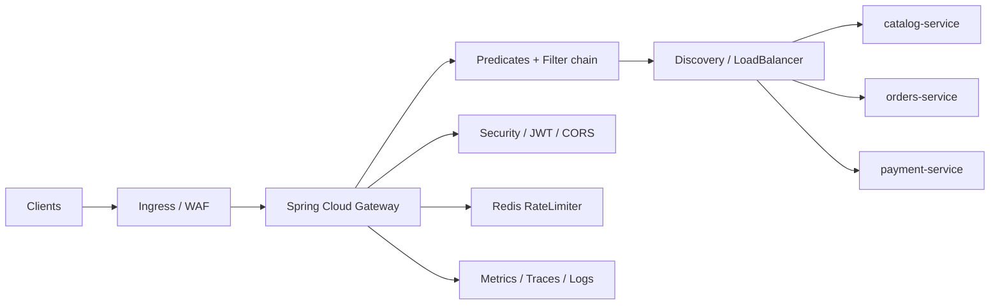
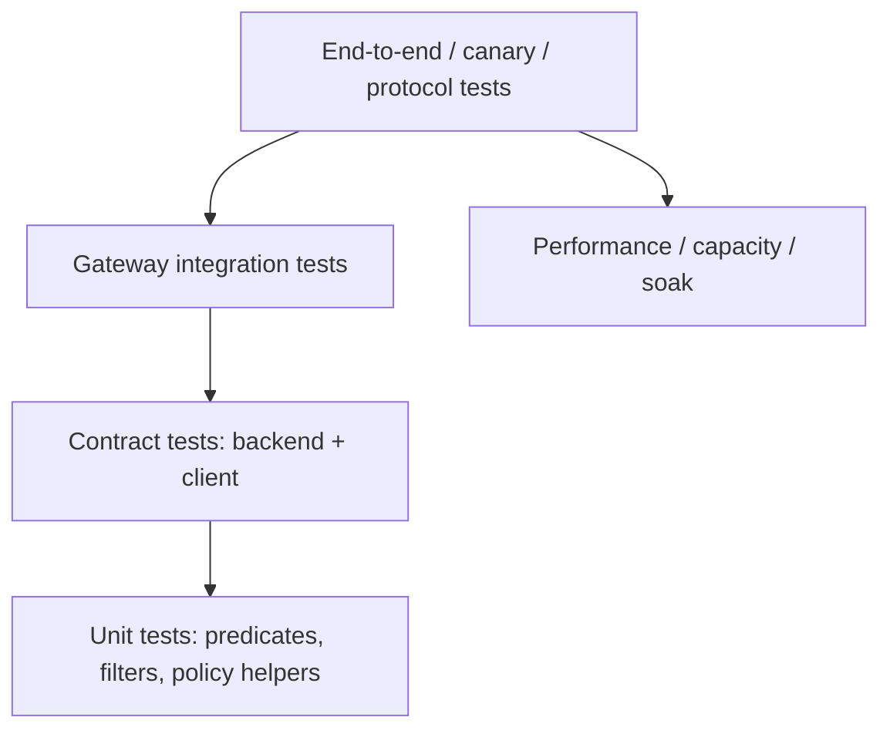
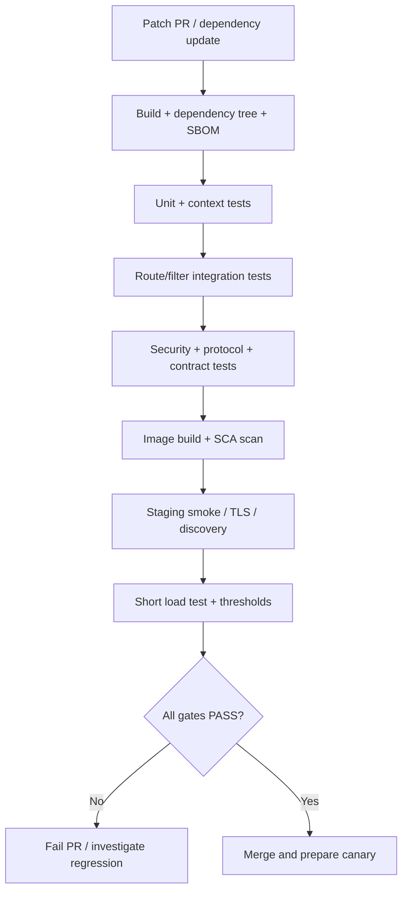

# Regression Testing for Routes, Protocols, Security, and Performance

When upgrading **Spring Cloud Gateway**, an application may still start up successfully and return HTTP 200 for a simple request yet behave differently in critical places: a route picks a different backend, `RewritePath` builds the wrong URI, filters run in a different order, HTTP/2 handshakes fail, JWTs get rejected, WebSockets fail to upgrade, the Redis rate limiter returns wrong quotas, or the connection pool saturates under load. Therefore, post-upgrade testing must prove that **routing contracts, protocols, security boundaries, and service levels** are preserved.

This article belongs to the **Upgrades** chapter of the **SPRING_CLOUD_GATEWAY** module. Gateway acts as the entry point for microservices, using route predicates, filter chains, path/header transformations, service discovery/load balancing, authentication, rate limiting, circuit breakers, retries, TLS, and observability. The goal is to build a repeatable regression test suite runnable before and after every Spring Boot/Spring Cloud/Gateway/Reactor Netty/Netty upgrade, spanning unit tests, integration tests, protocol tests, security tests, and load tests.

After this article, you will be able to:

- Identify **which behaviors must stay invariant** before changing dependencies or configuration.
- Pick the right test level: unit, WebFlux slice, Gateway integration, contract, end-to-end, and performance.
- Verify route predicates, filter order, path/header rewriting, and service discovery.
- Verify HTTP/1.1, HTTP/2, TLS/mTLS, WebSocket, SSE, and gRPC according to actually supported protocols.
- Prove that JWT, CORS, rate limiting, cache isolation, retries, and circuit breakers have not weakened.
- Compare before/after performance using identical workloads and SLO thresholds.
- Automate test gates across CI, canary, rollout, and rollback.

## 1. Why Is Regression Testing Needed After a Gateway Upgrade?

Gateway sits between clients and multiple backends. A small library change can affect many APIs simultaneously:



An upgrade can alter:

| Area | Potential regression | Consequence |
| --- | --- | --- |
| Route predicates | Host/Path/Method/Header no longer match as before. | 404s, misrouted requests, or unreachable APIs. |
| Filter chain | `Ordered`, pre/post phases, or filter list changes. | Wrong headers/paths, bypassed auth, misfired fallbacks. |
| Path/headers | Encoding, forwarded headers, or URI normalization changes. | Backends receive different requests or authorization bypass occurs. |
| Discovery/LB | Service IDs, instance selection, or caching changes. | 503/404 errors, traffic routed to stale instances. |
| HTTP codec | HTTP/1.1 framing, HTTP/2 headers, or body decoding changes. | Valid requests rejected, parser errors, resource exhaustion. |
| TLS | Trust stores, SNI, ALPN, certificate rotation. | Handshake failures or connections to the wrong identity. |
| WebSocket/SSE/gRPC | Upgrades, stream cancellation, trailers, timeouts. | Dropped connections, lost messages, or protocol errors. |
| Security | JWT claims, issuer/audience, CORS/CSRF, token relay. | Elevated 401/403s or unauthorized access. |
| Rate limiting/cache | Redis quotas, cache keys/eligibility changes. | Wrong 429s, backend overload, or cross-user data leaks. |
| Performance | Connection pool, pending acquires, memory, event loop. | Higher p95/p99, timeouts, OOM, or reduced throughput. |

**Successful startup does not prove system compatibility.** Nor does a route returning 200 prove token relay, CORS, quotas, path mapping, or TLS are right. You must verify against the system's critical contracts.

## 2. Build a Baseline Before Upgrading

To make comparisons meaningful, record a **baseline** before changing versions. The baseline is the test output of the currently accepted version—not an arbitrary number taken from a developer laptop.

### 2.1. Record versions and configuration

| Group | Information to save |
| --- | --- |
| Runtime | JDK, Spring Boot, Spring Cloud release train, Gateway artifact, Spring Framework, Reactor Core, Reactor Netty, and Netty modules. |
| Build | Commit SHA, Maven/Gradle lockfiles, resolved dependency tree, build profiles. |
| Image | Container image digest, base image, SBOM. |
| Routes | Route ID, URI/service ID, order, predicates, filters, and config revision. |
| Security | JWT issuer/audience, scopes, CORS origins, TLS trust, mTLS policy, token relay. |
| Dependencies | Redis, discovery registry, backends, certificate/secret versions. |
| Limits | Request body/header limits, timeouts, connection pool, retry budget, rate limits. |
| Workload | Request mix, payload sizes, concurrency, arrival rate, dataset, and test duration. |

Never put tokens, passwords, private keys, raw customer data, or connection strings containing credentials into baseline artifacts.

### 2.2. Document API behavior per route

Every critical route needs a minimum contract:

```text
routeId: catalog-public
public method/path: GET /api/catalog/products/{id}
predicate: Path=/api/catalog/**, Method=GET
destination: lb://catalog-service
upstream path: /products/{id}
auth: anonymous read, public catalog only
rate limit: public-client quota
timeout: agreed request budget
response: status + content-type + body schema
failure policy: no instance / timeout / backend 404
telemetry: routeId, status, latency, trace
```

This is a contract example, not a default configuration for every API. For payment/admin routes, authentication, authorization, TLS, and rate-limit requirements may be stricter. **Do not lump all routes into one test that checks only HTTP 200.**

### 2.3. Select a representative set of routes

Pick at least:

- One public GET route with path rewriting.
- One protected route requiring JWT and scopes.
- One route using `lb://` service discovery.
- One route with Redis `RequestRateLimiter`.
- One route with `CircuitBreaker`/`Retry`/fallback.
- One route caching public responses if caching is enabled.
- WebSocket/SSE/gRPC routes if the product uses them.
- One route with uploads/body transformations or header mutations.

If a feature is not enabled in the deployment, explicitly record **not applicable** with configuration/route-inventory evidence. Do not skip it just because the test is hard to write.

## 3. Test Pyramid for Spring Cloud Gateway

An effective test suite uses multiple layers:



| Test layer | Scope | Answers |
| --- | --- | --- |
| **Unit** | Custom `GatewayFilter`, `GlobalFilter`, `KeyResolver`, helper classes. | Does the logic match inputs/outputs? |
| **Context/slice** | Spring context, route definitions, filter bean wiring. | Does config bind and are beans wired properly? |
| **Gateway integration** | Real Gateway server + mock backend/Redis/registry. | Do requests take the right route and reach the right upstream? |
| **Contract** | Gateway ↔ backend/client contracts. | Are method/path/headers/status/schema compatible? |
| **End-to-end** | Client → Ingress → Gateway → service. | Do actual deployment layers coordinate properly? |
| **Protocol** | H1/H2/TLS/WebSocket/SSE/gRPC. | Are handshakes, frames, streams, and deadlines correct? |
| **Performance** | Load/stress/spike/soak/capacity. | Does the system hold SLOs and resource bounds under target load? |

### Do not substitute unit tests for integration tests

A unit test on a `RewritePath` helper may pass while:

- Gateway fails to bind route config due to a wrong property prefix.
- A global filter runs before/after in the wrong order.
- Ingress already stripped the prefix before the request reached Gateway.
- LoadBalancer fails to locate an instance.
- The backend context path differs from the test environment.

Therefore, critical logic must be verified **at least once through a real Gateway server**.

### Do not use E2E for every test

End-to-end tests are slow and prone to flakiness from DNS, certificates, registries, backend data, and deployments. Use unit/integration tests for most branches; reserve E2E for high-value journeys and protocol/security boundaries that require real verification.

## 4. Route Predicate Regression Tests

Route predicates decide whether a request enters the filter chain. Test each predicate individually as well as predicate combinations.

| Predicate | Positive case | Negative case |
| --- | --- | --- |
| `Path` | `/api/catalog/products/42` matches. | `/api/catalogue/products/42` does not match. |
| `Host` | `api.example.com` matches. | Another host or rewritten Host does not match. |
| `Method` | GET matches read route. | POST/OPTIONS handled per another contract. |
| `Header` | `X-API-Version: v2` matches. | Missing header or wrong value. |
| `Query` | `?version=2` matches. | Missing or wrong query value. |
| `Cookie` | Cookie matching pattern matches. | Missing cookie or different pattern. |
| `RemoteAddr` | Proxy/trusted client address recognized. | IP outside policy. |
| `After`/`Before` | Request within active route window. | Request outside time window. |

### Test route overlap and ordering

When two routes can match the same path, tests must verify the actual route ID:

```yaml
spring:
  cloud:
    gateway:
      server:
        webflux:
          routes:
            - id: catalog-specific
              order: 0
              uri: http://localhost:8081
              predicates:
                - Path=/api/catalog/**
            - id: api-generic
              order: 100
              uri: http://localhost:8082
              predicates:
                - Path=/api/**
```

A test asserting only status 200 is insufficient: both backends could return 200. Mock backends should return distinct markers, such as `X-Test-Backend: catalog-specific`, or record requests per server to prove the right route matched.

### Negative route cases

Test cases that must not route:

- Missing version header.
- Host outside allowlist.
- Disallowed method.
- Similar prefix path not belonging to the route.
- Route not yet active per time predicate.
- Paths with encoded slash/dot segments per policy.
- Request to an admin route without authority.

Expected statuses may be 400, 401, 403, 404, or 405 depending on the handling layer. **The core invariant is that the request never reaches the backend against policy.**

## 5. Path Rewriting and Header Transformation

A public route often differs in path from the backend. Verify **both the incoming and upstream requests** rather than only the final status.

### 5.1. Verify `StripPrefix`, `RewritePath`, `SetPath`, `PrefixPath`

| Public path | Filter | Expected upstream path |
| --- | --- | --- |
| `/api/catalog/products/42` | `StripPrefix=2` | `/products/42` |
| `/api/v2/orders/123` | `StripPrefix=2` | `/orders/123` |
| `/legacy/items/7` | `RewritePath` per contract | `/items/7` |
| `/health/catalog` | `SetPath=/internal/health` | `/internal/health` |
| `/products/42` | `PrefixPath=/v1` | `/v1/products/42` |

Also test paths with query strings, trailing slashes, percent encoding, context paths, and paths already rewritten by Ingress. Use a mock backend that records exact method/path/query.

### 5.2. Header mutation

Check:

- `AddRequestHeader`, `SetRequestHeader`, `RemoveRequestHeader`.
- `AddResponseHeader`, `SetResponseHeader`, `RemoveResponseHeader`.
- `PreserveHostHeader` if the route requires preserving Host.
- `X-Forwarded-*`/`Forwarded` generated by trusted proxies.
- Correlation/trace headers.
- `Authorization`, `Cookie`, `Set-Cookie`, and token relay.

Do not merely assert header presence; verify **values and trust provenance**. Clients must never be able to set `X-User`, `X-Tenant`, or `X-Forwarded-Host` themselves and have Gateway trust them as verified identity.

### 5.3. Test filter ordering

`GlobalFilter` and route-specific `GatewayFilter` instances combine into a chain sorted by `Ordered`. Test these invariants:

1. Authentication/authorization runs before any operations that could return sensitive data.
2. Rate limiting uses a trusted principal/API key.
3. Path rewriting happens at the right point before routing.
4. Caching never short-circuits ahead of auth if cached data needs protection.
5. Retries/fallbacks never bypass security or cause unintended side effects.

Do not assume YAML order equals execution order for all filters. Check order for your Gateway version and test with real requests.

## 6. Service Discovery, LoadBalancer, and Route Config

A `lb://catalog-service` route needs testing for both route matching and instance selection.

| Situation | Expected outcome to verify |
| --- | --- |
| One healthy instance | Request reaches that service instance. |
| Multiple instances | LoadBalancer distributes per configured policy. |
| Zero instances | Accurate status/error mapping (typically 503, unless policy differs). |
| One unhealthy instance | No new requests sent to the excluded instance. |
| Registry temporarily unavailable | Cache/freshness behavior matches implementation and policy. |
| Instances change during rollout | Traffic does not keep flowing to terminating pods. |
| Service ID casing differences | Discovery locator/path rewrite still works properly. |

### Discovery-generated routes

When using the `DiscoveryClient` route locator, test the default path prefix and default `RewritePath` that strips the service ID. When adding custom discovery filters, verify the custom list does not accidentally replace the default filter list. Test actual upstream paths.

### Dynamic routes

When route definitions update dynamically:

- Validate candidate routes before publishing.
- Record revision and owner.
- Verify all Gateway pods receive the approved revision.
- Invalid candidates must never overwrite the active last-known-good snapshot.
- Refresh/route mutation endpoints must be secured and audited.
- The regression suite must run against the published route snapshot, not just YAML in Git.

## 7. Authentication, Authorization, and CORS Regression

This is the layer that **must never be compromised just to turn tests green**. Every route needs positive and negative cases.

### JWT/OAuth2

| Test | Expectation |
| --- | --- |
| No bearer token to protected route | 401 or contract status; protected backend never receives request. |
| Expired JWT | Rejected. |
| Invalid signature | Rejected. |
| Wrong issuer | Rejected. |
| Wrong audience | Rejected. |
| Missing scope/authority | 403 or matching error contract. |
| Valid token with sufficient permissions | Routed properly to backend. |
| Token Relay | Sends token only to trusted backends/audiences. |
| JWKS temporarily unavailable | Cache/timeout/error behavior follows policy; never bypasses auth. |

Test with synthetic signing keys and test identities; never use real production JWTs in fixtures.

### CORS

Verify:

- Allowed Origin can complete preflight and send requests per policy.
- Disallowed Origin does not receive a valid `Access-Control-Allow-Origin`.
- `Access-Control-Allow-Credentials` is never combined with a wildcard origin against specification.
- Allowed methods/headers match the API.
- `OPTIONS` preflight is handled properly even when routes define Method predicates.
- Security WebFlux CORS integration has not changed after upgrading.

### CSRF and cookies/sessions

If Gateway uses sessions/cookies or browser-based authentication, test CSRF protection, `SameSite`/`Secure`/`HttpOnly`, logout/session expiry, and cookie forwarding. For stateless bearer-token APIs, document the CSRF policy and test against the threat model; do not disable CSRF mechanically if the app still uses cookie authentication.

## 8. Rate Limiting, Caching, and Resilience

### 8.1. Redis RequestRateLimiter

Test these points:

- `KeyResolver` uses verified identity/API keys.
- Two distinct tenants/users do not share a quota when policy requires isolation.
- A user cannot alter a raw header to impersonate another key.
- Requests within quota succeed; requests exceeding quota receive 429 per contract.
- Redis outage/latency produces approved fail-open or fail-closed behavior.
- Token-bucket quota resets/refills accurately.
- Multiple Gateway replicas share the quota as designed.
- Retries/client retries do not consume quota outside contract.

Test quotas against a real Redis in a container or integration environment; mock Redis can miss serialization, latency, and atomic behavior.

### 8.2. LocalResponseCache

If response caching is enabled:

- Public GET responses cache per policy.
- `Cache-Control: private`/`no-store` responses are not cached.
- User A never receives User B's response.
- Different routes/tenants/languages/versions never mix cache entries.
- Query strings, `Vary`, ETag, and TTL follow contract.
- Cold/warm caches and multi-replica setups behave properly.
- Post-upgrade cache hit ratio changes never break data correctness.

**Testing cache isolation is a security test**, not merely a performance test. A fast cache hit that serves the wrong tenant's data is a release blocker.

### 8.3. CircuitBreaker and Retry

| Backend scenario | What to verify |
| --- | --- |
| Steady 200s | No unintended fallback triggers. |
| Sustained 500s | Circuit opens per threshold/window. |
| Timeout | Timeout budget and fallback status are accurate. |
| Circuit OPEN | Requests stop hitting backend during open duration. |
| HALF_OPEN | Probe request count is bounded per config. |
| Backend recovers | Circuit closes and traffic resumes. |
| Retry on 503/timeout | Attempts/backoff stay within budget. |
| Non-idempotent POST | Not retried if duplicate side effects could occur, unless idempotency key/contract permits. |
| Fallback | Does not leak stack traces, secrets, or stale data against policy. |

Measure **the number of upstream attempts per inbound request**. A test asserting only that the client got 200 can miss Gateway sending 5 requests to the backend.

## 9. HTTP Protocol Regression

Gateway does more than shuttle JSON. A Reactor Netty/Netty upgrade can impact parsers, connection reuse, HTTP/2 multiplexing, and body handling.

### HTTP/1.1

Verify:

- Keep-alive and connection reuse.
- `Content-Length` and chunked transfer encoding.
- Empty, small, and large request/response bodies within limits.
- Duplicate headers and header normalization per policy.
- `Host`, `Connection`, `Transfer-Encoding`, and hop-by-hop headers.
- Client disconnect/cancellation mid-upload or mid-download.
- 400/413/431 for malformed requests or oversized bodies/headers.

Do not use malformed traffic tests to prove the parser accepts arbitrary input. What must hold is that **valid requests keep working while invalid requests are rejected safely**.

### HTTP/2

If ingress and Gateway enable HTTP/2, test:

- TLS ALPN negotiates the right protocol.
- `:method`, `:scheme`, `:authority`, `:path`, and pseudo-header ordering.
- Multiplexing multiple streams over one connection.
- Flow control, stream reset/cancellation, and connection shutdown.
- Header compression/size limits per config.
- HTTP/2 → HTTP/1.1 translation when downstream uses HTTP/1.1.
- gRPC trailers/status if routes proxy gRPC.

Test HTTP/2 end-to-end on the real topology. A HTTP/2-capable client calling Gateway does not prove Gateway → backend uses HTTP/2; each hop can use a different protocol.

### Body handling and streaming

For custom filters reading/writing bodies:

- Body is read once or cached/replayed exactly as designed.
- `DataBuffer` instances are released properly without leaking pooled buffers.
- `Content-Type`/`Content-Length`/`Transfer-Encoding` remain accurate after transformation.
- Cancellation and backpressure propagate properly.
- Large payloads are intentionally bounded without unbounded buffering.
- Multipart boundaries and individual parts are preserved when relaying uploads.

## 10. TLS, mTLS, and Certificate Regression

TLS tests must cover both inbound (client → Gateway) and outbound (Gateway → backend).

| Situation | Outcome to prove |
| --- | --- |
| Valid certificate chain, matching hostname | Handshake succeeds. |
| Expired certificate | Client/Gateway rejects per trust policy. |
| Untrusted CA | Connection rejected; no trust-all. |
| Wrong hostname/SAN | Hostname verification fails. |
| Wrong SNI | Selects right certificate/virtual host or fails safely. |
| mTLS missing client certificate | Hop requiring mTLS rejects connection. |
| mTLS certificate with wrong CA/identity | Rejected. |
| Certificate rotation | Gateway picks up new certificate/trust bundle per procedure. |
| Disallowed TLS protocol/cipher | Does not negotiate down to weaker configs. |

### Separate inbound and outbound tests

A Gateway may terminate TLS at Ingress and call backends over internal HTTP, or use TLS/mTLS on both hops. Write tests matching the actual deployment diagram:

```text
Client --HTTPS--> Ingress --HTTP/HTTPS--> Gateway
                                  |
                                  +--HTTPS/mTLS--> Backend
```

Do not assume every hop uses HTTPS or the same certificate. Check hostnames, SNI, CA bundles, trust stores, client certificates, and rotation independently.

### Testing certificate rotation

1. Use a dedicated CA/test certificates for the integration environment.
2. Start with valid certificate A.
3. Update the secret/trust bundle using the exact deployment mechanism.
4. Confirm Gateway/connection pool adopts the new certificate within the expected window.
5. Revoke certificate A or simulate the backend switching CAs.
6. Confirm no new connections succeed under the expired trust.

Existing pooled connections may continue using established TLS sessions; test both connection reuse and fresh reconnects. Never use production private keys in test suites.

## 11. WebSocket, SSE, and gRPC Regression

Run protocol tests only for protocols the application actually supports; whenever such routes exist, test handshakes and connection lifecycles.

### WebSocket

- HTTP upgrade handshake succeeds for permitted clients.
- `Origin` allowlisting works; origins outside policy are rejected.
- Cookie/JWT authentication still applies per threat model.
- Subprotocols negotiate properly.
- Ping/pong, close frames, and reconnects.
- Long-lived connections during Gateway rollouts/draining.
- Client and backend disconnects are handled cleanly without holding sockets indefinitely.

Origin checks do not replace authentication. Non-browser clients can forge `Origin`; identity/permissions still must be verified.

### Server-Sent Events (SSE)

- `Content-Type: text/event-stream`.
- First event and subsequent events forward promptly.
- No full-stream buffering that delays events to clients.
- Heartbeat/idle timeouts and reconnect semantics.
- Client cancellation releases the upstream subscription/connection.
- Gateway rollouts do not drop streams outside reconnect policy.

You can use `WebTestClient` to assert status/headers and `StepVerifier` to assert received events, then cancel the stream cleanly.

### gRPC

- HTTP/2 and ALPN are negotiated properly.
- `content-type: application/grpc` and method paths are preserved.
- Deadlines, cancellation, and metadata/trailers.
- `grpc-status` is preserved accurately; do not check only HTTP status 200.
- Unary and streaming calls are tested separately.
- mTLS, authority/SNI, and certificate identity.
- Connection/channel reuse, shutdown, and resource limits.

If Gateway uses `JsonToGrpc`, test JSON-to-protobuf mapping separately from native gRPC proxying. Never use one unary test to represent all streaming modes.

## 12. Designing Integration Tests with WebTestClient and Mock Backends

For Gateway WebFlux, `WebTestClient` can test the WebFlux app in a mock environment or send requests to a running server. To test Netty routing, connections, and upstream URIs, have at least one integration test running an **embedded server on a random port** with a mock HTTP backend that records requests.

### 12.1. Choosing the right bind mode

| How `WebTestClient` is bound | Best suited for | Limitations |
| --- | --- | --- |
| `bindToController` | Testing standalone controllers. | Does not represent the full Gateway route/filter runtime. |
| `bindToApplicationContext` | Testing WebFlux application context/handler chains. | Does not perform a real network hop to backends like production. |
| `bindToServer` | Calling a live server, including Gateway integration tests. | Requires starting the app and managing backend dependencies. |

### 12.2. Integration test example verifying StripPrefix

The example below illustrates the pattern with JUnit 5, Spring Boot random port, `WebTestClient`, and OkHttp `MockWebServer`. Choose test dependency versions compatible with your project's Spring Boot/Java versions.

```java
package com.example.gateway;

import java.io.IOException;
import java.util.concurrent.TimeUnit;

import okhttp3.mockwebserver.MockResponse;
import okhttp3.mockwebserver.MockWebServer;
import okhttp3.mockwebserver.RecordedRequest;
import org.junit.jupiter.api.AfterAll;
import org.junit.jupiter.api.Test;
import org.springframework.boot.test.context.SpringBootTest;
import org.springframework.boot.test.web.server.LocalServerPort;
import org.springframework.test.context.DynamicPropertyRegistry;
import org.springframework.test.context.DynamicPropertySource;
import org.springframework.test.web.reactive.server.WebTestClient;

import static org.assertj.core.api.Assertions.assertThat;

@SpringBootTest(webEnvironment = SpringBootTest.WebEnvironment.RANDOM_PORT)
class GatewayRouteRegressionTest {

    private static final MockWebServer BACKEND = startBackend();

    @LocalServerPort
    int gatewayPort;

    private static MockWebServer startBackend() {
        MockWebServer server = new MockWebServer();
        try {
            server.start();
            return server;
        }
        catch (IOException ex) {
            throw new ExceptionInInitializerError(ex);
        }
    }

    @DynamicPropertySource
    static void gatewayRouteProperties(DynamicPropertyRegistry registry) {
        registry.add(
            "spring.cloud.gateway.server.webflux.routes[0].id",
            () -> "catalog-test");
        registry.add(
            "spring.cloud.gateway.server.webflux.routes[0].uri",
            () -> BACKEND.url("/").toString());
        registry.add(
            "spring.cloud.gateway.server.webflux.routes[0].predicates[0]",
            () -> "Path=/api/catalog/**");
        registry.add(
            "spring.cloud.gateway.server.webflux.routes[0].filters[0]",
            () -> "StripPrefix=2");
    }

    @AfterAll
    static void stopBackend() throws IOException {
        BACKEND.shutdown();
    }

    @Test
    void stripsPublicPrefixBeforeProxying() throws Exception {
        BACKEND.enqueue(new MockResponse()
            .setResponseCode(200)
            .setHeader("Content-Type", "application/json")
            .setBody("{\"id\":42}"));

        WebTestClient client = WebTestClient.bindToServer()
            .baseUrl("http://localhost:" + gatewayPort)
            .build();

        client.get()
            .uri("/api/catalog/products/42")
            .exchange()
            .expectStatus().isOk()
            .expectBody()
            .json("{\"id\":42}");

        RecordedRequest upstream =
            BACKEND.takeRequest(2, TimeUnit.SECONDS);

        assertThat(upstream).isNotNull();
        assertThat(upstream.getMethod()).isEqualTo("GET");
        assertThat(upstream.getPath()).isEqualTo("/products/42");
    }
}
```

**This is an illustrative template**; verify the route property prefix matches your Gateway release train. On older Gateway lines, the prefix may be `spring.cloud.gateway.routes[...]`. In real test suites, route configurations should reside in a reviewed test profile or test configuration; avoid letting test routes override production configs.

The key point of the test is not merely asserting the client receives 200, but reading the backend's `RecordedRequest` to prove Gateway sent the right method and path.

### 12.3. Testing negative cases

Add tests sending:

- A path outside `/api/catalog/**`.
- A `POST` to a GET-only route (when a Method predicate is present).
- Wrong host/header.
- Backend returning 404/503 to verify status mapping.

For negative cases, in addition to client status, verify the backend **received zero requests** when the route is disallowed.

## 13. Use Testcontainers for Real Dependencies

Mock backends work well for verifying routes and filters. Certain behaviors require real services or production-like implementations:

| Dependency | When to use a container |
| --- | --- |
| Redis | Rate limiters, TTL, atomic quotas, timeouts, and outage behavior. |
| Consul/Eureka-compatible registry | Service registration, instance health, service IDs, and refresh. |
| PostgreSQL/MySQL | Only when backend integration requires a real database. |
| Mock gRPC service | HTTP/2, trailers, TLS/mTLS, and unary/streaming. |
| Local CA/test TLS server | Trust, hostnames, SNI, cert rotation. |

Testcontainers manages service containers for JUnit and integrates with Spring Boot test contexts. Pin image tags/digests in CI and use deterministic data fixtures; never rely on `latest` for stable test dependencies.

### Redis integration test

A quota test against real Redis should verify:

1. The first request within quota is allowed.
2. Subsequent requests consume quota per token bucket.
3. Once quota is exhausted, Gateway returns 429 without calling the backend.
4. Two independent keys have independent quotas.
5. Redis restart/timeout produces the exact fail-open/fail-closed behavior.
6. Quotas are shared across multiple Gateway instances as designed.

Do not merely check that the Redis bean started; test **real requests flowing through Gateway** and inspect Redis state.

## 14. Contract Tests Between Gateway and Backends

Contract tests capture the assumptions Gateway depends on:

- Method/path the backend expects.
- Required request headers.
- Response status, headers, and body schema.
- Error mappings (404/409/422/429/5xx).
- Timeouts/deadlines and idempotency behavior.
- `Content-Type`, compression, pagination, ETag.
- API versioning and backward compatibility.

When a backend changes an API path from `/v1/products` to `/v2/products`, contract tests should fail before the new Gateway config is deployed. When Gateway changes `StripPrefix` or `RewritePath`, tests must prove the backend still receives the expected contract.

You can use Spring Cloud Contract or another contract-testing tool if your organization has adopted one. **Contract tests do not replace protocol/security tests**: a schema-valid JSON response can still be sent to the wrong tenant or over unverified TLS.

## 15. Performance Regression: Establishing a Fair Comparison

Pre- and post-upgrade performance can only be compared when environments and workloads match. Never treat a single benchmark on a laptop as a baseline for a production cluster.

### Control the variables

- Same number of Gateway replicas, CPU/memory requests/limits, and node class.
- Same backend versions, data, Redis, discovery, and TLS topology.
- Same request mix, payload sizes, concurrency, arrival rate, and cache state.
- Same load generator placement/network path.
- Same warm-up period, test duration, and measurement window.
- No other benchmarks running concurrently against the same backend.
- Save image digests, config revisions, and test script commits.

### Measure both Gateway and backends

| Group | Metrics |
| --- | --- |
| Client/load generator | RPS/arrival rate, concurrency, p50/p90/p95/p99/max, error rate, timeouts. |
| Gateway | Route count, status distribution, request latency, CPU, heap, direct memory, GC, event-loop saturation. |
| Reactor Netty client | Connect time, response time, TLS handshake time, active/idle/pending connections, pending acquire time. |
| Backend | CPU, queues, latency, DB pool, errors, request attempts. |
| Redis | Latency, commands/sec, timeouts, connection count, quota decisions. |
| Kubernetes | CPU throttling, memory limits, restarts, pod readiness, network throughput. |

A Gateway test measuring only client response time cannot show whether a bottleneck sits in Gateway, the connection pool, Redis, or the backend.

### Percentiles matter more than averages

Averages can look healthy even when a slice of requests suffer long timeouts. Track p50, p90, p95, p99, and max. Compare percentiles against agreed route SLOs/API classes rather than using one blanket threshold for every route.

## 16. Types of Performance Tests

| Test type | Purpose | Example |
| --- | --- | --- |
| **Smoke** | Verify test rig and endpoints work at very low load. | 1–5 RPS for 1 minute. |
| **Baseline** | Record latency/resources at nominal load. | 50 RPS for 10 minutes. |
| **Load** | Verify expected load level. | Ramp up to 300 RPS and hold for 20 minutes. |
| **Stress** | Find limits and failure modes. | Step up load until SLOs break. |
| **Spike** | Observe reaction to sudden traffic surges. | 50 → 500 RPS over a short window. |
| **Soak** | Detect leaks/unbounded queue growth over time. | Steady load for several hours. |
| **Capacity** | Find throughput/replica and headroom. | Increase RPS and replicas to find saturation point. |
| **Recovery** | Verify recovery after overload/failure. | Reduce load, restore Redis/backend, and measure stabilization time. |

Numbers above are illustrative examples. Derive load levels from aggregated production traffic, forecasts, and SLOs; never run stress/spike tests against production without change approval and blast-radius controls.

### Open workload vs closed workload

- **Open workload:** test generates requests at a target arrival rate; fits API models receiving continuous traffic.
- **Closed workload:** fixed number of virtual users/concurrent sessions, each sending the next request after the previous one finishes; fits certain session models.

With a closed workload, when Gateway slows down, generated request rate drops automatically, masking saturation. Pick the model reflecting real traffic and document how load is generated.

## 17. Load Testing with k6: Thresholds as Pass/Fail Criteria

The example below uses k6 to send steady load to a public/protected route provisioned in staging. The token comes from a CI environment variable; **never hardcode or commit credentials**.

```javascript
import http from 'k6/http';
import { check, sleep } from 'k6';

export const options = {
  scenarios: {
    gateway_steady: {
      executor: 'constant-arrival-rate',
      rate: 100,
      timeUnit: '1s',
      duration: '5m',
      preAllocatedVUs: 50,
      maxVUs: 200,
    },
  },
  thresholds: {
    http_req_failed: ['rate<0.01'],
    http_req_duration: ['p(95)<400', 'p(99)<800'],
    checks: ['rate>0.99'],
  },
};

export default function () {
  const response = http.get(
    __ENV.BASE_URL + '/api/catalog/products/42',
    {
      headers: {
        Authorization: 'Bearer ' + __ENV.TOKEN,
        Accept: 'application/json',
      },
      tags: { route: 'catalog-public' },
    },
  );

  check(response, {
    'catalog returns expected status': (r) => r.status === 200,
    'catalog response is JSON': (r) =>
      r.headers['Content-Type'] &&
      r.headers['Content-Type'].includes('application/json'),
  });

  sleep(0.1);
}
```

Run in an authorized test environment:

```bash
k6 run -e BASE_URL=https://gateway-staging.example.test \
  -e TOKEN="$TEST_TOKEN" gateway-load.js
```

Rate, percentile, and error thresholds here are **examples** only; replace them with your route's SLOs and staging capacity. With `constant-arrival-rate`, the load generator needs enough VUs and CPU to sustain the arrival rate; if the generator starves, the test does not reflect Gateway capacity.

**Note:** k6 `checks` evaluate individual responses but do not fail the test process by themselves; use `thresholds` to encode pass/fail criteria. Thresholds can target error rates, percentiles, and custom metrics. Do not assert only status 200; verify response body/schema or backend markers when part of the contract.

## 18. Observing Gateway Metrics and the Reactor Netty Pool

### Spring Cloud Gateway metrics

When Actuator/Gateway metrics are enabled per your version, the `spring.cloud.gateway.requests` timer typically carries tags:

- `routeId`
- `routeUri`
- `outcome`
- `status` / `httpStatusCode`
- `httpMethod`

These can be scraped via the Prometheus registry if configured. Check actual metrics on your exact Gateway version; property names and tags can change.

**Do not enable arbitrary raw-URL path tags** in production when paths contain dynamic IDs. High-cardinality tags inflate memory/storage and can leak data. Use bounded `routeId` labels; if path-level analysis is needed, normalize templates like `/products/{id}`.

### Reactor Netty connection pool

Useful metrics may include:

| Metric family | Meaning during testing |
| --- | --- |
| `reactor.netty.connection.provider.total.connections` | Total connections in the pool. |
| `reactor.netty.connection.provider.active.connections` | Connections currently in use. |
| `reactor.netty.connection.provider.idle.connections` | Idle connections. |
| `reactor.netty.connection.provider.pending.connections` | Requests waiting to acquire a connection. |
| `reactor.netty.connection.provider.pending.connections.time` | Time spent waiting to acquire a connection. |
| `reactor.netty.http.client.connect.time` | Connect time. |
| `reactor.netty.http.client.response.time` | Request/response time. |
| `reactor.netty.http.client.tls.handshake.time` | TLS handshake time. |

Exact names and availability depend on Reactor Netty version, metrics config, and registry. Inspect Actuator/Prometheus before writing alerts.

### Signs of connection pool saturation

- Sustained rise in pending connections.
- Pending acquire time climbs alongside p95/p99.
- Active connections frequently hit max.
- Higher backend latency holds connections open longer.
- Gateway returns timeouts even while CPU stays low.

Do not immediately respond by raising `maxConnections` without limit. Check backend concurrency, timeouts, pool sizing, pending queue limits, connection lifetimes, and load distribution. A larger pool may simply push overload downstream to backends.

## 19. Performance Assertions for an Upgrade

A release gate can use this table:

| Metric | Baseline | Candidate | Condition |
| --- | --- | --- | --- |
| p95 latency per route | Measured on old version. | Measured with same workload. | Within SLO and agreed regression margin. |
| p99 latency | Measured on old version. | Measured with same workload. | No abnormal tail latency. |
| Error rate | Separate 4xx/5xx/timeouts. | Classified by route/status. | No increase outside budget. |
| Throughput | Achieved RPS. | RPS under same resource budget. | Meets target and keeps headroom. |
| CPU/memory | Per pod and cluster. | Per pod and cluster. | Does not exceed capacity budget. |
| Direct memory/FDs | Stable baseline. | Monitored during soak test. | No unbounded growth. |
| Pool pending | Baseline. | Candidate. | No sustained queue buildup. |
| Backend attempts | Requests/attempts. | Candidate. | Retries cause no amplification. |
| Redis latency/errors | Baseline. | Candidate. | Rate limiter does not become a bottleneck. |
| TLS handshake | Cold/warm. | Candidate. | Zero trust errors and latency within budget. |

Do not set a blanket regression threshold like “no more than 5% slower” if measurement noise exceeds 5%. Use multiple runs, medians/ranges, or appropriate confidence intervals; determine meaningful deltas from baseline variance.

### Separate latency budgets properly

A request through Gateway may include:

```text
Client network
  + Ingress/WAF
  + Gateway inbound parsing
  + Security/JWT
  + Redis rate limiter
  + Route/filter processing
  + Connection pool acquire
  + DNS/connect/TLS
  + Backend processing
  + Response transfer
```

Do not sum all durations when metric spans overlap; use trace timelines to isolate time per hop. A higher p99 may stem from a slow backend, TLS reconnects, DNS, pool pending time, or Gateway event-loop saturation.

## 20. Testing Resilience and Overload Behavior

After upgrading, test the system when dependencies or backends fail:

| Fault scenario | Behavior to verify |
| --- | --- |
| Backend timeout | Gateway times out per request budget; does not hold connections forever. |
| Backend 5xx | Retries/CircuitBreaker follow config without infinite retries. |
| One dead instance | LoadBalancer stops sending new traffic to that instance per health policy. |
| Redis latency/outage | Rate limit fails open/closed per policy; liveness does not cause restart storms. |
| Registry outage | Cached discovery/freshness and route behavior match design. |
| Invalid TLS certificate | Connection rejected; no trust-all fallback. |
| Connection pool full | Pending queue/timeouts bounded; no OOM. |
| Gateway pod restart | Readiness, graceful shutdown, client retry/reconnect match contract. |
| Burst traffic | Rate limiter protects backend, 429s accurate, fast recovery. |
| Long-lived streams | Cancellation/draining/reconnect follow policy. |

Run fault injection in sandbox/staging with blast-radius limits and a kill switch. Never shut down production Redis, registries, or backends just to run lesson checks.

## 21. CI Pipeline: Layered Checks Before Merging

A pragmatic pipeline:



### Pipeline tiers

| Stage | When it runs | Checks |
| --- | --- | --- |
| Compile/static | Every PR | Compilation, formatting, static analysis, dependency policy. |
| Unit | Every PR | Custom filters, `KeyResolver`, path/header helpers, fallback logic. |
| Gateway integration | Every PR with route/config changes | Route selection, upstream path, filter order, status mapping. |
| Security | Every PR with auth/filter/dependency changes | JWT, scopes, CORS, cache isolation, rate limiting, TLS negative tests. |
| Protocol | PR changing Netty/Reactor/codec or protocol configs | H1/H2, WebSocket, SSE/gRPC per feature. |
| Container integration | Nightly or major PRs | Real Redis/discovery/backends via Testcontainers. |
| Performance smoke | PR/release candidate | Baseline throughput, p95/p99, errors, pool metrics. |
| Full load/soak | Nightly/release candidate | Capacity, leaks, spikes, soak, failure recovery. |
| Canary | Before production promotion | Real request mix, SLOs, and security gates. |

You do not need multi-hour stress tests on every PR. However, changes to Netty, TLS, route matching, caching, body filters, or retries should trigger the relevant deep test suites.

### Fail fast for valid reasons

The pipeline should halt if:

- A critical route switches to the wrong backend.
- An unauthorized request reaches a protected backend.
- Private responses get cached or leaked across tenants.
- TLS verification is bypassed.
- Retries create duplicate side effects.
- Error rate/p95/p99 violate agreed SLOs.
- SBOM reveals unaddressed vulnerable dependencies.

Unrelated warnings can be triaged, but security regressions must never be downgraded to warnings just to merge faster.

## 22. Canary Rollout and Comparing Candidate vs Stable

Canary lets you validate under controlled traffic before replacing all Gateway pods.

### Process

1. Deploy the candidate image/config revision to a small group.
2. Run synthetic tests on critical routes/auth/TLS/protocols.
3. Shift a controlled traffic slice or use appropriate shadow traffic (never replay side-effecting requests).
4. Compare candidate and stable on identical routes/request classes.
5. Increase percentage stepwise as metrics and security checks pass.
6. Promote fully and verify every pod runs the approved image digest/config revision.

### What to compare

- 2xx/4xx/429/5xx by route and method.
- p50/p95/p99 and timeout rates.
- Upstream attempts/retries, CircuitBreaker opens/fallbacks.
- Redis latency/quota decisions.
- Reactor Netty active/pending connections.
- CPU, heap/direct memory, GC, FD/socket counts.
- TLS handshake failures, WebSocket handshake rejects, gRPC errors.
- Synthetic auth/cache isolation and path rewrite tests.

**Readiness 200 and Deployment Available do not prove the regression suite passed.** A pod can be healthy while misrouting, mischecking JWT audiences, or leaking private caches.

### Rollback

Prepare a known-good image/config revision and rollback procedure before opening traffic. If the candidate patched a security vulnerability, do not blindly roll back to a vulnerable image just to recover latency. Use a safe fallback or isolate the failing feature.

## 23. Managing Test Data, Determinism, and Flaky Tests

Regression tests are useful only when results are repeatable.

### Data and dependencies

- Use test identities/keys, never production credentials.
- Create fixture data with deterministic IDs and clean up after tests.
- Mock time for `After`/`Before` predicates where the test framework allows.
- Never rely on random ordering of registry instances.
- Use dynamic ports or isolated container networks; avoid shared ports.
- Wait for container/backend readiness via health checks rather than arbitrary sleeps.
- Reset Redis quotas/caches between test cases.
- Use unique correlation IDs to trace specific requests.

### Triaging flaky tests

| Symptom | Possible cause | Resolution |
| --- | --- | --- |
| Test intermittently times out | Backend/containers not ready or deadline too short. | Health checks, reasonable timeouts, inspect logs. |
| Unstable route test order | Overlapping predicates/order or shared state. | Assert route ID, isolate configs, do not rely on test order. |
| Redis quota test fails randomly | Shared keys or unreset state. | Distinct keys per test and reset containers/state. |
| Unstable TLS test | Cert validity clock, trust store, or hostname mismatch. | Fixed test clock/validity window, explicit SANs, isolated trust bundles. |
| Fluctuating load tests | Generator/cluster contention and warm-up. | Control environment, repeat runs, compare percentiles/variance. |
| WebSocket test hangs | Stream not cancelled/closed. | Close handshake, bounded wait, clean up connections. |

Do not retry failed tests indefinitely just to turn the pipeline green. A single retry can help gather extra evidence, but flaky tests must have an owner and a fix deadline.

## 24. Pre- and Post-Upgrade Regression Report

Every release candidate should have a report tied to commit, image digest, and test run:

```text
release candidate:
source commit:
old image digest:
new image digest:
Spring Boot / Spring Cloud / Gateway:
Spring Framework / Reactor Netty / Netty:
route config revision:
test suite revision:
protocols exercised:
security cases passed / failed:
contract cases passed / failed:
performance workload and duration:
baseline p95 / p99 / error rate:
candidate p95 / p99 / error rate:
resource and connection pool observations:
known deviations / approved exceptions:
canary decision:
rollback image/config:
approver:
```

If a test does not apply, record the reason and evidence that the feature is not deployed. Never write “all tests pass” when protocol/security tests were skipped.

## 25. Post-Upgrade Regression Acceptance Matrix

The cases below form a **test plan**. Run load/fault injection only in authorized environments with load limits and a stop mechanism.

| ID | Group | Test case | Pass criterion |
| --- | --- | --- | --- |
| R01 | Route | Matching Path predicate | Expected Route ID is selected. |
| R02 | Route | Similar path with wrong prefix | Wrong route is not selected. |
| R03 | Route | Allowed/disallowed Host | Host allowlist works. |
| R04 | Route | GET/POST/OPTIONS methods | Method mapping is accurate. |
| R05 | Route | Header/query/cookie predicates | Valid values match; missing/wrong values do not. |
| R06 | Route | Route overlap/order | Backend marker proves exact route. |
| R07 | Path | `StripPrefix` | Backend receives path with prefix stripped. |
| R08 | Path | `RewritePath`/`SetPath`/`PrefixPath` | Input/output mapping matches contract. |
| R09 | Path | Trailing slash/query/encoding | Gateway and backend interpret paths consistently. |
| R10 | Header | Forwarded/Host/authority | Trusts proxy headers only from configured sources. |
| R11 | Filter | `GlobalFilter`/`GatewayFilter` order | Pre/post behavior and ordering are accurate. |
| R12 | Filter | Short-circuit/fallback | Does not bypass auth or leak data. |
| R13 | Discovery | Single healthy instance | Request reaches right service. |
| R14 | Discovery | Multiple instances | Distributes per policy. |
| R15 | Discovery | Zero instances | Status/error mapping and alerts accurate. |
| R16 | Discovery | Custom locator filters | Default `RewritePath` not lost unintentionally. |
| R17 | Dynamic routes | Invalid candidate | Not published; active snapshot stays safe. |
| R18 | Contract | Backend path/method/headers | Backend receives exact contract. |
| R19 | Contract | Backend response schema/status | Gateway does not break response contract. |
| R20 | Auth | Missing/expired/invalid-signature token | Never reaches protected backend. |
| R21 | Auth | Wrong issuer/audience | Token rejected. |
| R22 | Auth | Missing scope/tenant | Authorization rejects properly. |
| R23 | Auth | Token Relay | Token reaches only trusted backends/audiences. |
| R24 | CORS | Allowed/denied Origin | Headers follow policy; no wildcard with credentials. |
| R25 | CSRF | Cookie/session routes | CSRF/session policy has not weakened. |
| R26 | Rate limit | Within/over quota | Allow/429 accurate and backend receives no blocked requests. |
| R27 | Rate limit | Two principals/tenants | Quota keys isolated properly. |
| R28 | Rate limit | Redis outage/latency | Fail policy accurate; no restart storm. |
| R29 | Cache | Public GET cache | Cache hit/miss and TTL accurate. |
| R30 | Cache | Private/no-store | Sensitive data never cached. |
| R31 | Cache | Cross-user/tenant/route | No leaks or mixed responses. |
| R32 | Resilience | Circuit OPEN/HALF_OPEN/CLOSED | State transitions accurate. |
| R33 | Resilience | Retry/timeout | Attempts/backoff stay within budget. |
| R34 | Resilience | POST side effects | No duplicate side effects. |
| R35 | HTTP | H1 keep-alive/chunked/body | Valid requests succeed. |
| R36 | HTTP/2 | ALPN/pseudo-headers/multiplexing | H2 behavior and translation accurate. |
| R37 | TLS | CA/hostname/SNI | Trust and hostname verification accurate. |
| R38 | mTLS | Valid/invalid/missing client cert | Identity policy enforced. |
| R39 | WebSocket | Upgrade/Origin/ping-pong/close | Handshake and lifecycle accurate. |
| R40 | SSE | Streaming/cancel/reconnect | Events not buffered/dropped against policy. |
| R41 | gRPC | Unary/trailers/deadlines | Status/metadata/protocol accurate. |
| R42 | Body | Large body/multipart/cancel | Bounds, `DataBuffer` lifecycle, and backpressure accurate. |
| R43 | Observability | Route metrics/traces | `routeId`/status/latency appear accurately. |
| R44 | Performance | Load profile and SLO thresholds | Candidate meets SLOs at target workload. |
| R45 | Performance | Stress/spike/soak | Failure/recovery/resource bounds verified. |
| R46 | Runtime | Heap/direct memory/FDs/pool | Zero leaks or unbounded queue growth. |
| R47 | Deployment | Canary/rollout/rollback | Promote/abort per release gates. |
| R48 | Evidence | Image digest/SBOM/test report | Runtime artifact matches tested patch. |

### Result marking rules

- **PASS:** test ran on the exact build/config and evidence met criteria.
- **FAIL:** wrong behavior, broken security invariant, or missed SLO.
- **BLOCKED:** could not run due to dependency/test environment; requires an owner and deadline.
- **N/A:** feature absent from deployment, with confirming evidence.

Never convert BLOCKED into PASS. A security test blocked by a missing CA/Redis in the test environment must be resolved before promotion if that feature sits on the critical path.

## 26. Release Gate Checklist

### A. Routes and filters

- [ ] Critical routes have positive/negative tests.
- [ ] Route overlap/order is verified via `routeId` or backend markers.
- [ ] Path rewrites, prefixes, queries, and encoded paths match contract.
- [ ] Host/Forwarded headers trust only configured proxies.
- [ ] Filter order does not misorder auth/caching/rate limiting.
- [ ] Discovery locator preserves default path rewrites and service IDs.
- [ ] Dynamic route snapshots are validated and versioned.

### B. Protocols and security

- [ ] HTTP/1.1 request framing, keep-alive, and body limits are accurate.
- [ ] HTTP/2/ALPN/pseudo-headers are tested if enabled.
- [ ] TLS CA/hostname/SNI/mTLS/certificate rotation are tested.
- [ ] WebSocket Origin/auth/upgrade/close are tested if used.
- [ ] SSE/gRPC streaming, cancellation, deadlines, and trailers are tested if used.
- [ ] JWT issuer/audience/signature/scope/tenant and Token Relay are accurate.
- [ ] CORS/CSRF/cookie policies have not weakened.
- [ ] Redis rate limiter quota/failure behavior is accurate.
- [ ] Private response cache isolation is verified.
- [ ] Retry/CircuitBreaker do not cause duplicate side effects or retry storms.

### C. Performance and operations

- [ ] Baseline and candidate use the same environment/request mix.
- [ ] p95/p99/error rate/throughput meet SLOs.
- [ ] Reactor Netty pool pending/active, direct memory, and FD/sockets are monitored.
- [ ] Redis/backend load does not exceed capacity budget.
- [ ] Load/stress/soak tests run proportionally to change scope and risk.
- [ ] Metrics/traces include `routeId`/status/latency without high cardinality.
- [ ] Canary/rollback gates are defined before deployment.
- [ ] Image digest, dependency tree, SBOM, and test reports are archived.

## 27. Self-Check Questions

1. Why does an app starting up and returning HTTP 200 not prove a Gateway upgrade succeeded?
2. Which version, route, and workload details must a baseline capture?
3. What are the differences between unit tests, WebFlux slices, Gateway integration tests, and end-to-end tests?
4. Why should route tests assert backend markers or upstream requests instead of status codes alone?
5. Which predicates need both positive and negative test cases?
6. How can route ordering and overlapping routes cause regressions?
7. Why must paths after `StripPrefix`/`RewritePath` be checked at the backend?
8. From which sources should `Host`/Forwarded headers be trusted?
9. Why can filter ordering affect caching, authentication, and rate limiting?
10. When should real Redis via Testcontainers be used instead of a mock?
11. How does testing LoadBalancer no-instance differ from a backend 404?
12. How can custom discovery locator filters accidentally lose the default `RewritePath`?
13. Why must JWT tests cover issuer, audience, signature, expiry, and scopes?
14. How can CORS preflight `OPTIONS` be affected by a Method predicate?
15. Why is cross-tenant cache testing a security gate?
16. How can Retry cause duplicate side effects on `POST`?
17. What must be verified for HTTP/2 pseudo-headers and H1↔H2 translation?
18. How do inbound and outbound TLS differ in a Gateway topology?
19. How must certificate rotation tests check existing pooled connections?
20. Why does a WebSocket `Origin` check not replace authentication?
21. How should SSE tests check cancellation and backpressure?
22. How do gRPC status/trailers differ from HTTP status 200?
23. Why is `WebTestClient.bindToServer` useful in Gateway integration tests?
24. Which fields should a mock backend record to prove accurate route mapping?
25. Which behaviors does Testcontainers test that mocks typically miss?
26. How do contract tests protect the Gateway/backend boundary?
27. How does an open workload differ from a closed workload?
28. Why can average latency mask a tail-latency regression?
29. Distinguish smoke, load, stress, spike, soak, and capacity tests.
30. Which Reactor Netty metrics signal connection pool pending pressure?
31. Why does increasing `maxConnections` not always solve a bottleneck?
32. How do k6 `checks` and `thresholds` differ regarding test-run pass/fail?
33. Why must the load generator's CPU/VUs also be monitored?
34. Which fault scenarios should be tested in staging?
35. When should a dependency update trigger deeper protocol/performance tests?
36. Why does readiness 200 not replace security regressions and canary checks?
37. What risk can rollback create if the candidate patched a CVE?
38. How does a `BLOCKED` test differ from `PASS` and `N/A`?
39. When may a protocol or feature be marked `N/A`?
40. What evidence is required to conclude a Gateway release candidate passed the regression gate?

## 28. References

The official sources below describe the test client, Spring Boot test contexts, containerized dependencies, Gateway metrics, Reactor Netty pools, and performance thresholds. Pick the reference page matching your project's actual version:

- [Spring Framework — WebTestClient](https://docs.spring.io/spring-framework/reference/testing/webtestclient.html) — binding controllers/application context/server, response assertions, and streaming tests.
- [Spring Boot — Testing Spring Boot Applications](https://docs.spring.io/spring-boot/reference/testing/spring-boot-applications.html) — `@SpringBootTest`, mock web environments, random ports, and test clients.
- [Spring Boot — Testcontainers](https://docs.spring.io/spring-boot/reference/testing/testcontainers.html) — managing service containers in JUnit/Spring Boot tests.
- [Spring Cloud Gateway — Global Filters and Metrics](https://docs.spring.io/spring-cloud-gateway/reference/spring-cloud-gateway-server-webflux/global-filters.html) — filter ordering, `spring.cloud.gateway.requests`, and route tags.
- [Spring Cloud Gateway — 4.3 Global Filters](https://docs.spring.io/spring-cloud-gateway/reference/4.3/spring-cloud-gateway-server-webflux/global-filters.html) — reference for the 4.3 line.
- [Reactor Netty — HTTP Client](https://projectreactor.io/docs/netty/release/reference/http-client.html) — connection pools, TLS, HTTP/2, timeouts, and metrics.
- [Reactor Netty — Observability](https://projectreactor.io/docs/netty/release/reference/observability.html) — version-specific metrics/observations.
- [Grafana k6 — Thresholds](https://grafana.com/docs/k6/latest/using-k6/thresholds/) — pass/fail criteria for error rates, percentiles, and custom metrics.
- [Gatling — Documentation](https://docs.gatling.io/) — test as code, workload profiles, HTTP/WebSocket/gRPC, and reporting.
- [Gatling — Assertions](https://docs.gatling.io/concepts/assertions/) — verifying response times, failed requests, and throughput.
- [Spring Cloud Contract](https://docs.spring.io/spring-cloud-contract/reference/index.html) — contract-based testing between services.

**Key takeaway:** Post-upgrade regression testing for Spring Cloud Gateway must verify **the right route, the right backend, the right protocol, the right security policy, and the right SLO**. Use unit/context tests for fast logic checks; integration tests to prove real requests traverse Gateway with accurate paths/headers/filters; protocol/security tests to guard TLS, JWT, CORS, caching, rate limiting, and streaming; performance tests to measure p95/p99, throughput, and resource bounds; and finally canary alongside image digests/SBOMs to validate the release candidate. **An upgrade should only be promoted when all applicable tests PASS, N/A items have evidence, and every BLOCKED item is resolved or policy-approved.**
