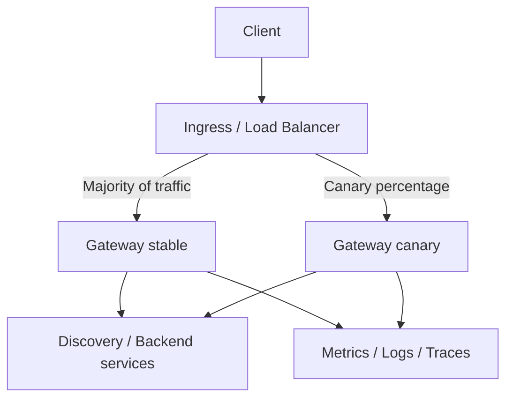

# Canary Deployment, Drift Monitoring, and Rollback for Spring Cloud Gateway

Upgrading Spring Cloud Gateway directly affects the entry point of many microservices. A small bug in a route, filter, HTTP client, or security configuration can trigger widespread errors even while individual downstream services remain healthy. Therefore, introduce the new version into production incrementally by traffic slices, compare behavior against the stable version, and prepare a rollback path before expanding the rollout.

This article focuses on deploying a canary for Gateway, monitoring drift, and executing controlled rollbacks. Distinguish two testing scopes:

- **Gateway binary canary:** run two groups of Gateway instances with different application versions and distribute a fraction of requests to the new group. This is the right approach for evaluating dependency upgrades, Spring Cloud release trains, Reactor Netty, or Spring Boot.
- **Backend canary via Gateway:** keep the Gateway version stable while routing a fraction of requests to a new backend service via routes, the `Weight` predicate, or another routing mechanism. This evaluates the backend and route policy; it does not prove that a new Gateway binary works properly.

If you change the Gateway binary, route definitions, filters, and backends simultaneously, any drift makes it hard to identify which change caused the failure. Split the rollout into changes that can be observed and rolled back independently.

## 1. Preparation Before Creating a Canary

### Lock down the baseline and recoverable artifacts

Before deploying, record the current running state:

- Image digest or artifact version of the stable Gateway; do not record only mutable tags that can be overwritten.
- Resolved Spring Boot, Spring Cloud release train, Spring Cloud Gateway, and HTTP client dependencies.
- Snapshots of route definitions, `default-filters`, Java configs, discovery locator, profiles, and metadata affecting routing.
- Ingress/load balancer, TLS, timeout, connection pool, and health check configurations.
- Secret/config reference versions required to restart the stable version.
- Dashboards and baseline time windows with traffic comparable to the planned rollout time.

The baseline should represent normal traffic by hour, day, and route group. Comparing an off-peak window on the new version against a peak window on the old version easily leads to false conclusions. Flag low-traffic routes so error rates are not judged from just a few requests.

### Check configuration compatibility

If the new Gateway shares a Config Server or configuration store with the old Gateway, ensure configurations are understood by both versions. New properties might be ignored or fail to bind on the old version; new filter factories might not exist in the old binary. You can maintain two separate config revisions, such as `gateway-stable` and `gateway-canary`, provided you manage them as versioned artifacts and know exactly which instances load which revision.

Do not alter route ordering, path rewrites, forwarded headers, retries, or rate limits in the first wave when the goal is validating the Gateway binary. First, run the new binary with configuration equivalent to the stable version. Only after the binary passes criteria should route/filter changes roll out as a separate wave.

### Verify contracts with downstream services

The new Gateway must remain compatible with existing backends. Check upfront:

- Paths, methods, query strings, and headers received by backends after filters.
- Authentication context, cookies, forwarded headers, and CORS.
- Response statuses/headers, compression, streaming, WebSockets, and SSE.
- Whether retries can resend requests; non-idempotent requests need idempotency keys or mechanisms preventing duplicate transactions.
- Timeouts, circuit breakers, rate limiters, and behavior when service discovery temporarily has zero instances.

If old and new Gateways serve the same backend concurrently, API schemas and backend header handling must stay compatible with both during the transition. For database or event contract changes, apply an expand-and-contract strategy so the old version keeps working during the rollback window.

## 2. Choosing the Canary Distribution Point

### Distributing between two Gateway binary groups

During a Gateway upgrade rollout, place both instance groups behind an ingress or load balancer capable of adjusting weights:



Initially, send only a small percentage of requests to the canary group. Both groups should have dedicated readiness checks, identical TLS and security policies, and explicit version labels in telemetry. Do not rely on a health endpoint that only checks whether the process is alive to conclude Gateway can receive traffic; also verify route loading and required dependencies.

Example Kubernetes Service selecting Gateway pods by label:

```yaml
apiVersion: v1
kind: Service
metadata:
  name: gateway-canary
spec:
  selector:
    app: api-gateway
    track: canary
  ports:
    - name: http
      port: 80
      targetPort: 8080
```

This Service only illustrates isolating the canary endpoint. Traffic percentages between `gateway-stable` and `gateway-canary` must be configured at your ingress controller, service mesh, or load balancer. A standard Kubernetes Service does not provide percentage-based traffic splitting across two separate Services. Verify the distribution algorithm and sticky-session behavior of the actual traffic-splitting layer.

To minimize variables, keep replica count, resource limits, JVM settings, routes, and upstreams unchanged in the first trial if load permits. Adjust canary capacity afterward based on measured results and expected traffic.

### Distributing to a new backend with the Weight predicate

When the goal is testing a new backend through Gateway, you can define two routes sharing one weight group:

```yaml
spring:
  cloud:
    gateway:
      routes:
        - id: catalog-stable
          uri: lb://catalog-service-v1
          predicates:
            - Path=/catalog/**
            - Weight=catalog-release, 95
        - id: catalog-canary
          uri: lb://catalog-service-v2
          predicates:
            - Path=/catalog/**
            - Weight=catalog-release, 5
```

Both routes share the group name `catalog-release`; weights represent relative ratios across routes in the group. In this example, the target is roughly a 95/5 split across requests matching the group, not a guarantee of exactly 95 out of every 100 requests. Actual distribution is influenced by the route selection algorithm, request volume, and observation window.

Do not confuse a backend canary with a Gateway binary canary. If both routes live on the same Gateway binary, they do not test a Gateway upgrade. Also remember that weighted route selection typically happens per request; a single user session spanning multiple requests may hit both backends. For WebSockets, selection happens at handshake and the connection stays bound to the chosen backend. If the app needs sticky sessions, implement affinity or shared session state at the appropriate layer.

### Distributing by controlled cohort

To test an internal group, prioritize requests carrying a header injected by a trusted ingress:

```yaml
spring:
  cloud:
    gateway:
      routes:
        - id: catalog-canary-cohort
          order: -10
          uri: lb://catalog-service-v2
          predicates:
            - Path=/catalog/**
            - Header=X-Release-Cohort, canary
        - id: catalog-stable-fallback
          order: 0
          uri: lb://catalog-service-v1
          predicates:
            - Path=/catalog/**
```

The canary route has higher precedence and matches only when the cohort header has the selected value; remaining requests fall through to the stable route. Never allow public Internet clients to set this header themselves if they can reach Gateway directly. Ingress must strip client-supplied headers and inject the header itself based on an authenticated user list or cohort. Signed cookies or a trusted bucketing key can be used if cohort assignment must persist across requests.

## 3. Ramp Traffic in Stages

A sample rollout might progress through these stages:

| Stage | Reference canary ratio | Criteria to advance |
|---|---:|---|
| Smoke test | Synthetic or internal requests only | Health, routes, TLS, auth, and upstream connectivity all pass |
| Small canary | 1–5% | Zero critical errors; enough samples for comparison |
| Expansion 1 | 10–25% | Error rate, latency, and resources close to baseline |
| Expansion 2 | 50% | No drift by route or client cohort; sufficient capacity |
| Complete | 100% | Meets agreed observation window and acceptance thresholds |

These are reference milestones, not a rigid formula. In low-traffic systems, 1% may yield only a handful of requests and insufficient data. In sensitive systems, start with synthetic traffic or internal user cohorts for longer. Each increment needs an observation window long enough to cover traffic cycles and events such as token refreshes, cache misses, or discovery refreshes.

Never auto-increment traffic simply because no alerts fired. A blank dashboard, unexported metrics, or a canary receiving zero traffic will also stay silent on alerts. Before every step, verify the canary is genuinely receiving the expected share of traffic and telemetry is arriving.

## 4. Monitoring Drift Between Stable and Canary

### Compare across identical slices

Tag each Gateway group with version/track labels and keep route IDs consistent across both groups. Compare stable against canary over the same time window, route, method, status class, and client type. Never collapse all routes into one aggregate ratio: a high-volume route can mask errors on a low-volume yet critical route.

Signals to watch:

| Group | Metrics or indicators | Meaning when canary drifts from baseline |
|---|---|---|
| Availability | Request counts, 4xx/5xx, 502/503/504, timeouts, connection resets | Unmatched routes, upstream errors, HTTP client bugs, or closed connections |
| Latency | p50, p95, p99, and upstream connect times | Heavier filters, pool waiting, slow DNS/TLS, or slow service discovery |
| Retries and circuit breaker | Retry counts, retry failures, open/half-open/closed states | New Gateway retries more often or opens circuit breakers prematurely |
| Rate limiting | Rejected request counts, key resolver, Redis latency/errors | Changed buckets, keys, or dependency errors distorting limit policies |
| Resources | CPU, heap, GC pauses, event loop, connection pool, file descriptors | Resource leaks, blocked event loop, or undersized pool capacity |
| Routing | Route ID, upstream URI, request counts per backend | Predicates/order/discovery picking wrong route or skewed traffic split |
| Security | Auth failures, TLS handshake failures, CORS rejections, forwarded headers | Header changes, trust chain drift, or auth config mismatch |
| Streaming | WebSocket handshake/close, connection duration, SSE event delay and disconnects | Unsuitable timeouts, buffering, response filters, or graceful shutdown |

If the application enables Gateway Actuator metrics, inspect the Gateway request timer, typically named `spring.cloud.gateway.requests`. Metric names, tags, and export setup depend on Gateway, Micrometer, and registry versions. Verify actual metrics in the running environment using a secured metrics endpoint or your observability dashboards; do not assume every tag exists across all versions.

Add deployment labels like `gateway_version` or `track` at the scrape/deployment layer to compare cohorts. Avoid using raw URLs, user IDs, tokens, session IDs, or query strings as metric tags, as cardinality spikes rapidly and sensitive data can leak. Use low-cardinality route IDs and status groups; detailed request diagnostics belong in access-controlled logs/traces.

### Distinguish Gateway errors from upstream errors

A `502` or `503` response can originate from Gateway, the load balancer, or the backend. To pinpoint the source, correlate:

- Selected Route ID and upstream URI.
- Status returned by upstream (if any), status generated by Gateway, and HTTP client exceptions.
- Request start/end timestamps and connection wait time.
- Correlation ID or trace ID spanning Gateway and backend.
- Logs from ingress, Gateway, and target service within the same time window.

Never log access tokens, cookies, sensitive request bodies, or arbitrary full headers just to debug failures. Log required fields, redact identifiers, and preserve correlation IDs across hops.

### Define stop criteria before rollout

Abort thresholds must be defined upfront from SLOs and baselines. Useful signals include:

- Canary 5xx or timeout rate rises above the allowed threshold over a sustained window.
- p95/p99 climbs significantly above stable for the same route and load level.
- Abnormal spikes in retries, circuit breaker opens, or rate-limit rejections.
- Canary fails to load all routes, loses discovery connectivity, fails to read secrets, or flips health checks to not-ready.
- Authentication, TLS, CORS errors, or leaks of sensitive headers occur.
- CPU, heap, GC, event loop, or connection pool approach operational limits.

For example, an internal policy might require halting if canary error rate exceeds stable by 1 percentage point or p95 stays 20% higher for 5 consecutive minutes above a minimum request volume. These numbers are purely illustrative of how to write thresholds; choose values matching your SLOs, baseline variance, and each route's criticality. A security flaw or loss of a critical route may demand an immediate stop even when aggregate error rates look low.

## 5. Testing Gateway-Specific Behaviors

### Routes and filters

Send the same request suite through both stable and canary, then compare:

1. Selected Route ID and upstream URI.
2. Path, method, query, and headers after request filters.
3. Status, response headers, and body after response filters.
4. Number of times the backend received the request to catch unexpected retries.
5. Behavior when the backend returns 4xx/5xx, times out, or has zero instances.

Include URLs with/without trailing slashes, encoded paths, missing or duplicate headers, `OPTIONS`/CORS, forwarded headers, and malformed requests. If routes come from discovery or Config Server, test refresh intervals and behavior when the config source is temporarily unreachable.

### TLS and authentication

Test both TLS legs where applicable: client → ingress/Gateway and Gateway → upstream. Verify certificate chains, hostname verification, truststores, mTLS if used, certificate validity, and behavior during upstream certificate rotation. Test expired tokens, audience/issuer checks, cookies, and authorization on both stable and canary.

### WebSocket and SSE

WebSockets and SSE are long-lived connections, so new request rates do not reflect active open connections. Track handshakes, close codes, connection lifetimes, active connection counts, event latency, and disconnects. A Gateway canary may look healthy on REST requests yet drop long-lived connections if idle timeouts, heartbeats, or shutdown policies differ.

When draining traffic off stable, avoid abruptly terminating active WebSocket connections. Stop accepting new connections on draining instances, allow existing connections time to close within operational limits, or signal clients to reconnect per the application contract. For SSE, support `Last-Event-ID` if clients must resume from the last received event. Never mirror WebSockets or mutating requests to two backends for testing.

### Controlled shadow traffic

Shadow traffic can help compare responses without changing what the client receives, but it is safe only when the receiving backend can process repeated requests without side effects. Never duplicate payment POSTs, order creation, email sends, event emissions, data writes, or mutating actions. When shadowing is appropriate, select read requests only, strip sensitive credentials where applicable, cap the rate, and protect personal data. Never treat shadow traffic as a substitute for a real user canary.

## 6. Rollback Runbook

Rollback must follow a previously rehearsed sequence. The goal is shifting new traffic back to the stable group, restoring compatible configuration, and preserving enough evidence for root-cause analysis.

### When to trigger rollback

Trigger a rollback upon hitting agreed stop thresholds, discovering a security flaw, losing a critical route, widespread auth/TLS failures, unexplained upstream error spikes, or losing reliable observability on the canary. Do not wait out the full observation window when data integrity or access control is visibly at risk.

### Recovery sequence

1. **Freeze changes:** halt traffic ramp-up and pause new route/config deployments to keep state reproducible.
2. **Shift traffic back to stable:** set canary weight to 0% or point the ingress/load balancer to the stable Gateway group. Confirm new requests no longer hit the canary.
3. **Drain connections:** stop accepting new connections on the canary; grant active WebSockets/SSE an appropriate window to finish. If emergency termination is unavoidable, rely on client reconnects per the designed contract.
4. **Restore configuration:** if drift came from routes/filters/configs, reload the last known-good revision matching the stable binary. Never push configs understood only by the new Gateway to the old binary.
5. **Restore artifacts:** if needed, redeploy the saved image digest or artifact version. Verify matching dependencies and secrets.
6. **Post-rollback verification:** run synthetic requests covering critical routes, auth, TLS, service discovery, rate limiting, and backends. Confirm error rates and latency return to the baseline band.
7. **Preserve evidence:** archive rollout timestamps, traffic split ratios, config revisions, image digests, route IDs, trace IDs, metrics, and relevant logs for post-incident review.

Rolling back a binary and rolling back route config are two distinct actions. If the bug stems from a route/filter change, reverting only the binary may not restore behavior. Conversely, if the bug is in the new binary, reverting route config while leaving the buggy binary running will not fix it either. The runbook must state explicitly which artifact and config revisions belong together.

### Example traffic switch via distribution config

With an ingress or load balancer supporting weights, rollback may look like setting:

```yaml
weights:
  gateway-stable: 100
  gateway-canary: 0
```

This is an illustrative structure, not a universal YAML schema for all ingresses. Use the syntax of your deployed controller/service mesh/load balancer and confirm the state has taken effect before declaring rollback complete.

## 7. Rehearsing Rollback Before Production

An untested rollback can fail due to a wrong Service name, overwritten image tag, rotated secret, or incompatible legacy configuration. Before opening a production rollout, rehearse in staging:

- Place stable and canary behind the same test ingress.
- Ramp canary traffic through planned stages.
- Inject a controlled fault, such as a canary route returning 503 or a failing health check.
- Verify alerts pinpoint the exact cohort and route.
- Shift traffic back to stable, drain the canary, and confirm new requests hit only stable.
- Restore config and artifact from snapshots, then re-run smoke tests.
- Measure elapsed time from fault detection until traffic returns to steady state.

Separately rehearse long-lived connections, Config Server outages, discovery returning zero instances, and invalid secrets/TLS certificates. Never induce faults by breaking production systems or issuing side-effecting requests.

## 8. Pre-, During-, and Post-Rollout Checklist

### Before rollout

- [ ] Saved the stable image digest, BOM/dependency versions, route/config revision, and secret references.
- [ ] Captured baselines by route, time window, method, and comparable load.
- [ ] Canary has dedicated readiness/liveness probes, resource limits, telemetry, and version labels.
- [ ] Shared configuration is compatible with both binaries or revisions are cleanly separated.
- [ ] Tested routes, filters, auth, TLS, discovery, retries, rate limiting, circuit breakers, and streaming.
- [ ] Assigned an owner, defined stop thresholds, and rehearsed the rollback runbook.

### During rollout

- [ ] Verified canary genuinely receives the target traffic percentage.
- [ ] Compared stable/canary across identical routes and time windows.
- [ ] Monitored 4xx/5xx, timeouts, p95/p99, retries, circuit breakers, rate limits, and resources.
- [ ] Inspected route IDs, upstreams, and header forwarding upon any drift.
- [ ] Increased traffic only with sufficient samples and zero breached stop thresholds.
- [ ] Monitored WebSockets, SSE, and long-lived connections separately.

### After rollout or rollback

- [ ] 100% of new traffic reaches the chosen version; no unintended instances receive requests.
- [ ] Old connections drained cleanly or handled reconnects per policy.
- [ ] Synthetic tests confirm routes, auth, TLS, and upstreams work.
- [ ] Metrics/logs/traces are archived alongside image digest and config revision.
- [ ] If rolled back, confirmed baseline recovery and documented root cause before the next attempt.

Canary deployments work when every change targets a clear cohort, has a baseline to compare against, and has a verified path back. With Spring Cloud Gateway, watch routes, filters, upstreams, and long-lived connections individually to catch drift at the exact layer before opening traffic to the entire system.
