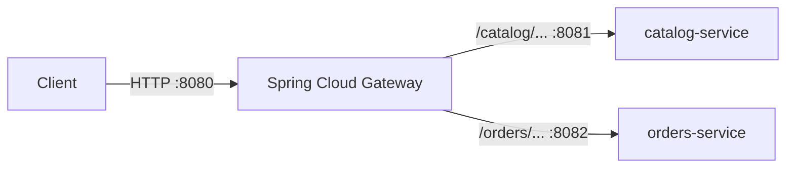

# Building a Gateway with Multiple Services and Verifying Route Selection

In a microservices architecture, clients should have a single stable entry point instead of needing to know the address and port of every service. Spring Cloud Gateway receives requests at that entry point, selects the target service using route predicates, and then runs a filter chain to normalize the path, add headers, and apply policies before forwarding the request.

This hands-on lab builds a gateway and two services: `catalog-service` and `orders-service`. We will send requests through the gateway, verify which service receives each request, inspect the transformed path, and check the headers added by the gateway. The final sections extend the configuration to service discovery, authentication, rate limiting, circuit breakers, retries, TLS, and request observability to operate the entry point securely.

## 1. Objectives and Architecture Diagram

After completing this lab, you can:

- Create separate routes for multiple services using the `Path` predicate.
- Explain how the gateway selects a route and forwards requests to the corresponding URI.
- Use `StripPrefix`, `RewritePath`, `AddRequestHeader`, and `AddResponseHeader` in a filter chain.
- Verify route selection using the response body, response headers, and target service logs.
- Understand how to transition from fixed addresses to service discovery and add protective layers for deployment.

Local execution architecture:



The gateway listens on port `8080`. The two backend services listen on `8081` and `8082`, respectively. Clients only call URLs starting with `/api/catalog/` or `/api/orders/`.

## 2. Preparing the Three Applications

Use compatible Spring Boot and Spring Cloud versions according to the Spring Cloud release train. The gateway in this lab uses WebFlux; the two backend services can use Spring MVC. Do not mix starter versions across different release trains.

In the gateway application, add the Spring Cloud Gateway Server WebFlux and Actuator starters. Older release trains use the artifact name `spring-cloud-starter-gateway`; newer releases may use `spring-cloud-starter-gateway-server-webflux`.

```xml
<dependency>
    <groupId>org.springframework.cloud</groupId>
    <artifactId>spring-cloud-starter-gateway-server-webflux</artifactId>
</dependency>
<dependency>
    <groupId>org.springframework.boot</groupId>
    <artifactId>spring-boot-starter-actuator</artifactId>
</dependency>
```

In each backend service, add `spring-boot-starter-web`. Configure the application names and ports for the two applications as follows.

`catalog-service/src/main/resources/application.yml`:

```yaml
spring:
  application:
    name: catalog-service
server:
  port: 8081
```

`orders-service/src/main/resources/application.yml`:

```yaml
spring:
  application:
    name: orders-service
server:
  port: 8082
```

Create a simple endpoint to identify which service handled the request. For example, in `catalog-service`:

```java
@RestController
@RequestMapping("/catalog")
public class CatalogController {
    @GetMapping("/items/{id}")
    public Map<String, String> getItem(
            @PathVariable String id,
            @RequestHeader(name = "X-Gateway-Route", required = false) String route) {
        return Map.of(
                "service", "catalog-service",
                "id", id,
                "gatewayRoute", Objects.toString(route, "missing")
        );
    }
}
```

This endpoint accepts `GET /catalog/items/{id}`. Add imports for `java.util.Map` and `java.util.Objects`, along with the required Spring MVC imports.

In `orders-service`, create a similar endpoint:

```java
@RestController
@RequestMapping("/orders")
public class OrdersController {
    @GetMapping("/{id}")
    public Map<String, String> getOrder(
            @PathVariable String id,
            @RequestHeader(name = "X-Gateway-Route", required = false) String route) {
        return Map.of(
                "service", "orders-service",
                "id", id,
                "gatewayRoute", Objects.toString(route, "missing")
        );
    }
}
```

This endpoint accepts `GET /orders/{id}`. Both endpoints intentionally return the service name and the `X-Gateway-Route` value; this lets us verify both the destination and the header forwarded by the gateway.

## 3. Declaring Routes and the Filter Chain

In `gateway/src/main/resources/application.yml`, declare two routes:

```yaml
server:
  port: 8080

spring:
  application:
    name: edge-gateway
  cloud:
    gateway:
      routes:
        - id: catalog-route
          order: 0
          uri: http://localhost:8081
          predicates:
            - Path=/api/catalog/**
          filters:
            - StripPrefix=1
            - AddRequestHeader=X-Gateway-Route,catalog
            - AddResponseHeader=X-Route-Id,catalog

        - id: orders-route
          order: 0
          uri: http://localhost:8082
          predicates:
            - Path=/api/orders/**
          filters:
            - RewritePath=/api/orders/(?<remaining>.*), /orders/$\{remaining}
            - AddRequestHeader=X-Gateway-Route,orders
            - AddResponseHeader=X-Route-Id,orders
```

Meaning of each component:

| Component | Role in this lab |
|---|---|
| `id` | Unique identifier for the route, useful when inspecting configuration and logs. |
| `uri` | Target service address. Currently uses a fixed URL for local execution. |
| `Path` | Predicate that only matches requests whose path belongs to the corresponding branch. |
| `StripPrefix=1` | Removes one leading path segment. `/api/catalog/items/42` becomes `/catalog/items/42`. |
| `RewritePath` | Uses a regular expression to transform `/api/orders/42` into `/orders/42`. |
| `AddRequestHeader` | Adds a header before the request is forwarded to the backend service. |
| `AddResponseHeader` | Adds a header to the response returned to the client. |

In the `catalog` route, `StripPrefix=1` removes the `/api` segment; `/catalog` remains so it matches `@RequestMapping("/catalog")`. In the `orders` route, `RewritePath` replaces the entire `/api/orders/` prefix with `/orders/`. The backslash in `/$\{remaining}` escapes the expression so Spring does not treat `${remaining}` as a configuration placeholder; the gateway uses the `remaining` regex group to build the new path.

Each route has its own predicate, so a request to `/api/catalog/items/42` only matches `catalog-route`, while `/api/orders/42` only matches `orders-route`. If overlapping predicates are introduced later, set `order` so specific routes are evaluated before general routes. Multiple predicates on the same route must all match for the route to be selected.

The filter chain processes the request before forwarding and can process the response on its way back. Filter order affects the values seen by subsequent filters; therefore, place path transformations and header manipulations deliberately and verify them with real requests.

## 4. Starting Up and Verifying Route Selection

Start the two backend services first, then start the gateway. Make sure all three applications are ready.

Call the catalog service through the gateway:

```bash
curl -i http://localhost:8080/api/catalog/items/42
```

The expected response has headers and body similar to:

```http
HTTP/1.1 200 OK
X-Route-Id: catalog
Content-Type: application/json

{"service":"catalog-service","id":"42","gatewayRoute":"catalog"}
```

This result proves three things: the `/api/catalog/**` predicate selected `catalog-route`; the gateway transformed the path to `/catalog/items/42`; and the `X-Gateway-Route: catalog` header reached the backend service. The `X-Route-Id: catalog` header was added to the response at the gateway.

Next, test the orders route:

```bash
curl -i http://localhost:8080/api/orders/9001
```

Expected body:

```json
{"service":"orders-service","id":"9001","gatewayRoute":"orders"}
```

The response must include `X-Route-Id: orders`. The service received the path `/orders/9001`, showing that `RewritePath` worked.

Test a path without a route:

```bash
curl -i http://localhost:8080/api/unknown/1
```

The gateway normally returns `404 Not Found` because no route matches. This differs from a `5xx` error when a route matched but the target service failed to respond.

To complete verification, call each service endpoint directly on ports `8081` and `8082`, then compare with the results through the gateway. Next, stop `catalog-service` alone and call the catalog URL again: the route is still selected, but the gateway cannot connect to the backend, so the response will be a `5xx` gateway error. Restart the service before proceeding to the following sections.

## 5. Switching Routes to Service Discovery

Fixed URLs are suitable for a small lab. In a microservices environment, the number of instances and IP addresses can change. Once a discovery client and Spring Cloud LoadBalancer are integrated, change the route URI to the service ID:

```yaml
spring:
  cloud:
    gateway:
      routes:
        - id: catalog-route
          uri: lb://catalog-service
          predicates:
            - Path=/api/catalog/**
          filters:
            - StripPrefix=1
        - id: orders-route
          uri: lb://orders-service
          predicates:
            - Path=/api/orders/**
          filters:
            - RewritePath=/api/orders/(?<remaining>.*), /orders/$\{remaining}
```

Add an appropriate discovery client, such as `spring-cloud-starter-netflix-eureka-client`, to the gateway and the services that need to register. Configure the registry address according to your environment. Each service registers under its corresponding `spring.application.name`; the gateway looks up the service ID and LoadBalancer picks an instance currently published by the registry.

The `lb://...` URI uses discovery to locate instances. The `spring.cloud.gateway.discovery.locator.enabled=true` option can automatically generate routes by service ID, typically with paths like `/<serviceId>/**`. Only enable automatic route generation when you control the list of published services; for public APIs, explicitly declared routes help limit the attack surface and keep URLs stable.

## 6. Adding Authentication and Rate Limiting

With a WebFlux gateway, you can validate JWT access tokens at the entry point using Spring Security Resource Server. Add `spring-boot-starter-security` and `spring-boot-starter-oauth2-resource-server`, then configure the identity provider's issuer:

```yaml
spring:
  security:
    oauth2:
      resourceserver:
        jwt:
          issuer-uri: ${OIDC_ISSUER_URI}
```

Create a security chain to allow only public health checks and require authentication for all remaining requests:

```java
@Configuration
public class GatewaySecurityConfig {
    @Bean
    SecurityWebFilterChain securityWebFilterChain(ServerHttpSecurity http) {
        return http
                .csrf(ServerHttpSecurity.CsrfSpec::disable)
                .authorizeExchange(exchange -> exchange
                        .pathMatchers("/actuator/health").permitAll()
                        .anyExchange().authenticated())
                .oauth2ResourceServer(oauth2 -> oauth2.jwt(Customizer.withDefaults()))
                .build();
    }
}
```

This is a baseline configuration for stateless APIs; add rules by path, scope, or role according to your system's policies. Backend services still need appropriate trust boundaries: do not blindly trust an identity header sent by a client, and consider validating tokens or service identity at the backend if the threat model requires it.

To rate-limit traffic with Redis, add `spring-boot-starter-data-redis-reactive` and declare a `KeyResolver`. The example below uses the authenticated principal's name as the key:

```java
@Bean
KeyResolver principalKeyResolver() {
    return exchange -> exchange.getPrincipal()
            .map(Principal::getName)
            .defaultIfEmpty("anonymous");
}
```

Add the filter to the route you want to limit:

```yaml
filters:
  - name: RequestRateLimiter
    args:
      key-resolver: "#{@principalKeyResolver}"
      redis-rate-limiter.replenishRate: 10
      redis-rate-limiter.burstCapacity: 20
      redis-rate-limiter.requestedTokens: 1
```

This example allows replenishing 10 tokens per second, with a burst capacity of 20 tokens, and each request consumes one token. When the threshold is exceeded, the gateway returns `429 Too Many Requests`. Tune the limits based on actual load and individual API policies. If unauthenticated, the `anonymous` key can group all clients into a single bucket; do not use an arbitrary client-controlled header as the user identifier.

## 7. Circuit Breaker and Retry for Transient Errors

A circuit breaker prevents the gateway from continuing to call a persistently failing backend. With Spring Cloud CircuitBreaker Reactor Resilience4J, add the `spring-cloud-starter-circuitbreaker-reactor-resilience4j` starter, then attach the filter to the route:

```yaml
filters:
  - name: CircuitBreaker
    args:
      name: catalogBreaker
      fallbackUri: forward:/fallback/catalog
```

Create a fallback endpoint in the gateway application:

```java
@RestController
public class GatewayFallbackController {
    @GetMapping("/fallback/catalog")
    public ResponseEntity<Map<String, String>> catalogFallback() {
        return ResponseEntity.status(HttpStatus.SERVICE_UNAVAILABLE)
                .body(Map.of(
                        "service", "catalog-service",
                        "status", "temporarily_unavailable"
                ));
    }
}
```

A fallback should return actionable information and never expose stack traces or internal data. Circuit opening thresholds, timeouts, and measurement windows can be configured according to backend characteristics; those values should be tested under load and failure scenarios.

Retries are only suitable for transient errors and requests that can be safely repeated. For example, restrict retries to GET when receiving specific gateway error codes:

```yaml
  - name: Retry
    args:
      retries: 2
      methods: GET
      statuses: BAD_GATEWAY,SERVICE_UNAVAILABLE,GATEWAY_TIMEOUT
      backoff:
        firstBackoff: 50ms
        maxBackoff: 500ms
        factor: 2
        basedOnPreviousValue: false
```

Do not blindly retry write operations such as POST or payment requests: the backend may have already executed the operation before the connection dropped. If business logic requires retries, design idempotency keys and duplicate-handling rules in the target service. Circuit breakers and retries also need to be configured together to avoid amplifying load when a backend is degraded.

## 8. Enabling TLS and Request Observability

To encrypt connections from clients to the gateway, configure a certificate for the HTTPS listener. For example, using a PKCS12 keystore provided via a deployment environment secret:

```yaml
server:
  port: 8443
  ssl:
    enabled: true
    key-store: file:/run/secrets/gateway.p12
    key-store-password: ${GATEWAY_KEYSTORE_PASSWORD}
    key-store-type: PKCS12
    key-alias: gateway
```

Clients now call `https://<gateway-host>:8443/...`. If the gateway connects to backends over HTTPS, use `https://...` URIs and configure a trusted trust store/CA for the gateway's HTTP client. Do not disable certificate verification in production; manage private keys and passwords with a secret manager, and maintain a certificate renewal process.

Actuator helps inspect health and loaded routes. Example configuration exposing only the necessary endpoints:

```yaml
management:
  endpoints:
    web:
      exposure:
        include: health,info,metrics,gateway,prometheus
  endpoint:
    health:
      probes:
        enabled: true
```

Add the Micrometer Prometheus registry if the system collects metrics with Prometheus. Depending on the Spring Boot and Spring Cloud Gateway versions, the gateway endpoint may need to be enabled explicitly; check the documentation for your exact release train. You can use `/actuator/health` to check status, `/actuator/gateway/routes` to view registered routes, and `/actuator/metrics` to explore exported metrics.

In production, restrict Actuator access via an admin network or separate authentication; do not expose route configurations, detailed metrics, or environment info to Internet clients. Use Micrometer Observation/Tracing to correlate traces across the gateway and services. Logs should include request ID, route ID, HTTP status, and processing time; avoid logging access tokens, cookies, sensitive data, or entire request bodies.

## 9. Verification Tests and Troubleshooting

Perform the following checks in order and record the results:

1. Call `/api/catalog/items/42`; confirm the body has `service=catalog-service`, `gatewayRoute=catalog`, and the response has `X-Route-Id: catalog`.
2. Call `/api/orders/9001`; confirm the body has `service=orders-service`, `gatewayRoute=orders`, and the response has `X-Route-Id: orders`.
3. Call `/api/unknown/1`; confirm the gateway returns `404` because no route matches.
4. Shut down one backend; confirm the route still matches but the request fails at the backend connection step. After enabling the circuit breaker, retry several times and verify the fallback.
5. Send requests missing a JWT or with an expired JWT; confirm the authentication policy returns `401` or `403` as appropriate.
6. Send a burst of requests exceeding the limit; confirm the rate limiter returns `429`, then wait for tokens to replenish and retry.
7. Test HTTPS with a valid certificate and an untrusted certificate; the gateway/client must reject invalid connections.
8. Inspect health, routes, metrics, and traces; confirm a request can be traced through the gateway to the backend.

Common symptoms:

| Symptom | Cause to check |
|---|---|
| `404` from gateway | Path does not match any predicate, route was not loaded, or submitted path has the wrong prefix. |
| Backend returns `404` | `StripPrefix`/`RewritePath` produced a path that differs from the controller mapping. |
| `502` or `503` | Backend is down, wrong host/port, service registry has no instances, or circuit breaker is open. |
| Header missing at backend | Filter was not attached to the selected route or header names do not match. |
| `401` or `403` | Missing/expired token, wrong issuer/audience, or insufficient scope/role. |
| `429` | Applied rate-limit key and thresholds; check the principal and Redis status. |
| TLS handshake failure | Expired certificate, hostname mismatch, untrusted CA, or incorrect keystore configuration. |

**Completion criteria:** the two public URLs reach the exact two services; paths and headers at the backends match the configuration; paths without a route receive `404`; and the learner can explain which predicate selected each route and how each filter modified the request/response. Service discovery, authentication, rate limiting, circuit breakers, retries, TLS, and observability should be enabled step-by-step and verified with corresponding scenarios before applying them in a real environment.
