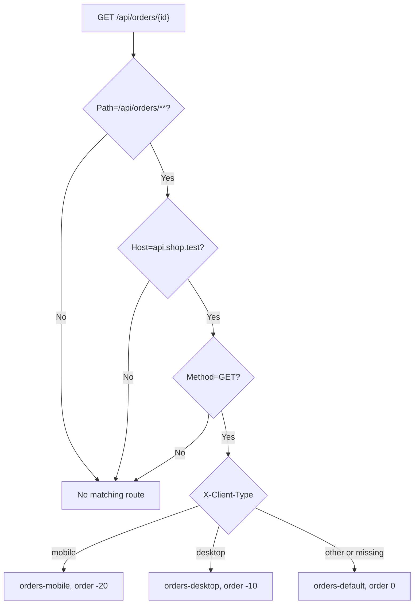

# Combining Path, Host, Method, and Header in a Routing Scenario

## 1. Practice Scenario

An online store exposes its orders API behind a single hostname:

```text
https://api.shop.test/api/orders/{orderId}
```

This is the designed public URL. In the local lab, we use HTTP on port 8080 and set the Host header manually to focus on predicates; TLS can be configured later at the ingress/Gateway.

The Gateway needs to route order read requests by client type:

- **Mobile** apps send the header `X-Client-Type: mobile`.
- **Desktop** apps send the header `X-Client-Type: desktop`.
- Other clients or requests missing the header use the **default** route.
- Only hostname `api.shop.test`, path `/api/orders/**`, and HTTP method `GET` are accepted into this route group.

In this hands-on lab, all three routes proxy to a test backend at `localhost:8081`. The backend echoes back the route class attached to the request by the Gateway so the learner can see which route matched. This keeps the lab compact while still demonstrating how **Path + Host + Method + Header** work together.

**Expected results**

| Request | Selected route |
|---|---|
| Correct host, GET, correct path, mobile header | `orders-mobile` |
| Correct host, GET, correct path, desktop header | `orders-desktop` |
| Correct host, GET, correct path, other or missing header | `orders-default` |
| Wrong host, wrong path, or wrong method | No matching route; Gateway returns 404 |

## 2. Learning Objectives

After completing this lab, you can:

1. Explain that predicates within **the same route** are combined using AND logic.
2. Combine `Path`, `Host`, `Method`, and `Header` to describe a complete routing condition.
3. Use a regular expression in a Header predicate to match header values.
4. Order routes using `order` so specific routes are evaluated before the default route.
5. Use `StripPrefix` and `SetRequestHeader` to forward requests to the backend.
6. Test both matching and non-matching cases with `curl`.
7. Diagnose 404s caused by unmet predicates and distinguish them from upstream connection errors.

## 3. Understanding Predicate Combination Logic

### 3.1. Predicates Within a Route Are ANDed

Spring Cloud Gateway evaluates a route's predicates using **AND** logic. A request only matches when every predicate in the route returns true.

For the mobile route:

```text
Path=/api/orders/**
AND Host=api.shop.test
AND Method=GET
AND Header X-Client-Type matches ^mobile$
------------------------------------------
=> Only requests satisfying all four conditions select the orders-mobile route
```

For example, the following request matches:

```http
GET /api/orders/ORD-1001 HTTP/1.1
Host: api.shop.test
X-Client-Type: mobile
```

If one condition changes, the mobile route no longer matches:

- `Host: admin.shop.test`: fails the Host predicate.
- `GET /api/products/1001`: fails the Path predicate.
- `POST /api/orders/ORD-1001`: fails the Method predicate.
- `X-Client-Type: desktop`: fails the Header predicate.

### 3.2. OR Lives Inside Certain Predicates, Not Between Predicate Lines

Separately listed predicates in a route are joined by AND. A single predicate factory can accept multiple patterns or a regex representing multiple choices.

For example, a Path predicate with two patterns:

```yaml
predicates:
  - Path=/api/orders/**,/api/purchases/**
  - Host=api.shop.test
  - Method=GET
```

Meaning:

```text
(Path=/api/orders/** OR Path=/api/purchases/**)
AND Host=api.shop.test
AND Method=GET
```

A Header predicate can use a regex to accept one of several values:

```yaml
predicates:
  - Header=X-Client-Type, ^(mobile|tablet)$
```

In the main lab, we use exact regexes `^mobile$` and `^desktop$` so the results are easy to observe.

### 3.3. Route Order Determines Which Route Is Selected First

A request can satisfy multiple routes. The Gateway evaluates routes in priority order; a route with a smaller `order` value is evaluated first. Therefore, the routes for mobile/desktop must come before the default route, which has broader conditions.



Do not rely on YAML declaration order when routes have overlapping conditions. Set `order` explicitly and test requests that satisfy multiple routes.

## 4. Preparing the Two Applications

We run two processes:

| Application | Port | Role |
|---|---:|---|
| Gateway | 8080 | Receives requests and evaluates route predicates |
| Orders backend | 8081 | Receives requests after the Gateway selects a route |

Use Spring Boot 4.2.x and Spring Cloud 2026.0.x as the reference versions for the examples. The Spring Cloud BOM manages the Gateway version; do not add a separate version to the starter.

### 4.1. Creating the Gateway Project

In Maven, use the core dependencies:

```xml
<?xml version="1.0" encoding="UTF-8"?>
<project xmlns="http://maven.apache.org/POM/4.0.0"
         xmlns:xsi="http://www.w3.org/2001/XMLSchema-instance"
         xsi:schemaLocation="http://maven.apache.org/POM/4.0.0 https://maven.apache.org/xsd/maven-4.0.0.xsd">
    <modelVersion>4.0.0</modelVersion>

<parent>
    <groupId>org.springframework.boot</groupId>
    <artifactId>spring-boot-starter-parent</artifactId>
    <version>4.2.0</version>
    <relativePath/>
</parent>

<groupId>com.example</groupId>
<artifactId>gateway</artifactId>
<version>1.0.0</version>

<properties>
    <java.version>21</java.version>
    <spring-cloud.version>2026.0.0</spring-cloud.version>
</properties>

<dependencyManagement>
    <dependencies>
        <dependency>
            <groupId>org.springframework.cloud</groupId>
            <artifactId>spring-cloud-dependencies</artifactId>
            <version>${spring-cloud.version}</version>
            <type>pom</type>
            <scope>import</scope>
        </dependency>
    </dependencies>
</dependencyManagement>

<dependencies>
    <dependency>
        <groupId>org.springframework.cloud</groupId>
        <artifactId>spring-cloud-starter-gateway-server-webflux</artifactId>
    </dependency>
</dependencies>
</project>
```

This is **Gateway Server WebFlux**. Do not add `spring-boot-starter-web` or the Gateway MVC starter to the same application.

Main class:

```java
package com.example.gateway;

import org.springframework.boot.SpringApplication;
import org.springframework.boot.autoconfigure.SpringBootApplication;

@SpringBootApplication
public class GatewayApplication {
    public static void main(String[] args) {
        SpringApplication.run(GatewayApplication.class, args);
    }
}
```

### 4.2. Creating the Orders Backend

The backend is a separate Spring Boot application. Use Spring Boot 4.2.x and add `spring-boot-starter-webflux`. Do not add the Spring Cloud Gateway starter to the backend.

Minimal backend POM:

```xml
<?xml version="1.0" encoding="UTF-8"?>
<project xmlns="http://maven.apache.org/POM/4.0.0"
         xmlns:xsi="http://www.w3.org/2001/XMLSchema-instance"
         xsi:schemaLocation="http://maven.apache.org/POM/4.0.0 https://maven.apache.org/xsd/maven-4.0.0.xsd">
<modelVersion>4.0.0</modelVersion>

<parent>
    <groupId>org.springframework.boot</groupId>
    <artifactId>spring-boot-starter-parent</artifactId>
    <version>4.2.0</version>
    <relativePath/>
</parent>

<groupId>com.example</groupId>
<artifactId>orders-backend</artifactId>
<version>1.0.0</version>

<properties>
    <java.version>21</java.version>
</properties>

<dependencies>
    <dependency>
        <groupId>org.springframework.boot</groupId>
        <artifactId>spring-boot-starter-webflux</artifactId>
    </dependency>
</dependencies>
</project>
```

```yaml
# orders-backend application.yml
server:
  port: 8081
```

Controller that returns the request info:

```java
package com.example.orders;

import org.springframework.web.bind.annotation.GetMapping;
import org.springframework.web.bind.annotation.PathVariable;
import org.springframework.web.bind.annotation.RequestHeader;
import org.springframework.web.bind.annotation.RestController;

@RestController
public class OrdersController {

    public record OrderEcho(
            String orderId,
            String clientType,
            String routeClass) {}

    @GetMapping("/orders/{orderId}")
    public OrderEcho getOrder(
            @PathVariable String orderId,
            @RequestHeader(value = "X-Client-Type", required = false)
            String clientType,
            @RequestHeader(value = "X-Route-Class", required = false)
            String routeClass) {

        return new OrderEcho(
                orderId,
                clientType == null ? "missing" : clientType,
                routeClass == null ? "missing" : routeClass);
    }
}
```

Backend main class:

```java
package com.example.orders;

import org.springframework.boot.SpringApplication;
import org.springframework.boot.autoconfigure.SpringBootApplication;

@SpringBootApplication
public class OrdersApplication {
    public static void main(String[] args) {
        SpringApplication.run(OrdersApplication.class, args);
    }
}
```

Example response:

```json
{
  "orderId": "ORD-1001",
  "clientType": "mobile",
  "routeClass": "mobile"
}
```

`X-Route-Class` is a header set by the Gateway to illustrate which route was selected. The demo backend does not use this header for authorization.

## 5. Configuring the Four Conditions in the Gateway

### 5.1. Declaring Three Routes in application.yml

Put the following content in the Gateway's `application.yml` file:

```yaml
server:
  port: 8080

spring:
  cloud:
    gateway:
      server:
        webflux:
          routes:
            # Dedicated route for mobile apps.
            - id: orders-mobile
              order: -20
              uri: http://localhost:8081
              predicates:
                - Path=/api/orders/**
                - Host=api.shop.test
                - Method=GET
                - Header=X-Client-Type, ^mobile$
              filters:
                - StripPrefix=1
                - SetRequestHeader=X-Route-Class, mobile

            # Dedicated route for desktop apps.
            - id: orders-desktop
              order: -10
              uri: http://localhost:8081
              predicates:
                - Path=/api/orders/**
                - Host=api.shop.test
                - Method=GET
                - Header=X-Client-Type, ^desktop$
              filters:
                - StripPrefix=1
                - SetRequestHeader=X-Route-Class, desktop

            # Default route: accepts other client types or requests without the header.
            - id: orders-default
              order: 0
              uri: http://localhost:8081
              predicates:
                - Path=/api/orders/**
                - Host=api.shop.test
                - Method=GET
              filters:
                - StripPrefix=1
                - SetRequestHeader=X-Route-Class, default
```

### 5.2. Reading Each Predicate

| Configuration | Meaning in the lab |
|---|---|
| `Path=/api/orders/**` | Accepts only paths starting with `/api/orders/` and sub-paths |
| `Host=api.shop.test` | Accepts only requests whose Host header matches this hostname |
| `Method=GET` | Accepts only HTTP GET |
| `Header=X-Client-Type, ^mobile$` | Header `X-Client-Type` must have a value matching regex `^mobile$` |
| `Header=X-Client-Type, ^desktop$` | Header must have the exact value `desktop` |
| `order: -20` | The mobile route is evaluated before desktop and default |
| `order: -10` | The desktop route is evaluated after mobile but before default |
| `order: 0` | The default route is the broadest route in the group |

**Matching condition for the mobile route:** correct Path **AND** correct Host **AND** Method is GET **AND** Header matches mobile.

The default route has no Header predicate. Therefore, a request with header `tablet` or missing `X-Client-Type` still matches default if the three Path/Host/Method conditions are satisfied.

### 5.3. Why Use SetRequestHeader?

`SetRequestHeader=X-Route-Class, mobile` overwrites any existing header with the same name. If a client tries to send:

```http
X-Route-Class: admin
```

The Gateway still resets it to `mobile` when the mobile route matches. This prevents the client from spoofing **the lab's diagnostic header**. In real systems, identity/tenant/role headers must be established from the authenticated principal, not taken from client-supplied headers.

### 5.4. Why Use StripPrefix=1?

The client calls:

```text
/api/orders/ORD-1001
```

`StripPrefix=1` drops the first segment `api` before proxying. The backend receives:

```text
/orders/ORD-1001
```

This modifies the path after the route has already been selected. The `Path` predicate still evaluates the original path from the client.

## 6. Running the Two Applications

### 6.1. Start the Backend First

In the Orders backend project terminal:

```bash
./mvnw spring-boot:run
```

Verify the backend directly:

```bash
curl -i http://localhost:8081/orders/ORD-1001
```

If running Windows PowerShell, use `curl.exe` instead of the `curl` alias when you need to pass curl flags.

The multi-line commands in this article use Bash syntax. In PowerShell, you can run the equivalent command on a single line:

```powershell
curl.exe -i -H "Host: api.shop.test" -H "X-Client-Type: mobile" http://localhost:8080/api/orders/ORD-1001
```

### 6.2. Start the Gateway

In a second terminal for the Gateway project:

```bash
./mvnw spring-boot:run
```

The Gateway listens at `localhost:8080`. Only begin testing predicates after both applications have started successfully.

## 7. Testing Each Routing Case

In the commands below, the connection URL is `localhost:8080`, while the `Host` header simulates the public hostname `api.shop.test`. This lets you run the lab on a personal machine without configuring DNS.

### 7.1. Mobile Client — Must Select orders-mobile

```bash
curl -i \
  -H "Host: api.shop.test" \
  -H "X-Client-Type: mobile" \
  http://localhost:8080/api/orders/ORD-1001
```

Expected result:

```json
{
  "orderId": "ORD-1001",
  "clientType": "mobile",
  "routeClass": "mobile"
}
```

Explanation: all four conditions of the `orders-mobile` route are true. `StripPrefix` changes the path to `/orders/ORD-1001` before sending to the backend; `SetRequestHeader` sets `X-Route-Class: mobile`.

### 7.2. Desktop Client — Must Select orders-desktop

```bash
curl -i \
  -H "Host: api.shop.test" \
  -H "X-Client-Type: desktop" \
  http://localhost:8080/api/orders/ORD-1002
```

Expected result has `routeClass` equal to `desktop`.

### 7.3. Tablet Client — Must Fall Into the default Route

```bash
curl -i \
  -H "Host: api.shop.test" \
  -H "X-Client-Type: tablet" \
  http://localhost:8080/api/orders/ORD-1003
```

Expected result:

```json
{
  "orderId": "ORD-1003",
  "clientType": "tablet",
  "routeClass": "default"
}
```

The `tablet` header does not match the mobile or desktop regex. However, Path, Host, and Method are still true, so the `orders-default` route is selected.

### 7.4. Missing X-Client-Type — Still Selects the default Route

```bash
curl -i \
  -H "Host: api.shop.test" \
  http://localhost:8080/api/orders/ORD-1004
```

The backend returns `clientType` as `missing` and `routeClass` as `default`. This is intentional because the default route does not require a Header predicate.

### 7.5. Wrong Host — No Matching Route

```bash
curl -i \
  -H "Host: admin.shop.test" \
  -H "X-Client-Type: mobile" \
  http://localhost:8080/api/orders/ORD-1005
```

Expected result: **404 Not Found** from the Gateway because no route with `Host=api.shop.test` matches. The backend does not receive the request.

### 7.6. Wrong Path — No Matching Route

```bash
curl -i \
  -H "Host: api.shop.test" \
  -H "X-Client-Type: mobile" \
  http://localhost:8080/api/products/1005
```

Expected result: **404 Not Found** because `/api/products/1005` does not match `Path=/api/orders/**`.

### 7.7. Wrong Method — No Matching Route

```bash
curl -i -X POST \
  -H "Host: api.shop.test" \
  -H "X-Client-Type: mobile" \
  -H "Content-Type: application/json" \
  -d '{"note":"test"}' \
  http://localhost:8080/api/orders/ORD-1006
```

Expected result: **404 Not Found** because all routes in the lab require `Method=GET`. The Gateway does not automatically return 405 just because the path exists; when no route matches, it typically returns 404.

### 7.8. Header Value With Different Letter Case

```bash
curl -i \
  -H "Host: api.shop.test" \
  -H "X-Client-Type: Mobile" \
  http://localhost:8080/api/orders/ORD-1007
```

Expected result: route `orders-default`. HTTP header names are case-insensitive, but the value regex `^mobile$` is case-sensitive. `Mobile` does not match `mobile`.

## 8. Test Result Matrix

| # | Host | Path | Method | X-Client-Type | Result |
|---:|---|---|---|---|---|
| 1 | api.shop.test | /api/orders/1 | GET | mobile | orders-mobile |
| 2 | api.shop.test | /api/orders/2 | GET | desktop | orders-desktop |
| 3 | api.shop.test | /api/orders/3 | GET | tablet | orders-default |
| 4 | api.shop.test | /api/orders/4 | GET | Not sent | orders-default |
| 5 | admin.shop.test | /api/orders/5 | GET | mobile | 404 |
| 6 | api.shop.test | /api/products/6 | GET | mobile | 404 |
| 7 | api.shop.test | /api/orders/7 | POST | mobile | 404 |
| 8 | api.shop.test | /api/orders/8 | GET | Mobile | orders-default |

**Key takeaway:** changing a single condition can cause a specialized route not to match. If the general conditions still hold, the request may fall into the default route; if Path/Host/Method is wrong, no route in this group accepts the request.

## 9. Tracking Which Route Matched

### 9.1. Enabling Routing Logs in the Lab Environment

Add to the Gateway's `application.yml`:

```yaml
logging:
  level:
    org.springframework.cloud.gateway: DEBUG
    org.springframework.cloud.gateway.handler.RoutePredicateHandlerMapping: TRACE
```

Restart the Gateway and send mobile, desktop, and tablet requests one by one. The logs help observe the route lookup process and the selected route ID. The TRACE level can be very verbose; enable it only temporarily in the practice environment, then revert to an appropriate DEBUG/INFO level.

### 9.2. Using Actuator When Inspecting Route Definitions

If the application has configured the Gateway Actuator endpoint, you can inspect route definitions in an internal environment. Only expose necessary endpoints and protect them with authentication/network policy. Do not open Gateway management endpoints to the public Internet just for a lab.

### 9.3. Distinguishing 404 From 502/503

| Status | Common meaning in the lab | Check |
|---|---|---|
| 404 | No route predicate matched | Host, Path, Method, Header, route order |
| 502 | Gateway selected a route but could not obtain a valid upstream response | Backend port, protocol, connection refusal |
| 503 | Upstream/service unavailable or related infrastructure failure | Backend process, service discovery, load balancer |
| 200 | Route matched, backend processed and returned a successful response | JSON echo and routeClass |

If route predicates match but the backend is not running, the error usually lies in the upstream connection rather than the predicates.

## 10. Common Configuration Mistakes

| Mistake | Symptom | Fix |
|---|---|---|
| Forgot Host header when testing localhost | Gateway returns 404 | Add `-H "Host: api.shop.test"` or configure a local hostname |
| Host predicate has the wrong hostname | No requests match | Check the actual Host header and pattern |
| Used backend Path instead of public path | Route does not match | Predicate must use the path sent by the client to the Gateway |
| Configured `Method=POST` while client sends GET | 404 | Compare against the actual method in the request |
| Header value does not match regex | Specialized route does not match | Check exact value, whitespace, and letter case |
| Default route given higher priority order than specialized routes | Requests always go to default | Assign a smaller order number to specific routes |
| Forgot `StripPrefix=1` | Backend receives `/api/orders/...` and may return 404 | Transform the public path to the path expected by the backend |
| Used `AddRequestHeader` for a header that needs to be overwritten | May keep both the client-sent value and the new value | Use `SetRequestHeader` when overwriting is needed |
| Gateway uses the wrong property prefix | Routes are not loaded | Use the prefix matching the running Gateway release |
| Backend is not running | Route matches but receives 502/503 | Check port 8081 and backend logs |

### 10.1. Route Does Not Match Even Though Every Predicate Looks Correct

Inspect the **actual** request instead of just looking at the curl command:

1. Use verbose mode to see the request headers sent.
2. Confirm the Host header is not overwritten by a proxy/ingress.
3. Check whether the URL path has a different slash, context path, or encoding than expected.
4. Verify the method after redirects; some clients change POST to GET when following a redirect depending on status code/configuration.
5. Check the Header regex and whether values have leading/trailing whitespace.
6. Check route order and route ID in the logs.

Example:

```bash
curl -v \
  -H "Host: api.shop.test" \
  -H "X-Client-Type: mobile" \
  http://localhost:8080/api/orders/ORD-2001
```

### 10.2. Be Careful When Using the Header Predicate for Security

`X-Client-Type` is a client-controlled header. Users can send `X-Client-Type: mobile` or any value they want. Therefore:

- Use the Header predicate to **classify requests or select an appropriate backend**, not as proof of authentication.
- Do not route to internal/high-privilege APIs merely because a client sends `X-Role: admin`.
- Authentication must verify tokens/sessions; authorization must rely on the verified principal and permissions.
- If an internal header is trusted by the backend, the Gateway must strip/overwrite the client header before forwarding.
- Critical backends must still enforce permissions and resource ownership; do not treat the Gateway as the sole layer of defense.

## 11. Extension Exercises

### Exercise 1 — Accept Two Client Groups in the Same Route

Requirement: the mobile route accepts both `mobile` and `tablet`, desktop still uses its own route, and other values go to default.

Hint: change the mobile route's Header predicate to:

```yaml
- Header=X-Client-Type, ^(mobile|tablet)$
```

Result:

| Header | Route |
|---|---|
| mobile | orders-mobile |
| tablet | orders-mobile |
| desktop | orders-desktop |
| kiosk | orders-default |

### Exercise 2 — Add a Route Only for API v2

Requirement: add a route for `/api/v2/orders/**` with Host `api.shop.test` and Method GET. The `X-Client-Type` header can be mobile or desktop.

Hint:

```yaml
- id: orders-v2
  order: -30
  uri: http://localhost:8081
  predicates:
    - Path=/api/v2/orders/**
    - Host=api.shop.test
    - Method=GET
    - Header=X-Client-Type, ^(mobile|desktop)$
  filters:
    - StripPrefix=2
    - SetRequestHeader=X-Route-Class, v2
```

If the backend still only exposes `/orders/{id}`, the path after `StripPrefix=2` is `/orders/{id}`. Double-check the number of segments removed: `api` and `v2`.

### Exercise 3 — Accept Only Specific Hostnames

Requirement: the route accepts `api.shop.test` and `partner.shop.test`.

Hint: use the Host predicate with multiple patterns:

```yaml
- Host=api.shop.test,partner.shop.test
```

Or use a pattern matching the hostname requirement. Always test both allowed hostnames and similar-looking disallowed hostnames.

### Exercise 4 — Distinguish Paths With and Without a Trailing Slash

Test:

```text
/api/orders
/api/orders/
/api/orders/ORD-3001
/api/ordersXYZ/ORD-3001
```

Observe whether the `/api/orders/**` pattern matches each case according to the PathPattern semantics of your Gateway version. If the collection endpoint `/api/orders` must be explicitly supported, declare an additional pattern/route and test it separately rather than guessing from wildcards.

### Exercise 5 — Add a POST Route to Create Orders

Requirement: only POST to `/api/orders` with Host `api.shop.test` selects the order-creation route; the request body is forwarded to the backend. Do not affect the existing GET routes.

Hint:

```yaml
- id: orders-create
  order: -5
  uri: http://localhost:8081
  predicates:
    - Path=/api/orders
    - Host=api.shop.test
    - Method=POST
  filters:
    - StripPrefix=1
    - SetRequestHeader=X-Route-Class, create
```

This POST route has its own Path/Host/Method conditions. The backend must have a matching POST handler; if the backend only has GET, the route still matches, but the backend may return 405.

## 12. Solutions and Completion Criteria

### 12.1. Quick Answer Table

| Exercise | Key points to achieve |
|---|---|
| 1 | Regex `^(mobile|tablet)$`, mobile route order remains ahead of default |
| 2 | Path `/api/v2/orders/**`, StripPrefix=2, higher priority order than default route |
| 3 | Host predicate contains both allowed hostnames; test hostnames outside the list |
| 4 | Record the result for each path and add an explicit pattern if the collection path needs to match |
| 5 | POST route has its own order, Method=POST, and the backend has a POST handler |

### 12.2. Self-Assessment Checklist

- [ ] Backend runs on port 8081 and is directly accessible.
- [ ] Gateway runs on port 8080.
- [ ] Mobile route matches only when Path + Host + GET + Header mobile are all satisfied.
- [ ] Desktop route matches only when Path + Host + GET + Header desktop are all satisfied.
- [ ] Other/missing header enters the default route.
- [ ] Wrong Host, Path, or Method matches no route in the lab.
- [ ] Route order ensures mobile/desktop are evaluated before default.
- [ ] Backend receives the path transformed by StripPrefix.
- [ ] Backend sees X-Route-Class overwritten by the Gateway.
- [ ] Checked route-matching logs and distinguished 404 errors from upstream errors.

### 12.3. Completion Criteria

The lab is complete when you can explain why a mobile request must satisfy all four predicates simultaneously, prove from the backend response that the mobile route was selected, and point out what changes when modifying Host, Path, Method, or Header individually. You also need to explain why the default route has **lower priority (a larger order number)** and why the Header predicate is not an authentication mechanism.

## 13. References

- [Spring Cloud Gateway Server WebFlux – Route Predicate Factories](https://docs.spring.io/spring-cloud-gateway/reference/spring-cloud-gateway-server-webflux/route-predicate-factories.html): Path, Host, Method, Header predicates and how to configure them.
- [Spring Cloud Gateway Server WebFlux – How to Include](https://docs.spring.io/spring-cloud-gateway/reference/spring-cloud-gateway-server-webflux/starter.html): starter and WebFlux runtime.
- [Spring Cloud Gateway – Route Definition](https://docs.spring.io/spring-cloud-gateway/reference/spring-cloud-gateway-server-webflux/how-it-works.html): how the Gateway selects routes and executes the filter chain.
- [Spring Cloud Gateway – GatewayFilter Factories](https://docs.spring.io/spring-cloud-gateway/reference/spring-cloud-gateway-server-webflux/gatewayfilter-factories.html): StripPrefix and SetRequestHeader.
- [Spring Boot – Reactive Web Applications](https://docs.spring.io/spring-boot/reference/web/reactive.html): reactive server foundation.

**Remember:** A route with multiple predicates is a composite condition: **Path AND Host AND Method AND Header**. The route only matches when all conditions are true. When multiple routes can match the same request, use **order** so specific routes run before the default route. Finally, verify with real requests and backend responses; a 404 from unmet predicates differs from a 502/503 due to an unavailable upstream.
