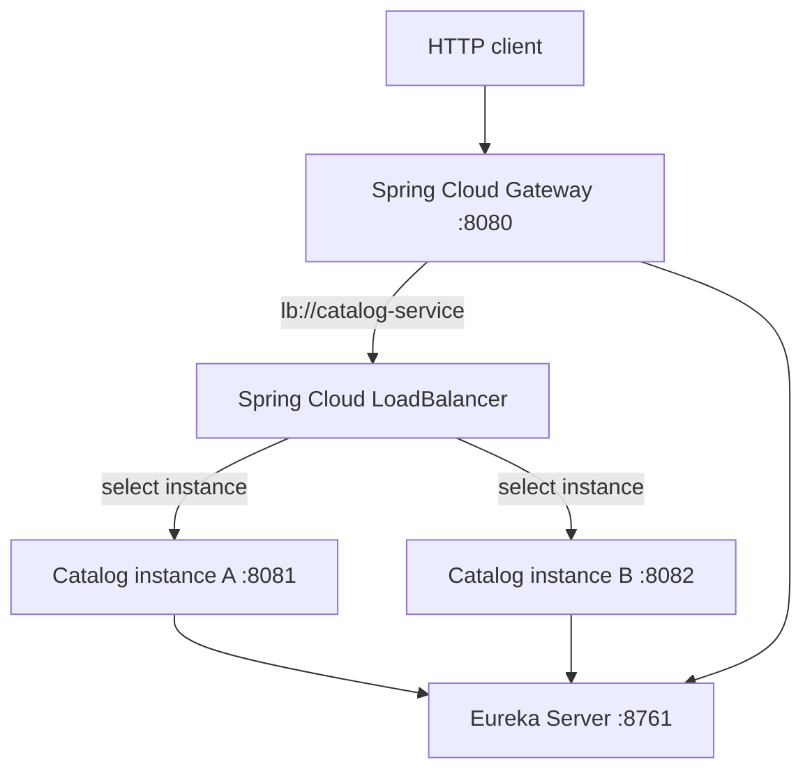

# Hands-on Practice: Integrating Service Discovery and Multi-Instance Load Balancing

In this hands-on lab, you will set up a Eureka Server, run two instances of the same service, and configure Spring Cloud Gateway to route to the service by logical name. The Gateway does not know the address or port of individual instances ahead of time; it fetches the instance list from service discovery and uses Spring Cloud LoadBalancer to pick an instance for each request.

Target outcomes:

- Two `catalog-service` instances register with Eureka using distinct identifiers.
- The Gateway resolves the service via `lb://catalog-service`.
- Requests through the Gateway are distributed across multiple instances.
- When one instance stops, the Gateway continues serving via the remaining instance after the registry and instance list update.
- You can inspect routes, the selected instance, and common configuration mistakes.

We use Eureka for illustration. You can replace Eureka with Consul or another registry if your project standardizes on that platform; the Gateway principle remains routing to a service ID through Spring Cloud LoadBalancer.

## 1. Architecture and Request Flow

Create three independent Spring Boot applications: `discovery-server`, `catalog-service`, and `api-gateway`. In the lab, two `catalog-service` processes run on the same machine using different ports.



Eureka stores instance metadata such as service ID, hostname/IP, port, and registration status. The Gateway retrieves the instance list via the Eureka client. Spring Cloud LoadBalancer picks an instance from that list; with the common default configuration, the selection algorithm is round robin.

The key point is that the `lb://catalog-service` URI means something different from `http://localhost:8081`. The `lb://` URI instructs the Gateway to resolve the service ID and select an instance. A fixed `http://localhost:8081` URI always calls a single address, bypassing service discovery and failing to load-balance across both instances.

## 2. Preparing Projects and Dependencies

Create three separate Spring Boot projects or three modules in a single build. Use a Spring Cloud BOM/release train compatible with your project's Spring Boot version. Do not pick independent versions for each starter; let the BOM manage Spring Cloud dependencies.

Core dependencies:

| Application | Required dependencies |
|---|---|
| `discovery-server` | `spring-cloud-starter-netflix-eureka-server`, `spring-boot-starter-actuator` |
| `catalog-service` | `spring-boot-starter-web`, `spring-cloud-starter-netflix-eureka-client`, `spring-boot-starter-actuator` |
| `api-gateway` | Spring Cloud Gateway Server WebFlux starter matching the release train, `spring-cloud-starter-netflix-eureka-client`, `spring-cloud-starter-loadbalancer`, `spring-boot-starter-actuator` |

Example Gradle dependency declarations (starter names may vary by Spring Cloud generation; keep artifact names matching your project's BOM):

```groovy
dependencies {
    implementation 'org.springframework.cloud:spring-cloud-starter-netflix-eureka-client'
    implementation 'org.springframework.boot:spring-boot-starter-actuator'
}
```

In `discovery-server`, replace the Eureka client dependency above with `spring-cloud-starter-netflix-eureka-server`. In `catalog-service`, add `spring-boot-starter-web`. In `api-gateway`, add the Gateway Server WebFlux starter and `spring-cloud-starter-loadbalancer`. If using Maven, declare the corresponding artifacts in `pom.xml` and import the Spring Cloud BOM in `dependencyManagement`.

Make sure the Gateway uses WebFlux if you choose the Gateway Server WebFlux starter. Do not mix MVC and WebFlux starters in the same Gateway application unless the architecture and version explicitly support it.

## 3. Setting Up Eureka Server

In the `discovery-server` project, enable Eureka Server:

```java
import org.springframework.boot.SpringApplication;
import org.springframework.boot.autoconfigure.SpringBootApplication;
import org.springframework.cloud.netflix.eureka.server.EnableEurekaServer;

@SpringBootApplication
@EnableEurekaServer
public class DiscoveryServerApplication {
    public static void main(String[] args) {
        SpringApplication.run(DiscoveryServerApplication.class, args);
    }
}
```

Configure `src/main/resources/application.yml`:

```yaml
server:
  port: 8761

spring:
  application:
    name: discovery-server

eureka:
  client:
    register-with-eureka: false
    fetch-registry: false
    service-url:
      defaultZone: http://localhost:8761/eureka/

management:
  endpoints:
    web:
      exposure:
        include: health,info
```

The two properties `register-with-eureka: false` and `fetch-registry: false` prevent the standalone server from registering itself and querying its own registry. In production environments with multiple Eureka Servers, peer replication topology needs separate configuration; this lab uses a single node for easier observation.

Run the application and open `http://localhost:8761`. The Eureka dashboard shows the registry and registered instances. When the server first starts, the applications list may be empty; this is normal before clients register.

## 4. Creating a Multi-Instance Catalog Service

In the `catalog-service` project, create the Spring Boot application:

```java
import org.springframework.boot.SpringApplication;
import org.springframework.boot.autoconfigure.SpringBootApplication;

@SpringBootApplication
public class CatalogServiceApplication {
    public static void main(String[] args) {
        SpringApplication.run(CatalogServiceApplication.class, args);
    }
}
```

Create a controller that returns the instance identifier so we can see which process the Gateway called:

```java
import java.util.Map;

import org.springframework.beans.factory.annotation.Value;
import org.springframework.web.bind.annotation.GetMapping;
import org.springframework.web.bind.annotation.RequestMapping;
import org.springframework.web.bind.annotation.RestController;

@RestController
@RequestMapping("/api/catalog")
public class CatalogController {

    @Value("${spring.application.name}")
    private String serviceName;

    @Value("${server.port}")
    private String port;

    @GetMapping("/instance")
    public Map<String, String> instance() {
        return Map.of(
            "service", serviceName,
            "port", port,
            "instance", serviceName + ":" + port
        );
    }
}
```

Configure `application.yml` for the catalog service:

```yaml
server:
  port: ${SERVER_PORT:8081}

spring:
  application:
    name: catalog-service

eureka:
  client:
    service-url:
      defaultZone: ${EUREKA_SERVER_URL:http://localhost:8761/eureka/}
  instance:
    instance-id: ${spring.application.name}:${server.port}
    prefer-ip-address: true

management:
  endpoints:
    web:
      exposure:
        include: health,info
```

Both processes share the same `spring.application.name` of `catalog-service` because they represent the same logical service. Their `instance-id` values differ due to different ports, preventing two processes on the same host from registering with duplicate IDs. The `SERVER_PORT` environment variable allows changing the port without editing the config file.

The controller uses `Map.of`, so the example requires Java 9 or higher. For older Java projects, replace it with a DTO or `HashMap`.

## 5. Running Two Instances of Catalog Service

Start Eureka Server first. Then build the catalog service and run the same artifact twice. For example, with a built JAR file:

In PowerShell, open two separate terminals:

```powershell
# Terminal 1
$env:SERVER_PORT = "8081"
java -jar .\build\libs\catalog-service.jar
```

```powershell
# Terminal 2
$env:SERVER_PORT = "8082"
java -jar .\build\libs\catalog-service.jar
```

In Bash, open two separate terminals:

```bash
SERVER_PORT=8081 java -jar build/libs/catalog-service.jar
```

```bash
SERVER_PORT=8082 java -jar build/libs/catalog-service.jar
```

If using Maven, change the JAR path to the `target` directory. If using a multi-module Gradle build, build the catalog service module specifically. Do not run both processes on the same port; the operating system will refuse to bind the second port.

Wait for both instances to register with Eureka. On the dashboard, the `CATALOG-SERVICE` application should show two instances on ports `8081` and `8082`. You can verify each instance directly:

```bash
curl http://localhost:8081/api/catalog/instance
curl http://localhost:8082/api/catalog/instance
```

The results should show the same service name but different instances/ports. If only one instance appears in Eureka, troubleshoot registration before configuring the Gateway.

## 6. Configuring the Gateway to Use a Service ID

In the `api-gateway` project, create the application:

```java
import org.springframework.boot.SpringApplication;
import org.springframework.boot.autoconfigure.SpringBootApplication;

@SpringBootApplication
public class ApiGatewayApplication {
    public static void main(String[] args) {
        SpringApplication.run(ApiGatewayApplication.class, args);
    }
}
```

The Gateway does not need `@EnableEurekaClient` in modern Spring Cloud configurations; adding the Eureka client starter triggers auto-configuration. If your project uses an older version requiring a specific annotation, follow the documentation for that release train.

Configure `application.yml`:

```yaml
server:
  port: 8080

spring:
  application:
    name: api-gateway
  cloud:
    gateway:
      discovery:
        locator:
          enabled: false
      routes:
        - id: catalog-route
          uri: lb://catalog-service
          predicates:
            - Path=/catalog/**
          filters:
            - StripPrefix=1

eureka:
  client:
    service-url:
      defaultZone: ${EUREKA_SERVER_URL:http://localhost:8761/eureka/}
  instance:
    instance-id: ${spring.application.name}:${server.port}
    prefer-ip-address: true

management:
  endpoints:
    web:
      exposure:
        include: health,info,metrics
```

Configuration explanation:

- `uri: lb://catalog-service` instructs Spring Cloud LoadBalancer to select an instance from the list provided by the discovery client.
- `Path=/catalog/**` routes only requests with the `/catalog/` prefix.
- `StripPrefix=1` drops the first segment before forwarding. A request to `/catalog/api/catalog/instance` arrives at the backend as `/api/catalog/instance`.
- `discovery.locator.enabled: false` keeps explicitly declared routes as the sole routing source in the lab. This does not disable the Eureka client or `lb://`; it only disables auto-generating routes for every discovered service.

`spring-cloud-starter-loadbalancer` must be on the classpath to use `lb://`. If you declare only the Eureka client without the load balancer, the route may fail to resolve the `lb` scheme.

## 7. Sending Requests Through the Gateway and Observing Load Balancing

Start the Gateway once Eureka and both catalog instances are ready. Send a request through the single entry address:

```bash
curl http://localhost:8080/catalog/api/catalog/instance
```

The request passes through the Gateway, drops the `/catalog` prefix, and is sent to one of the two catalog instances. Send repeated requests to observe instance selection:

```bash
for i in $(seq 1 12); do
  curl -s http://localhost:8080/catalog/api/catalog/instance
  echo
done
```

PowerShell:

```powershell
1..12 | ForEach-Object {
    $result = Invoke-RestMethod "http://localhost:8080/catalog/api/catalog/instance"
    "{0,2}: {1}" -f $_, $result.instance
}
```

The expected output is that both `catalog-service:8081` and `catalog-service:8082` appear across responses. The call counts to the two instances do not have to be strictly equal in a small sample. Instance lists may be cached and refreshed periodically; failed requests, newly registered instances, or the selection algorithm also affect distribution over a short observation window.

To prove requests truly traverse the Gateway, call only the port `8080` URL during this verification step. Calling ports `8081` or `8082` directly tests each backend individually, not Gateway routing and load balancing.

## 8. Testing When an Instance Stops

While both instances are serving, stop the process running on port `8081` by closing its terminal or sending a normal shutdown signal. Then continue calling the Gateway:

```bash
for i in $(seq 1 10); do
  curl -sS http://localhost:8080/catalog/api/catalog/instance
  echo
done
```

After Eureka evicts the stopped instance from the registry and the Gateway refreshes its instance list, new requests should continue reaching `catalog-service:8082`. When you restart the port `8081` process, wait for it to re-register and verify distribution across both instances again.

Do not assume stopping a process immediately notifies every client that the instance has vanished. Eureka relies on heartbeats, leases, and eviction; clients also cache the instance list. Convergence time depends on configuration and registry state. During the transition window, requests may hit connection errors to the recently stopped instance. In production, choose appropriate timeouts, retries, and health policies, and avoid retrying write requests without idempotency guarantees.

Try additional scenarios:

1. Restart an instance on its old port and observe re-registration.
2. Stop both instances and send a request; the Gateway typically returns an upstream error such as `503 Service Unavailable` when no instance is available. Record the actual response for your application version and error handler.
3. Restart Eureka Server in the lab environment and observe client behavior when the registry is temporarily unreachable. Clients may retain their current cache for a period; do not treat this as a guarantee for all production configurations.

## 9. Enabling Discovery Locator for Automatic Route Discovery (Optional)

Explicitly declared routes above are generally easier to govern because only chosen endpoints are exposed. The Gateway can also generate routes from service IDs in the registry using Discovery Locator. When enabling this feature, carefully review path rules, rewrite filters, and access control; any service registered in Eureka can become reachable through the Gateway.

In versions supporting this setting, enable:

```yaml
spring:
  cloud:
    gateway:
      discovery:
        locator:
          enabled: true
          lower-case-service-id: true
```

Discovery Locator by default creates routes following the service ID and the Gateway version's path convention. For instance, `catalog-service` may become reachable via a prefix matching its service ID, with the Gateway stripping the prefix before forwarding to the service. Inspect generated routes via Gateway Actuator or routing logs instead of guessing URLs from service names.

Do not enable the locator broadly just to avoid declaring routes. In production, control which services are exposed, enforce authentication/authorization, restrict paths, and protect internal endpoints. When only a few services are needed, explicit routes make reviewing and controlling the attack surface much easier.

After experimenting with Discovery Locator, disable it again if the lab continues using explicit routes so the two mechanisms do not both generate routes that could match requests.

## 10. Checking Observability and Operations

### Actuator and Logs

In the lab environment, you can check Gateway health:

```bash
curl http://localhost:8080/actuator/health
```

If Gateway metrics are exposed, view the metric list via the configured and protected Actuator endpoint. A common Gateway metric name is `spring.cloud.gateway.requests`, though exact metric/tag names depend on the version and registry. Use route ID, status, and observability trace data to compare requests.

In logs, record diagnostic fields such as correlation ID, route ID, service ID, and processing duration. Avoid logging access tokens, cookies, full headers, or sensitive bodies. Do not use full URLs containing query strings with user data as metric tags, as that can spike cardinality and leak information.

### Common Errors

| Symptom | Possible cause | How to check and fix |
|---|---|---|
| Eureka does not show `CATALOG-SERVICE` | Missing Eureka client dependency, wrong registry URL, network issue, or app still starting | Check client logs, `defaultZone`, port `8761`, and connectivity to `/eureka/` |
| Only one catalog instance appears | Two processes use the same port or duplicate `instance-id`; one process hasn't registered | Check ports, `server.port`, `eureka.instance.instance-id`, and dashboard |
| Gateway returns `503` or cannot resolve `lb` | Missing Spring Cloud LoadBalancer, no available instance, or registry out of sync | Check load balancer dependency, instance list, and route logs |
| Gateway returns `404` | Predicate does not match or path after `StripPrefix` does not match controller | Check `/catalog/api/catalog/instance` URL, route ID, and path received by backend |
| Requests always hit one instance | Only one instance is healthy/registered, cache not refreshed, or calling direct URL by mistake | Check Eureka, send multiple requests to Gateway port, and wait for registry convergence |
| Second port fails to start | Port already in use by another process | Change `SERVER_PORT` and ensure instance ID uses the new port |
| Requests fail immediately after stopping an instance | Eureka and LoadBalancer have not updated lists yet | Wait for heartbeat/eviction/cache refresh; check graceful shutdown and timeouts |
| Gateway starts but routes do not work | Incompatible Gateway MVC/WebFlux configuration or starter | Check BOM, starters, auto-configuration logs, and active server type |

## 11. Extension Exercises

After completing the basic flow, try the following exercises:

1. **Add a third instance:** run `catalog-service` on port `8083` with a unique instance ID and verify all three instances receive requests.
2. **Add a second route:** create `inventory-service` and route `lb://inventory-service`; verify the two services do not mix up service IDs.
3. **Try path rewriting:** replace `StripPrefix=1` with an appropriate `RewritePath` and verify the backend receives the right path.
4. **Enable health checks:** expose actuator health on the backend and observe instance status in the registry. Distinguish application health status from Eureka registration status.
5. **Try weighted backends:** create two service IDs for catalog v1/v2 and use the `Weight` predicate to route a portion of traffic to v2. Record observed ratios over a sufficiently large sample.
6. **Add route protection:** require authentication at the Gateway and verify auth headers are forwarded per policy.
7. **Measure latency:** send steady load, compare p50/p95/p99 and CPU per instance, and check whether any instance is overloaded or receiving no requests.

## 12. Lab Completion Checklist

- [ ] Eureka Server runs on port `8761` and displays the registry.
- [ ] Two catalog processes use the same service ID but have different ports and instance IDs.
- [ ] Gateway registers with Eureka and runs on port `8080`.
- [ ] Route uses `lb://catalog-service`, not a fixed URI to a single backend.
- [ ] `StripPrefix` delivers the path to the exact catalog service controller.
- [ ] Repeated requests through the Gateway receive responses from both instances.
- [ ] When one instance stops, new requests continue reaching the remaining instance after registry/cache convergence.
- [ ] When the instance restarts, it re-registers with the right identifier.
- [ ] Tested the no-instance case and recorded the error response.
- [ ] Reviewed necessary logs/health/metrics without logging sensitive auth data.

You have completed the lab when you can explain the path from route predicate to service ID, how Eureka supplies the instance list, how LoadBalancer picks a backend, and the convergence delay when instances change state. This provides the foundation to scale the Gateway across multiple services, multiple environments, and secure production service discovery.
