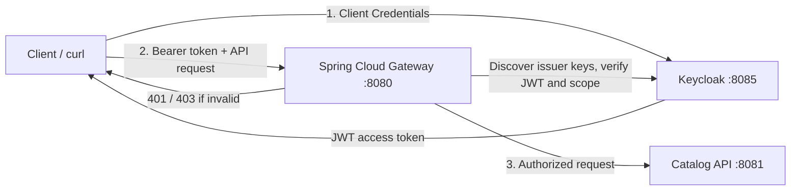

# Protecting APIs with JWT and Verifying Scope-Based Authorization

In this hands-on lab, Spring Cloud Gateway validates a JWT access token issued by an Identity Provider, then verifies scopes before forwarding requests to a backend service. You will spin up a local Keycloak instance as the token issuer, a Catalog API as the backend, and a WebFlux Gateway as an OAuth2 Resource Server. The expected behavior is that requests without a token are rejected with `401`, valid tokens lacking the required scope are rejected with `403`, and tokens with the right scope are allowed through.

This model focuses on machine-to-machine authentication using OAuth 2.0 Client Credentials so tests are easily repeatable. For browser-based user logins, use Authorization Code with PKCE and apply the same principles for verifying token issuer, signature, expiration, and permissions.

## 1. Objectives and Architecture

After completing this lab, you will be able to:

- Configure the Gateway as an OAuth2 Resource Server and fetch public keys from the issuer's JWKS endpoint.
- Map scopes in the JWT claim to Spring Security authorities using the `SCOPE_` convention.
- Protect `GET` with `catalog.read` and `POST` with `catalog.write`.
- Distinguish unauthenticated errors (`401`) from authenticated but unauthorized errors (`403`).
- Verify that expired tokens, invalid-signature tokens, or tokens issued by another issuer are rejected.



The Gateway checks the token before routing the request. `catalog.read` and `catalog.write` are independent permissions. A token with `catalog.read` can read the catalog but cannot create new records.

## 2. Starting Local Keycloak

Create a `compose.yaml` file for the practice environment:

```yaml
services:
  keycloak:
    image: quay.io/keycloak/keycloak:26.3.3
    command: ["start-dev", "--http-port=8085"]
    environment:
      KC_BOOTSTRAP_ADMIN_USERNAME: admin
      KC_BOOTSTRAP_ADMIN_PASSWORD: admin
    ports:
      - "8085:8085"
```

Start it:

```bash
docker compose up -d
```

Open `http://localhost:8085` and log in to the admin console using the lab credentials `admin` / `admin`. These are illustrative local-only credentials; never use this password in real environments. Stop the environment after practicing with `docker compose down`.

### Create the Realm, Client, and Scopes

In the Keycloak Admin Console, complete these steps:

1. Create a realm named `gateway-lab` and switch to it.
2. Create a client named `gateway-lab-client` with the OpenID Connect protocol.
3. Enable **Client authentication** and **Service accounts roles**; disable Standard flow for this Client Credentials-only lab client.
4. Save the configuration and open the **Credentials** tab to copy the client secret.
5. Go to **Client scopes** and create two OpenID Connect scopes named `catalog.read` and `catalog.write`.
6. For each scope, enable the option to include the scope in the token (if shown in your version's UI), then add both to the `gateway-lab-client` client as **Optional client scopes**.
7. Save the client configuration.

When calling the token endpoint, the client requests optional scopes via the `scope` parameter. Inspect the `scope` field in the token or token endpoint response to confirm only the requested permissions were granted. If Keycloak omits the scope from the token, recheck the client scope, the include-in-token-scope toggle, and how scopes are assigned to the client.

Set environment variables in the terminal used to call the API. Example for Bash or Git Bash:

```bash
export CLIENT_ID='gateway-lab-client'
export CLIENT_SECRET='PASTE_LAB_CLIENT_SECRET_HERE'
```

Never commit the client secret to Git or hardcode it in Gateway configuration files. In production, store secrets in a secret manager or the deployment platform's secret management mechanism.

## 3. Creating the Catalog API Backend

Create a Spring Boot project named `catalog-service` using Spring Web MVC. Required dependency:

```xml
<dependency>
    <groupId>org.springframework.boot</groupId>
    <artifactId>spring-boot-starter-web</artifactId>
</dependency>
```

Create a controller providing one read API and one write API:

```java
import java.util.List;
import java.util.Map;

import org.springframework.http.HttpStatus;
import org.springframework.http.ResponseEntity;
import org.springframework.web.bind.annotation.GetMapping;
import org.springframework.web.bind.annotation.PostMapping;
import org.springframework.web.bind.annotation.RequestBody;
import org.springframework.web.bind.annotation.RequestMapping;
import org.springframework.web.bind.annotation.RestController;

@RestController
@RequestMapping("/items")
public class CatalogController {

    @GetMapping
    public Map<String, Object> listItems() {
        return Map.of(
                "items", List.of("gateway", "jwt", "scope"),
                "operation", "read");
    }

    @PostMapping
    public ResponseEntity<Map<String, Object>> createItem(
            @RequestBody Map<String, String> request) {
        return ResponseEntity.status(HttpStatus.CREATED).body(Map.of(
                "created", true,
                "name", request.getOrDefault("name", "unnamed"),
                "operation", "write"));
    }
}
```

In `application.yml` of Catalog Service:

```yaml
server:
  address: 127.0.0.1
  port: 8081

spring:
  application:
    name: catalog-service
```

Binding to loopback ensures the backend only accepts connections from the same machine during this local lab. If the Gateway and backend run in separate containers or hosts, replace the bind address and target URI with a private network address reachable between the two workloads, and restrict network policies so external clients cannot call the backend directly.

Start the backend:

```bash
mvn spring-boot:run
```

Test the backend directly in another terminal:

```bash
curl -i http://localhost:8081/items
```

The API should return `200 OK` and the item list. In this lab, the backend does not verify JWTs itself; `127.0.0.1` restricts direct local access so we can focus on Gateway policy checks. In production, protect the network path to the backend and consider having individual services validate tokens or workload identities rather than relying solely on a single Gateway check.

## 4. Creating the Gateway and Configuring JWT Verification

Create an `edge-gateway` project using Spring Cloud Gateway Server WebFlux. The concrete example below uses Spring Boot 3.x and Spring Cloud Gateway 4.x. Core dependencies:

```xml
<dependency>
    <groupId>org.springframework.cloud</groupId>
    <artifactId>spring-cloud-starter-gateway</artifactId>
</dependency>
<dependency>
    <groupId>org.springframework.boot</groupId>
    <artifactId>spring-boot-starter-oauth2-resource-server</artifactId>
</dependency>
```

Import a Spring Cloud BOM compatible with your Spring Boot version to manage the Gateway version. Do not force a separate Spring Security version when the release train already manages compatible versions.

Create the main application class:

```java
import org.springframework.boot.SpringApplication;
import org.springframework.boot.autoconfigure.SpringBootApplication;

@SpringBootApplication
public class EdgeGatewayApplication {
    public static void main(String[] args) {
        SpringApplication.run(EdgeGatewayApplication.class, args);
    }
}
```

In the Gateway's `application.yml`:

```yaml
server:
  port: 8080

spring:
  application:
    name: edge-gateway
  security:
    oauth2:
      resourceserver:
        jwt:
          issuer-uri: http://localhost:8085/realms/gateway-lab
  cloud:
    gateway:
      routes:
        - id: catalog-api
          uri: http://localhost:8081
          predicates:
            - Path=/api/catalog/**
          filters:
            - StripPrefix=2
```

`issuer-uri` must match the `iss` claim in the access token exactly. Spring Security uses the issuer's metadata to locate the JWKS endpoint and fetch keys for verifying JWT signatures. When keys rotate, the resource server can retrieve updated key metadata via the library's built-in mechanism. The Gateway also checks time claims such as `exp` and `nbf` when present in the token.

The route targets backend `http://localhost:8081`. `Path=/api/catalog/**` matches public requests at the Gateway; `StripPrefix=2` transforms `/api/catalog/items` into `/items` before forwarding to Catalog Service.

For Spring Cloud Gateway 5.x Server WebFlux, use the `spring-cloud-starter-gateway-server-webflux` starter and move the routes section under the new prefix:

```yaml
spring:
  cloud:
    gateway:
      server:
        webflux:
          routes:
            - id: catalog-api
              uri: http://localhost:8081
              predicates:
                - Path=/api/catalog/**
              filters:
                - StripPrefix=2
```

`server.port`, `spring.application.name`, and `spring.security.oauth2.resourceserver.jwt.issuer-uri` remain at their respective levels as shown. Use only the single route namespace matching your running major version.

## 5. Declaring Scope-Based Authorization in SecurityWebFilterChain

Create `GatewaySecurityConfiguration`:

```java
import org.springframework.context.annotation.Bean;
import org.springframework.context.annotation.Configuration;
import org.springframework.http.HttpMethod;
import org.springframework.security.config.Customizer;
import org.springframework.security.config.web.server.ServerHttpSecurity;
import org.springframework.security.web.server.SecurityWebFilterChain;

@Configuration
public class GatewaySecurityConfiguration {

    @Bean
    SecurityWebFilterChain gatewaySecurity(ServerHttpSecurity http) {
        return http
                .csrf(ServerHttpSecurity.CsrfSpec::disable)
                .authorizeExchange(exchanges -> exchanges
                        .pathMatchers(HttpMethod.GET, "/api/catalog/**")
                            .hasAuthority("SCOPE_catalog.read")
                        .pathMatchers(HttpMethod.POST, "/api/catalog/**")
                            .hasAuthority("SCOPE_catalog.write")
                        .anyExchange().denyAll())
                .oauth2ResourceServer(oauth2 -> oauth2
                        .jwt(Customizer.withDefaults()))
                .build();
    }
}
```

By default, Spring Security reads the `scope` or `scp` claim in the JWT and converts each scope into an authority prefixed with `SCOPE_`. Therefore:

| Scope claim in access token | Authority generated by Spring |
|---|---|
| `catalog.read` | `SCOPE_catalog.read` |
| `catalog.write` | `SCOPE_catalog.write` |
| `catalog.read catalog.write` | Both authorities above |

`hasAuthority` performs an exact authority match. A token with `catalog.read` does not satisfy `SCOPE_catalog.write`. If your Identity Provider uses a different claim, such as `realm_access.roles`, write a `Converter<Jwt, Mono<AbstractAuthenticationToken>>` or configure an appropriate converter; do not assume Spring automatically maps every provider-specific claim.

CSRF is disabled in this example because the lab API authenticates via bearer tokens in headers rather than browser session cookies. If your system uses cookies or sessions for authentication, evaluate and configure CSRF protection instead of copying this configuration. CORS is a separate policy and does not replace token or scope validation.

Start the Gateway:

```bash
mvn spring-boot:run
```

## 6. Obtaining Access Tokens with Different Scopes

Keycloak provides a per-realm token endpoint. Client Credentials requires a client with Client authentication and Service accounts enabled. Use the secret obtained in section 2 to request a read-only token:

```bash
READ_TOKEN=$(curl -sS \
  -u "$CLIENT_ID:$CLIENT_SECRET" \
  -d 'grant_type=client_credentials' \
  --data-urlencode 'scope=catalog.read' \
  http://localhost:8085/realms/gateway-lab/protocol/openid-connect/token \
  | jq -r '.access_token')
```

Request a write-only token:

```bash
WRITE_TOKEN=$(curl -sS \
  -u "$CLIENT_ID:$CLIENT_SECRET" \
  -d 'grant_type=client_credentials' \
  --data-urlencode 'scope=catalog.write' \
  http://localhost:8085/realms/gateway-lab/protocol/openid-connect/token \
  | jq -r '.access_token')
```

Request a token with both permissions:

```bash
FULL_TOKEN=$(curl -sS \
  -u "$CLIENT_ID:$CLIENT_SECRET" \
  -d 'grant_type=client_credentials' \
  --data-urlencode 'scope=catalog.read catalog.write' \
  http://localhost:8085/realms/gateway-lab/protocol/openid-connect/token \
  | jq -r '.access_token')
```

If any command returns `null`, inspect Keycloak's error response, the client secret, the service account setting, and optional client scopes. You can verify granted scopes by inspecting the `scope` field in the token endpoint response. Never paste production access tokens into public JWT decoder websites; inspect lab tokens only in local tools when you need to view the payload.

## 7. Verifying 401, 403, and Permitted Requests

### Without a Token: Must Receive 401

```bash
curl -i http://localhost:8080/api/catalog/items
```

The Gateway has no authenticated identity for the request, so it returns `401 Unauthorized`. The request is never forwarded to Catalog Service.

### Token with `catalog.read`: GET Succeeds

```bash
curl -i \
  -H "Authorization: Bearer $READ_TOKEN" \
  http://localhost:8080/api/catalog/items
```

Expected result is `200 OK` along with the item list from the backend.

### Token with Only `catalog.read`: POST Is Rejected

```bash
curl -i -X POST \
  -H "Authorization: Bearer $READ_TOKEN" \
  -H 'Content-Type: application/json' \
  -d '{"name":"new-item"}' \
  http://localhost:8080/api/catalog/items
```

Expected result is `403 Forbidden`. The token was verified, but it lacks the `SCOPE_catalog.write` authority. The Gateway rejects the request before calling the backend.

### Token with `catalog.write`: POST Succeeds

```bash
curl -i -X POST \
  -H "Authorization: Bearer $WRITE_TOKEN" \
  -H 'Content-Type: application/json' \
  -d '{"name":"new-item"}' \
  http://localhost:8080/api/catalog/items
```

Expected result is `201 Created`. The backend returns JSON confirming the write operation.

### Token with Both Scopes: Both GET and POST Succeed

```bash
curl -i -H "Authorization: Bearer $FULL_TOKEN" \
  http://localhost:8080/api/catalog/items

curl -i -X POST \
  -H "Authorization: Bearer $FULL_TOKEN" \
  -H 'Content-Type: application/json' \
  -d '{"name":"another-item"}' \
  http://localhost:8080/api/catalog/items
```

Summary of expected results:

| Request | Token | Result |
|---|---|---:|
| GET `/api/catalog/items` | None | 401 |
| GET `/api/catalog/items` | `catalog.read` | 200 |
| POST `/api/catalog/items` | `catalog.read` | 403 |
| GET `/api/catalog/items` | `catalog.write` | 403 |
| POST `/api/catalog/items` | `catalog.write` | 201 |
| GET and POST | Both scopes | 200 and 201 |

If you get 401 with a freshly issued token, check `issuer-uri`, the `iss` claim, system clock, and the Gateway's connectivity to Keycloak's discovery/JWKS endpoint. If you get 403 on a request that should be permitted, check the actual `scope` claim and authority names. If you get 404, check the route predicate, backend path, and `StripPrefix=2`.

## 8. Testing Invalid Tokens and Trust Boundaries

Try several negative cases to confirm the Gateway is verifying signatures and claims:

- **Tampered payload:** modify one character in the JWT and resend; the Gateway must return 401 due to an invalid signature.
- **Expired token:** use an expired token or shorten the token lifespan in the lab realm, wait for expiration, and call the API; the Gateway must return 401.
- **Wrong issuer:** temporarily configure a different issuer URI or issue a token from another realm; the Gateway must reject that token.
- **Missing scope:** use a valid token that only holds the other scope; the Gateway returns 403 for the unauthorized method.
- **Spoofed identity headers:** send `X-User: admin` or `X-Roles: catalog.write` without a JWT; the request must still be rejected. Never treat client-supplied headers as proof of authentication.

Spoofed header example:

```bash
curl -i \
  -H 'X-User: admin' \
  -H 'X-Roles: catalog.write' \
  http://localhost:8080/api/catalog/items
```

The Gateway relies solely on a verified JWT and authorities built from trusted claims. If user info must be passed to the backend, define an explicit contract, strip client-sent identity headers before adding internal headers, and restrict the backend to accept traffic only from the Gateway. In defense-in-depth systems, backends also verify the token or workload identity rather than trusting an `X-User` header.

In this lab, the bearer token is forwarded with the request to the backend unless the Gateway configures a filter to strip `Authorization`. The backend currently skips token verification to focus on Gateway policy. Production systems must explicitly decide which services validate tokens, which scopes belong at the Gateway, and which scopes must be re-checked at the target service. Never treat Gateway authorization as an excuse to expose backends directly to the Internet.

## 9. Troubleshooting Common Errors

| Symptom | Possible cause | How to fix |
|---|---|---|
| Gateway fails to start, cannot load issuer metadata | Keycloak is not ready, wrong realm, or wrong issuer URI | Check `http://localhost:8085/realms/gateway-lab/.well-known/openid-configuration` and Gateway logs |
| All tokens return 401 | `iss` claim does not match issuer, invalid signature, expired token, or Gateway cannot reach JWKS | Compare exact issuer string, check system clock and JWKS endpoint |
| Token has scope but returns 403 | Scope missing from claim, different scope name, or converter reads a different claim | Check optional client scope, include-in-token-scope, and `SCOPE_` authority |
| Read token succeeds on GET and also succeeds on POST | POST rule misconfigured or a broader rule permitted it earlier | Check matcher order; place specific matchers first and use `denyAll` for the rest |
| Gateway returns 404 | Path predicate mismatch or backend received the wrong path | Check `/api/catalog/items`, `StripPrefix=2`, and `/items` on the backend |
| Gateway returns 503 | Catalog Service is not running or Gateway cannot connect to backend | Check port 8081 and connection logs |
| Token endpoint returns `invalid_scope` | Optional scope not attached to client or wrong scope name | Attach `catalog.read`/`catalog.write` to the client and verify names |
| Token endpoint returns `unauthorized_client` | Client Credentials or service account not enabled | Enable Client authentication and Service accounts roles |

Do not enable DEBUG logging that prints full tokens or secrets while troubleshooting. If you need increased Spring Security logging, use it only in a test environment, redact sensitive data, and turn it off after investigating.

## 10. Completion Criteria and Extension Exercises

Mark this lab complete once you have verified:

- [ ] Local Keycloak is running and has the `gateway-lab` realm.
- [ ] Client `gateway-lab-client` can obtain access tokens via Client Credentials.
- [ ] Tokens can be issued individually with `catalog.read`, `catalog.write`, and both scopes.
- [ ] Gateway validates token signature, issuer, and expiration via resource server config.
- [ ] GET is permitted only with a `catalog.read` token.
- [ ] POST is permitted only with a `catalog.write` token.
- [ ] Requests missing a token return 401; valid tokens missing the scope return 403.
- [ ] Forged tokens or tokens from the wrong issuer are rejected.
- [ ] Client-supplied identity headers cannot substitute for a JWT.

Extension exercises:

1. Add a `catalog.delete` scope and a `DELETE /api/catalog/items/{id}` endpoint; grant this permission only to an admin client.
2. Replace Client Credentials with Authorization Code + PKCE for a web app; compare user identity with workload identity.
3. Implement a `Converter<Jwt, Mono<AbstractAuthenticationToken>>` to map a custom Identity Provider claim into Spring Security authorities.
4. Add audience validation for the JWT so the Gateway only accepts tokens issued for the intended API.
5. Add a separate `SecurityWebFilterChain` for `/actuator/**` permitting only health checks per policy and requiring an operations scope for management endpoints.
6. Enable TLS between client and Gateway; if using TLS between Gateway and backend, configure a truststore and certificate verification instead of disabling hostname checks.

Deliverables include the realm/client/scope configuration (without secrets), Gateway configuration, Catalog API code, and a 401/403/200/201 test matrix explaining the granted permissions.

## References

- [Spring Security – Reactive OAuth 2.0 Resource Server JWT](https://docs.spring.io/spring-security/reference/reactive/oauth2/resource-server/jwt.html)
- [Spring Security – Reactive Authorization](https://docs.spring.io/spring-security/reference/reactive/authorization/authorize-exchanges.html)
- [Spring Cloud Gateway – Configuration](https://docs.spring.io/spring-cloud-gateway/reference/)
- [Keycloak Server Administration Guide](https://www.keycloak.org/docs/latest/server_admin/)
- [OAuth 2.0 – Client Credentials Grant (RFC 6749, Section 4.4)](https://www.rfc-editor.org/rfc/rfc6749#section-4.4)
