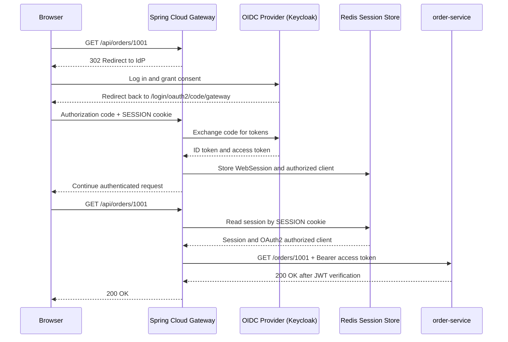

# Comprehensive Practice: Setting Up OIDC Login, Shared Sessions, and TokenRelay

This hands-on lab configures Spring Cloud Gateway as an entry point with OpenID Connect (OIDC) login. After a user signs in, the Gateway stores the session and OAuth2 client state in Redis so multiple Gateway instances can share it. The `TokenRelay` filter forwards the access token to the backend microservice; the microservice validates the token as an OAuth2 Resource Server.

You will use Keycloak as the identity provider, Redis as the session store, and an `order-service` as the protected API. The example focuses on browser-based login and a GET route for easy verification. The Spring Boot, Spring Cloud, and Spring Session versions must belong to compatible lines according to the project's Spring Cloud release train.

## Target Outcomes

You have completed this lab when you can:

- Log in through the Gateway using the OIDC Authorization Code Flow.
- Explain the roles of `issuer-uri`, client registration, redirect URI, and the `openid` scope.
- Store `WebSession` and the OAuth2 authorized client in Redis so two Gateway instances share login state.
- Configure `TokenRelay` to forward access tokens to downstream services.
- Protect downstream services with a JWT Resource Server and verify the relayed token.
- Diagnose redirect URI errors, token validation failures, and session sharing issues.

## 1. Practice Architecture



| Component | Responsibility |
|---|---|
| Browser | Initiates requests, performs login, and holds the session cookie |
| Keycloak | Authenticates users, issues authorization codes and tokens |
| Spring Cloud Gateway | Protects routes, maintains OAuth2 login, relays access tokens |
| Redis | Stores sessions shared across Gateway instances |
| `order-service` | Validates access tokens and handles the protected API |

The browser cookie carries only a session ID. The session and OAuth2 authorized client are stored server-side in Redis; the access token does not need to be stored in browser local storage. When the Gateway processes a route with `TokenRelay`, it retrieves the access token associated with the logged-in user and adds an `Authorization: Bearer ...` header to the downstream request.

## 2. Preparing the OIDC Provider with Keycloak

Start Redis and Keycloak for the practice environment. The example below uses Docker; the sample admin password is for local use only:

```bash
docker run --rm --name gateway-redis -p 6379:6379 redis:7-alpine
```

In another terminal, start Keycloak on host port `8081`:

```powershell
docker run --rm --name gateway-keycloak -p 8081:8080 `
  -e KC_BOOTSTRAP_ADMIN_USERNAME=admin `
  -e KC_BOOTSTRAP_ADMIN_PASSWORD=change-me `
  quay.io/keycloak/keycloak:latest start-dev
```

If using PowerShell, the trailing backtick on each line is the line-continuation character. You can also put the command on a single line. For team or CI environments, pin a tested Keycloak image version rather than relying on the `latest` tag.

Open `http://localhost:8081`, log into the Admin Console, and create the realm and client:

1. Create a realm named `gateway-lab`.
2. Within that realm, create a client with Client ID `gateway` of type OpenID Connect.
3. Enable **Client authentication** and **Standard flow**. This is a confidential client running server-side on the Gateway.
4. Add Valid redirect URIs:
   - `http://localhost:8080/login/oauth2/code/gateway`
   - `http://localhost:8082/login/oauth2/code/gateway`
5. Add Web origins `http://localhost:8080` and `http://localhost:8082` for the local lab.
6. Copy the client secret from the Credentials section. Pass the secret via the `OIDC_CLIENT_SECRET` environment variable; never commit secrets to the repository.
7. Create a test user, set a password, and disable the option requiring a password change on first login if Keycloak enables it.

The realm's Issuer URI is:

```text
http://localhost:8081/realms/gateway-lab
```

You can inspect discovery metadata at `http://localhost:8081/realms/gateway-lab/.well-known/openid-configuration`. The `issuer` value in the metadata must match the `issuer-uri` configured on the Gateway and downstream. If apps run in containers, `localhost` inside a container refers to that container itself; use a hostname reachable on the Docker network and ensure the authorization URL in the metadata is also reachable from the browser.

## 3. Configuring the Gateway as an OAuth2/OIDC Client

The Gateway application uses reactive Spring Cloud Gateway. Add dependencies whose versions are managed by compatible Spring Boot and Spring Cloud BOMs:

| Dependency | Purpose |
|---|---|
| `spring-cloud-starter-gateway` | Reactive Gateway, routes, and filter chain |
| `spring-boot-starter-security` | Spring Security for WebFlux |
| `spring-boot-starter-oauth2-client` | OAuth2 Client and OIDC Login |
| `spring-session-data-redis` | Stores WebSession in Redis |
| `spring-boot-starter-data-redis-reactive` | Reactive Redis connection for WebFlux and Spring Session |

Do not add `spring-boot-starter-web` to the reactive Gateway application. Configure `application.yml`:

```yaml
server:
  port: ${SERVER_PORT:8080}
  forward-headers-strategy: framework

spring:
  application:
    name: api-gateway

  data:
    redis:
      host: ${REDIS_HOST:localhost}
      port: ${REDIS_PORT:6379}

  session:
    timeout: 30m
    redis:
      namespace: gateway:session

  security:
    oauth2:
      client:
        registration:
          gateway:
            provider: local-oidc
            client-id: gateway
            client-secret: ${OIDC_CLIENT_SECRET}
            authorization-grant-type: authorization_code
            redirect-uri: "{baseUrl}/login/oauth2/code/{registrationId}"
            scope:
              - openid
              - profile
              - email
        provider:
          local-oidc:
            issuer-uri: ${OIDC_ISSUER_URI:http://localhost:8081/realms/gateway-lab}

  cloud:
    gateway:
      routes:
        - id: orders-api
          uri: http://localhost:8091
          predicates:
            - Path=/api/orders/**
            - Method=GET
          filters:
            - StripPrefix=1
            - TokenRelay=

management:
  endpoints:
    web:
      exposure:
        include: health,info
```

`issuer-uri` tells Spring Security the OIDC provider's address. Spring Security reads the discovery metadata to locate the authorization endpoint, token endpoint, and JWK Set URI. The registration ID is `gateway`, so the default callback matches `/login/oauth2/code/gateway`. The `openid` scope activates OIDC; `profile` and `email` request additional profile claims if provided by the provider.

Create the WebFlux security chain:

```java
import org.springframework.context.annotation.Bean;
import org.springframework.context.annotation.Configuration;
import org.springframework.security.config.Customizer;
import org.springframework.security.config.annotation.web.reactive.EnableWebFluxSecurity;
import org.springframework.security.config.web.server.ServerHttpSecurity;
import org.springframework.security.web.server.SecurityWebFilterChain;

@Configuration
@EnableWebFluxSecurity
public class GatewaySecurityConfiguration {

    @Bean
    SecurityWebFilterChain springSecurityFilterChain(ServerHttpSecurity http) {
        return http
                .authorizeExchange(exchanges -> exchanges
                        .pathMatchers("/actuator/health").permitAll()
                        .anyExchange().authenticated())
                .oauth2Login(Customizer.withDefaults())
                .oauth2Client(Customizer.withDefaults())
                .build();
    }
}
```

Requests to routes requiring login are redirected to Keycloak if no authenticated session exists yet. After the callback, Spring Security stores the login state and authorized client in the WebSession. `oauth2Client()` enables OAuth2 Client support; `TokenRelay` uses the current user's authorized client to obtain the access token. Keep default CSRF protection for browser flows using session cookies; if adding write APIs, design CSRF and authentication policies per client type before changing the configuration.

`forward-headers-strategy: framework` helps construct redirect URIs using forwarded information from a reverse proxy. Trust forwarded headers only when overwritten by a trusted proxy; do not allow external clients to spoof these headers. When accessing the lab directly over localhost, this property is optional, though it illustrates the configuration needed when deploying behind a load balancer.

## 4. Protecting the Downstream Service with a JWT Resource Server

Create `order-service` running on port `8091`. Add `spring-boot-starter-web`, `spring-boot-starter-security`, and `spring-boot-starter-oauth2-resource-server`. Configure the same issuer as the Gateway:

```yaml
server:
  port: 8091

spring:
  application:
    name: order-service
  security:
    oauth2:
      resourceserver:
        jwt:
          issuer-uri: ${OIDC_ISSUER_URI:http://localhost:8081/realms/gateway-lab}
```

Create the security chain for the Spring MVC application:

```java
import org.springframework.context.annotation.Bean;
import org.springframework.context.annotation.Configuration;
import org.springframework.security.config.Customizer;
import org.springframework.security.config.annotation.web.builders.HttpSecurity;
import org.springframework.security.web.SecurityFilterChain;

@Configuration
public class ResourceServerConfiguration {

    @Bean
    SecurityFilterChain apiSecurity(HttpSecurity http) throws Exception {
        return http
                .authorizeHttpRequests(authorize -> authorize
                        .requestMatchers("/actuator/health").permitAll()
                        .anyRequest().authenticated())
                .oauth2ResourceServer(resourceServer ->
                        resourceServer.jwt(Customizer.withDefaults()))
                .build();
    }
}
```

The Resource Server uses the issuer to locate Keycloak's public keys and validate JWT signature, issuer, and expiration. Create an endpoint that returns the authenticated subject:

```java
import java.util.Map;

import org.springframework.security.core.annotation.AuthenticationPrincipal;
import org.springframework.security.oauth2.jwt.Jwt;
import org.springframework.web.bind.annotation.GetMapping;
import org.springframework.web.bind.annotation.PathVariable;
import org.springframework.web.bind.annotation.RequestMapping;
import org.springframework.web.bind.annotation.RestController;

@RestController
@RequestMapping("/orders")
public class OrderController {

    @GetMapping("/{id}")
    public Map<String, String> getOrder(
            @PathVariable String id,
            @AuthenticationPrincipal Jwt jwt) {
        return Map.of(
                "orderId", id,
                "authenticatedSubject", jwt.getSubject(),
                "issuer", jwt.getIssuer().toString());
    }
}
```

The Gateway route exposes `/api/orders/1001`. `StripPrefix=1` drops the `api` segment, so downstream receives `/orders/1001`, matching the controller mapping. `TokenRelay` forwards the access token; the Resource Server validates that token. The ID token represents the user's OIDC login session, while the access token is the credential intended for APIs. Never forward the ID token to a Resource Server endpoint.

In this example, downstream requires a valid token from the issuer. In real deployments, add audience, scope, or role checks according to the API security contract. Checking only signature and issuer is not enough to prove the token was issued for the intended target API.

## 5. Running and Verifying Login and TokenRelay

Set environment variables in the terminal running the Gateway. PowerShell example:

```powershell
$env:OIDC_CLIENT_SECRET = "<client-secret-from-Keycloak>"
$env:OIDC_ISSUER_URI = "http://localhost:8081/realms/gateway-lab"
$env:REDIS_HOST = "localhost"
$env:REDIS_PORT = "6379"
$env:SERVER_PORT = "8080"
```

Start `order-service`, then start the Gateway. To test shared sessions, open a second terminal and launch the same Gateway application with `SERVER_PORT` set to `8082`; both processes must use the same Redis, OIDC issuer, client ID, client secret, and session namespace.

**Verify first-time login:**

1. Open a browser to `http://localhost:8080/api/orders/1001`.
2. Since the Gateway has no session yet, it redirects the browser to Keycloak.
3. Log in with the test user. Keycloak redirects the browser back to the `/login/oauth2/code/gateway` callback.
4. The Gateway exchanges the authorization code for tokens, saves the authorized client and session in Redis, and continues the original request.
5. Expected result is `200 OK` with JSON similar to:

```json
{
  "orderId": "1001",
  "authenticatedSubject": "<users-subject>",
  "issuer": "http://localhost:8081/realms/gateway-lab"
}
```

The subject value is assigned by Keycloak for the test user. This response proves downstream received a valid token and authenticated the principal.

**Verify TokenRelay:**

- Call `http://localhost:8091/orders/1001` directly in a terminal without a bearer token. Expected result is `401 Unauthorized`.
- Call the same endpoint through the Gateway after logging in. Expected result is `200 OK`.
- Check logs or authentication output at `order-service`: the subject must belong to the logged-in user. Never enable logging of the `Authorization` header or print raw access tokens to verify this.

If the Gateway returns `200` but downstream does not enforce authentication, the lab has not yet proved TokenRelay. Confirm the Resource Server security chain protects the endpoint and unauthenticated direct requests are rejected.

## 6. Verifying Shared Sessions Between Two Gateway Instances

Keep both Gateway processes running concurrently on ports `8080` and `8082`. In Keycloak, redirect URIs are registered for both callbacks. After logging in successfully on the first instance, use the same browser to open:

```text
http://localhost:8082/api/orders/1001
```

Expected result is `200 OK` without logging in again. The browser sends the session cookie for the same `localhost` hostname; the second instance uses that session ID to read the WebSession and authorized client from Redis. Cookies do not distinguish ports, though they still depend on hostname, domain, path, and SameSite/Secure attributes.

To prove Redis is actively involved, you can stop the `8080` instance after logging in and continue calling `8082`. If requests remain authenticated, the session does not depend on the first process's local memory. Restarting the Gateway must not drop active sessions as long as Redis retains the data and cookie/session configurations remain unchanged.

| Test | Expected result | What is proved |
|---|---|---|
| Not logged in, call Gateway | Redirect to Keycloak | OIDC login is triggered |
| Logged in, call route | `200 OK` from downstream | Gateway authenticated the user and relayed the access token |
| Call downstream directly without token | `401 Unauthorized` | Downstream is actually protected |
| Logged in on `8080`, call `8082` | `200 OK`, no re-login | Both instances read the same session from Redis |
| Stop `8080`, keep calling `8082` | Valid session still works | Session is shared outside process memory |

If running two Gateways on two different hostnames, a host-only cookie for `localhost` will not automatically be sent to the other hostname. When deploying behind a load balancer, use a unified public hostname and configure cookie domain/path as needed. Both instances must also share the same client configuration and be compatible in application version, Spring Session, and session serialization.

## 7. Analyzing Common Errors

| Symptom | Causes to check |
|---|---|
| Keycloak reports `Invalid parameter: redirect_uri` | Client redirect URI does not match actual callback; check scheme, host, port, and `/login/oauth2/code/gateway`. |
| Gateway reports `invalid_client` | Wrong Client ID or client secret; check environment variables and Client authentication status in Keycloak. |
| Failed to load OIDC metadata | Wrong `issuer-uri`, Keycloak not running, or Gateway cannot reach the discovery URL. |
| Gateway repeatedly redirects to login page | Cookie not saved/sent, callback failed, session unreadable, or browser using a different hostname. |
| Downstream returns `401` via Gateway | Token not relayed, access token expired, issuer/JWK mismatch, or downstream did not receive Bearer header. |
| Downstream returns `403` | Token authenticated but missing required scope/role/audience per API authorization policy. |
| Second instance prompts to log in again | Mismatched Redis host/database/namespace, cookie not sent, session expired, or nodes use incompatible configs. |
| Works locally, but behind a proxy redirects to wrong host or HTTP | Proxy did not forward `Forwarded`/`X-Forwarded-*` properly or Gateway trusts headers from an untrusted source. |

When investigating, check in order: OIDC discovery and callback; cookie/session; authorized client; bearer header at the Gateway/downstream boundary; and finally the Resource Server's JWT policy. Never write access tokens, refresh tokens, client secrets, or session cookies into logs or tickets.

## 8. Security Requirements for Production Operation

- Use HTTPS on public endpoints and enable appropriate `Secure`, `HttpOnly`, and `SameSite` cookie attributes. `SameSite=Lax` generally works with top-level GET OIDC callbacks; if changing response mode or navigation flows, re-verify cookie behavior.
- Store the client secret in a secret manager or the deployment environment's secret management system. Rotate secrets according to a rotation process and keep all Gateway instances synchronized.
- Place Redis on a trusted network, enforce authentication and TLS where appropriate, restrict access permissions, enable backups/monitoring, and never expose Redis to the Internet.
- Use an appropriate session timeout, and support logout and session revocation when needed. Deleting a Gateway-side session does not mean already-issued access tokens are immediately revoked across all downstream services.
- Validate audience, scope/role, and issuer at downstream services. Only relay tokens to services within the defined trust boundary; never relay user tokens to arbitrary hosts.
- Do not trust `X-Forwarded-*` from public clients. Only trusted proxies may set these headers so the Gateway constructs accurate redirect URIs.
- Never log `Authorization`, cookies, authorization codes, access tokens, or refresh tokens in logs, traces, or metric labels.

`TokenRelay` forwards the current access token; it does not replace downstream authorization and does not turn the Gateway into the only place where identity needs verification. When tokens expire, design a refresh policy aligned with your provider and OAuth2 client manager capabilities; do not assume every TokenRelay setup automatically refreshes tokens in all scenarios.

## 9. Extension Exercises

1. Add an `orders.read` scope in Keycloak, require it on `order-service` via authority `SCOPE_orders.read`, and verify tokens lacking the scope receive `403`.
2. Add a public route solely for health checks and verify business routes still require login.
3. Run three Gateway instances and verify sessions remain valid when stopping each instance one at a time.
4. Place the Gateway behind an HTTPS reverse proxy, configure forwarded headers, and confirm redirect URIs still use the public HTTPS hostname.
5. Test expiring the session and access token to document the differences between re-login, token refresh, and downstream access denial.

## 10. Completion Criteria

- [ ] Keycloak serves OIDC metadata for the correct issuer and client `gateway` has valid redirect URIs.
- [ ] Accessing a business route while unauthenticated redirects to Keycloak.
- [ ] After login, the Gateway stores the WebSession and OAuth2 authorized client in Redis.
- [ ] `order-service` rejects direct requests lacking a bearer token.
- [ ] Requests through the Gateway succeed thanks to `TokenRelay`, and downstream verifies the JWT principal.
- [ ] Two Gateway instances share a single session; stopping the first instance leaves requests via the second instance authenticated.
- [ ] Can explain the difference between ID token, access token, session cookie, and OAuth2 authorized client.
- [ ] Secrets and tokens do not appear in source code or logs.

When submitting, attach the OIDC client/realm configuration (without secrets), security chain, route with `TokenRelay`, Redis session configuration, and verification results for four cases: unauthenticated, successful login, direct downstream call without token, and session handoff between two Gateway instances. Redact client secrets, cookies, and tokens in all screenshots.
