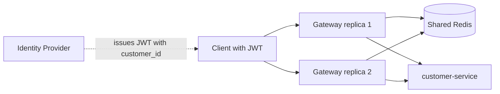

# Per-Customer Rate Limiting Using a Shared State Store

In a microservices system, request limits must be enforced by customer identity rather than per connection or per Gateway instance. If each API Gateway replica counts requests in local memory, a customer can multiply their quota by sending requests across multiple replicas. This hands-on lab uses Spring Cloud Gateway's `RequestRateLimiter` together with `RedisRateLimiter` to store token bucket state in a shared Redis instance.

We will validate JWTs at the Gateway, extract the customer ID from a claim signed by the identity provider, and use that ID as the rate-limiting key. Requests from multiple users belonging to the same customer share a single bucket; different customers get separate buckets. At the end of the lab, we verify limits across multiple Gateway replicas and cover how to operate Redis securely.

## 1. Objectives and Architecture

After completing this lab, you can:

- Explain token buckets and the three parameters `replenishRate`, `burstCapacity`, and `requestedTokens`.
- Configure `RequestRateLimiter` with Redis as a shared state store.
- Validate JWTs and resolve `customer_id` as the rate-limiting key.
- Distinguish requests rejected for missing identity from requests exceeding the rate limit.
- Verify that customers have independent buckets and multiple Gateway replicas share state.
- Identify rate limiter limitations when Redis disconnects and when business requirements call for long-term quotas.

Lab architecture:



The Gateway verifies the token before processing the route. `KeyResolver` extracts the `customer_id` claim from the authenticated principal. `RedisRateLimiter` uses that key to read and update the bucket in Redis. Because replicas share the same Redis and route configuration, a customer's rate limit is shared across replicas.

## 2. Preparing the Application and Redis

This example uses Spring Cloud Gateway Server WebFlux, Spring Security Resource Server, and reactive Redis. Choose a Spring Cloud release train compatible with your project's Spring Boot version and import the corresponding Spring Cloud BOM. Newer releases may name the Gateway starter `spring-cloud-starter-gateway-server-webflux`; older releases use `spring-cloud-starter-gateway`.

In the Gateway application, add the dependencies:

```xml
<dependency>
    <groupId>org.springframework.cloud</groupId>
    <artifactId>spring-cloud-starter-gateway-server-webflux</artifactId>
</dependency>
<dependency>
    <groupId>org.springframework.boot</groupId>
    <artifactId>spring-boot-starter-data-redis-reactive</artifactId>
</dependency>
<dependency>
    <groupId>org.springframework.boot</groupId>
    <artifactId>spring-boot-starter-security</artifactId>
</dependency>
<dependency>
    <groupId>org.springframework.boot</groupId>
    <artifactId>spring-boot-starter-oauth2-resource-server</artifactId>
</dependency>
<dependency>
    <groupId>org.springframework.boot</groupId>
    <artifactId>spring-boot-starter-actuator</artifactId>
</dependency>
```

Do not add `spring-boot-starter-web` to the reactive Gateway application. The backend service can use Spring MVC.

Start a dedicated Redis instance for the practice lab:

```bash
docker run --rm --name gateway-redis -p 6379:6379 redis:7-alpine
```

Open another terminal and confirm Redis is ready:

```bash
docker exec gateway-redis redis-cli ping
```

Expected output is `PONG`. In deployed environments, Redis must run inside a private network with authentication/ACLs and TLS enabled as appropriate; never expose the Redis port directly to the Internet.

## 3. Creating a Backend Endpoint for Testing

Create a small service named `customer-service` running on port `8081`. The `/customer/orders` endpoint returns a simple response to verify requests passed through the Gateway:

```java
@RestController
@RequestMapping("/customer")
public class CustomerController {
    @GetMapping("/orders")
    public Map<String, String> getOrders() {
        return Map.of(
                "service", "customer-service",
                "result", "ok"
        );
    }
}
```

Add the `java.util.Map` import and required Spring Web imports. Configure the port:

```yaml
spring:
  application:
    name: customer-service
server:
  port: 8081
```

The Gateway exposes `/api/customer/orders` and drops the `/api` segment before forwarding requests to the backend. Therefore, the internal endpoint remains `GET /customer/orders`.

## 4. Authenticating Customers with JWT

Do not take the customer ID from an arbitrary client-sent header such as `X-Customer-Id`. Clients could modify that header to create fresh buckets and bypass the limit. In this lab, the identity provider issues a signed JWT containing a `customer_id` claim; the Gateway verifies the signature and issuer before using the claim as the key.

Illustrative payload of a signed token:

```json
{
  "iss": "https://identity.example.test",
  "sub": "user-17",
  "customer_id": "customer-1001",
  "aud": "customer-api"
}
```

`sub` identifies the user, while `customer_id` identifies the customer owning the account. If multiple users belong to the same customer, they share one bucket. This claim must be issued by a trusted identity system; never accept self-asserted client values.

In the Gateway's `application.yml`, configure the issuer:

```yaml
spring:
  security:
    oauth2:
      resourceserver:
        jwt:
          issuer-uri: ${OIDC_ISSUER_URI}
```

Set the `OIDC_ISSUER_URI` environment variable according to your test environment's identity provider. The Resource Server uses issuer metadata to locate verification keys and validate tokens. If your system requires audience verification, add an audience validator matching your API.

Create the WebFlux security chain:

```java
@Configuration
public class GatewaySecurityConfiguration {
    @Bean
    SecurityWebFilterChain gatewaySecurity(ServerHttpSecurity http) {
        return http
                .csrf(ServerHttpSecurity.CsrfSpec::disable)
                .authorizeExchange(exchanges -> exchanges
                        .pathMatchers("/actuator/health").permitAll()
                        .pathMatchers("/api/customer/**").authenticated()
                        .anyExchange().permitAll())
                .oauth2ResourceServer(oauth2 ->
                        oauth2.jwt(Customizer.withDefaults()))
                .build();
    }
}
```

This configuration requires a valid JWT for the customer API. Requests without a token or with an invalid token are rejected by Spring Security before reaching the rate limiter filter. In a real application, adjust `authorizeExchange` rules to match your API surface and access control policies.

## 5. Creating a KeyResolver by Customer ID

`KeyResolver` determines which bucket a request belongs to. Register a bean that reads the `customer_id` claim from the `JwtAuthenticationToken` created by Spring Security after verifying the JWT:

```java
@Configuration
public class CustomerRateLimitConfiguration {
    @Bean
    KeyResolver customerKeyResolver() {
        return exchange -> exchange.getPrincipal()
                .cast(JwtAuthenticationToken.class)
                .map(authentication -> authentication.getToken()
                        .getClaimAsString("customer_id"))
                .filter(StringUtils::hasText);
    }
}
```

Key imports:

```java
import org.springframework.cloud.gateway.filter.ratelimit.KeyResolver;
import org.springframework.context.annotation.Bean;
import org.springframework.context.annotation.Configuration;
import org.springframework.security.oauth2.server.resource.authentication.JwtAuthenticationToken;
import org.springframework.util.StringUtils;
```

The method returns `Mono<String>` as required by `KeyResolver`. If a token is valid but lacks the `customer_id` claim, the publisher emits no key. We configure the Gateway to reject this case using `deny-empty-key`, preventing unidentified requests from collapsing into one shared bucket or bypassing the rate limit.

If the goal is per-user rather than per-customer limiting, you can use `authentication.getName()` or the `sub` claim. Pick a stable, unique, authenticated identifier; do not use IP address as the default key when multiple users can share the same NAT or proxy.

## 6. Configuring RequestRateLimiter with Redis

In `gateway/src/main/resources/application.yml`, configure Redis and the route:

```yaml
server:
  port: 8080

spring:
  application:
    name: edge-gateway
  data:
    redis:
      host: ${REDIS_HOST:localhost}
      port: ${REDIS_PORT:6379}
      password: ${REDIS_PASSWORD:}
  cloud:
    gateway:
      routes:
        - id: customer-api
          uri: http://localhost:8081
          predicates:
            - Path=/api/customer/**
          filters:
            - StripPrefix=1
            - name: RequestRateLimiter
              args:
                key-resolver: "#{@customerKeyResolver}"
                redis-rate-limiter.replenishRate: 2
                redis-rate-limiter.burstCapacity: 4
                redis-rate-limiter.requestedTokens: 1
                deny-empty-key: true
                empty-key-status-code: FORBIDDEN
                status-code: TOO_MANY_REQUESTS
```

With Spring Boot 3, Redis connection properties use the `spring.data.redis` prefix. Some older Spring Boot versions use `spring.redis`; pick the prefix matching your project version. When Redis has a password, supply `REDIS_PASSWORD` from a secret manager or environment variable, never committed to the repository.

Meaning of rate limiter settings:

| Parameter | Value | Meaning |
|---|---:|---|
| `replenishRate` | `2` | Replenishes 2 tokens per second. |
| `burstCapacity` | `4` | Bucket holds at most 4 tokens, permitting a short burst above the average rate. |
| `requestedTokens` | `1` | Each request consumes 1 token. |
| `key-resolver` | `customerKeyResolver` | Uses the `customer_id` claim as the bucket key. |
| `deny-empty-key` | `true` | Rejects the request if no key can be resolved. |
| `empty-key-status-code` | `FORBIDDEN` | Returns `403` when the customer key is missing. |
| `status-code` | `TOO_MANY_REQUESTS` | Returns `429` when the bucket lacks sufficient tokens. |

RedisRateLimiter implements the token bucket algorithm. A fresh bucket can hold up to `burstCapacity` tokens. Each request consumes `requestedTokens`; tokens replenish at `replenishRate` up to maximum capacity. With the configuration above, a customer can send a burst of up to 4 requests, then sustain an average of 2 tokens added per second.

Because the key is `customer_id`, two users carrying the same claim share a bucket. A customer with a different ID gets a separate bucket. The route ID also participates in distinguishing per-route state; keep route IDs and rate-limit policies consistent across Gateway replicas.

## 7. Starting Up and Verifying

Start components in order:

1. Start Redis and confirm `redis-cli ping` returns `PONG`.
2. Start `customer-service` on port `8081`.
3. Obtain a valid test JWT from the identity provider. The token must contain the `customer_id` claim, e.g. `customer-1001`.
4. Set `OIDC_ISSUER_URI` and required Redis variables, then start the Gateway on port `8080`.

Store test tokens in terminal environment variables. Example in Bash:

```bash
export TOKEN_A='<jwt-for-customer-1001>'
export TOKEN_B='<jwt-for-customer-2002>'
```

Never place real tokens into config files or commit them to source code. Send a test request:

```bash
curl -i -H "Authorization: Bearer $TOKEN_A" \
  http://localhost:8080/api/customer/orders
```

Expected response is `200 OK` with the body from `customer-service`. This confirms the JWT is valid, the route matched, and the request was forwarded to the backend.

### Testing a Single Customer's Bucket

Quickly send 5 consecutive requests with the same token:

```bash
for i in 1 2 3 4 5; do
  curl -s -o /dev/null -w "%{http_code}\n" \
    -H "Authorization: Bearer $TOKEN_A" \
    http://localhost:8080/api/customer/orders
done
```

If requests arrive fast enough before tokens replenish, expect four `200` responses and one `429` response. If the fifth request arrives after a new token has been added, retry with tighter spacing or temporarily lower `replenishRate` in the lab environment to observe clearly.

Wait about one second and send another request. The bucket has replenished tokens so the request can succeed. If you keep sending continuously, the Gateway only allows requests when the bucket has enough tokens.

### Testing Two Independent Customers

Send a burst using `TOKEN_A` for `customer-1001`, then use `TOKEN_B` carrying `customer_id=customer-2002`:

```bash
curl -i -H "Authorization: Bearer $TOKEN_B" \
  http://localhost:8080/api/customer/orders
```

The second customer's request can still receive `200` even though the first customer's bucket is exhausted. If two tokens share the same `customer_id`, they must share the same bucket regardless of having different `sub` claims.

### Testing Missing Identity

- Missing or invalid token: Spring Security rejects the request, typically `401 Unauthorized`.
- Valid token lacking the `customer_id` claim: `KeyResolver` emits empty and the rate limiter rejects with `403 Forbidden`.
- Valid request exceeding the limit: Gateway returns `429 Too Many Requests`.

These three cases represent three distinct causes. Do not change `deny-empty-key` to `false` just to let unidentified requests through; fix the token or authentication rules instead.

## 8. Proving Redis Shares Limits Across Multiple Gateways

To verify shared state, run an additional Gateway replica on port `8082` with the same route configuration, same route ID `customer-api`, same Redis, and same rate-limit policy. In the lab, you can use a profile or environment variable to change `server.port`; the backend stays on port `8081`.

Keep Redis running and alternate sending requests for the same customer through both Gateway ports:

```bash
curl -i -H "Authorization: Bearer $TOKEN_A" http://localhost:8080/api/customer/orders
curl -i -H "Authorization: Bearer $TOKEN_A" http://localhost:8082/api/customer/orders
curl -i -H "Authorization: Bearer $TOKEN_A" http://localhost:8080/api/customer/orders
curl -i -H "Authorization: Bearer $TOKEN_A" http://localhost:8082/api/customer/orders
```

The bucket is state stored in Redis, so requests at the second replica continue consuming tokens from the same customer's bucket. There is no fresh burst allowance per replica. If each replica used its own Redis or an in-memory counter, results would differ and customers could multiply their quota by the number of replicas.

Ensure every replica shares the same `customerKeyResolver`, route ID, and `replenishRate`, `burstCapacity`, and `requestedTokens` values. Configuration drift between replicas leads to unpredictable behavior and makes reconciliation difficult.

## 9. Extending Policies by Customer Tier

The lab currently applies the same rate to every customer. In real products, customers may belong to different tiers, such as Standard and Premium. `KeyResolver` only determines the bucket key; changing the key does not automatically change the token replenishment rate.

To enforce different limits per tier, you need a trusted policy determining customer entitlement and a corresponding rate limiter implementation. Options include:

- Use a custom `RateLimiter` to read limits from configuration or an entitlement store and apply per-customer rate/burst settings.
- Split routes by policy when route classification relies on authenticated, trusted data, while ensuring customers cannot self-select a higher-limit route.
- Cache entitlements briefly and provide an update mechanism when a customer's plan changes.

Never use a client-sent `X-Plan: premium` header to grant higher limits. If entitlement lives inside the JWT, trust only claims verified by the issuer with an appropriate lifespan; if plan changes must take effect immediately, look up entitlements from a controlled data source.

A token bucket is suited for smoothing rates and bursts over short time windows. It is not a billing counter or a long-term business quota such as 100,000 requests per month. Long-term quotas require persistent counters, reset schedules, transaction handling, and separate reconciliation.

## 10. Operating Redis and Rate-Limit Observability

Redis sits on the request processing path. When Redis loses connectivity, the Gateway cannot accurately determine whether a bucket still has tokens. Explicitly decide your API's policy: fail closed to protect the backend, or provide a deliberately designed and bounded fallback. Never assume a Redis error equates to `429`; monitor connection errors and test behavior when Redis is unavailable.

Deployment practices to follow:

- Run Redis with appropriate high availability, restricting access via private network, ACLs/passwords, and TLS as needed.
- Supply connection credentials via a secret manager; never log passwords, JWTs, or private keys.
- Monitor Redis latency and connection errors, `429` counts, `403` counts from missing keys, and per-route success rates.
- Use Actuator/Micrometer and monitoring systems to observe the Gateway; expose management endpoints only on protected networks.
- Use request IDs and route IDs for tracing; log customer IDs only when data policy allows, and avoid logging bearer tokens.
- Test behavior during Redis restarts or failovers. Bucket state may be lost or altered when the state store reinitializes; never use this mechanism as the source of truth for billing quotas.

Example exposing only essential Actuator endpoints:

```yaml
management:
  endpoints:
    web:
      exposure:
        include: health,info,metrics,prometheus
  endpoint:
    health:
      probes:
        enabled: true
```

If using Prometheus, add the registry matching your Spring Boot version. Build dashboards tracking `429` rates, per-route traffic, Gateway latency, and Redis health. Restrict access to metrics and management endpoints; do not publicly expose route details or internal configurations.

## 11. Troubleshooting

| Symptom | Causes to check |
|---|---|
| Every request receives `401` | Missing or expired token, invalid signature, or `issuer-uri` mismatch. |
| Valid token receives `403` | `customer_id` claim is missing/empty or `KeyResolver` did not receive a `JwtAuthenticationToken`. |
| Requests receive `429` too early | Bucket is shared by other users of the same customer, burst is set low, or concurrent requests arrived together. |
| Requests are not rate-limited | Filter not attached to the selected route, inconsistent route ID/config, or KeyResolver resolves a different key. |
| Two replicas have separate limits | Replicas are connected to different Redis instances, different DBs/namespaces, or different route IDs. |
| Gateway errors when Redis stops | Gateway cannot read/update buckets; check network, ACLs, password, TLS, and Redis health. |
| Different customers share one bucket | Selected claim is not a unique customer ID or the issuer assigned the same value to multiple customers. |

## 12. Completion Exercises

Complete and record the results for each item:

1. Start Redis, backend, and Gateway; confirm a valid JWT request returns `200`.
2. Verify `customer_id` in the JWT serves as the bucket key; explain why `sub` could create separate buckets if used instead.
3. With `2 tokens/sec` and burst `4`, send a burst of requests for one customer and observe `429` responses when the bucket drains.
4. Use a token from another customer and confirm independent buckets.
5. Use a valid token missing the `customer_id` claim; confirm the request receives `403`.
6. Run two Gateway replicas with shared Redis; alternate requests and prove the limit is shared.
7. Stop Redis in the lab environment; record the observed error and propose an appropriate fail-closed or fallback policy.

**Completion criteria:** authenticated requests are grouped by a trusted customer ID; distinct customers get separate buckets; Gateway replicas share Redis state; requests exceeding the limit receive `429`; requests missing a key are rejected; and the learner can explain the limits of token buckets and how to operate Redis securely.
