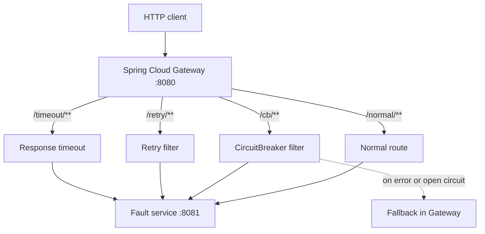

# Simulating Faults to Observe Timeouts, Retries, and Circuit Breakers

In this hands-on lab, you build a backend that can produce controlled slow responses, HTTP 503 errors, and HTTP 500 errors. Spring Cloud Gateway routes each scenario through a separate filter so you can observe three resilience mechanisms:

- **Timeout:** the Gateway stops waiting for upstream when response time exceeds the limit.
- **Retry:** the Gateway retries an eligible request after upstream returns a retryable error.
- **Circuit breaker:** the Gateway temporarily stops calling upstream when the failure rate exceeds a threshold, while returning a fallback to reduce cascading failures.

We use Spring Cloud Gateway Server WebFlux and Spring Cloud CircuitBreaker with Resilience4j. The Gateway configuration examples below use the `spring.cloud.gateway.*` namespace from the Gateway 4.x line. Choose a Spring Cloud BOM compatible with your project's Spring Boot version; if using another Gateway line, verify starter names and property prefixes against the documentation for that exact version.

## 1. Lab Model

Create two Spring Boot applications:

| Application | Port | Responsibility |
|---|---:|---|
| `fault-service` | 8081 | API simulating fast, slow, 503, and 500 responses |
| `api-gateway` | 8080 | Routes requests and applies timeout, retry, and circuit breaker |

Each fault category uses its own route so you can observe the effect of each filter individually. We do not place Retry and CircuitBreaker on the same route in this initial exercise because filter order alters error counting, upstream call counts, and fallback behavior. Once you understand each mechanism individually, you can experiment with combining them.



## 2. Preparing Dependencies

Manage Spring Cloud dependencies with a BOM compatible with Spring Boot. Do not specify independent versions for Gateway or Spring Cloud CircuitBreaker when the BOM already manages them.

Example Maven dependency for `fault-service`:

```xml
<dependency>
    <groupId>org.springframework.boot</groupId>
    <artifactId>spring-boot-starter-web</artifactId>
</dependency>
```

Example Maven dependencies for `api-gateway` on Gateway 4.x Server WebFlux:

```xml
<dependency>
    <groupId>org.springframework.cloud</groupId>
    <artifactId>spring-cloud-starter-gateway</artifactId>
</dependency>
<dependency>
    <groupId>org.springframework.cloud</groupId>
    <artifactId>spring-cloud-starter-circuitbreaker-reactor-resilience4j</artifactId>
</dependency>
<dependency>
    <groupId>org.springframework.boot</groupId>
    <artifactId>spring-boot-starter-actuator</artifactId>
</dependency>
```

If using Gradle, declare the same artifacts in `dependencies`. Gateway Server WebFlux requires Reactor; do not add `spring-boot-starter-web` to the Gateway application in this lab. `fault-service` can use Spring MVC because it is an independent mock backend.

## 3. Creating a Backend That Simulates Faults

Create the `FaultServiceApplication` application:

```java
import org.springframework.boot.SpringApplication;
import org.springframework.boot.autoconfigure.SpringBootApplication;

@SpringBootApplication
public class FaultServiceApplication {
    public static void main(String[] args) {
        SpringApplication.run(FaultServiceApplication.class, args);
    }
}
```

Configure `application.yml`:

```yaml
server:
  port: 8081

spring:
  application:
    name: fault-service
```

Create the controller below. The `flakyAttempts` counter makes `/flaky` return 503 on the first two attempts and succeed on the third. The `controlledFailure` flag toggles 500 errors so you can observe the circuit breaker transitioning from OPEN to HALF_OPEN and then CLOSED.

```java
import java.util.Map;
import java.util.concurrent.atomic.AtomicBoolean;
import java.util.concurrent.atomic.AtomicInteger;

import org.springframework.http.HttpStatus;
import org.springframework.http.ResponseEntity;
import org.springframework.web.bind.annotation.GetMapping;
import org.springframework.web.bind.annotation.PostMapping;
import org.springframework.web.bind.annotation.RequestMapping;
import org.springframework.web.bind.annotation.RequestParam;
import org.springframework.web.bind.annotation.RestController;

@RestController
@RequestMapping("/api/test")
public class FaultController {

    private final AtomicInteger flakyAttempts = new AtomicInteger();
    private final AtomicBoolean controlledFailure = new AtomicBoolean(true);

    @GetMapping("/ok")
    public Map<String, String> ok() {
        return Map.of("status", "ok", "source", "fault-service");
    }

    @GetMapping("/slow")
    public Map<String, String> slow() throws InterruptedException {
        Thread.sleep(3000);
        return Map.of("status", "completed", "delayMs", "3000");
    }

    @GetMapping("/flaky")
    public ResponseEntity<Map<String, Object>> flaky() {
        int attempt = flakyAttempts.incrementAndGet();
        if (attempt <= 2) {
            return ResponseEntity.status(HttpStatus.SERVICE_UNAVAILABLE)
                .body(Map.of("status", "temporary_failure", "attempt", attempt));
        }
        return ResponseEntity.ok(
            Map.of("status", "recovered", "attempt", attempt));
    }

    @PostMapping("/reset-flaky")
    public Map<String, String> resetFlaky() {
        flakyAttempts.set(0);
        return Map.of("status", "reset");
    }

    @GetMapping("/controlled")
    public ResponseEntity<Map<String, String>> controlled() {
        if (controlledFailure.get()) {
            return ResponseEntity.status(HttpStatus.INTERNAL_SERVER_ERROR)
                .body(Map.of("status", "controlled_failure"));
        }
        return ResponseEntity.ok(Map.of("status", "recovered"));
    }

    @PostMapping("/admin/failure")
    public Map<String, Object> setFailure(@RequestParam boolean enabled) {
        controlledFailure.set(enabled);
        return Map.of("controlledFailure", enabled);
    }
}
```

The `/admin/failure` and `/reset-flaky` endpoints are strictly for the local lab. Never expose fault-injection or state-reset endpoints to the Internet or production environments. If running multiple backend instances, counters and state must live in a shared store or be simulated per instance; this lab uses a single process so outcomes are predictable.

Start the backend:

```bash
./mvnw spring-boot:run
```

Test the backend directly before adding the Gateway:

```bash
curl -i http://localhost:8081/api/test/ok
curl -i http://localhost:8081/api/test/slow
curl -i http://localhost:8081/api/test/controlled
```

`/slow` takes roughly three seconds to respond. `/controlled` initially returns 500 because `controlledFailure` starts as `true`.

## 4. Configuring the Gateway for the Three Scenarios

Create the Gateway main class:

```java
import org.springframework.boot.SpringApplication;
import org.springframework.boot.autoconfigure.SpringBootApplication;

@SpringBootApplication
public class ApiGatewayApplication {
    public static void main(String[] args) {
        SpringApplication.run(ApiGatewayApplication.class, args);
    }
}
```

Create a fallback controller inside the Gateway application:

```java
import java.util.Map;

import org.springframework.web.bind.annotation.GetMapping;
import org.springframework.web.bind.annotation.RestController;

@RestController
public class GatewayFallbackController {

    @GetMapping("/fallback/catalog")
    public Map<String, String> catalogFallback() {
        return Map.of(
            "status", "degraded",
            "message", "Catalog service is temporarily unavailable",
            "source", "gateway-fallback"
        );
    }
}
```

Configure the Gateway's `application.yml`:

```yaml
server:
  port: 8080

spring:
  application:
    name: api-gateway
  cloud:
    gateway:
      httpclient:
        connect-timeout: 1000
        response-timeout: 3s
      routes:
        - id: normal-route
          uri: http://localhost:8081
          predicates:
            - Path=/normal/**
          filters:
            - StripPrefix=1

        - id: timeout-route
          uri: http://localhost:8081
          predicates:
            - Path=/timeout/**
          filters:
            - StripPrefix=1
          metadata:
            response-timeout: 1000

        - id: retry-route
          uri: http://localhost:8081
          predicates:
            - Path=/retry/**
          filters:
            - StripPrefix=1
            - name: Retry
              args:
                retries: 2
                methods:
                  - GET
                statuses:
                  - SERVICE_UNAVAILABLE

        - id: circuit-breaker-route
          uri: http://localhost:8081
          predicates:
            - Path=/cb/**
          filters:
            - StripPrefix=1
            - name: CircuitBreaker
              args:
                name: catalogCircuit
                fallbackUri: forward:/fallback/catalog
                statusCodes:
                  - 500

resilience4j:
  circuitbreaker:
    instances:
      catalogCircuit:
        slidingWindowType: COUNT_BASED
        slidingWindowSize: 4
        minimumNumberOfCalls: 4
        failureRateThreshold: 50
        waitDurationInOpenState: 10s
        permittedNumberOfCallsInHalfOpenState: 2

management:
  endpoints:
    web:
      exposure:
        include: health,info,metrics
  endpoint:
    health:
      show-details: always
```

Explanation of key settings:

- `connect-timeout` limits the time to establish an upstream connection, in milliseconds.
- Global `response-timeout` is a duration; `timeout-route` overrides it with metadata `response-timeout: 1000`, i.e. 1,000 milliseconds.
- `Retry` allows at most two retries after the initial attempt, restricted to GET and status 503. The total number of times the backend can receive a request for one Gateway call is three.
- `CircuitBreaker` uses the Resilience4j instance named `catalogCircuit`; status 500 counts as a failure, and the Gateway routes to the internal fallback on failure or when the circuit is open.
- The circuit breaker uses a 4-call window, requires at least 4 samples, and opens when the failure rate reaches at least 50%. After 10 seconds, it permits two probe requests in the HALF_OPEN state.

Global `response-timeout` and route metadata use different types/units as shown. Verify against your specific Gateway version when upgrading. This configuration uses a fixed HTTP URI to simulate faults against a local backend; in a multi-instance environment, you can switch `uri` to `lb://fault-service` and register the backend with service discovery.

Start the Gateway:

```bash
./mvnw spring-boot:run
```

If the Gateway fails to start, inspect property binding logs, BOM version, the Gateway Server WebFlux starter, and the CircuitBreaker Reactor Resilience4j starter before sending requests.

## 5. Observing Timeouts

Call the slow endpoint through the Gateway's timeout route:

```bash
curl -i http://localhost:8080/timeout/api/test/slow
```

The backend needs about three seconds, but the timeout route waits only one second. The result is typically `504 Gateway Timeout` or an equivalent gateway error depending on the version and exception handling. Time the call from the client to confirm the Gateway stops waiting near the configured limit.

Compare with the normal route:

```bash
curl -i http://localhost:8080/normal/api/test/ok
curl -i http://localhost:8080/normal/api/test/slow
```

The normal route has a global 3-second response timeout, so a ~3-second slow endpoint may complete right near the boundary. If processing exceeds three seconds, this route can also time out.

Points to observe:

- `connect-timeout` and `response-timeout` govern two separate phases. Increasing connect timeout does not help when the backend takes too long after the connection is established.
- The Gateway giving up does not mean the backend immediately aborts work. A Spring MVC controller running `Thread.sleep` may finish sleeping even after the client has already received a timeout.
- A timeout on the Gateway does not automatically adjust timeouts on the ingress, load balancer, or client. These layers need consistent deadlines so requests do not stall on another hop.
- Never set overly short timeouts for uploads, streaming, long reports, or endpoints with legitimately long processing times.

## 6. Observing Retries

First, reset the flaky counter directly on the backend:

```bash
curl -X POST http://localhost:8081/api/test/reset-flaky
```

Then call the retry route through the Gateway:

```bash
curl -i http://localhost:8080/retry/api/test/flaky
```

The backend returns 503 on the first two attempts and 200 on the third. With `retries: 2`, the Gateway calls up to three times and the final response is expected to be 200 with `attempt: 3`. Check backend logs to confirm the actual number of calls.

To see retries stop after reaching the allowed count, temporarily make the backend always return 503 or add an endpoint that always fails with 503. With two retries, the Gateway performs the initial attempt plus two retries, then returns the final error response.

Key principles to remember:

- `retries` is the number of retry attempts after the first call, not the total number of calls.
- Only retry methods and statuses that are safe under the application's contract. For example, GET is typically safer than a POST that creates an order.
- If retrying POST or write operations, require an idempotency key or deduplication mechanism to avoid duplicate transactions.
- Backoff prevents hammering a recovering upstream. In production, configure initial delay, multiplier, and a total cap aligned with the client's deadline.
- Retries increase load on upstream while the system is failing. Cap retry counts and monitor retry rates to prevent incident amplification.
- Never retry all exceptions or all statuses by default. Explicitly declare the failure group appropriate for your API.

## 7. Observing the Circuit Breaker and Fallback

A circuit breaker has three main states:

| State | Meaning | Behavior |
|---|---|---|
| CLOSED | System allows requests to reach upstream and records outcomes | Requests forward normally; failures accumulate within the window |
| OPEN | Failure rate exceeded threshold | Requests fail fast without calling upstream; Gateway switches to fallback |
| HALF_OPEN | Wait duration after OPEN elapsed | Allows only a limited number of probe requests to upstream to evaluate recovery |

With the lab configuration, at least four calls are needed to evaluate the window. Four consecutive failures exceed the 50% threshold and transition the circuit to OPEN.

### Triggering Failures to Open the Circuit

Ensure the backend is in failure mode (by default `controlledFailure=true`). Call the circuit breaker route four times:

```bash
for i in $(seq 1 4); do
  curl -i http://localhost:8080/cb/api/test/controlled
done
```

Each 500 error from the backend is counted as a failure by the filter and turned into a fallback response from the Gateway. The fallback response has `status: degraded` and `source: gateway-fallback`.

Call it one more time:

```bash
curl -i http://localhost:8080/cb/api/test/controlled
```

Once the circuit is OPEN, the Gateway continues returning the fallback immediately without calling the backend. Compare response times and backend logs to distinguish fallbacks triggered by upstream errors from fallbacks returned because the circuit is open.

### Recovering and Closing the Circuit

Disable failure mode on the backend:

```bash
curl -X POST "http://localhost:8081/api/test/admin/failure?enabled=false"
```

Wait for `waitDurationInOpenState` (10 seconds). Once the circuit transitions to HALF_OPEN, send two probe requests:

```bash
curl -i http://localhost:8080/cb/api/test/controlled
curl -i http://localhost:8080/cb/api/test/controlled
```

If both requests succeed, the circuit transitions back to CLOSED and subsequent requests continue reaching the backend. If probe requests still fail, the circuit reopens and you must wait another cycle.

You can enable the health indicator and inspect `/actuator/health` to observe circuit state if your dependency/version exports circuit breaker details. Resilience4j metrics can also be exported via Micrometer depending on your registry. Do not expose detailed Actuator endpoints publicly in production; restrict access and enable only truly needed endpoints.

## 8. Comparing the Three Mechanisms

| Mechanism | What it detects | Action | When appropriate |
|---|---|---|---|
| Timeout | Upstream fails to respond within deadline | Stop waiting and terminate request | Bounding wait times, protecting resources and client UX |
| Retry | A failure may be transient | Re-send request within bounded limits | Transient errors, requests safe to repeat |
| Circuit breaker | Upstream persistently fails or is overloaded | Temporarily stop calling upstream and optionally serve fallback | Preventing cascading failures, shedding load on degraded dependencies |

The three mechanisms complement rather than replace one another. Timeout bounds a single attempt's duration; retry can issue additional attempts; circuit breaker decides whether to keep sending requests to a dependency. When combined, the overall deadline must account for all attempts plus backoff. For example, three attempts each with a 2-second timeout plus two backoff delays can exceed six seconds; a shorter client timeout will close the request before the Gateway finishes.

Nor does a fallback always mean returning fake data. Use a fallback only when valid degraded content exists—such as cached data, defaults, or a temporary notice. For financial transactions or write operations, returning a fake success can mislead clients about transaction state.

## 9. Experimenting with Combining Retry and CircuitBreaker

After testing each mechanism separately, you can create another test route combining them. You must decide filter ordering and understand which filter sees failures first. One logical request can generate multiple physical backend calls due to Retry; CircuitBreaker may count results per attempt or per publisher depending on filter nesting and implementation.

Try two configurations in the lab environment:

1. Retry placed before CircuitBreaker in the filter chain: observe whether the circuit breaker sees the result after retries finish or each intermediate failure.
2. CircuitBreaker wrapping a request with Retry: observe whether the circuit breaker counts all retries as a single logical call.

Effective ordering must be verified via logs and backend request counts, not just assumed from YAML line order. Record route ID, upstream call counts, final status, total duration, and circuit state. Never copy combined configurations into production without verifying ordering, deadlines, and idempotency.

## 10. Lab Troubleshooting Table

| Symptom | Possible cause | How to fix |
|---|---|---|
| Timeout route still waits longer than expected | Wrong metadata unit, route mismatch, or another proxy/client holding the request | Confirm route ID, per-route `response-timeout`, and timing at each hop |
| Normal route also times out | Global response timeout is shorter than backend processing time | Intentionally raise timeout or separate long-running routes |
| Retry calls backend only once | Status not listed in retry config, method mismatch, or filter not on route | Check status 503, method GET, route ID, and Gateway logs |
| Retry creates too many requests | High retry count, multiple layers retrying, or client also retrying | Inventory retries across client, Gateway, service mesh, and SDK; set a total budget |
| Circuit does not open | Too few samples, status 500 not declared, or failures bypassing filter | Check `minimumNumberOfCalls`, `statusCodes`, circuit name, and route |
| Fallback does not run | Wrong `fallbackUri`, internal endpoint missing, or fallback handler errors | Check `forward:/fallback/catalog` and internal dispatch logs |
| Circuit is open but backend still receives requests | Pre-existing in-flight requests, another route calling same backend, or another instance using a separate circuit | Check request timestamps, route ID, and instance/config scope |
| Circuit stays open after backend recovers | OPEN duration not elapsed, HALF_OPEN probes failing, or errors remaining in window | Wait full duration, send permitted probes, and inspect backend responses |

## 11. Completion Checklist

- [ ] Backend runs on port `8081` and `/ok`, `/slow`, `/flaky`, `/controlled` respond as designed.
- [ ] Gateway runs on port `8080` and all four routes load properly.
- [ ] Timeout route terminates slow requests near the one-second limit.
- [ ] Retry route calls the flaky endpoint three times and succeeds on the third attempt.
- [ ] Circuit breaker route switches to fallback after enough 500 errors.
- [ ] When circuit is OPEN, requests fail over quickly without calling the backend.
- [ ] After disabling errors and waiting out the cooldown, HALF_OPEN probes succeed and return the circuit to CLOSED.
- [ ] Recorded backend call counts, response times, and circuit states.
- [ ] Fault-control endpoints are used strictly in the lab environment and never exposed publicly.

## 12. Extension Exercises

1. Replace the fixed backend with `lb://fault-service`, register two instances, and stop each instance in turn to observe timeouts/retries/circuit breaking as discovery updates.
2. Experiment with different response timeout values and measure the impact on p95/p99.
3. Add backoff to Retry, then compare total duration and upstream request counts.
4. Adjust `slidingWindowSize`, `minimumNumberOfCalls`, and `failureRateThreshold`; record when the circuit transitions to OPEN.
5. Add a fallback that reads from a cache and identify which data is safe enough to return when catalog service is unavailable.
6. Enable Resilience4j metrics and build a dashboard tracking state, failure rate, retry count, and latency.

Deliverables include the source code for fault service and Gateway, configuration of all three filters, logs or responses proving timeout/retry/fallback behavior, and notes on timestamps when the circuit transitioned CLOSED → OPEN → HALF_OPEN → CLOSED. Through this lab, you see how the Gateway bounds wait times, retries transient failures, and prevents a persistently failing dependency from degrading the entire system.
