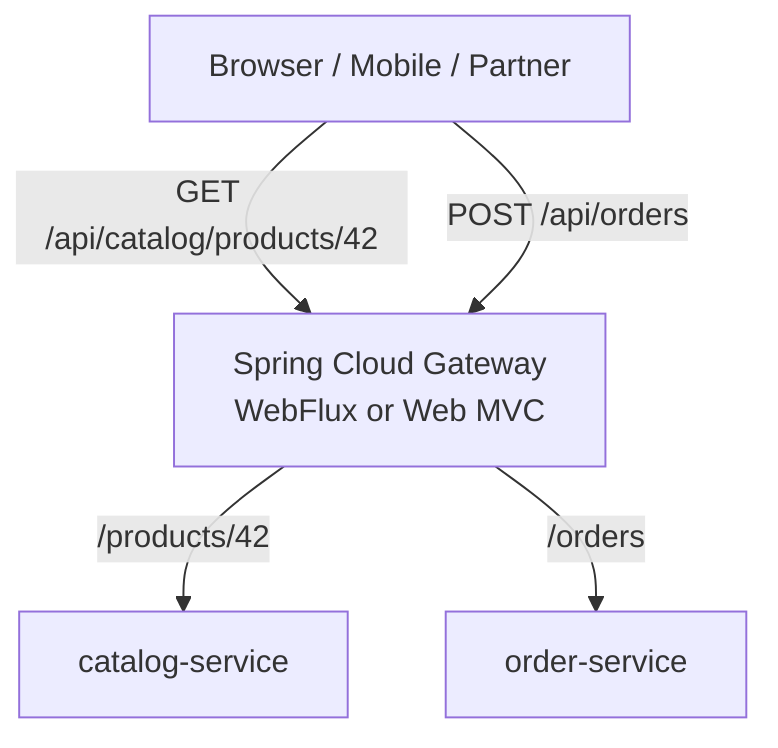
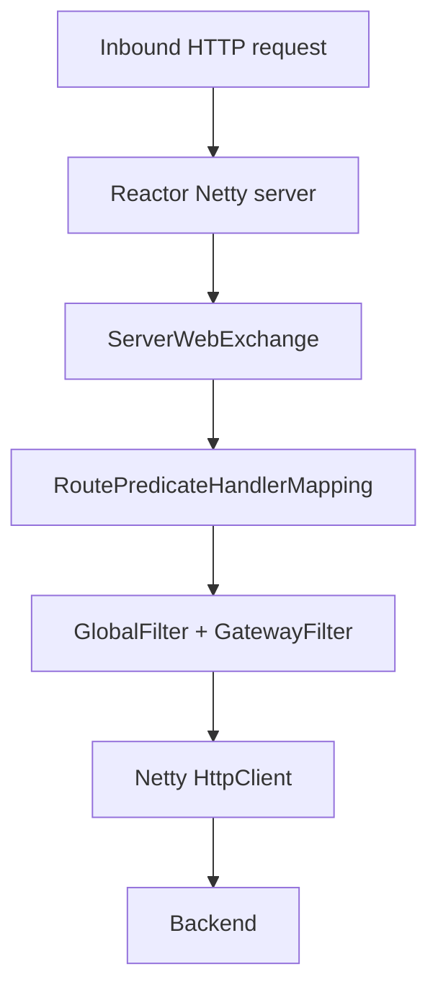
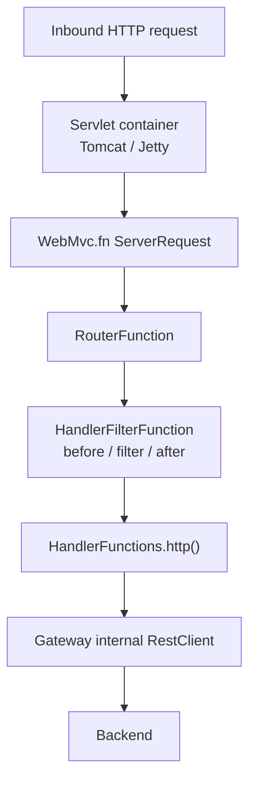
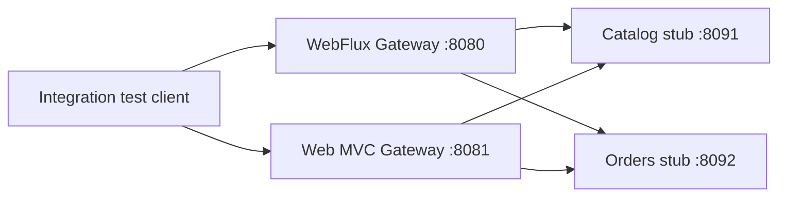

# Comparing the Same Scenario on Server WebFlux and Server Web MVC

## Practice Objectives

In the **Comprehensive Practice** chapter of the **SPRING_CLOUD_GATEWAY** module, this lab implements the exact same API Gateway problem on two server flavors: **Spring Cloud Gateway Server WebFlux** and **Spring Cloud Gateway Server Web MVC**. The goal is to observe differences in execution models, route APIs, predicates, filters, HTTP clients, load balancing, security, body handling, and testing—while confirming both can fulfill the same public API contract.

The recurring use case is a store API:

- `GET /api/catalog/products/42` forwards to Catalog service with internal path `/products/42`.
- `POST /api/orders` forwards to Order service with internal path `/orders` while preserving the JSON body.
- Both routes add the technical header `X-Gateway-Name: public-api`.
- Catalog requires scope `catalog.read`; creating an Order requires `orders.write`.
- When using service discovery, both routes must pick an instance of their respective service.

After this lab, you can:

- Distinguish **Gateway Server** from **Proxy Exchange** and understand WebFlux/MVC as two distinct runtime flavors.
- Create identical routes using YAML and the Java DSL on both flavors.
- Compare `RouteLocator`, `GatewayFilter`, and `GlobalFilter` with `RouterFunction`, `RequestPredicate`, and `HandlerFilterFunction`.
- Rewrite paths and headers without altering the public API contract.
- Understand differences between the Reactor Netty HTTP client and Server MVC's internal HTTP client.
- Configure `lb://` and recognize differences in load-balancing filters.
- Apply Spring Security using `SecurityWebFilterChain` or `SecurityFilterChain`.
- Compare rate limiters, Retry, Circuit Breaker, TokenRelay, and body caching per flavor.
- Choose WebFlux or Web MVC based on execution model and system dependencies.
- Test both Gateways against the same backend stubs and compare actual downstream requests.

> **Reference version:** official documentation was checked against Spring Cloud Gateway **5.1.0 stable** as of November 24, 2026. Examples use 5.1 starters and namespaces: `spring-cloud-starter-gateway-server-webflux`, `spring-cloud-starter-gateway-server-webmvc`, `spring.cloud.gateway.server.webflux.*`, and `spring.cloud.gateway.server.webmvc.*`. Use a Spring Cloud BOM compatible with your project's Spring Boot version; never mix two versions or both server starters arbitrarily.

## 1. Shared Problem and Target Outcomes

### 1.1. System Diagram



The two Gateway applications are independent implementations of the same contract. In the lab, run each flavor on its own port pointing to the same backend stubs:

| Component | WebFlux Gateway | Web MVC Gateway |
| --- | --- | --- |
| Gateway port | `8080` | `8081` |
| Catalog stub | `8091` | `8091` |
| Orders stub | `8092` | `8092` |
| Public API | `/api/catalog/**`, `/api/orders` | Same as WebFlux |
| Added header | `X-Gateway-Name: public-api` | Same as WebFlux |

These ports are lab values. In production, two Gateways typically do not serve the same traffic pool without deliberate routing, rollout, and capacity planning.

### 1.2. Expected Requests and Responses

**Catalog**

```http
GET /api/catalog/products/42 HTTP/1.1
Host: api.example.test
Authorization: Bearer <token with catalog.read scope>
```

Backend must receive:

```http
GET /products/42 HTTP/1.1
X-Gateway-Name: public-api
```

**Orders**

```http
POST /api/orders HTTP/1.1
Host: api.example.test
Content-Type: application/json
Authorization: Bearer <token with orders.write scope>

{"productId":"42","quantity":2}
```

Backend must receive:

```http
POST /orders HTTP/1.1
X-Gateway-Name: public-api
Content-Type: application/json

{"productId":"42","quantity":2}
```

Completion requires **correct route, correct path, correct headers, correct body, and correct authorization**. A standalone 200 status does not prove the proxy forwarded the request properly.

## 2. Distinguishing Gateway Server From Proxy Exchange

Spring Cloud Gateway has two main flavors:

| Flavor | Role |
| --- | --- |
| **Server** | A full API Gateway that can run standalone or embedded inside a Spring Boot application |
| **Proxy Exchange** | Lets a handler/controller in a WebFlux or Web MVC app use a `ProxyExchange` object to proxy a specific request |

Each flavor can target WebFlux or Web MVC. This lab compares **Server WebFlux** and **Server Web MVC**, not `ProxyExchange`.

### 2.1. Server WebFlux

Server WebFlux is built on Spring WebFlux and Reactor. The WebFlux starter uses the Netty runtime provided by Spring Boot; Gateway documentation notes this flavor does not run in a traditional Servlet container or package as a WAR.

### 2.2. Server Web MVC

Server Web MVC is built on Spring Boot and **Spring WebMvc.fn**. It runs on Servlet runtimes such as Tomcat or Jetty. Routes are expressed using `RouterFunction` and Gateway's HTTP proxy handler.

**The name "Server Web MVC" does not mean default route APIs are written with `@RestController`.** Gateway Server MVC uses WebMvc.fn functional routing; the application can still add MVC controllers for fallbacks or internal endpoints if the architecture needs them.

Sources: [Spring Cloud Gateway overview](https://docs.spring.io/spring-cloud-gateway/reference/index.html), [Server Web MVC starter](https://docs.spring.io/spring-cloud-gateway/reference/spring-cloud-gateway-server-webmvc/starter.html).

## 3. Comparing Execution Models

### 3.1. WebFlux Flow



Key concepts:

- Requests/responses flow through `ServerWebExchange`.
- Routes are described by `RouteLocator` or route definitions.
- Predicates inspect `ServerWebExchange`.
- Filters return `Mono<Void>` and can process bodies as `Flux<DataBuffer>`.
- Outbound HTTP routing defaults to Reactor Netty `HttpClient`.
- Non-blocking I/O fits high-concurrency workloads when the entire pipeline avoids blocking.

### 3.2. Web MVC Flow



Key concepts:

- Requests/responses flow through the Servlet stack and WebMvc.fn `ServerRequest`/`ServerResponse`.
- Routes are described by `RouterFunction<ServerResponse>`.
- Predicates are Spring WebMvc.fn `RequestPredicate` instances.
- Filters are `HandlerFilterFunction`s, or request/response processors added via `.before()`/`.after()`.
- The HTTP proxy handler is provided by `HandlerFunctions.http()`.
- Gateway Server MVC constructs an internal HTTP client based on `RestClient` to proxy requests.
- The traditional Servlet model uses blocking I/O; thread/container tuning and virtual threads depend on the application.

### 3.3. Core Differences Table

| Component | Server WebFlux | Server Web MVC |
| --- | --- | --- |
| Web stack | Spring WebFlux | Spring WebMvc.fn |
| Server runtime | Reactor Netty | Servlet container such as Tomcat/Jetty |
| Route abstraction | `Route`, `RouteLocator` | `RouterFunction<ServerResponse>` |
| Request type in predicates | `ServerWebExchange` | `ServerRequest` |
| Predicate extension | `RoutePredicateFactory` | WebMvc.fn `RequestPredicate` |
| Route filter | `GatewayFilter` | `HandlerFilterFunction` |
| Global filter API | `GlobalFilter` | Does not share the same interface; composition via WebMvc.fn/Servlet filters |
| Pre/post API | Reactive chain, `Mono<Void>` | `.before()`, `.filter()`, `.after()` |
| Request body | `Flux<DataBuffer>` | Servlet/WebMvc.fn request body APIs |
| Outbound client | Reactor Netty `HttpClient` | Gateway internal `RestClient` |
| HTTP client customization | `HttpClientCustomizer` | Does not use `HttpClientCustomizer`; check MVC/RestClient extension points |
| Load balancing | Reactive LoadBalancer filter | MVC LoadBalancer filter |
| Security | `SecurityWebFilterChain` | `SecurityFilterChain` |
| Reactive operators | Reactor is foundational | No reactive Gateway filter chain by default |

The two flavors share the same API Gateway goals and many similar filters/predicates, but **they do not share every extension interface**. You cannot copy a WebFlux `GlobalFilter` or `GatewayFilterFactory` class into MVC and expect it to register.

## 4. Choosing Starters and Project Setup

Use the same Spring Cloud BOM compatible with Spring Boot. Each lab application needs only one Gateway Server flavor.

### 4.1. WebFlux Dependency

```xml
<dependency>
    <groupId>org.springframework.cloud</groupId>
    <artifactId>spring-cloud-starter-gateway-server-webflux</artifactId>
</dependency>
```

### 4.2. Web MVC Dependency

```xml
<dependency>
    <groupId>org.springframework.cloud</groupId>
    <artifactId>spring-cloud-starter-gateway-server-webmvc</artifactId>
</dependency>
```

### 4.3. Things to Keep Separate

- Do not include both starters in a single application just to "enable both modes"; auto-configuration and runtime servers can conflict or cause confusion.
- Use the release train BOM rather than pinning individual Gateway/Reactor/Netty versions.
- WebFlux requires WebFlux/Netty runtime and matching dependencies.
- Web MVC requires the Spring MVC/Servlet runtime.
- If a project already has Spring MVC controllers and blocking JDBC/JPA APIs, Server Web MVC usually integrates more smoothly with the existing stack.
- If the Gateway primarily proxies I/O and requires end-to-end reactive/non-blocking execution, Server WebFlux is usually the natural choice.

## 5. Same Routes in YAML on Server WebFlux

With WebFlux 5.1, routes belong under the `spring.cloud.gateway.server.webflux.routes` namespace.

```yaml
server:
  port: 8080

spring:
  cloud:
    gateway:
      server:
        webflux:
          routes:
            - id: catalog-read
              uri: http://localhost:8091
              predicates:
                - Path=/api/catalog/**
                - Method=GET
              filters:
                - StripPrefix=2
                - AddRequestHeader=X-Gateway-Name, public-api

            - id: orders-create
              uri: http://localhost:8092
              predicates:
                - Path=/api/orders
                - Method=POST
              filters:
                - StripPrefix=1
                - AddRequestHeader=X-Gateway-Name, public-api
```

For `/api/catalog/products/42`, `StripPrefix=2` drops `/api/catalog`, and the backend receives `/products/42`.

For `/api/orders`, `StripPrefix=1` drops `/api`, and the backend receives `/orders`.

Two predicates on one route are combined with AND logic: both Path and Method must match. `AddRequestHeader` attaches the technical header to downstream requests.

## 6. Same Routes in YAML on Server Web MVC

Server MVC uses its own namespace `spring.cloud.gateway.server.webmvc.routes`. The YAML route structure resembles WebFlux, but the underlying runtime and extension APIs differ.

```yaml
server:
  port: 8081

spring:
  cloud:
    gateway:
      server:
        webmvc:
          routes:
            - id: catalog-read
              uri: http://localhost:8091
              predicates:
                - Path=/api/catalog/**
                - Method=GET
              filters:
                - StripPrefix=2
                - AddRequestHeader=X-Gateway-Name, public-api

            - id: orders-create
              uri: http://localhost:8092
              predicates:
                - Path=/api/orders
                - Method=POST
              filters:
                - StripPrefix=1
                - AddRequestHeader=X-Gateway-Name, public-api
```

For this use case, downstream path/header results must match WebFlux. **Same YAML shape does not mean same runtime implementation**: MVC routes are built from WebMvc.fn and MVC filter functions.

### 6.1. Config Looks Similar, Namespaces Must Never Be Mixed

| Flavor | Routes prefix |
| --- | --- |
| WebFlux | `spring.cloud.gateway.server.webflux.routes` |
| Web MVC | `spring.cloud.gateway.server.webmvc.routes` |

If you copy the wrong prefix, routes may fail to bind. Check startup logs and the effective route inventory, not just whether YAML parses cleanly.

## 7. Same Routes in Java DSL

### 7.1. WebFlux: RouteLocatorBuilder

WebFlux Java DSL uses `RouteLocatorBuilder`:

```java
@Configuration
class WebFluxRoutes {

    @Bean
    RouteLocator routes(RouteLocatorBuilder builder) {
        return builder.routes()
            .route("catalog-read", route -> route
                .path("/api/catalog/**")
                .and()
                .method(HttpMethod.GET)
                .filters(filters -> filters
                    .stripPrefix(2)
                    .addRequestHeader("X-Gateway-Name", "public-api")
                )
                .uri("http://localhost:8091")
            )
            .route("orders-create", route -> route
                .path("/api/orders")
                .and()
                .method(HttpMethod.POST)
                .filters(filters -> filters
                    .stripPrefix(1)
                    .addRequestHeader("X-Gateway-Name", "public-api")
                )
                .uri("http://localhost:8092")
            )
            .build();
    }
}
```

Key imports include `RouteLocator`, `RouteLocatorBuilder`, `HttpMethod`, `Configuration`, and `Bean`. The Java DSL creates the same route definitions as YAML while enabling Java-based composition/filter logic.

### 7.2. Web MVC: GatewayRouterFunctions and HandlerFunctions

Server MVC Java DSL builds on Spring WebMvc.fn:

```java
@Configuration
class WebMvcGatewayRoutes {

    @Bean
    RouterFunction<ServerResponse> catalogRoute() {
        return route("catalog-read")
            .GET("/api/catalog/**", http())
            .before(uri("http://localhost:8091"))
            .before(stripPrefix(2))
            .before(addRequestHeader("X-Gateway-Name", "public-api"))
            .build();
    }

    @Bean
    RouterFunction<ServerResponse> ordersRoute() {
        return route("orders-create")
            .POST("/api/orders", http())
            .before(uri("http://localhost:8092"))
            .before(stripPrefix(1))
            .before(addRequestHeader("X-Gateway-Name", "public-api"))
            .build();
    }
}
```

Key static imports:

```java
import static org.springframework.cloud.gateway.server.mvc.filter.BeforeFilterFunctions.addRequestHeader;
import static org.springframework.cloud.gateway.server.mvc.filter.BeforeFilterFunctions.stripPrefix;
import static org.springframework.cloud.gateway.server.mvc.filter.BeforeFilterFunctions.uri;
import static org.springframework.cloud.gateway.server.mvc.handler.GatewayRouterFunctions.route;
import static org.springframework.cloud.gateway.server.mvc.handler.HandlerFunctions.http;
```

Key type imports are `RouterFunction`, `ServerResponse`, `Configuration`, and `Bean`.

Points to note:

- `GatewayRouterFunctions.route("catalog-read")` attaches the route ID to request metadata; useful for filters requiring the route ID.
- `HandlerFunctions.http()` is the handler that performs proxying.
- `.before(uri(...))` sets the downstream URI.
- `.before(stripPrefix(...))` alters the path before sending.
- `.before(addRequestHeader(...))` adds the request header.
- Use `http()` paired with `BeforeFilterFunctions.uri(...)`; the `http(String)` and `http(URI)` overloads have been deprecated since 4.1.7.

Source: [Server MVC Java Routes API](https://docs.spring.io/spring-cloud-gateway/reference/spring-cloud-gateway-server-webmvc/java-routes-api.html).

## 8. Comparing Route Predicates

### 8.1. WebFlux

WebFlux route predicates accept `ServerWebExchange`. Built-in predicate factories are configured by name in YAML or Java DSL:

```yaml
predicates:
  - Host=api.example.test
  - Path=/api/catalog/**
  - Method=GET
  - Header=X-Client-Type, mobile
```

Multiple predicates in the same route must all match.

### 8.2. Web MVC

Server MVC uses Spring WebMvc.fn `RequestPredicate` with `ServerRequest` input. Predicates can be composed in `RouterFunctions.Builder`:

```java
return route("catalog-read")
    .route(
        path("/api/catalog/**")
            .and(method(HttpMethod.GET))
            .and(host("api.example.test")),
        http()
    )
    .before(uri("http://localhost:8091"))
    .before(stripPrefix(2))
    .build();
```

Static imports for the example:

```java
import static org.springframework.web.servlet.function.RequestPredicates.method;
import static org.springframework.web.servlet.function.RequestPredicates.path;
import static org.springframework.cloud.gateway.server.mvc.predicate.GatewayRequestPredicates.host;
```

### 8.3. Comparison Table

| Aspect | WebFlux | Web MVC |
| --- | --- | --- |
| Predicate input | `ServerWebExchange` | `ServerRequest` |
| Built-in path | `Path` Route Predicate Factory | WebMvc.fn/Gateway `RequestPredicate` |
| Custom predicate | Extend `AbstractRoutePredicateFactory` | Implement WebMvc.fn `RequestPredicate` |
| Composition | Route DSL `.and()` and YAML list | `RequestPredicate.and()`/builder |
| Custom predicate from config | Gateway factory discovery | `PredicateSupplier`/PredicateDiscoverer |

Do not copy an `AbstractRoutePredicateFactory` class to MVC. An MVC custom predicate implements `boolean test(ServerRequest request)`, whereas a WebFlux factory builds predicates over `ServerWebExchange`.

### 8.4. Same Business Rule

Suppose only Catalog GET is allowed:

```text
Host = api.example.test
AND Path starts with /api/catalog/
AND Method = GET
```

Both flavors must be verified with the same test matrix:

| Request | Expected outcome |
| --- | --- |
| GET + matching host + matching path | Matches catalog route |
| POST + matching host + matching path | Does not match catalog read |
| GET + wrong host | Does not match |
| GET + matching host + different domain path | Does not match |

## 9. Comparing Filter Chains and Custom Filters

### 9.1. WebFlux: GatewayFilter and GlobalFilter

WebFlux uses:

- `GatewayFilter`: filter attached per route.
- `GlobalFilter`: filter conditionally applied across routes.
- `GatewayFilterFactory`: factory creating route filters from configuration.
- `Ordered`: controls ordering in the combined filter chain.

The filter signature uses `ServerWebExchange`, `GatewayFilterChain`, and `Mono<Void>`:

```java
@Component
class AddAuditMarkerFilter implements GlobalFilter, Ordered {

    @Override
    public int getOrder() {
        return -1;
    }

    @Override
    public Mono<Void> filter(
            ServerWebExchange exchange,
            GatewayFilterChain chain) {

        ServerHttpRequest request = exchange.getRequest()
            .mutate()
            .header("X-Gateway-Mode", "webflux")
            .build();

        return chain.filter(
            exchange.mutate().request(request).build()
        );
    }
}
```

This is a lab global filter example. Never use client-sent headers as identity; technical headers must be generated/overwritten at a trusted boundary. A smaller order value has higher precedence in the pre-phase and executes later in the post-phase.

### 9.2. Web MVC: HandlerFilterFunction

Server MVC uses `HandlerFilterFunction<ServerResponse, ServerResponse>` and before/after forms:

- `.before(Function<ServerRequest, ServerRequest>)`: transforms the request before the handler.
- `.filter(HandlerFilterFunction)`: accesses the request, invokes the next handler, and processes the response.
- `.after(BiFunction<ServerRequest, ServerResponse, ServerResponse>)`: processes the response after the handler.

Example filter adding a header before proxying:

```java
static HandlerFilterFunction<ServerResponse, ServerResponse> addGatewayHeader() {
    return (request, next) -> {
        ServerRequest modified = ServerRequest.from(request)
            .header("X-Gateway-Mode", "webmvc")
            .build();

        return next.handle(modified);
    };
}
```

Use in a route:

```java
return route("catalog-read")
    .GET("/api/catalog/**", http())
    .before(uri("http://localhost:8091"))
    .before(stripPrefix(2))
    .filter(addGatewayHeader())
    .build();
```

### 9.3. No 1:1 Equivalent for GlobalFilter

Web MVC route filters compose via WebMvc.fn. When a concern applies to many routes, you can:

- Create a reusable filter function and attach it across route builders.
- Create a helper to standardize route composition.
- Use a Servlet Filter for concerns truly spanning the entire Servlet application.

A Servlet Filter has a different scope/lifecycle from a Gateway GlobalFilter. Check whether it runs on Actuator, static resources, fallback endpoints, or requests bypassing the Gateway router.

### 9.4. Custom Filter Factories

| WebFlux | Web MVC |
| --- | --- |
| `GatewayFilterFactory` | `HandlerFilterFunction`/request processor/response processor |
| `AbstractGatewayFilterFactory<Config>` | `SimpleFilterSupplier` or `FilterSupplier` to register config functions |
| Shortcut/expanded config args | Static filter functions discovered via supplier |
| `GlobalFilter` | WebMvc.fn composition or Servlet Filter depending on scope |

Web MVC custom predicates/filters use `PredicateSupplier`, `SimpleFilterSupplier`, or `FilterSupplier` to expose static methods for external configuration. The 5.1 documentation notes that registration via `META-INF/spring.factories` is deprecated; register supplier beans in the application context.

Sources: [Web MVC custom predicates and filters](https://docs.spring.io/spring-cloud-gateway/reference/spring-cloud-gateway-server-webmvc/writing-custom-predicates-and-filters.html), [WebFlux Developer Guide](https://docs.spring.io/spring-cloud-gateway/reference/spring-cloud-gateway-server-webflux/developer-guide.html).

## 10. Service Discovery and Load Balancing

### 10.1. WebFlux

With YAML routes:

```yaml
spring:
  cloud:
    gateway:
      server:
        webflux:
          routes:
            - id: catalog-read
              uri: lb://catalog-service
              predicates:
                - Path=/api/catalog/**
                - Method=GET
              filters:
                - StripPrefix=2
```

WebFlux uses `ReactiveLoadBalancerClientFilter` to resolve a service ID to an instance. `lb://catalog-service` is a logical service URI; the route needs no hard-coded host/port.

### 10.2. Web MVC YAML

```yaml
spring:
  cloud:
    gateway:
      server:
        webmvc:
          routes:
            - id: catalog-read
              uri: lb://catalog-service
              predicates:
                - Path=/api/catalog/**
                - Method=GET
              filters:
                - StripPrefix=2
```

MVC also supports `lb://` in route configuration and uses the MVC LoadBalancer filter/LoadBalancer client to resolve service instances.

### 10.3. Web MVC Java DSL Requires Attention to Order

When using the Java DSL, MVC documentation requires pairing the `lb()` filter with parameterless `HandlerFunctions.http()`:

```java
return route("catalog-read")
    .GET("/api/catalog/**", http())
    .before(stripPrefix(2))
    .filter(lb("catalog-service"))
    .build();
```

The LoadBalancer filter must run after path-manipulating filters like `stripPrefix()` or `setPath()`; otherwise the resolved URI may be wrong. When using YAML `uri: lb://...`, the Gateway configures the load-balancer handler from the route URI.

**Do not annotate a shared custom `RestClient.Builder` with `@LoadBalanced` in Server MVC** without reading the docs: Gateway MVC creates its own internal `RestClient`; a custom `@LoadBalanced RestClient.Builder` can cause LoadBalancer to intercept internal proxy calls and fail with missing ServiceInstance errors. Use `lb://` or the MVC `lb()` filter for Gateway routes.

Source: [MVC LoadBalancer Filter](https://docs.spring.io/spring-cloud-gateway/reference/spring-cloud-gateway-server-webmvc/filters/loadbalancer.html).

## 11. Security: Same Scopes, Different Filter Chains

Both flavors can enforce the same authorization contract, but Spring Security integration differs.

### 11.1. WebFlux SecurityWebFilterChain

```java
@Configuration
class WebFluxSecurityConfig {

    @Bean
    SecurityWebFilterChain apiSecurity(ServerHttpSecurity http) {
        return http
            .authorizeExchange(exchanges -> exchanges
                .pathMatchers(HttpMethod.GET, "/api/catalog/**")
                    .hasAuthority("SCOPE_catalog.read")
                .pathMatchers(HttpMethod.POST, "/api/orders/**")
                    .hasAuthority("SCOPE_orders.write")
                .anyExchange().denyAll()
            )
            .oauth2ResourceServer(oauth2 ->
                oauth2.jwt(Customizer.withDefaults())
            )
            .build();
    }
}
```

### 11.2. Web MVC SecurityFilterChain

```java
@Configuration
class WebMvcSecurityConfig {

    @Bean
    SecurityFilterChain apiSecurity(HttpSecurity http) throws Exception {
        return http
            .authorizeHttpRequests(authorize -> authorize
                .requestMatchers(HttpMethod.GET, "/api/catalog/**")
                    .hasAuthority("SCOPE_catalog.read")
                .requestMatchers(HttpMethod.POST, "/api/orders/**")
                    .hasAuthority("SCOPE_orders.write")
                .anyRequest().denyAll()
            )
            .oauth2ResourceServer(oauth2 ->
                oauth2.jwt(Customizer.withDefaults())
            )
            .build();
    }
}
```

Both examples use the same scope names. Configure JWT issuer/audience, decoder, authority mapping, CORS, and CSRF according to your real application's clients and management endpoints. If a health endpoint must be public, declare the health matcher before `denyAll`.

### 11.3. Shared Principles

- Route predicates only select routes; they do not replace authentication.
- A client-sent `X-Role: ADMIN` header is not a verified authority.
- Backends must still verify order/tenant ownership and business permissions.
- Never forward access tokens to upstreams not authorized to receive them.
- `TokenRelay` requires proper OAuth2 client configuration and an authorized-client manager.

### 11.4. Differences in Security Configuration

| Requirement | WebFlux | Web MVC |
| --- | --- | --- |
| Security chain | `SecurityWebFilterChain` | `SecurityFilterChain` |
| Configurer | `ServerHttpSecurity` | `HttpSecurity` |
| Matcher | `authorizeExchange` | `authorizeHttpRequests` |
| JWT resource server | Reactive resource server integration | Servlet resource server integration |
| Token relay | WebFlux TokenRelay filter | MVC TokenRelay filter |

Do not put `SecurityWebFilterChain` into a Servlet Gateway or `SecurityFilterChain` into a WebFlux Gateway as if they were interchangeable.

Source: [Spring Security Integration for Server MVC](https://docs.spring.io/spring-cloud-gateway/reference/spring-cloud-gateway-server-webmvc/spring-security.html).

## 12. Rate Limiting, Retry, and Circuit Breaker

Resilience concepts match, but implementations and filter APIs differ between the two flavors.

### 12.1. Rate Limiting

| WebFlux | Web MVC |
| --- | --- |
| `RequestRateLimiter` uses `RateLimiter` abstraction; can use RedisRateLimiter | MVC `RateLimiter` filter uses Bucket4j |
| Key resolver is typically a reactive `KeyResolver` bean | Key resolver is `Function<ServerRequest, String>` in Java DSL |
| RedisRateLimiter commonly shares state across Gateway instances | Bucket4j can use local/distributed proxy managers; storage config differs |

Do not copy WebFlux's `redis-rate-limiter.replenishRate` settings into MVC and expect them to run automatically. The MVC rate limiter uses Bucket4j semantics and needs an appropriate `AsyncProxyManager` if distributed bucket state is required.

MVC 5.1 documentation notes that the key resolver is configured only via Java DSL, not external properties. If an organization wants policies to change independently of code, build a dedicated config/policy layer and test policy synchronization; do not assume YAML can pass a lambda resolver.

### 12.2. Retry on WebFlux

The WebFlux Retry filter lives inside the reactive Gateway filter chain. Retrying methods with bodies may require caching the body for replay, which carries a memory cost. Never retry non-idempotent POST requests just because upstream timed out.

### 12.3. Retry on Web MVC

The MVC Retry filter chooses its implementation from the classpath:

- If Spring Retry is on the classpath, it defaults to Gateway Retry functions backed by Spring Retry.
- If Spring Retry is absent, it uses Spring Framework 7's Framework Retry.
- You can force Framework Retry with `spring.cloud.gateway.server.webmvc.use-framework-retry-filter=true`.

If `cacheBody=true`, you must add `AdaptCachedBody` to forward the cached body downstream. MVC reads the entire body into memory and stores an attribute backed by `ByteArrayInputStream`; cap body sizes and concurrency. Filters after Retry may execute multiple times.

Source: [MVC Retry Filter](https://docs.spring.io/spring-cloud-gateway/reference/spring-cloud-gateway-server-webmvc/filters/retry.html).

### 12.4. Circuit Breaker

Both flavors integrate with Spring Cloud CircuitBreaker and can use Resilience4J. MVC provides `CircuitBreakerFilterFunctions` for Java DSL and `CircuitBreaker` in route config; WebFlux uses the corresponding GatewayFilter factory.

Fallbacks must follow the same contract in both apps: status, body, correlation ID, and no leaked exception details. Test open circuits, timeouts, backend 5xxs, and fallback paths. Never treat a 200 fallback as business success if it returns misleading default data.

### 12.5. Retry Does Not Replace Circuit Breaker

- Retry handles certain transient errors by trying again.
- Circuit breaker stops calling a persistently failing upstream.
- Timeout bounds wait duration.
- Rate limiter bounds inbound request rate.

Combining them requires a retry budget, a timeout budget, and idempotency. If every route retries aggressively, the Gateway can overload an already struggling upstream further.

## 13. Request Bodies and Streaming

### 13.1. WebFlux

WebFlux request bodies flow as a reactive stream, typically `Flux<DataBuffer>`. The Gateway can proxy streams without buffering the whole body on the heap. If a custom filter calls `bodyToMono`, `DataBufferUtils.join`, or caches the body, it must manage one-shot body semantics and memory limits.

### 13.2. Web MVC

MVC uses Servlet/WebMvc.fn request-body abstractions and the outbound internal `RestClient`. Never treat `DataBuffer`/Reactor operators as default body APIs inside custom MVC filters. When a body is needed for retry, MVC Retry has its own caching mechanism; documentation requires `AdaptCachedBody` after `Retry`.

### 13.3. Practical Comparison

| Scenario | WebFlux | Web MVC |
| --- | --- | --- |
| Small JSON | Decode/cache via codecs when needed | Read/convert via Servlet/WebMvc APIs |
| Large uploads | Prefer `Flux<DataBuffer>` streaming | Use appropriate Servlet/multipart streaming |
| Inspect body then forward | Cache/decorate with proper lifecycle | Use MVC body/cache functions with proper lifecycle |
| Retry POST body | Reactive body replay/cache; memory budget | `cacheBody=true` + `AdaptCachedBody`; whole body in memory |
| Cancellation | Reactive cancel/discard cleanup | Servlet request/response lifecycle and client disconnect |

Never conclude WebFlux is always faster than MVC. Measure your actual workload, body sizes, concurrency, upstream latency, and dependency stack.

## 14. HTTP Client, TLS, and Timeouts

### 14.1. WebFlux Outbound Client

Server WebFlux uses Reactor Netty `HttpClient` to proxy. Pool, connect timeout, response timeout, proxy, and TLS settings live under WebFlux HTTP client properties. `HttpClientCustomizer` is the extension point for the outbound Reactor Netty client.

### 14.2. Web MVC Outbound Client

Server MVC creates an internal `RestClient` to proxy. Do not use WebFlux's `HttpClientCustomizer` to configure this client. Consult Server MVC TLS/SSL docs, properties, and supported extension points for your exact Gateway version.

### 14.3. Comparison

| Aspect | WebFlux | Web MVC |
| --- | --- | --- |
| Outbound client | Reactor Netty `HttpClient` | Internal `RestClient` |
| Client customization | `HttpClientCustomizer` | MVC/Boot RestClient configuration per supported APIs |
| Pool | Reactor Netty channel pool | RestClient HTTP transport/pool implementation |
| Connect/response timeout | Gateway HTTP client properties | MVC client/configuration properties per release |
| TLS/mTLS | Reactor Netty SSL/client configuration | MVC TLS/SSL configuration |
| Proxy | Reactor Netty HttpClient proxy settings | MVC HTTP client transport settings |

### 14.4. Checking Timeouts Phase by Phase

Distinguish:

1. Pool acquire timeout.
2. TCP connect timeout.
3. TLS handshake timeout.
4. Response/read timeout.
5. Overall request deadline.

A connection pool acquire timeout cannot be fixed by raising TCP connect timeout. For SSE/WebSocket or long streaming responses, test timeout/idle semantics separately.

### 14.5. TLS Is Not Identical Just Because YAML Keys Look Similar

Both flavors may have similar TLS settings while using different outbound clients. Test:

- Certificate chain and hostname/SAN verification.
- mTLS client certificates.
- Trust store/SSL bundles.
- TLS handshake timeouts.
- Proxy egress and bypass hosts.
- Upstream HTTPS with expired certificates or hostname mismatches must fail.

Never enable an insecure trust manager to mask certificate errors in production.

## 15. WebSocket and Long-Lived Connections

Both WebFlux and MVC support WebSocket routing, but behavior depends on the runtime/container.

Server MVC uses the Servlet WebSocket API. MVC documentation states:

- The Gateway connects to the backend before completing the client handshake.
- Text, binary, and pong messages are relayed.
- Ping messages are not relayed; the Servlet container replies with pong itself.
- Filters apply only during the handshake; response-body filters, Retry, and Circuit Breaker do not apply to messages after the connection is established.
- Servlet WebSocket lacks backpressure; if one side reads slowly, messages buffer up to `send-buffer-size-limit`, after which the connection closes.
- Each long-lived connection holds container resources; at high connection counts, run capacity tests and consider evaluating virtual threads per Spring Boot guidance.

If an application relies on pings to check backend health, use an application-level heartbeat instead of treating container/Gateway pong replies as proof the backend is alive.

With WebFlux, test WebSocket routing, connection lifecycle, event-loop usage, and cleanup under the reactive runtime. Reactive backpressure has different semantics from Servlet WebSocket buffering. Never assume ordinary HTTP filters process frames after the handshake.

Source: [Server MVC WebSockets](https://docs.spring.io/spring-cloud-gateway/reference/spring-cloud-gateway-server-webmvc/websockets.html).

## 16. Observability and Route Governance

Both applications must deliver equivalent operational visibility:

- Stable route IDs.
- Metrics by route/status/outcome.
- Trace IDs across Gateway and backend.
- Redacted logs.
- Protected Actuator health and route inventory.
- Alerts for upstream latency, 5xx, 429, pool exhaustion, and timeouts.

### 16.1. What to Compare

| Data | What to verify |
| --- | --- |
| Route ID | Both flavors record the same ID |
| Selected route | Path/method/host selects the same logical route |
| Downstream URI | Same service/host in the lab |
| Outbound path | Catalog `/products/42`, Orders `/orders` |
| Headers | Correct technical headers, auth headers unspoofed |
| Status | Backend status forwarded per contract |
| Latency | Measure inbound, proxy, and backend |
| Retry count | Separate inbound requests from outbound attempts |
| Pool metrics | Collected from the right HTTP client/runtime |

Do not assume metric names, tag sets, or Actuator route endpoints are identical across both flavors. Check each flavor's config/metrics docs and verify with Actuator in a protected environment.

### 16.2. Forwarded Headers

Both Server WebFlux and Server MVC provide `HttpHeadersFilters` to handle `Forwarded`, `X-Forwarded-*`, and hop-by-hop headers. However, property prefixes and runtime processing belong to each respective flavor. Trust only a configured trusted proxy chain; never treat client-sent `X-Forwarded-For` as identity.

## 17. Testing the Same Contract on Both Gateways

### 17.1. Topology



Both Gateways share the same backend stubs. Stubs must record request method, path, query, safe headers, body bytes, and call count; never log JWTs, cookies, API keys, or personal data.

### 17.2. Core Test Cases

| Test | WebFlux | Web MVC | Expected outcome |
| --- | --- | --- | --- |
| GET Catalog | Yes | Yes | Backend path `/products/42` |
| POST Orders | Yes | Yes | Backend path `/orders` |
| Header marker | Yes | Yes | `X-Gateway-Name: public-api` |
| JSON body | Yes | Yes | Backend receives exact bytes |
| Wrong method | Yes | Yes | Does not match corresponding route |
| Wrong path | Yes | Yes | Does not match |
| Missing scope | Yes | Yes | 401/403 per security contract |
| Correct scope | Yes | Yes | Request passes security |
| Unknown service | Yes | Yes | 503 error/behavior per LoadBalancer policy |
| Upstream timeout | Yes | Yes | Times out per policy |
| Upstream 5xx | Yes | Yes | Proper response/circuit behavior |
| Large body | Yes | Yes | Body limit enforced per flavor |
| Client disconnect | Yes | Yes | Proper connection/buffer cleanup |

### 17.3. WebTestClient for WebFlux

Example:

```java
webTestClient.post()
    .uri("/api/orders")
    .contentType(MediaType.APPLICATION_JSON)
    .headers(headers -> headers.setBearerAuth(validOrdersWriteToken))
    .bodyValue("""
        {"productId":"42","quantity":2}
        """)
    .exchange()
    .expectStatus().is2xxSuccessful();
```

After the exchange, assert the backend stub received exactly one call, path `/orders`, the marker header, and the JSON body.

### 17.4. MockMvc for Web MVC

Example:

```java
mockMvc.perform(post("/api/orders")
        .contentType(MediaType.APPLICATION_JSON)
        .header(HttpHeaders.AUTHORIZATION, "Bearer " + validOrdersWriteToken)
        .content("""
            {"productId":"42","quantity":2}
            """))
    .andExpect(status().is2xxSuccessful());
```

After the request, assert the backend stub received exactly one call and the right body. `MockMvc` verifies the Servlet/WebMvc.fn layer; to test the real network client, connection pooling, and TLS, add integration tests with an embedded container and backend test server.

### 17.5. Do Not Check Status Alone

Test assertions should include:

```text
expected route ID
expected backend host/service
expected HTTP method
expected rewritten path
expected safe headers
expected body byte count and content
expected backend call count
expected auth result
expected timeout/retry behavior
```

If the backend receives two calls for one inbound request, check for Retry/fan-out before concluding duplicate forwarding.

## 18. Complete Practice Walkthrough

### Step 1 — Create Both Gateway Applications

Create two separate Spring Boot apps or separate profiles/build modules:

- `gateway-webflux-lab`: WebFlux starter, port 8080.
- `gateway-webmvc-lab`: Web MVC starter, port 8081.

Both import the same compatible Spring Cloud BOM.

### Step 2 — Start the Backend Stubs

Create two HTTP stubs:

- Catalog on port 8091, supporting `GET /products/{id}`.
- Orders on port 8092, supporting `POST /orders`.

Each stub returns JSON with a request ID and logs safe metadata.

### Step 3 — Declare Routes

Add the corresponding YAML from Sections 5 and 6. Keep public paths, methods, marker headers, and upstream paths identical across both applications.

### Step 4 — Configure Security

Add `SecurityWebFilterChain` for WebFlux and `SecurityFilterChain` for MVC. Create test JWTs with scopes:

- `catalog.read`
- `orders.write`

Never use real tokens.

### Step 5 — Send Identical Requests

```bash
curl -i http://localhost:8080/api/catalog/products/42
curl -i http://localhost:8081/api/catalog/products/42

curl -i -X POST http://localhost:8080/api/orders \
  -H "Content-Type: application/json" \
  -d '{"productId":"42","quantity":2}'

curl -i -X POST http://localhost:8081/api/orders \
  -H "Content-Type: application/json" \
  -d '{"productId":"42","quantity":2}'
```

To test security, send tokens with valid/invalid scopes to each Gateway.

### Step 6 — Compare Backend Logs

Compare:

```text
WebFlux GET  → GET /products/42
Web MVC GET  → GET /products/42
WebFlux POST → POST /orders + JSON body
Web MVC POST → POST /orders + JSON body
```

If they differ, inspect route matching, StripPrefix, target URIs, content headers, filter ordering, and proxy clients.

### Step 7 — Add Resilience

Add Retry/Circuit Breaker per flavor, then simulate:

- Backend returns 503 on first attempt.
- Backend times out.
- Backend returns 500 continuously.
- Circuit opens.
- Fallback returns a response.

For POST, enable retry only when the backend supports idempotency keys/deduplication. MVC Retry with body caching must use `AdaptCachedBody`; WebFlux body replay/caching has its own lifecycle.

### Step 8 — Load Testing

Run increasing load and record:

- Throughput and p95/p99.
- Concurrent requests.
- CPU, heap, and direct memory.
- Thread pool/Servlet threads or Reactor event-loop saturation.
- HTTP client pool metrics.
- Pending acquire counts and timeouts.

Do not declare one flavor faster from a single benchmark; keep hardware, JVM, TLS, backend, connection reuse, payloads, and traffic profiles identical.

## 19. When to Choose WebFlux vs. Web MVC?

| Criterion | Prefer WebFlux when | Prefer Web MVC when |
| --- | --- | --- |
| I/O | Pipeline is predominantly non-blocking | Many existing blocking integrations |
| Runtime | Want Netty/reactive stack | Operating Servlet/Tomcat/Jetty |
| Dependencies | Reactive HTTP clients/data access | Blocking JDBC/JPA/SDKs |
| Team | Proficient in Reactor/backpressure | Proficient in Spring MVC/WebMvc.fn |
| Streaming | Need end-to-end reactive streams | Existing Servlet stack meets requirements |
| Custom filters | Already have `GatewayFilter`/`GlobalFilter` | Want WebMvc.fn `RequestPredicate`/`HandlerFilterFunction` |
| HTTP client | Want Reactor Netty `HttpClient`/customizer | Want MVC internal `RestClient` behavior |
| Integration | Using reactive security/context | Using servlet security/filter chains |

### 19.1. When Should You Not Switch Stacks?

- A stable Spring MVC app does not need to rewrite onto WebFlux just because the Gateway has a reactive flavor.
- A well-running WebFlux Gateway does not need to switch to MVC just because backends use JPA/JDBC; the Gateway primarily proxies I/O and does not call blocking repositories directly.
- If custom filters depend heavily on `ServerWebExchange`, `DataBuffer`, `GatewayFilterFactory`, and `HttpClientCustomizer`, migrating to MVC carries substantial cost.
- If a system has extensive Servlet filters, security customizations, and `RestClient` integrations, MVC can reduce integration effort.

### 19.2. There Is No "WebFlux Is Always Faster" Conclusion

Performance depends on:

- Concurrent connections and upstream wait times.
- Blocking code and thread isolation.
- HTTP clients, connection pools, and TLS.
- Body buffering/streaming.
- CPU-bound transformations.
- GC, heap/direct memory.
- Container, JVM, and deployment settings.

Choose by execution model and real workload, then benchmark under identical scenarios.

## 20. Troubleshooting When Both Flavors Behave Differently

### 20.1. WebFlux Works but MVC Finds No Route

Check:

- `spring-cloud-starter-gateway-server-webmvc` starter.
- `spring.cloud.gateway.server.webmvc.routes` prefix.
- `RouterFunction` beans are registered.
- Predicate and handler imports come from the `server.mvc` package.

### 20.2. MVC Returns 404 After Adding StripPrefix

Check the number of stripped segments and the expected backend path. `/api/catalog/products/42` with `StripPrefix=2` must become `/products/42`.

### 20.3. MVC LoadBalancer Reports No ServiceInstance

Check DiscoveryClient/LoadBalancer dependencies and service ID. In Java DSL, use `http()` and `lb("catalog-service")` per MVC docs. Do not attach `@LoadBalanced` to the RestClient builder used by Gateway's internal client.

### 20.4. WebFlux Custom Filter Fails to Compile in MVC

That is the expected API difference. Rewrite the filter using WebMvc.fn `HandlerFilterFunction` or before/after processors; never try to force `Mono<Void>` into a Servlet handler chain.

### 20.5. Same Security Rules Return Different Statuses

Compare `SecurityWebFilterChain` vs `SecurityFilterChain`, JWT authority mapping, matcher ordering, CORS/CSRF, and default authentication behavior. Assert identical principals/scopes rather than just sending a mock header.

### 20.6. Retry Body Works on Only One Flavor

WebFlux and MVC have different body caching/replay mechanisms. MVC needs `cacheBody=true` and `AdaptCachedBody`; WebFlux needs version-appropriate Retry semantics/caching. Check memory, idempotency, and backend call counts.

### 20.7. MVC Outbound Calls Block or Pool Differently

Inspect the internal `RestClient`/HTTP transport and Servlet thread saturation. Do not apply WebFlux's `HttpClientCustomizer` to MVC.

### 20.8. WebSocket Ping Does Not Reach Backend in MVC

This is documented MVC behavior: the Servlet WebSocket API/container handles ping/pong, so pings are not relayed. Use application-level heartbeats to check the backend.

## 21. Acceptance Checklist

| Item | WebFlux | Web MVC |
| --- | --- | --- |
| Right starter/runtime | ☐ | ☐ |
| Right route namespace | ☐ | ☐ |
| Catalog GET matches | ☐ | ☐ |
| Orders POST matches | ☐ | ☐ |
| StripPrefix accurate | ☐ | ☐ |
| Marker header accurate | ☐ | ☐ |
| JSON body forwarded intact | ☐ | ☐ |
| Wrong method/path does not match | ☐ | ☐ |
| Valid JWT scope allowed | ☐ | ☐ |
| Invalid scope rejected | ☐ | ☐ |
| Load balancing picks right service | ☐ | ☐ |
| Timeouts/resilience tested | ☐ | ☐ |
| Retry creates no duplicate side effects | ☐ | ☐ |
| TLS/hostname/mTLS tested | ☐ | ☐ |
| Streaming/body size tested | ☐ | ☐ |
| Actuator protected | ☐ | ☐ |
| Metrics/traces carry route identity | ☐ | ☐ |
| Backend stub logs exact request | ☐ | ☐ |

## 22. Exercises With Solutions

### Exercise 1 — Choosing Route Declaration APIs

You have a custom `GlobalFilter` using `ServerWebExchange` and `Mono<Void>`. Can you move this bean as-is to Server MVC?

**Answer:** not directly. That is a WebFlux API. Server MVC uses WebMvc.fn `HandlerFilterFunction`, before/after processors, or a Servlet Filter depending on scope.

### Exercise 2 — Choosing the HTTP Client

An application uses Server MVC and wants to configure `HttpClientCustomizer`.

**Answer:** `HttpClientCustomizer` is an extension for Gateway WebFlux's Reactor Netty client. MVC uses an internal `RestClient`; check supported MVC HTTP client/TLS configuration.

### Exercise 3 — Same Routes, Wrong Namespace

You copy `spring.cloud.gateway.server.webflux.routes` into MVC.

**Answer:** change it to `spring.cloud.gateway.server.webmvc.routes` or declare a `RouterFunction`.

### Exercise 4 — Load Balancing in MVC Java DSL

You call `http("lb://catalog-service")` inside a Java route.

**Answer:** use `http()` paired with the `lb("catalog-service")` filter; if stripping paths, place the load-balancer filter after path manipulation. The `http(String/URI)` overloads are deprecated.

### Exercise 5 — Retrying a POST Body

MVC Gateway enables `cacheBody=true`, yet the retried request body is empty.

**Answer:** add `AdaptCachedBody` after Retry per the docs; cap body size since the entire request is cached in memory.

### Exercise 6 — Rate Limiter Ignores Redis Properties

You copy WebFlux `redis-rate-limiter.*` settings into MVC.

**Answer:** MVC RateLimiter uses Bucket4j. Configure a Bucket4j key resolver and an appropriate distributed proxy manager.

### Exercise 7 — Choosing the Security Chain

An MVC application declares a `SecurityWebFilterChain`.

**Answer:** use `SecurityFilterChain` and `HttpSecurity` for the Servlet stack.

### Exercise 8 — WebSocket Ping Not Relayed

The backend never sees ping frames from clients traversing an MVC Gateway.

**Answer:** the Servlet WebSocket API/container handles ping/pong internally; use application-level heartbeats to probe the backend.

### Exercise 9 — WebFlux Benchmarks Faster While Using Blocking JDBC

**Answer:** the benchmark may be skewed if blocking code starves the event loop or requires a separate scheduler. Evaluate the full dependency path and workload; never infer performance solely from server flavor.

### Exercise 10 — Both Return 200 but Backend Paths Differ

**Answer:** assert paths and headers at the backend stub. Check `StripPrefix`/`RewritePath` and filter ordering on each flavor.

## 23. Official References

- [Spring Cloud Gateway 5.1.0 — Overview](https://docs.spring.io/spring-cloud-gateway/reference/index.html): Server/Proxy Exchange and WebFlux/Web MVC flavors.
- [Server WebFlux — Starter](https://docs.spring.io/spring-cloud-gateway/reference/spring-cloud-gateway-server-webflux/starter.html): starter, Netty runtime, and Servlet/WAR limitations.
- [Server WebFlux — How It Works](https://docs.spring.io/spring-cloud-gateway/reference/spring-cloud-gateway-server-webflux/how-it-works.html): route mapping and reactive filter chain.
- [Server WebFlux — Global Filters](https://docs.spring.io/spring-cloud-gateway/reference/spring-cloud-gateway-server-webflux/global-filters.html): GlobalFilter, ordering, Netty routing, and load balancing.
- [Server Web MVC — Starter](https://docs.spring.io/spring-cloud-gateway/reference/spring-cloud-gateway-server-webmvc/starter.html): starter, WebMvc.fn, and Servlet runtime.
- [Server Web MVC — How It Works](https://docs.spring.io/spring-cloud-gateway/reference/spring-cloud-gateway-server-webmvc/how-it-works.html): RouterFunction, HandlerFunctions, predicates, and filter functions.
- [Server Web MVC — Java Routes API](https://docs.spring.io/spring-cloud-gateway/reference/spring-cloud-gateway-server-webmvc/java-routes-api.html): GatewayRouterFunctions, HandlerFunctions.http, and route builder.
- [Server Web MVC — Custom Predicates and Filters](https://docs.spring.io/spring-cloud-gateway/reference/spring-cloud-gateway-server-webmvc/writing-custom-predicates-and-filters.html): RequestPredicate, HandlerFilterFunction, before/after processors, and suppliers.
- [Server Web MVC — LoadBalancer Filter](https://docs.spring.io/spring-cloud-gateway/reference/spring-cloud-gateway-server-webmvc/filters/loadbalancer.html): `lb()`, `lb://`, and RestClient notes.
- [Server Web MVC — Retry Filter](https://docs.spring.io/spring-cloud-gateway/reference/spring-cloud-gateway-server-webmvc/filters/retry.html): Retry implementation, cacheBody, and AdaptCachedBody.
- [Server Web MVC — RateLimiter Filter](https://docs.spring.io/spring-cloud-gateway/reference/spring-cloud-gateway-server-webmvc/filters/ratelimiter.html): Bucket4j rate limiting.
- [Server Web MVC — CircuitBreaker Filter](https://docs.spring.io/spring-cloud-gateway/reference/spring-cloud-gateway-server-webmvc/filters/circuitbreaker-filter.html): circuit state, fallback, and status code handling.
- [Server Web MVC — TokenRelay](https://docs.spring.io/spring-cloud-gateway/reference/spring-cloud-gateway-server-webmvc/filters/tokenrelay.html): OAuth2 token relay.
- [Server Web MVC — Security Integration](https://docs.spring.io/spring-cloud-gateway/reference/spring-cloud-gateway-server-webmvc/spring-security.html): SecurityFilterChain, JWT, and TokenRelay.
- [Server Web MVC — HttpHeadersFilters](https://docs.spring.io/spring-cloud-gateway/reference/spring-cloud-gateway-server-webmvc/httpheadersfilters.html): Forwarded/X-Forwarded and hop-by-hop header handling.
- [Server Web MVC — WebSockets](https://docs.spring.io/spring-cloud-gateway/reference/spring-cloud-gateway-server-webmvc/websockets.html): Servlet WebSocket routing and ping/pong behavior.
- [Spring Framework — WebFlux overview](https://docs.spring.io/spring-framework/reference/web/webflux/new-framework.html): execution models and choosing between WebFlux and MVC.

## Summary

The same API Gateway contract can be implemented with **Spring Cloud Gateway Server WebFlux** or **Server Web MVC**, but the two flavors have distinct execution models and extension APIs. WebFlux uses Spring WebFlux/Reactor Netty, `ServerWebExchange`, `RouteLocator`, `GatewayFilter`, and `GlobalFilter`; Web MVC uses a Servlet runtime, WebMvc.fn `RouterFunction`, `RequestPredicate`, `HandlerFilterFunction`, and `HandlerFunctions.http()`.

In this hands-on lab, both flavors must turn `GET /api/catalog/products/42` into `GET /products/42`, turn `POST /api/orders` into `POST /orders`, preserve the JSON body, and add the same technical header. Differences lie in how routes are declared, filter/predicate APIs, Security chains, outbound HTTP clients, LoadBalancer, Retry/body caching, rate limiters, and WebSocket behavior. Never copy custom filters, predicates, `HttpClientCustomizer`, or security chains verbatim from one flavor to the other.

Choose WebFlux when you need end-to-end reactive/non-blocking I/O and the team is proficient in Reactor; choose Web MVC when integrating with Servlet/WebMvc.fn and existing blocking libraries. **Accept the implementation only when both deliver identical backend outcomes, identical security contracts, and runtime tests tailored to each flavor**—not merely when YAML parses or the app starts up.
