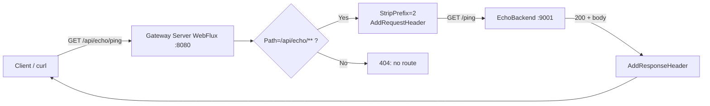

# Creating a Minimal Gateway Server WebFlux Application

## 1. Objectives and Expected Outcomes

In a microservices architecture, an **API Gateway** is the entry point that receives requests from clients, selects target services according to routing rules, and applies common processing steps before and after forwarding requests. With **SPRING_CLOUD_GATEWAY**, the **Spring Cloud Gateway Server WebFlux** variant uses Spring WebFlux, Reactor, and Reactor Netty to serve HTTP traffic asynchronously.

After completing this lab, you will be able to:

1. Create a Spring Boot application running **Gateway Server WebFlux** using Java and Maven.
2. Declare the proper Spring Cloud BOM and corresponding starter without manually pinning the Gateway library version.
3. Configure a route in `application.yml` with a `Path` predicate, `StripPrefix`, and a header-adding filter.
4. Run a minimal downstream service locally, send `curl` requests through the Gateway, and verify the response.
5. Distinguish between route configuration errors, upstream connection errors, and unmatched route cases.

This is a **minimal setup** that serves as the foundation for later lessons on service discovery, filter chains, authentication, rate limiting, retries, circuit breakers, TLS, and request observability. This example does not yet implement those protective mechanisms; you should not expose this Gateway directly to the Internet as a production gateway.

### Where Does the Gateway Sit?



This example intentionally uses a static backend address `127.0.0.1:9001` so that Eureka, Consul, or LoadBalancer are not required. Once the application is running, you will see the Gateway sitting between the client and the backend; each step in the diagram can be verified through the actual response.

## 2. Prerequisites and Version Selection

You need **JDK 17 or higher**, Maven (or the Maven Wrapper from Spring Initializr), a code editor, a terminal, and an HTTP client tool such as `curl`. Verify them with:

```bash
java -version
mvn -version
curl --version
```

Throughout this guide, the following version set is used:

| Component | Example Version | Why |
| --- | --- | --- |
| Java | 17 | Meets the minimum Java requirement for Spring Boot 3.5. |
| Spring Boot | `3.5.0` | Provides the WebFlux/Netty runtime, auto-configuration, and Maven plugin. |
| Spring Cloud BOM | `2025.0.0` | Release train compatible with Spring Boot 3.5.0. |
| Gateway Server WebFlux | Managed by Spring Cloud BOM | Uses the `spring-cloud-starter-gateway-server-webflux` starter. |

**Note on versions:** this pair is chosen to illustrate a consistent configuration, **not as a recommendation to use `*.0` patch releases in production**. When creating a real-world project, use the latest supported patch release within the same compatible pair, based on the [Spring Cloud compatibility matrix](https://spring.io/projects/spring-cloud/) and the [Spring Cloud 2025.0 release notes](https://github.com/spring-cloud/spring-cloud-release/wiki/Spring-Cloud-2025.0-Release-Notes).

Starting with the **Spring Cloud 2025.0** release train, the WebFlux starter name was clarified to `spring-cloud-starter-gateway-server-webflux` (replacing the old name `spring-cloud-starter-gateway`); the new WebFlux property group uses the prefix **`spring.cloud.gateway.server.webflux`** instead of `spring.cloud.gateway` in older examples. Do not mix the new-line starter with configuration patterns from documentation for another line. The **Gateway Server Web MVC** variant is a separate architectural choice and is not used in this lesson.

## 3. Initializing the Maven Project

You can go to [Spring Initializr](https://start.spring.io/) and select **Maven**, **Java**, **Spring Boot 3.5.x**, **Java 17**, packaging **Jar**, group `com.example`, and artifact `gateway-webflux`. If **Gateway Server WebFlux** is listed in the dependencies, select it. If the Initializr UI changes or does not display the exact starter, create a basic Maven Spring Boot project and use the `pom.xml` below.

Main project structure:

```text
gateway-webflux/
├── pom.xml
├── src/
│   └── main/
│       ├── java/com/example/gateway/GatewayApplication.java
│       └── resources/application.yml
└── demo/
    └── EchoBackend.java     # test server, not packaged with Gateway
```

### 3.1. Declaring `pom.xml`

```xml
<?xml version="1.0" encoding="UTF-8"?>
<project xmlns="http://maven.apache.org/POM/4.0.0"
         xmlns:xsi="http://www.w3.org/2001/XMLSchema-instance"
         xsi:schemaLocation="http://maven.apache.org/POM/4.0.0
                             https://maven.apache.org/xsd/maven-4.0.0.xsd">
    <modelVersion>4.0.0</modelVersion>

    <parent>
        <groupId>org.springframework.boot</groupId>
        <artifactId>spring-boot-starter-parent</artifactId>
        <version>3.5.0</version>
        <relativePath/>
    </parent>

    <groupId>com.example</groupId>
    <artifactId>gateway-webflux</artifactId>
    <version>0.0.1-SNAPSHOT</version>
    <name>gateway-webflux</name>
    <description>Minimal Spring Cloud Gateway Server WebFlux</description>

    <properties>
        <java.version>17</java.version>
        <spring-cloud.version>2025.0.0</spring-cloud.version>
    </properties>

    <dependencyManagement>
        <dependencies>
            <dependency>
                <groupId>org.springframework.cloud</groupId>
                <artifactId>spring-cloud-dependencies</artifactId>
                <version>${spring-cloud.version}</version>
                <type>pom</type>
                <scope>import</scope>
            </dependency>
        </dependencies>
    </dependencyManagement>

    <dependencies>
        <dependency>
            <groupId>org.springframework.cloud</groupId>
            <artifactId>spring-cloud-starter-gateway-server-webflux</artifactId>
        </dependency>
    </dependencies>

    <build>
        <plugins>
            <plugin>
                <groupId>org.springframework.boot</groupId>
                <artifactId>spring-boot-maven-plugin</artifactId>
            </plugin>
        </plugins>
    </build>
</project>
```

Three key details:

- `spring-boot-starter-parent` provides version management for Spring Boot ecosystem libraries and default build configuration.
- The `spring-cloud-dependencies` BOM is **imported** in `dependencyManagement`, ensuring compatible versions across components in the same Spring Cloud release train.
- The Gateway starter is declared **without an explicit `<version>`**. Adding `spring-boot-starter-web` is unnecessary for Gateway Server WebFlux; this hands-on version runs on Reactor Netty, not a servlet WAR.

There is no need to add a REST controller or any service discovery library at the initialization step.

### 3.2. Writing the Java Entry Point

Create `src/main/java/com/example/gateway/GatewayApplication.java`:

```java
package com.example.gateway;

import org.springframework.boot.SpringApplication;
import org.springframework.boot.autoconfigure.SpringBootApplication;

@SpringBootApplication
public class GatewayApplication {
    public static void main(String[] args) {
        SpringApplication.run(GatewayApplication.class, args);
    }
}
```

`@SpringBootApplication` enables auto-configuration based on the starters present on the classpath. The Gateway reads routes from configuration, so this simple application **does not need a `@RestController`**. If you write a controller yourself that returns data, that endpoint belongs to the Gateway application itself, which is different from proxying requests to a downstream service.

## 4. Configuring Routes in `application.yml`

Create `src/main/resources/application.yml`:

```yaml
server:
  port: 8080

spring:
  application:
    name: gateway-webflux
  cloud:
    gateway:
      server:
        webflux:
          routes:
            - id: local-echo
              uri: http://127.0.0.1:9001
              predicates:
                - Path=/api/echo/**
              filters:
                - StripPrefix=2
                - AddRequestHeader=X-Gateway-Request, webflux
                - AddResponseHeader=X-Gateway-Variant, webflux
```

This is **a minimal route where both the request and response modifications are visible**:

| Configuration | Effect |
| --- | --- |
| `id: local-echo` | Route identifier, used for lookup, logging, and diagnostics. |
| `uri: http://127.0.0.1:9001` | Specific HTTP backend that the Gateway forwards requests to. |
| `Path=/api/echo/**` | The route matches only requests whose path is under `/api/echo/`. |
| `StripPrefix=2` | Strips two segments (`api` and `echo`) before sending downstream. |
| `AddRequestHeader=...` | Adds the `X-Gateway-Request: webflux` header to the forwarded request. |
| `AddResponseHeader=...` | Adds the `X-Gateway-Variant: webflux` header to the response returned to the client. |

For example: when the client calls `http://localhost:8080/api/echo/ping`, the Gateway matches the route, forwards it to `http://127.0.0.1:9001/ping`, and adds the headers. **Predicates** determine whether a route applies; **filters** determine how the request and response are transformed.

Keep YAML indentation accurate: `routes` is nested under `spring.cloud.gateway.server.webflux`; `predicates` and `filters` are lists belonging to *one* route. A single indentation mistake can prevent the route from loading or stop the application from starting.

## 5. Creating a Test Backend Using the JDK

To verify the request flow **without adding another Spring Boot project**, create `demo/EchoBackend.java`:

```java
import com.sun.net.httpserver.HttpServer;
import java.io.IOException;
import java.net.InetSocketAddress;
import java.nio.charset.StandardCharsets;

public class EchoBackend {
    public static void main(String[] args) throws IOException {
        HttpServer server = HttpServer.create(
            new InetSocketAddress("127.0.0.1", 9001), 0
        );

        server.createContext("/", exchange -> {
            String path = exchange.getRequestURI().getRawPath();
            String fromGateway =
                exchange.getRequestHeaders().getFirst("X-Gateway-Request");

            String body = "path=" + path + "\n"
                        + "gateway-header=" + fromGateway + "\n";
            byte[] bytes = body.getBytes(StandardCharsets.UTF_8);

            exchange.getResponseHeaders().set(
                "Content-Type", "text/plain; charset=UTF-8"
            );
            exchange.sendResponseHeaders(200, bytes.length);

            try (var stream = exchange.getResponseBody()) {
                stream.write(bytes);
            }
        });

        server.start();
        System.out.println("EchoBackend listening on 127.0.0.1:9001");
    }
}
```

The built-in `HttpServer` in the JDK is sufficient for this test. It accepts any path, prints the received path and header, and returns `200 OK`; **do not use this test backend as a production service**.

Open the **first terminal** in the `gateway-webflux/` root directory and run:

```bash
java demo/EchoBackend.java
```

The terminal will print `EchoBackend listening on 127.0.0.1:9001` and keep the process running to serve requests. You can try calling the backend directly:

```bash
curl -i http://127.0.0.1:9001/ping
```

The body will show `path=/ping` and `gateway-header=null`, because this request did not go through the Gateway. The `null` value here is expected.

## 6. Running the Gateway Application

Open a **second terminal** in the project root directory and run:

```bash
mvn spring-boot:run
```

If you created the project with Spring Initializr and have the Maven Wrapper, use `./mvnw spring-boot:run` on Linux/macOS or `mvnw.cmd spring-boot:run` on Windows. If there are Java/Maven errors, recheck `java -version` and `mvn -version`.

The application should start Spring Boot, configure Spring Cloud Gateway Server WebFlux, and listen on port `8080`. Ports `9001` and `8080` must be free before running. You can change either port as long as you update both the configuration and the test commands consistently.

### 6.1. Calling Through the Gateway

In a **third terminal**, run:

```bash
curl -i http://localhost:8080/api/echo/ping
```

The expected result looks like this (other system headers may vary):

```http
HTTP/1.1 200 OK
Content-Type: text/plain; charset=UTF-8
X-Gateway-Variant: webflux

path=/ping
gateway-header=webflux
```

This confirms all four steps: `Path` match, `StripPrefix` removing `/api/echo`, the request header being added, and the response having the Gateway header attached before returning to the client.

If you are using Windows PowerShell and `curl` is aliased to another command, use `curl.exe -i http://localhost:8080/api/echo/ping`.

### 6.2. Testing a Request That Does Not Match Any Route

```bash
curl -i http://localhost:8080/not-configured
```

Because no route matches `/not-configured` and the application does not declare a controller for this path, the Gateway is expected to return `404 Not Found`. This behaves differently from an upstream error: the request was never forwarded to `EchoBackend`.

### 6.3. Testing When the Backend Is Down

Stop only the `EchoBackend` process using `Ctrl+C` in the first terminal, keep the Gateway running, and call again:

```bash
curl -i http://localhost:8080/api/echo/ping
```

The route still matches, but the Gateway cannot connect to `127.0.0.1:9001`, so you receive a Gateway-side error response (typically **5xx**) and a connection failure log. Do not confuse this error with a `404` caused by no matching route. Restart the backend to continue testing.

## 7. Request Processing Sequence Inside the Gateway

A concise mental model:

```text
HTTP request
  -> RoutePredicateHandlerMapping finds the matching route
  -> Gateway Web Handler builds the chain of GlobalFilters and route GatewayFilters
  -> pre-processing filters (e.g., StripPrefix, AddRequestHeader)
  -> routing filter sends the HTTP request via Reactor Netty to the backend
  <- backend returns the HTTP response
  <- post-processing filters (e.g., AddResponseHeader)
  <- returns the response to the client
```

`Path` is a **route predicate**, not a filter. `StripPrefix`, `AddRequestHeader`, and `AddResponseHeader` are **GatewayFilters** attached to the route. `GlobalFilter`s can run on every route and are merged and ordered alongside route filters depending on the ordering mechanism; therefore, when building custom filters in upcoming lessons, pay attention to `order` and the request/response processing direction.

Spring Cloud Gateway Server WebFlux uses a **reactive** runtime based on Netty. Later when writing custom filters, avoid running long synchronous I/O on the event loop; blocking calls can slow down many concurrent requests. In this lesson, basic HTTP forwarding is already handled by the starter.

## 8. Diagnosing Common Errors

| Symptom | Check | How to Fix |
| --- | --- | --- |
| Build error `dependency version is missing` or starter not found | Does the POM import the BOM, and are the starter name and repository correct? | Import `spring-cloud-dependencies`, do not insert an arbitrary version on the starter, and check Maven Central connectivity. |
| Spring Cloud reports an incompatible version pair | Are you using Boot 3.5.x with Cloud 2025.0.x? | Check the official release train; upgrade both sides to a supported pair. |
| `Port 8080 was already in use` | Is another process holding the port? | Stop that process or change `server.port` and the test URLs. |
| Calling `/api/echo/ping` returns `404` | Does YAML have the right `spring.cloud.gateway.server.webflux.routes` prefix and predicate? | Fix the key, indentation, and path; check the startup logs. |
| Gateway has a route but returns a 5xx error | Is backend `127.0.0.1:9001` running? | Call the backend directly, and check the port, host, and connection logs. |
| Backend sees `/api/echo/ping` instead of `/ping` | Is the `StripPrefix=2` filter inside the right route? | Fix the filter list and restart. |
| Missing `X-Gateway-Request` header at the backend | Did the request go through the Gateway? Is `AddRequestHeader` spelled correctly? | Send the request to port `8080`, not directly to `9001`. |
| `X-Gateway-Variant` header is not visible | Did the route match? Is the response filter registered? | Inspect the HTTP response with `curl -i` and verify the route configuration. |

To inspect the resolved Maven dependencies, run:

```bash
mvn dependency:tree
```

If you already have an older Gateway version in a project, do not copy the old `spring.cloud.gateway.routes` configuration verbatim into an example using Spring Cloud 2025.0. Check the release notes before renaming the starter and properties.

## 9. From Minimal Application to Real-World Gateway

Once your first route is working, you can expand in the proper order:

1. **Routing:** add `Method`, `Header`, and `Host` predicates as well as path/header-modifying filters with clear tests.
2. **Service discovery:** replace static URIs with `lb://service-name` once you have Spring Cloud LoadBalancer and an instance list source (a discovery client or configured instances). Simply changing the URI to `lb://...` without those components will not enable discovery by itself.
3. **Edge protection:** integrate WebFlux-compatible Spring Security/OAuth2, rate limiting, retries, circuit breakers, and bounded timeouts.
4. **Operations:** configure TLS, Actuator, Micrometer, controlled request tracing/logging, and test behavior when upstream services are slow, failing, or unavailable.

These steps are necessary before going to production, but they should not all be crammed into the very first example: a Gateway that **can start up and forward requests** does not automatically provide authentication, rate limiting, or fault tolerance.

## 10. Completion Checklist

- [ ] Using a compatible Spring Boot / Spring Cloud version pair.
- [ ] Includes the `spring-cloud-starter-gateway-server-webflux` starter without a manually pinned version.
- [ ] Java entry point has `@SpringBootApplication`, with no REST controller needed.
- [ ] `application.yml` defines the `local-echo` route with the correct prefix and indentation.
- [ ] Local backend responds on port `9001`; Gateway starts on port `8080`.
- [ ] `curl -i localhost:8080/api/echo/ping` returns `200`, `path=/ping`, `gateway-header=webflux`, and response header `X-Gateway-Variant: webflux`.
- [ ] Unmatched requests are distinguished from backend connection errors.

### Official References

- [Spring Cloud: choosing a release train compatible with Spring Boot](https://spring.io/projects/spring-cloud/)
- [Spring Cloud 2025.0 release notes: Gateway starter and config prefix renames](https://github.com/spring-cloud/spring-cloud-release/wiki/Spring-Cloud-2025.0-Release-Notes)
- [Spring Cloud Gateway Server WebFlux: how to add the starter](https://docs.spring.io/spring-cloud-gateway/reference/4.3/spring-cloud-gateway-server-webflux/starter.html)
- [Spring Cloud Gateway Server WebFlux: route predicates](https://docs.spring.io/spring-cloud-gateway/reference/spring-cloud-gateway-server-webflux/request-predicates-factories.html)
- [Spring Cloud Gateway Server WebFlux: filter factories](https://docs.spring.io/spring-cloud-gateway/reference/spring-cloud-gateway-server-webflux/gatewayfilter-factories.html)
