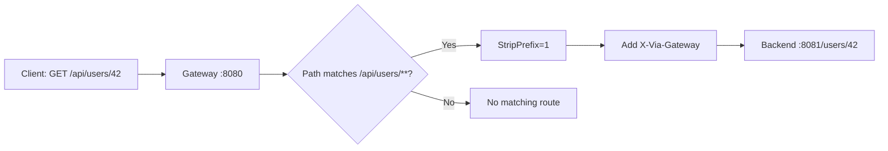

# Declaring the Right Starter with Maven or Gradle for Spring Cloud Gateway

## 1. Objectives and Context

To build an **API Gateway with Spring Cloud Gateway**, the first step is choosing the right **starter** for the type of application you are deploying, and then declaring a compatible set of versions across **Spring Boot**, **Spring Cloud**, and **Spring Cloud Gateway**. The starter determines the web stack the Gateway uses; capabilities such as routing via **route predicates**, running a **filter chain**, transforming paths/headers, integrating **service discovery**, authentication, rate limiting, circuit breakers, retries, TLS, and request observability are added through appropriate configuration or dependencies.

After this lesson, you will be able to:

- Choose the right **Gateway Server WebFlux** or **Gateway Server Web MVC** variant based on project requirements.
- Declare the starter and **Spring Cloud BOM** in `pom.xml`, `build.gradle`, or `build.gradle.kts`.
- Add libraries for discovery, load balancing, security, rate limiting, and observability only when actually needed.
- Verify resolved dependencies and run a test route to catch starter mistakes or wrong configuration namespaces early.

> **Rule:** do not pick a starter just because the name looks familiar. First determine the Spring Cloud Gateway version and whether the application runs on **reactive WebFlux** or **Servlet MVC**; only then declare dependencies, letting the BOM manage Spring Cloud library versions.

## 2. The Two Gateway Server Types and Their Starters

Spring Cloud Gateway has two main **Gateway Server** variants:

| Criterion | Gateway Server WebFlux | Gateway Server Web MVC |
|---|---|---|
| Web stack | Spring WebFlux, reactive, typically runs on Reactor Netty | Spring Web MVC, Servlet, typically runs on Tomcat or Jetty |
| New starter from Gateway 4.3 | `spring-cloud-starter-gateway-server-webflux` | `spring-cloud-starter-gateway-server-webmvc` |
| Legacy starter in Gateway 4.1–4.2 | `spring-cloud-starter-gateway` | `spring-cloud-starter-gateway-mvc` |
| Route configuration prefix from Gateway 4.3 | `spring.cloud.gateway.server.webflux.routes` | `spring.cloud.gateway.server.webmvc.routes` |
| Route configuration prefix in Gateway 4.1–4.2 | `spring.cloud.gateway.routes` | `spring.cloud.gateway.mvc.routes` |
| Best suited when | Building a reactive edge gateway, handling high I/O concurrency, and using the WebFlux ecosystem | Integrating with an existing Servlet/Spring MVC ecosystem and intentionally choosing the MVC runtime |
| Application security configuration | Typically uses `SecurityWebFilterChain` | Typically uses `SecurityFilterChain` |

**Choose WebFlux** if you are building a new Gateway responsible for routing, authentication, and applying filters for microservices and the system has no requirement to use Servlet. **Choose Web MVC** when the project already has a clear reason to use Spring MVC/Servlet. Both are Gateway Servers; there is no need to put both starters into one application just to "have all features."

**Distinction from Proxy Exchange:** artifacts named `spring-cloud-gateway-proxyexchange-webflux` or `spring-cloud-gateway-proxyexchange-webmvc` are for writing proxy logic via `ProxyExchange` inside handlers/controllers. They **do not replace** a Gateway Server starter when the goal is to declare a list of routes in `application.yml`.

### 2.1. Choosing by Version Line

| Typical Spring Cloud Version Set | Spring Cloud Gateway Line | WebFlux Starter | Web MVC Starter |
|---|---|---|---|
| `2023.0.x` / `2024.0.x` | 4.1.x / 4.2.x | `spring-cloud-starter-gateway` | `spring-cloud-starter-gateway-mvc` |
| `2025.0.x` | 4.3.x | `spring-cloud-starter-gateway-server-webflux` | `spring-cloud-starter-gateway-server-webmvc` |
| `2025.1.x` and later | 5.x and later | `spring-cloud-starter-gateway-server-webflux` | `spring-cloud-starter-gateway-server-webmvc` |

The **4.3** line is the transition period for starter names and configuration namespaces. The old names are marked deprecated; starting from the **5.x** line, you should use the new artifacts. For projects on 4.2 or earlier, do not apply the new starter names or prefixes without upgrading the BOM.

**Example used throughout this lesson:** Spring Boot **3.5.0**, Spring Cloud BOM **2025.0.0**, Spring Cloud Gateway **4.3.x**, choosing **Gateway Server WebFlux**. This is a concrete version pair for illustration; when applying it to a real project, update to compatible patch releases within the same release train. Do not mix a Boot version from another generation with the example's Cloud BOM.

## 3. Maven: Declaring the Starter and Importing the Spring Cloud BOM

Create a Spring Boot project with `pom.xml`, or open the Gateway module in a multi-module project. Use a compatible Spring Boot parent to manage Boot dependencies; **import the Spring Cloud BOM** to manage Gateway and Spring Cloud library versions.

Minimal `pom.xml` for **Gateway Server WebFlux 4.3.x**:

```xml
<?xml version="1.0" encoding="UTF-8"?>
<project xmlns="http://maven.apache.org/POM/4.0.0"
         xmlns:xsi="http://www.w3.org/2001/XMLSchema-instance"
         xsi:schemaLocation="http://maven.apache.org/POM/4.0.0
             https://maven.apache.org/xsd/maven-4.0.0.xsd">
    <modelVersion>4.0.0</modelVersion>

    <parent>
        <groupId>org.springframework.boot</groupId>
        <artifactId>spring-boot-starter-parent</artifactId>
        <version>3.5.0</version>
        <relativePath/>
    </parent>

    <groupId>com.example</groupId>
    <artifactId>api-gateway</artifactId>
    <version>0.0.1-SNAPSHOT</version>
    <name>api-gateway</name>

    <properties>
        <java.version>17</java.version>
        <spring-cloud.version>2025.0.0</spring-cloud.version>
    </properties>

    <dependencyManagement>
        <dependencies>
            <dependency>
                <groupId>org.springframework.cloud</groupId>
                <artifactId>spring-cloud-dependencies</artifactId>
                <version>${spring-cloud.version}</version>
                <type>pom</type>
                <scope>import</scope>
            </dependency>
        </dependencies>
    </dependencyManagement>

    <dependencies>
        <dependency>
            <groupId>org.springframework.cloud</groupId>
            <artifactId>spring-cloud-starter-gateway-server-webflux</artifactId>
        </dependency>
    </dependencies>

    <build>
        <plugins>
            <plugin>
                <groupId>org.springframework.boot</groupId>
                <artifactId>spring-boot-maven-plugin</artifactId>
            </plugin>
        </plugins>
    </build>
</project>
```

Key takeaways:

1. `spring-boot-starter-parent` manages the Spring Boot library set. Java 17 suits Spring Boot 3.5; you can use a higher Java version if supported.
2. `spring-cloud-dependencies` is placed inside **`dependencyManagement`**, with `type=pom` and `scope=import`. A BOM **does not add libraries to the classpath by itself**, but supplies versions for declared dependencies.
3. `spring-cloud-starter-gateway-server-webflux` is placed in **`dependencies`** **without a separate `<version>`**: the BOM selects the corresponding Gateway version.
4. `spring-boot-maven-plugin` enables running and packaging the application using Spring Boot goals.

If you choose **Gateway Server Web MVC**, keep the same compatible version set and swap only the Gateway dependency:

```xml
<dependency>
    <groupId>org.springframework.cloud</groupId>
    <artifactId>spring-cloud-starter-gateway-server-webmvc</artifactId>
</dependency>
```

**Do not keep both** Gateway Server dependencies simultaneously in the same application. Avoid manually adding `spring-boot-starter-web` to a Gateway Server WebFlux project: MVC/Servlet libraries can make web application type selection or auto-configurations confusing.

### 3.1. Multi-Module Maven Projects

If you have a shared parent POM, Spring Boot/Spring Cloud management and versions are typically placed in the **parent POM**, while the `api-gateway` module declares only the starter it uses. Make sure the BOM is actually inherited/imported by the Gateway module; simply writing the BOM in a file that the module does not inherit from will **not** manage versions for that module.

## 4. Gradle Groovy DSL: `build.gradle`

With Gradle Groovy, you can use the `io.spring.dependency-management` plugin to import the Spring Cloud BOM. The equivalent of the Maven example above is:

```groovy
plugins {
    id 'java'
    id 'org.springframework.boot' version '3.5.0'
    id 'io.spring.dependency-management' version '1.1.7'
}

group = 'com.example'
version = '0.0.1-SNAPSHOT'

java {
    toolchain {
        languageVersion = JavaLanguageVersion.of(17)
    }
}

repositories {
    mavenCentral()
}

dependencyManagement {
    imports {
        mavenBom 'org.springframework.cloud:spring-cloud-dependencies:2025.0.0'
    }
}

dependencies {
    implementation 'org.springframework.cloud:spring-cloud-starter-gateway-server-webflux'
}
```

If using MVC, change just one line in `dependencies`:

```groovy
implementation 'org.springframework.cloud:spring-cloud-starter-gateway-server-webmvc'
```

Here, `implementation` adds the starter to the classpath, while `dependencyManagement.imports.mavenBom` supplies the Spring Cloud versions. Be sure **not to put a Gateway version inside the `implementation` string** when the BOM already manages it.

## 5. Gradle Kotlin DSL: `build.gradle.kts`

If the project uses Kotlin DSL, the equivalent declaration is:

```kotlin
plugins {
    java
    id("org.springframework.boot") version "3.5.0"
    id("io.spring.dependency-management") version "1.1.7"
}

group = "com.example"
version = "0.0.1-SNAPSHOT"

java {
    toolchain {
        languageVersion = JavaLanguageVersion.of(17)
    }
}

repositories {
    mavenCentral()
}

dependencyManagement {
    imports {
        mavenBom("org.springframework.cloud:spring-cloud-dependencies:2025.0.0")
    }
}

dependencies {
    implementation("org.springframework.cloud:spring-cloud-starter-gateway-server-webflux")
}
```

Replace `spring-cloud-starter-gateway-server-webflux` with `spring-cloud-starter-gateway-server-webmvc` when selecting Server MVC. If the project already uses **Gradle native `platform(...)`** instead of the dependency-management plugin, follow one consistent BOM strategy, including both the Spring Boot BOM and Spring Cloud BOM when needed; avoid mixing multiple version management mechanisms while manually pinning dependencies, which makes resolved versions hard to explain.

> **Maven and Gradle have different syntax, but the principle is the same:** choose the appropriate Boot plugin/parent, import the Spring Cloud BOM for the right release train, declare **one** Gateway Server starter, and let the BOM select the Gateway version.

## 6. Core Starter and Feature-Based Add-On Libraries

The Gateway starter provides the routing core, predicates, and filters. Some operational features have **additional requirements** regarding libraries, external services, or configuration. You should not add all dependencies up front just "in case you need them later."

| Requirement | Commonly Considered Dependency | Notes |
|---|---|---|
| Routing by `Path`, `Host`, `Method`; `StripPrefix`, `RewritePath`, `AddRequestHeader`, `Retry` | The chosen Gateway Server starter | Basic route predicates/filters are built in according to the variant and version; routes still must be configured |
| Using `lb://service-name` | `spring-cloud-starter-loadbalancer` | Allows Spring Cloud LoadBalancer to select an instance; requires an instance source such as discovery or suitable configuration |
| Discovering microservices via Eureka | `spring-cloud-starter-netflix-eureka-client` | Requires a Eureka Server and registry configuration; not needed if using static URIs |
| Security, OAuth2 JWT validation | `spring-boot-starter-oauth2-resource-server` | Requires issuer/JWK, authentication, and authorization configuration; the dependency alone does not secure routes |
| Redis rate limiting on WebFlux | `spring-boot-starter-data-redis-reactive` | Requires a real Redis instance, `RequestRateLimiter`, and a suitable `KeyResolver` |
| Reactive circuit breaker with Resilience4j | `spring-cloud-starter-circuitbreaker-reactor-resilience4j` | For reactive Gateway; verify support for your variant, version, and filter |
| Circuit breaker on MVC | `spring-cloud-starter-circuitbreaker-resilience4j` | For non-reactive integration; check the Gateway Server MVC filter docs for your exact version |
| Health, metrics, HTTP request observability | `spring-boot-starter-actuator` | Consider adding a Micrometer registry such as `micrometer-registry-prometheus` if exporting metrics to Prometheus |
| Edge TLS | No separate Gateway starter needed | Configure HTTPS via `server.ssl.*`; TLS from Gateway to backend is configured separately per HTTP client/stack |

**Maven example:** when Gateway Server WebFlux needs service load balancing, JWT authentication, request observability, and a circuit breaker, you can add the following dependencies inside `dependencies` in `pom.xml` (alongside the main Gateway starter):

```xml
<dependency>
    <groupId>org.springframework.cloud</groupId>
    <artifactId>spring-cloud-starter-loadbalancer</artifactId>
</dependency>
<dependency>
    <groupId>org.springframework.boot</groupId>
    <artifactId>spring-boot-starter-oauth2-resource-server</artifactId>
</dependency>
<dependency>
    <groupId>org.springframework.boot</groupId>
    <artifactId>spring-boot-starter-actuator</artifactId>
</dependency>
<dependency>
    <groupId>org.springframework.cloud</groupId>
    <artifactId>spring-cloud-starter-circuitbreaker-reactor-resilience4j</artifactId>
</dependency>
```

**Gradle equivalent** (placed inside the `dependencies` block):

```groovy
implementation 'org.springframework.cloud:spring-cloud-starter-loadbalancer'
implementation 'org.springframework.boot:spring-boot-starter-oauth2-resource-server'
implementation 'org.springframework.boot:spring-boot-starter-actuator'
implementation 'org.springframework.cloud:spring-cloud-starter-circuitbreaker-reactor-resilience4j'
```

The examples above only illustrate how to add libraries, **not complete configurations** for JWT, discovery, circuit breakers, or TLS. For Gateway MVC, switch the circuit breaker library and filter/security stack to match the Servlet stack. Always check the documentation for your exact version before using a specific filter.

## 7. Running a Minimal Gateway Server WebFlux Test

After declaring the starter with Maven or Gradle, create the Spring Boot startup class:

```java
package com.example.gateway;

import org.springframework.boot.SpringApplication;
import org.springframework.boot.autoconfigure.SpringBootApplication;

@SpringBootApplication
public class ApiGatewayApplication {
    public static void main(String[] args) {
        SpringApplication.run(ApiGatewayApplication.class, args);
    }
}
```

This example assumes the Java file is placed at `src/main/java/com/example/gateway/ApiGatewayApplication.java`, in the proper root package so Spring Boot can scan application beans.

Next, put the configuration into `src/main/resources/application.yml`. For **Gateway 4.3+ WebFlux**, routes must live under `spring.cloud.gateway.server.webflux.routes`:

```yaml
server:
  port: 8080

spring:
  application:
    name: api-gateway
  cloud:
    gateway:
      server:
        webflux:
          routes:
            - id: users-service-route
              uri: http://localhost:8081
              predicates:
                - Path=/api/users/**
              filters:
                - StripPrefix=1
                - AddRequestHeader=X-Via-Gateway, true
```

Request flow:



**Explanation:** the `Path=/api/users/**` predicate selects the route, and `StripPrefix=1` removes one path segment `/api`, so the backend receives `/users/42`. The `AddRequestHeader` filter appends the header sent to the backend. When the backend on port 8081 is not running yet, the downstream connection fails; that error is **different from** the Gateway failing to load the route.

Run the application:

```bash
# Maven (use the wrapper if the project has mvnw)
./mvnw spring-boot:run

# Or Gradle (use the wrapper if the project has gradlew)
./gradlew bootRun
```

Run **only one** of the two commands matching your project's build tool. On Windows you can use `mvnw.cmd`/`gradlew.bat`. Once a sample backend is running at `http://localhost:8081` with a `/users/42` endpoint, verify with:

```bash
curl -i http://localhost:8080/api/users/42
```

Check the backend logs/headers: the request arrives at `/users/42` with `X-Via-Gateway: true`. The returned status code and body depend on the backend. To try **Gateway Server MVC 4.3+**, change the starter to `spring-cloud-starter-gateway-server-webmvc` and replace the `webflux:` level with `webmvc:` in the corresponding configuration; verify each filter against the MVC documentation.

### 7.1. If You Need `lb://` Instead of a Static Address

When using service discovery, you can change the URI to `lb://users-service`:

```yaml
uri: lb://users-service
```

At that point, the route needs a component supplying the instance list for `users-service` and an appropriate load-balancing mechanism. `spring-cloud-starter-loadbalancer` handles instance selection, while a discovery client like Eureka (if chosen) fetches the instance list. Simply changing `http://localhost:8081` to `lb://users-service` without discovery or configured instances will not establish the intended connection.

## 8. Verifying Resolved Dependencies and Versions

After declaring the BOM, you need to know the **actual versions selected by Maven/Gradle**, especially in multi-module projects or when other libraries pull in transitive dependencies.

**Maven:**

```bash
./mvnw dependency:tree
./mvnw help:effective-pom
```

**Gradle:**

```bash
./gradlew dependencies --configuration runtimeClasspath
./gradlew dependencyInsight --dependency spring-cloud-gateway --configuration runtimeClasspath
```

In the output, look for the selected Server starter and related Gateway dependencies. If there are multiple versions of the same library or an older starter sneaks onto the classpath, trace the dependency origin before fixing it. `help:effective-pom` helps verify that the BOM was inherited/imported in Maven; `dependencyInsight` reveals Gradle's version selection rules.

If you configured the Spring Cloud BOM properly but the IDE still reports "Could not resolve," check your repositories, proxy/mirror settings, metadata download access, and Gradle/Maven cache. Manually setting a version on a single starter to bypass an error can cause Gateway incompatibilities with Spring Framework/Boot.

## 9. Common Errors When Declaring Starters

| Symptom | Common Cause | Resolution |
|---|---|---|
| Maven reports missing version for `spring-cloud-starter-gateway-server-webflux` | Spring Cloud BOM not imported, or module does not inherit `dependencyManagement` | Check `spring-cloud-dependencies` and the effective POM |
| New starter artifact not found | Using an older Spring Cloud train / Gateway 4.2 or earlier, or repository is unreachable | Choose the starter matching the release train; check Maven Central / mirror access |
| Application starts but routes return 404 | Correct starter, but the route prefix is still `spring.cloud.gateway.routes` from the legacy line | Use `spring.cloud.gateway.server.webflux.routes` in Gateway 4.3+ WebFlux or `server.webmvc.routes` for MVC |
| WebFlux application exhibits strange auto-configuration behavior | Accidentally added `spring-boot-starter-web` or both Gateway MVC and WebFlux starters | Keep only the starter matching one web stack |
| `lb://service-name` cannot find instances | Missing load balancer, discovery, or instance list | Add the appropriate dependency and instance source configuration |
| Route works but auth/rate limiting/circuit breaker does not run | Only the Gateway starter was added without adding/configuring the extension components | Add the right libraries, backing services, security/filters, and test the behavior |
| `NoClassDefFoundError` / `NoSuchMethodError` | Mixing Boot/Cloud/Gateway versions or forcing an individual version | Re-align to a compatible Boot–Cloud pair; let the BOM manage Spring Cloud |

### 9.1. Checklist Before Moving to Advanced Configuration

- [ ] Decided on **WebFlux** or **Web MVC** and used **only one** Gateway Server starter.
- [ ] Spring Boot, Spring Cloud BOM, and Spring Cloud Gateway belong to **compatible version lines**.
- [ ] Starter dependency does not have a manually pinned version while the BOM is managing it.
- [ ] `mvn dependency:tree` or `gradlew dependencies` shows the right dependency type and version.
- [ ] `application.yml` uses the **route prefix matching the version and web stack**.
- [ ] Ran a minimal route against a sample backend and verified path/header transformation.
- [ ] Added only the dependencies for discovery, JWT, Redis, resilience, and metrics needed for the target features.

## 10. Practice Exercises

**Exercise 1 – Choosing a starter.** A team is building a new API Gateway with Spring Boot 3.5 and Spring Cloud 2025.0, using reactive WebFlux to route multiple microservices. Choose the main dependency and route prefix.

**Answer:** `org.springframework.cloud:spring-cloud-starter-gateway-server-webflux`, prefix `spring.cloud.gateway.server.webflux.routes`. Import the `org.springframework.cloud:spring-cloud-dependencies:2025.0.x` BOM compatible with Boot 3.5; do not specify a separate Gateway version.

**Exercise 2 – Reading upgrade errors.** A Spring Cloud 2024.0 project used `spring-cloud-starter-gateway`, then switched to `2025.0` while keeping `spring.cloud.gateway.routes` in YAML. The application starts up without routing as expected. Find two places to check.

**Answer:** switch the starter to `spring-cloud-starter-gateway-server-webflux` and move the route namespace to `spring.cloud.gateway.server.webflux.routes`, while reviewing other Gateway Server properties such as discovery, HTTP client, and metrics; verify that the actual configuration was loaded.

**Exercise 3 – Choosing add-on libraries.** Gateway Server WebFlux needs to route `lb://inventory-service`, validate JWTs, rate-limit with Redis, and expose Prometheus metrics. Is the standalone Gateway starter enough?

**Answer:** no. Consider Spring Cloud LoadBalancer along with an instance/discovery source, OAuth2 Resource Server, reactive Redis and the `RequestRateLimiter` mechanism, plus Spring Boot Actuator with the Micrometer Prometheus registry. Each component still requires configuration and testing; dependencies only put the capabilities on the classpath.

## 11. Official Documentation References

- [Spring Cloud release trains and choosing compatible versions](https://spring.io/projects/spring-cloud).
- [Spring Cloud 2025.0 Release Notes — Gateway starter and prefix renames](https://github.com/spring-cloud/spring-cloud-release/wiki/Spring-Cloud-2025.0-Release-Notes).
- [Spring Cloud Gateway Server WebFlux: Starter](https://docs.spring.io/spring-cloud-gateway/reference/5.0/spring-cloud-gateway-server-webflux/starter.html).
- [Spring Cloud Gateway Server Web MVC: Starter](https://docs.spring.io/spring-cloud-gateway/reference/5.0/spring-cloud-gateway-server-webmvc/starter.html).
- [Gateway 4.3: Configuration Properties](https://docs.spring.io/spring-cloud-gateway/reference/4.3/configprops.html).
- [Spring Boot Maven Plugin](https://docs.spring.io/spring-boot/maven-plugin/) and [Spring Boot Gradle Plugin](https://docs.spring.io/spring-boot/gradle-plugin/).

**Remember:** the **starter** chooses how the Gateway runs, the **BOM** chooses compatible dependency versions, and **routes/filters and extensions** determine how the Gateway processes requests. Getting these three parts right from the start makes deploying and operating an API Gateway safer and easier to upgrade.
