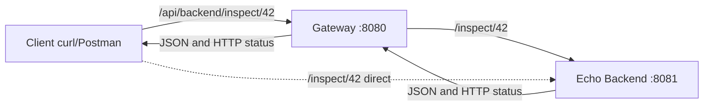

# Building a Downstream Service to Observe Forwarded Requests

**Chapter:** Setup  
**Module:** Spring Cloud Gateway (`SPRING_CLOUD_GATEWAY`)

Spring Cloud Gateway receives HTTP requests, selects a route using predicates, applies a filter chain, and forwards the request to a *downstream service*. While setting up a microservices entry point, you need a test backend to **see the exact path, method, query string, headers, body, and returned status** after a request passes through the gateway.

This lesson builds an **Echo Backend** with Spring Boot. The service receives a request and returns what it received as JSON, while also providing endpoints that simulate errors and latency. Next, we configure a simple route on **Spring Cloud Gateway Server WebFlux**, send the same request two ways (directly and through the gateway), and compare them. The result will serve as the baseline for practicing path/header rewriting, authentication, rate limiting, circuit breakers, retries, TLS, service discovery, and request observability in subsequent lessons.

## 1. Objectives and Lab Topology

Once finished, you will be able to:

1. Build a Spring Boot backend on port `8081` with a health check endpoint and HTTP request reflection.
2. Distinguish between the URL the client calls and the URI that actually reaches the backend after the `StripPrefix` filter.
3. Use a header added by the Gateway to identify forwarded traffic in a lab environment.
4. Read backend logs to check request counts, HTTP status codes, and processing duration.
5. Call a `503` error endpoint and a controlled-delay endpoint to prepare for resilience labs.



| Component | Port | Role |
|---|---|---|
| Client | — | Sends and inspects requests/responses |
| Spring Cloud Gateway | `8080` | Matches `/api/backend/**`, strips prefix, adds header, and forwards |
| Echo Backend | `8081` | Receives actual requests, returns JSON, and logs observations |

The backend in this example uses **Spring MVC/Servlet**, while the gateway uses **Server WebFlux**. This is completely valid: the two processes communicate over HTTP and do not have to share the same web stack. We use the address `http://localhost:8081` first to keep troubleshooting isolated; service discovery and `lb://` come in a later step.

> Deploy Echo Backend only in learning or controlled internal environments. Inspection endpoints can expose HTTP data; never test with real tokens, cookies, or personal information.

## 2. Initializing the Echo Backend Project

### 2.1. Tools and Dependencies

Prepare a JDK and Maven/Maven Wrapper compatible with the Spring Boot version you are using, ensure ports `8080` and `8081` are free, and have `curl` or Postman ready. With Spring Boot 3.x, Java 17 or higher is an appropriate choice.

On [Spring Initializr](https://start.spring.io/), select:

| Field | Suggested Value |
|---|---|
| Project | Maven |
| Language | Java |
| Group | `com.example` |
| Artifact | `echo-backend` |
| Package | `com.example.echobackend` |
| Packaging | Jar |
| Dependencies | **Spring Web**, optionally add **Spring Boot Actuator** for actuator health |

For a Spring Boot 3.x application, the basic dependencies in `pom.xml` include:

```xml
<dependencies>
    <dependency>
        <groupId>org.springframework.boot</groupId>
        <artifactId>spring-boot-starter-web</artifactId>
    </dependency>
    <!-- Optional: /actuator/health -->
    <dependency>
        <groupId>org.springframework.boot</groupId>
        <artifactId>spring-boot-starter-actuator</artifactId>
    </dependency>
</dependencies>
```

The parent and dependency management are already generated by Initializr. If using Spring Boot 4.x, select the exact starter names provided by Initializr for that release. **Echo Backend does not need any Spring Cloud Gateway dependency**: the Gateway application is a separate process.

### 2.2. Project Structure

```text
echo-backend/
├── pom.xml
└── src/main/
    ├── java/com/example/echobackend/
    │   ├── EchoBackendApplication.java
    │   ├── EchoController.java
    │   └── RequestTraceFilter.java
    └── resources/application.yml
```

Place these classes in the same package or a subpackage of the startup class so `@SpringBootApplication` can scan the components.

### 2.3. Application Configuration

Create `src/main/resources/application.yml`:

```yaml
spring:
  application:
    name: echo-backend

server:
  port: 8081

management:
  endpoints:
    web:
      exposure:
        include: health,info
```

The `spring.application.name` property identifies the application in logs; **it does not automatically register with a service registry**. The `management` section applies only to Actuator; this example exposes only `health` and `info`, rather than enabling all management endpoints.

Create `EchoBackendApplication.java`:

```java
package com.example.echobackend;

import org.springframework.boot.SpringApplication;
import org.springframework.boot.autoconfigure.SpringBootApplication;

@SpringBootApplication
public class EchoBackendApplication {
    public static void main(String[] args) {
        SpringApplication.run(EchoBackendApplication.class, args);
    }
}
```

## 3. Creating the Request-Reflecting Controller

Create `EchoController.java`:

```java
package com.example.echobackend;

import jakarta.servlet.http.HttpServletRequest;
import org.springframework.http.HttpStatus;
import org.springframework.http.ResponseEntity;
import org.springframework.web.bind.annotation.*;

import java.util.Collections;
import java.util.LinkedHashMap;
import java.util.List;
import java.util.Locale;
import java.util.Map;
import java.util.Set;

@RestController
public class EchoController {

    private static final Set<String> SENSITIVE_HEADERS =
            Set.of("authorization", "proxy-authorization",
                   "cookie", "set-cookie");

    @GetMapping("/healthz")
    public Map<String, String> healthz() {
        return Map.of("service", "echo-backend", "status", "UP");
    }

    @GetMapping("/inspect/{id}")
    public Map<String, Object> inspectGet(
            @PathVariable String id, HttpServletRequest request) {
        return snapshot(request, Map.of("pathVariableId", id), null);
    }

    @PostMapping("/inspect")
    public Map<String, Object> inspectPost(
            @RequestBody(required = false) String body,
            HttpServletRequest request) {
        return snapshot(request, Map.of(), body);
    }

    @GetMapping("/simulate-error")
    public ResponseEntity<Map<String, String>> simulateError() {
        return ResponseEntity.status(HttpStatus.SERVICE_UNAVAILABLE)
                .body(Map.of(
                        "service", "echo-backend",
                        "message", "Simulated backend failure"));
    }

    @GetMapping("/simulate-delay")
    public Map<String, Object> simulateDelay(
            @RequestParam(defaultValue = "300") long ms,
            HttpServletRequest request) throws InterruptedException {
        long boundedMs = Math.max(0, Math.min(ms, 2_000));
        Thread.sleep(boundedMs);
        return snapshot(request, Map.of("delayMs", boundedMs), null);
    }

    private Map<String, Object> snapshot(
            HttpServletRequest request,
            Map<String, ?> details,
            String body) {
        Map<String, Object> result = new LinkedHashMap<>();
        result.put("service", "echo-backend");
        result.put("method", request.getMethod());
        result.put("requestUri", request.getRequestURI());
        result.put("queryString", request.getQueryString());
        result.put("scheme", request.getScheme());
        result.put("remoteAddress", request.getRemoteAddr());
        result.put("headers", safeHeaders(request));
        result.put("details", details);
        if (body != null) {
            result.put("body", body);
        }
        return result;
    }

    private Map<String, List<String>> safeHeaders(HttpServletRequest request) {
        Map<String, List<String>> result = new LinkedHashMap<>();
        if (request.getHeaderNames() == null) {
            return result;
        }
        for (String name : Collections.list(request.getHeaderNames())) {
            if (SENSITIVE_HEADERS.contains(name.toLowerCase(Locale.ROOT))) {
                result.put(name, List.of("[REDACTED]"));
            } else {
                result.put(name, Collections.list(request.getHeaders(name)));
            }
        }
        return result;
    }
}
```

### 3.1. Available Endpoints

| Backend Endpoint | Result | Purpose |
|---|---|---|
| `GET /healthz` | `200` and JSON `status=UP` | Verify the backend before running the Gateway |
| `GET /inspect/{id}` | JSON with method, URI, query, headers, path variable | Verify forwarded path and headers |
| `POST /inspect` | JSON also containing the string body | Verify POST requests through the gateway |
| `GET /simulate-error` | `503 Service Unavailable` | Produce a controlled HTTP error |
| `GET /simulate-delay?ms=600` | Waits roughly `600 ms` then returns JSON | Observe timeouts and processing latency |

`HttpServletRequest` reflects the request **as received by the backend**, so `requestUri` is critical for verifying path transformations. `queryString` may be `null`, and `remoteAddress` may be the gateway or container address rather than the original client IP.

The controller redacts four common sensitive header types. However, query strings, bodies, and other headers can still contain sensitive data; never expose this endpoint publicly and never send real data. `@RequestBody String` works for small test payloads; do not use this demo for multipart uploads, large files, or production streaming.

The delay endpoint uses `Thread.sleep` on a servlet thread and caps the wait at 2 seconds. This is a **simulation tool**, not how waiting should be implemented in a real application.

## 4. Logging Requests to Verify Backend Execution

JSON shows a single request, whereas logs let you count how many times requests arrive. This is especially useful later when enabling `Retry` or circuit breakers: **a single client request can cause the backend to be called multiple times**.

Create `RequestTraceFilter.java`:

```java
package com.example.echobackend;

import jakarta.servlet.FilterChain;
import jakarta.servlet.ServletException;
import jakarta.servlet.http.HttpServletRequest;
import jakarta.servlet.http.HttpServletResponse;
import org.slf4j.Logger;
import org.slf4j.LoggerFactory;
import org.springframework.stereotype.Component;
import org.springframework.web.filter.OncePerRequestFilter;

import java.io.IOException;
import java.util.concurrent.TimeUnit;

@Component
public class RequestTraceFilter extends OncePerRequestFilter {

    private static final Logger log =
            LoggerFactory.getLogger(RequestTraceFilter.class);

    @Override
    protected void doFilterInternal(
            HttpServletRequest request,
            HttpServletResponse response,
            FilterChain filterChain)
            throws ServletException, IOException {
        long start = System.nanoTime();
        try {
            filterChain.doFilter(request, response);
        } finally {
            long elapsedMs = TimeUnit.NANOSECONDS.toMillis(
                    System.nanoTime() - start);
            log.info(
                    "method={} uri={} status={} elapsedMs={} "
                            + "gatewaySource={} labRequestId={}",
                    request.getMethod(), request.getRequestURI(),
                    response.getStatus(), elapsedMs,
                    request.getHeader("X-Gateway-Source"),
                    request.getHeader("X-Lab-Request-Id"));
        }
    }
}
```

An example log line:

```text
method=GET uri=/inspect/42 status=200 elapsedMs=6
gatewaySource=spring-cloud-gateway labRequestId=gw-001
```

The timing is illustrative; do not expect every machine to report `6 ms`. The filter logs only metadata and **does not read the body**, so it does not consume the request stream before the controller runs. In flows that throw exceptions, the status seen in the filter might not yet reflect the final status after container error handling; always check the HTTP status returned to the client.

## 5. Running the Backend Standalone and Verifying

Inside the `echo-backend` project directory:

```bash
./mvnw spring-boot:run
```

On Windows PowerShell or Command Prompt:

```powershell
.\mvnw.cmd spring-boot:run
```

Once the server is listening on `8081`, open another terminal:

```bash
curl -i http://localhost:8081/healthz
curl -i "http://localhost:8081/inspect/42?source=direct&tag=a&tag=b"
```

Expected health response:

```http
HTTP/1.1 200
Content-Type: application/json

{"service":"echo-backend","status":"UP"}
```

Abbreviated inspect response (headers and peer address vary by environment):

```json
{
  "service": "echo-backend",
  "method": "GET",
  "requestUri": "/inspect/42",
  "queryString": "source=direct&tag=a&tag=b",
  "scheme": "http",
  "remoteAddress": "<peer IP>",
  "headers": {"host": ["localhost:8081"]},
  "details": {"pathVariableId": "42"}
}
```

The actual JSON may include more headers. If using Actuator, try `GET http://localhost:8081/actuator/health`; this endpoint only confirms the application's health and **does not prove the Gateway forwarded requests**.

If calling `8081` fails, check whether the backend started, whether `server.port` is correct, and whether another program is using the port. Move on to the Gateway step only after direct calls succeed; that way, if the gateway returns 5xx later, you will know exactly where the new error originated.

## 6. Creating a Test Route on Spring Cloud Gateway

The next example is for **a separate Gateway Server WebFlux application** running on `8080`. Do not add the route configuration below to the `echo-backend` project; the backend only needs the controller on `8081`.

If creating a new Gateway project, choose a compatible Spring Boot / Spring Cloud release train. With Spring Cloud 2025.0 or later, the Gateway Server WebFlux starter is named:

```xml
<dependency>
    <groupId>org.springframework.cloud</groupId>
    <artifactId>spring-cloud-starter-gateway-server-webflux</artifactId>
</dependency>
```

In **the Gateway's** `application.yml`:

```yaml
server:
  port: 8080

spring:
  cloud:
    gateway:
      server:
        webflux:
          routes:
            - id: echo-backend
              uri: http://localhost:8081
              predicates:
                - Path=/api/backend/**
              filters:
                - StripPrefix=2
                - AddRequestHeader=X-Gateway-Source, spring-cloud-gateway
```

**Version note:** this example uses the `spring.cloud.gateway.server.webflux.routes` prefix (Spring Cloud 2025.0+ / Gateway 4.3+ line). Earlier versions commonly used `spring.cloud.gateway.routes` and the `spring-cloud-starter-gateway` starter. When configuring routes, check the documentation matching your exact release train so the gateway does not start up without loading routes.

### 6.1. Breaking Down Each Component

| Component | Meaning for the Test Request |
|---|---|
| `id: echo-backend` | Route name for searching in logs/metrics |
| `uri: http://localhost:8081` | Downstream HTTP server that will receive the request |
| `Path=/api/backend/**` | Client request must match the `/api/backend/` prefix |
| `StripPrefix=2` | Strips the two segments `api` and `backend` |
| `AddRequestHeader=...` | Adds the `X-Gateway-Source` header to the downstream request |

Concrete example:

```text
Client sends:
  GET http://localhost:8080/api/backend/inspect/42?source=gateway

Route predicate:
  Path=/api/backend/** -> matches

After StripPrefix=2:
  /api/backend/inspect/42 -> /inspect/42

Filter adds:
  X-Gateway-Source: spring-cloud-gateway

Backend actually receives:
  GET http://localhost:8081/inspect/42?source=gateway
```

Because the backend has `@GetMapping("/inspect/{id}")`, the request reaches the right handler. If you mistakenly change `StripPrefix=2` to `StripPrefix=1`, the backend receives `/backend/inspect/42` and typically returns `404` because no matching mapping exists. This scenario helps distinguish between **an unmatched route at the Gateway** and **an unmatched handler at the backend**.

**Do not use `X-Gateway-Source` to authenticate the gateway's identity.** This is strictly an observation marker: a client could also send this header itself. Trusting a request's origin must rely on network isolation, TLS, authentication, proxy trust settings, and real security policies.

## 7. Testing Requests End-to-End

Keep the backend running on `8081` while running the Gateway on `8080` in another terminal. Run the test commands in a third terminal.

### 7.1. Direct Call vs. Through the Gateway

```bash
# Direct request to backend
curl -i \
  -H "X-Lab-Request-Id: direct-001" \
  "http://localhost:8081/inspect/42?source=direct"

# Request to gateway, letting gateway forward it
curl -i \
  -H "X-Lab-Request-Id: gw-001" \
  "http://localhost:8080/api/backend/inspect/42?source=gateway"
```

Compare the JSON from both:

| Field | Direct `8081` | Through Gateway `8080` |
|---|---|---|
| `method` | `GET` | `GET` |
| `requestUri` at backend | `/inspect/42` | `/inspect/42` after filter |
| `queryString` | `source=direct` | `source=gateway` |
| `pathVariableId` | `42` | `42` |
| `X-Lab-Request-Id` header | `direct-001` | `gw-001` |
| `X-Gateway-Source` header | Absent unless sent by client | `spring-cloud-gateway` |

Also inspect the backend terminal. For the `gw-001` request, the log might look like:

```text
method=GET uri=/inspect/42 status=200 elapsedMs=8
gatewaySource=spring-cloud-gateway labRequestId=gw-001
```

Combining the evidence—**client URL / backend path / gateway-attached header / backend log**—confirms that the filter chain transformed and forwarded the request.

HTTP header names are case-insensitive; the JSON may show `x-gateway-source` instead of `X-Gateway-Source`. Headers such as `Host`, `Forwarded`, or `X-Forwarded-*` may be generated or modified by the Gateway depending on configuration, so do not expect them to match client-sent headers byte-for-byte.

### 7.2. Testing Query Strings and Custom Headers

```bash
curl -i \
  -H "X-Demo-Client: terminal" \
  -H "X-Lab-Request-Id: gw-headers-002" \
  "http://localhost:8080/api/backend/inspect/99?color=blue&tag=a&tag=b"
```

At the backend, check that:

- `requestUri` is `/inspect/99`;
- `queryString` contains `color=blue&tag=a&tag=b`;
- `details.pathVariableId` is `99`;
- `headers` includes `X-Demo-Client`, `X-Lab-Request-Id`, and `X-Gateway-Source` (casing may differ);
- the backend log records one corresponding execution.

Certain headers may be handled specially by the system or HTTP client, especially hop-by-hop headers, `Host`, and forwarding headers. What the backend actually receives is the source of truth in this lab; **do not assume every header is copied verbatim**.

### 7.3. Testing POST and Request Body

```bash
curl -i -X POST \
  "http://localhost:8080/api/backend/inspect" \
  -H "Content-Type: application/json" \
  -H "X-Lab-Request-Id: gw-post-003" \
  --data '{"sku":"A1","quantity":2}'
```

In the abbreviated JSON response, the important fields are:

```json
{
  "service": "echo-backend",
  "method": "POST",
  "requestUri": "/inspect",
  "queryString": null,
  "details": {},
  "body": "{\"sku\":\"A1\",\"quantity\":2}"
}
```

Here, `body` is the **raw JSON string** received by the controller via `@RequestBody String`, which Jackson then embeds into the JSON response. The escaped quotes inside `body` are normal.

In **Windows PowerShell**, `curl` may be an alias for `Invoke-WebRequest`; use `curl.exe` if you want to invoke the cURL binary. For POST requests with JSON, you can use reliable PowerShell syntax:

```powershell
Invoke-RestMethod -Method Post `
  -Uri 'http://localhost:8080/api/backend/inspect' `
  -ContentType 'application/json' `
  -Headers @{ 'X-Lab-Request-Id' = 'gw-post-003' } `
  -Body '{"sku":"A1","quantity":2}'
```

In the PowerShell snippet above, the character at the end of the first lines is PowerShell's **line-continuation backtick**. If running in Command Prompt, Bash, or another shell, use the syntax appropriate for that shell.

### 7.4. Simulating HTTP Errors and Tracing the Path

```bash
curl -i http://localhost:8081/simulate-error
curl -i http://localhost:8080/api/backend/simulate-error
```

Echo Backend intentionally returns `503 Service Unavailable` with the message `Simulated backend failure`. With a simple route that has no special filters, the Gateway forwards the backend's status and body to the client. Later, when retries, circuit breakers, or fallbacks are added, the final status or number of backend calls may change; at that point you must observe **both the client HTTP response and the backend log count**.

**Distinguish two kinds of errors:** a running backend intentionally returning `503` is different from a stopped backend causing the Gateway to hit a TCP/connection error or timeout. Retry and circuit breaker policies may treat these two error types differently depending on configuration.

### 7.5. Simulating Latency to Inspect Timeouts

```bash
curl -i "http://localhost:8080/api/backend/simulate-delay?ms=600"
```

The response includes `details.delayMs=600` and the backend log shows increased processing time. When passing `ms=20000`, the endpoint still caps the wait at `2000 ms`, preventing a servlet thread from being held indefinitely. Total client-side duration may exceed the backend logged time due to gateway, network, and serialization overhead.

## 8. How to Interpret Results Across Three Layers

Each layer sees a different slice of the request:

| Observation Layer | What the Data Is Reliable For | Pitfalls to Avoid |
|---|---|---|
| **Client** | URL called; headers sent; final status and body | Assuming the backend received the client's exact URL/path |
| **Gateway** | Matched route, configured filters, target downstream URI | Assuming the backend succeeded just because a route matched |
| **Backend** | Method/URI/query/body/headers actually received; call count in logs; backend processing time | Assuming `remoteAddress` is always the original client IP |

### 8.1. Role of Each Echo Backend Field

- `method`: confirms the request used `GET`/`POST` as intended.
- `requestUri`: proves `StripPrefix`, `RewritePath`, or `PrefixPath` produced the right downstream path.
- `queryString`: shows whether raw query parameters were preserved, including repeated keys and percent-encoded characters.
- `headers`: helps inspect headers added, removed, or changed by the Gateway; keep in mind HTTP headers are case-insensitive.
- `body`: suitable for viewing small payloads; do not use this example to test streaming, binary, or multipart payloads.
- `status` and `elapsedMs` in logs: distinguish successful requests, failed requests, and backend latency.
- `X-Lab-Request-Id`: identifies test requests in logs. Multiple lines with the same ID may indicate retries or client resends.

A lab request ID header **does not replace** production distributed tracing. When expanding to real observability, integrate Micrometer Observation, tracing, and W3C Trace Context according to your runtime.

### 8.2. Service Discovery and Container Environments

This example uses `uri: http://localhost:8081` to eliminate service registry variables. If switching to `lb://echo-backend`, the Gateway needs a load-balancing mechanism and a corresponding source of service instances (such as Spring Cloud LoadBalancer + `DiscoveryClient` or a static instance list). Setting `spring.application.name: echo-backend` alone **is not enough** for `lb://echo-backend` to work automatically.

In Docker, `localhost` inside the Gateway container refers to that container itself, not the backend container. With Docker Compose, services on the same network can call each other by service name, such as `http://echo-backend:8081`, once you ensure the backend listens on the right interface and port.

If the client uses HTTPS while the Gateway calls the backend over HTTP, `request.getScheme()` on the backend may be `http`. That does not mean the client → Gateway connection is also HTTP. Verify TLS at **every hop**, truststore/hostname verification policies, and trusted forwarded headers in production deployments.

## 9. Common Errors and How to Handle Them

| Symptom | Possible Cause | How to Check |
|---|---|---|
| `Connection refused` when calling `8081` | Backend not running, wrong port, or port already in use | Check startup logs, `server.port`, and `GET /healthz` |
| Calling `8080` returns `404` | Route predicate did not match or config prefix is wrong for the version | Verify `Path=/api/backend/**` and the right `spring.cloud.gateway...routes` prefix |
| Backend JSON shows `requestUri=/backend/inspect/42` | `StripPrefix` stripped too few segments | Change `StripPrefix=1` to `2` |
| Backend receives the right request yet returns `404` | No controller mapping exists for the post-filter path | Match `requestUri` against `@GetMapping`/`@PostMapping` |
| Client receives `405` | HTTP method is not supported by that endpoint | `GET /inspect/{id}` differs from `POST /inspect` |
| `X-Gateway-Source` is missing | Called directly or filter did not run | Call `8080/api/backend/...`; check Gateway's YAML |
| Headers in JSON are all lowercase | Servlet container / HTTP client normalized names | Compare header names case-insensitively |
| `remoteAddress` does not match user IP | A gateway, proxy, or container sits in front | Check network topology and trusted proxy config |
| Gateway reports `5xx` after stopping backend | Connection error to downstream | Check direct `8081/healthz` and Gateway logs |
| Multiple backend logs for one client request | Retries, redirects, or repeated client requests | Compare `X-Lab-Request-Id` and retry policies |
| `lb://echo-backend` cannot find an instance | LoadBalancer / DiscoveryClient not configured | Get static HTTP routing working before trying `lb://` |

**Recommended diagnostic sequence:** call `8081/healthz` → call `8081/inspect/42` directly → verify the Gateway has a route configured for your version → call `8080/api/backend/inspect/42` → compare JSON path/headers → check backend logs and client HTTP status.

## 10. Practice Exercises and Completion Criteria

Work through these steps in order:

1. Change `StripPrefix=2` to `StripPrefix=1`, record `requestUri` and the HTTP status code, then restore `2`. Explain why the path no longer matches the controller.
2. Add `AddRequestHeader=X-Lab-Environment, development` to the route and confirm the Echo JSON includes this header without modifying the backend.
3. Send a POST request with a simple JSON payload; inspect the body, Content-Type, and `method` at the backend. Try accidentally sending GET to `/inspect` to see the effect of HTTP method mapping.
4. Call `/simulate-error` three times and count the backend logs. Later, in the Retry lesson, observe the difference in actual invocation counts.
5. Call `/simulate-delay` with `ms=0`, `250`, and `1000`, comparing `elapsedMs` at the backend with the duration measured by the client.
6. Inspect `remoteAddress` when calling directly versus through the gateway; explain the difference and why an arbitrary forwarded header cannot be trusted to authenticate users.

Evaluation checklist:

| Check | Passing Criterion |
|---|---|
| Backend ready | `GET localhost:8081/healthz` returns `200` with `status=UP` |
| Inspect endpoint works | `GET /inspect/42` returns `method=GET` and `details.pathVariableId=42` |
| Gateway selects route | `GET localhost:8080/api/backend/inspect/42` returns the Echo Backend response |
| Path transformation | Gateway receives `/api/backend/inspect/42` while backend logs `/inspect/42` |
| Header filter | Backend sees `X-Gateway-Source: spring-cloud-gateway` when called via gateway |
| Body forwarding | `POST /api/backend/inspect` echoes back the exact body string sent |
| Error response | `/simulate-error` returns HTTP `503` and produces a backend log entry |
| Latency observation | `/simulate-delay?ms=600` introduces delay and logs the corresponding duration |
| Testing safety | No real sensitive data used, diagnostic endpoints not exposed publicly |

Once complete, you have a test backend simple enough to isolate errors yet informative enough to observe Spring Cloud Gateway route predicates, filter chains, path/header modifications, and request forwarding. Keep this setup as your baseline when adding authentication, rate limiting, circuit breakers, retries, TLS, distributed tracing, or service discovery.

## Official Documentation

- [Spring Boot — Building a RESTful Web Service](https://spring.io/guides/gs/rest-service).
- [Spring Cloud Gateway — Reference Documentation](https://docs.spring.io/spring-cloud-gateway/reference/).
- [Spring Cloud Gateway Server WebFlux — Route Predicate Factories](https://docs.spring.io/spring-cloud-gateway/reference/spring-cloud-gateway-server-webflux/request-predicates-factories.html).
- [Spring Cloud Gateway Server WebFlux — GatewayFilter Factories](https://docs.spring.io/spring-cloud-gateway/reference/spring-cloud-gateway-server-webflux/gatewayfilter-factories.html).
- [Spring Boot Actuator — Production-ready Features](https://docs.spring.io/spring-boot/reference/actuator/).

> **Version compatibility:** Gateway dependencies, configuration prefixes, and supported filters can vary across release trains. When moving from this lab to a real project, always verify the documentation matching your exact Spring Boot / Spring Cloud versions.
