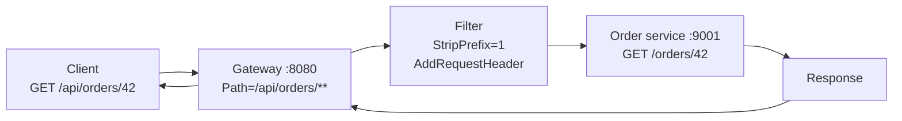

# Declaring Your First Route with `application.yml` in Spring Cloud Gateway

In a microservices architecture, clients typically call a single entry address rather than knowing each service's individual address. **Spring Cloud Gateway** serves as that entry point: reading requests, selecting a **route** using **predicates**, running the required **filters**, and forwarding the request to a backend. This lesson guides you through declaring your first route in `application.yml`, verifying paths and headers as requests actually flow through the gateway, and introducing how to expand to multiple services.

> **Version scope:** The main example uses **Spring Cloud Gateway Server WebFlux 5.0.x**, corresponding to Spring Cloud **2025.1.x** and Spring Boot **4.x** per the compatibility matrix. The required YAML structure is `spring.cloud.gateway.server.webflux.routes`. Older Gateway lines (such as 4.2 and earlier) may use `spring.cloud.gateway.routes`; do not mix the two structures across versions. Spring Cloud Gateway also has a **Server Web MVC** variant with the prefix `spring.cloud.gateway.server.webmvc.routes`; this lesson focuses on WebFlux.

## 1. Expected Outcomes

After this lesson, you will be able to:

1. Explain the meaning of `id`, `uri`, `predicates`, and `filters` in a route.
2. Declare a route receiving `/api/orders/**` at the gateway and forwarding it to an order service.
3. Use `StripPrefix` to rewrite the path, and `AddRequestHeader` and `AddResponseHeader` to observe filters in action.
4. Send test requests, read responses, and distinguish **unmatched route** errors from **unreachable backend** errors.
5. Identify what needs updating when upgrading Gateway, deploying in containers, or moving to service discovery.

Suppose the API gateway runs at `localhost:8080`, while the order service runs at `localhost:9001`. We want the client to call:

`GET http://localhost:8080/api/orders/42`

and the order service to receive:

`GET http://localhost:9001/orders/42`

The `api` segment in the public path is only for the gateway, not a path the order service needs to know about.



## 2. Preparing the Gateway Application

Create a Spring Boot application with the **Spring Cloud Gateway Server WebFlux** starter, using a Spring Cloud BOM compatible with your chosen Boot version. A convenient approach is generating the project on [Spring Initializr](https://start.spring.io/) and selecting the Spring Cloud Gateway dependency. If editing Maven manually, the Gateway Server WebFlux dependency is:

```xml
<dependency>
    <groupId>org.springframework.cloud</groupId>
    <artifactId>spring-cloud-starter-gateway-server-webflux</artifactId>
</dependency>
```

For Spring to manage versions consistently, the Maven project needs a **Spring Cloud BOM** compatible with Spring Boot (or the configuration generated by Initializr). Do not pick an arbitrary Gateway version and assume it is compatible with your current Boot version. With the WebFlux variant, Gateway uses WebFlux and Reactor Netty; avoid adding `spring-boot-starter-web` to the gateway application unless you intentionally want to change the web stack.

This lab uses **Java 17+**, the Maven wrapper or an installed Maven, and an HTTP backend running on port `9001`. You only need a single Spring Boot startup class:

```java
import org.springframework.boot.SpringApplication;
import org.springframework.boot.autoconfigure.SpringBootApplication;

@SpringBootApplication
public class GatewayApplication {
    public static void main(String[] args) {
        SpringApplication.run(GatewayApplication.class, args);
    }
}
```

You do not need to write a controller to proxy requests: the Gateway reads routes from configuration.

## 3. Declaring the First Route

Create or open `src/main/resources/application.yml` in the **gateway application** and add:

```yaml
server:
  port: 8080

spring:
  application:
    name: gateway-demo
  cloud:
    gateway:
      server:
        webflux:
          routes:
            - id: orders-local
              uri: http://localhost:9001
              predicates:
                - Path=/api/orders/**
              filters:
                - StripPrefix=1
                - AddRequestHeader=X-Gateway-Lab, from-gateway
                - AddResponseHeader=X-Gateway-Route, orders-local
```

Note that `routes` is a **YAML list**. The `-` before `id` starts a new route; the `-` before each predicate/filter builds the list of conditions and actions. Fields belonging to the same route must share the same indentation level. Use spaces instead of tabs.

### 3.1. Meaning of Each Component

| Property | Meaning | In This Example |
|---|---|---|
| `server.port` | HTTP port clients use to call the Gateway | `8080` |
| `id` | Route identifier for observation, management, and distinguishing routes | `orders-local` |
| `uri` | Target URI the gateway forwards to after the route matches | `http://localhost:9001` |
| `predicates` | Conditions for a request to enter the route | `Path=/api/orders/**` |
| `filters` | Processing steps applied to the route's request/response | Strip path prefix, add headers |
| `StripPrefix=1` | Removes the first **one segment** from the path | `/api/orders/42` → `/orders/42` |
| `AddRequestHeader` | Adds a header to the request sent to the backend | `X-Gateway-Lab: from-gateway` |
| `AddResponseHeader` | Adds a header to the response returned to the client | `X-Gateway-Route: orders-local` |

**Route predicates** decide *whether a request enters this route*. If `Path=/api/orders/**` does not match, the gateway checks other routes; when no route matches, the typical result is HTTP `404`.

**Filters** apply only after a route is selected. `StripPrefix=1` does not remove the string `api` everywhere—it strips the first path segment. For example:

| Path Sent by Client | Path Forwarded to Backend |
|---|---|
| `/api/orders/42` | `/orders/42` |
| `/api/orders/42/items` | `/orders/42/items` |
| `/api/orders/42?expand=items` | `/orders/42?expand=items` |

Query strings are preserved in this example; path-modifying filters do not drop query parameters. If the backend natively handles `/api/orders/42`, **remove `StripPrefix`** or choose an appropriate path rewrite so you do not break the API contract.

`AddRequestHeader` is great for observing demo flows. It does not authenticate or prove the client's identity; a client might send the same header name itself, and the filter could append another value. In real systems, trusted identity headers must be controlled by proper security mechanisms.

### 3.2. Shortcut Syntax vs. Expanded Syntax

`Path=/api/orders/**` and `StripPrefix=1` use **shortcut** syntax: factory name, `=`, and positional arguments. Gateway also supports full `name`/`args` configuration, which is useful when named arguments make things clearer.

For instance, just the predicate and filter written in expanded form look like:

```yaml
predicates:
  - name: Path
    args:
      patterns.0: /api/orders/**
filters:
  - name: StripPrefix
    args:
      parts: 1
```

The snippet above is **part of a route**, not a standalone `application.yml` file. It replaces the corresponding `predicates` and `filters` in the main example—do not put both styles redundantly in the same route.

## 4. Creating a Minimal Backend to Test the Route

If you already have an order service handling `GET /orders/42` on port `9001`, use that service directly and skip creating the mock. Otherwise, you can use the HTTP server built into the JDK without adding any dependencies.

Create `LocalOrderBackend.java` in any practice directory:

```java
import com.sun.net.httpserver.HttpServer;
import java.net.InetSocketAddress;
import java.nio.charset.StandardCharsets;

public class LocalOrderBackend {
    public static void main(String[] args) throws Exception {
        HttpServer server = HttpServer.create(
                new InetSocketAddress("127.0.0.1", 9001), 0);

        server.createContext("/", exchange -> {
            String response =
                    "method=" + exchange.getRequestMethod() + "\n" +
                    "path=" + exchange.getRequestURI().getRawPath() + "\n" +
                    "query=" + exchange.getRequestURI().getRawQuery() + "\n" +
                    "X-Gateway-Lab=" +
                    exchange.getRequestHeaders().getFirst("X-Gateway-Lab") + "\n";

            byte[] bytes = response.getBytes(StandardCharsets.UTF_8);
            exchange.getResponseHeaders().set(
                    "Content-Type", "text/plain; charset=utf-8");
            exchange.sendResponseHeaders(200, bytes.length);
            try (var output = exchange.getResponseBody()) {
                output.write(bytes);
            }
        });

        server.start();
        System.out.println("Local order backend listening at http://localhost:9001");
    }
}
```

Run it in the first terminal (JDK 17 or newer):

```bash
java --add-modules jdk.httpserver LocalOrderBackend.java
```

In a second terminal, test the backend **directly**:

```bash
curl -i "http://localhost:9001/orders/42?expand=items"
```

The response body will look roughly like:

```text
method=GET
path=/orders/42
query=expand=items
X-Gateway-Lab=null
```

The `null` value shows that a direct call to the backend has not received the gateway-added header. This demo server intentionally returns `200` for every path so you can clearly see the actual path; it **does not simulate business logic or authorization** of a real order service.

## 5. Starting the Gateway and Sending Test Requests

Run the Spring Boot gateway application in a third terminal:

```bash
# Linux/macOS
./mvnw spring-boot:run

# Windows PowerShell
.\mvnw.cmd spring-boot:run
```

In the commands below, on traditional Windows PowerShell you can use `curl.exe` instead of `curl` to avoid PowerShell's alias.

Send a request through port `8080`:

```bash
curl -i "http://localhost:8080/api/orders/42?expand=items"
```

If both processes are running, the response will include the gateway-added header:

```http
HTTP/1.1 200 OK
X-Gateway-Route: orders-local
Content-Type: text/plain; charset=utf-8

method=GET
path=/orders/42
query=expand=items
X-Gateway-Lab=from-gateway
```

Header order and some additional headers may vary by runtime. The key points to verify are **HTTP 200**, the `X-Gateway-Route` header, the backend path with `/api` stripped, and the `X-Gateway-Lab` header arriving at the backend.

Try the following scenarios to distinguish whether requests match a route:

| Request Sent to Gateway | Expected Result |
|---|---|
| `GET /api/orders/42` | Matches `orders-local`; backend sees `/orders/42` |
| `GET /api/orders/42/items` | Matches; backend sees `/orders/42/items` |
| `GET /api/orders/42?expand=items` | Matches; preserves `expand=items` query |
| `GET /api/customers/42` | Does not match `orders-local`; returns `404` if no other route exists |
| `GET /orders/42` | Does not match `orders-local`; returns `404` if no other route exists |

When calling `http://localhost:8080/api/customers/42` and getting `404`, do not jump to the conclusion that the order service is broken: that request was never accepted by the `orders-local` route.

## 6. Expanding Routes: Adding Conditions and Adding Services

### 6.1. Combining Multiple Predicates

If you only want to forward `GET` requests to the order service, add `Method=GET`:

```yaml
predicates:
  - Path=/api/orders/**
  - Method=GET
```

Two predicates placed in the same route must **both** match: `GET /api/orders/42` passes through, whereas `POST /api/orders/42` does not enter this route. This is a gateway-level condition and does not replace HTTP method and permission checks inside the backend.

### 6.2. Declaring Another Independent Route

When the system has a catalog service running at `localhost:9002` with `/products/**` APIs, you can declare both routes under the same `routes` key:

```yaml
spring:
  cloud:
    gateway:
      server:
        webflux:
          routes:
            - id: orders-local
              uri: http://localhost:9001
              predicates:
                - Path=/api/orders/**
              filters:
                - StripPrefix=1

            - id: catalog-local
              uri: http://localhost:9002
              predicates:
                - Path=/api/products/**
              filters:
                - StripPrefix=1
```

Corresponding mapping:

| Client Calls | Route | Backend Receives |
|---|---|---|
| `GET /api/orders/42` | `orders-local` | `http://localhost:9001/orders/42` |
| `GET /api/products/7` | `catalog-local` | `http://localhost:9002/products/7` |

The two-route example is a **replacement configuration** for the single-route configuration in section 3. Do not paste a second `spring:` root key into the same YAML document.

If multiple routes have overlapping predicates, design explicit priorities using `order` (smaller numbers have higher priority) and test overlapping matches rather than relying on file declaration order.

### 6.3. From Static Addresses to Service Discovery

The URI `http://localhost:9001` is only suitable for practice or when a backend has a static address. In microservices, instances can scale up/down or change addresses. Once you configure service discovery and **Spring Cloud LoadBalancer**, a route can use:

```yaml
uri: lb://order-service
```

`lb://` requires infrastructure that provides instances for `order-service`; writing that string alone **does not create a service registry**. This is an upgrade step for discovery/load balancing and is not required for your first route.

## 7. Observing Routes and Troubleshooting

### 7.1. Viewing the Route List with Actuator

If the project already includes `spring-boot-starter-actuator`, with Gateway 5.0 you can enable the read-only endpoint in `application.yml`:

```yaml
management:
  endpoint:
    gateway:
      access: read-only
  endpoints:
    web:
      exposure:
        include: health,info,gateway
```

After restarting, check:

```bash
curl -i http://localhost:8080/actuator/gateway/routes
```

Once the configuration is loaded properly, the list will include route ID `orders-local` and target `http://localhost:9001`. Depending on the version, the response also shows predicates, filters, and `order`. Management endpoints can reveal internal routing details, so only enable and restrict access appropriately in learning environments; production requires proper authentication/authorization and private networking.

### 7.2. Quick Troubleshooting Table

| Symptom | Common Possibilities | How to Check |
|---|---|---|
| Gateway fails to start | Missing starter, incompatible BOM, WebFlux/Servlet mix-up, or bad YAML indentation | Read the first stacktrace; check dependencies and config property paths |
| `GET /api/orders/42` returns `404` | Route not loaded, predicate mismatch, wrong port, or backend returning 404 | Check `/actuator/gateway/routes`, test backend directly, and compare paths |
| Route matches yet request returns `5xx` | Backend stopped or unreachable, wrong DNS/port, or upstream error | `curl` `localhost:9001` directly; inspect Gateway and backend logs |
| Backend receives `/api/orders/42` instead of `/orders/42` | Forgot `StripPrefix=1` or filter is not on that route | Review `filters` and inspect the echo body |
| `X-Gateway-Lab` missing at backend | Calling backend directly, typo in filter, or another route matched | Call port `8080`; check route ID and header syntax |
| Configuration copied from older articles has no effect | Wrong property prefix for your Gateway version | For Server WebFlux 5.0 check `spring.cloud.gateway.server.webflux.routes` |
| Gateway runs in Docker but cannot reach `localhost:9001` | `localhost` inside a container points to the gateway container itself | Use a hostname/service name reachable on the container network |

**An effective debugging sequence:** (1) confirm the gateway listens on `8080`, (2) call backend `9001` directly, (3) inspect loaded routes, (4) test a path guaranteed to match, (5) verify the path/headers reaching the backend. When editing `application.yml` in a standard application, **restart the gateway** to be sure the new config is loaded; do not assume all changes hot-reload.

## 8. Notes Before Taking Routes to a Real System

Your first route only solves backend selection and basic request transformation. To operate Spring Cloud Gateway safely and reliably as a microservices edge gateway, you also need:

- **Authentication and authorization:** protect routes with WebFlux-appropriate Spring Security, validating tokens against real issuer/audience/rules; backends should still enforce authorization on their own resources.
- **Rate limiting:** enforce limits by a trusted key (user, tenant, client) to prevent abuse; never treat a self-declared client header as a verified identity.
- **Timeouts, retries, circuit breakers:** set backend wait bounds, avoid blindly retrying non-idempotent POSTs, and define a strategy when upstreams fail.
- **TLS and headers:** use HTTPS and proper certificate verification; avoid leaking tokens, cookies, or personal data in headers/logs; control forwarded headers from trusted proxies.
- **Observability:** track requests per route, status codes, latency, connection errors, and tracing/correlation IDs before scaling out the number of routes.

These mechanisms build on the same **route + predicate + filter** foundation you just practiced, but require dedicated configuration and testing. Do not treat the fact that a request passed through the gateway as proof that backends need no protection.

## 9. Self-Check

1. **Is `uri` the address the client calls or the backend address?** — It is the **backend** address to which the route sends requests.
2. **Why does `GET /api/orders/42` reach the backend as `GET /orders/42`?** — `Path` selects the route, and then `StripPrefix=1` strips the `api` segment.
3. **Can `Path` and `Method` both be placed in `predicates`?** — Yes. All conditions in a single route must be satisfied together.
4. **Why doesn't calling `localhost:9001` directly show `X-Gateway-Lab`?** — This header is added by a gateway filter, so it is only present when the request flows through the gateway.
5. **Is using `lb://order-service` enough to find a service?** — No. It requires an instance-providing mechanism and the corresponding Spring Cloud LoadBalancer setup.
6. **Why must you check both the gateway and the backend when seeing `404`?** — A `404` can happen because no route matched, or because the route matched but the backend itself returned `404`.

## 10. Official Documentation

- [Spring Cloud — release train and Spring Boot compatibility matrix](https://spring.io/projects/spring-cloud/).
- [Spring Cloud Gateway Server WebFlux 5.0 — adding the starter](https://docs.spring.io/spring-cloud-gateway/reference/5.0/spring-cloud-gateway-server-webflux/starter.html).
- [Configuring route predicate factories and filter factories via shortcut/`name`-`args`](https://docs.spring.io/spring-cloud-gateway/reference/5.0/spring-cloud-gateway-server-webflux/configuring-route-predicate-factories-and-filter-factories.html).
- [Path Route Predicate Factory](https://docs.spring.io/spring-cloud-gateway/reference/5.0/spring-cloud-gateway-server-webflux/request-predicates-factories.html).
- [StripPrefix GatewayFilter Factory](https://docs.spring.io/spring-cloud-gateway/reference/5.0/spring-cloud-gateway-server-webflux/gatewayfilter-factories/stripprefix-factory.html).
- [Spring Cloud Gateway Actuator API](https://docs.spring.io/spring-cloud-gateway/reference/5.0/spring-cloud-gateway-server-webflux/actuator-api.html).

When upgrading versions, re-verify the starter, property prefixes, and filter behavior in the matching documentation branch. This lab provides an independently verifiable route, forming the foundation for upcoming lessons on service discovery, security, resilience, and traffic observability.
