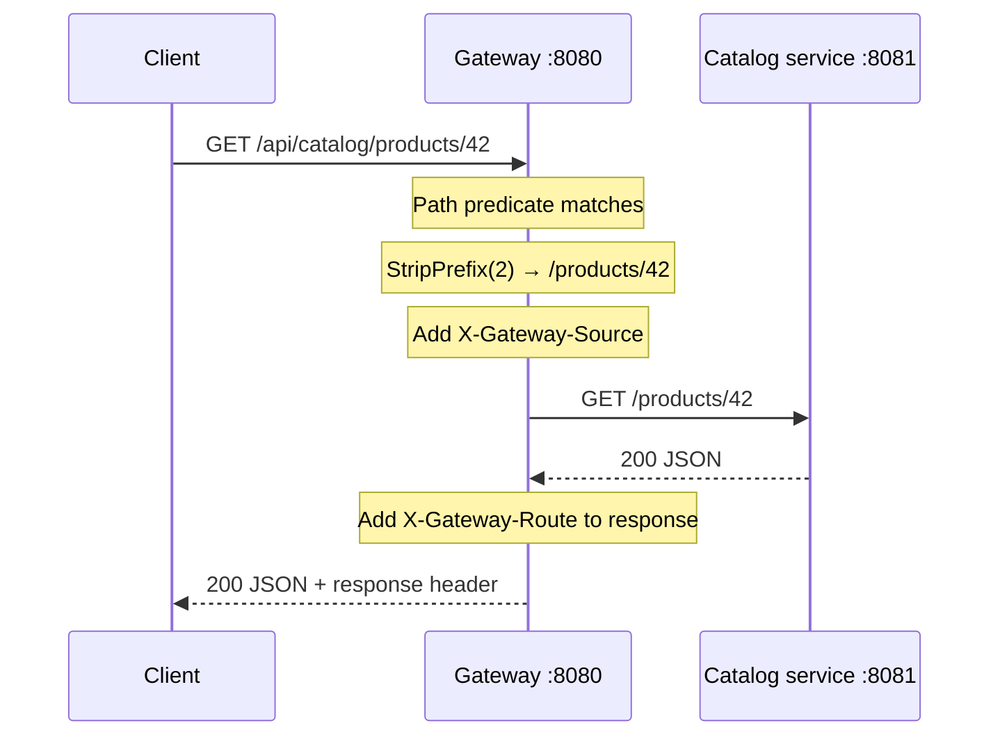

# Declaring Your First Route with Java `RouteLocatorBuilder`

## 1. Objectives and Context

In a microservices architecture, clients do not necessarily call each service directly. **Spring Cloud Gateway** can act as an API Gateway: receiving requests, selecting routes by predicates, running a filter chain to transform requests/responses, and forwarding to target services. Later, the system can expand to add service discovery, authentication, rate limiting, circuit breakers, retries, TLS, and request observability.

This lesson focuses on the foundational setup step: **declaring a route using the Java `RouteLocatorBuilder` DSL**. Once finished, you will be able to:

1. Create a **Gateway Server WebFlux** application and declare a `RouteLocator` bean.
2. Use `route(id, ...)`, `path(...)`, `filters(...)`, `uri(...)`, and `build()`.
3. Transform `GET /api/catalog/products/42` on port `8080` into `GET /products/42` on the `8081` service.
4. Demonstrate filters adding headers to the request going to the backend and the response returned to the client.
5. Inspect routes, diagnose 404/5xx causes, and recognize when `lb://` is needed instead of a static URL.

**Lab scope:** demonstrated on **Spring Cloud Gateway Server WebFlux 5.0.x** (Spring Boot 4.0.x, Spring Cloud release train 2025.1.x); choose compatible patch versions from the [Spring Cloud compatibility table](https://spring.io/projects/spring-cloud/) or [Spring Initializr](https://start.spring.io/). The `RouteLocatorBuilder` API also exists in 4.x lines, though starter names and some configurations differ by version. **Gateway Server Web MVC has its own Java Routes API based on `RouterFunction<ServerResponse>`; do not use WebFlux's `RouteLocatorBuilder` for the MVC variant.**

## 2. What Parts Make Up a Route?

A route is a rule that tells the gateway whether to forward a request and how to process that request.

| Component | Meaning in Example | Effect |
|---|---|---|
| **Route ID** | `catalog-route` | Identifier for logging, monitoring, and Actuator lookups |
| **Predicate** | `path("/api/catalog/**")` | Only requests with a matching path enter the route |
| **Filter** | `stripPrefix(2)` | Removes the first two path segments before calling the backend |
| **Filter** | `addRequestHeader(...)` | Adds a header to the request sent **to the backend** |
| **Filter** | `addResponseHeader(...)` | Adds a header to the response returned **to the client** |
| **Target URI** | `http://localhost:8081` | Backend address connected over HTTP |

Processing flow:



> **Distinction:** Predicates only **select the route**; filters are what **transform** paths and headers. Declaring `path("/api/catalog/**")` alone does not strip `/api/catalog`. Additionally, in Gateway Server WebFlux, the type returned by the `@Bean` is `RouteLocator`, whereas `RouteLocatorBuilder` is the builder tool used to construct the route list.

## 3. Preparing the Environment

### 3.1. Creating Two Spring Boot Applications

To avoid depending on an Internet API, the example uses two standalone applications:

| Application | Port | Main Dependency | Role |
|---|---:|---|---|
| `gateway-demo` | 8080 | **Reactive Gateway** / `spring-cloud-starter-gateway-server-webflux` | Receives requests and defines routes in Java |
| `catalog-demo` | 8081 | **Spring Web** | Backend returning JSON to verify path and headers |

Generate each project at [start.spring.io](https://start.spring.io/), choosing **Java 17 or higher**, Maven (or Gradle), and a confirmed compatible Spring Boot / Spring Cloud pair. For the gateway application, the key Maven dependency is:

```xml
<!-- Snippet inside <dependencies> of the gateway-demo project.
     Spring Initializr / Spring Cloud BOM manages the version. -->
<dependency>
    <groupId>org.springframework.cloud</groupId>
    <artifactId>spring-cloud-starter-gateway-server-webflux</artifactId>
</dependency>
```

Add `spring-boot-starter-actuator` if you want to inspect the route list over HTTP in section 7. Do not pin an individual version on the Gateway starter in a project that already imports the **Spring Cloud BOM**. For a WebFlux gateway application, do not add Servlet-style `spring-boot-starter-web` without an explicit architectural intent: Gateway Server WebFlux runs on Reactor Netty and is not deployed as a traditional Servlet WAR.

### 3.2. Creating a Backend to Verify Results

In the **`catalog-demo`** project (created with the *Spring Web* dependency), create `CatalogApplication.java`:

```java
package com.example.catalog;

import java.util.Map;
import org.springframework.boot.SpringApplication;
import org.springframework.boot.autoconfigure.SpringBootApplication;
import org.springframework.web.bind.annotation.GetMapping;
import org.springframework.web.bind.annotation.PathVariable;
import org.springframework.web.bind.annotation.RequestHeader;
import org.springframework.web.bind.annotation.RestController;

@SpringBootApplication
@RestController
public class CatalogApplication {

    public static void main(String[] args) {
        SpringApplication.run(CatalogApplication.class, args);
    }

    @GetMapping("/products/{id}")
    public Map<String, String> product(
            @PathVariable String id,
            @RequestHeader(name = "X-Gateway-Source",
                           defaultValue = "direct", required = false) String source) {
        return Map.of("id", id, "receivedHeader", source);
    }
}
```

Set `src/main/resources/application.yml` of the **backend**:

```yaml
spring:
  application:
    name: catalog-demo
server:
  port: 8081
```

Run the backend in the first terminal, inside the `catalog-demo` project directory:

```bash
./mvnw spring-boot:run
# Windows PowerShell/CMD: .\mvnw.cmd spring-boot:run
```

Verify **before adding the gateway**:

```bash
curl -i http://localhost:8081/products/42
```

When running properly, the backend returns `200 OK` with JSON equivalent to `{"id":"42","receivedHeader":"direct"}`. Field order in JSON does not matter. If this command fails, fix the backend before testing the gateway.

## 4. Declaring the First Route in Java

### 4.1. Creating the Gateway Application and `RouteLocator` Bean

In the **`gateway-demo`** project, create `src/main/java/com/example/gateway/GatewayApplication.java`:

```java
package com.example.gateway;

import org.springframework.boot.SpringApplication;
import org.springframework.boot.autoconfigure.SpringBootApplication;
import org.springframework.cloud.gateway.route.RouteLocator;
import org.springframework.cloud.gateway.route.builder.RouteLocatorBuilder;
import org.springframework.context.annotation.Bean;

@SpringBootApplication
public class GatewayApplication {

    public static void main(String[] args) {
        SpringApplication.run(GatewayApplication.class, args);
    }

    @Bean
    public RouteLocator catalogRoutes(RouteLocatorBuilder builder) {
        return builder.routes()
            .route("catalog-route", r -> r
                .path("/api/catalog/**")
                .filters(f -> f
                    .stripPrefix(2)
                    .addRequestHeader("X-Gateway-Source", "scg-java")
                    .addResponseHeader("X-Gateway-Route", "catalog-route"))
                .uri("http://localhost:8081"))
            .build();
    }
}
```

This is the complete gateway code for this lab. Spring Boot scans `@SpringBootApplication` and registers the `catalogRoutes` `@Bean`; Spring Cloud Gateway provides `RouteLocatorBuilder` automatically through the WebFlux starter.

Step-by-step breakdown:

1. **`builder.routes()`**: begins the `RouteLocator` builder holding the routes.
2. **`.route("catalog-route", r -> ...)`**: creates a route with an explicit ID; avoid relying on randomly generated IDs when tracing errors.
3. **`.path("/api/catalog/**")`**: predicate matching the path of incoming HTTP requests entering the gateway. `**` matches subsequent path segments.
4. **`.filters(f -> ...)`**: chains multiple `GatewayFilter`s applied to this route; by default they do not apply to other routes.
5. **`.stripPrefix(2)`**: removes the first two segments (`api`, `catalog`) of the path before forwarding. Query strings such as `?lang=vi` are preserved unless modified by a filter.
6. **`.addRequestHeader(...)`**: adds `X-Gateway-Source: scg-java` to the downstream request so the backend can prove the request came through the gateway.
7. **`.addResponseHeader(...)`**: adds `X-Gateway-Route: catalog-route` to the response sent back to the client, convenient for observing in this demo.
8. **`.uri("http://localhost:8081")`**: sets the target scheme, hostname, and port. **A path inside the route URI is not used to prepend a prefix**; modify paths using filters such as `stripPrefix`, `prefixPath`, `setPath`, or `rewritePath`.
9. **`.build()`**: finalizes and returns the `RouteLocator` for the gateway to use.

### 4.2. Configuring the Listening Port

Set `src/main/resources/application.yml` for the **gateway**:

```yaml
spring:
  application:
    name: gateway-demo
server:
  port: 8080
```

No YAML routes are needed in this example: the route is already built by the **Java `@Bean`**. Starting from Gateway 5.x, if you want to declare configured routes instead of Java routes, the WebFlux namespace is `spring.cloud.gateway.server.webflux.routes`; older articles using `spring.cloud.gateway.routes` belong to earlier version lines. Do not declare an additional YAML route with an overlapping path while practicing this single-route example.

Run the gateway in a second terminal, inside the `gateway-demo` project:

```bash
./mvnw spring-boot:run
# Windows PowerShell/CMD: .\mvnw.cmd spring-boot:run
```

Both processes must remain running: gateway `:8080` and catalog backend `:8081`.

## 5. Sending Requests and Observing Results

### 5.1. Request Passing Through the Gateway

```bash
curl -i 'http://localhost:8080/api/catalog/products/42'
```

Expected output (abbreviated; header order and casing may vary):

```http
HTTP/1.1 200 OK
X-Gateway-Route: catalog-route
Content-Type: application/json

{"id":"42","receivedHeader":"scg-java"}
```

The difference from calling `http://localhost:8081/products/42` directly is that the backend reads the `X-Gateway-Source` header added by the gateway, while the client sees `X-Gateway-Route` in the response. The client **does not necessarily** see the `X-Gateway-Source` request header in the response: those are two different header directions.

### 5.2. How Do Paths and Query Strings Change?

| Request to `:8080` | Predicate Matches? | Downstream Request After Filters | Expected Result |
|---|---|---|---|
| `GET /api/catalog/products/42` | Yes | `GET /products/42` | Backend returns product 42 info |
| `GET /api/catalog/products/7?lang=vi` | Yes | `GET /products/7?lang=vi` | Backend returns product 7; query is forwarded |
| `GET /api/orders/42` | No | Not forwarded by this route | Typically 404 if the app has no other matching route/handler |
| `GET /products/42` | No | Not forwarded by this route | Typically 404 if the app has no other matching route/handler |
| `GET /api/catalog/missing` | Yes | `GET /missing` | Backend decides the status; demo backend has no mapping so 404 |

The last two **404** cases must be distinguished: **404 because no route matched** versus **404 returned by the backend after a route matched**. Looking at the HTTP status code alone is not enough to know where the failure occurred.

### 5.3. Testing Additional Invalid Requests

```bash
# Does not match route:
curl -i http://localhost:8080/api/orders/42

# Matches route, but example backend has no endpoint:
curl -i http://localhost:8080/api/catalog/not-found

# To clearly see downstream headers, compare:
curl -i http://localhost:8081/products/42
curl -i http://localhost:8080/api/catalog/products/42
```

> The commands are **self-run instructions**, not output already executed in this document. If the backend is not running, a route may still match while the gateway returns a connection error (usually in the 5xx range); inspect the logs and backend status.

## 6. Adding Predicates with the Java DSL

When only `path(...)` is specified, the route is not limited to HTTP GET by default. To restrict the route to GET only, combine `method(HttpMethod.GET)` using the **`and()`** operator:

```java
import org.springframework.http.HttpMethod;

// Replaces the .route(...) section in the bean from section 4; do not declare
// two routes with the same ID simultaneously.
.route("catalog-route", r -> r
    .path("/api/catalog/**")
    .and()
    .method(HttpMethod.GET)
    .filters(f -> f
        .stripPrefix(2)
        .addRequestHeader("X-Gateway-Source", "scg-java"))
    .uri("http://localhost:8081"))
```

In this configuration, both conditions must **hold simultaneously**: the path starts with `/api/catalog/` per the pattern and the method is `GET`. A `POST` to the same URL will not enter this route; if no other route/handler exists, the application usually returns 404. This highlights the difference between *no matching route* and HTTP `405 Method Not Allowed` returned by a specific handler.

The Java DSL also supports combining `host(...)`, `header(...)`, `query(...)`, `cookie(...)`, and logical operators:

| Operator | Meaning | Example Scenario |
|---|---|---|
| `.and()` | Satisfies both conditions simultaneously | `Host=api.example.test` **and** `Path=/v1/**` |
| `.or()` | Either condition is true | A route serving two different path styles |
| `.negate()` | Negates a condition | Excluding certain paths |

Use explicit parentheses/grouping when chaining multiple operators to avoid accidentally widening route scope. **A header predicate is not authentication:** a client can send `X-User-Role: admin` itself; JWT verification, authorization, and endpoint protection must be enforced via Spring Security or a trusted security mechanism, not by matching a header alone.

## 7. Observing Routes with Actuator

To verify that the gateway **registered the Java route**, add `spring-boot-starter-actuator` to the gateway project (if not selected from Initializr), then add to the **gateway's `application.yml`**:

```yaml
management:
  endpoint:
    gateway:
      access: read-only
  endpoints:
    web:
      exposure:
        include: health,gateway
```

With Gateway 5.0.x, the `gateway` endpoint is restricted by default; the configuration above enables **reading routes** over HTTP. Restart the gateway and call:

```bash
curl -i http://localhost:8080/actuator/gateway/routes
curl -i http://localhost:8080/actuator/gateway/routes/catalog-route
```

Route output (illustrative structure; predicate/filter strings may differ across patch releases):

```json
{
  "route_id": "catalog-route",
  "uri": "http://localhost:8081",
  "predicate": "...",
  "filters": ["..."],
  "order": 0
}
```

This endpoint answers three questions before investigating the backend: **Is the ID right? Is the URI right? Have the predicate/filters appeared?** Routes created via `@Bean` are code-defined; do not assume you can modify or delete them through Actuator's `POST/DELETE` management APIs.

**Securing Actuator:** in production environments, never expose Gateway management endpoints to the Internet; enable read-only access only when needed and restrict access via security/network policies. Enable `unrestricted` only when dynamic management is genuinely required and proper access controls are in place.

## 8. Two Expansion Paths After Your First Route

### 8.1. Externalizing the Backend URI to Configuration

The URL `http://localhost:8081` is handy for practice but awkward when moving from a developer machine to staging/production. You can inject the URL from configuration into the `@Bean`:

```java
import org.springframework.beans.factory.annotation.Value;

@Bean
public RouteLocator catalogRoutes(
        RouteLocatorBuilder builder,
        @Value("${services.catalog.url}") String catalogUrl) {
    return builder.routes()
        .route("catalog-route", r -> r
            .path("/api/catalog/**")
            .filters(f -> f.stripPrefix(2))
            .uri(catalogUrl))
        .build();
}
```

```yaml
services:
  catalog:
    url: http://localhost:8081
```

This is a **replacement** for the bean in section 4—do not paste a second bean with the same ID into the application. When deploying, you can supply `services.catalog.url` via environment-specific configuration. For URIs sourced externally, accept only **operator-controlled** values; never let end users pass arbitrary URLs due to SSRF risks.

### 8.2. Using `lb://` When Service Discovery Is Present

When microservices run multiple instances, instead of `http://localhost:8081`, you can configure:

```java
.uri("lb://catalog-service")
```

`lb://catalog-service` **is not an ordinary HTTP URL** and does not perform service discovery by itself. The Gateway needs Spring Cloud LoadBalancer plus a mechanism providing service instances, such as a `DiscoveryClient` (properly integrated Eureka/Consul/Kubernetes) or a static service instance configuration for testing. The gateway then picks an instance before proxying over HTTP/HTTPS. Simply changing `uri` to `lb://...` in a demo without LoadBalancer/discovery will **not work properly**.

### 8.3. Laying the Groundwork for Production Filter Chains

After the first route, you can add `rewritePath`, `setRequestHeader`, timeouts, `Retry`, `CircuitBreaker`, `RequestRateLimiter`, and `TokenRelay` where supported by your version, dependencies, and security setup. Do not turn everything on at once for a simple route:

- **Retry:** cap the retry count; be cautious with state-mutating `POST` requests and ensure idempotency.
- **Rate limiting:** choose an accurate key based on user, API key, or trusted source, and account for multiple gateway instances.
- **Circuit breaker:** requires the proper dependencies and sensible timeout/fallback policies; a fallback does not automatically turn bad data into valid data.
- **TLS and authentication:** an `https://...` URL protects the gateway → backend connection when trust/certificates are valid; client-facing HTTPS is a separate hop. Adding trace headers does not replace authentication or authorization.
- **Observability:** include the route ID in logs, metrics, and traces; do not log Authorization tokens, cookies, or sensitive bodies.

## 9. Common Errors and How to Handle Them

| Symptom | Possible Cause | How to Check |
|---|---|---|
| Application cannot find `RouteLocatorBuilder` bean | Wrong MVC starter chosen, missing Gateway Server WebFlux starter, or auto-configuration conflict | Check dependency tree, Boot/Cloud versions, and import package `org.springframework.cloud.gateway.route.builder.RouteLocatorBuilder` |
| Gateway fails to start | Port `8080` already in use, incompatible Boot/Cloud versions, or Web MVC dependency mixed into reactive gateway | Read startup logs; check port and BOM |
| `404` right at Gateway | `path(...)` does not match, `@Bean` code not scanned, or duplicate/competing routes | Call `/actuator/gateway/routes`, check route ID/predicate and exact URL |
| `404` from backend | Route matches, but `stripPrefix` removes the wrong number of segments or backend lacks a mapping | Call `:8081` directly and compare expected downstream request |
| `5xx` error when route matches | Backend down, wrong host/port, DNS, TLS, or timeout | Call backend directly from the gateway host environment; check logs and connectivity |
| Expected header is missing | Mixed up request/response direction; route did not match; header modified by another filter | Check JSON `receivedHeader` at backend and `X-Gateway-Route` in response |
| Two routes both match | Overlapping conditions or unclear route priority order | Use distinct IDs and specific conditions; when needed set `order` and inspect Actuator |
| Calling `lb://...` fails | Missing LoadBalancer or no instances supplied by discovery | Check dependencies, instance list, and discovery configuration |

**Diagnostic tip:** temporarily enable `logging.level.org.springframework.cloud.gateway: DEBUG` in your development environment, send a single request, and match the route ID. Turn verbose logging off when not needed, especially anywhere real data is present.

## 10. Practice Exercises

1. Change the route ID to `catalog-v1` and verify the new ID in `/actuator/gateway/routes` and the response header.
2. Change the public path to `/edge/catalog/**`. Keeping `stripPrefix(2)`, predict which path the backend will receive.
3. Add the predicate `method(HttpMethod.GET)` and verify that `POST /edge/catalog/products/42` does not match the route.
4. Change `stripPrefix(2)` to `stripPrefix(1)`. Explain why `/products/42` on the backend is no longer called properly.
5. Stop the backend while the gateway keeps running; compare **route matched but backend errored** against **no route matched**.
6. Move the URI into `application.yml` via `@Value`, then try changing `services.catalog.url` from `:8081` to another backend's port.

### Self-Check Questions

- Why can a single `@Bean RouteLocator` contain multiple `.route(...)` definitions?
- Does `RouteLocatorBuilder` belong to Server WebFlux or Server Web MVC?
- Does `path("/api/catalog/**")` automatically rewrite the downstream path to `/products/**`?
- Which receiving end differs between `addRequestHeader` and `addResponseHeader`?
- Why does `lb://catalog-service` need an additional instance-providing system?
- When receiving a `404`, what should you inspect to distinguish a predicate error from a downstream controller error?

## References

- [Spring Cloud Gateway Server WebFlux 5.0 — Fluent Java Routes API](https://docs.spring.io/spring-cloud-gateway/reference/5.0/spring-cloud-gateway-server-webflux/fluent-java-routes-api.html) — `RouteLocatorBuilder`, `route`, predicate/filter, and `build` syntax.
- [Spring — Building a Gateway](https://spring.io/guides/gs/gateway/) — guide to creating a `@Bean RouteLocator` and testing with curl.
- [Gateway Server WebFlux — How It Works](https://docs.spring.io/spring-cloud-gateway/reference/5.0/spring-cloud-gateway-server-webflux/how-it-works.html) — route matching, filter chain execution, and URI notes.
- [Gateway Server WebFlux — Actuator API](https://docs.spring.io/spring-cloud-gateway/reference/5.0/spring-cloud-gateway-server-webflux/actuator-api.html) — inspecting route IDs, predicates, and filters.
- [Gateway Server WebFlux — GatewayFilter Factories](https://docs.spring.io/spring-cloud-gateway/reference/5.0/spring-cloud-gateway-server-webflux/gatewayfilter-factories.html) — built-in filters.
- [Gateway Server Web MVC 5.0 — Java Routes API](https://docs.spring.io/spring-cloud-gateway/reference/5.0/spring-cloud-gateway-server-webmvc/java-routes-api.html) — comparing API differences with Server WebFlux.
- [Spring Cloud — Spring Boot Compatibility](https://spring.io/projects/spring-cloud/) — selecting a compatible release train during setup.
