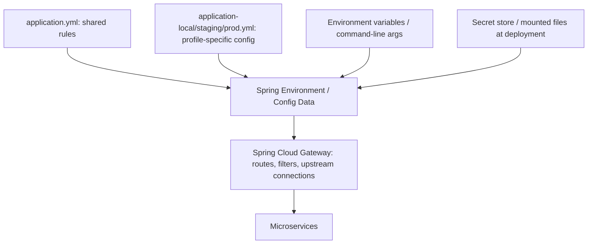

# Separating Configuration by Environment and Using Environment Variables

## 1. Why Does Spring Cloud Gateway Need Environment-Specific Configuration?

When building **SPRING_CLOUD_GATEWAY**, the application typically runs across multiple environments: a developer's personal workstation (`local`), a testing environment (`staging`), and an environment serving real users (`prod`). The exact same Gateway codebase must route requests, apply the filter chain, manage connections to microservices, and coordinate authentication, rate limiting, circuit breakers, retries, TLS, and request observability policies.

However, **configuration values** vary significantly between environments:

- Upstream addresses: `http://localhost:8081` during development, internal service names or HTTPS endpoints in deployment.
- Gateway port, timeouts, log levels, and observability backend addresses.
- JWT issuer URI, Redis used for rate limiting, discovery server, and TLS certificates.
- Sensitive values such as Redis passwords, keys, access tokens, and keystore passwords.

If you hardcode these values in Java or hand-edit a single config file before every deployment, the team can easily push test settings to production, leak secrets, or lose the ability to reuse the same build artifact.

The **goal** is to keep the built artifact unchanged, separate ordinary configuration by environment, and supply infrastructure-dependent values via **environment variables** or an appropriate configuration/secret management mechanism.

After this lesson, you will be able to:

1. Distinguish **Spring Profiles**, shared configuration files, profile-specific configuration files, and environment variables.
2. Organize `application.yml`, `application-local.yml`, `application-staging.yml`, and `application-prod.yml`.
3. Use `${...}` placeholders, default values, required variables, and profile activation methods.
4. Apply environment configuration to Spring Cloud Gateway route predicates and filters.
5. Verify effective configuration, avoid leaking secrets, and diagnose common configuration errors.

> The route examples below use the `spring.cloud.gateway.routes` declaration style commonly seen in **Spring Cloud Gateway Server WebFlux 4.x**. Some newer versions use a different configuration namespace or starter; when deploying, check the documentation matching your exact Spring Cloud Gateway version and WebFlux/MVC variant. **Spring Boot Config Data, Profiles, and environment variable principles** remain the core focus of this lesson.

## 2. Three Configuration Layers to Distinguish

| Layer | What Information Does It Hold? | Examples |
| --- | --- | --- |
| **Shared configuration** | Rules identical across every environment: application name, route IDs, predicates, path-rewriting filters | `application.yml` |
| **Profile-specific configuration** | Choices meaningful to a specific environment: local log levels, local upstream values, staging/prod operational options | `application-local.yml`, `application-prod.yml` |
| **Deployment-supplied values** | Real infrastructure addresses, cluster-specific values, secrets, per-deployment settings | `CATALOG_SERVICE_URI`, `JWT_ISSUER_URI`, secret store |

A **Spring Profile** is one or more active configuration labels, such as `local`, `staging`, or `prod`. Spring Boot loads the corresponding `application-{profile}.yml` files and layers them on top of the shared configuration.

**Environment variables** are values the application process receives from the operating system or deployment platform. They are not synonymous with profiles: `SPRING_PROFILES_ACTIVE=prod` selects the production configuration set; `CATALOG_SERVICE_URI=https://catalog.internal.example` supplies a concrete value for that configuration set.



The diagram shows the **configuration sources** that Spring can consume; it does not imply a secret store is read automatically without proper integration or secret mounting.

## 3. Designing the Example: One Gateway, Multiple Environments

Suppose the Gateway exposes this endpoint:

```text
GET http://localhost:8080/api/catalog/products/42
```

The Gateway needs to strip the `/api` prefix and forward to `GET /catalog/products/42` on `catalog-service`.

We want to keep the **route rules** identical across all environments, changing only the upstream URI:

| Environment | Profile | Upstream URI | Value Source |
| --- | --- | --- | --- |
| Developer workstation | `local` | `http://localhost:8081` | `application-local.yml` file |
| Staging | `staging` | `http://catalog.staging.internal:8081` | `CATALOG_SERVICE_URI` variable supplied by staging deployment |
| Production | `prod` | `https://catalog.prod.internal` | `CATALOG_SERVICE_URI` variable supplied by production deployment |

The domains above are **illustrative placeholders**; replace them with your infrastructure's real endpoints.

### 3.1. File Structure

```text
src/main/resources/
├── application.yml
├── application-local.yml
├── application-staging.yml
└── application-prod.yml
```

Naming files by the `application-{profile}.yml` convention lets Spring Boot locate them automatically when the corresponding profile is activated. No Java code is needed to read individual files.

### 3.2. `application.yml`: Keeping Shared Route Rules

```yaml
spring:
  application:
    name: api-gateway
  cloud:
    gateway:
      routes:
        - id: catalog-route
          uri: ${app.upstream.catalog-uri}
          predicates:
            - Path=/api/catalog/**
          filters:
            - StripPrefix=1

server:
  port: ${GATEWAY_PORT:8080}
```

Breakdown:

- `spring.application.name` identifies the application in logs, metrics, and management systems.
- `catalog-route` is the route ID; `Path=/api/catalog/**` is the **route predicate**.
- `StripPrefix=1` is a **GatewayFilter** that removes the first path segment (`api`) before forwarding upstream.
- `uri: ${app.upstream.catalog-uri}` references a property supplied by a profile or another configuration source. This is an **example application property**, not a built-in Spring Cloud Gateway key.
- `${GATEWAY_PORT:8080}` reads `GATEWAY_PORT` if present; otherwise it defaults to `8080`.

For example: when `app.upstream.catalog-uri=http://localhost:8081`, a `GET /api/catalog/products/42` request goes to `http://localhost:8081/catalog/products/42`. Upstream URIs must include an appropriate scheme (`http://`, `https://`, or `lb://` once load balancing is integrated).

> This is a minimal route and **does not automatically configure** JWT authentication, rate limiters, circuit breakers, retries, or TLS. Those features require separate dependencies and policies, even though their values can also come from environment variables.

### 3.3. `application-local.yml`: Convenient for Development

```yaml
app:
  upstream:
    catalog-uri: http://localhost:8081

logging:
  level:
    org.springframework.cloud.gateway: DEBUG
```

Locally, this targets the service running on your machine and enables more verbose logging to make it easier to diagnose unmatched routes. The `DEBUG` level should not be enabled by default in production because it can generate excessive logs and increase the risk of exposing data in uncontrolled logging pipelines.

### 3.4. `application-staging.yml`: Receiving the URI from Deployment

```yaml
app:
  upstream:
    catalog-uri: ${CATALOG_SERVICE_URI}

logging:
  level:
    org.springframework.cloud.gateway: INFO
```

When the `staging` profile is active, Spring Boot must find `CATALOG_SERVICE_URI`. Because the placeholder **has no default value**, a misconfigured deployment is caught when Spring attempts to resolve this property to create the route, usually during application startup.

This prevents a staging Gateway from silently calling `localhost:8081` or hitting a service in the wrong environment.

### 3.5. `application-prod.yml`: Never Hardcoding Infrastructure Addresses

```yaml
app:
  upstream:
    catalog-uri: ${CATALOG_SERVICE_URI}

logging:
  level:
    org.springframework.cloud.gateway: INFO
```

The staging and prod files may look nearly identical; what matters is that **real values** come from separate deployments. The same JAR/image can run in both environments without editing and rebuilding.

Do not set `spring.profiles.active: prod` inside `application-prod.yml`. Profiles should be **selected externally**, via `SPRING_PROFILES_ACTIVE` or startup arguments. Spring Boot enforces rules on where profile-activating properties are allowed in profile-specific files.

## 4. Activating Profiles and Passing Environment Variables

### 4.1. Running Locally on Linux/macOS

With a project that includes the Maven Wrapper:

```bash
SPRING_PROFILES_ACTIVE=local ./mvnw spring-boot:run
```

If running a built JAR:

```bash
SPRING_PROFILES_ACTIVE=local java -jar target/api-gateway.jar
```

The JAR filename here is just an example. With the Gradle Wrapper, use your project's corresponding run command instead of Maven.

### 4.2. Running Locally in Windows PowerShell

```powershell
$env:SPRING_PROFILES_ACTIVE = "local"
$env:GATEWAY_PORT = "9090"

.\mvnw.cmd spring-boot:run
```

The Gateway will listen on port `9090`, while the upstream URI comes from `application-local.yml`. Values set via `$env:` apply to the current PowerShell process and child processes launched from it.

### 4.3. Running Staging/Prod with the Same Artifact

Linux example, using illustrative endpoints:

```bash
export SPRING_PROFILES_ACTIVE=staging
export CATALOG_SERVICE_URI=http://catalog.staging.internal:8081
export GATEWAY_PORT=8080

java -jar target/api-gateway.jar
```

To run production, the deployment provides **different values**:

```bash
export SPRING_PROFILES_ACTIVE=prod
export CATALOG_SERVICE_URI=https://catalog.prod.internal
export GATEWAY_PORT=8080

java -jar target/api-gateway.jar
```

Both cases use the exact same JAR file; they differ only in configuration sources. That is the main benefit of separating configuration from code and artifacts.

You can select a profile using startup arguments:

```bash
java -jar target/api-gateway.jar --spring.profiles.active=prod
```

However, the command above **only selects the profile**; if `CATALOG_SERVICE_URI` is not supplied, the route is still missing its configuration. Never pass secrets directly in command-line arguments because they can appear in shell history or process listings.

### 4.4. Note on `.env` Files

A `.env` file containing entries like:

```dotenv
SPRING_PROFILES_ACTIVE=local
CATALOG_SERVICE_URI=http://localhost:8081
```

**is not loaded automatically by Spring Boot out of the box**. Docker Compose, IDEs, tools like `direnv`, or launch scripts can read this file and pass the values into the process, but that behavior must be configured explicitly.

Do not commit `.env` files containing passwords/tokens to Git. If you need to share variable names, create a template document with no real secrets and keep actual secret files outside source control.

## 5. How Spring Boot Reads Environment Variables and Placeholders

### 5.1. Reading Variables Directly via Relaxed Binding

Spring Boot supports **relaxed binding** when mapping canonical property names to environment variables. Common rules: replace dots with underscores, remove dashes, and convert to uppercase.

| Spring Boot Property | Corresponding Environment Variable |
| --- | --- |
| `server.port` | `SERVER_PORT` |
| `spring.profiles.active` | `SPRING_PROFILES_ACTIVE` |
| `spring.application.name` | `SPRING_APPLICATION_NAME` |
| `app.upstream.catalog-uri` | `APP_UPSTREAM_CATALOGURI` |
| `spring.security.oauth2.resourceserver.jwt.issuer-uri` | `SPRING_SECURITY_OAUTH2_RESOURCESERVER_JWT_ISSUERURI` |

**Do not confuse** automatic relaxed-binding mapping with custom-named placeholders. In the example, `${CATALOG_SERVICE_URI}` reads the variable named `CATALOG_SERVICE_URI` directly; meanwhile, `APP_UPSTREAM_CATALOGURI` is an alternative way to override the `app.upstream.catalog-uri` property through binding.

For hard-to-remember properties, using short, clear placeholder names (`CATALOG_SERVICE_URI`, `JWT_ISSUER_URI`, `REDIS_HOST`) makes deployments easier to manage. When referencing property names inside placeholders, prefer standard kebab-case such as `${app.upstream.catalog-uri}`.

### 5.2. Default Values and Required Variables

```yaml
server:
  port: ${GATEWAY_PORT:8080}

app:
  upstream:
    catalog-uri: ${CATALOG_SERVICE_URI}
```

- `${GATEWAY_PORT:8080}`: suitable for supplying a default port when running locally.
- `${CATALOG_SERVICE_URI}`: requires a value when the property is resolved.
- `${CATALOG_SERVICE_URI:http://localhost:8081}`: has a fallback, which is **unsuitable as a default escape hatch in production** because it can easily point to the wrong target by mistake.

For values affecting security or production routing, prefer **fail-fast** behavior (startup fails if config is missing) and input validation. A populated URI with the wrong scheme/host can still break the Gateway at runtime; placeholders do not replace validating URIs or connectivity.

### 5.3. Configuration Source Precedence

Spring Boot merges **PropertySources** into a single `Environment`. A higher-priority configuration source can override the same key from a lower-priority source.

Among sources commonly used in Spring Boot applications:

- Command-line arguments like `--server.port=9090` typically take precedence over environment variables.
- An environment variable `SERVER_PORT=9090` typically takes precedence over `server.port` in `application.yml`.
- An active profile config file (such as `application-prod.yml`) can override the same key in `application.yml` at the same config location.

These are **practical rules of thumb**, not an exhaustive precedence list: `SPRING_APPLICATION_JSON`, system properties, external files outside the JAR, multi-profile ordering, and `spring.config.import` also affect the final value. When a key is unexpectedly overridden, inspect which source actually provided it.

For example, if `application.yml` declares `server.port: ${GATEWAY_PORT:8080}`, but the deployment sets both `GATEWAY_PORT=8081` and `SERVER_PORT=9090`, the `server.port` property bound directly from `SERVER_PORT` has higher priority than the value in the file, so the usual result is **9090**.

### 5.4. Be Careful with Route Lists

Routes under `spring.cloud.gateway.routes` are **a list**. Spring Boot usually **replaces the entire list** with the list from the higher-priority source, rather than merging two lists by `id`.

An unsafe example if you only want to change one URI:

```yaml
# application-prod.yml (avoid this pattern if base has multiple routes)
spring:
  cloud:
    gateway:
      routes:
        - id: catalog-route
          uri: https://catalog.prod.internal
```

The snippet above can cause other routes in `application.yml` to disappear from the active list; the replacement route will also be missing its predicates and filters unless redeclared.

**Recommended approach:** keep stable route definitions in `application.yml`, and extract varying values like URIs into `app.upstream.*` or placeholders. If you genuinely need different route counts or definitions per environment, declare the **complete list** for each environment and verify the active routes after startup.

## 6. Externalizing Gateway Feature Configuration to the Environment

Just like upstream URIs, Gateway settings related to security, connectivity, and resilience also need per-environment separation.

| Feature | Example Varying Values | Principle |
| --- | --- | --- |
| Routes and discovery | `CATALOG_SERVICE_URI`, registry address | Endpoints must belong to the right environment and have valid schemes |
| Authentication | `JWT_ISSUER_URI`, audience, and related keys/settings | Never use a test issuer in production; validate tokens properly |
| Rate limiting | `REDIS_HOST`, `REDIS_PASSWORD`, quotas | Keep passwords out of Git; Redis is optional depending on deployment |
| Circuit breaker / retry | Error thresholds, timeouts, retry counts | Consider upstream load and idempotency, especially for write requests |
| TLS | Keystore/certificate paths, passwords, truststore | Manage and rotate certificates/secrets; know where TLS terminates |
| Observability | OTLP endpoint, sampling, log levels | Never push sensitive data into logs or traces |

### 6.1. Configurable Timeout Example

Using the HTTP client configuration style of **Gateway Server WebFlux 4.x**:

```yaml
spring:
  cloud:
    gateway:
      httpclient:
        connect-timeout: ${UPSTREAM_CONNECT_TIMEOUT_MS:2000}
        response-timeout: ${UPSTREAM_RESPONSE_TIMEOUT:5s}
```

Typically `connect-timeout` is in **milliseconds** and `response-timeout` uses a **Duration** format (`5s`). Choose time budgets based on SLOs and target service behavior. Never raise timeouts indefinitely just to mask a slow upstream.

This is an **optional** configuration example; verify the HTTP client namespace for your exact Gateway version. These timeouts do not automatically enable a circuit breaker or retries.

### 6.2. JWT Issuer and Redis Example (Values Only)

```yaml
spring:
  security:
    oauth2:
      resourceserver:
        jwt:
          issuer-uri: ${JWT_ISSUER_URI}
  data:
    redis:
      host: ${REDIS_HOST}
      port: ${REDIS_PORT:6379}
      password: ${REDIS_PASSWORD}
```

The snippet above **only illustrates how to move properties to environment variables**. JWT validation requires Spring Security Resource Server and an appropriate `SecurityWebFilterChain` policy; request rate limiting requires a rate limiter mechanism and a configured `KeyResolver`. Adding `REDIS_HOST` or `JWT_ISSUER_URI` alone does not turn on full security.

In practice, declare only the property groups you are actually using. Do not add Redis configuration to an application that has not integrated Redis, or require an issuer in an environment without authentication configured.

### 6.3. TLS Example When the Gateway Terminates HTTPS

```yaml
server:
  ssl:
    enabled: true
    key-store: ${TLS_KEYSTORE_PATH}
    key-store-type: PKCS12
    key-store-password: ${TLS_KEYSTORE_PASSWORD}
```

When using this configuration, the keystore must exist at the specified path and contain the matching certificate/key. For example, `TLS_KEYSTORE_PATH=file:/run/secrets/gateway.p12` works only if the deployment has mounted that file into the container.

If HTTPS terminates at an upstream ingress/load balancer, TLS settings on the gateway may differ. Clearly understand which hops are encrypted, internal TLS policies, and which `Forwarded`/`X-Forwarded-*` headers are safe to trust.

## 7. Passing Environment Variables in Docker Compose and Kubernetes

### 7.1. Docker Compose

Example running the same Gateway image with deployment configuration:

```yaml
services:
  gateway:
    image: example/api-gateway:1.0.0
    ports:
      - "8080:8080"
    environment:
      SPRING_PROFILES_ACTIVE: prod
      GATEWAY_PORT: "8080"
      CATALOG_SERVICE_URI: http://catalog:8081
```

`catalog` must be a hostname resolvable from the container network (e.g., a Compose service on the same network). `localhost` inside the Gateway container **points to the Gateway container itself**, not the host machine or another container.

If using a `.env` file for Compose to interpolate `${...}` expressions or using `env_file`, distinguish between **Compose reading a file for its config** and **which variables the container actually receives**. Do not assume every variable in Compose's `.env` file is automatically injected into the Gateway process environment.

### 7.2. Kubernetes

Non-secret values can be passed via `env` or a ConfigMap; secrets should be supplied from a Secret, secret manager, or mounted file, depending on operational policy. The snippet below shows only the `containers` section of a Deployment:

```yaml
containers:
  - name: gateway
    image: example/api-gateway:1.0.0
    env:
      - name: SPRING_PROFILES_ACTIVE
        value: "prod"
      - name: CATALOG_SERVICE_URI
        value: "http://catalog-service.default.svc.cluster.local:8081"
      - name: REDIS_PASSWORD
        valueFrom:
          secretKeyRef:
            name: gateway-redis
            key: password
```

`REDIS_PASSWORD` is populated only if the Kubernetes Secret `gateway-redis` and key `password` already exist. Storing a secret as a Kubernetes Secret does not automatically eliminate all security risks: you still need RBAC, secret read access controls, proper encryption, and a rotation process.

If values change in a ConfigMap/Secret or Pod environment variables, the application **does not automatically reload all runtime configuration**. For values provided via environment variables, running processes typically need a rollout/restart to pick up new values. External configuration solutions have their own refresh mechanisms; verify support for your exact version and components.

## 8. Secret Management and Security Boundaries

A useful rule is that **non-sensitive configuration can be version-controlled**, while real secrets must be managed through appropriately protected channels:

1. **Never commit** passwords, client secrets, private keys, real tokens, or keystores containing private keys into Git.
2. Prefer secret managers, volume mounts, or deployment platform secret references; environment variables can be used if access permissions and variable exposure are controlled.
3. Never write secrets to logs, error messages, traces, dumps, or publicly exposed Actuator endpoints. Environment variables can leak via admin tools, process dumps, or host/container inspection access.
4. Enforce per-environment access control: production secrets must not be granted to developer workstations or staging jobs that do not need them.
5. Plan rotation for JWT keys, Redis passwords, TLS certificates, and credentials; check whether a restart/reload is required when they change.
6. With a Gateway sitting at the system edge, never trust user identity or permissions from client-supplied headers without authentication/normalization and a proper trust boundary.

Choosing environment variables as a value source **does not automatically make the values secure**. Security also depends on how secrets are provisioned, stored, read, logged, authorized, and revoked.

## 9. Verifying Effective Configuration Before Operating

You should verify **the active profile**, **the resolved route values**, and **whether requests actually reach the right upstream**.

### 9.1. Verifying with a Real Request

Suppose local `catalog-service` has a `GET /catalog/products/42` endpoint; after enabling `local` and starting the Gateway:

```bash
curl -i http://localhost:8080/api/catalog/products/42
```

Depending on the service, the expected result could be `200 OK` and product JSON. If the upstream returns `404`, distinguish whether the Gateway route matched but the service lacks the forwarded path, or whether the Gateway failed to find a route.

If running on port `9090`, adjust the URL accordingly; if the local upstream has not been started, the test cannot prove the route works end-to-end.

### 9.2. Observable Signals

- Startup logs usually print the **active profiles** (confirm you are not running the wrong profile).
- A test request shows whether the public URL reaches the right upstream.
- Spring Boot Actuator provides diagnostic endpoints, but use them only when you have added the dependency and configured appropriate access policies.
- If using endpoints such as `/actuator/env`, `/actuator/configprops`, or related Gateway endpoints, **never expose them publicly** to external users. They can reveal system topology or operational details even when many values are partially masked.

Do not rely on `System.out.println(System.getenv())` or dumping the entire `Environment` for debugging: that easily leaks secrets. Log only carefully selected and sanitized keys/values, or use access-controlled observability tools.

### 9.3. Common Errors and Fixes

| Symptom | Possible Cause | How to Check or Fix |
| --- | --- | --- |
| Application reports it cannot resolve `${CATALOG_SERVICE_URI}` | Variable not provided to the **running process**; wrong profile | Check deployment config, IDE/container environment, and active profile |
| Gateway calls `localhost` even after deployment | Running `local` by mistake, using a localhost fallback, or `localhost` in the wrong network namespace | Check active profile and URI; use internal service DNS |
| `prod` profile has no effect | `SPRING_PROFILES_ACTIVE` not set, misspelled filename, or value overridden | Check startup active profiles log, command-line args, and Config Data |
| Some routes disappear | Overrode the **entire** `spring.cloud.gateway.routes` list in a profile file | Extract URIs with placeholders or declare the full route list |
| Route matches yet upstream returns 404 | Wrong `StripPrefix`/path rewrite, or service lacks the endpoint | Compare pre/post-filter paths and upstream endpoints |
| `503` when using `lb://SERVICE` | No instances available, service discovery/LoadBalancer not integrated, or wrong service name | Check dependencies, registry, instance list, and health |
| HTTPS upstream TLS errors | Wrong truststore/CA, hostname verification, protocol, or certificate | Check certificates and TLS config for the right environment |
| High timeouts in prod | Timeout property overridden, slow upstream, or connection limits | Check property sources, per-route metrics, and traces |
| Secrets appear in logs | Dumping full config, headers, or environment | Stop logging sensitive values, sanitize logs, and rotate exposed secrets |
| Updated env var but Gateway still uses old value | Running process has not picked up the new environment | Perform a rollout/restart or use a supported refresh mechanism |

## 10. Principles for Real-World Projects

**Keep the same artifact across environments.** If you change the JAR/image just to swap a URI or password, it becomes hard to tell whether a bug comes from code or configuration. Building one artifact and deploying it with different values is much easier to control.

**Use consistent variable names.** For example, `CATALOG_SERVICE_URI` is a full URI, unlike `CATALOG_SERVICE_HOST` which holds only the host. Agree clearly on whether scheme, port, path prefix, and TLS rules are included.

**Prefer required variables for production infrastructure.** Never set fallbacks to localhost or staging for JWT issuers, Redis, payment gateways, or sensitive upstreams. Default values are only appropriate for safe parameters that cannot misroute traffic.

**Do not put business rules in environment variables.** The environment should decide hosts, timeouts, quotas, and permissible operational parameters; order ownership, payment logic, and business state must stay controlled by services.

**Control list modifications.** Route, filter, and listener lists must not be expected to auto-merge by `id` across multiple files. Whenever route policies must vary by environment, inspect the effective configuration and test concrete requests.

**Match configuration to your version.** Property namespaces for Spring Cloud Gateway, Spring Security, and Actuator can change across versions. In particular, never mix **Gateway Server WebFlux** and **Gateway Server MVC** configurations.

**Do not sacrifice observability.** Even when lowering log verbosity in production, you still need metrics, traces, and upstream health visibility; configure observability endpoints in line with security requirements.

### Pre-Deployment Checklist

- [ ] Profile is selected by deployment; startup logs confirm the right profile.
- [ ] The same JAR/image runs cleanly with appropriate `staging` and `prod` configurations.
- [ ] Upstream URIs have the right scheme, hostname, and port for the deployment network.
- [ ] No dangerous fallbacks to `localhost` or test systems exist in production.
- [ ] Secrets come from protected sources and are never logged or committed.
- [ ] Route predicates, path/header filters, authentication, rate limiting, and retry policies are tested individually.
- [ ] Timeouts, TLS, and connectivity to discovery/Redis/identity providers are verified if used.
- [ ] Latency/error metrics and diagnostic logs are sufficient to distinguish Gateway errors from upstream errors.
- [ ] A proper restart/rollout or refresh procedure exists when configuration changes.

## 11. Summary

**Spring Profiles** select configuration groups such as `local`, `staging`, and `prod`; **environment variables** pass values at runtime; `${...}` **placeholders** connect them to Spring Boot properties. With **Spring Cloud Gateway**, keep route definitions, predicates, and filters stable in shared configuration, while supplying upstream URIs, connection parameters, infrastructure policies, and secrets per environment.

When separating configuration this way, a single Gateway can accept and route requests to different microservices in a controlled manner—supporting authentication, rate limiting, circuit breakers, retries, TLS, and request observability without modifying source code whenever moving between environments. What must always be verified is **the configuration values actually effective in the running process**, not just what is written in a YAML file.
