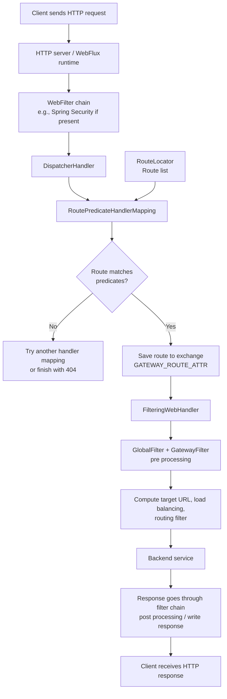
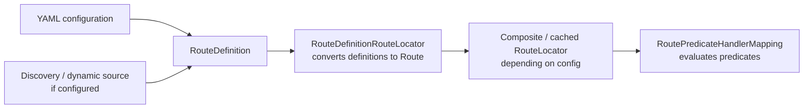
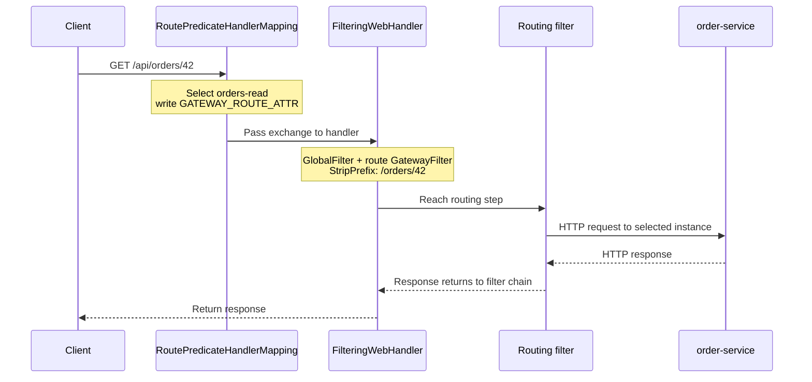

# Gateway Handler Mapping and the Route Selection Process

In a microservices system, clients typically call a single shared address such as `https://api.example.test` without knowing where each service is running. When a `GET /api/orders/42` request arrives at **Spring Cloud Gateway**, the gateway needs to answer a key question before applying forwarding filters: **which route does this request belong to?**

The component primarily responsible for answering that question in **Spring Cloud Gateway Server WebFlux** is **`RoutePredicateHandlerMapping`**. It combines the list of routes from `RouteLocator` with **route predicates** to find a matching route, then hands the request off to `FilteringWebHandler` to run the filter chain. Understanding the boundaries between these steps prevents confusing route selection errors with path rewriting, discovery, load balancing, or backend call errors.

This content belongs to the **Request Processing Architecture** chapter of the **SPRING_CLOUD_GATEWAY** module. Understanding handler mapping is the foundation for building an API gateway using route predicates, filter chains, path/header transformations, and service discovery; it also helps pinpoint exactly where authentication, rate limiting, circuit breakers, retries, TLS, and request observability take place along the journey of a call.

> **Scope:** This article describes the **Spring Cloud Gateway Server WebFlux** (reactive) architecture. The **Server MVC** variant uses a Spring MVC-based mechanism and different handler/filter types. YAML property names, starters, and internal details may vary across Spring Cloud Gateway versions; the configuration examples below use the common form for the Server WebFlux 4.x branch.

## 1. What Is a Route and What Does Handler Mapping Do?

A **route** is an identifiable rule describing when the gateway accepts a request and where it forwards it. Common components:

| Component | Meaning | Example |
| --- | --- | --- |
| **ID** | Route identifier, useful for logging and observability. | `orders-read` |
| **Target URI** | Backend or logical destination that receives the request after gateway processing. | `lb://order-service` |
| **Predicates** | Conditions for the route to match the current request. | `Path=/api/orders/**`, `Method=GET` |
| **Filters** | Transformations/policies executed **after the route is selected**. | `StripPrefix=1`, `AddResponseHeader=...` |
| **Order** | Priority order among potentially matching routes. | `-20` has higher priority than `0` |
| **Metadata** | Additional information that can be used by the framework or filters. | Per-route timeout configuration, if supported |

**`RoutePredicateHandlerMapping`** is a `HandlerMapping` implementation in the Spring WebFlux ecosystem. Its core job is to:

1. Retrieve available routes from a `RouteLocator`.
2. Check whether the request satisfies each route's predicates.
3. Select the **first matching route in the provided/priority route order**.
4. Store the selected route in `ServerWebExchange` (typically via the `GATEWAY_ROUTE_ATTR` attribute).
5. Return the next handler for processing, which in Gateway Server WebFlux is typically **`FilteringWebHandler`**.

Handler mapping **does not make HTTP calls to the backend itself**, nor does it mean it has authenticated tokens, rewritten paths, or performed load balancing. Those tasks belong to other layers in the processing flow.

### 1.1. Distinguishing Easily Confused Names

| Name | Role |
| --- | --- |
| **`DispatcherHandler`** | Dispatcher in Spring WebFlux; finds a handler through `HandlerMapping` instances in order and passes it to the appropriate `HandlerAdapter`. |
| **`RoutePredicateHandlerMapping`** | Specialized handler mapping of Spring Cloud Gateway Server WebFlux; selects a route using predicates. |
| **`RouteDefinitionLocator`** | Provides **route definitions** from configuration, discovery, or integrated sources. |
| **`RouteLocator`** | Provides **`Route`** objects with built predicates, URIs, filters, and order for the gateway to evaluate. |
| **`FilteringWebHandler`** | Assembles and executes `GlobalFilter` instances along with the selected route's `GatewayFilter` instances. |
| **Routing filter** | Component in the filter chain that actually prepares/forwards to the backend, such as routing via Netty or `forward:`. |

In a WebFlux application, multiple `HandlerMapping` instances can exist: for controllers, static resources, actuator, or gateway. `DispatcherHandler` evaluates them in the order configured by Spring. Therefore, not **every** request to the application is necessarily handled by `RoutePredicateHandlerMapping`.

## 2. Overview of the Request Path

Suppose a client calls:

```http
GET /api/orders/42 HTTP/1.1
Host: api.example.test
Accept: application/json
```

A typical journey in Spring Cloud Gateway Server WebFlux:



The diagram shows **logical responsibilities**, not that each box is a separate server or thread. Processing takes place along a reactive pipeline; in practice, there may be multiple proxy/TLS termination layers in front of the gateway and observability or mesh components at downstream hops.

### Stage A: WebFlux Receives the Request

The HTTP server creates WebFlux objects, including `ServerHttpRequest`, `ServerHttpResponse`, and `ServerWebExchange`. Application `WebFilter` instances can run before handler lookup; for example, Spring Security can reject an unauthorized request right here.

If the gateway sits behind a reverse proxy or load balancer, details such as `Host`, client IP address, or HTTPS scheme may have been processed by the proxy beforehand. Trusted proxy and forwarded header configurations affect predicates that rely on this information.

### Stage B: Handler and Route Lookup

`DispatcherHandler` looks up an appropriate handler from the `HandlerMapping` instances. When it reaches `RoutePredicateHandlerMapping`, it evaluates route predicates against the **incoming request/exchange**. The selected route is saved into the exchange for subsequent filters to use.

This is the moment that answers **"which route?"**. There is not necessarily a final answer yet for **"which backend instance?"**, because an `lb://` target still needs the load balancer to resolve it.

### Stage C: Running the Gateway Filter Chain

`FilteringWebHandler` combines `GlobalFilter` instances with the route's `GatewayFilter` instances, applies ordering, and invokes the chain. Filters can modify the request path/headers, enforce gateway-layer policies, compute the target URL, select an instance, or execute retries or circuit breakers when configured.

A filter that changes the path, such as `StripPrefix`, runs **after route selection**, so rewriting does not automatically trigger re-selecting a route.

### Stage D: Calling the Backend and Returning the Response

The routing filter forwards the request to the appropriate backend; response-processing filters and the writer send the response back to the client. Errors can occur at any hop, so check **whether the request matched a route**, **which route was selected**, and **whether an instance was chosen** before investigating downstream connectivity.

## 3. How Does `RouteLocator` Provide the Route List?

The gateway can obtain route definitions from multiple sources:

- **Static configuration**: `application.yml` or `application.properties` declaring id, uri, predicates, and filters.
- **Discovery source**: an integration can generate route definitions from discovered services, if configured.
- **Custom dynamic source**: storing routes in a repository or another configuration source, then converting them into evaluable `Route` objects.

Common classes appearing in the architecture:



`RouteDefinition` is configuration data in declarative form. `Route` is a runtime object whose predicates/filters have been constructed from their corresponding factories. `RouteLocator` returns a stream of routes for the handler mapping to use; some implementations use caching to avoid repeated conversion on every request.

**Having a route in a YAML file is not enough to prove the route is active.** The application must load the configuration, resolve the predicate/filter factories, include the route in the runtime list, and apply the new configuration. With cached dynamic route sources, it is usually necessary to publish a refresh event or use the update mechanism provided by the deployment system.

**Service discovery is different from route matching.** Discovery determines which services/instances can be called. Predicates determine which route a request belongs to. When a route uses `lb://order-service`, instance selection happens in a step after route selection, via load balancing integration and the appropriate instance source.

## 4. Route Selection Rules: Conditions and Ordering

### 4.1. Multiple Predicates in One Route Usually Combine with AND

Example:

```yaml
predicates:
  - Path=/api/orders/**
  - Method=GET
```

This route only matches if **both** conditions are true: the path belongs to `/api/orders/**` and the HTTP method is `GET`. A `POST /api/orders/42` request has a matching path but **does not** match the route above because the method differs.

Some predicate factories can accept **multiple values within a single predicate**, such as multiple path patterns; how those internal values are combined depends on the factory. Do not equate the internal logic of a single factory with the rule for combining different predicate entries.

### 4.2. Multiple Routes Are Competing Choices

When a request can match multiple routes, the gateway typically picks the **first matching route in the ordered route list**. The `order` property lets you control priority: **lower values have higher priority**.

For example, if both of the following routes match:

- Route `orders-read`: `Path=/api/orders/**`, `Method=GET`, `order: -20`.
- Route `api-fallback`: `Path=/api/**`, `order: 100`.

A `GET /api/orders/42` request is selected for `orders-read`; the fallback route does not run its filters for this request.

Do not rely on the assumption that **"a more specific path always wins automatically"**. Predicate matches and **route order** determine the choice; a general route with higher priority can shadow a specific route. Also do not rely on incidental ordering of routes with the same `order` when their conditions overlap: give them explicit priorities or design mutually exclusive conditions.

> **Exceptions to be aware of:** Mechanisms such as weighted routing or custom predicates may have their own route selection logic. When using them, understand the rules of the corresponding predicate factory rather than extrapolating from basic predicate examples.

### 4.3. When Are Predicates Evaluated?

`Path`, `Host`, `Method`, `Header`, `Query`, `Cookie`, or `RemoteAddr` inspect request information at the stage **before the route's Gateway filter chain**.

For example, a route requiring `Header=X-Mode, demo` will **not** match just because an `AddRequestHeader=X-Mode, demo` filter is in that same route's filters. The filter has not run yet at the time handler mapping checks the predicate.

However, a **`WebFilter`** running before `DispatcherHandler` can modify the request seen by handler mapping. Therefore, when analyzing match results, distinguish between a `WebFilter` at the WebFlux layer and a `GlobalFilter`/`GatewayFilter` at the Spring Cloud Gateway layer.

## 5. Three-Route Configuration Example and How the Gateway Decides

The example below uses routes with overlapping path segments. The backends and service discovery are only an illustrative environment; to run in practice, appropriate instances, dependencies, and connections must be configured.

```yaml
spring:
  cloud:
    gateway:
      routes:
        - id: orders-read
          order: -20
          uri: lb://order-service
          predicates:
            - Path=/api/orders/**
            - Method=GET
          filters:
            - StripPrefix=1
            - AddResponseHeader=X-Demo-Route, orders-read

        - id: orders-general
          order: 0
          uri: lb://order-service
          predicates:
            - Path=/api/orders/**
          filters:
            - StripPrefix=1
            - AddResponseHeader=X-Demo-Route, orders-general

        - id: api-fallback
          order: 100
          uri: http://fallback-service:8080
          predicates:
            - Path=/api/**
          filters:
            - StripPrefix=1
            - AddResponseHeader=X-Demo-Route, api-fallback
```

The first two routes forward to the same logical service under different conditions; the last route acts as a fallback for the remaining `/api/**` paths. `AddResponseHeader` is only there to **make the selected route easy to observe in a learning example**; in production environments, consider whether internal route information should be exposed.

| Incoming Request | Selected Route | Why? | Path Sent to Backend After `StripPrefix=1` |
| --- | --- | --- | --- |
| `GET /api/orders/42` | `orders-read` | Both path and method match, `order: -20`. | `/orders/42` |
| `POST /api/orders/42` | `orders-general` | `orders-read` does not match the method; general route matches the path. | `/orders/42` |
| `GET /api/users/7` | `api-fallback` | Neither orders route matches; `/api/**` matches. | `/users/7` |
| `GET /public/health` | No route in the example | No matching path; may be handled by another mapping or return 404. | Not forwarded through these routes. |

Looking at the first request:

1. `RoutePredicateHandlerMapping` receives the list of routes sorted by priority.
2. The `Path=/api/orders/**` predicate of `orders-read` matches `/api/orders/42`.
3. The `Method=GET` predicate also matches, so this route is selected.
4. The gateway saves the route and transfers to `FilteringWebHandler`.
5. `StripPrefix=1` removes the `api` segment from the path; subsequent routing filters use the prepared path/URL to reach the backend.
6. `lb://order-service` is resolved via the load balancer; `AddResponseHeader` can help the client observe the `orders-read` route in the demo system's response.

With the `POST` request, the `orders-read` route is eliminated at the method condition; handler mapping continues checking the remaining routes. With requests outside `/api/**`, the route set declared here has no match; **that does not mean WebFlux is guaranteed to return 404 if the application has other handler mappings**.

### 5.1. Try It Yourself with curl

Assuming the gateway starts on `localhost:8080`, the backends can be resolved, and the routes load successfully:

```bash
curl -i http://localhost:8080/api/orders/42
curl -i -X POST http://localhost:8080/api/orders/42
curl -i http://localhost:8080/api/users/7
```

Check the `X-Demo-Route` header to see which route applied its filters. If a backend is unavailable, the response may be an upstream error; inspect logs and route metadata to distinguish **matched a route but failed to call the backend** from **did not match any route**. Illustrative headers are not a guarantee of the backend's HTTP status code.

## 6. Only After Route Selection Does the Filter Chain Begin

`FilteringWebHandler` combines two filter sources:

- **`GlobalFilter`**: applies to requests routed by Spring Cloud Gateway through this handler, independent of any specific route.
- **`GatewayFilter`**: attached to individual routes, directly or via preconfigured `GatewayFilterFactory` instances.

Filters are sorted by priority order and executed via `GatewayFilterChain`. An earlier filter can process the request, call `chain.filter(exchange)`, and continue processing the result on the response path. Pre-processing and post-processing order can differ: filters that run early on the outbound path typically wrap filters that run later, so post-chain callbacks can occur in reverse order.



Here is the core distinction:

| Question | Responsible Component |
| --- | --- |
| Which route does the request match? | `RoutePredicateHandlerMapping` + predicates from `RouteLocator`. |
| Which filters are applied? | `FilteringWebHandler` based on the selected route and global filters. |
| What path/headers does the request sent to the backend use? | Gateway filters that transform the request before the routing step. |
| Which specific backend receives the request for `lb://`? | Load balancer and integrated instance/discovery source. |
| How does the network connection to the backend happen? | Corresponding routing filter/HTTP client (or `forward:` mechanism). |
| What status/headers/body does the client receive? | The backend and response/error processing steps in the gateway. |

### 6.1. Route-Related Exchange Attributes

In Spring Cloud Gateway Server WebFlux, `ServerWebExchange` typically holds internal attributes defined in `ServerWebExchangeUtils`, for example:

| Attribute | Typical Timing / Meaning |
| --- | --- |
| `GATEWAY_ROUTE_ATTR` | Selected route; set by handler mapping so the filter chain knows which route is being served. |
| `GATEWAY_REQUEST_URL_ATTR` | Downstream URL prepared or updated during routing/load balancing steps after route selection. |
| `GATEWAY_ORIGINAL_REQUEST_URL_ATTR` | Used to store original URIs / pre-transformation URIs during routing. |
| `GATEWAY_ALREADY_ROUTED_ATTR` | Marks that the request has been handled by a routing filter to prevent unintended duplicate routing. |

**Do not confuse `GATEWAY_ROUTE_ATTR` with `GATEWAY_REQUEST_URL_ATTR`.** Having a selected route does not mean the final URI has been resolved to an actual host/port. For example, `lb://order-service` is a logical destination, while the HTTP URI to a specific instance is computed in subsequent steps.

These attributes are Spring Cloud Gateway integration details and can be modified by filters; when writing custom filters, only use version-appropriate APIs and avoid overwriting framework-managed values unless you clearly understand their lifecycle.

## 7. Reading the Selected Route in a Custom GlobalFilter

If you want to log the route ID for request investigation, you can read `GATEWAY_ROUTE_ATTR` from the exchange **inside the gateway filter chain**:

```java
package com.example.gateway.filter;

import org.slf4j.Logger;
import org.slf4j.LoggerFactory;
import org.springframework.cloud.gateway.filter.GatewayFilterChain;
import org.springframework.cloud.gateway.filter.GlobalFilter;
import org.springframework.cloud.gateway.route.Route;
import org.springframework.cloud.gateway.support.ServerWebExchangeUtils;
import org.springframework.core.Ordered;
import org.springframework.stereotype.Component;
import org.springframework.web.server.ServerWebExchange;
import reactor.core.publisher.Mono;

@Component
public class SelectedRouteLogFilter implements GlobalFilter, Ordered {

    private static final Logger log =
        LoggerFactory.getLogger(SelectedRouteLogFilter.class);

    @Override
    public Mono<Void> filter(ServerWebExchange exchange,
                             GatewayFilterChain chain) {
        Route route = exchange.getAttribute(
            ServerWebExchangeUtils.GATEWAY_ROUTE_ATTR
        );
        String routeId = route != null ? route.getId() : "unknown";
        long startedNanos = System.nanoTime();

        return chain.filter(exchange)
            .doFinally(signal -> {
                long elapsedMillis =
                    (System.nanoTime() - startedNanos) / 1_000_000;
                log.info("gateway route={} status={} durationMs={}",
                    routeId,
                    exchange.getResponse().getStatusCode(),
                    elapsedMillis);
            });
    }

    @Override
    public int getOrder() {
        return 0;
    }
}
```

This example demonstrates **reading the selected route**, not looking up a route from scratch. `doFinally` observes completion or cancellation of the reactive chain; status may not have a clear value in some error/cancellation cases. To collect metrics/tracing in operational environments, prefer supported, properly configured observability mechanisms rather than relying solely on custom log lines.

Do not log raw `Authorization` tokens, cookies, query strings containing personal data, or sensitive bodies. Associate the route ID with a controlled trace/correlation ID for safe request investigation.

**Limitation of the example:** `GlobalFilter` only runs when the request has been mapped to the gateway handler. It is not a reliable place to count **every** HTTP request rejected before the route mapping stage, such as when a security `WebFilter` blocks a request early.

## 8. Why Was a Route Not Selected as Expected?

### 8.1. Predicate Mismatch

Common causes:

- `Path` has the wrong prefix, wrong pattern, or different letter casing compared to the actual request.
- `Method` only allows `GET`, while the client calls `POST`, `HEAD`, or `OPTIONS`.
- `Host` differs from the value the gateway actually receives, especially when a reverse proxy sits in front.
- `Header` or `Query` requires a specific regex/value that does not match.
- `RemoteAddr` relies on a connection/proxy address that differs from expectations.

Do not debug a route's filters when the route itself **was never selected**; those filters never had a chance to run.

### 8.2. A General Route Shadows a Specific Route

If `Path=/api/**` has higher priority than `Path=/api/orders/**`, it can capture order requests as well. You need to adjust `order` or predicate conditions. Use explicit `order` levels and avoid unintended overlapping conditions.

### 8.3. Changing the Path Only in a Filter and Expecting the Gateway to Re-Select a Route

For example, a filter on route `/api/orders/**` transforms the path into `/orders/**`. The route was **already** selected beforehand based on the original path; handler mapping does not automatically run a second time. If you want to classify requests by the new path, design predicates matching the incoming path, or place an intentional transformation in a processing layer before handler mapping.

### 8.4. The Route Matches, Yet the Backend Still Returns Errors

Cases to distinguish:

| Symptom | Where to Check |
| --- | --- |
| No route matches | Predicates, `order`, whether the route was loaded; whether another handler mapping handles the request. |
| Route matches, but no instance for `lb://` | Discovery, Spring Cloud LoadBalancer, instance registration, health/state. |
| Route matches, backend returns `404` | Path after `StripPrefix`/`RewritePath`, actual backend endpoint. |
| Route matches, backend connection error or timeout | URI, DNS, network, TLS between gateway and backend, timeouts, and routing filter. |
| `401`/`403` before or after mapping | Spring Security WebFilter, authentication/authorization filter, backend policies. |
| `429` | Rate limiter or another proxy layer; identify where the response originates. |
| `5xx` after retry/circuit breaker | Resilience configuration, backend state, retry limits, and fallback. |

**Do not infer a single cause from the HTTP status code.** For instance, a `404` can come from failing to match a gateway route, another WebFlux handler, or the backend. Use route IDs, traces, and logs at each hop to see where the response originated.

### 8.5. HTTP OPTIONS, CORS, and Preflight

A route requiring `Method=GET` will not match a preflight `OPTIONS` request under the same predicate logic. WebFlux and Gateway have their own CORS handling mechanisms, which may intervene before route filters or in other handler mappings depending on configuration. When encountering preflight errors, check CORS policies and the `OPTIONS` request path, not just the `GET` handler.

### 8.6. Dynamic Configuration Not Yet Refreshed

Changing routes in a data source does not guarantee the active `RouteLocator` sees the new version, especially when caching is involved. Identify the route source, refresh mechanism, when it takes effect, and how to verify the runtime route list. If enabling the gateway actuator endpoint for inspection, protect access and restrict it to authorized operators only.

## 9. Placing Security, Resilience, and Observability in the Right Position

Route selection architecture affects where policies are placed in the Spring Cloud Gateway module:

| Policy | Common Placement | Relationship to Handler Mapping |
| --- | --- | --- |
| **Client-side TLS** | HTTP server/gateway or reverse proxy in front. | TLS connection is handled before checking routes; TLS to the backend is a separate hop. |
| **Authentication (JWT/OAuth2)** | Spring Security `WebFilter` or an integration at the gateway. | If security blocks early, the request may never reach `RoutePredicateHandlerMapping`. |
| **Per-route API authorization** | Intentionally configured security/filter policies. | Route selection does not grant authorization by itself; route ID and path are not proof the user has access permission. |
| **Rate limiting** | Per-route `GatewayFilter` or corresponding proxy layer. | For a limiter inside the gateway filter chain, the route must be selected before the filter applies. |
| **Circuit breaker/retry** | Gateway filter or designated client/mesh layer. | Only affects downstream calls after the routing decision; avoid excessive nested retries. |
| **Service discovery / load balancing** | When resolving `lb://service-name` after route selection. | Predicates identify the **logical service**; load balancing identifies the **instance**. |
| **Logs/metrics/traces** | WebFlux, gateway filter chain, and telemetry systems. | Route ID is very useful for matched requests; requests blocked early must be observed at an earlier layer. |

In particular, note: `Header`, `Query`, `Cookie`, and `Host` predicates reflect incoming data and can contain client-controlled values. **Do not use predicate matching as proof of identity or permissions.** Resource-level authorization must still be properly enforced in the backend. Identity headers from upstream should only be trusted when verification mechanisms and trust boundaries are established.

When using retries, set clear timeouts, retry counts, and retry budgets; consider idempotency for write requests. Handler mapping selecting the right route does not guarantee that a downstream request can be safely repeated.

## 10. Workflow for Troubleshooting Route Selection Errors

To diagnose why a request does not reach the right microservice, proceed in order:

1. **Verify the actual request:** method, host, path, query, and relevant headers at the gateway entry point; account for proxies and TLS termination in front of the gateway.
2. **Verify runtime routes:** routes loaded from `RouteLocator`, IDs, predicates, `order`, URIs, and filters attached to the route. If using dynamic configuration, verify the version has been refreshed.
3. **Check predicates:** inspect AND conditions one by one as well as higher-priority routes. For requests matching multiple routes, check which route is selected first.
4. **Verify `GATEWAY_ROUTE_ATTR`:** check the route ID via gateway logs/observability or a filter reading metadata as in the example above.
5. **Verify filters and transformed URL:** compare paths/headers before and after `StripPrefix`, `RewritePath`, or custom filters; distinguish route ID from final URL.
6. **Verify backend instance and response:** service discovery, load balancer, network, TLS, HTTP status, and traces. Separate gateway route selection errors from backend processing errors.

You can enable detailed log levels for the appropriate gateway packages in a test environment to observe matching/filter behavior, and use route management endpoints when enabled and properly authorized. Avoid leaving debug logs containing sensitive data enabled long-term in production.

### Self-Check Scenarios

**Scenario 1.** There are two routes: `Path=/api/**, order=-10` and `Path=/api/orders/**, order=0`. Which route will a `GET /api/orders/1` request take?  
**Analysis:** If both match and the route list is ordered as stated, the `/api/**` route wins due to its smaller `order`, even though its pattern is more general. You need to change priorities or redesign predicates.

**Scenario 2.** Route `Path=/api/orders/**` has filter `StripPrefix=1`. Which path does the predicate inspect: `/api/orders/1` or `/orders/1`?  
**Analysis:** Predicates are evaluated before route filters, so they see `/api/orders/1`. The path `/orders/1` is the result used in the subsequent processing step.

**Scenario 3.** A client calls `POST /api/orders/1`, but there is only a route with `Path=/api/orders/**`, `Method=GET`. Must the gateway select that route because the path matches?  
**Analysis:** No; the two predicates are combined with AND, so the `POST` method makes the route not match.

**Scenario 4.** Logs show route `orders-read` was selected, yet an error reports no instance found for `order-service`. Did handler mapping select the wrong route?  
**Analysis:** You cannot conclude that. Route matching succeeded; the error lies in resolving the logical destination, discovery, or load balancing.

**Scenario 5.** A custom filter adds `X-Route-Type: premium` to the request, expecting a route with predicate `Header=X-Route-Type, premium` to be selected. Why doesn't it work?  
**Analysis:** If the filter is a route's `GatewayFilter`, it runs after the matching stage. A predicate evaluated earlier cannot be made to match again just by modifying a header inside a route filter.

## 11. Remembering Responsibility Boundaries

To accurately understand Spring Cloud Gateway's processing architecture, answer four sequential questions:

1. **Who finds the handler?** `DispatcherHandler` coordinates with `HandlerMapping` instances; `RoutePredicateHandlerMapping` is the mapping dedicated to the gateway.
2. **Who selects the route?** `RoutePredicateHandlerMapping` evaluates predicates of routes from `RouteLocator`, in priority order.
3. **Who executes policies and transforms the request?** `FilteringWebHandler` together with `GlobalFilter` and the selected route's `GatewayFilter` instances.
4. **Who selects the instance and sends the request?** The routing/load balancing filters and client matching the target URI.

**Core takeaway:** *Route selection*, *request transformation*, and *routing to a backend instance* are distinct stages. Distinguishing `RoutePredicateHandlerMapping`, `RouteLocator`, and `FilteringWebHandler` helps place route predicates, the filter chain, security, rate limiting, circuit breakers, retries, TLS, and observability correctly when operating a secure API gateway.
