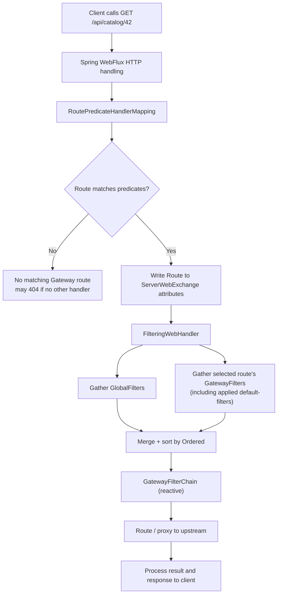
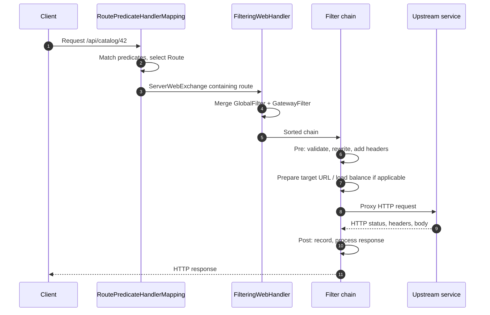

# Filtering Web Handler and the Selected Route's Filter Chain

## 1. Why Understand the Gateway Filter Chain?

**SPRING_CLOUD_GATEWAY** enables an API Gateway to receive requests, choose a target service via route predicates, and then apply filters for path rewriting, header modification, authentication, rate limiting, retries, circuit breakers, and HTTP observability. In the **Spring Cloud Gateway Server WebFlux** variant, the key component connecting **route selection** to **filter execution** is **`FilteringWebHandler`**.

Understanding this class answers questions that often cause confusion when building microservices:

- Why did route `/api/catalog/**` match, yet a filter from route `/api/orders/**` did not run?
- Why does a `GlobalFilter` still execute when switching from the catalog route to the orders route?
- When placing a filter with `order=-10`, which logic runs before and which runs after the request is sent to the backend?
- Can a filter block a request before proxying? When does downstream receive new headers?
- How does the order of retries, circuit breakers, authentication, and logging affect outcomes and observability?

This lesson focuses on the runtime architecture of **Gateway Server WebFlux**: from `RoutePredicateHandlerMapping` to `FilteringWebHandler`, the list of `GatewayFilter`/`GlobalFilter` instances, the `Ordered` sorting mechanism, and the reactive chain around proxying. Implementation details of security and resilience filters are covered in dedicated lessons; here they serve as examples to explain the architecture.

> **Version scope:** the `application.yml` examples below use the `spring.cloud.gateway.server.webflux` prefix and the `spring-cloud-starter-gateway-server-webflux` starter, matching the Spring Cloud Gateway Server WebFlux 4.3.x / Spring Cloud 2025.0.x release train. For other release trains, consult the version-specific documentation, especially when encountering older examples using `spring.cloud.gateway.routes`.

## 2. Position of FilteringWebHandler in the HTTP Processing Flow

A request arriving at the Gateway passes through multiple layers. In Spring WebFlux, the HTTP request enters WebFlux's processing mechanism; the Gateway participates in handler selection via **`RoutePredicateHandlerMapping`**. When a route matches, the handler mapping puts the selected `Route` into a `ServerWebExchange` attribute, then hands the request off to **`FilteringWebHandler`**.



Several concepts to distinguish:

| Component | Responsibility |
| --- | --- |
| `Route` | Routing unit with its own `id`, `uri`, predicates, and filter list. |
| `RoutePredicateHandlerMapping` | Inspects routes and predicates to find a route matching the request. |
| `FilteringWebHandler` | Builds and executes **one combined filter chain** based on the selected route. |
| `GlobalFilter` | Gateway-level filter that can be applied to **every matched route**, not tied to one specific route. |
| `GatewayFilter` | Filter attached to a route; can be created from a `GatewayFilterFactory` such as `StripPrefix`, `AddRequestHeader`, or `Retry`. |
| `default-filters` | Shared filter factory configuration across routes; when a route is built, they join that route's filter list. |
| `GatewayFilterChain` | API allowing a filter to invoke the next step in the reactive pipeline; enables logic wrapping the rest of the chain. |
| `ServerWebExchange` | Context of **one request/response**, holding the request, response, and routing attributes. |

Note that **route predicates are evaluated before the Gateway filter chain**. Filters such as `StripPrefix` are not criteria for deciding which route matches; they transform the request **after** the route is selected. Unless another handler in the WebFlux application handles the path, requests that do not match a route typically receive `404 Not Found`.

### Why Have Separate Handler Mapping and Web Handler?

If every request ran all filters from every route, policies would conflict: a public route could accidentally get a private route's filter, an orders route could get catalog's path rewrite, or two backends could receive the wrong headers. By placing route selection **before** `FilteringWebHandler`, the Gateway only puts filters relevant to the current request into the chain.

Each request has its own `ServerWebExchange`; selecting a route and building the chain does not mean the gateway allocates a dedicated servlet thread to run filters synchronously one by one. Gateway Server WebFlux returns `Mono<Void>` and uses reactive composition to connect asynchronous tasks.

## 3. What Steps Does FilteringWebHandler Perform?

You can visualize the core mechanism with **illustrative pseudocode**, not a copy of the library source code:

```java
// Pseudocode: omits wrappers, caching, internal optimizations, and error details.
Mono<Void> handle(ServerWebExchange exchange) {
    Route selectedRoute =
        exchange.getRequiredAttribute(GATEWAY_ROUTE_ATTR);

    List<GatewayFilter> combined = new ArrayList<>();

    // GlobalFilter has a similar interface to GatewayFilter;
    // internal implementations adapt them into the same chain.
    combined.addAll(adaptGlobalFilters(globalFilters));

    // Filters of the selected route, including applied default-filters.
    combined.addAll(selectedRoute.getFilters());

    combined.sort(AnnotationAwareOrderComparator.INSTANCE);

    return new DefaultGatewayFilterChain(combined).filter(exchange);
}
```

Key steps:

1. **Retrieve the route from the exchange.** If there is no matching route, execution should not enter the Gateway's matched-route branch under normal flow.
2. **Collect global filters.** `GlobalFilter` beans registered in the application join the chain when a route matches. GlobalFilter does not mean it runs for every HTTP request outside the route system.
3. **Collect the route's own filters.** This is where the route's `StripPrefix`, `AddRequestHeader`, `CircuitBreaker`, `Retry`, etc. are included. Unselected routes do not contribute their filters to this chain.
4. **Sort the entire list.** Sorting uses ordering metadata (via `Ordered` and the framework's adapter mechanisms). There is no default rule that *all* global filters run before *all* route filters.
5. **Start the reactive chain.** Each filter decides whether to call `chain.filter(exchange)` or stop early and produce a response.

This component **does not by itself** determine the backend URI or perform all HTTP operations. Specialized infrastructure global filters such as `RouteToRequestUrlFilter`, `ReactiveLoadBalancerClientFilter`, `NettyRoutingFilter`, and `NettyWriteResponseFilter` collaborate to carry out those steps.

## 4. Three Filter Groups and Their Scope of Application

| Type | How Declared | With catalog route | With orders route | When request matches no route |
| --- | --- | --- | --- | --- |
| `GlobalFilter` | Java bean in Gateway | Participates | Participates | Not run per-route by `FilteringWebHandler` |
| Per-route `GatewayFilter` | `filters:` under `catalog-route` | Participates | No | No |
| Default `GatewayFilter` | Shared `default-filters:` | Participates | Participates | No |
| Spring WebFlux `WebFilter` | WebFlux infrastructure, outside Gateway filter mechanism | May apply | May apply | May apply via WebFlux chain |

The last point is especially important: **Spring Cloud Gateway's `GlobalFilter` differs from Spring WebFlux's `WebFilter`**. For example, Spring Security in WebFlux typically participates via a separate `WebFilter` chain; you cannot infer the scope of a `GlobalFilter` from the word "global", nor should you treat it as a replacement for all endpoint protection mechanisms in the application.

`default-filters` also **differ from `GlobalFilter`**: they are still filters created by GatewayFilter factories and attached to each route. This distinction matters when checking ordering, writing custom filters, or inspecting route management endpoints.

### Example: Two Routes Sharing One Backend with Different Filters

Suppose there is a test HTTP backend at `http://127.0.0.1:9001`. Illustrative configuration:

```yaml
server:
  port: 8080

spring:
  application:
    name: edge-gateway
  cloud:
    gateway:
      server:
        webflux:
          default-filters:
            - AddRequestHeader=X-Edge, webflux
          routes:
            - id: catalog-route
              uri: http://127.0.0.1:9001
              predicates:
                - Path=/api/catalog/**
              filters:
                - StripPrefix=2
                - AddRequestHeader=X-Selected-Route, catalog
                - AddResponseHeader=X-Route-Response, catalog

            - id: orders-route
              uri: http://127.0.0.1:9001
              predicates:
                - Path=/api/orders/**
              filters:
                - StripPrefix=2
                - AddRequestHeader=X-Selected-Route, orders
                - AddResponseHeader=X-Route-Response, orders
```

Using the same backend simply makes it easier to observe how filters are selected. With `GET /api/catalog/42`, the catalog route matches, and the backend receives path `/42`, header `X-Edge: webflux`, and `X-Selected-Route: catalog`. The response to the client has `X-Route-Response: catalog`. The orders route does not participate in that request.

With `GET /api/orders/42`, the orders route matches and the backend receives `X-Selected-Route: orders`, and the response has `X-Route-Response: orders`. **The same global filter**, if present in the application, will run on both matched requests.

This example only illustrates scope and final output; **it does not assert the exact execution order of every built-in filter**. The merged list is sorted by order, which matters when filters modify the same header or path.

## 5. `Ordered`: One Combined List, Two Execution Directions

In Spring, `Ordered` defines a filter's priority: **a smaller order number means higher priority**. For filter logic with code before and after `chain.filter(exchange)`, higher-priority filters enter the **pre** phase first and exit the **post** phase last.

A *hypothetical* example of three sorted filters with their own orders:

| Filter | Order | Pre | Post |
| --- | ---: | --- | --- |
| A – Mark request | `-20` | Runs first | Runs last |
| B – Check rules | `-10` | Runs second | Runs second |
| C – Transform data | `10` | Runs third | Runs first |

```text
Client
  |
  v
A.pre (-20)
  |
  v
B.pre (-10)
  |
  v
C.pre (10)
  |
  v
... remaining filters and proxy operation ...
  |
  v
C.post (10)
  |
  v
B.post (-10)
  |
  v
A.post (-20)
  |
  v
Client
```

Conceptually, this is a **nested** structure:

```text
A.pre
  B.pre
    C.pre
      proxy / remainder of the chain
    C.post
  B.post
A.post
```

However, **not every filter has both pre and post phases**. Some filters only modify the request before forwarding; some focus on writing the response; some return an early result without calling the next step. Actual order also depends on the orders of foundational global filters (routing, load balancing, response writing) and application-configured filters.

### What Happens When Two Filters Have the Same Order?

When two filters have equal order values, do not rely on an implicit system-wide tie-breaking order to resolve auth/header/URL conflicts. Some filter groups preserve declaration order under stable sorting, while filters from different sources (global, default, route) may be assembled according to version-specific mechanisms. **If logic depends on ordering, set an explicit order on custom filters and verify the resolved chain.**

For example, do not leave to chance whether `RemoveRequestHeader=Authorization` runs before or after a custom filter that needs to read `Authorization`. Assign clear responsibilities and enforce security policies in the appropriate place.

## 6. What Does a Reactive Filter Actually Look Like?

Both key interfaces look similar:

```java
Mono<Void> filter(ServerWebExchange exchange, GatewayFilterChain chain);
```

Where:

- `exchange` carries the request/response and attributes associated with the current request.
- `chain.filter(exchange)` delegates to the next filter; the return value is **`Mono<Void>`** representing work that will complete or fail.
- Calling `chain.filter(...)` is **not** a synchronous call waiting for the backend to respond. You can use Reactor operators to attach behavior before, after, on error, or on subscription cancellation.

An example you can add to Gateway WebFlux to observe pre/post is `RouteTraceGlobalFilter`:

```java
package com.example.gateway;

import org.slf4j.Logger;
import org.slf4j.LoggerFactory;
import org.springframework.cloud.gateway.filter.GatewayFilterChain;
import org.springframework.cloud.gateway.filter.GlobalFilter;
import org.springframework.cloud.gateway.route.Route;
import org.springframework.cloud.gateway.support.ServerWebExchangeUtils;
import org.springframework.core.Ordered;
import org.springframework.stereotype.Component;
import org.springframework.web.server.ServerWebExchange;
import reactor.core.publisher.Mono;

@Component
public class RouteTraceGlobalFilter implements GlobalFilter, Ordered {

    private static final Logger log =
            LoggerFactory.getLogger(RouteTraceGlobalFilter.class);

    @Override
    public int getOrder() {
        return -20; // Chosen for illustration; check the full actual ordering.
    }

    @Override
    public Mono<Void> filter(
            ServerWebExchange exchange, GatewayFilterChain chain) {

        Route route = exchange.getAttribute(
                ServerWebExchangeUtils.GATEWAY_ROUTE_ATTR);
        String routeId = route != null ? route.getId() : "unknown";
        long startNanos = System.nanoTime();

        log.info("PRE route={} method={} path={}",
                routeId,
                exchange.getRequest().getMethod(),
                exchange.getRequest().getPath().value());

        return chain.filter(exchange)
                .doOnError(error ->
                        log.warn("ERROR route={} type={}",
                                routeId, error.getClass().getSimpleName()))
                .doFinally(signal ->
                        log.info("END route={} signal={} elapsedMs={}",
                                routeId,
                                signal,
                                (System.nanoTime() - startNanos) / 1_000_000));
    }
}
```

Key points to remember:

1. `@Component` registers the global filter with Spring; it does not need to appear in `application.yml`.
2. `Ordered` sets the priority; `-20` is merely a learning choice, not a guarantee that the filter always comes before all foundational global filters.
3. `doOnError` helps observe errors occurring in the reactive branch; it does not automatically convert errors into a valid HTTP response.
4. `doFinally` logs when the Mono ends with complete/error/cancel; the name **END** is more accurate than saying "response sent successfully", because the subscription might be canceled or terminate with an error.
5. `routeId` data comes from the selected route. Do not store `ServerWebExchange` in a singleton field and do not log headers containing tokens, cookies, or personal data.

On a successful catalog request, illustrative logs:

```text
PRE route=catalog-route method=GET path=/api/catalog/42
END route=catalog-route signal=onComplete elapsedMs=18
```

Timings are illustrative only; actual latency depends on the backend and environment.

### When Modifying the Request: Mutate the Request Object

Requests in WebFlux are immutable in normal usage. A filter should create a modified copy via a builder and pass the mutated `exchange` to the remainder of the chain:

```java
ServerWebExchange changed = exchange.mutate()
        .request(builder -> builder.header("X-Edge-Trace", "enabled"))
        .build();

return chain.filter(changed);
```

This is how to change headers before the routing filter sends the request out. For simple operations, prefer built-in factories such as `AddRequestHeader`/`RemoveRequestHeader` to reduce custom code.

### When Modifying Response Headers: Mind the Commit Time

You cannot always call `exchange.getResponse().getHeaders().add(...)` **after** `chain.filter(...)`; the response may already be committed or the body already emitted. For logic that needs to write headers before commit, register a `beforeCommit` callback before calling the chain:

```java
exchange.getResponse().beforeCommit(() -> {
    exchange.getResponse().getHeaders()
            .add("X-Edge-Processed", "true");
    return Mono.empty();
});

return chain.filter(exchange);
```

The example above belongs inside the `filter(...)` method body of a custom filter. It applies when the response is committed and the callback runs; do not assume this callback always runs if the request is canceled before sending a response. For simple headers, using `AddResponseHeader` is more convenient.

## 7. Role of Routing GlobalFilters Within the Same Chain

The Gateway filter chain also includes infrastructure filters. High-level flow for an HTTP route:



Typical routing components:

| Infrastructure Global Filter | Main Function | Related Attributes / Conditions |
| --- | --- | --- |
| `RouteToRequestUrlFilter` | Builds the destination URL based on the matched route and transformed request. | Reads `GATEWAY_ROUTE_ATTR`, sets `GATEWAY_REQUEST_URL_ATTR`. |
| `ReactiveLoadBalancerClientFilter` | For `lb://service-id` URIs, picks a suitable service instance and replaces the URI with actual host/port. | Requires `lb` scheme, Spring Cloud LoadBalancer, and an instance source. |
| `NettyRoutingFilter` | When the target URI is `http` or `https`, uses Netty `HttpClient` to send the request upstream. | Reads `GATEWAY_REQUEST_URL_ATTR`; HTTP client result is stored via `CLIENT_RESPONSE_ATTR`. |
| `NettyWriteResponseFilter` | Writes the response received from the HTTP client back to the client-facing response. | Uses the Netty response saved in the exchange; runs at the appropriate terminal phase. |
| `ForwardRoutingFilter` | Forwards to an internal WebFlux handler when the route URI has the `forward:` scheme. | Intended for forward routes, not external HTTP proxying. |

This list describes **roles**, not the complete `getOrder()` ordering. Multiple infrastructure global filters appear together in the combined list and only act when their conditions hold.

For example:

- `uri: http://inventory:8081`: uses the prepared HTTP URL and proxies via the HTTP client.
- `uri: lb://inventory`: must resolve `inventory` to a valid `ServiceInstance` before proxying; if no instance is found, the Gateway typically returns `503` under default configuration.
- `uri: forward:///fallback`: uses internal forwarding to the appropriate WebFlux endpoint, rather than making the same kind of HTTP request to an external service.

Once a request has been routed, the exchange is marked as "already routed" so other routing filters do not forward it a second time. This is an important safeguard to avoid multiple proxy paths handling the same request.

### Exchange Attributes That Help Filters Coordinate

```text
GATEWAY_ROUTE_ATTR
    -> Matched route

GATEWAY_REQUEST_URL_ATTR
    -> URI used for routing (may change after load balancing)

GATEWAY_ORIGINAL_REQUEST_URL_ATTR
    -> Stores original URI info when URL transformation steps occur

CLIENT_RESPONSE_ATTR
    -> Response received from Netty HTTP client, if using Netty routing
```

These are keys from `ServerWebExchangeUtils`, not HTTP headers automatically returned to the client. When writing custom filters, distinguish **`exchange.getAttributes()`** (internal data between filters) from **`exchange.getRequest().getHeaders()`** (HTTP headers) to avoid leaking routing information or mixing up data.

## 8. Short-Circuiting: When a Filter Does Not Call the Rest of the Chain

A filter has the right **not to call `chain.filter(exchange)`**. In that case, subsequent filters in the chain are not executed, downstream may never receive the request, and the response is completed by the early-stopping filter or an appropriate error-handling layer.

Clear architectural examples:

- Request lacks access conditions: a security component can return `401` or `403` without proxying upstream. In real applications, configure Spring Security WebFlux/OAuth2 and proper authorization policies rather than implementing authentication with a toy example that skips token verification.
- Request is rate-limited: a rate limiter filter can return `429 Too Many Requests`.
- Circuit breaker is open: the handler can return a defined fallback or error without calling the backend along the normal branch.
- Retries can re-subscribe to downstream operations; thus some parts of the downstream pipeline may execute again depending on configuration and filter position.

**Specifically:** if a filter stops early, the `post` logic of filters **already entered earlier** may still trigger according to how they chained; filters **not yet entered** will not run on their own. You cannot assume "every filter always runs once, in list order, from start to finish."

When combining auth, retry, and circuit breaker, clearly define retry scope, HTTP method idempotency, and the placement of metrics filters to avoid undercounting or double-counting attempts.

## 9. Hands-On: Observing the Selected Route Through Filters and Backend Requests

You can add `RouteTraceGlobalFilter` from section 6 to a Gateway Server WebFlux application that already has the starter and configure the two routes from section 4. To test without external services, run a tiny Java backend at `127.0.0.1:9001`.

Create `EchoBackend.java`:

```java
import com.sun.net.httpserver.HttpServer;
import java.net.InetSocketAddress;
import java.nio.charset.StandardCharsets;

public class EchoBackend {
    public static void main(String[] args) throws Exception {
        HttpServer server = HttpServer.create(
                new InetSocketAddress("127.0.0.1", 9001), 0);

        server.createContext("/", exchange -> {
            String path = exchange.getRequestURI().getPath();
            String selected = exchange.getRequestHeaders()
                    .getFirst("X-Selected-Route");
            String edge = exchange.getRequestHeaders()
                    .getFirst("X-Edge");

            String body = "path=" + path
                    + "\nselected=" + selected
                    + "\nedge=" + edge + "\n";
            byte[] data = body.getBytes(StandardCharsets.UTF_8);

            exchange.getResponseHeaders().set(
                    "Content-Type", "text/plain; charset=UTF-8");
            exchange.sendResponseHeaders(200, data.length);
            try (var output = exchange.getResponseBody()) {
                output.write(data);
            }
        });

        server.start();
        System.out.println("Echo backend ready on :9001");
    }
}
```

Open the first terminal:

```bash
java EchoBackend.java
```

Run the Gateway with `./mvnw spring-boot:run` or `mvn spring-boot:run` in a second terminal; use a Spring Boot/Spring Cloud BOM pair compatible with the WebFlux starter and the YAML configuration under study.

In a third terminal, try:

```bash
curl -i http://localhost:8080/api/catalog/42
curl -i http://localhost:8080/api/orders/17
curl -i http://localhost:8080/no-such-route
```

Expected output for catalog:

```http
HTTP/1.1 200 OK
X-Route-Response: catalog
Content-Type: text/plain; charset=UTF-8

path=/42
selected=catalog
edge=webflux
```

For orders, the corresponding values are `X-Route-Response: orders`, `path=/17`, and `selected=orders`, while `edge=webflux` is still present due to `default-filters`.

In the Gateway logs, `RouteTraceGlobalFilter` logs the corresponding route ID for **both** matched requests. The `/no-such-route` request typically gets `404` and **produces no log from `RouteTraceGlobalFilter`**, because it does not pass through `FilteringWebHandler` for a selected route. A Spring WebFlux `WebFilter`, if registered by the application, may have a different scope.

**Failure experiment:** stop the `9001` backend and call `/api/catalog/42` again. The route still matches and the GlobalFilter can still log PRE, but a connection error occurs during the routing step. The `END` log may record `onError`, or `onComplete` if a lower-level error handler turned the error into a valid response; do not infer the HTTP status solely from this one log line.

### Checking Order as Filters Grow Complex

In a controlled development environment, you can use Spring Boot Actuator and the Gateway management endpoints (if supported by your version, enabled, and secured) to inspect the route list, global filters, and orders. Enabling management endpoints depends on **the Spring Boot/Gateway version**; do not copy actuator configuration verbatim from documentation for another version. Never expose route-control endpoints to the Internet.

If not using Actuator, write tests for requests passing through the Gateway, observe individual custom filter logs, and check what the backend receives. Verify **behavioral order**, rather than just looking at YAML line order.

## 10. Common Misconceptions

| Misconception | Correct Understanding |
| --- | --- |
| "All `GlobalFilter`s run before every `GatewayFilter`." | They are merged and sorted by order, so they can interleave. |
| "Declaring a filter first in YAML means it runs before all filters." | Foundational global filters and filters with explicit orders still affect ordering. |
| "GlobalFilter means every HTTP request hitting the Gateway port must run it." | GlobalFilter sits in the Gateway chain of a selected route; unmatched requests may be handled by another handler. |
| "`default-filters` are GlobalFilter beans." | They are filters created from GatewayFilter factories and attached to routes. |
| "The post-phase can always modify response headers." | After the response is committed, header edits may no longer take effect; use an appropriate factory or `beforeCommit`. |
| "Every filter is only invoked once." | Retries/resubscriptions, short-circuiting, and subscription cancellation change execution scope. |
| "Changing the URI to `lb://` gives the Gateway service discovery automatically." | LoadBalancer and a service instance source are required; the URI signals the resolution branch. |
| "Custom filters can freely call blocking APIs." | WebFlux/Netty uses an event loop; uncontrolled blocking can stall many requests. |

## 11. Connection to Security, Availability, and Observability

In production architectures, the filter chain is where many concerns intersect:

**Authentication and authorization.** Security decisions must be enforced before forwarding upstream. When using Spring Security WebFlux, understand Security's `WebFilter` chain and how it interacts with Gateway routes; avoid relying on a route filter lacking standard security mechanisms to protect the entire API.

**Rate limiting.** Filters can reject requests early or use counters keyed by client. Test missing keys, backend timeouts, and multiple Gateway instances to avoid inconsistent limiting.

**Retries and circuit breakers.** These filters wrap routing; their position in the chain determines which operations are repeated, which metrics are recorded per attempt, and where errors turn into fallbacks. For HTTP `POST`/`PATCH`, do not configure retries indiscriminately when upstream operations have side effects.

**TLS and headers.** Client–Gateway TLS can be separate from Gateway–upstream TLS; routing selects `http`/`https` based on the target URI, HttpClient configuration, and LoadBalancer. When transforming `Host`, `Forwarded`, or `X-Forwarded-*`, define trusted proxy boundaries and avoid trusting headers supplied by untrusted clients.

**Observability.** Log route ID, method, status, latency, and trace ID at an appropriate level of detail; prefer built-in metrics/tracing instead of logging bodies or tokens. Pre and post logs help trace the path, but distinguish committed responses, handled errors, and canceled subscriptions.

This interplay explains why **FilteringWebHandler and filter ordering** are foundational knowledge before implementing advanced Gateway features.

## 12. Self-Check Questions

1. When request `/api/catalog/42` matches the catalog route, does the orders route's `GatewayFilter` join the chain? **No.** Only filters of the selected route, applicable default-filters, and relevant global filters are combined.
2. How does `GlobalFilter` differ from `WebFilter`? **Processing scope.** GlobalFilter is part of the Spring Cloud Gateway pipeline for matched routes; WebFilter belongs to the general Spring WebFlux pipeline.
3. With three filters having orders `-20`, `-10`, `10`, how do pre and post logic execute if all three continue the chain? **Pre:** `-20` → `-10` → `10`; **post:** `10` → `-10` → `-20`.
4. If a filter does not call `chain.filter(exchange)`, is the backend always called? **No.** The remainder of the chain does not continue down that branch.
5. Why is adding a response header inside `doFinally` unreliable? **The response may already be committed.** You need to register pre-commit handling or use an appropriate GatewayFilterFactory.
6. Which filter can resolve `lb://inventory` to a real host and port? **`ReactiveLoadBalancerClientFilter`**, when LoadBalancer and a suitable service instance are available.
7. Where can the selected route be identified at runtime? **`GATEWAY_ROUTE_ATTR` in `ServerWebExchange`**.
8. If the same route has `Retry` and a custom logging filter, can you rely solely on YAML order to guarantee logging once? **No.** Check actual ordering and retry/resubscription scope.

## Summary

`FilteringWebHandler` is the execution point for the filter chain of the **selected route** in Spring Cloud Gateway Server WebFlux. It takes `GlobalFilter` beans, merges them with the route's `GatewayFilter` instances (including default filters if configured), sorts them by priority order, and sends the request through `GatewayFilterChain`. A filter can work in the pre phase, wrap the remainder via `Mono<Void>`, handle the post phase, or short-circuit the request. Infrastructure filters continue handling URI conversion, LoadBalancer, Netty proxying, and response writing.

By understanding the filter assembly point, each filter type's scope, and the **pre in priority order – post in reverse order** rule, you will design routes, header/path transforms, security, retries, circuit breakers, and observability much more proactively.

### References

- [Spring Cloud Gateway Server WebFlux — How It Works (4.3)](https://docs.spring.io/spring-cloud-gateway/reference/4.3/spring-cloud-gateway-server-webflux/how-it-works.html)
- [Spring Cloud Gateway Server WebFlux — Global Filters (4.3)](https://docs.spring.io/spring-cloud-gateway/reference/4.3/spring-cloud-gateway-server-webflux/global-filters.html)
- [Spring Cloud Gateway Server WebFlux — GatewayFilter Factories (4.3)](https://docs.spring.io/spring-cloud-gateway/reference/4.3/spring-cloud-gateway-server-webflux/gatewayfilter-factories.html)
- [Spring Cloud Gateway Server WebFlux — Configuration Properties](https://docs.spring.io/spring-cloud-gateway/reference/configprops.html)
- [Spring WebFlux — WebHandler API](https://docs.spring.io/spring-framework/reference/web/webflux/dispatcher-handler.html)
