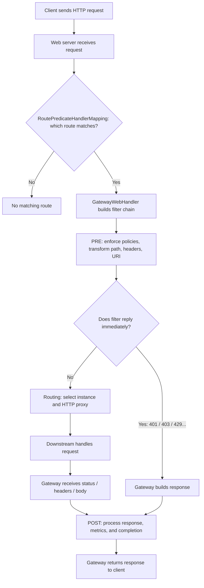

# Pre- and Post-Downstream Service Call Phases in Spring Cloud Gateway

## 1. Where the Two Phases Fit in the Request Processing Architecture

When building an **API Gateway with Spring Cloud Gateway**, an HTTP request does not travel straight from client to microservice. The Gateway must determine the appropriate **route**, evaluate **predicates and filters**, prepare the **downstream** service address, forward the request, process the response, and return it to the client. Depending on configuration, these steps may include authentication, rate limiting, path/header transformation, service discovery, load balancing, circuit breaking, retries, TLS, and metrics/trace recording.

In the **Spring Cloud Gateway Server WebFlux** architecture, filters typically participate in two interrelated phases:

- **Pre-downstream call phase (*pre-phase*)**: inspects or modifies the request before it is sent to the backend; can reject the request directly at the Gateway.
- **Post-downstream call phase (*post-phase*)**: handles the result, headers/status, resources, timing measurements, and completion tasks after the downstream call has executed or finished.

The key point is that **pre/post describe when logic executes**, not necessarily two independent filter lists. A single `GlobalFilter` or `GatewayFilter` can both perform work before `chain.filter(exchange)` and register processing after the inner chain completes.

> **Example scope:** this article illustrates the **Gateway Server WebFlux** (reactive, typically using Reactor Netty) pipeline. Gateway Server Web MVC also has route matching, pre/post processing, and proxying steps, but uses the Servlet stack along with its corresponding APIs and filters. Do not copy a WebFlux `GlobalFilter` directly into a Gateway Server Web MVC application.

## 2. Overview of a Request's Lifecycle



The diagram above is a **logical model**, not a guarantee that every filter runs on every branch. When a filter returns an early response without calling `chain.filter(...)`, filters **downstream of it** are not invoked. Post-processing sections registered in filters **wrapping outside it** may still run. When a request matches no route, the route's `GlobalFilter`/`GatewayFilter` chain is not constructed.

### 2.1. Stage-by-Stage Comparison

| Stage | Notable Component in Server WebFlux | Main Work | Affected Data |
|---|---|---|---|
| 1. Ingestion | Spring WebFlux, web server | Creates `ServerWebExchange` from the HTTP request | Method, URI, headers, body, connection info |
| 2. Route lookup | `RoutePredicateHandlerMapping` | Checks route predicates (`Path`, `Host`, `Method`...) and selects route | Route ID, target URI, configured filters |
| 3. Chain creation | `FilteringWebHandler` / `GatewayWebHandler` | Merges `GlobalFilter`s with the route's `GatewayFilter`s, sorted by order | One chain for the matched route |
| 4. Pre-phase | Filters in the chain | Executes policies, changes request/path/headers, may short-circuit | Outgoing request, exchange state |
| 5. Routing | `RouteToRequestUrlFilter`, load-balancer filter, `NettyRoutingFilter`... | Determines target URI, picks instance if using `lb://`, proxies to backend | Target URI, downstream request |
| 6. Receiving result | Gateway HTTP client | Receives status, headers, and body/stream from downstream | Downstream response |
| 7. Post-phase and writing response | Post-processing filters, `NettyWriteResponseFilter` | Valid operations on response, write/stream to client, finalize measurements | HTTP response sent to client |

**Note:** according to the documentation, `Gateway Handler Mapping` selects a route before passing the request to `Gateway Web Handler`; pre executes before the proxy call, while post executes as execution returns from inside the chain. `ServerWebExchange` holds both the request/response and **internal attributes** of the current exchange.

## 3. Before Calling Downstream: What Does the Pre-Phase Do?

### 3.1. Selecting a Route via Predicates Before Running Route Filters

Suppose there is a route:

```yaml
predicates:
  - Path=/api/orders/**
  - Method=GET
```

`GET /api/orders/42` can match the route; `POST /api/orders/42` does not match this route. Within the same route, ordinary predicates must all be satisfied. Route selection is a step **before** the route's filter chain; a filter should not be treated as the place that decides whether a route matches.

Once the route is selected, the Gateway gathers two groups of filters:

- **`GlobalFilter`**: beans applied to route-matched requests in Gateway Server WebFlux, such as filters for routing, logging, or shared features.
- **`GatewayFilter`**: filters for a specific route, typically declared in YAML under `filters` or via Java DSL, such as `StripPrefix`, `AddRequestHeader`, `RequestRateLimiter`, `Retry`.

Filters are merged into **one chain and sorted by order**; do not assume that all `GlobalFilter`s always finish running before any route filter starts.

### 3.2. Tasks Commonly Placed in the Pre-Phase

| Need | Example | Purpose Before Proxying |
|---|---|---|
| Authentication/authorization | Spring Security `SecurityWebFilterChain`, JWT policies | Block invalid users before consuming backend resources; Spring Security WebFilter typically sits at the WebFlux layer before the route handler, not necessarily as a `GatewayFilter` |
| Rate limiting | `RequestRateLimiter` and `KeyResolver` | Reject requests exceeding quota, typically returning `429 Too Many Requests` when properly configured |
| Path handling | `StripPrefix=1`, `RewritePath` | Turn `/api/orders/42` into the desired backend path |
| Header transformation | `AddRequestHeader`, `RemoveRequestHeader`, `SetRequestHeader` | Add or adjust metadata before sending the request |
| Target selection | Route URI and load-balancer filter | Resolve `lb://orders-service` to the chosen instance address |
| Backend protection | Circuit breaker/timeout, size limits, rejection policies | Shed load from the backend upon signs of errors or invalid requests |
| Observability tagging | Attach correlation ID, record start timestamp | Correlate logs/traces and compute latency upon completion |

For example, with `StripPrefix=1`: the initial `GET /api/orders/42` request is sent downstream to the backend as `GET /orders/42`. With `AddRequestHeader=X-From-Gateway, true`, the backend additionally receives `X-From-Gateway: true`.

**Do not equate "pre" with "exactly once".** `Retry` can trigger additional attempts downstream when retry conditions are met; `CircuitBreaker` can refuse to call the backend and return a fallback. How many times the backend is called and which parts of the chain re-run depend on filter placement and configuration.

### 3.3. Short-Circuiting: Replying Immediately Without Calling the Backend

A step in the pre-phase can terminate processing, for example:

- Invalid token → the security layer can return `401 Unauthorized`.
- Authenticated but lacking permissions → can return `403 Forbidden`.
- Quota exceeded → `RequestRateLimiter` can return `429 Too Many Requests`.
- Circuit breaker is open → can return a fallback or error, depending on configuration.

In such cases, the Gateway **does not need** to send the request to the backend. Not all short-circuit branches share an identical standard response: status, body, and headers depend on the component causing the rejection. Observability systems should distinguish **requests handled at the Gateway** from **requests that actually called downstream**.

## 4. The Downstream Backend Call Sits Between Pre-Phase and Post-Phase

### 4.1. From Route URI to Downstream Connection

In Gateway Server WebFlux, several infrastructure filters coordinate as follows:

1. `RouteToRequestUrlFilter` constructs the **target URI** from the selected route and current request, storing it in the `GATEWAY_REQUEST_URL_ATTR` exchange attribute.
2. If the URI uses the `lb://` scheme, `ReactiveLoadBalancerClientFilter` picks an instance from load balancing and creates a URI with an actual scheme/host/port. A source of service instances from discovery or equivalent configuration is required; `lb://` alone does not guarantee finding a backend.
3. For `http` or `https` target URIs, `NettyRoutingFilter` uses Reactor Netty `HttpClient` to send the downstream request.
4. The response from the backend is stored as a client response in the `CLIENT_RESPONSE_ATTR` exchange attribute for subsequent components to process; `NettyWriteResponseFilter` participates in writing the response to the client.

Attributes such as `GATEWAY_REQUEST_URL_ATTR` and `CLIENT_RESPONSE_ATTR` are **internal state of `ServerWebExchange`**, not HTTP headers sent over the network. Other routing mechanisms, such as `forward:` or `ws:`/`wss:`, go through their corresponding filters and follow a different path from standard HTTP proxying.

```mermaid
sequenceDiagram
    participant C as Client
    participant G as Gateway / pre-filters
    participant LB as LoadBalancer (if present)
    participant B as orders-service
    C->>G: GET /api/orders/42
    Note over G: Route match; validate and StripPrefix
    opt URI is lb://orders-service
        G->>LB: Find backend instance
        LB-->>G: http://10.0.0.12:8081
    end
    G->>B: GET /orders/42 + X-From-Gateway
    B-->>G: 200 + JSON + headers
    Note over G: Post-process response, metrics, logging
    G-->>C: 200 + JSON + response headers
```

### 4.2. The Gateway Does Not Necessarily Wait for the Full Response Body

In WebFlux, HTTP communication uses reactive streams and supports **streaming/backpressure**. For large bodies, the Gateway can stream data incrementally rather than buffering the entire response in memory before returning to the client. Therefore:

- "Post-phase" does not mean **the entire body is already buffered in RAM**.
- Filters that need to read or modify the body must use supported mechanisms, paying attention to memory, streaming, and retry cases.
- Timeout, retry, and circuit breaker configurations must match request characteristics; replaying requests with non-idempotent bodies can cause side effects.

## 5. After Calling Downstream: What Does the Post-Phase Handle?

When the downstream processing stream finishes or returns a publisher representing the response, the chain moves to the post-processing parts of the participating filters. Typical work:

| Task | Example | Notes |
|---|---|---|
| Add/remove response headers | `AddResponseHeader`, `DedupeResponseHeader`, `RemoveResponseHeader` | Must take effect at the right time before headers are committed |
| Observe outcome | Record status, latency, route ID, outcome | May include errors or request cancellation; do not log sensitive info |
| Gateway metrics | Micrometer/Actuator Gateway metrics | Requires enabling/configuring the corresponding observability tools |
| Forward status and body | `NettyWriteResponseFilter` | Response is written back to the client; do not treat each post filter as a separate HTTP send |
| Error/fallback handling | Circuit breaker, retry, exception handler | Some errors occur before any HTTP response arrives from the backend |

**Commit timing is critical.** Once a response is committed, you cannot freely alter status or headers as you could before sending. `ServerHttpResponse.beforeCommit(...)` registers a callback to modify headers right before commit; for the body, dedicated response-modification APIs are needed to intervene. Putting `response.getHeaders().add(...)` inside a late callback like `doFinally(...)` may no longer have any effect.

Additionally, when using `Retry`, **post logic of certain filters** may run around each attempt or around the entire retry chain depending on filter order; never use the invocation count of a logging method to deduce the number of downstream requests without considering ordering.

## 6. Filter Execution Order: Forward Going In, Reverse Coming Out

Spring Cloud Gateway Server WebFlux sorts the combined chain of `GlobalFilter` and `GatewayFilter` by order (`Ordered`, or order mechanisms provided by filter factories). **Smaller order values** generally mean **higher priority**: that filter runs **earlier in the pre-phase**, yet **later in the post-phase** when it has logic after `chain.filter(...)`.

Suppose three filters have the following orders and all wrap the call to `chain.filter(...)`:

| Filter | Order | Pre | Post |
|---|---:|---|---|
| A – validate request | `-10` | Runs first | Runs last |
| B – log | `0` | Runs second | Runs second |
| C – handle near routing | `10` | Runs third | Runs first |

```text
Request
   |
   v
A.pre  ->  B.pre  ->  C.pre  ->  [Routing / backend]
   ^           ^          ^              |
   |           |          |              |
A.post <-  B.post <-  C.post <-----------+
   |
Response / completion
```

This is the **nested** model of a reactive chain, commonly expressed as:

```java
// Illustrating the idea of a WebFlux GlobalFilter
log.info("PRE: before downstream chain");

return chain.filter(exchange)
    .then(Mono.fromRunnable(() -> log.info("POST: chain completed")));
```

The snippet above **illustrates the inside of a `filter` method**, not a complete Java class. `POST` in the `.then(...)` example only runs when the publisher completes successfully; if you also want to observe errors or request cancellations, use a callback supporting those signal types, such as `doFinally(...)`.

**Ordering warning:** two filters with the same order should not be designed to depend strictly on an implicit execution order. Set explicit orders when logic requires a specific sequence. `NettyRoutingFilter` and `NettyWriteResponseFilter` have their own infrastructure orders, so the A/B/C diagram illustrates the principle rather than representing all built-in filters completely.

## 7. Complete Example: Route, Pre-Filters, and Post-Filters

Suppose a client sends:

```http
GET /api/orders/42 HTTP/1.1
Host: gateway.example.test
Authorization: Bearer <access-token>
```

The Gateway forwards the request to the `orders-service` backend running at `http://localhost:8081`, which exposes `GET /orders/42`. With **Gateway Server WebFlux 4.3+**, the configuration in `application.yml` can be:

```yaml
server:
  port: 8080

spring:
  application:
    name: edge-gateway
  cloud:
    gateway:
      server:
        webflux:
          default-filters:
            - AddResponseHeader=X-Served-By, spring-cloud-gateway
          routes:
            - id: orders-route
              uri: http://localhost:8081
              predicates:
                - Path=/api/orders/**
                - Method=GET
              filters:
                - StripPrefix=1
                - AddRequestHeader=X-From-Gateway, true
```

**Processing flow of the example:**

1. `RoutePredicateHandlerMapping` finds `orders-route` because the method is `GET` and the path matches `/api/orders/**`.
2. The route's chain executes the pre section. `StripPrefix=1` removes `/api`; `AddRequestHeader` attaches `X-From-Gateway: true`. Default filters also join the chain according to their respective orders.
3. The Gateway proxies to `http://localhost:8081/orders/42`, preserving `GET` method semantics.
4. The backend returns a response, such as `200 OK` and order JSON. The Gateway applies response post-processing and writes the response to the client, including header `X-Served-By: spring-cloud-gateway`.

**A sample backend is needed** on port 8081 for end-to-end testing. Without a backend, a connection error does not prove that `Path` or `StripPrefix` is wrong. You can run:

```bash
curl -i http://localhost:8080/api/orders/42
```

When using **Gateway 4.2 or earlier (WebFlux)**, the route declaration prefix is usually `spring.cloud.gateway.routes`; starting from **4.3**, the new namespace `spring.cloud.gateway.server.webflux.routes` is used. When using **Gateway Server Web MVC**, you must use the corresponding MVC prefix and filter APIs. Configuration prefixes are part of operability, because putting valid route contents under the wrong namespace can prevent the Gateway from registering the route.

**Authentication note:** the `Authorization: Bearer ...` header in the example request **does not automatically trigger JWT validation**. To secure the Gateway, configure Spring Security / resource server (and authorization policies). Decide whether to forward the original token downstream or use another identity-propagation mechanism; never trust self-asserted client headers by default.

## 8. Writing a Custom GlobalFilter to Observe Before and After the Chain

The example class below is for **Gateway Server WebFlux**, using `GlobalFilter` and `Ordered` to log when a request enters the filter chain and when the chain finishes. It does not read the body or log tokens.

```java
package com.example.gateway.filter;

import java.util.concurrent.TimeUnit;

import org.slf4j.Logger;
import org.slf4j.LoggerFactory;
import org.springframework.cloud.gateway.filter.GatewayFilterChain;
import org.springframework.cloud.gateway.filter.GlobalFilter;
import org.springframework.core.Ordered;
import org.springframework.stereotype.Component;
import org.springframework.web.server.ServerWebExchange;
import reactor.core.publisher.Mono;

@Component
public class RequestPhaseLoggingFilter implements GlobalFilter, Ordered {

    private static final Logger log =
            LoggerFactory.getLogger(RequestPhaseLoggingFilter.class);

    @Override
    public Mono<Void> filter(ServerWebExchange exchange, GatewayFilterChain chain) {
        String requestId = exchange.getRequest().getId();
        long startedAt = System.nanoTime();

        log.info("PRE id={} method={} path={}",
                requestId,
                exchange.getRequest().getMethod(),
                exchange.getRequest().getPath().value());

        return chain.filter(exchange)
                .doFinally(signalType -> {
                    long durationMs = TimeUnit.NANOSECONDS.toMillis(
                            System.nanoTime() - startedAt);
                    log.info("POST id={} status={} durationMs={} signal={}",
                            requestId,
                            exchange.getResponse().getStatusCode(),
                            durationMs,
                            signalType);
                });
    }

    @Override
    public int getOrder() {
        return -100;
    }
}
```

**How to read the example:**

- `PRE` records when our filter is called, before handing control to the inner chain.
- `chain.filter(exchange)` returns `Mono<Void>` representing asynchronous processing. Reactive execution occurs when the publisher is subscribed; do not call `block()` inside a filter.
- `doFinally(...)` receives completion, error, and cancellation signals; `status` can be `null` if an error occurred before the response received a status code. `signalType` helps diagnose differences.
- `getOrder() = -100` gives this filter high priority in the example. Do not assume this negative number guarantees running before **every** security/WebFilter/infrastructure layer: Spring Security WebFilter may sit outside the Gateway route chain.

In production systems, use standard tracing/metrics (Micrometer Observation, Actuator, distributed tracing tools) rather than relying solely on custom logs. Do not log `Authorization`, cookies, passwords, or sensitive response bodies; avoid tags with excessively high cardinality.

### 8.1. If You Truly Need to Add a Header Right Before Commit

Do not write HTTP headers in `doFinally()`: the response may already be committed by then. Register `beforeCommit()` **before** invoking the chain:

```java
exchange.getResponse().beforeCommit(() -> {
    exchange.getResponse().getHeaders()
            .set("X-Gateway-Trace", exchange.getRequest().getId());
    return Mono.empty();
});
return chain.filter(exchange);
```

This snippet is the body of a filter, meant to illustrate header-modification timing. The header is only added if the response goes through normal commit; for errors handled outside the chain or canceled connections, the outcome may differ. `beforeCommit()` is not a tool for arbitrary response body rewriting.

## 9. Error Branches Affecting Pre/Post Phases

| Situation | Route Selected? | Backend Actually Called? | What to Observe |
|---|---|---|---|
| `Path`/`Method` mismatch | No | No | `404` or handled by another handler if the app has other handlers |
| Invalid JWT, insufficient permissions | May be blocked at Security layer before routing | No if blocked | `401`/`403`, identify source generating response |
| Rate limiter limit exceeded | Usually has route | No if filter rejects | `429`, key/quota and Redis or active limiter |
| `lb://` URI finds no instance | Yes | Cannot establish desired backend connection | Discovery/LoadBalancer, often `503` depending on config |
| Backend unreachable | Yes | Gateway attempted to connect | DNS/port/TLS/connect-timeout; error mapped to status per handling |
| Backend returns `500` | Yes | Yes | Does filter retry/circuit-break or pass response through? |
| Client disconnects | Possibly | Possibly or not yet | `CANCEL` signal, backpressure, resources, and logs |

**Distinguish three timing scopes:**

1. **Time from client to Gateway and route matching**, including processing steps outside the route chain.
2. **Time inside the Gateway chain**, including pre, routing, waiting on downstream, post, and sending the response (depending on where measured and when the response finishes).
3. **Backend processing time**, which is only part of total Gateway latency; it excludes pre/post steps outside the backend.

When using timeouts and retries, a single client request can generate **multiple** attempts to the backend. For order/payment creation operations, retrying without an idempotency key can create duplicate transactions; define policies by method, status, and body repeatability. A circuit breaker can also short-circuit before the backend or return a fallback, altering the path compared to normal success.

## 10. Operations: Observing Each Phase Properly

To separate issues in pre, routing, or post, collect the following signals:

| Signal | Purpose | Hint |
|---|---|---|
| Matched Route ID | Know whether the request entered the right route | Log route ID, inspect Actuator Gateway routes with proper access control |
| Original path and downstream path | Verify `StripPrefix`/`RewritePath` transforms | Only log paths sanitized of sensitive data |
| Who generated the status | Distinguish Gateway rejection from backend error | Cross-check security/rate limit logs, trace to downstream |
| Downstream attempt count | Detect retries, avoid miscounting throughput | Track per-attempt and per-client-request if observability supports it |
| Latency, error, cancellation | Locate slowness in routing, backend, or streaming | Use metrics and tracing; distinguish `onComplete`/`onError`/`cancel` |
| TLS results on both ends | Diagnose HTTPS client→Gateway vs. Gateway→service errors | Incoming TLS config differs from outgoing HTTP client TLS to backend |

You can add `spring-boot-starter-actuator` and corresponding metrics/tracing systems. Actuator Gateway endpoints help inspect registered routes and filters, but should only be exposed on appropriate networks/with proper authorization. Endpoint, metric, or tag names may depend on version; always check the documentation for the exact release train.

With **service discovery**, distinguish the route URI `lb://orders-service` from the actual selected instance address. When a backend responds slowly, do not jump to blaming slow pre-filters: use trace spans or backend metrics to compare proxying, connection, processing, and body-sending times.

## 11. Thought Exercises and Answers

**Scenario 1.** The Gateway has `Path=/api/orders/**`, `StripPrefix=1`, and backend `http://localhost:8081`. A client calls `GET /api/orders/42`. Across the two phases, when does the path change and what path does the backend see?

**Answer:** The Gateway selects the route when predicates match; `StripPrefix=1` is request processing in the pre-phase before proxying. The backend receives path `/orders/42`. The response from the backend continues through the post-processing chain before the Gateway sends it back to the client.

**Scenario 2.** Three filters A/B/C have orders `-10`, `0`, `10`. Each filter logs before `chain.filter(...)` and after the inner chain completes. What is the corresponding log sequence?

**Answer:** `A.pre → B.pre → C.pre → [routing] → C.post → B.post → A.post`, assuming the request is not short-circuited and chains complete normally.

**Scenario 3.** `RequestRateLimiter` rejects a request for exceeding quota. Does the backend receive the request? Is a latency-measuring `GlobalFilter` guaranteed to log `POST`?

**Answer:** the backend does not receive the request if the rate limiter returns a response immediately. A `GlobalFilter` placed **outside** the rate limiter using an appropriate completion callback can log post-processing; filters **after** the rate limiter will not be called. If the request is blocked by Spring Security before route selection, Gateway `GlobalFilter`s do not even run.

**Scenario 4.** A developer adds a response header inside `doFinally()` but the client does not see it. Why?

**Answer:** `doFinally()` may run after the response has already been committed, at which point headers can no longer be modified. If you need to add a header based on the Gateway's result, use an appropriate response filter or register `beforeCommit()` before calling the chain; check ordering relative to the response-writing component.

**Scenario 5.** A client calls once, yet the backend receives three identical requests. Did `RoutePredicateHandlerMapping` match three times?

**Answer:** not necessarily. A `Retry` filter can generate multiple attempts for a single client request. Check retry configuration, upstream status, and business idempotency; counting route matches is not equivalent to counting requests sent to the backend.

## 12. Official References

- [Spring Cloud Gateway Server WebFlux – How It Works](https://docs.spring.io/spring-cloud-gateway/reference/5.1/spring-cloud-gateway-server-webflux/how-it-works.html): Gateway Handler Mapping → Gateway Web Handler → pre/proxy/post diagram.
- [Spring Cloud Gateway Server WebFlux – Global Filters](https://docs.spring.io/spring-cloud-gateway/reference/spring-cloud-gateway-server-webflux/global-filters.html): how GlobalFilter and GatewayFilter merge, `Ordered`, routing, and writing responses.
- [Spring Cloud Gateway Server WebFlux – Developer Guide](https://docs.spring.io/spring-cloud-gateway/reference/5.0/spring-cloud-gateway-server-webflux/developer-guide.html): writing custom filters.
- [Spring Cloud Gateway – Configuration Properties](https://docs.spring.io/spring-cloud-gateway/reference/5.1/configprops.html): WebFlux configuration namespaces and properties for Gateway 5.1.
- [Spring Framework – WebFlux reference](https://docs.spring.io/spring-framework/reference/web/webflux.html): reactive HTTP processing model and response lifecycle.

**Remember:** The Gateway **matches the route first**, executes **pre** when entering the filter chain, **proxies** the request to the backend, and then executes **post** as control returns. Understanding **filter ordering**, **short-circuiting**, and **response commit** is the foundation for safely configuring security, rate limits, retries, circuit breakers, and request observability.
