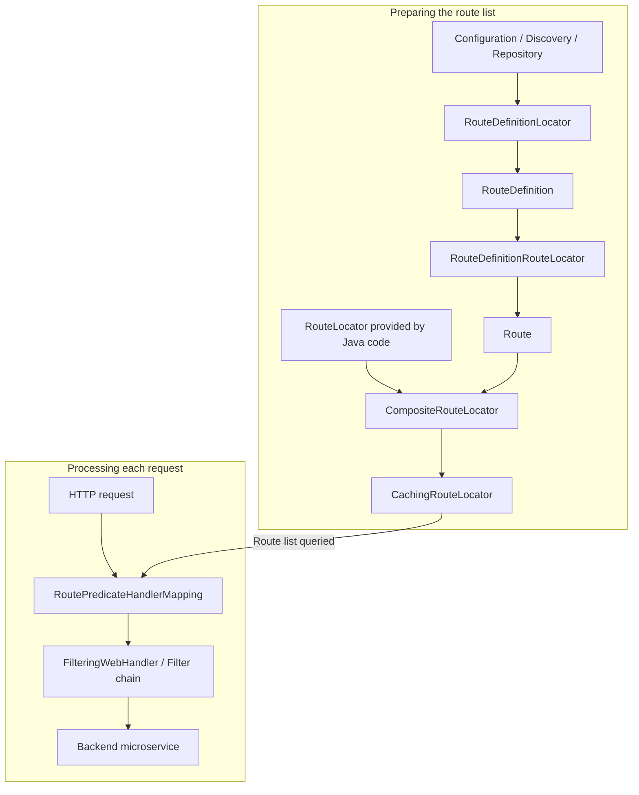
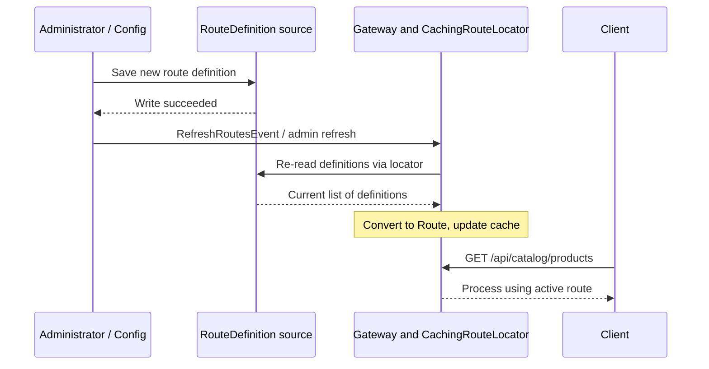
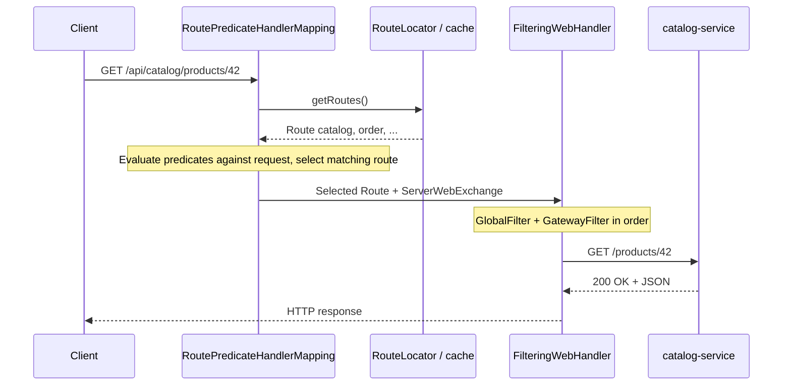
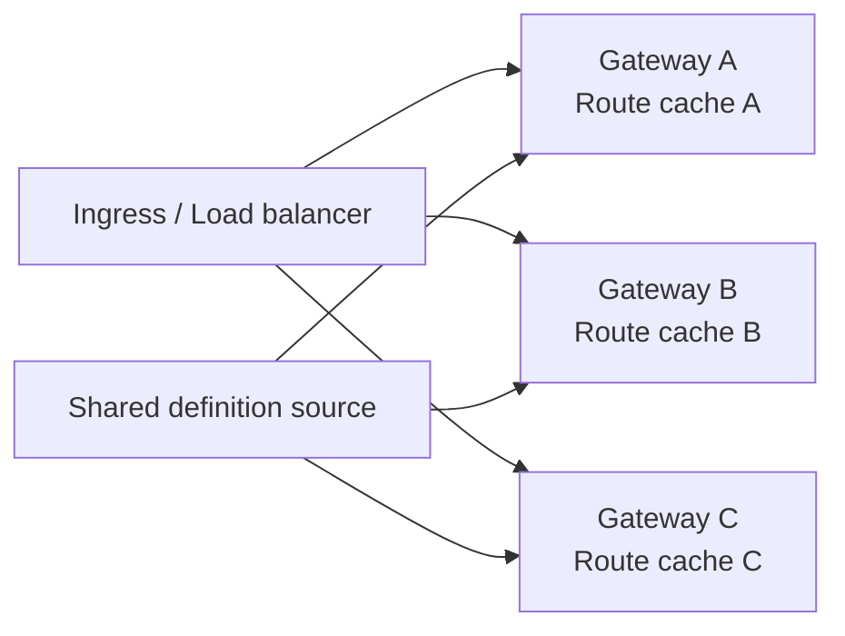

# RouteDefinitionLocator, RouteLocator, and the Route Cache

In **Spring Cloud Gateway**, a request such as `GET /api/catalog/products/42` is only forwarded to `catalog-service` after the gateway knows **which routes exist**, determines which route matches, and runs the filters attached to that route. Most introductory examples only present `Path` and `StripPrefix` configurations, yet when operating multiple microservices, the more important questions are:

- **Where does the gateway read route definitions from**: config files, service discovery, a repository, or Java code?
- **What converts configuration definitions into route objects** with executable predicates and filters?
- Why can requests still follow an old route even after a definition has been edited?
- At which step does the **route cache** operate, and what needs to be done to update active routes?
- How do you distinguish **route not found** errors from **backend instance not found** errors and filter/security errors?

This lesson belongs to the **Request Processing Architecture** chapter and focuses on three core concepts of the **Spring Cloud Gateway Server WebFlux** variant: `RouteDefinitionLocator`, `RouteLocator`, and `CachingRouteLocator`. Understanding these three components helps you build an API Gateway with route predicates, filter chains, path/header transformations, and service discovery, while keeping tight control over changes affecting authentication, rate limiting, circuit breakers, retries, TLS, and request observability.

> **Version scope:** Class names and processing flows presented in this article follow the **Gateway Server WebFlux** model, common in Spring Cloud Gateway 4.x releases. Gateway Server Web MVC organizes routing around the MVC stack and corresponding APIs; do not blindly apply WebFlux internal classes to MVC. Starters, property prefixes, actuator details, and refresh behavior must be verified against your actual Spring Boot/Spring Cloud/Gateway version.

## 1. Two Distinct Moments: Preparing Routes and Processing Requests

Two processes must be distinguished:

**Preparing the route list:** the gateway loads declaration sources, converts configuration-style definitions into executable objects, merges route lists, and stores the list used for route matching.

**Processing each request:** the gateway inspects existing routes, evaluates the request's predicates, selects a matching route, and then sends the request through the filter chain and forwards it upstream.



The diagram shows the **logical flow** of the WebFlux architecture; exact bean names and ordering can vary by version and how the application configures additional `RouteLocator`s. The key point is that `RouteDefinitionLocator` serves **route definitions**, whereas `RouteLocator` provides **runtime routes** for route selection.

Business example:

| Moment | Action | Key Component |
| --- | --- | --- |
| When the application starts or needs to reload routes | Read `catalog-route` definition: path `/api/catalog/**`, URI `lb://catalog-service`, filter `StripPrefix=2`. | `RouteDefinitionLocator` |
| When creating the route object | Compile/instantiate predicates and filters from the definition; attach ID, URI, and order. | `RouteDefinitionRouteLocator` |
| When retaining the route list for reuse | Avoid rebuilding the entire route list on every request. | `CachingRouteLocator` |
| When a client calls an API | Evaluate the request against predicates; select the matching route. | `RoutePredicateHandlerMapping` + `RouteLocator` |
| After selecting a route | Run filters, find an instance for `lb://`, and forward HTTP. | `FilteringWebHandler` and related filters |

## 2. RouteDefinition: Description of a Route

`RouteDefinition` is the data model describing a **declared route** before it enters request processing. Typical fields:

| Field | Meaning | Example |
| --- | --- | --- |
| `id` | Route identifier for management and observability. | `catalog-route` |
| `uri` | Forwarding destination; can be a direct URL or a logical URI. | `lb://catalog-service` |
| `predicates` | Conditions for a request to match. | `Path=/api/catalog/**`, `Method=GET` |
| `filters` | Filters applied on the route. | `StripPrefix=2` |
| `order` | Relative priority when multiple routes can match. | `-10` |
| `metadata` | Additional info for configuration/observability as supported. | Labels, route-specific parameters |

Conceptual example, independent of a specific version's property prefix:

```yaml
id: catalog-route
uri: lb://catalog-service
predicates:
  - Path=/api/catalog/**
  - Method=GET
filters:
  - StripPrefix=2
order: 0
```

This means **GET** requests to `/api/catalog/**` are forwarded to `catalog-service`, after removing the first two path segments. With `GET /api/catalog/products/42`, the backend receives `GET /products/42`. Query strings still need to be handled and validated per the API contract.

`RouteDefinition` is a **description**, not a request-handling function. An object holding the string `Path=/api/catalog/**` does not inherently know how to inspect a `ServerWebExchange`; the system must convert it into an appropriate runtime predicate.

### How Does RouteDefinition Differ from Route?

| `RouteDefinition` | `Route` |
| --- | --- |
| Focuses on configuration, coming from files, discovery, or a repository. | Focuses on the runtime object used to match a route to a request. |
| Stores predicate/filter definition structures. | Contains executable predicates and a constructed list of gateway filters. |
| Provided via `RouteDefinitionLocator`. | Provided via `RouteLocator`. |
| Suited for saving, editing, and managing a route definition. | Suited for `RoutePredicateHandlerMapping` to find an executable route. |

Many bugs come from treating the two objects as one: **changing definition data does not mean the runtime route list has changed immediately**.

## 3. RouteDefinitionLocator: The Port for Reading Route Definitions

`RouteDefinitionLocator` is an interface that provides `RouteDefinition` instances via a reactive stream. Conceptually, its contract is equivalent to:

```java
public interface RouteDefinitionLocator {
    Flux<RouteDefinition> getRouteDefinitions();
}
```

When collecting route definitions, the gateway calls `getRouteDefinitions()` on the appropriate source. Each emitted element describes one route; this interface **does not directly select a route for an HTTP request**.

### Common Definition Sources

| Source | Common Component / Integration | Use Case |
| --- | --- | --- |
| Application configuration | `PropertiesRouteDefinitionLocator` | Relatively static routes declared in properties/YAML mapped into Gateway config. |
| Service discovery | `DiscoveryClientRouteDefinitionLocator` when enabled | Generate route definitions from service info registered in discovery. |
| Dynamic route repository | An implementation of `RouteDefinitionRepository`, if configured | Applications managing add/edit/delete of definitions through a writable source. |
| Multiple sources at once | `CompositeRouteDefinitionLocator` | Merge definitions from multiple locators. |
| Custom implementation | Custom bean implementing `RouteDefinitionLocator` | Read routes from an admin system or internal policy store. |

Implementation names, supported mechanisms, and how they are enabled can differ across releases; check the docs for your exact version when implementing.

### Example: Route Definitions Coming from Discovery

Suppose the registry knows three instances of `catalog-service`. A discovery-based locator can provide a route definition corresponding to the logical service name. However, distinguish clearly:

- **`DiscoveryClientRouteDefinitionLocator`** can generate **route definitions** based on the list of service names and route-creation rules.
- **Spring Cloud LoadBalancer** (or the corresponding instance-selection mechanism) resolves `lb://catalog-service` to **one backend instance** when forwarding.

These are **two separate steps**. The registry updating its instance list does not necessarily mean route definitions must change; however, when a **new service** appears and routes are generated from the registry, the gateway may need to refresh its route list per the version/deployment mechanism.

For instance, if an existing route URI is `lb://catalog-service`, scaling from 2 to 3 instances is usually a matter of **updating the load balancer's instance list**, not creating a new `RouteDefinition` with a different ID for each instance.

### Notes When Using Multiple Sources

When multiple locators are present, control:

1. **Duplicate IDs:** static configuration and dynamic sources both defining `catalog-route` can cause confusion when observing, updating, or overriding routes. Use unique IDs and naming conventions.
2. **Overlapping routes:** two routes both matching `/api/catalog/**` can yield results dependent on `order`. Never treat incidental registration order as a stable contract.
3. **Asynchronously changing sources:** discovery, config server, repository, and cache may update at different times; know which route is actually active.
4. **Edit permission control:** if updating routes via an admin API is allowed, that operation can redirect requests to a different upstream. It requires strict authentication, authorization, target URI validation, and auditing.

## 4. RouteDefinitionRouteLocator: Converting Definitions into Runtime Routes

Once `RouteDefinitionLocator` provides descriptions, `RouteDefinitionRouteLocator` takes on the role of **converting `RouteDefinition` into `Route`**.

For the `catalog-route` example, the conceptual processing consists of:

1. Receive ID, URI, order, and metadata.
2. Look up the **`RoutePredicateFactory`** matching each declared predicate, such as `Path` and `Method`.
3. Convert predicate configuration into an executable condition on requests; combine multiple conditions on the same route per the corresponding rules.
4. Look up the **`GatewayFilterFactory`** matching each filter, such as `StripPrefix` or `RewritePath`, and build the concrete gateway filter.
5. Create a `Route` object containing the components needed for matching and forwarding.

Example:

```text
RouteDefinition:
  id: catalog-route
  predicates: ["Path=/api/catalog/**", "Method=GET"]
  filters: ["StripPrefix=2"]
  uri: lb://catalog-service

                |
                v

Route:
  id: catalog-route
  predicate: (ServerWebExchange) -> matching condition
  filters: [constructed GatewayFilters]
  uri: lb://catalog-service
```

Do not treat the snippet above as `toString()` or an official API format; it is an illustration showing the difference between **configuration** and **executable structure**.

If a predicate/filter declaration has a nonexistent name or invalid arguments, the gateway can fail during route conversion/loading. For example, `StripPrefix=abc` is not a valid segment count. Inspect route configuration logs and refresh results rather than waiting for the first request to uncover errors.

### The Filter Chain Does Not Run During Conversion

Creating filter objects and **executing filters** are two different things. `RouteDefinitionRouteLocator` builds the runtime filter list, yet `FilteringWebHandler`'s processing chain only runs when a request matches the route. `GlobalFilter`s and `GatewayFilter`s are merged and sorted according to their respective application orders.

Because of this separation, the system does not need to re-parse the filter chain from YAML on every request; however, editing filter configuration also requires reloading runtime routes via an appropriate refresh mechanism.

## 5. RouteLocator: Source of Runtime Routes

`RouteLocator` is the interface returning the `Route`s that the gateway can use to find paths for requests. Conceptually:

```java
public interface RouteLocator {
    Flux<Route> getRoutes();
}
```

`RouteDefinitionRouteLocator` **is one way to create a `RouteLocator`** from route definitions. Beyond it, an application can also provide a `RouteLocator` **directly via Java DSL** or a custom bean.

### Example: Creating a RouteLocator with Java DSL

The sample below illustrates a `RouteLocator` bean for Gateway Server WebFlux:

```java
import org.springframework.cloud.gateway.route.RouteLocator;
import org.springframework.cloud.gateway.route.builder.RouteLocatorBuilder;
import org.springframework.context.annotation.Bean;
import org.springframework.context.annotation.Configuration;

@Configuration
public class GatewayRoutes {

    @Bean
    RouteLocator catalogRoutes(RouteLocatorBuilder builder) {
        return builder.routes()
            .route("catalog-route", route -> route
                .path("/api/catalog/**")
                .filters(filters -> filters
                    .stripPrefix(2)
                    .setRequestHeader("X-Gateway-Origin", "api-edge"))
                .uri("lb://catalog-service"))
            .build();
    }
}
```

When running, `GET /api/catalog/products/42` is routed to the logical URI `lb://catalog-service` after rewriting the path to `/products/42`. A real backend, Spring Cloud LoadBalancer configuration, and a compatible instance source are required for `lb://` URIs to work.

**Architectural point to remember:** a route created with Java DSL is a direct `RouteLocator`; it does not have to go through a `RouteDefinition` from `RouteDefinitionLocator`. Consequently, **changing data in a `RouteDefinition` repository** will not automatically modify a `RouteLocator` bean created in Java code.

If multiple `RouteLocator` beans are registered, a composite component such as `CompositeRouteLocator` can collect routes from those sources for the gateway to use together. Before adding a custom bean, check route IDs and orders to avoid conflicts with configuration-defined routes.

## 6. CachingRouteLocator: The Route Cache

`CachingRouteLocator` holds the computed/loaded `Route` list so the gateway **reuses it during route matching**. Its main goal is to reduce the cost of aggregating multiple sources and converting definitions on every request.

Imagine two requests arriving sequentially:

```text
Request A                             Request B
    |                                     |
    v                                     v
RoutePredicateHandlerMapping          RoutePredicateHandlerMapping
    |                                     |
    +--------> CachingRouteLocator <------+
                     |
           Runtime Route list
           [catalog-route, order-route, ...]
                     |
           Select route via predicates
```

If the route source has not changed, both requests can use the same **runtime route set**. However, predicates are still evaluated against the **current request**: method, path, host, headers, and other required information. Route caching **does not mean caching the route selection outcome for every request**.

### 6.1. What Is Cached and What Is Not?

| Subject | Part of the Route Cache? | Explanation |
| --- | --- | --- |
| List of `Route` objects | **Yes** | This is the primary purpose of `CachingRouteLocator`. |
| Source configuration data or repository | **Not synonymous** | Definition sources have their own lifecycle and storage. |
| Route-matching outcome of an HTTP request | **No** | Incoming requests must still have predicates evaluated. |
| JSON response of `GET /products` | **No** | Caching HTTP responses requires a different mechanism, such as an appropriate response-cache filter. |
| List of IPs/instances of `catalog-service` | **Not synonymous** | That belongs to instance selection/discovery/load balancing, which may have its own cache. |
| Validated JWTs or rate limit quotas | **No** | Security and rate limiting are separate mechanisms/state stores. |

A common mistake is seeing that routes are cached and expecting that when discovery loses an instance, the route cache automatically drops the old IP. For an `lb://catalog-service` route, instance selection must be investigated in **service discovery/load balancer**. Conversely, when **route names, predicates, filters, or target URIs** change, the issue lies in the runtime route list.

### 6.2. Why Might a Configuration Change Not Take Effect Yet?

Suppose at 09:00 the gateway loaded:

```text
catalog-route -> lb://catalog-v1
Path=/api/catalog/**
StripPrefix=2
```

At 09:10 an administrator updates the definition source to:

```text
catalog-route -> lb://catalog-v2
Path=/api/catalog/**
StripPrefix=2
```

If the gateway **has not reloaded its runtime `Route` list**, new requests may still match the old `Route`. This is a **divergence between the configuration source state and the state used by the gateway**, not necessarily a service discovery bug.

Another case: editing a config file packaged inside an artifact or changing an environment variable of a running process **does not automatically update values already bound in the process**. Merely publishing a route cache refresh event will not turn a packaged config file into a new version. Ensure **the definition source has genuinely been updated**; sometimes redeploying or restarting the application is required, depending on how configuration is distributed.

## 7. Refreshing Routes: RefreshRoutesEvent and Update Order

In Gateway Server WebFlux, `CachingRouteLocator` has a mechanism to react to `RefreshRoutesEvent` to reload the route list as supported by the version. Separate clearly:

1. **Update the source:** save the new definition into the right repository/config source or update the discovery source.
2. **Request a route refresh:** trigger the gateway's refresh mechanism, such as `RefreshRoutesEvent` or a supported management endpoint.
3. **Verify the result:** confirm the gateway holds the new `Route` list and requests route properly.



### 7.1. Illustrating Event Publishing After Saving

In an application with a properly configured `RouteDefinitionWriter`, the admin layer can structure an update flow as follows:

```java
import org.springframework.cloud.gateway.event.RefreshRoutesEvent;
import org.springframework.cloud.gateway.route.RouteDefinition;
import org.springframework.cloud.gateway.route.RouteDefinitionWriter;
import org.springframework.context.ApplicationEventPublisher;
import org.springframework.stereotype.Service;
import reactor.core.publisher.Mono;

@Service
public class RouteAdminService {
    private final RouteDefinitionWriter writer;
    private final ApplicationEventPublisher events;

    public RouteAdminService(
            RouteDefinitionWriter writer,
            ApplicationEventPublisher events) {
        this.writer = writer;
        this.events = events;
    }

    public Mono<Void> saveAndRequestRefresh(RouteDefinition definition) {
        // Only accept definitions validated at the admin layer.
        return writer.save(Mono.just(definition))
            .doOnSuccess(ignored ->
                events.publishEvent(new RefreshRoutesEvent(this)));
    }
}
```

This **illustrates the sequence of writing successfully and then requesting a refresh** in a WebFlux application. The `Mono<Void>` must be subscribed at the calling layer (such as a WebFlux controller), otherwise the operation will not run. Ensure `RouteDefinitionWriter` writes to the same source that `RouteDefinitionLocator` reads from; not every source supports writes.

In a real route-management API, include at minimum: admin authentication/authorization, validation of target URIs and allowed hosts, normalization/validation of predicates and filters, duplicate ID handling, auditing, change throttling, and a rollback mechanism. Never expose a route-update API to ordinary users, because changing forwarding destinations can create SSRF vulnerabilities or expose backend data.

**Publishing the event does not mean every request after the call immediately uses the new version.** Refreshing and loading routes can be asynchronous; deployment procedures need explicit status verification, timeouts, and error reporting. Do not treat completion of the event-publishing call as proof that every gateway instance has updated.

### 7.2. Refreshing via Actuator

In versions that support and have Spring Boot Actuator/Gateway actuator endpoints configured, management endpoints are typically available:

```http
POST /actuator/gateway/refresh
```

And routes can be inspected via an endpoint such as:

```http
GET /actuator/gateway/routes
```

These endpoints only work when the corresponding dependencies and **exposure/enablement/security** configuration are in place. Exact endpoint names, response payloads, and configuration vary across versions. **Do not expose gateway actuator endpoints to the public Internet**, especially endpoints capable of modifying or refreshing routes. Place them on an administrative network or protect them with dedicated authentication/authorization.

Actuator refresh requests **reloading the definitions provided by current sources**; it does not automatically load a new file not yet visible in the process, does not fix discovery sources on its own, and does not synchronize all gateway replicas unless the system has built a coordination mechanism.

### 7.3. What If a Refresh Fails?

Operationally, understand these scenarios:

- **Source unreachable:** the gateway may fail to load new routes. Know which version is currently running and the strategy for retaining old routes or recovering.
- **Syntactically wrong definition or invalid filter:** conversion to `Route` may fail; do not assume a refresh succeeded solely because an admin API returned HTTP 2xx.
- **Partially updated data source:** if loading many routes while definitions are written piecemeal, the gateway may observe an intermediate configuration set. Design batch updates or atomic config version publishing at the source layer.
- **Multiple gateway instances:** each instance keeps an in-process route cache; ensure every instance is updated or redeployed to the same version and verify the outcome.
- **In-flight requests:** requests that already selected a route prior to refresh can continue using the selected route/filters. Do not treat refresh as an operation that immediately aborts all in-flight requests.

Specific guarantees on refresh failure—retaining the old cache, replacing all, or partial updates—must be checked in the source code/documentation of **your exact version** and tested via a POC. Do not rely on general assumptions when designing critical rollback flows.

## 8. From RouteLocator to RoutePredicateHandlerMapping

Once `Route`s exist, the processing flow of a request through WebFlux can be summarized as:



`RoutePredicateHandlerMapping` queries the route list and selects the route whose predicates match the request. Once selected, route information is attached to the exchange for later pipeline stages to use. `FilteringWebHandler` coordinates global filters and the route's filters.

For an `lb://catalog-service` URI, a corresponding load-balancing filter resolves the logical name to a backend instance. HTTP forwarding components then use the resolved URI per the runtime stack. **Do not assume every `Route` with `lb://` works automatically** if dependencies and an instance source are missing.

### 8.1. Route Order and Filter Order Are Two Different Concepts

**Route order** determines relative priority while evaluating candidate matching routes. Lower order values usually carry higher priority, depending on the system's sorting order. Example:

| Route | Predicate | Illustrative Order | What to Control |
| --- | --- | ---: | --- |
| `catalog-special` | `Path=/api/catalog/special/**` | `-10` | The specialized route is evaluated before the general route. |
| `catalog-general` | `Path=/api/catalog/**` | `0` | The general route does not "swallow" the specialized route. |

**Filter order**, by contrast, determines the execution order of processing steps **after the route has been selected**. It affects security, path/header transforms, retries, circuit breakers, tracing, and responses. Changing a route's `order` does not change the execution order of filters attached to that route.

### 8.2. Missing Route vs. Selected Route with Upstream Error

| Situation | Step Where Issue Occurs | Typical Symptom |
| --- | --- | --- |
| `GET /api/unknown` matches no route | Predicate matching | Usually returns `404` if no other handler accepts the request. |
| `POST` to a route allowing only `GET` | Predicate matching | Does not match that route; may fall through to another handler/route. |
| Matched route `lb://catalog-service` yet no instance exists | Discovery/load balancing | May see no-instance/upstream-unavailable errors depending on config. |
| Invalid JWT header | Security chain or auth filter | May be rejected with `401` or per configured auth policy. |
| User lacks permission for a specific order | Authorization in business service | Usually returns `403` when authenticated yet unauthorized. |
| `Retry` filter repeats request multiple times | Filter chain / resilience policy | Increases upstream calls; can cause side effects if endpoint is non-idempotent. |
| Misconfigured filter in definition | Definition-to-route conversion stage | Route load/refresh error, visible in management logs. |

When diagnosing, identify **which layer stopped the request** before modifying the route cache. Refreshing routes will not fix an invalid JWT, TLS certificate errors, dead backend instances, or rate-limit policies.

## 9. Hands-On Exercise: Observing the Route Lifecycle

Practice on a **Spring Cloud Gateway Server WebFlux** project with compatible Spring Boot/Spring Cloud versions. Suppose the local environment has a `catalog-service` backend exposing:

```http
GET /products/42
```

Backend returns illustrative JSON:

```json
{"id":42,"name":"Gateway Handbook"}
```

### Step 1 — Declare the Route

You can use the Java DSL introduced earlier or place an equivalent route definition in configuration **using the exact prefix for your Gateway version**. With Java DSL, the application accepts `/api/catalog/**`, applies `StripPrefix(2)`, and forwards to `catalog-service`.

If you do not have service discovery yet, use a direct URI to the local backend instead of `lb://catalog-service`, such as `http://localhost:8081` when the backend runs on port 8081. When switching to `lb://`, add Spring Cloud LoadBalancer and an instance source.

### Step 2 — Send a Request to Verify Predicates and Filters

```bash
curl -i "http://localhost:8080/api/catalog/products/42"
```

Record:

- Which route ID was selected, based on enabled logs/observability.
- Whether the backend actually received `GET /products/42`.
- Whether the response code/body matches the backend's output.
- How the gateway responds when calling a path outside `/api/catalog/**`.

When using YAML route definitions, the path to runtime is **RouteDefinitionLocator → RouteDefinitionRouteLocator → RouteLocator/cache**. When using Java DSL to build `RouteLocator` directly, the `RouteDefinitionRouteLocator` conversion step is not required for that route.

### Step 3 — Inspect Runtime Routes

If actuator is enabled, you can use the management endpoint to inspect the route list:

```bash
# Call only on a protected management port/network
curl -i "http://localhost:8080/actuator/gateway/routes"
```

Returned fields may vary between versions; look for route ID, URI, predicates, filters, and order supported by your version. If the endpoint does not exist, check dependencies and exposure instead of assuming the gateway has no routes.

### Step 4 — Modify a Writable Definition

In a POC with `RouteDefinitionRepository` or a source supporting route management:

1. Record the old route, route ID, and current configuration version.
2. Change the route target from `lb://catalog-v1` to `lb://catalog-v2` in the **writable definition source**.
3. Verify the source actually saved the new value.
4. Trigger a route refresh via the version-supported mechanism.
5. Re-read runtime routes and send a request to confirm forwarding.
6. Restore the source and refresh again to practice rollback.

**Do not attempt this step by merely editing Java DSL code and expecting a refresh event to update a bean built from an old build.** Changing Java code requires an appropriate build/deploy. Similarly, changing environment variables or packaged config files may require a restart for the process to pick up new values.

### Step 5 — Simulate One Error at Each Layer

| Test | How to Trigger Error | Expectation During Analysis |
| --- | --- | --- |
| Route mismatch | Use a path/method not covered by predicates | Check predicate/order config; do not jump to adjusting the load balancer. |
| Invalid definition | Put an invalid filter argument into a test source | Catch error on route load/conversion; restore definition before further request tests. |
| Upstream unavailable | Stop backend or deregister instance from discovery | Inspect load balancing/HTTP errors, timeouts, and circuit breaker if configured. |
| Stale cache | Edit a dynamic definition source without refreshing | Distinguish source-side state from runtime route state. |
| Out-of-sync replicas | Refresh only one gateway among multiple instances | Observe identical requests across instances yielding different results; establish a sync procedure. |

Practice in a test environment; never intentionally inject invalid definitions or expose management endpoints on a user-facing production system.

## 10. Operating Multiple Gateway Instances and Safe Updates

When running three gateway replicas:



Each process can maintain its **own route cache**. To roll out a route change in a controlled way:

1. **Version the route source**: give every change an explicit ID/revision so replicas know which version is active.
2. **Validate before applying**: validate route IDs, target URIs, predicate ordering, filters, and security policies; test for route conflicts.
3. **Distribute changes**: use a refresh/rollout mechanism across replicas, or perform a synchronized redeployment when the source is static configuration.
4. **Verify each replica individually**: check revision/config, route ID/URI, send canary requests, and monitor error rates.
5. **Monitor during transition**: account for requests hitting replicas on two different versions during rollout.
6. **Repeatable rollback**: keep the old revision and a revert procedure; verify both source and runtime.

When system-wide atomic switching is needed, a single local event is not enough to provide distributed consistency. Design coordinated rollouts (such as revision-based rollout, versioned config, health/readiness checks, and traffic shifting) aligned with availability requirements.

### Relationship to Authentication, Rate Limiting, and Circuit Breakers

- **Changing predicates or order** can cause an endpoint to fall under a route with different security filters. Test to ensure no unauthenticated bypass path is created.
- **Changing route filters** can alter rate-limit quotas, path/header rules, retries, or circuit breakers. These changes directly affect backend safety and stability.
- **Changing target URIs** can shift traffic to a different service/namespace. Verify trust boundaries, TLS, service discovery rules, and the new destination's capacity to handle the data.
- **Refreshing routes** does not automatically clear or synchronize rate-limiter state, nor reset breaker states under any universal rule; those systems have their own lifecycles.
- **Changing paths/headers** can alter metric names, route labels, or trace context. Dashboards and alerts should rely on stable route IDs and plan updates when contracts change.

## 11. How to Investigate When a Route Does Not Behave as Expected

Do not start by blindly triggering refreshes. Trace from the configuration source to where the request fails:

| Symptom | Diagnostic Question | Direction to Check |
| --- | --- | --- |
| New route does not appear | Is the `RouteDefinitionLocator` source emitting the new definition? | Check config/repository/discovery state; verify the process sees the change. |
| Route exists in source, missing at runtime | Was the definition successfully converted into a `Route`? | Check predicate/filter factories, valid arguments, load/refresh error logs. |
| Runtime route is still stale | Was a cache refresh requested and completed? | Check refresh event/actuator, version, and every replica. |
| Right route, yet returns 404 | Are path/method/host/header predicates accurate? Does another handler intercept? | Check route order, path rewrites, and upstream logs if forwarded. |
| Right route, yet 503 or connection error | Does `lb://` resolve an instance? Are backend/port/TLS ready? | Check discovery, LoadBalancer, health, DNS, network, and TLS. |
| Some requests hit the wrong backend | Are there overlapping routes or replicas on different revisions? | Compare IDs, orders, configs, and runtime routes per instance. |
| `401`/`403` responses | Did the request pass the security chain? Is the principal authorized for the resource? | Check token and authorization policies at gateway/backend. |
| Spike in errors after changing filters | What did the new filter alter regarding path, headers, rate limit, retry, or timeout? | Diff old/new route snapshots, per-route metrics, traces, and safe logs. |

### Recommended Logs and Metrics

During development and debugging, prioritize observability:

- Selected **Route ID**, source, and configuration revision (if the system tracks revisions).
- Timestamp of **refresh requests** and refresh outcomes.
- Request count, error rate, and latency by route; avoid overly high-cardinality tags.
- Trace/correlation IDs across gateway and upstream, to separate pre-forwarding errors from post-forwarding errors.
- `lb://` URI resolution errors and upstream call results, distinguishing route errors from backend errors.
- Alerts when replicas run different revisions or when a critical route disappears from runtime.

Never log `Authorization` tokens, session cookies, passwords, full sensitive request bodies, or headers containing secrets. When enabling verbose logs during incident response, restrict access and limit how long they stay enabled.

## 12. Misconceptions to Avoid

**"RouteDefinitionLocator processes every request."** No. It provides **route definitions**. Requests are matched against runtime **`Route`s** returned by `RouteLocator`.

**"Every Route must come from YAML."** No. Routes can come from config files, discovery, a repository, or a `RouteLocator` programmatically built via Java DSL.

**"Editing the repository updates routes immediately."** Not necessarily. Updating the source and reloading the runtime route list are two steps; verify refresh, cache, and multiple replicas.

**"CachingRouteLocator caches responses to make APIs faster."** No. It caches the **route list**; HTTP response caching is a separate mechanism.

**"Refreshing routes also updates service discovery instances."** Not true in general. The route cache and the backend instance list source have separate lifecycles, though they collaborate during forwarding.

**"If a route is missing, just restart the gateway."** Restarting may temporarily mask config-loading issues, yet hides root causes such as un-updated sources, invalid configs, missing factories, out-of-sync replicas, or wrong route order.

**"If a route exists, it is definitely secure."** A route only decides where to forward. Authentication, business authorization, rate limiting, TLS, proxy trust, circuit breakers, and retries must be designed and verified separately.

## 13. Summary of the Flow to Remember

| Block | Question It Solves | What to Check on Failure |
| --- | --- | --- |
| **RouteDefinitionLocator** | "Which **route definitions** exist from configuration sources?" | Does the source have updated data with right ID/URI/predicates/filters? |
| **RouteDefinitionRouteLocator** | "How are definitions turned into **executable Routes**?" | Are there factory, argument, or conversion errors? |
| **RouteLocator** | "Which **runtime Routes** does the Gateway have to evaluate?" | Are the route list, ordering, and match conditions right? |
| **CachingRouteLocator** | "How is the **Route list reused** and updated when needed?" | Was the cache refreshed, and is every replica on the same version? |
| **RoutePredicateHandlerMapping** | "Which **Route does this request match**?" | Path/method/host/headers, route order, and the specific request. |
| **FilteringWebHandler + filters** | "After matching, how is the request/response **processed and forwarded**?" | Filter chain, upstream URI, discovery, security, timeouts, retries, tracing. |

### Self-Check Questions

1. Why cannot `RouteDefinitionLocator` and `RouteLocator` be treated as the same interface?
2. Must a route declared via Java DSL be created through `RouteDefinitionRouteLocator`? Why?
3. When `catalog-route` has been saved to `catalog-v2`, yet the gateway still forwards requests to `catalog-v1`, which steps must be verified before blaming the cache?
4. Why does `CachingRouteLocator` not solve the problem of a dead backend instance?
5. With three gateway replicas, why can publishing `RefreshRoutesEvent` on one replica be insufficient for a uniform rollout?
6. How does route order differ from filter order, and what consequences can confusing the two have on authentication or path rewriting?

**Conclusion:** In Gateway Server WebFlux, **`RouteDefinitionLocator` reads descriptions, `RouteDefinitionRouteLocator` converts them into runtime routes, `RouteLocator` supplies routes, and `CachingRouteLocator` retains the route list for reuse and refreshes when requested**. Understanding these boundaries helps you troubleshoot routing methodically and operate the gateway safely as routes, filters, and microservices infrastructure evolve.
