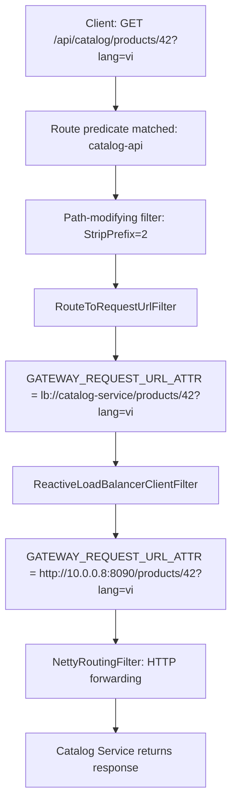

# Role of RouteToRequestUrlFilter in Spring Cloud Gateway

In **Spring Cloud Gateway Server WebFlux**, route predicates determine which route a request belongs to, yet the selected route only supplies a **declared target URI**. For downstream components to know where to forward the current request, the Gateway needs to build a **forwarding URL** from the route URI and request information after any necessary transformations. `RouteToRequestUrlFilter` is the component that performs that job.

This is a key step in the processing architecture of `SPRING_CLOUD_GATEWAY`: it connects **route matching**, the **filter chain**, path rewriting, and **service discovery** to the actual HTTP routing step. Clearly distinguishing this filter's role helps configure authentication, rate limiting, circuit breakers, retries, TLS, and request observability at the right layer, avoiding confusion between a logical URI like `lb://catalog-service` and a directly reachable network address.

> **Scope:** This article presents `RouteToRequestUrlFilter` in the **Spring Cloud Gateway Server WebFlux** variant. Configuration and Java examples must use the starter and configuration namespaces matching the deployed Spring Boot/Spring Cloud version; the Server MVC variant has its own pipeline.

## 1. Matching a Route Does Not Mean the Request Has Been Sent to the Backend

Suppose a client calls:

```http
GET /api/catalog/products/42?lang=vi HTTP/1.1
Host: gateway.example.com
```

The Gateway may declare route `catalog-api` with URI `lb://catalog-service`, predicate `Path=/api/catalog/**`, and filter `StripPrefix=2`. When the request arrives, work occurs at distinct steps:

1. **Predicates** inspect the request and determine that route `catalog-api` matches.
2. **`GatewayFilter`** can transform the public path `/api/catalog/products/42` into `/products/42`.
3. **`RouteToRequestUrlFilter`** combines the route info and request URI to construct the URL to route to, e.g., `lb://catalog-service/products/42?lang=vi`.
4. **`ReactiveLoadBalancerClientFilter`** finds an instance of `catalog-service` and replaces the logical URI with the chosen instance's URI, e.g., `http://10.0.0.8:8090/products/42?lang=vi`.
5. The appropriate **routing filter** sends the request to the backend and handles the response.



The address `10.0.0.8:8090` is only an illustrative example. Instance lookup, connection protocol, and forwarding capability depend on discovery/load balancer and actual runtime configuration.

**Key takeaway:** `RouteToRequestUrlFilter` **does not call the backend itself** and **does not pick an instance itself**. It prepares the URI for specialized downstream filters to process further.

## 2. What Is RouteToRequestUrlFilter?

`RouteToRequestUrlFilter` is a **`GlobalFilter`** belonging to the routing infrastructure of Spring Cloud Gateway Server WebFlux. It also participates in `Ordered` sorting and executes in the filter chain after the Gateway has selected a route.

Its main roles include:

- Reading the current route from the `ServerWebExchange` attributes.
- Reading the URI of the request being processed, including path and query after any earlier transformations.
- Combining the route's target URI with the request URI to form the **forwarding URL**.
- Storing the computed URL in the `GATEWAY_REQUEST_URL_ATTR` attribute so subsequent filters can use it.
- For certain URI forms carrying a **scheme prefix**, extracting and recording that prefix so the next filter interprets how to route accurately.

This filter typically has order `RouteToRequestUrlFilter.ROUTE_TO_URL_FILTER_ORDER`, with value **`10000`** in common Spring Cloud Gateway Server WebFlux versions. That value explains why path-transforming filters must be ordered properly before the URL-building step. When working with a specific version, check the corresponding API because internal components can be adjusted across versions.

### 2.1. Inputs and Outputs

| Input/Output | Role |
| --- | --- |
| `ServerWebExchange` | Context representing the HTTP request/response and attributes for the WebFlux pipeline. |
| `GATEWAY_ROUTE_ATTR` | Holds the selected `Route` object, including `id` and target `uri`. |
| `exchange.getRequest().getURI()` | Current request's URI; may already have been modified by earlier filters. |
| `route.getUri()` | Target URI in route configuration, e.g., `https://catalog.internal`, `lb://catalog-service`, or `forward:/fallback`. |
| `GATEWAY_REQUEST_URL_ATTR` | **Most important output**: the URL used as input for load balancing/routing filters. |
| `GATEWAY_SCHEME_PREFIX_ATTR` | Attribute that can appear when the route URI uses a scheme prefix like `lb:ws://...`. |

Constant names belong to `ServerWebExchangeUtils`, such as:

```java
ServerWebExchangeUtils.GATEWAY_ROUTE_ATTR
ServerWebExchangeUtils.GATEWAY_REQUEST_URL_ATTR
ServerWebExchangeUtils.GATEWAY_SCHEME_PREFIX_ATTR
```

These are **internal exchange attributes**, not headers sent from the client. Do not create HTTP headers with the same names and expect the Gateway to route based on them.

### 2.2. Why Is a Separate URL Needed Apart from the Request URI?

Distinguish three concepts:

| Concept | Example | Meaning |
| --- | --- | --- |
| **Public request URI** | `http://gateway.example.com/api/catalog/products/42?lang=vi` | Which gateway API the client is calling. |
| **Route URI** | `lb://catalog-service` | Which logical destination the route declares. |
| **Forwarding URL** | `lb://catalog-service/products/42?lang=vi` | Target combined with current path/query; may still need load balancer resolution. |

The public request URI still contains the gateway's host, so using it as-is to connect upstream would be wrong. Conversely, the route URI usually expresses only the **destination scheme/host/port**, without specifying the concrete resource in the request. `RouteToRequestUrlFilter` merges those two pieces of information.

## 3. URL Construction Mechanism and What the Filter Actually Changes

Conceptually, the business logic can be pictured as follows; this is **not** a verbatim copy of a library version's implementation:

```text
route = exchange.attributes[GATEWAY_ROUTE_ATTR]

if no route:
    continue filter chain

requestUri = exchange.request.uri
routeUri   = route.uri

if routeUri has a scheme prefix like "lb:ws://...":
    save prefix to GATEWAY_SCHEME_PREFIX_ATTR
    unwrap URI to obtain inner forwarding scheme

targetUrl = combine scheme/host/port from routeUri
            with path/query of current requestUri

exchange.attributes[GATEWAY_REQUEST_URL_ATTR] = targetUrl
continue filter chain
```

Several principles follow from this:

**First, the URL is saved into the exchange.** This operation does not mean a socket has been opened, an HTTP request sent, a response processed, or the entire original request object replaced. Only subsequent routing filters inspect this URL to decide what to do.

**Second, path and query depend on the request state when the filter runs.** If `StripPrefix` or `RewritePath` has already transformed the path prior to URL construction, the result uses the transformed path. Transformations performed after this step must be carefully controlled to avoid mismatch between the request and the routing URL.

**Third, the route URI is not an automatic path-prepending mechanism.** For instance, a route declaring `https://backend.internal/base` should not be assumed by default to have the Gateway prepend `/base` to every request. If the backend requires a `/base` prefix, use a dedicated path-transforming filter such as `PrefixPath`, `SetPath`, or `RewritePath` and test the result.

**Fourth, query strings are normally preserved when the target URL is constructed.** If an earlier filter actively modifies query parameters, the result should reflect those changes. However, do not assume every custom filter modifying the URI/request automatically syncs with `GATEWAY_REQUEST_URL_ATTR` if it runs in the wrong order.

### 3.1. Static HTTPS URI Example

Suppose the route target is `https://catalog.internal.example:8443`, and after `StripPrefix=2` the request has URI path `/products/42` and query `lang=vi`:

```text
route.uri                     = https://catalog.internal.example:8443
request.path (transformed)    = /products/42
request.query                 = lang=vi

GATEWAY_REQUEST_URL_ATTR      = https://catalog.internal.example:8443/products/42?lang=vi
```

In this example, the HTTP routing filter can use the generated URL to connect directly to the declared host/port, provided DNS, network, and TLS settings allow it. `RouteToRequestUrlFilter` is not responsible for certificate verification, TLS handshakes, or network timeouts.

### 3.2. Logical URI via Load Balancer Example

Suppose the route has `uri: lb://catalog-service`. The output immediately after `RouteToRequestUrlFilter` still has a logical form:

```text
lb://catalog-service/products/42?lang=vi
```

This is **not yet** an instance address. `ReactiveLoadBalancerClientFilter` uses the service name `catalog-service` to select a `ServiceInstance` from the list provided by load balancing/discovery. After choosing an instance, that filter updates the routing URL, for example:

```text
http://10.0.0.8:8090/products/42?lang=vi
```

If no instance can be found, the request can fail before ever being sent to a concrete backend; the response code depends on Gateway configuration and error handling. A missing-instance issue cannot be fixed simply by changing `RouteToRequestUrlFilter`.

## 4. Position in the Filter Chain and Meaning of `order`

In Spring Cloud Gateway Server WebFlux, `GlobalFilter`s and the matched route's `GatewayFilter`s are combined and sorted by order. Filters with lower `order` values typically run earlier in the **pre-phase** and later in the **post-phase**.

`RouteToRequestUrlFilter` runs during the forwarding-preparation stage. It should be viewed in relation to the following filter groups:

| Stage | Typical Component | Effect |
| --- | --- | --- |
| 1. Route matching | `RoutePredicateHandlerMapping` | Selects the matching `Route`; records route in `GATEWAY_ROUTE_ATTR`. |
| 2. Request adjustment | Gateway filters such as `StripPrefix`, `RewritePath`, `SetPath` | Adjusts the path before URL construction if filter order is appropriate. |
| 3. URL construction | **`RouteToRequestUrlFilter`** | Writes target URI into `GATEWAY_REQUEST_URL_ATTR`. |
| 4. Service resolution | `ReactiveLoadBalancerClientFilter` (if using `lb://`) | Turns service name into a concrete instance. |
| 5. Forwarding | `NettyRoutingFilter`, `WebsocketRoutingFilter`, or `ForwardRoutingFilter` depending on scheme | Performs the appropriate routing action. |
| 6. Response writing | Response-writing filters and related post-filters | Streams data/status/headers back to the client. |

The table describes the **logical flow**, not an implication that all filters run once strictly in source listing order: `Ordered` values, pre/post mechanics, and route type determine the actual flow. For `lb://`, `ReactiveLoadBalancerClientFilter` normally runs **after** `RouteToRequestUrlFilter`, at order `10150` in common WebFlux branches.

### 4.1. Errors When Placing a Custom Filter in the Wrong Position

A custom filter might modify the path:

```java
ServerHttpRequest changed = exchange.getRequest()
    .mutate()
    .path("/internal/products/42")
    .build();

return chain.filter(
    exchange.mutate().request(changed).build()
);
```

The snippet above only illustrates path modification. If this filter runs **after** `RouteToRequestUrlFilter` has computed the URL, the value in `GATEWAY_REQUEST_URL_ATTR` may still hold the previous path, causing the backend to receive an unexpected URI. Therefore, when altering the path before routing:

- Prefer built-in filters (`StripPrefix`, `PrefixPath`, `RewritePath`, `SetPath`).
- Check the `order` of custom `GlobalFilter` or `GatewayFilter` relative to `RouteToRequestUrlFilter`.
- Verify the actual path arriving at the backend rather than looking only at `exchange.getRequest().getPath()` in a single isolated log.

If there is a valid reason to modify `GATEWAY_REQUEST_URL_ATTR`, understand clearly how downstream components consume that attribute; this operation directly affects the routing destination and must be tightly restricted.

## 5. Full Illustration with Route, Predicate, and StripPrefix

Below is an illustrative configuration for **Spring Cloud Gateway Server WebFlux** in versions using the `spring.cloud.gateway.server.webflux.routes` namespace:

```yaml
spring:
  cloud:
    gateway:
      server:
        webflux:
          routes:
            - id: catalog-api
              uri: lb://catalog-service
              predicates:
                - Path=/api/catalog/**
              filters:
                - StripPrefix=2
```

Some older Spring Cloud Gateway versions use `spring.cloud.gateway.routes`. Choose **the single namespace matching your version** and project starter; never arbitrarily mix configurations from two versions.

Suppose an instance named `catalog-service` runs at `http://10.0.0.8:8090` with endpoint `GET /products/{id}`.

| Step | URL / Path State | Responsible Component |
| --- | --- | --- |
| Client calls | `GET /api/catalog/products/42?lang=vi` | Client |
| Route selection | `catalog-api` | Predicate `Path=/api/catalog/**` |
| Path change | `/products/42` | `StripPrefix=2` |
| Logical URL build | `lb://catalog-service/products/42?lang=vi` | **`RouteToRequestUrlFilter`** |
| Instance selection | `http://10.0.0.8:8090/products/42?lang=vi` | `ReactiveLoadBalancerClientFilter` |
| Send HTTP | `GET /products/42?lang=vi` to instance | `NettyRoutingFilter` |
| Return result | Status/headers/body from backend via gateway | Relevant filters |

You can try calling the running gateway:

```bash
curl -i "http://localhost:8080/api/catalog/products/42?lang=vi"
```

The command only succeeds when the corresponding gateway, route, and backend exist; specifically `lb://catalog-service` requires Spring Cloud LoadBalancer and a valid instance source. If you do not yet have discovery in a learning environment, you can temporarily replace the route URI with `http://localhost:8081` and run Catalog Service on port 8081 to observe static URL construction.

**Try changing one factor at a time:**

- Remove `StripPrefix=2`: the backend will likely receive path `/api/catalog/products/42` and return 404 if no matching endpoint exists.
- Replace `lb://catalog-service` with `http://localhost:8081`: no load-balancer instance-selection step is needed for this route.
- Send `GET /api/other/products/42`: the `Path` predicate does not match; the example route and URL are not selected.
- Change the route to point to `https://...`: the constructed URL uses HTTPS, though connection success still depends on TLS/trust configuration and upstream reachability.

## 6. Schemes: http, https, lb, ws/wss, and forward

`RouteToRequestUrlFilter` prepares the URL from the route. How the Gateway uses that URL depends on the **scheme** and present routing components:

| Route URI | Meaning After URL Construction | Next Routing Component |
| --- | --- | --- |
| `http://inventory.internal:8080` | Concrete HTTP destination. | Usually `NettyRoutingFilter`. |
| `https://inventory.internal` | Concrete HTTPS destination; requires valid TLS. | Usually `NettyRoutingFilter`. |
| `lb://inventory-service` | Logical service name requiring resolution to an instance. | `ReactiveLoadBalancerClientFilter` before HTTP routing. |
| `ws://chat.internal` or `wss://chat.internal` | WebSocket destination via WS/WSS. | `WebsocketRoutingFilter`. |
| `lb:ws://chat-service` | Load balancing prefix and WebSocket scheme. | Load balancer picks instance, then WebSocket routing. |
| `forward:/internal/fallback` | Internal routing inside the Gateway app to a matching handler. | `ForwardRoutingFilter`, not an external HTTP trip to a backend. |

### 6.1. Why Does `lb:ws://` Have Two Schemes?

With `lb:ws://chat-service`, the `lb:` part is a **scheme prefix** indicating a load-balancing request; the inner `ws://` part indicates the WebSocket protocol. `RouteToRequestUrlFilter` can store the `lb` prefix in `GATEWAY_SCHEME_PREFIX_ATTR` and prepare the URL with scheme `ws`. The load balancer filter inspects the URL and/or prefix attribute to know it must select an instance before WebSocket routing proceeds.

If you only inspect `GATEWAY_REQUEST_URL_ATTR` at a single moment, you may miss the full meaning of a route with a scheme prefix. When debugging this URI style, also inspect `GATEWAY_SCHEME_PREFIX_ATTR`.

### 6.2. HTTPS Is Not Determined Solely by Hostname Suffix

The `http` or `https` scheme in the target URI determines the upstream connection type. With `lb://` routes, the actual address after instance selection also depends on `ServiceInstance` configuration and how the load balancer reconstructs the URI; the instance's `secure` flag or the route's scheme/prefix can influence the final scheme.

**TLS** is the responsibility of the HTTP client/server connection layer and certificate policies. `RouteToRequestUrlFilter` does not verify hostnames, issue certificates, or replace mTLS.

## 7. Observing URL Attributes with a GlobalFilter

When you need to see what URL `RouteToRequestUrlFilter` constructed, you can write a `GlobalFilter` that only **reads** attributes after the URL-construction step. The example below uses Server WebFlux APIs:

```java
import java.net.URI;

import org.slf4j.Logger;
import org.slf4j.LoggerFactory;
import org.springframework.cloud.gateway.filter.GatewayFilterChain;
import org.springframework.cloud.gateway.filter.GlobalFilter;
import org.springframework.cloud.gateway.filter.RouteToRequestUrlFilter;
import org.springframework.cloud.gateway.route.Route;
import org.springframework.core.Ordered;
import org.springframework.stereotype.Component;
import org.springframework.web.server.ServerWebExchange;
import reactor.core.publisher.Mono;

import static org.springframework.cloud.gateway.support.ServerWebExchangeUtils.GATEWAY_REQUEST_URL_ATTR;
import static org.springframework.cloud.gateway.support.ServerWebExchangeUtils.GATEWAY_ROUTE_ATTR;

@Component
public class RouteTargetObservationFilter implements GlobalFilter, Ordered {
    private static final Logger log =
        LoggerFactory.getLogger(RouteTargetObservationFilter.class);

    @Override
    public int getOrder() {
        // After RouteToRequestUrlFilter, before an lb:// route is resolved.
        return RouteToRequestUrlFilter.ROUTE_TO_URL_FILTER_ORDER + 1;
    }

    @Override
    public Mono<Void> filter(ServerWebExchange exchange,
                             GatewayFilterChain chain) {
        Route route = exchange.getAttribute(GATEWAY_ROUTE_ATTR);
        URI target = exchange.getAttribute(GATEWAY_REQUEST_URL_ATTR);

        if (route != null && target != null) {
            // Log stable routing info; do not log full query/tokens.
            log.debug("routeId={} targetScheme={} targetHost={}",
                route.getId(), target.getScheme(), target.getHost());
        }

        return chain.filter(exchange);
    }
}
```

The filter above has important properties:

1. Returns the publisher from `chain.filter(exchange)` directly without calling `subscribe()` or `block()`.
2. Uses an `order` greater than `RouteToRequestUrlFilter` to read the **constructed** URL.
3. Because it runs right after URL construction, if the route uses `lb://`, `targetHost` is typically the **service name**, not yet a real instance host.
4. Logs only route ID, scheme, and host; avoids leaking query strings containing tokens or user identifiers. In production, you may further restrict hostnames and prefer built-in metrics/tracing.

If you want to observe the URL **after load balancing**, place the observation appropriately after the load balancer filter or use Gateway tracing/metrics. Do not assume every URL log reflects the final destination: `GATEWAY_REQUEST_URL_ATTR` can be updated multiple times along the pipeline.

## 8. Distinguishing Three Easily Confused Attributes

During transformation and forwarding, attributes in `ServerWebExchange` serve different purposes:

| Attribute | What Does It Hold? | Notes |
| --- | --- | --- |
| `GATEWAY_ROUTE_ATTR` | The selected logical route. | Used to know `id`, route predicates/filters, and declared URI; not a real instance. |
| `GATEWAY_REQUEST_URL_ATTR` | The URL the routing filter needs to use right now. | May initially be `lb://...` and later updated to `http://host:port/...`. |
| `GATEWAY_ORIGINAL_REQUEST_URL_ATTR` | Set of original / pre-transformation URIs recorded by relevant filters. | Useful when tracing URL changes, but not the active routing target. |

You can picture it as:

```text
Matched route:
  GATEWAY_ROUTE_ATTR       -> catalog-api, uri=lb://catalog-service

Right after RouteToRequestUrlFilter:
  GATEWAY_REQUEST_URL_ATTR -> lb://catalog-service/products/42?lang=vi

After ReactiveLoadBalancerClientFilter (example):
  GATEWAY_REQUEST_URL_ATTR -> http://10.0.0.8:8090/products/42?lang=vi
```

A log showing `GATEWAY_ROUTE_ATTR` matched does not prove the backend received the request. Likewise, having `GATEWAY_REQUEST_URL_ATTR` does not prove a network connection to the backend succeeded.

## 9. Troubleshooting Common Routing Errors

When a route looks right yet the API returns errors, inspect in order: **route match → post-filter path → routing URL → instance selection → backend connection → response**.

| Symptom | What to Check | Why Related to `RouteToRequestUrlFilter`? |
| --- | --- | --- |
| Request does not enter desired route | `Path`, `Method`, `Host` predicates and route order. | Without a matching route, the filter cannot build a URL for that route. |
| Backend returns 404 even though route matched | `StripPrefix`, `RewritePath`, `SetPath`; actual path received by backend. | The URL may have the right host yet the wrong path. |
| `lb://` finds no target | Service name, instance list, Spring Cloud LoadBalancer, and discovery. | The filter builds the logical URL; instance resolution is a later step. |
| Sent to wrong upstream | `route.uri`, custom URL modifications, scheme/host/port after filters. | The routing URL attribute may be built wrong or overwritten. |
| HTTPS connection fails | DNS, port, trust store, certificates, hostname verification, HTTP client TLS config. | Building an `https://` URL is not enough for TLS to succeed. |
| Logs show `lb://` yet backend still works | Observation timing in the filter chain. | The log may read the URL before the load balancer replaces it. |
| Filter changes path yet upstream gets old path | `order` and `GATEWAY_REQUEST_URL_ATTR` at routing time. | Changing path after URL construction does not implicitly sync the attribute. |
| WebSocket fails to connect | `ws/wss` scheme, `lb:` prefix, upgrade support, proxy, and routing filter. | Scheme picks the routing branch; target may need prefix unwrapping. |

### Example Tracing a 404 Case

The Gateway has route `Path=/api/orders/**` pointing to `http://localhost:8082`, yet the backend only exposes `GET /orders/7`. The client calls:

```text
GET /api/orders/7
```

Without a filter removing `/api`, the target URL may be:

```text
http://localhost:8082/api/orders/7
```

The backend returns 404 because no such endpoint exists. `RouteToRequestUrlFilter` **completed its job of building a URL from the current request**. The issue lies in the path contract between gateway and backend. Adding `StripPrefix=1` (at the right chain position) turns the URL into `http://localhost:8082/orders/7`.

If **no route matches** at all, the request typically gets 404 right at the gateway without any forwarding to the backend. The two 404 cases have different root causes.

## 10. Responsibility Boundaries with Security and Reliability

`RouteToRequestUrlFilter` is a routing processing step. It does not replace other edge mechanisms:

| Need | Related Component / Policy | Role of RouteToRequestUrlFilter |
| --- | --- | --- |
| Authentication, authorization | Spring Security, token and permission checks at gateway/backend. | Only prepares URL; does not authenticate users. |
| Rate limiting | `RequestRateLimiter`, key resolver, appropriate state store. | Does not count requests or enforce quotas. |
| Circuit breaker | Circuit breaker filter integration and fallback config. | Provides the target for routing to execute; does not open/close circuits. |
| Retry | Retry filter based on conditions/status/errors and idempotency. | Does not resend requests or replay bodies on its own. |
| TLS/mTLS | HTTP server/client TLS, certificates, trust, and HTTPS routing rules. | Ensures URL has right scheme/host/port; does not perform handshakes. |
| Observability | Micrometer, tracing, safe logging, route ID, and latency. | URL/route attributes are one context source; do not guarantee end-to-end tracing alone. |

### 10.1. Never Let Client Data Dictate Arbitrary Target URLs

The routing URL directly governs **which upstream the gateway connects to**. If a custom filter accepts a client-supplied URL and writes it directly into `GATEWAY_REQUEST_URL_ATTR`, the gateway risks becoming an open proxy to unintended hosts, including internal systems.

Design principles to follow:

- Only route to **permitted services/hosts** per application configuration and policy.
- Never treat client-sent `Host`, `X-Forwarded-Host`, or query parameters as authority to pick an upstream.
- If dynamic routing by tenant or API version is needed, use a trusted lookup table/allowlist and validate context before selecting a target.
- For HTTPS, maintain certificate, trust store, and hostname verification; avoid disabling TLS checks just to test connectivity.
- In the backend, still enforce authentication and business authorization instead of assuming every request coming through the gateway is valid.

### 10.2. A Correct URL Does Not Mean Good Fault Tolerance

Suppose the URL is built and the load balancer picks the right instance, yet the backend takes 3 seconds to respond. `RouteToRequestUrlFilter` does not decide timeouts or retry policies. I/O and reliability layers must be configured to protect gateway resources.

In particular, retrying a `POST` that creates orders or payments can repeat side effects if the backend already processed it and the response was lost. Clear retry conditions, idempotency keys, and business contracts are required. When filters modify bodies, mind data caching/replay and memory cost in WebFlux.

## 11. Practice Questions and Exercises

**Exercise 1 — Determine the logical URL.** A route has `uri: lb://payment-service`, predicate `Path=/api/payments/**`, filter `StripPrefix=1`. Client calls `GET /api/payments/25?view=summary`. Which URL is normally written to `GATEWAY_REQUEST_URL_ATTR` right after `RouteToRequestUrlFilter`?

**Answer:** `lb://payment-service/payments/25?view=summary`. This is a logical URL; the load balancer has not chosen an instance yet. The request had `/api` stripped by `StripPrefix=1`.

**Exercise 2 — Distinguish route selection from URL construction.** If predicate `Method=GET` does not match `POST /api/payments/25` and no other route exists, can `RouteToRequestUrlFilter` send this request to `payment-service`?

**Answer:** No. The filter neither selects routes nor sends HTTP requests. When no matching route exists, no forwarding URL for `payment-service` is formed from that route.

**Exercise 3 — Predict a filter-order bug.** A custom `GlobalFilter` runs after the URL-construction step and only then changes the path to `/internal/items/3`. Why might the backend receive the old path?

**Answer:** `GATEWAY_REQUEST_URL_ATTR` may already contain the pre-modification path. Routing filters use the target URL stored in that attribute. Check `order`, place path-modifying filters in the right phase, or manage URL updates consistently.

**Exercise 4 — Understand scheme-prefixed URIs.** For route `lb:ws://chat-service`, why pay attention to `GATEWAY_SCHEME_PREFIX_ATTR`?

**Answer:** `lb` indicates an instance-selection requirement, while `ws` indicates the WebSocket protocol. The prefix attribute tells the load balancer about `lb`'s role after the inner URI is unwrapped.

**Exercise 5 — Identify the responsible layer.** The URL changed from `lb://inventory-service/items/1` to `http://10.0.0.9:8080/items/1`, yet the connection is refused. Should you fix `RouteToRequestUrlFilter` first?

**Answer:** Not yet justified. URL construction and instance resolution already ran; check whether the instance is alive, port, network, health checks, timeout policy, and HTTP routing. URL construction does not guarantee a successful connection.

## 12. Key Takeaways

When reading the **Spring Cloud Gateway Server WebFlux** pipeline, view `RouteToRequestUrlFilter` as **the bridge from the selected route to the forwarding URL**:

- Reads `GATEWAY_ROUTE_ATTR` along with the current request URI.
- Combines destination info to write `GATEWAY_REQUEST_URL_ATTR`.
- Preserves/interprets required scheme info, including prefixes like `lb:`.
- Leaves load balancer and routing filters to perform **instance selection** and **actual forwarding** in subsequent steps.

The key when configuring or debugging is **right route, right post-transform path, right filter order, and right URL at routing time**. Separating these stages prevents wrong paths, wrong upstreams, and misplaced security config, while building a solid foundation for implementing service discovery, TLS, retries, circuit breakers, rate limiting, and request observability for a microservices API Gateway.
