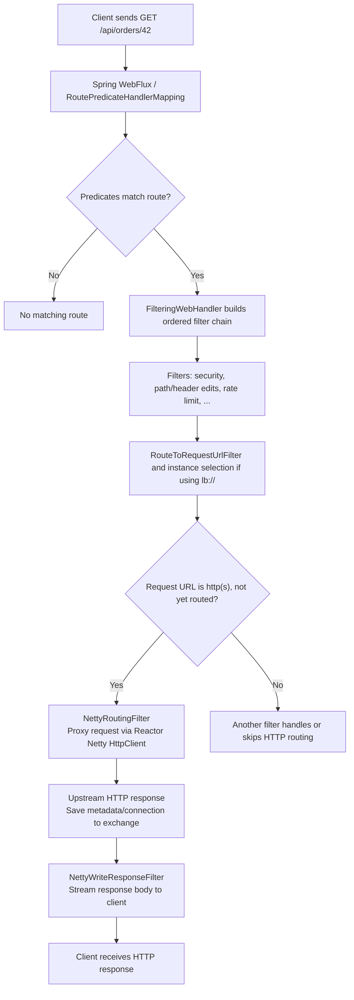
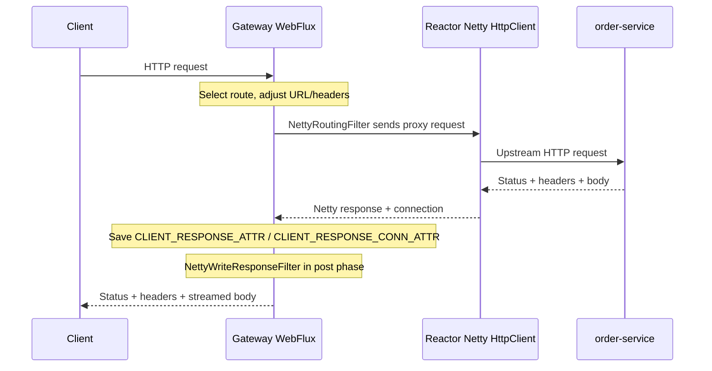
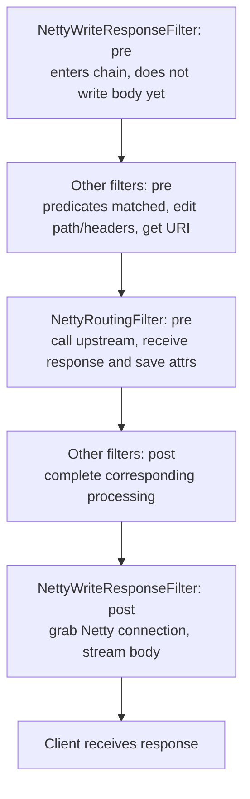
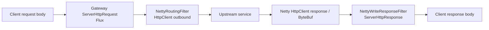

# NettyRoutingFilter and NettyWriteResponseFilter

In Spring Cloud Gateway Server WebFlux, receiving an HTTP request from a client and forwarding it to a backend microservice does not happen in a single Java call. The Gateway executes a chain consisting of **route selection → request transformation → upstream address selection → sending the request via HTTP client → receiving the response → writing the response back to the client**. Two built-in filters playing a central role at the end of this chain are **`NettyRoutingFilter`** and **`NettyWriteResponseFilter`**.

This lesson belongs to the **Request Processing Architecture** chapter of the **SPRING_CLOUD_GATEWAY** module. To build and operate an API Gateway with route predicates, filter chains, path/header transformations, service discovery, authentication, rate limiting, circuit breakers, retries, TLS, and request observability, learners need to understand how these two filters coordinate, where they read/write data, and what happens when a request is not proxied over HTTP.

> **Scope:** This content covers **Spring Cloud Gateway Server WebFlux using Reactor Netty**. Spring Cloud Gateway Server MVC has a different processing model; do not apply the lifecycle of these two GlobalFilters verbatim to the MVC variant. Package names, configuration properties, and some implementation details may vary across Spring Cloud versions; the names given below describe the familiar mechanism in the Gateway Server WebFlux branch.

## 1. Where Do the Two Filters Sit in the Processing Architecture?

Suppose a client calls:

```http
GET /api/orders/42 HTTP/1.1
Host: api.example.com
Authorization: Bearer <access-token>
```

The Gateway has a route forwarding `/api/orders/**` to `order-service`. Conceptual execution flow:



**`NettyRoutingFilter`** is a *routing* filter: it uses Reactor Netty's HTTP client to make an outbound request upstream when the URL is determined to be HTTP/HTTPS.

**`NettyWriteResponseFilter`** is a *write response* filter: it uses the response and connection left by the routing step to transfer the response content to the client, typically via streaming without buffering the entire body in memory.

Both belong to the **built-in `GlobalFilter`s of Gateway Server WebFlux**. They do not replace route predicates, path/header modification filters, Spring Security, or backend business services.

### Separating Responsibilities Across Layers

| Component | Main Responsibility | Not Primarily Responsible For |
| --- | --- | --- |
| `RoutePredicateHandlerMapping` | Find a route whose predicates match the request; attach the route to the exchange | Sending HTTP requests to the backend |
| `FilteringWebHandler` | Combine `GlobalFilter`s and `GatewayFilter`s, sorting them into a chain | Performing network I/O itself |
| `RouteToRequestUrlFilter` | Construct the actual request URL from the route URI and current request | Selecting response body details |
| `ReactiveLoadBalancerClientFilter` | Resolve `lb://service-id` to an endpoint of a suitable instance | Writing the response to the client |
| **`NettyRoutingFilter`** | Proxy HTTP/HTTPS requests using Reactor Netty HttpClient; save upstream response in exchange | Finding routes from predicates, executing business logic |
| **`NettyWriteResponseFilter`** | Use upstream response/connection to write the body and complete the response to the client | Calling upstream again, selecting routes |
| `ForwardRoutingFilter` / `WebsocketRoutingFilter` | Handle other appropriate URI types or protocols | Standard HTTP proxying via the Netty filter pair |

Spring Security is typically applied in the **WebFlux WebFilter chain**; do not assume every authentication step always sits inside the ordering of `GatewayFilter`s.

## 2. ServerWebExchange and Attributes Used to Coordinate

The Gateway passes information through a **`ServerWebExchange`** object for the current request. Besides the request, response, and HTTP properties, the exchange holds an internal attribute map. Filters read and write these attributes to coordinate without passing objects directly from one filter to another via separate parameters.

Special attributes are typically accessed via constants in `ServerWebExchangeUtils`:

| Attribute | Source Setting / Meaning | Filters Commonly Interested |
| --- | --- | --- |
| `GATEWAY_ROUTE_ATTR` | Selected route after matching | `FilteringWebHandler`, filters needing the route ID |
| `GATEWAY_REQUEST_URL_ATTR` | Constructed/adjusted target URI for routing | `NettyRoutingFilter` and other routing filters |
| `GATEWAY_ORIGINAL_REQUEST_URL_ATTR` | Original URIs saved during rewrites/URI changes | Filters tracking paths before/after transformation |
| `GATEWAY_SCHEME_PREFIX_ATTR` | May hold scheme prefix such as `lb` when handling `lb://...` | URI handling and load balancing steps |
| `GATEWAY_ALREADY_ROUTED_ATTR` | Marks that the request has been handled by a routing filter | Routing filters avoiding duplicate routing |
| `CLIENT_RESPONSE_ATTR` | Metadata about the upstream response received by Netty HTTP client | `NettyWriteResponseFilter` |
| `CLIENT_RESPONSE_CONN_ATTR` | Reactor Netty connection associated with the upstream response | Used by `NettyWriteResponseFilter` to read body data |

Think of this map as a **handoff board**:

1. The route matching step fills in "which route was selected?".
2. URL modification and load balancing steps fill in "which URI should the request be sent to?".
3. `NettyRoutingFilter` sends the HTTP request and fills in "which response did upstream return and which connection will deliver the data?".
4. `NettyWriteResponseFilter` reads the populated info to write the response back to the client.

These are **internal implementation details**, not headers from the client. A request carrying a self-declared `GATEWAY_REQUEST_URL_ATTR` header does not create or overwrite the attribute of the same name in the exchange map.

## 3. NettyRoutingFilter: Execution Conditions and Tasks Performed

### 3.1. When Does NettyRoutingFilter Actually Proxy a Request?

In the standard Gateway Server WebFlux implementation, `NettyRoutingFilter` performs routing when:

- The `GATEWAY_REQUEST_URL_ATTR` attribute already contains a target URI.
- The scheme of the target URI is **`http` or `https`**.
- The request **has not yet been marked as routed by another routing filter**.

If those conditions are not met, it skips HTTP routing and continues along the chain. For example, a `forward://...` URI is handled by the corresponding forward mechanism; a `ws://` or `wss://` URI goes to the WebSocket branch. If a request was already answered with `401` or `429` by an earlier filter without calling `chain.filter(exchange)`, Netty routing does not happen either.

An important point: **`NettyRoutingFilter` does not read `Path` predicates to decide the route**. By the time this filter runs, the route and target URI have essentially already been prepared by earlier steps.

### 3.2. Responsibilities on the Request Side

Steps typically performed:

1. Read the target URI from `GATEWAY_REQUEST_URL_ATTR` and check the routed status.
2. Mark the exchange as routed to prevent another routing filter from accidentally sending the request a second time.
3. Use **Reactor Netty `HttpClient`** to issue the request upstream with the corresponding HTTP method.
4. Forward request headers that have passed relevant header filtering/editing rules.
5. Stream the request body when a body is present, such as in `POST` or `PUT` requests.
6. When upstream returns an HTTP response, store the response information and associated connection in the exchange for the response-writing step.

This is **asynchronous proxy** processing. While waiting for network I/O to the backend, the event loop does not block a thread by calling `Thread.sleep()` or `block()` to wait for the response.

### 3.3. NettyRoutingFilter Does Not Decide Everything

For example, to turn the public path `/api/orders/42` into the service path `/orders/42`, use a filter like `StripPrefix=1` or `RewritePath` **before** sending the request. `NettyRoutingFilter` receives the target URI already computed by those steps.

Similarly, when the route URI is `lb://order-service`, the load balancer filter typically picks an instance and replaces the target URI with a concrete HTTP/HTTPS address **before** `NettyRoutingFilter` proxies. If discovery/load balancing configuration is missing, the issue cannot be solved simply by modifying `NettyRoutingFilter` itself.

For TLS, the **client → gateway** connection and the **gateway → upstream** connection are two separate legs. An `https://...` route may require certificate trust configuration for the outbound Reactor Netty HTTP client; having HTTPS enabled on the public endpoint does not mean the hop to the backend is also encrypted.

## 4. NettyWriteResponseFilter: Why Is a Separate Response-Writing Step Needed?

When upstream replies, the Gateway cannot simply "return" Reactor Netty's response object as an ordinary Java return value. The client is waiting for an HTTP response sent by the Gateway **server**, while the upstream response comes from the **HTTP client** used by the Gateway. These two sides are distinct:



**`NettyWriteResponseFilter`** checks the response/connection info left by routing, then uses the data stream received from the Netty client to write the body to the gateway's `ServerHttpResponse`.

Key points to understand:

- Status codes and many response headers are set on the Gateway response while receiving the upstream response during the routing stage and header filter steps; the write step primarily **writes the body content** and finishes sending to the client. Do not interpret the name "WriteResponse" as meaning status/header copying only begins in this filter.
- Bodies are usually transferred as **`Flux<DataBuffer>`**, without requiring the entire response to be loaded into RAM before sending.
- Netty `ByteBuf` and WebFlux `DataBuffer` objects have memory-management lifecycles. When writing custom filters that touch the body, respect retain/release rules and consume data strictly once to avoid memory leaks or empty responses.
- When there is **no** suitable upstream Netty connection in the exchange, the filter cannot write a body from a Netty source; for example, if a security/rate-limit filter answered early or the request took the `forward://` branch.
- Once the response is committed, downstream filters cannot freely alter HTTP status or headers. Logic that needs to edit headers must run at the right time, or use WebFlux's pre-commit hook when appropriate.

The names of the two filters describe **two distinct phases of work**, not that they always run in a linear "routing finishes first, then the writer filter is called" sequence. Reality ties into the order and bidirectional flow of the reactive filter chain.

## 5. GlobalFilter Ordering: Pre-Phase and Post-Phase Reverse Direction

Spring Cloud Gateway builds a filter chain sorted by `Ordered`. Typically:

- **Pre-phase:** Filters with smaller order values are invoked earlier.
- **Post-phase:** As inner publishers complete, the post-processing parts of outer filters run later.

In familiar Gateway Server WebFlux versions, `NettyWriteResponseFilter` has order **`-1`**, whereas `NettyRoutingFilter` sits very late in the pre-phase (typically `Ordered.LOWEST_PRECEDENCE`). This may look counterintuitive, yet it is precisely how the writer registers work **in the post-phase** after routing has obtained the upstream response.



The diagram above is meant to explain the **ordering principle**, not represent every filter or every error branch. When custom filters are added to the chain, post ordering and response commit timing depend on where those filters sit in the chain. Filter code combines `chain.filter(exchange)` with Reactor operators to define pre/post handling; therefore, read both **order** and how publishers are composed.

### Mental Exercise on Ordering

Suppose we have these filters:

| Filter | Illustrative Order | Work in Pre / Post |
| --- | ---: | --- |
| `CustomLoggingGlobalFilter` | `-2` | Pre starts timing, post logs result after chain |
| `NettyWriteResponseFilter` | `-1` | Pre enters chain, post writes body to client |
| `RouteToRequestUrlFilter` | Positive framework order | Prepares URI sent upstream |
| `ReactiveLoadBalancerClientFilter` | Positive framework order, when using `lb://` | Selects instance, constructs HTTP/HTTPS URI |
| `NettyRoutingFilter` | Very late in pre-phase | Sends request and obtains upstream response |

Order numbers of built-in filters should be **verified per version** when writing custom filters that must insert at a precise point. Avoid relying on hardcoded order numbers solely because an online snippet lists them.

## 6. Complete Example: HTTP Route and Request/Response Flow

A minimal WebFlux Gateway may define the following static HTTP route:

```yaml
spring:
  cloud:
    gateway:
      routes:
        - id: orders-http
          uri: http://localhost:8081
          predicates:
            - Path=/api/orders/**
          filters:
            - StripPrefix=1
            - RemoveRequestHeader=X-User-Id
```

> This `spring.cloud.gateway.routes` configuration format is common in earlier Spring Cloud Gateway Server WebFlux versions; newer versions may use the `spring.cloud.gateway.server.webflux.routes` namespace. Use the prefix matching your project's version and starter. The example assumes the backend is listening on `localhost:8081` on a network/host reachable from the gateway runtime environment.

Client calls the gateway:

```bash
curl -i http://localhost:8080/api/orders/42 \
  -H "X-User-Id: someone-else"
```

The backend is assumed to support `GET /orders/42` and return:

```http
HTTP/1.1 200 OK
Content-Type: application/json
X-Order-Source: order-service

{"id":42,"status":"CREATED"}
```

Data flow:

| Step | What the Gateway Knows or Does | Outcome |
| --- | --- | --- |
| 1. Match route | `Path=/api/orders/**` matches request | `GATEWAY_ROUTE_ATTR` points to `orders-http` |
| 2. Modify request | `StripPrefix=1` removes `api` segment; strips untrusted header | Backend sees path `/orders/42`, does not receive client-sent `X-User-Id` |
| 3. Determine URI | Route URI is `http://localhost:8081` | `GATEWAY_REQUEST_URL_ATTR` holds target URL to backend |
| 4. Routing | `NettyRoutingFilter` sends `GET /orders/42` via Reactor Netty HTTP client | Receives upstream `200` response, headers, and connection |
| 5. Store response | Upstream info placed into exchange | `CLIENT_RESPONSE_ATTR`, `CLIENT_RESPONSE_CONN_ATTR` hold relevant data |
| 6. Return | `NettyWriteResponseFilter` writes upstream response body to client | Client receives JSON, status/headers after respective processing steps |

The example uses `RemoveRequestHeader=X-User-Id` to avoid trusting a client-supplied identity header. In real systems, identity propagation should rely on information authenticated by Spring Security and clear trust policies; the service must still enforce business authorization for order `42`.

### If the Route Uses Discovery Instead of a Static Address

You can change to:

```yaml
uri: lb://order-service
```

Then, after the route is selected, the load balancer mechanism locates a suitable instance and prepares the outbound URL. `NettyRoutingFilter` still handles HTTP routing once the final URL has an `http` or `https` scheme. This configuration **requires** the actual dependencies and instance source (such as Spring Cloud LoadBalancer with a discovery client); the string `lb://order-service` alone does not conjure a service.

## 7. How Headers, Bodies, and Backpressure Move Through Both Filters

### 7.1. Request and Response Headers

The Gateway should not blindly copy every HTTP header. Some headers are **hop-by-hop** (e.g., `Connection` and headers it lists), meaningful only for a single HTTP connection. Spring Cloud Gateway provides `HttpHeadersFilter` implementations and related mechanisms to manage headers on both request and response paths. Headers modified by route filters must also be accounted for before calling the Netty client.

Practical considerations:

- **`Host`**: decide whether to keep the public host or use the upstream host as required by the backend; filters like `PreserveHostHeader` should only be enabled when upstream connectivity and virtual hosts are understood.
- **`Forwarded` and `X-Forwarded-*`**: trust info only from authorized proxies; never take client IP addresses from arbitrary headers for authentication or rate limiting.
- **`Authorization` / identity headers**: validate tokens and explicitly define what information is forwarded; never log tokens.
- **`Content-Length` / `Transfer-Encoding`**: modifying or streaming the body can invalidate the original length; let the framework/header filters handle this per HTTP rules rather than setting it manually.
- **Status and response headers**: once body streaming begins and the response commits, changing headers/status in post-processing is no longer reliable.

### 7.2. Request Body Going Up, Response Body Coming Down

`NettyRoutingFilter` can stream the request body from `ServerHttpRequest` to the upstream HTTP client. `NettyWriteResponseFilter` can stream the upstream body from Netty back to `ServerHttpResponse`.



Streaming design reduces the need to buffer entire bodies in memory. Even so, **non-blocking does not mean using unlimited memory is safe**: if a custom filter buffers large bodies for logging, signing, or rewriting, the gateway can suffer heap/direct memory pressure. With Netty `ByteBuf`, retain/release mistakes can also cause memory leaks.

When a custom filter must read or modify the body, use dedicated APIs and handle the `DataBuffer` lifecycle properly. Never call `.block()` or arbitrary `.subscribe()` inside a filter; return `Mono<Void>`/publishers so the framework manages subscription, cancellation, and backpressure.

### 7.3. Characteristics of Streaming

- Read/write rates are regulated through the reactive pipeline, yet still depend on buffer limits, transport, and producers.
- If the client disconnects, the pipeline may receive a cancellation signal; allow the framework to close/release upstream resources.
- If upstream streaming takes a long time, the response may already be committed, so you cannot "wait until the end and then change the status."
- When adding retries, resending a request that has a body is **not automatically safe**. Consider idempotency, body replay/caching capability, and appropriate retry policies.

## 8. When Do the Two Filters Not Form a Complete Pair?

Not every HTTP response from the Gateway comes from upstream via `NettyRoutingFilter`. Other cases:

| Situation | What Typically Happens | Why Distinguish It |
| --- | --- | --- |
| No route matches | Handler matching selects no route; framework returns error/not-found response | No upstream URL for Netty routing to act on |
| Missing token or unauthorized | Spring Security may return `401` / `403` before the route is proxied | No upstream response from Netty |
| Rate limit exceeded | Filter may return `429 Too Many Requests` without calling the rest of the chain | Do not look for the cause in the backend |
| `forward://...` route | Corresponding internal routing/dispatcher handles it | Not part of the ordinary Netty HTTP client flow |
| `ws://` / `wss://` route | WebSocket routing handles protocol upgrade | Standard HTTP response streaming does not apply as-is |
| Circuit breaker triggers fallback | May switch to a configured fallback branch | Response may be generated internally, with no Netty upstream connection like a normal success |
| Upstream connection error or timeout | Pipeline may terminate with error, handled by exception handler/resilience filter | No valid upstream response for writer to stream normally |
| Custom filter writes response directly | Filter writes response, returns `setComplete()` or `writeWith(...)` without calling the chain | Prevent other filters from attempting to write the response twice |

A filter that returns a response directly must **explicitly stop the chain**. Illustrative example:

```java
@Override
public Mono<Void> filter(
        ServerWebExchange exchange,
        GatewayFilterChain chain) {

    if (isBlockedByLocalPolicy(exchange)) {
        exchange.getResponse()
            .setStatusCode(HttpStatus.TOO_MANY_REQUESTS);
        return exchange.getResponse().setComplete();
    }

    return chain.filter(exchange);
}
```

In the branch returning `429`, `NettyRoutingFilter` is not invoked and `NettyWriteResponseFilter` has no upstream Netty body to write. The snippet assumes `isBlockedByLocalPolicy(...)` is a fast, non-blocking check; in production, distributed rate limiting should use an appropriate reactive filter/driver.

## 9. Writing a Custom GlobalFilter Without Breaking the Proxy Lifecycle

Suppose the simple goal is to measure elapsed time from when a request enters the gateway chain until the chain completes. There is no need to replace the two default Netty filters; just add a lightweight measurement filter:

```java
import java.util.concurrent.TimeUnit;

import org.slf4j.Logger;
import org.slf4j.LoggerFactory;
import org.springframework.cloud.gateway.filter.GatewayFilterChain;
import org.springframework.cloud.gateway.filter.GlobalFilter;
import org.springframework.cloud.gateway.route.Route;
import org.springframework.cloud.gateway.support.ServerWebExchangeUtils;
import org.springframework.core.Ordered;
import org.springframework.stereotype.Component;
import org.springframework.web.server.ServerWebExchange;

import reactor.core.publisher.Mono;

@Component
public class GatewayLatencyFilter implements GlobalFilter, Ordered {

    private static final Logger log =
        LoggerFactory.getLogger(GatewayLatencyFilter.class);

    @Override
    public int getOrder() {
        // Example: pre earlier than NettyWriteResponseFilter (-1),
        // doFinally runs when the inner chain has finished.
        return -2;
    }

    @Override
    public Mono<Void> filter(
            ServerWebExchange exchange,
            GatewayFilterChain chain) {

        long start = System.nanoTime();

        return chain.filter(exchange)
            .doFinally(signal -> {
                Route route = exchange.getAttribute(
                    ServerWebExchangeUtils.GATEWAY_ROUTE_ATTR);

                String routeId = route == null
                    ? "unknown"
                    : route.getId();

                long elapsedMs = TimeUnit.NANOSECONDS.toMillis(
                    System.nanoTime() - start);

                log.debug(
                    "route={} status={} signal={} elapsedMs={}",
                    routeId,
                    exchange.getResponse().getStatusCode(),
                    signal,
                    elapsedMs);
            });
    }
}
```

**Meaning of the pattern:**

1. `getOrder() = -2` places pre before writer order `-1` in the described implementation; thus the outer `doFinally` can record the chain duration including response writing. In other versions, verify the order again if a specific position must be guaranteed.
2. `chain.filter(exchange)` is **returned** as a publisher. The filter neither calls `subscribe()` nor waits via `block()`.
3. `doFinally` runs when the publisher completes, errors, or is canceled; `signal` distinguishes normal completion from cancellation. This log alone does not yield exact upstream duration; measuring individual phases requires detailed tracing/metrics.
4. Production logging should use a backend/appender that does not block the event loop or is appropriately configured; avoid printing tokens, bodies, cookies, or raw URLs containing sensitive data.

If you want to **modify response headers**, handle it before the response commits, such as registering a `beforeCommit(...)` callback in the appropriate phase and ensuring the logic runs only once. Trying to change status/headers inside `doFinally` of the filter above is too late once the response has already been sent.

### Common Mistakes When Writing Filters

| Mistake | Consequence | How to Avoid |
| --- | --- | --- |
| Replacing `NettyRoutingFilter` just to rewrite a URL | Loses standard proxy/HTTP client behavior, introduces hard-to-predict bugs | Use route predicates and filters like `RewritePath`, `StripPrefix` |
| Calling `chain.filter(exchange)` then manually calling `subscribe()` | Request lifecycle, errors, and cancellation detach from the framework | Return the publisher created by the filter |
| Calling a blocking HTTP client in `GlobalFilter` | Ties up event-loop threads, raises `p95/p99` across many routes | Prefer `WebClient`, reactive drivers; isolate legacy blocking if unavoidable |
| Reading the body without reconstructing the request | Upstream receives an empty body or fails | Use the Gateway's proper body caching/modification mechanisms |
| Writing the response body twice | Response already committed, corrupt data, or exceptions | Pick one response-writing path; avoid custom writers colliding with the built-in writer |
| Trusting client-supplied `X-User-Id` | Identity spoofing in internal layers | Strip untrusted headers; authenticate and enforce policies in services |
| Logging full bodies/`Authorization` | Sensitive data exposure and memory overhead | Log only allowed fields, trace ID, route ID, and needed metadata |

## 10. Observing and Troubleshooting Stage by Stage

When operating a gateway, distinguish issues **before routing**, **during routing**, and **when writing the response**.

### 10.1. What to Monitor?

- **Route ID and safe target URL:** identify which route the request matched; avoid putting raw URLs with sensitive queries into metric tags.
- **Total duration and upstream duration:** if most time is spent in the HTTP client, check DNS, TLS handshake, connection pool, instance count, and backend latency.
- **HTTP status:** `401/403` usually relates to security policies, `429` is rate limiting, `5xx` can come from upstream or gateway errors; do not assert a cause from status alone.
- **Pool and transport:** active/pending connections, connect timeouts, response timeouts, client cancellations, TLS errors, and direct memory pressure.
- **Trace ID:** correlate a gateway request with backend logs/traces and retry attempts.
- **Circuit breaker/retry status:** count upstream calls; one client request may correspond to multiple attempts if retries are enabled.

You can use metrics from Spring Cloud Gateway, Reactor Netty, and Micrometer/observability depending on version and configuration. Specific metric names vary by library; inspect the registry/Actuator in your running environment rather than assuming a name always exists.

### 10.2. Diagnostic Reasoning Patterns on Failure

| Observation | What to Check First | What Cannot Be Concluded Yet |
| --- | --- | --- |
| Client receives `404` | Did route predicates match? Was path properly processed by `StripPrefix`/`RewritePath`? Does the backend have that endpoint? | Cannot be sure whether the error is in Gateway or backend without traces |
| `lb://` reports no instance | Discovery registry, service ID, instance health/status, LoadBalancer | Not caused by `NettyWriteResponseFilter` not knowing where to send |
| Backend returns `200` yet client misses body | Did a custom filter consume the body? Was response committed? Streaming/connection/cancellation issue? | Do not blame the backend by default |
| Many routes slow despite healthy backends | Is the event loop blocked? TLS, CPU, connection pool, logging, memory pressure? | Not necessarily all backends being slow |
| Client disconnects mid-stream | Cancellation, DataBuffer/Netty connection lifetime, socket reset | Should not be treated as a fully successful response |
| Retries cause duplicate writes | Retry config, HTTP method, idempotency key, service logic | Cannot deduce backend write count from one final status code |

When inspecting filters, you can enable package-level logging for Spring Cloud Gateway/Reactor Netty in a test environment. Avoid enabling wiretap/broad body logging in production as it can hurt performance and leak data. If using Actuator endpoints to inspect routes, restrict access to administrative endpoints.

## 11. Hands-On Exercise: Tracking a Request Through Netty Routing and the Response Writer

**Goal:** verify the exact boundary between route selection, request proxying, and response writing using a test backend.

### Setup

1. Run a Gateway Server WebFlux instance at `localhost:8080` with the `orders-http` route from section 6.
2. Run a test backend at `localhost:8081` exposing `GET /orders/42` returning JSON and header `X-Order-Source: order-service`.
3. You can use WebFlux or any test HTTP server as the backend; its job is to let you verify method, path, headers, and response. Network examples describe a local environment and do not require service discovery.

### Scenario A — Successful Proxy

Run:

```bash
curl -i http://localhost:8080/api/orders/42
```

Expected:

- Route `orders-http` is selected.
- Backend sees `/orders/42`.
- `NettyRoutingFilter` calls upstream over HTTP.
- `NettyWriteResponseFilter` streams the body back to the client.
- Client sees status, JSON, and allowed forwarded response headers.

### Scenario B — No Route Match

Run:

```bash
curl -i http://localhost:8080/api/unknown/42
```

Expect the request not to match route `orders-http`. Observe status and logs per the application's default handling; do not infer that the Netty HTTP client attempted to send this request to order-service.

### Scenario C — Backend Disconnected

Stop the backend on `localhost:8081` and call `/api/orders/42` again.

Observe: Gateway exception/response status, timeout duration, HTTP client metrics, and route logs. This is an error in the **upstream connection/routing stage**; there may be no valid response in `CLIENT_RESPONSE_ATTR` for the writer to stream. Do not write a fake fallback reporting that the order was processed successfully.

### Scenario D — Filter Short-Circuits the Chain Early

Add a test GatewayFilter returning `429` for the route before routing. Resend the request and compare:

- Client receives the response created by the filter.
- Backend records no request.
- There is no upstream Netty response body for the writer to copy.

### Scenario E — Streaming Response

Have the backend return multiple small chunks with delays between chunks, then verify whether the client receives data incrementally. Monitor total latency, memory, and cancellation state when disconnecting the client. Avoid adding a custom filter that buffers the entire body in RAM just to inspect logs.

### Check Questions

**Question 1.** If `GATEWAY_REQUEST_URL_ATTR` has scheme `forward`, does `NettyRoutingFilter` always send an outbound HTTP request?

> No. HTTP routing via Netty requires an `http`/`https` target URI; the `forward` branch is handled by a different mechanism.

**Question 2.** Why can `NettyWriteResponseFilter` have order `-1` even though writing the body happens after routing?

> Because order controls the sequence of *entering* the chain in the pre-phase. The writer registers post-phase handling; only after inner publishers perform routing and return data does the post part write the body.

**Question 3.** Can you read the upstream response body directly from `CLIENT_RESPONSE_ATTR` without knowing the connection?

> The response attribute provides metadata of the Netty HTTP client response; body streaming in the built-in Netty implementation also uses the corresponding saved inbound connection/stream. Do not assume having status/headers means the entire body is already in memory.

**Question 4.** If a client receives `401` due to a missing token, does `NettyWriteResponseFilter` still write a body from `order-service`?

> No upstream request succeeds in a branch blocked before routing. The `401` response is generated by the security mechanism, not returned as a response body from order-service.

**Question 5.** If `/api/orders/42` needs to become `/orders/42`, should you modify `NettyRoutingFilter`?

> No. Use supported path-transforming filters such as `StripPrefix` or `RewritePath`, so the target URL is prepared before Netty routing.

## 12. Checklist for Safe Operation

- [ ] Clearly identify the app as **Gateway Server WebFlux** and verify matching dependencies/starters, version, and config prefixes.
- [ ] Understand the sequence **predicate → route URL → load balancing (if any) → Netty routing → write response**.
- [ ] Custom filters never call `subscribe()`/`block()` on the request path; avoid JDBC, blocking HTTP clients, and heavy CPU work on the event loop.
- [ ] Align `StripPrefix`/`RewritePath`, `Host`, and header forwarding with internal service contracts.
- [ ] `lb://` routes have discovery/LoadBalancer and valid instances; HTTPS routes have proper outbound TLS/truststore configuration.
- [ ] Client-supplied identity headers are not trusted by default; tokens and resource permissions are verified at the proper layers.
- [ ] Filters reading/modifying bodies properly handle `DataBuffer`, size limits, streaming, and connection lifecycles.
- [ ] Never write the body twice; check status/headers before response commit.
- [ ] Timeouts, circuit breakers, and retries do not fabricate "false success" states or resend non-idempotent writes.
- [ ] Monitor route ID, trace ID, latency, upstream errors, pools, and cancellations; never log tokens, cookies, or sensitive payloads.
- [ ] Test successful proxying, route mismatch, early blocking, upstream timeouts, large streaming, and client disconnects.

## Conclusion

`NettyRoutingFilter` and `NettyWriteResponseFilter` cooperate to complete the **HTTP reverse proxy** functionality of Spring Cloud Gateway Server WebFlux. The first filter sends the request upstream via Reactor Netty HttpClient and stores response/connection details in `ServerWebExchange`; the second performs the post-processing needed to stream the response body back to the client via `ServerHttpResponse`.

Understanding coordination via **exchange attributes**, **pre/post** ordering, and **reactive streaming** principles enables placing route predicates, path/header transforms, load balancing, security, rate limiting, circuit breakers, retries, and observability in the right positions. It also helps isolate failures: whether a request never reached upstream, failed in the HTTP client, or failed while streaming the response back to the client. This knowledge is the foundation for keeping the Gateway lightweight, secure, and observable while serving multiple microservices.
