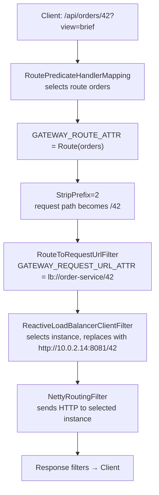

# Exchange Attributes for Route, Original URL, and Target URL

## Learning Objectives

In the **Request Processing Architecture** chapter of **Spring Cloud Gateway**, a request does not consist solely of an HTTP method, path, and headers. Throughout route selection, path transformation, service discovery, and forwarding, the Gateway also stores coordination metadata in **`ServerWebExchange` attributes**. Understanding them explains why a request is sent to a particular address and helps uncover root causes of hard-to-observe routing failures.

After this lesson, you will be able to:

- Distinguish **`ServerWebExchange` attributes**, HTTP requests/responses, and Reactor Context.
- Correctly read three core attributes: `GATEWAY_ROUTE_ATTR`, `GATEWAY_ORIGINAL_REQUEST_URL_ATTR`, and `GATEWAY_REQUEST_URL_ATTR`.
- Trace how a URL changes across route predicates, path-modifying filters, `RouteToRequestUrlFilter`, service discovery/load balancing, and routing filters.
- Distinguish the URL sent by the client, the URI configured on the route, the intermediate `lb://` URI, and the real backend URI.
- Write a `GlobalFilter` to observe route/URL state without breaking routing or exposing sensitive data.
- Determine when attributes hold data, why they might not exist yet or hold unexpected values, and how to verify them with integration tests.

## 1. What Is `ServerWebExchange`?

In Spring WebFlux, **`ServerWebExchange`** models a server-side HTTP exchange. It provides:

- `exchange.getRequest()`: the current request, including method, URI, path, headers, and body.
- `exchange.getResponse()`: the response being built and returned.
- `exchange.getAttributes()`: a `Map<String, Object>` used to share **internal metadata of the same exchange** across processing components.

Spring Cloud Gateway Server WebFlux uses the exchange to coordinate **route predicates**, the **gateway filter chain**, URL rewriting, **service discovery**, routing, and response-processing steps. Each request typically has its own exchange, making its attributes suitable for per-request state.

For example, a filter can add an application attribute:

```java
static final String START_TIME_KEY = "app.requestStartedAtNanos";

exchange.getAttributes().put(START_TIME_KEY, System.nanoTime());
Long startedAt = exchange.getAttribute(START_TIME_KEY);
```

Unlike Reactor Context, which is immutable at the API level, `exchange.getAttributes()` is a **mutable map**. Filters handling the same exchange can read and write this map. That is convenient, yet also requires avoiding careless overwrites and avoiding dependencies on unguaranteed execution ordering.

`exchange.mutate()` can create a decorator over the exchange to use modified request/response instances; in WebFlux's default model, attributes continue to be shared across the decorated exchange. Mutating the HTTP request **does not automatically mean** all Gateway URL-related attributes change with it.

> The scope of this article is **Spring Cloud Gateway Server WebFlux**, where `GlobalFilter`, `GatewayFilterChain`, and `ServerWebExchange` apply. Other variants such as Spring Cloud Gateway Server MVC have their own APIs and processing models. Route configuration syntax may vary with the Spring Cloud Gateway version in use.

## 2. Three Attributes to Recognize First

The constants below belong to:

```java
import static org.springframework.cloud.gateway.support.ServerWebExchangeUtils
    .GATEWAY_ROUTE_ATTR;
import static org.springframework.cloud.gateway.support.ServerWebExchangeUtils
    .GATEWAY_ORIGINAL_REQUEST_URL_ATTR;
import static org.springframework.cloud.gateway.support.ServerWebExchangeUtils
    .GATEWAY_REQUEST_URL_ATTR;
```

| Attribute | Value Type | Meaning | Typical Time of Appearance |
| --- | --- | --- | --- |
| **`GATEWAY_ROUTE_ATTR`** | `org.springframework.cloud.gateway.route.Route` | Selected route, including ID, configured URI, and route metadata | After `RoutePredicateHandlerMapping` finds a matching route, before the Gateway filter chain executes |
| **`GATEWAY_ORIGINAL_REQUEST_URL_ATTR`** | `Set<URI>` | Set of pre-transformation URLs actively recorded by filters | When filters changing path or target URI invoke history-recording helpers; may not exist yet |
| **`GATEWAY_REQUEST_URL_ATTR`** | `java.net.URI` | URI the routing pipeline currently **intends to use**, which may be rewritten multiple times | After `RouteToRequestUrlFilter`; may change from `lb://...` to `http(s)://host:port/...` when the load balancer picks an instance |

Do not assume these three values are always present from the moment a request enters the application:

- `GATEWAY_ROUTE_ATTR` appears once a **route has matched**. Before route matching, such as in an early `WebFilter`, it may not exist yet.
- `GATEWAY_REQUEST_URL_ATTR` is set at the target-URL construction step. A custom filter running before that step can read `null` even though a route has already been selected.
- `GATEWAY_ORIGINAL_REQUEST_URL_ATTR` is **conditional history**, appended by components that record prior URLs. Do not treat it as a mandatory field or a single URI.

Two URIs are very easy to confuse:

```java
Route route = exchange.getAttribute(GATEWAY_ROUTE_ATTR);
URI configuredUri = route == null ? null : route.getUri();

URI currentTarget = exchange.getAttribute(GATEWAY_REQUEST_URL_ATTR);
```

`route.getUri()` is the **route's configured URI** (e.g., `lb://order-service`), whereas `currentTarget` is the **URI the Gateway is currently preparing to forward to** (e.g., `http://10.0.2.14:8081/orders/42`). The two values do not necessarily match.

## 3. Which Stages Does a Request Pass Through?

Consider a sales system with a public API:

```text
GET https://api.example.com/api/orders/42?view=brief
```

The Gateway needs to forward the request to an instance of `order-service`. Suppose a YAML route configuration in Spring Cloud Gateway Server WebFlux style:

```yaml
spring:
  cloud:
    gateway:
      routes:
        - id: orders
          uri: lb://order-service
          predicates:
            - Path=/api/orders/**
          filters:
            - StripPrefix=2
```

This is an **illustrative configuration** using the property style common in Spring Cloud Gateway Server WebFlux; verify the configuration namespace against your actual version/framework. `lb://order-service` requires a load balancing mechanism and a configured source of service instances. The string `lb://` alone does not start a service registry.

With `StripPrefix=2`, the first two path segments `api` and `orders` are removed. The expected backend request is:

```text
GET /42?view=brief
```

Any backend expecting `/orders/42` will need a different rewrite rule. The Gateway cannot infer each service's API contract on its own.



The diagram simplifies other filters and the query string for readability. The query string `?view=brief` is normally preserved when building the new URL, unless a filter actively changes it.

### 3.1. Snapshot at Each Moment

Suppose in this example the Gateway receives the HTTPS request directly, path-modifying filters recorded the old URL in history, and the load balancer found instance `10.0.2.14:8081`:

| Stage | `exchange.getRequest().getURI()` | `GATEWAY_ROUTE_ATTR` | `GATEWAY_REQUEST_URL_ATTR` |
| --- | --- | --- | --- |
| After route matching, before rewrite | `https://api.example.com/api/orders/42?view=brief` | Route `orders` | Not necessarily present yet |
| After `StripPrefix=2` | `https://api.example.com/42?view=brief` | Route `orders` | Not necessarily present yet |
| After `RouteToRequestUrlFilter` | `https://api.example.com/42?view=brief` | Route `orders` | `lb://order-service/42?view=brief` |
| After reactive load balancing | `https://api.example.com/42?view=brief` | Route `orders` | `http://10.0.2.14:8081/42?view=brief` |
| During Netty routing | Request URI on exchange still reflects mutated request | Route `orders` | Target HTTP URI used for routing |

The rows show **logical moments**, not a guarantee that all filters in all versions always execute in one rigid absolute order. Custom filters can alter the flow; verify `Ordered` and the active Gateway variant.

Three conclusions follow from the table:

1. **The URI from the current request** is not necessarily the URI the client originally sent because filters can rewrite the path.
2. **The Route's configured URI** can stay `lb://order-service` throughout the request lifecycle.
3. **The target URI in `GATEWAY_REQUEST_URL_ATTR`** can change between steps: from a logical service name to a concrete instance address.

### 3.2. Original URL History Can Contain Multiple Entries

`GATEWAY_ORIGINAL_REQUEST_URL_ATTR` in this case may contain:

```text
https://api.example.com/api/orders/42?view=brief
lb://order-service/42?view=brief
```

The first element may be recorded when altering the path; the second may be recorded before the load balancer replaces the `lb://` URI with an instance URI. These values are merely **examples of history recorded by the corresponding filters**. They are not guaranteed to always be present, do not necessarily represent every single transformation, and should not be treated as an ordered list.

## 4. `GATEWAY_ROUTE_ATTR`: Which Route Won?

In Gateway WebFlux, `RoutePredicateHandlerMapping` evaluates route predicates such as `Path`, `Host`, `Method`, headers, or custom conditions. When a matching route is selected, the Gateway stores the **`Route` object** in `GATEWAY_ROUTE_ATTR`, after which `FilteringWebHandler` runs that route's set of GlobalFilters and GatewayFilters.

Example of reading the data:

```java
import org.springframework.cloud.gateway.route.Route;
import org.springframework.web.server.ServerWebExchange;

import static org.springframework.cloud.gateway.support.ServerWebExchangeUtils
    .GATEWAY_ROUTE_ATTR;

public String selectedRouteId(ServerWebExchange exchange) {
    Route route = exchange.getAttribute(GATEWAY_ROUTE_ATTR);
    return route == null ? "no-route-yet" : route.getId();
}
```

When inspecting routes, prefer logging the **route ID** rather than the entire route object's contents. Route IDs are stable and well suited for per-route error/latency statistics. Logging the entire route can expose internal metadata or generate unnecessary log volume.

Distinguish three roles:

- **Route predicate:** decides which route matches the request.
- **Route URI:** declares a logical backend or static target (`lb://order-service`, `https://backend.example.net`, etc.).
- **`GATEWAY_ROUTE_ATTR`:** stores the selected route so subsequent processing components can reference it.

A route being selected does **not** mean the request has passed authentication, the backend is healthy, or sending succeeded. After matching, filters can still reject the request due to permissions, rate limits, timeouts, or downstream failures.

If reading inside a `WebFilter` running before route matching, do not assume `GATEWAY_ROUTE_ATTR` exists. A request matching no route can also go to another handler or receive an error before any Gateway filter chain exists.

## 5. `GATEWAY_REQUEST_URL_ATTR`: The URI Actually Used for Routing

After a route is selected and request-transforming filters run, **`RouteToRequestUrlFilter`** builds a target URI from the current request info and the route's configured URI; the resulting URI is stored in `GATEWAY_REQUEST_URL_ATTR`.

For example:

```text
Request after StripPrefix:
  https://api.example.com/42?view=brief

Route URI:
  lb://order-service

Request URL attribute after RouteToRequestUrlFilter:
  lb://order-service/42?view=brief
```

This URI is in **logical destination** form: `order-service` is not yet an instance IP address and port. When `ReactiveLoadBalancerClientFilter` processes a URI with scheme `lb`, it locates a service instance using Spring Cloud LoadBalancer and replaces `GATEWAY_REQUEST_URL_ATTR` with a usable URI:

```text
http://10.0.2.14:8081/42?view=brief
```

**`NettyRoutingFilter`** in the next step uses that target URL information to perform outbound HTTP/HTTPS. The routing component typically marks the request as already routed to prevent other routing filters from processing the same exchange again.

### 5.1. Common URI Types

| Route URI | Usual Meaning | What to Check |
| --- | --- | --- |
| `http://host:8080` or `https://host` | Points to a fixed HTTP target | Host, TLS, trust, path rewrites, and timeouts |
| `lb://order-service` | Service name must be resolved to a concrete instance | Whether Spring Cloud LoadBalancer and an instance source are configured |
| `ws://...` or `wss://...` | WebSocket routing | Upgrade handshake, backend support, WebSocket routing filter |
| `lb:ws://order-service` | Uses load balancing for WebSocket per matching config | Scheme prefix, routing component support |
| `forward:/some-path` | Internal forward to a handler in the Gateway app | Do not treat as outbound HTTP to a remote backend |

A related attribute is **`GATEWAY_SCHEME_PREFIX_ATTR`**, used when a route URI carries a scheme prefix, such as the `lb:ws://...` combination. It helps relevant filters decide how to interpret the scheme and load balancing. Do not manually edit the prefix to force a request down another routing branch.

Additionally, Gateway internally tracks whether **the request has already been routed** (for instance via helpers like `isAlreadyRouted`/`setAlreadyRouted`). These markers are for routing coordination and should not be altered in ordinary business filters.

### 5.2. Why Not Just Use `route.getUri()` as the Target URL?

Suppose the route still holds `lb://order-service`, while the load balancer selected node `10.0.2.14:8081`. If a dashboard only reads `route.getUri()` and records "connected to lb://order-service", operators still do not know which instance actually received the request.

To observe stage by stage, read:

```java
Route route = exchange.getAttribute(GATEWAY_ROUTE_ATTR);
URI configured = route == null ? null : route.getUri();
URI currentTarget = exchange.getAttribute(GATEWAY_REQUEST_URL_ATTR);
```

`configured` answers **"where does the route configuration point?"**. `currentTarget` answers **"at the current step, which URI does the Gateway intend to go to?"**. If read early, `currentTarget` may still be `lb://`; if read after load balancing, it usually holds a concrete host/port. If the request was blocked before URL construction, it may be absent.

Do not assume a final `GATEWAY_REQUEST_URL_ATTR` proves the backend **received and successfully processed** the request. It reflects destination selection; actual outcomes still depend on connectivity, timeouts, circuit breakers, retries, and backend responses.

## 6. `GATEWAY_ORIGINAL_REQUEST_URL_ATTR`: Set of Recorded URLs

This attribute holds a **`Set<URI>`**, populated when filters call the helper to store pre-transformation URLs. In Spring Cloud Gateway source code, the associated utility is typically:

```java
ServerWebExchangeUtils.addOriginalRequestUrl(exchange, previousUri);
```

In use:

```java
import java.net.URI;
import java.util.Set;

import org.springframework.web.server.ServerWebExchange;

import static org.springframework.cloud.gateway.support.ServerWebExchangeUtils
    .GATEWAY_ORIGINAL_REQUEST_URL_ATTR;

public int originalUrlCount(ServerWebExchange exchange) {
    Set<URI> previous =
        exchange.getAttribute(GATEWAY_ORIGINAL_REQUEST_URL_ATTR);

    return previous == null ? 0 : previous.size();
}
```

The word `ORIGINAL` easily misleads readers into thinking it holds only **one initial URL sent by the client**. In reality, path transformations or converting a logical URI into a physical URI can add multiple distinct entries. Remember:

1. The attribute's type is **`Set<URI>`**, not `URI` or `List<URI>`.
2. A Set **has no chronological ordering guarantee**; do not grab the first/last element and declare it "the initial URL" or "the URL before the last step".
3. Not every filter records history; the element count is not the number of times the request was rewritten.
4. A request may lack this attribute entirely if no filter saved a prior URL.
5. Stored URIs may contain query strings with private data. Never log the entire collection directly in production.

If operational requirements genuinely need an immutable **"URI when the client entered the Gateway"** value, capture it at a clearly defined entry point under a **custom key** before any path-modifying filter runs:

```java
public static final String CLIENT_ENTRY_URI_ATTR =
    "app.clientEntryUri";

exchange.getAttributes().putIfAbsent(
    CLIENT_ENTRY_URI_ATTR,
    exchange.getRequest().getURI()
);
```

This snippet assumes it runs **before** filters that can mutate the request. If placed in a late-running filter, the captured URI may already be transformed. When sitting behind a reverse proxy, the HTTP URI seen by the Gateway may also differ from the public URL used by the browser; handling forwarded headers and trusted proxy boundaries is a separate concern.

Storing the entry URL under an application key avoids misusing `GATEWAY_ORIGINAL_REQUEST_URL_ATTR` as a complete or strictly ordered history structure.

## 7. Reading Attributes Inside a `GlobalFilter`

An observation filter can read attributes to record **route ID, target scheme, target host**, and terminal signal without altering the routing flow:

```java
import java.net.URI;
import java.util.Set;

import org.slf4j.Logger;
import org.slf4j.LoggerFactory;
import org.springframework.cloud.gateway.filter.GatewayFilterChain;
import org.springframework.cloud.gateway.filter.GlobalFilter;
import org.springframework.cloud.gateway.route.Route;
import org.springframework.core.Ordered;
import org.springframework.stereotype.Component;
import org.springframework.web.server.ServerWebExchange;

import reactor.core.publisher.Mono;

import static org.springframework.cloud.gateway.support.ServerWebExchangeUtils
    .GATEWAY_ORIGINAL_REQUEST_URL_ATTR;
import static org.springframework.cloud.gateway.support.ServerWebExchangeUtils
    .GATEWAY_REQUEST_URL_ATTR;
import static org.springframework.cloud.gateway.support.ServerWebExchangeUtils
    .GATEWAY_ROUTE_ATTR;

@Component
public class RouteAuditFilter implements GlobalFilter, Ordered {

    private static final Logger log =
        LoggerFactory.getLogger(RouteAuditFilter.class);

    @Override
    public int getOrder() {
        // Early filter, wrapping URL construction and routing steps.
        return -100;
    }

    @Override
    public Mono<Void> filter(
            ServerWebExchange exchange,
            GatewayFilterChain chain) {

        String method = exchange.getRequest()
            .getMethod().name();

        return chain.filter(exchange)
            .doFinally(terminalSignal -> {
                Route selected =
                    exchange.getAttribute(GATEWAY_ROUTE_ATTR);
                URI target =
                    exchange.getAttribute(GATEWAY_REQUEST_URL_ATTR);
                Set<URI> history = exchange.getAttribute(
                    GATEWAY_ORIGINAL_REQUEST_URL_ATTR
                );

                log.info(
                    "route={} method={} targetScheme={} "
                        + "targetHost={} previousUrlCount={} terminal={}",
                    selected == null ? "unknown" : selected.getId(),
                    method,
                    target == null ? "unknown" : target.getScheme(),
                    target == null ? "unknown" : target.getHost(),
                    history == null ? 0 : history.size(),
                    terminalSignal
                );
            });
    }
}
```

**Why read inside `doFinally`?** An early-ordered filter is invoked in the *pre* phase before many routing filters. Reading the target URI at the start of `filter` may find `GATEWAY_REQUEST_URL_ATTR` not yet populated. In `doFinally`, the downstream chain has reached a terminal state, making attribute changes performed throughout processing visible.

`doFinally` receives terminal signals such as complete, error, or subscription cancellation. **`terminalSignal` is not an HTTP status code**. If you need to distinguish 2xx/4xx/5xx, also inspect the response status and handle cases where status is not yet set or the response is incomplete.

The example logs only route ID and target scheme/host to minimize data-exposure risk. **Never log raw URLs containing query strings, tokens, cookies, or authorization headers.** In production environments, also control what enters logs and metric cardinality, especially when hostnames/instances churn frequently.

### 7.1. Snapshot After `RouteToRequestUrlFilter` Runs

When you specifically need to observe the **intermediate `lb://` URI**, a filter can be ordered right after URL construction and before load balancing:

```java
import java.net.URI;

import org.springframework.cloud.gateway.filter.GatewayFilterChain;
import org.springframework.cloud.gateway.filter.GlobalFilter;
import org.springframework.cloud.gateway.filter.RouteToRequestUrlFilter;
import org.springframework.core.Ordered;
import org.springframework.stereotype.Component;
import org.springframework.web.server.ServerWebExchange;
import reactor.core.publisher.Mono;

import static org.springframework.cloud.gateway.support.ServerWebExchangeUtils
    .GATEWAY_REQUEST_URL_ATTR;

@Component
public class LogicalTargetProbe implements GlobalFilter, Ordered {

    @Override
    public int getOrder() {
        return RouteToRequestUrlFilter.ROUTE_TO_URL_FILTER_ORDER + 1;
    }

    @Override
    public Mono<Void> filter(
            ServerWebExchange exchange,
            GatewayFilterChain chain) {

        URI logicalTarget =
            exchange.getAttribute(GATEWAY_REQUEST_URL_ATTR);

        if (logicalTarget != null) {
            // Observe scheme/host only; do not print query string.
            System.out.println(
                "logicalTarget=" + logicalTarget.getScheme()
                    + "://" + logicalTarget.getHost()
            );
        }

        return chain.filter(exchange);
    }
}
```

This is **illustrative learning code**; in real applications, use a logger, telemetry, and log-level controls instead of `System.out.println`. The order value above targets capturing the URI right after `RouteToRequestUrlFilter` in a Server WebFlux pipeline with matching filter orders; other custom filter orders can still affect results. Only use constants/Filter classes present in your declared Gateway dependency version.

To capture the **instance URI after load balancing**, place an observation step after `ReactiveLoadBalancerClientFilter` per your exact version's filter ordering. If a service uses a static `http(s)://...` URI, no `lb://` phase exists.

### 7.2. Never Call `subscribe()` Inside a Filter to "Wait for the URL"

An **inappropriate** example:

```java
// Avoid creating a detached subscription to read attributes.
chain.filter(exchange).subscribe();
URI target = exchange.getAttribute(GATEWAY_REQUEST_URL_ATTR);
return Mono.empty();
```

This spawns an independent subscription, breaks the request lifecycle, and detaches errors and cancellation from Gateway management. Instead, **return** the publisher from `chain.filter(exchange)` and attach `doOn...`/`doFinally` when observation is needed.

## 8. When Rewriting Paths, What Actually Changes?

This is a frequent cause of 404 errors: modifying the request URI via `exchange.mutate()` and modifying `GATEWAY_REQUEST_URL_ATTR` are **two distinct actions**.

When `StripPrefix`, `SetPath`, or `RewritePath` executes **before `RouteToRequestUrlFilter`**, target URL construction typically uses the **mutated** request URI.

```text
Client:             GET /api/orders/42
                       │
StripPrefix=2:         ▼
Request URI:        GET /42
                       │
RouteToRequestUrlFilter
                       ▼
Gateway target:     lb://order-service/42
                       │
Load balancer:         ▼
Backend target:     http://10.0.2.14:8081/42
```

Conversely, if a custom filter modifies the request path **after `GATEWAY_REQUEST_URL_ATTR` has already been computed**, the routing filter may still use the old target URL. Therefore, when writing custom filters:

- Verify whether it runs **before or after** `RouteToRequestUrlFilter`.
- Prefer standard `GatewayFilterFactory` implementations such as `StripPrefix`, `SetPath`, and `RewritePath` for common needs.
- If you truly must change the routing target in code, understand how downstream filters use `GATEWAY_REQUEST_URL_ATTR` and how the Gateway marks routing state; manual overrides can bypass route/load-balancing/TLS policies.
- Test against a mock backend and verify **the URI the backend actually receives**, rather than checking only the attribute map.

Beyond paths, HTTP headers can be added, modified, or removed across the filter chain. Changing a header via `SetRequestHeader` **does not automatically update** `GATEWAY_ROUTE_ATTR` or the target URI. Conversely, a value in `exchange.getAttributes()` **does not automatically become an HTTP header** seen by the client or backend.

## 9. Comparing Exchange Attributes, Reactor Context, and HTTP Headers

The mechanisms below can all carry "per-request" information, yet **differ in scope and propagation**:

| Mechanism | Where Does Data Live? | How to Use | Automatically Propagated to Backend? |
| --- | --- | --- | --- |
| **`ServerWebExchange.getAttributes()`** | Internal map attached to current exchange | `exchange.getAttribute(KEY)` / `exchange.getAttributes().put(KEY, value)` | No |
| **Reactor Context** | Context per Reactor subscription | `contextWrite`, `deferContextual` | No |
| **HTTP request headers** | HTTP request metadata | `exchange.getRequest().mutate().headers(...)` or appropriate Gateway filter | Yes, if forwarded by routing and not stripped |
| **Route URI (`Route.getUri()`)** | Route configuration | Read from `GATEWAY_ROUTE_ATTR` | Not data that automatically appears in headers |
| **`GATEWAY_REQUEST_URL_ATTR`** | Coordination URI used by Gateway routing | Read from `exchange.getAttribute(...)` | Not sent as a header; used by routing to pick destination |

Example:

```java
// Internal metadata, visible only to components holding the exchange:
exchange.getAttributes().put("app.correlationId", "req-123");
```

The snippet above does **not** make Order Service automatically receive `X-Correlation-Id`. To transmit a correlation ID over the network, add the header to the forwarded HTTP request using the mechanism designed for that purpose, while validating header sources if they carry security value.

`Reactor Context` is suited when reactive components receive `Mono`/`Flux` without receiving `ServerWebExchange`. Exchange attributes are suited when multiple Gateway filters already share the same exchange and need to share coordination data, such as route ID, URL history, or gateway-computed metadata.

Reactive Spring Security has its own mechanism for accessing the security context; do not store tokens/Authentication objects into Gateway attribute keys and treat that as an authentication mechanism. Data-access authorization must still be enforced at the proper layer.

## 10. Real-World Scenarios to Analyze

### Scenario A: Right Route, Backend Returns 404

Client requests:

```text
GET /api/orders/42
```

`GATEWAY_ROUTE_ATTR` shows route `orders` matched, yet the backend only supports `GET /orders/42`. If the Gateway uses `StripPrefix=2`, the target URL becomes `/42` and the backend returns 404.

**How to handle:** inspect `route.getId()`, request URI after path filters, and `GATEWAY_REQUEST_URL_ATTR` before routing; compare against the HTTP path actually received by the backend. Adjust rewrite rules to match the backend contract. A 404 in this case does not necessarily mean the route predicate was wrong.

### Scenario B: Route Uses `lb://`, Yet Requests Get 503

`GATEWAY_ROUTE_ATTR` holds route `orders` and `GATEWAY_REQUEST_URL_ATTR` held `lb://order-service/42`, yet no suitable service instance exists or service discovery failed.

**How to handle:** check load balancer/discovery config, service name, instance status, readiness, and errors from upstream resolution. Depending on configuration, when no instance is found, the Gateway may return **503** or **404**; you cannot conclude solely from the error code that the Gateway failed to match a route. If resolution did not succeed, the target URL attribute may still show the logical URI.

### Scenario C: Logs Show Different URLs

One filter reading `GATEWAY_REQUEST_URL_ATTR` before load balancing sees `lb://order-service/...`; another reading after that step sees `http://10.0.2.14:8081/...`.

**How to handle:** record the **snapshot stage** clearly in logs and distinguish configured URI, logical URI, and instance URI. This can be normal progression rather than two filters routing to conflicting targets.

### Scenario D: Original URL Set Is Empty

No custom filter rewrites the URL; you observe `GATEWAY_ORIGINAL_REQUEST_URL_ATTR` is `null` or empty.

**How to handle:** do not assume data loss. The attribute is history written only when a component invokes the prior-URL recording mechanism. If you need the URL right at the entry point regardless of whether any rewrite occurs, capture it in an early enough filter under a dedicated application key.

### Scenario E: Retries and Backend Call Attempts

The Gateway may apply retries to a request depending on configuration and error conditions. Exchange attributes show the route and URI being processed, yet **are not a complete history of every connection attempt**. Looking only at `GATEWAY_ORIGINAL_REQUEST_URL_ATTR` is insufficient to count retries or prove which instances received the request.

**How to handle:** use metrics, per-attempt logs, distributed tracing, and backend telemetry; also ensure retries apply only when request semantics permit, especially for non-idempotent write operations.

## 11. Security and System Observability When Using URL Attributes

Exchange attributes help debug quickly, yet URLs can carry sensitive data:

- Query strings may contain session IDs, emails, access codes, or business parameters; avoid logging raw `URI.toString()`.
- Instance host/port values can reveal infrastructure topology. Restrict them to access-controlled internal logs.
- Headers like `Forwarded`, `X-Forwarded-Host`, and `X-Forwarded-Proto` may reflect upstream proxies. Trust these headers only when proxy sources are verified and infrastructure prevents spoofing; they can affect the URI perceived by the Gateway.
- Never accept a target URI from uncontrolled headers or query params and write it straight into `GATEWAY_REQUEST_URL_ATTR`; doing so risks **server-side request forgery (SSRF)**, unintended internal network access, or bypassing route policies.
- Never treat route ID or path matching as proof that the caller was authenticated, authorized, or permitted to access backend resources.

A practical observability design should use:

| Signal | What to Record | What to Avoid |
| --- | --- | --- |
| Metrics | Route ID, HTTP status, latency, error rate, saturation | Per-user tags, full URIs, query strings, or per-request IDs due to unbounded cardinality |
| Logs | Route ID, valid request/correlation ID, error code, phase, duration, sanitized target scheme | Tokens, cookies, personal data in queries, sensitive payloads |
| Traces | Spans for Gateway and downstream, route ID, trace ID, per-hop timing | Using exchange attributes as a complete replacement for network trace propagation |
| Routing incidents | Sanitized logical/target URI snapshots, discovery/Netty errors, response code | Asserting the backend received the request solely because a URL attr was set |

For an API Gateway with TLS, rate limiting, circuit breakers, retries, or authentication, these attributes only help **observe routing decisions**. They do not replace security configurations or resilience policies; telemetry should link route, filter, backend, and error codes under the same trace.

## 12. Testing Correct Route and URL Behavior

In integration tests, run the Gateway against a mock HTTP backend or test service capable of recording received requests. For example, with route `orders` and `StripPrefix=2`, verify:

1. Client sends `GET /api/orders/42?view=brief`.
2. Request matches route `orders`; if an audit filter is present, it records route ID `orders`.
3. Backend actually receives **`GET /42?view=brief`**.
4. When changed to `StripPrefix=1`, backend actually receives **`GET /orders/42?view=brief`**.
5. For an `lb://order-service` route, the service instance source provides a specific test backend; the Gateway sends the request to the selected instance.
6. When no instance is available, the Gateway returns an error per config; audit/logs show the route matched yet upstream could not be resolved.
7. When no rewrite records history, code reading `GATEWAY_ORIGINAL_REQUEST_URL_ATTR` handles `null` safely.
8. No sensitive query strings, tokens, or cookies appear in diagnostic logs.

Example HTTP client check:

```bash
curl -i "http://localhost:8080/api/orders/42?view=brief"
```

**Observe at the backend**, not just by matching status codes. If the backend returns 200 on both `/42` and `/orders/42`, a test checking only status will miss an incorrect rewrite. For TLS, rate limiting, circuit breaker, and retry integrations, write dedicated tests for each policy; those tests must verify both the execution path and real side effects, not merely attribute presence.

### 12.1. Checklist When Debugging a Request Going to the Wrong Target

| Question | Data to Inspect |
| --- | --- |
| Which route did the Gateway select? | `GATEWAY_ROUTE_ATTR` → `Route.getId()` |
| Where is the route configured to go? | `Route.getUri()` |
| What is the request path after rewrites? | `exchange.getRequest().getURI()` at the appropriate stage |
| What is the target URL before load balancing? | `GATEWAY_REQUEST_URL_ATTR` right after `RouteToRequestUrlFilter` |
| What is the target URL after load balancing? | `GATEWAY_REQUEST_URL_ATTR` after service instance resolution |
| Which URLs were actively recorded? | `GATEWAY_ORIGINAL_REQUEST_URL_ATTR` (do not assume order or completeness) |
| Which URL did the backend actually receive? | Backend access logs/HTTP stub, tracing, or network telemetry |
| Why did the request fail? | Status code, exception, timeout, per-route metrics, and correlated trace |

## 13. Self-Assessment Exercise

Design two routes:

```text
Route A:
  id = catalog
  predicate = Path=/api/catalog/**
  uri = http://catalog.internal:8081
  filter = StripPrefix=2

Route B:
  id = orders
  predicate = Path=/api/orders/**
  uri = lb://order-service
  filter = StripPrefix=1
```

Given the requests:

```text
GET /api/catalog/items/7?lang=vi
GET /api/orders/42
```

Determine on your own:

1. Which route does `GATEWAY_ROUTE_ATTR` point to for each request?
2. What is the URI of `exchange.getRequest()` after the path filter?
3. What is `GATEWAY_REQUEST_URL_ATTR` expected to be after `RouteToRequestUrlFilter`?
4. For route B, what additional step is needed before the real instance host/port is known?
5. Can "the initial URL sent by the client" be deduced from the first element of `GATEWAY_ORIGINAL_REQUEST_URL_ATTR`?

**Answer hints:**

- Route A selects `catalog`, leaving `/items/7?lang=vi` after `StripPrefix=2`; expected target URL is `http://catalog.internal:8081/items/7?lang=vi`.
- Route B selects `orders`, leaving `/orders/42` after `StripPrefix=1`; logical target URL is `lb://order-service/orders/42`, after which the load balancer selects an instance to produce a concrete HTTP URI.
- Do not treat the original URLs set as an ordered list or guaranteed to hold the initial URI. If you need to store the URL upon entering the Gateway, save it under a custom key at an early enough stage.

## Summary

In **Spring Cloud Gateway Server WebFlux**, `ServerWebExchange` attributes act as an internal "state board" for components to coordinate request processing. **`GATEWAY_ROUTE_ATTR`** answers *which route was selected*; **`GATEWAY_REQUEST_URL_ATTR`** reflects *the target URI at the current stage*; **`GATEWAY_ORIGINAL_REQUEST_URL_ATTR`** holds *the set of prior URIs actively saved by filters*. They carry different meanings from configured URIs, HTTP headers, and Reactor Context.

When analyzing routes, path rewrites, and service discovery, always ask **at which moment the attribute is read**. That is the key to distinguishing predicate errors, path-transformation errors, service discovery errors, and backend connection errors. Combining attribute inspection with integration tests and end-to-end tracing keeps a microservices API gateway accurate, secure, and easy to diagnose.
