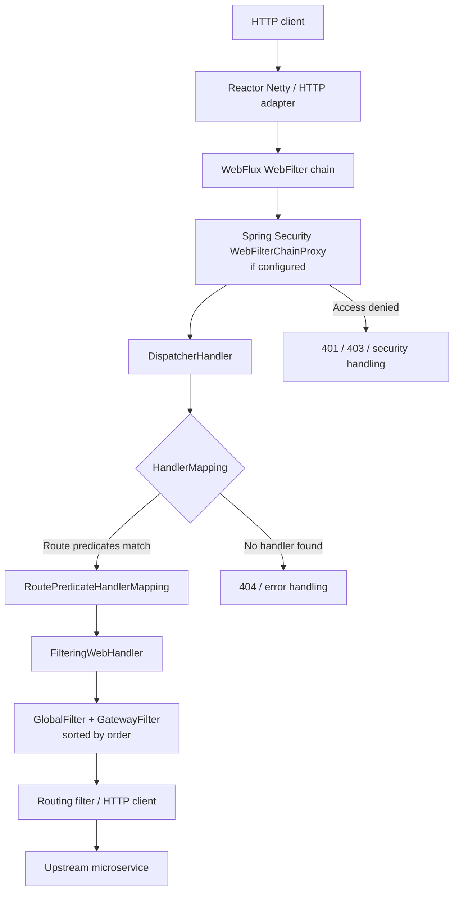
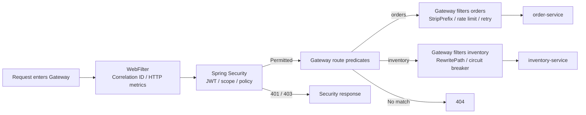

# Boundaries Between WebFilter, Spring Security Filters, and GatewayFilter

In Spring Cloud Gateway running on **Spring WebFlux**, a request passes through multiple processing layers before being forwarded to a backend microservice. Three of the most easily confused concepts are WebFlux's `WebFilter`, Spring Security's security filters, and Spring Cloud Gateway's `GatewayFilter`. All of them can read `ServerWebExchange` and return `Mono<Void>`, yet they **differ in where they are invoked, their scope of application, execution timing, and responsibilities**.

This lesson belongs to the **Request Processing Architecture** chapter and focuses on picking the right layer to implement authentication, authorization, logging, routing, path/header transformations, rate limiting, retries, and circuit breakers. Understanding these boundaries helps the Gateway protect even requests that match no route, avoid out-of-order security checks, and avoid placing logic in a filter that never executes.

> **Scope:** Examples use **Spring Cloud Gateway Server WebFlux** (Reactor and Spring WebFlux foundation), and do not apply verbatim to Spring Cloud Gateway Server MVC. In MVC/Servlet applications, `jakarta.servlet.Filter` and Gateway MVC's filter mechanism belong to a different pipeline.

## 1. Which Layers Does an HTTP Request Pass Through?

Conceptually, the pipeline on Gateway WebFlux consists of:



The diagram above illustrates **logical boundaries**, not that `WebFilterChainProxy` is an independent processor outside the WebFilter chain: in a reactive application, Spring Security integrates into the **WebFilter chain itself** via a proxy `WebFilter`. Other `WebFilter`s can be ordered before or after that proxy using the ordering mechanism.

Important sequence:

1. WebFlux creates a `ServerWebExchange` holding the request and response, then runs registered `WebFilter`s.
2. When Spring Security is present, `WebFilterChainProxy` selects a `SecurityWebFilterChain` matching the request and runs the security `WebFilter`s inside it. Security can stop the pipeline right here.
3. If the request continues, `DispatcherHandler` and `HandlerMapping` look for a matching handler. The Gateway uses `RoutePredicateHandlerMapping` to evaluate route predicates (e.g., `Path`, `Method`, `Header`).
4. Only after a Gateway route has been selected does `FilteringWebHandler` combine **`GlobalFilter`s + the route's `GatewayFilter`s** into a processing chain.
5. The routing filter calls the target service; the response flows back through the post-processing callbacks of the corresponding filters.

Within the same application, WebFlux handlers other than Gateway can exist, such as internal controllers or Actuator endpoints. Therefore, **not every request entering WebFlux passes through the Gateway filter chain**.

### Quick Comparison Table

| Perspective | WebFlux `WebFilter` | Spring Security reactive filters | Gateway `GlobalFilter` / `GatewayFilter` |
| --- | --- | --- | --- |
| Framework | Spring WebFlux | Spring Security WebFlux | Spring Cloud Gateway Server WebFlux |
| Timing | Before handler processing, wrapping the WebFlux flow | Inside the WebFilter chain; runs before handler if security chain matches | After a Gateway route has been selected |
| Scope | Requests passing through the application's WebFlux handler chain | Requests matching a `SecurityWebFilterChain`'s `securityMatcher` | `GlobalFilter`: selected Gateway routes; `GatewayFilter`: specific route |
| Main API | `WebFilter.filter(exchange, WebFilterChain)` | `SecurityWebFilterChain`, `ServerHttpSecurity`, and security `WebFilter`s | `GlobalFilter.filter(exchange, GatewayFilterChain)`, `GatewayFilter` |
| Order | `@Order`/`Ordered` in the WebFilter list | Order of security chains and `SecurityWebFiltersOrder` inside | `Ordered` / route filter order in the Gateway list |
| Well suited for | Correlation ID, cross-cutting technical tasks, broadly designed CORS | Authentication, authorization, CSRF, sessions, security context, exception translation | Route rewrites, header transforms, rate limiting, retries, circuit breakers, routing, per-route metrics |
| If no route exists | Can still run | Can still check permissions by path | **Does not run** because no Gateway route was selected |
| If security denies | A WebFilter running **before** security can still observe the result when the chain ends | Returns response/error signal per security config | Usually **does not run** |

**Name distinction:** Gateway's `GlobalFilter` does not mean "filter all HTTP requests". The word "global" refers to the scope of **all selected Gateway routes**; it does not automatically wrap controller endpoints, Actuator endpoints, unmatched requests, or requests blocked earlier by Security.

## 2. WebFilter: The WebFlux Layer Wrapping Request Processing

`WebFilter` has the contract:

```java
public interface WebFilter {
    Mono<Void> filter(
        ServerWebExchange exchange,
        WebFilterChain chain
    );
}
```

`WebFilter` itself does not need to know the route ID, upstream `uri`, or Gateway predicates. It fits **WebFlux-wide cross-cutting tasks**, such as generating correlation IDs, recording request execution duration, adding technical response headers, or setting up context.

Example generating an internal ID for every request ahead of downstream layers:

```java
@Component
@Order(Ordered.HIGHEST_PRECEDENCE)
public class RequestIdWebFilter implements WebFilter {

    public static final String REQUEST_ID_ATTR = "requestId";

    @Override
    public Mono<Void> filter(
            ServerWebExchange exchange,
            WebFilterChain chain) {

        String requestId = UUID.randomUUID().toString();

        exchange.getAttributes().put(REQUEST_ID_ATTR, requestId);
        exchange.getResponse().getHeaders()
            .set("X-Request-Id", requestId);

        return chain.filter(exchange);
    }
}
```

Required imports include `WebFilter`, `WebFilterChain`, `ServerWebExchange`, `Mono`, `Component`, `Order`, `Ordered`, and `UUID`. The example intentionally generates a new ID rather than trusting a header that a client could forge; if the system already uses a trace ID from an observability platform, use unified propagation instead of duplicating IDs.

Notable points:

- `@Order(Ordered.HIGHEST_PRECEDENCE)` makes this WebFilter run early in the **WebFilter list**. That order number is **not** directly comparable to `GlobalFilter` order numbers.
- It can apply to requests rejected by Security and to requests that match no Gateway route.
- `exchange.getAttributes()` shares data within the same request across layers; to send the ID upstream, add a header to the **forwarded request** at the appropriate layer.
- Calling `chain.filter(exchange)` returns a publisher that participates in the request pipeline. Avoid calling `subscribe()` inside a filter, because a detached subscription breaks away from request error/cancellation handling.
- Never hold per-request state in fields of a singleton `WebFilter`; use local variables, request attributes, or Reactor `Context`.

**Boundary:** a WebFilter can modify `ServerHttpRequest` or `ServerHttpResponse`, yet is **not a good place to enforce rules based on Gateway route ID**. When a WebFilter runs before `HandlerMapping`, no route has been determined yet.

## 3. Spring Security Reactive: Protecting Before Routing

In the WebFlux stack, Spring Security uses a `WebFilterChainProxy` executing security `WebFilter`s according to `SecurityWebFilterChain` configurations. Two ordering levels must be distinguished:

- **Order among `SecurityWebFilterChain`s:** if multiple chains are configured with different `securityMatcher`s, Spring Security selects the matching chain in order; the chosen chain takes responsibility for the request.
- **Order among security filters within a chain:** Spring Security organizes authentication, authorization, exception handling, and related steps via `SecurityWebFiltersOrder`. Normally, configure via the `ServerHttpSecurity` DSL rather than manually ordering security filters.

For microservices secured with Bearer JWTs, a sample configuration:

```java
@Configuration
@EnableWebFluxSecurity
public class GatewaySecurityConfig {

    @Bean
    SecurityWebFilterChain securityWebFilterChain(
            ServerHttpSecurity http) {

        return http
            .csrf(ServerHttpSecurity.CsrfSpec::disable)
            .authorizeExchange(exchanges -> exchanges
                .pathMatchers("/actuator/health").permitAll()
                .pathMatchers("/api/public/**").permitAll()
                .pathMatchers("/api/admin/**").hasAuthority("SCOPE_admin")
                .anyExchange().authenticated())
            .oauth2ResourceServer(oauth2 ->
                oauth2.jwt(Customizer.withDefaults()))
            .build();
    }
}
```

This is an **example for stateless APIs using Bearer tokens**, with corresponding JWT resource server configuration and token verification in the application. Disabling CSRF is only reasonable when browser cookie/session authentication is not used; if browser sessions exist, design CSRF according to the actual flow. Configure appropriate issuer/trust keys and JWT validators, including audience if required by the API. Authority `SCOPE_admin` illustrates a common scope mapping, not that every JWT carries this authority.

The configuration illustrates authorization boundaries:

- `/actuator/health` and `/api/public/**` are accessed under public policy, regardless of whether a Gateway route matches.
- `/api/admin/**` requires a specific authority **before** `StripPrefix`/`RewritePath` applies for upstream.
- Every other request must be authenticated due to `anyExchange().authenticated()`. A catch-all rule prevents accidentally leaving unlisted endpoints open.

Security can process a request before a Gateway route is selected. Therefore, **never assume a `GatewayFilter` rule always runs to protect an endpoint**. Core authentication/authorization rules belong in the security layer, after which Gateway filters can add route-specific checks if truly needed.

### Distinguishing Authentication from Token Forwarding

**Authentication** verifies identity or credentials; **authorization** decides whether the caller has permission to invoke a path/operation. Both are primary responsibilities of Spring Security.

A `GatewayFilter` such as `TokenRelay` serves the job of **forwarding an appropriate access token** upstream when supported by OAuth2 client/security context configuration. Token relay **does not replace** authentication and authorization at the Gateway. Nor should upstreams blindly trust any `X-User` or `Authorization` header arriving from the Internet. In a zero-trust architecture, microservices either verify tokens themselves or only trust identity metadata propagated over a trusted channel.

## 4. GatewayFilter and GlobalFilter: Present Only After Route Selection

When a route satisfies its predicates, `RoutePredicateHandlerMapping` hands processing off to `FilteringWebHandler`. That handler collects `GlobalFilter`s and the route's `GatewayFilter`s, sorts them by order, and builds one chain.

A sample route using Java DSL:

```java
@Configuration
public class GatewayRoutes {

    @Bean
    RouteLocator orderRoutes(RouteLocatorBuilder builder) {
        return builder.routes()
            .route("orders", route -> route
                .path("/api/orders/**")
                .filters(filters -> filters
                    .stripPrefix(1)
                    .addRequestHeader("X-Edge", "gateway"))
                .uri("lb://orders-service"))
            .build();
    }
}
```

A `GET /api/orders/42` request matches route `orders`. Gateway filter `StripPrefix=1` turns the upstream path into `/orders/42`, while `AddRequestHeader` adds a route-specific header. The `lb://orders-service` URI illustrates service discovery and load balancing; appropriate service discovery/load balancer configuration is required. In a test environment, it can be replaced with a concrete HTTP URI.

A `GlobalFilter` logging per route:

```java
@Component
public class RouteLifecycleFilter implements GlobalFilter, Ordered {

    private static final Logger log =
        LoggerFactory.getLogger(RouteLifecycleFilter.class);

    @Override
    public int getOrder() {
        return 0;
    }

    @Override
    public Mono<Void> filter(
            ServerWebExchange exchange,
            GatewayFilterChain chain) {

        Route route = exchange.getAttribute(
            ServerWebExchangeUtils.GATEWAY_ROUTE_ATTR);

        String routeId = (route != null) ? route.getId() : "unknown";
        long startedAt = System.nanoTime();

        return chain.filter(exchange)
            .doFinally(signal -> log.info(
                "route={} signal={} status={} elapsedMs={}",
                routeId,
                signal,
                exchange.getResponse().getStatusCode(),
                TimeUnit.NANOSECONDS.toMillis(
                    System.nanoTime() - startedAt)));
    }
}
```

Gateway types include `GlobalFilter`, `GatewayFilterChain`, `Route`, and `ServerWebExchangeUtils`; the example also uses SLF4J and `TimeUnit`. `ServerWebExchangeUtils.GATEWAY_ROUTE_ATTR` is the attribute Gateway sets after selecting a route. Hence, this GlobalFilter can retrieve the route ID, yet **will never be called just to log a request that matched no Gateway route**.

### Pre/Post and Ordering Rules

A filter can process **before** and **after** the next filter:

```java
@Override
public Mono<Void> filter(
        ServerWebExchange exchange,
        GatewayFilterChain chain) {

    // Pre-phase: before calling the rest of the Gateway chain.
    return chain.filter(exchange)
        .then(Mono.fromRunnable(() -> {
            // Post-phase: after the chain completes successfully.
        }));
}
```

Once the Gateway filter list is sorted, a filter with a **smaller order** typically enters the pre-phase earlier and exits the post-phase later, like nested layers:

```text
Pre:   Filter A (order -10) → Filter B (order 0) → Filter C (order 10)
              → send request upstream
Post:  Filter C             → Filter B           → Filter A
```

However, `then(...)` only runs when the upstream publisher **completes successfully**; to record errors and cancellations as well, use `doFinally` and distinguish `SignalType`. Do not expect a post callback to overwrite a response after the response has already been committed.

**Two separate order axes:** `@Order(-100)` on a `WebFilter` and `getOrder() == -100` on a `GlobalFilter` do not belong to the same sorted list. The Gateway filter chain sits deeper in dispatch; setting a huge negative order never makes a `GlobalFilter` run before Spring Security.

## 5. Real Boundaries Across Three Requests

Suppose the Gateway has the security policy above and the `orders` route.

| Request | Security Handles It? | Gateway Filters Handle It? | Illustrative Result |
| --- | --- | --- | --- |
| `GET /api/orders/42` without JWT | Blocked due to `authenticated()` | No | Usually returns `401 Unauthorized` |
| `GET /api/orders/42` with valid JWT | Allowed | Yes: `orders` route, path rewrite, proxy | Returns upstream result or proxy error |
| `GET /api/unknown` with valid JWT, matching no route | Allowed | No | Usually returns `404 Not Found` |

If a JWT is valid yet lacks the required scope on `/api/admin/**`, Spring Security usually returns `403 Forbidden`, also prior to routing filters. If a Gateway rate limiter on a route rejects the request, it can actively return `429 Too Many Requests` after the Security step. HTTP codes `401`/`403`/`404`/`429` do not necessarily correspond to Reactor `onError`; they can be valid completed responses.

A `WebFilter` running **before Security** can measure all three cases. A `GlobalFilter` only has measurements for cases that selected a route, so **Gateway route metrics must not be used in place of total inbound HTTP metrics**.

## 6. Placing Requirements in the Right Layer

### JWT Authentication and Scope/Role Authorization

Place in **Spring Security**. Use `ServerHttpSecurity`, OAuth2 resource server, security matchers, and authorization rules. Gateway filters can consume authentication results, yet should not replace the unified security layer with hand-written per-route checks.

Specifically, Security sees **the client-facing public path**. If a route has `StripPrefix` or `RewritePath`, those transformations normally happen **after** authorization. For instance, Security authorizes `/api/admin/reports`, while the backend receives `/admin/reports`. Design rules around the public client API contract to avoid confusing pre-rewrite and post-rewrite paths.

### URI Transformation, Headers, Service Routing

Place in **`GatewayFilter`** when route-dependent: `StripPrefix`, `RewritePath`, `AddRequestHeader`, `RemoveRequestHeader`, `SetPath`, `SetRequestHostHeader`, and similar filters. Place in **`GlobalFilter`** when shared logic applies across all Gateway routes, such as attaching verified metadata or measuring per-route latency.

When adding identity headers from the Gateway for upstream, handle same-named headers sent by clients: only forward values actively created or verified by the Gateway to prevent spoofing. Be careful with `Host`, `Forwarded`, and `X-Forwarded-*` headers, as they affect how upstream perceives origin, protocol, and caller address.

### Rate Limiting, Retries, and Circuit Breakers

Usually placed in **Gateway route filters** or equivalent Gateway policies:

- `RequestRateLimiter`: enforces limits on route-matched requests; if the key resolver uses identity, understand how the security context was authenticated.
- `Retry`: restrict retriable error conditions, total duration, and operations with side effects. Never automatically retry non-idempotent write operations.
- `CircuitBreaker`: protects upstream and provides valid fallbacks when permitted by business design.
- Timeouts: coordinate HTTP client connect/response timeouts with request deadlines and related filters.

Do not place a mechanism meant solely for upstream routes inside a `WebFilter` if doing so unexpectedly affects internal endpoints or unmatched requests.

### CORS and HTTP OPTIONS Preflight

CORS can be handled at the WebFlux/Spring Security layer or via Gateway CORS configuration depending on architecture. Because preflight `OPTIONS` requests **can be resolved before a route is selected**, ensure CORS config allows valid requests through the security step and does not depend solely on a `GatewayFilter` that might never run.

A common approach is unified CORS configuration at the Gateway integrated properly with Spring Security; avoid adding `Access-Control-Allow-Origin` from multiple layers simultaneously, which causes duplicate or conflicting headers. Clearly define allowed origins, methods, headers, and credentials; never use unrestricted wildcards for interfaces carrying sensitive data.

### Logs, Trace IDs, Metrics, and Audits

Can be divided by scope:

| Need | Suitable Layer | Reason |
| --- | --- | --- |
| Shared ID for both rejected and unmatched requests | WebFilter or general observability mechanism | Covers the WebFlux entrypoint |
| Authentication success/failure, access denied | Spring Security events/handlers and instrumentation | Separates `401` from `403`, avoids missing pre-route requests |
| Route ID, target, and proxy duration | GlobalFilter / Gateway metrics | Route has been selected and metadata exists |
| Service-A-specific path/header transforms | Route `GatewayFilter` | Applies only to Service A |
| Request body logging | Prefer controlled observability, minimized as much as possible | Risk of leaking PII/tokens and consuming `DataBuffer` |

Never log tokens, cookies, sensitive identifiers, or full request bodies. In Reactor pipelines, execution can switch threads; never assume `ThreadLocal`/MDC propagates automatically. Use context propagation/tracing configurations that support WebFlux.

## 7. Common Design Mistakes

### Mistake 1: "GlobalFilter always runs, even without a route"

**Wrong scope.** If `RoutePredicateHandlerMapping` does not select a route, `FilteringWebHandler` does not build a Gateway filter chain. A GlobalFilter is not the single place to measure all requests or catch all application `404`s.

**How to fix:** record HTTP entrypoint metrics with a WebFilter/general observability and record route-specific metrics separately in a GlobalFilter.

### Mistake 2: "Let GatewayFilter handle authentication because it is close to upstream"

**Easy to miss branches where the filter does not run.** If authentication exists only inside a route-specific filter, another endpoint, new route, or internal handler may lack the same policy.

**How to fix:** use Spring Security for baseline default rules and control scope with `securityMatcher` / `authorizeExchange`; add route-level checks only with a clear purpose.

### Mistake 3: "Give GatewayFilter a large negative order so it runs before Security"

**Wrong ordering model.** The two ordering systems do not share a common list. Security belongs to the WebFilter chain; Gateway filters exist only after route selection.

**How to fix:** identify whether the order adjustment belongs in the WebFilter layer, internal security, or the Gateway chain, and configure that layer's own mechanism.

### Mistake 4: "Use the backend path to authorize client paths"

**Wrong URL boundary.** `StripPrefix`/`RewritePath` make the upstream path differ from the initial path. Security runs before those rewrites.

**How to fix:** write authorization rules against the client-facing public API and test every sensitive path whenever adding/editing routes.

### Mistake 5: "Manually subscribe() to check permissions or call a service"

**Broken reactive lifecycle.** Calling `subscribe()` inside a filter detaches errors/cancellation from the active request; side effects keep running even if the client disconnects.

**How to fix:** chain publishers onto `chain.filter(exchange)` using `flatMap`, `then`, `onErrorResume`, or appropriate operators and **return** the whole pipeline.

### Mistake 6: "Catch every exception in GlobalFilter and always return 200"

**Masks security and operational failures.** Errors can come from upstream, network, timeouts, or other filters; some security failures were already handled before the Gateway chain. The response may already be committed, making status changes unsafe.

**How to fix:** separate responsibilities for security error handlers, proxy/upstream errors, and observability; only return fallbacks under a valid business contract, preserve cause metrics, and check commit state.

## 8. Applying the Model to a Microservices Entry Point

Suppose a system has `order-service`, `inventory-service`, and public endpoint `/actuator/health`. A straightforward division:



With this design, any new route still falls under Spring Security's default policy if a catch-all rule exists. Adding a route does not automatically open access; developers must update scopes/authorization if different access is needed. Conversely, Spring Security rules do not rewrite paths when sending requests to backends; that is the job of Gateway filters.

### Integration Test Matrix

| Scenario | Expected Outcome to Verify | Main Layer to Check |
| --- | --- | --- |
| Calling protected API without Bearer token | `401`, upstream is not called | Spring Security |
| Token present but missing admin scope | `403`, upstream is not called | Spring Security |
| Valid token, URL has no route | `404`, not recorded as a successful Gateway route | Handler mapping |
| Calling valid orders route | `/api/orders/42` turns into `/orders/42` at backend | GatewayFilter |
| Quota exceeded | `429` per policy and rate-limit metrics | Gateway route filter |
| Backend slow/timeout | Timeout enforced; error/fallback matches contract | HTTP client + Gateway filter |
| Valid preflight `OPTIONS` | Valid CORS headers, not wrongly blocked by JWT rule | CORS + Security |
| Security rejects request | Correlation ID still present if WebFilter runs before Security | WebFilter + Security |
| Early connection close | Cancellation handled; no detached subscription running indefinitely | Reactive lifecycle |

Use `WebTestClient` for HTTP/security behavior and a mock upstream such as WireMock or MockWebServer to verify the exact path/headers received by the backend. You can use `spring-security-test` to create mock JWTs when testing authentication/authorization. For routes using `lb://`, the test environment needs service discovery/load balancing or a concrete HTTP URI substitution.

## 9. How to Pick the Filter Layer in One Minute

When implementing a new feature, ask yourself in order:

1. **Must this feature run even if the request is rejected by Security or matches no Gateway route?** If yes, consider a WebFilter or general HTTP mechanism. Mind the order relative to Spring Security.
2. **Does this feature check identity, permissions, sessions, CSRF, or security context?** If yes, place it in Spring Security and keep default policies explicit.
3. **Does this feature need the route ID, downstream service, predicates, or path/header changes for just one route?** If yes, place it in a `GatewayFilter`; if shared across all Gateway routes, consider a `GlobalFilter`.
4. **Does this feature depend on retries, circuit breakers, rate limiters, or routing?** Understand Gateway filter ordering and the possibility of replayed, timed-out, or canceled requests.
5. **Is there post-processing?** Distinguish `onComplete`, `onError`, and `cancel`; do not assume error HTTP status codes always produce a Reactor error.

**Core principle:** `WebFilter` wraps **WebFlux** processing, Spring Security decides **who gets through**, and `GatewayFilter`/`GlobalFilter` enforce policies **for the selected Gateway route**. Placing responsibilities on the right side of each boundary lets the Gateway both protect requests early and transform and forward traffic cleanly per microservice in a testable, observable way.
