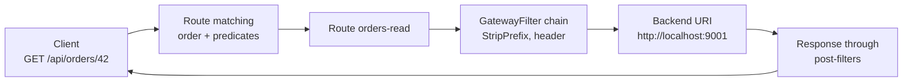
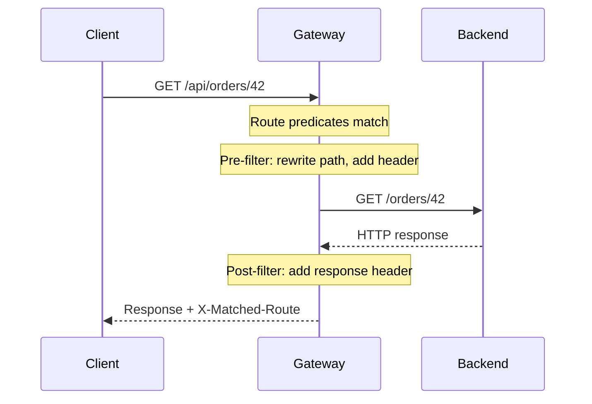

# The `id`, `uri`, `order`, `predicates`, `filters`, and `metadata` Fields in Spring Cloud Gateway

A **route** is the central configuration unit of **Spring Cloud Gateway**: it determines which requests are accepted, which backend they are forwarded to, and what processing takes place before and after forwarding. When building an API Gateway for microservices, understanding the exact roles of `id`, `uri`, `order`, `predicates`, `filters`, and `metadata` helps you design testable routes, avoid overlapping routes, and prepare for authentication, rate limiting, circuit breakers, retries, TLS, and traffic observability.

This lesson belongs to the **Route Configuration** chapter and focuses on **Spring Cloud Gateway Server WebFlux**. Examples use the configuration syntax of the **Gateway 5.0.x** branch (Spring Cloud 2025.1.x / Spring Boot 4.x) with the `spring.cloud.gateway.server.webflux.routes` prefix. Systems running a different branch must verify the starter and property prefix against the corresponding documentation; in particular, older examples using `spring.cloud.gateway.routes` should not be copied verbatim. Server Web MVC has its own configuration model and extension API.

## 1. Learning Outcomes

After this lesson, you will be able to:

- Read and write a complete YAML route with all six fields.
- Distinguish between **route selection conditions** and **request/response processing**.
- Understand why `order` affects which route is chosen when multiple routes match, without controlling filter ordering inside a route.
- Use `metadata` for business information and technical attributes supported by the Gateway, especially per-route timeouts.
- Verify routes yourself using `curl`/Actuator and diagnose common errors.

Imagine the gateway listening at `http://localhost:8080` and the order service at `http://localhost:9001`. The goal is to forward the public request `GET /api/orders/42` to the backend with the path `GET /orders/42`.



**Distinguishing the two phases:** The Gateway first finds a route whose predicates match; only then does it build the filter chain and forward the request to that route's URI. Not every filter in the configuration runs for every request.

## 2. A Complete YAML Route

In an application that already includes the `spring-cloud-starter-gateway-server-webflux` dependency and a compatible Spring Cloud BOM, create `src/main/resources/application.yml`:

```yaml
server:
  port: 8080

spring:
  application:
    name: gateway-routing-lab
  cloud:
    gateway:
      server:
        webflux:
          routes:
            - id: orders-read
              uri: http://localhost:9001
              order: 0
              predicates:
                - Path=/api/orders/**
                - Method=GET
              filters:
                - StripPrefix=1
                - AddRequestHeader=X-Gateway-Id, gateway-routing-lab
                - AddResponseHeader=X-Matched-Route, orders-read
              metadata:
                domain: commerce
                owner: orders-team
                connect-timeout: 1000
                response-timeout: 3000
```

This is **one entry in the `routes` list**. The `-` before `id` starts a route; the `-` entries under `predicates` and `filters` represent the elements of those two lists.

| Route field | Data type | Purpose | Sample value |
|---|---|---|---|
| `id` | String | Route identifier for management, logging, and inspection | `orders-read` |
| `uri` | URI | Destination address to forward matched requests to | `http://localhost:9001` |
| `order` | Integer | Priority when evaluating routes; lower numbers take precedence | `0` |
| `predicates` | List of conditions | Determines whether a request matches the route | `Path` and `Method` |
| `filters` | List of filters | Modifies the request/response within the selected route | `StripPrefix`, adding headers |
| `metadata` | Key–value map | Attaches auxiliary information or properties read by specialized components | `owner`, timeouts |

With the configuration above, the main flow is:

1. The Gateway receives a request on port `8080`.
2. `Path=/api/orders/**` and `Method=GET` both evaluate the request.
3. If both match, the `orders-read` route is selected according to `order` among matching routes.
4. `StripPrefix=1` removes the `api` segment: the backend receives `/orders/42`.
5. `AddRequestHeader` adds `X-Gateway-Id` to the forwarded request.
6. The Gateway calls `http://localhost:9001/orders/42` and adds `X-Matched-Route` to the response.

`metadata` does not automatically alter the path or add headers. Specifically, `connect-timeout` and `response-timeout` are metadata keys recognized by the Gateway Server WebFlux HTTP client to configure per-route timeouts.

## 3. `id`: The Route Identifier

`id` is a string used to identify a specific route in configuration and management tools. You should use stable, easily traceable IDs, such as:

```yaml
- id: catalog-read-v1
  uri: http://localhost:9002
  predicates:
    - Path=/api/catalog/v1/**
```

`id` **is not a path** and **does not determine the backend**; those two responsibilities belong to `predicates` and `uri`. Therefore, renaming `id` from `catalog-read-v1` to `catalog-v1` does not automatically change `/api/catalog/v1/**`.

A few useful conventions:

- Use names that indicate **service + business group + scope/version**; for example `orders-read`, `auth-login-v1`.
- Avoid duplicate `id` values across the entire set of routes, including routes loaded from other sources; duplicate IDs cause confusion when observing, managing, or updating routes.
- When renaming a route, review dashboards, metrics, tracing, logs, and operational tools if they reference the route ID.

**Example:** Actuator can list `route_id: orders-read`; this makes it possible to distinguish errors on the orders route from those on the catalog route. However, `id` is not a security key: a client is not granted access merely by knowing that ID.

## 4. `uri`: Backend or Forwarding Mechanism

`uri` answers the question: *Once a route has been selected, where does the Gateway send the request?*

| Sample URI | Meaning | Requirements / Notes |
|---|---|---|
| `http://localhost:9001` | Forward HTTP to a local backend | A backend must be running on port `9001` |
| `https://orders.example.internal` | Forward HTTPS | Requires TLS connectivity and appropriate upstream certificate verification |
| `lb://order-service` | Resolve a service ID to instances for load balancing | Requires Spring Cloud LoadBalancer and a service instance provider |
| `ws://socket.example.internal` / `wss://...` | Forward WebSocket | Requires verifying WebSocket support, connection settings, and corresponding TLS |

`lb://order-service` **does not set up a registry automatically**. Service discovery can come from Eureka, Consul, Kubernetes, or another instance configuration, but you still must provide the appropriate dependencies and connections.

### 4.1. URI Is Not the Place to Rewrite Paths

A common mistake:

```yaml
uri: http://localhost:9001/orders
predicates:
  - Path=/api/orders/**
```

Do not assume the Gateway will append `/orders` to the request as intended. In **Server WebFlux**, the official documentation states that **any path in the route URI is ignored** when building the forwarded request. Keep the URI focused on the destination, and use `StripPrefix`, `RewritePath`, `SetPath`, or other appropriate path filters when you need to transform the path.

The correct example for this lab:

```yaml
uri: http://localhost:9001
predicates:
  - Path=/api/orders/**
filters:
  - StripPrefix=1
```

The client calls `/api/orders/42`, and the backend receives `/orders/42`. Query strings such as `?expand=items` remain with the request unless another filter actively modifies them.

### 4.2. Addresses Depend on the Deployment Environment

`localhost` refers to the machine running the Gateway process. When the Gateway runs **inside a container**, `localhost:9001` points to that container itself; it does not automatically point to the host machine or another backend container. When using Docker Compose or Kubernetes, choose the hostname/service DNS appropriate for your deployment network.

Do not place sensitive information in `uri`. For outbound routing, distinguish client → gateway TLS from gateway → backend TLS; both directions require certificate validation and timeout control.

## 5. `order`: Priority When Multiple Routes Match

The Gateway may have multiple routes that satisfy the same request. The `order` field determines which route is **evaluated first**:

- `order: -10` takes precedence over `order: 0`.
- `order: 0` takes precedence over `order: 50`.
- If `order` is omitted, a route typically defaults to `0`.
- If two routes have the same `order` and both match, **do not rely on their declaration order in YAML** as a long-term precedence rule. Set `order` explicitly or make the predicates mutually exclusive.

For example, suppose one route specifically handles `/api/orders/export/**`, while another matches all `/api/orders/**`:

```yaml
spring:
  cloud:
    gateway:
      server:
        webflux:
          routes:
            - id: orders-export
              uri: http://localhost:9001
              order: -10
              predicates:
                - Path=/api/orders/export/**
                - Method=GET
              filters:
                - StripPrefix=1
                - AddResponseHeader=X-Matched-Route, orders-export

            - id: orders-general
              uri: http://localhost:9001
              order: 0
              predicates:
                - Path=/api/orders/**
                - Method=GET
              filters:
                - StripPrefix=1
                - AddResponseHeader=X-Matched-Route, orders-general
```

| Request | Conditionally matching routes | Prioritized route |
|---|---|---|
| `GET /api/orders/export/2026` | Both `orders-export` and `orders-general` | `orders-export` because `-10 < 0` |
| `GET /api/orders/42` | Only `orders-general` | `orders-general` |
| `POST /api/orders/42` | Neither route in this example matches | No matching route |

This two-route example is a **standalone replacement configuration** for the configuration in section 2; do not paste a second root `spring:` key into the same YAML document.

**Route-level `order` is different from filter order.** Route `order` only governs route selection; filter execution order is determined by `GatewayFilter`, `GlobalFilter`, sorted order, and the `Ordered` interface. Setting `order: -10` on a route does not mean all of its filters automatically run before filters on other requests.

In addition, **priority is not authorization**: a route named `orders-admin` with a lower order number does not automatically protect an endpoint. Authentication and authorization must be configured with Spring Security or an equivalent mechanism.

## 6. `predicates`: Route Selection Conditions

A predicate is a condition that inspects request attributes such as path, HTTP method, host, header, query parameter, or IP address. Predicates are defined via **Route Predicate Factories**.

Common factories:

| Predicate | Shortcut example | Description |
|---|---|---|
| `Path` | `Path=/api/orders/**` | Path matches the declared pattern |
| `Method` | `Method=GET,POST` | HTTP method belongs to the allowed set |
| `Host` | `Host=api.example.com` | HTTP Host matches the hostname |
| `Header` | `Header=X-Client-Type, mobile` | Header is present and its value matches the expression |
| `Query` | `Query=version, v[12]` | Query parameter `version` matches the pattern |
| `RemoteAddr` | `RemoteAddr=192.0.2.0/24` | Remote IP address falls within the given CIDR range |

### 6.1. Multiple Predicates on the Same Route Are Combined with AND

```yaml
predicates:
  - Path=/api/orders/**
  - Method=GET
  - Header=X-Client-Type, mobile
```

The route matches only when **all three** conditions hold. Given the request:

```http
GET /api/orders/42 HTTP/1.1
Host: localhost:8080
X-Client-Type: mobile
```

all three conditions can match. If the header is removed or the method changes to `POST`, the route above is not selected.

Multiple values may be supported by a single factory as arguments to the **same predicate** (for example, `Method=GET,POST` specifies a set of methods); do not confuse this with writing two separate predicates `Method=GET` and `Method=POST` on one route, because those two conditions cannot both be true for a single normal request.

### 6.2. Predicates Do Not Modify the Request

`Path=/api/orders/**` only selects requests by path; it **does not strip** `/api`. To change the path, use `filters`. Similarly, `Host` checks the incoming hostname and does not automatically modify the `Host` header of the forwarded request.

Predicates based on client-supplied headers or query parameters (such as `X-Client-Type`) are useful for characteristic-based routing, but they are **not trustworthy enough for authorization**. Before protecting data or admin access, authenticate the identity and check permissions against verified credentials.

### 6.3. What If No Route Matches?

The Gateway does not forward the request to any route's URI. When no route matches and no other handler is configured, the response is typically `404 Not Found`. When a route does match but the backend cannot find the resource, the backend may also return `404`; inspect logs/traces or response headers to tell the two situations apart.

## 7. `filters`: Pre- and Post-Proxy Processing

Filters allow the Gateway to transform requests/responses or enforce policies during route processing. Common factories:

| Filter | Example | Effect |
|---|---|---|
| `StripPrefix` | `StripPrefix=1` | Drops leading path segment(s) |
| `AddRequestHeader` | `AddRequestHeader=X-Gateway, scg` | Adds a header to the request sent to the backend |
| `AddResponseHeader` | `AddResponseHeader=X-Route, orders-read` | Adds a header to the response returned to the client |
| `RemoveRequestHeader` | `RemoveRequestHeader=X-Legacy-Debug` | Removes a header you do not want forwarded |
| `SetPath` | `SetPath=/orders/{id}` | Sets the path according to the template |
| `RewritePath` | Regex pattern and replacement | Rewrites the path using more complex rules |
| `RequestRateLimiter` | Requires resolver and limiter configuration | Limits traffic per client/key |
| `CircuitBreaker` | Requires a compatible resilience library | Prevents cascading backend failures |
| `Retry` | Use only under controlled conditions | Retries the request on matching errors |

A route can use multiple filters:

```yaml
filters:
  - RemoveRequestHeader=X-Legacy-Debug
  - StripPrefix=1
  - AddRequestHeader=X-Gateway-Id, gateway-routing-lab
  - AddResponseHeader=X-Matched-Route, orders-read
```

The configuration above prepares the request for the backend and tags the response for debugging. Although the example uses straightforward filters, **not all filters simply run linearly from top to bottom as written in YAML**: the Gateway combines route filters with global filters, sorts them by their order, and executes **pre** logic before proxying and **post** logic on the response path.



Be especially careful with the **retry** filter on non-idempotent operations like payments: retrying a `POST` can cause duplicate side effects. For **rate limiting**, the limiting key must be tied to a trusted identity or tenant; a client-editable header is not sufficient. For **circuit breakers**, verify the failure conditions, timeouts, and fallback behavior of your specific version.

### 7.1. Route Filters, Default Filters, and Global Filters

- **Route filter**: declared under `routes[*].filters`, applying only to that specific route.
- **Default filter**: configured under `spring.cloud.gateway.server.webflux.default-filters` to apply across routes, useful for shared policies.
- **GlobalFilter**: a programmatic Java component at the Gateway layer, merged into the filter chain whenever a request matches a route.

When filters come from multiple sources, **do not use `route.order` to guess individual filter execution order**. When order matters, verify the actual filter orders using Actuator/logs and the documentation for each filter in use.

## 8. `metadata`: Data Attached to a Route

`metadata` is a key–value map. You can store strings, numbers, and nested objects in the map, for example:

```yaml
metadata:
  domain: commerce
  owner: orders-team
  labels:
    audience: internal
    tier: critical
  revision: 3
```

Keys such as `domain`, `owner`, `labels`, and `revision` are **custom metadata**; the Gateway itself does not block external users just because it sees `audience: internal`, nor does it automatically add `owner` as an HTTP header. They take effect only when some component explicitly reads and acts on them.

In Server WebFlux, a custom filter can access the selected route via the exchange:

```java
import org.springframework.cloud.gateway.route.Route;
import static org.springframework.cloud.gateway.support.ServerWebExchangeUtils.GATEWAY_ROUTE_ATTR;

// Inside code that has a ServerWebExchange exchange:
Route route = exchange.getAttribute(GATEWAY_ROUTE_ATTR);
if (route != null) {
    Object owner = route.getMetadata("owner");
    // Use owner in internal policies/logging if explicitly designed to do so.
}
```

Do not treat metadata in configuration files as security values enforced automatically by the system. If you want authorization based on `audience`, you must implement the policy and test it explicitly.

### 8.1. Metadata with Technical Meaning: Per-Route Timeouts

Server WebFlux recognizes two special metadata keys:

```yaml
metadata:
  connect-timeout: 1000
  response-timeout: 3000
```

These two values are interpreted in **milliseconds** when configured **per route**:

- `connect-timeout: 1000`: sets a connection wait limit of roughly 1 second for requests on this route.
- `response-timeout: 3000`: sets a response wait limit of roughly 3 seconds for this route in the Gateway's HTTP client.

Note the difference in **units**: in the **global** HTTP client configuration, `connect-timeout` is specified in milliseconds while `response-timeout` is a `Duration` such as `5s`. For the two **per-route metadata** keys, the documentation specifies millisecond values—such as `3000` rather than `3s`. A negative `response-timeout` value in metadata can disable the global response timeout for that route; this is an operational choice that requires careful consideration.

A 3-second route timeout does not guarantee every request finishes in under 3 seconds from the client's perspective: there is also time spent in filters, connections, queuing, TLS, or retries. Measure end-to-end latency and test slow-backend scenarios.

### 8.2. Metadata in Observability and Operations

Custom metadata can help categorize routes by service group, owner, release stage, or policies to audit. In Spring Cloud Gateway, Actuator can display route information and use metadata in certain route-management operations; however, **custom metadata does not automatically become metric tags**. If you want `domain` or `owner` in your observability system, you must explicitly implement the extraction and enforce appropriate security boundaries.

## 9. Two Ways to Represent `predicates` and `filters`

The Gateway supports **shortcut** and **fully expanded** syntax. Shortcut syntax is concise and well suited for simple configurations:

```yaml
predicates:
  - Cookie=theme,dark
filters:
  - AddRequestHeader=X-Gateway-Id, gateway-routing-lab
```

The same configuration using the expanded syntax:

```yaml
predicates:
  - name: Cookie
    args:
      name: theme
      regexp: dark
filters:
  - name: AddRequestHeader
    args:
      name: X-Gateway-Id
      value: gateway-routing-lab
```

These are **fragments within the same route**, replacing the corresponding list. The expanded syntax uses the factory's `name` and an `args` map, making it easier to read when there are multiple arguments. The `args` keys vary by **factory**—do not assume every filter uses `name`/`value`.

Shortcut syntax uses `=` and comma-separated arguments. If values are complex or contain delimiters, consider the expanded form per the factory documentation to avoid string-parsing issues.

## 10. Hands-On: Observing All Six Fields

### 10.1. Create a Simple Echo Backend

If you do not already have an order service on `localhost:9001`, use the JDK to spin up a small backend solely to inspect the received path and headers.

Create `OrderEchoBackend.java`:

```java
import com.sun.net.httpserver.HttpServer;
import java.net.InetSocketAddress;
import java.nio.charset.StandardCharsets;

public class OrderEchoBackend {
    public static void main(String[] args) throws Exception {
        HttpServer server = HttpServer.create(
                new InetSocketAddress("127.0.0.1", 9001), 0);

        server.createContext("/", exchange -> {
            String payload =
                    "method=" + exchange.getRequestMethod() + "\n" +
                    "path=" + exchange.getRequestURI().getRawPath() + "\n" +
                    "query=" + exchange.getRequestURI().getRawQuery() + "\n" +
                    "X-Gateway-Id=" +
                    exchange.getRequestHeaders().getFirst("X-Gateway-Id") + "\n";

            byte[] data = payload.getBytes(StandardCharsets.UTF_8);
            exchange.getResponseHeaders().set(
                    "Content-Type", "text/plain; charset=utf-8");
            exchange.sendResponseHeaders(200, data.length);
            try (var out = exchange.getResponseBody()) {
                out.write(data);
            }
        });

        server.start();
        System.out.println("Order echo backend listening on 9001");
    }
}
```

Run it with JDK 17+ in a separate terminal:

```bash
java --add-modules jdk.httpserver OrderEchoBackend.java
```

In a Gateway application with the WebFlux starter and the `application.yml` from **section 2**, run the Maven wrapper:

```bash
# Linux/macOS
./mvnw spring-boot:run

# Windows PowerShell
.\mvnw.cmd spring-boot:run
```

### 10.2. Send Requests and Interpret the Results

```bash
curl -i "http://localhost:8080/api/orders/42?expand=items"
```

When both the backend and gateway have started properly, the response looks similar to:

```http
HTTP/1.1 200 OK
X-Matched-Route: orders-read
Content-Type: text/plain; charset=utf-8

method=GET
path=/orders/42
query=expand=items
X-Gateway-Id=gateway-routing-lab
```

This is an **illustrative** response; header order and additional headers may vary by runtime. Observe:

- `id` appears in the `X-Matched-Route` debug header because **the filter explicitly wrote that value**, not because the Gateway automatically injects `id`.
- `predicates` allowed `GET /api/orders/42` to match the route.
- `uri` selected the `localhost:9001` backend.
- `filters` stripped the `api` segment and added headers in both directions.
- `order: 0` makes no difference when only one route matches; try the two-route example in section 5 to observe precedence.
- `metadata` holds the owner and timeouts, but does not appear in the body or headers unless a custom component reads it.

Try more cases:

| Action | What to observe |
|---|---|
| `curl -i http://localhost:8080/api/orders/42` | Route matches; backend receives `/orders/42` |
| `curl -i -X POST http://localhost:8080/api/orders/42` | Fails `Method=GET` predicate; typically returns `404` if no other handler exists |
| `curl -i http://localhost:8080/api/products/42` | Fails `Path` predicate; typically returns `404` |
| Stop the backend and call a matched route | Observe connection/proxy error; the exact HTTP status depends on the scenario and configuration |
| Change `response-timeout` and make the backend respond slowly | Observe the timeout at the Gateway; do not assume every timeout type returns the same status code |

On older Windows PowerShell versions, use `curl.exe` instead of `curl` when you need standard curl syntax.

### 10.3. Inspect Loaded Routes with Actuator

If you have added `spring-boot-starter-actuator`, you can enable the Gateway endpoint in read-only mode:

```yaml
management:
  endpoint:
    gateway:
      access: read-only
  endpoints:
    web:
      exposure:
        include: health,info,gateway
```

Place the `management` block in the **same** `application.yml` file you are using, at the root YAML level, then restart. Inspect:

```bash
curl -i http://localhost:8080/actuator/gateway/routes
curl -i http://localhost:8080/actuator/gateway/routes/orders-read
```

Fields to look for include `route_id`, `uri`, `order`, predicates, and filters in the endpoint's format. Actuator shows the **loaded routes**, helping catch YAML configurations with the wrong prefix or inactive routes. Do not rely on this endpoint always returning all metadata in a fixed structure; response formats may vary across releases.

Outside local development, management endpoints must be access-restricted and properly authenticated. Avoid enabling route editing/refresh over HTTP merely to inspect configuration.

## 11. Common Errors and How to Reason About Them

| Symptom | Cause to check | How to fix |
|---|---|---|
| Gateway starts but does not load routes | Wrong prefix or misaligned YAML indentation | Verify `spring.cloud.gateway.server.webflux.routes` in version 5.0.x and inspect Actuator |
| `GET` works, `POST` returns `404` | `Method=GET` predicate | Update the condition if the business logic requires `POST`, and configure appropriate authentication |
| Backend path still contains `/api` | Only `Path` declared without `StripPrefix`/path filter | Add a path-transforming filter |
| Two routes match, wrong route selected | Duplicate `order` or wrong priority | Set `order` intentionally and test overlapping requests |
| Added `/v1` in `uri` but backend does not see it | Route URI is not a path-rewriting mechanism | Use `SetPath`/`RewritePath` depending on the case |
| Gateway cannot connect to `localhost:9001` | Backend stopped, wrong port, or gateway running in a container | Check the backend directly and verify DNS/hostname from the gateway's environment |
| `metadata.owner` does not appear in headers | Metadata is not automatically injected into HTTP | Write a filter that reads metadata if truly needed |
| Timeout differs from expectations | Mixing up milliseconds in route metadata with global Duration, or retries increasing total time | Check units, retry count, and timing logs |
| Client-supplied header trusted as identity | Header is unverified | Verify JWT/session/permissions with Spring Security before passing identity to the backend |
| Reordered routes but filters still run in unexpected order | Confusing `route.order` with filter order | Inspect the filter chain, global/default filters, and `Ordered` |

Note: receiving a `404` alone is not enough to know whether a route matched; the backend can also return `404` after the Gateway proxies successfully. Combine Actuator, access logs, trace IDs, and direct backend checks to pinpoint the cause.

## 12. Applying This to a Microservices API Gateway

Suppose a system has `identity-service`, `catalog-service`, and `order-service`. Routes can be separated by public paths, while authentication, rate-limiting, and resilience policies are added as needed:

| Route ID | Typical predicates | URI | Filters/policies to consider |
|---|---|---|---|
| `identity-login` | `Path=/api/auth/login` and `Method=POST` | `lb://identity-service` | Login rate limiting, masking sensitive info in logs |
| `catalog-read` | `Path=/api/catalog/**` and `Method=GET` | `lb://catalog-service` | Timeouts, controlled retries for read requests |
| `orders-write` | `Path=/api/orders/**` and `Method=POST` | `lb://order-service` | Authentication, authorization, idempotency |
| `orders-read` | `Path=/api/orders/**` and `Method=GET` | `lb://order-service` | Authentication, tracing, appropriate circuit breaker |

This is a **design table**, not a ready-to-run configuration: `lb://` requires LoadBalancer and a discovery source; the policies require corresponding dependencies, filters, and Spring Security. Backends must still enforce authorization on their own data.

An important principle: never let a higher-priority route accidentally bypass the security policies of a general route. For example, a specialized route for `/api/orders/export/**` must still enforce appropriate security policies, even when configured with `order: -10` to match first.

## 13. Self-Check Exercises

**Question 1.** With `Path=/api/orders/**` and `Method=GET`, does `POST /api/orders/42` pass through the route?

**Answer:** No. Predicates within the same route are combined with AND.

**Question 2.** Two routes both match a request; route A has `order: 5`, route B has `order: -2`. Which route takes precedence?

**Answer:** Route B, because `-2` is less than `5`.

**Question 3.** Is `uri: http://localhost:9001/orders` the standard way to change the public path `/api/orders/42` to `/orders/42`?

**Answer:** No. In Server WebFlux, a path in the route URI is not a rewrite mechanism. Use a path filter, such as `StripPrefix=1` when appropriate.

**Question 4.** Why does `metadata: { owner: orders-team }` not cause responses to contain an `X-Owner` header?

**Answer:** Metadata is just data attached to a route; a filter or other programmatic component must explicitly read and use it.

**Question 5.** What does `metadata.response-timeout: 3000` on a route mean in seconds? Does it use the same format as the global response timeout?

**Answer:** 3 seconds. Per-route timeouts in metadata are specified in milliseconds; the global response timeout uses a Duration format such as `5s`.

**Question 6.** Does `order` sort filters within the same route?

**Answer:** No. It determines route priority; the filter chain has its own ordering mechanism.

**Extended Practice:** Starting from the example in section 2, add an `orders-export` route with `order: -10` and `Path=/api/orders/export/**`. Use `AddResponseHeader=X-Matched-Route, orders-export`, then compare the responses for `/api/orders/export/2026` and `/api/orders/42`. Explain why both requests use the same backend yet are routed to two different routes.

## 14. Official Documentation

- [Spring Cloud Gateway Server WebFlux 5.0 — Route Glossary](https://docs.spring.io/spring-cloud-gateway/reference/5.0/spring-cloud-gateway-server-webflux/glossary.html).
- [Configuring Route Predicate Factories and Gateway Filter Factories](https://docs.spring.io/spring-cloud-gateway/reference/5.0/spring-cloud-gateway-server-webflux/configuring-route-predicate-factories-and-filter-factories.html).
- [How It Works — route matching and filter chain](https://docs.spring.io/spring-cloud-gateway/reference/5.0/spring-cloud-gateway-server-webflux/how-it-works.html).
- [Route Metadata Configuration](https://docs.spring.io/spring-cloud-gateway/reference/5.0/spring-cloud-gateway-server-webflux/route-metadata-configuration.html).
- [Http Timeouts Configuration](https://docs.spring.io/spring-cloud-gateway/reference/5.0/spring-cloud-gateway-server-webflux/http-timeouts-configuration.html).
- [Actuator API — inspecting loaded routes](https://docs.spring.io/spring-cloud-gateway/reference/5.0/spring-cloud-gateway-server-webflux/actuator-api.html).

Understanding the role of each field enables verifiable gateway configuration: **`predicates` select the right requests, `uri` selects the right backend, `filters` execute transformations and policies, `order` resolves overlapping routes, `id` supports traceability, and `metadata` extends per-route information**. From this foundation, you can systematically build out service discovery, security, rate limiting, circuit breakers, and request observability.
