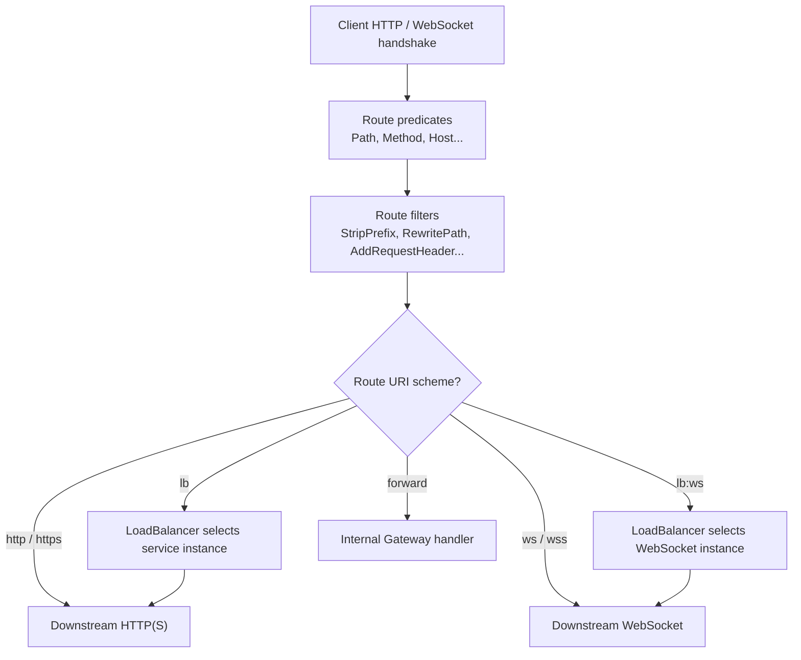

# Target URIs with `http:`, `https:`, `lb:`, `ws:`, `wss:`, and `forward:` by Support Level

**Chapter:** Route Configuration  
**Module:** Spring Cloud Gateway (`SPRING_CLOUD_GATEWAY`)

A route in Spring Cloud Gateway typically has three parts: **predicates** determine which requests are selected, **filters** modify or control the request/response, and the **target URI** (`uri`) determines the next step after a request matches. Choosing the right target URI is just as important as configuring `Path`, `StripPrefix`, or `RewritePath`: simply changing the scheme at the start of the URI can cause the Gateway to use plain HTTP, TLS, WebSocket, service discovery, or dispatch to an internal handler.

This lesson focuses on the `http:`, `https:`, `lb:`, `ws:`, `wss:`, and `forward:` forms, as well as the `lb:ws:` combination. The main examples use **Spring Cloud Gateway Server WebFlux**. Capabilities and APIs across Server WebFlux, Server Web MVC, and Proxy Exchange **are not identical**; when applying them, always check your project's exact flavor and release train.

## 1. Learning Objectives

After studying this lesson, you will be able to:

1. Read a route URI and explain whether the Gateway will contact an HTTP server directly, look up instances via a load balancer, establish a WebSocket connection, or dispatch internally.
2. Distinguish between **the scheme the client uses to call the Gateway** and **the scheme the Gateway uses to call downstream**.
3. Write illustrative WebFlux route configurations for each target form and identify the additional dependencies required.
4. Explain why `lb://catalog-service` will not work on its own without an instance list or service discovery.
5. Verify path/headers, TLS, HTTP statuses, service errors, and WebSocket handshakes appropriately for each scheme.
6. Recognize limitations when using retries, circuit breakers, rate limiting, and observability across different connection types.

## 2. Reading a URI Structure: Which Part Does What?

In a YAML route:

```yaml
- id: orders
  uri: http://orders.internal:8081
  predicates:
    - Path=/api/orders/**
  filters:
    - StripPrefix=2
```

`Path=/api/orders/**` selects incoming requests to the Gateway, `StripPrefix=2` removes the first two path segments, and `uri` specifies the destination. For example:

```text
Client -> Gateway:
  GET http://localhost:8080/api/orders/42?expand=items

After Path predicate + StripPrefix:
  GET /42?expand=items

Gateway -> backend:
  GET http://orders.internal:8081/42?expand=items
```

The backend path is the result of combining the **post-filter request path** with the **scheme/host/port** of the route URI. Do not treat appending a path to `uri` as a reliable substitute for `StripPrefix` or `RewritePath`; path and URL handling rules can differ between flavors and versions. For labs, use a URI with an explicit scheme and authority, and let filters handle path transformations.

### Quick Reference Table

| Sample URI | Next step | Conditions required to actually run |
|---|---|---|
| `http://localhost:8081` | Direct HTTP request to the target host/port | Backend serves HTTP and is reachable by the Gateway |
| `https://api.internal:8443` | Direct HTTPS request over TLS | Backend enables TLS with valid certificate/trust/hostname |
| `lb://catalog-service` | Look up a service instance and send an HTTP(S) request | Spring Cloud LoadBalancer and a service instance source are present |
| `ws://localhost:9001` | Upgrade connection to WebSocket toward the backend | Backend actually supports WebSocket handshakes/endpoints |
| `wss://chat.internal:9443` | WebSocket over TLS | WebSocket backend enables TLS with a valid certificate |
| `lb:ws://chat-service` | Resolve a service instance and then connect via WebSocket | WebFlux supports load balancer/WebSocket integration and instances are provided |
| `forward:/internal/status` | Forward the request to a handler inside **the Gateway application itself** | An internal handler/route accepts the target path; flavor supports forward |

**Note:** `lb:` is a **service-name resolution** step, not a network protocol like HTTP or WebSocket. `forward:` also does not open a TCP connection to an external machine; it is an internal dispatch.

## 3. Looking at the Gateway Server WebFlux Processing Flow



In Gateway Server WebFlux, the components commonly referenced in source code and docs are `RouteToRequestUrlFilter` (builds the forwarding URL from the route), `ReactiveLoadBalancerClientFilter` (resolves `lb:` when integrated), `NettyRoutingFilter` (HTTP/HTTPS), `WebsocketRoutingFilter` (WS/WSS), and `ForwardRoutingFilter` (internal dispatch). Together with other filters, they participate in the ordered processing chain. This is **Server WebFlux's mechanism**; do not assume equivalent class/filter names must exist in Server Web MVC.

In particular, **the client's request scheme does not force the Gateway to use the same scheme toward the backend**. A Gateway accepting HTTPS on port `443` can still call a backend over HTTP on an internal network if `uri: http://...`; conversely, a Gateway accepting HTTP in a lab can call a backend over HTTPS if `uri: https://...` and TLS is configured properly.

## 4. `http://`: Direct Downstream HTTP

This is the simplest form for testing REST APIs, health checks, and internal backends:

```yaml
- id: echo-http
  uri: http://localhost:8081
  predicates:
    - Path=/direct/**
  filters:
    - StripPrefix=1
    - AddRequestHeader=X-Routed-Via, echo-http
```

The request `GET http://localhost:8080/direct/echo/42` will go to `GET http://localhost:8081/echo/42` if the backend has a matching mapping.

Key points to remember:

- `http://` requires the backend to speak **plain HTTP** on that host/port. If the backend port only accepts TLS, the connection will fail due to protocol mismatch.
- `localhost` is evaluated inside the environment running **the Gateway process**. If the Gateway is inside a Docker container, `localhost:8081` is the Gateway container itself, not the host machine or another backend container.
- Route predicates still run first; requests whose path does not match will not be sent even if the backend is running.
- The `StripPrefix` filter modifies the path; the `AddRequestHeader` filter sends a header downstream. Self-added headers are suitable only for observation, not for proving Gateway identity.

In Docker Compose environments, replace the address with the Compose network DNS service name, such as `http://echo-backend:8081`; in Kubernetes, you can use the corresponding Service DNS, or an `lb://` route if discovery is integrated.

## 5. `https://`: Downstream HTTP with TLS

A direct route can point to an HTTPS backend:

```yaml
- id: payment-https
  uri: https://payment.internal.example:8443
  predicates:
    - Path=/secure/**
  filters:
    - StripPrefix=1
```

For the request `/secure/invoices/10`, the filter rewrites the path to `/invoices/10`; the Gateway opens an HTTP session over TLS to `payment.internal.example:8443`.

**TLS is evaluated separately on each hop:**

```text
Client --HTTPS--> Gateway --HTTPS--> Payment backend
          (TLS A)              (TLS B)
```

TLS A and TLS B are **two separate connections**, each with its own handshake and certificates. The Gateway can terminate TLS from the client and then initiate a new TLS connection to the backend. Configuring HTTPS on the Gateway's inbound port does not automatically configure trust for the outbound HTTP client, and choosing `https://` does not automatically generate a certificate for the backend.

When encountering `https://` connection errors, check:

1. Whether DNS, firewall, and the downstream port are reachable.
2. Whether the backend actually serves TLS on that port.
3. Whether the certificate is valid (not expired), has a trusted CA chain, and matches the hostname/SNI.
4. Trust material, mTLS client certificates (if required by the backend), and HTTP client configuration for the **Gateway flavor in use**.
5. Whether connection and handshake timeouts suit the network environment.

In development there may be servers with self-signed certificates, but **never disable certificate/hostname validation in production**. If testing uses an internal CA, configure the Gateway to trust that CA properly.

## 6. `lb://`: Discovering a Service Instance Before Routing

Instead of hardcoding a fixed host/port, use the backend's logical service name:

```yaml
- id: catalog-lb
  uri: lb://catalog-service
  predicates:
    - Path=/catalog/**
  filters:
    - StripPrefix=1
```

With this configuration, the Gateway tries to find an instance of `catalog-service`. If it selects `http://10.0.2.15:8082`, the request `GET /catalog/products/42` is sent to `GET http://10.0.2.15:8082/products/42`. If the load balancer selects another instance next time, the downstream URL can change while the client and route remain unchanged.

### 6.1. Required Dependencies

For Gateway Server WebFlux and a compatible Spring Cloud version, an application using `lb://` typically needs:

```xml
<dependency>
    <groupId>org.springframework.cloud</groupId>
    <artifactId>spring-cloud-starter-gateway-server-webflux</artifactId>
</dependency>
<dependency>
    <groupId>org.springframework.cloud</groupId>
    <artifactId>spring-cloud-starter-loadbalancer</artifactId>
</dependency>
```

At the same time, the application must have an **instance list source**: Eureka, Consul, Kubernetes discovery client, or a compatible manual configuration mechanism. The LoadBalancer starter provides the instance-selection logic; it **does not turn an arbitrary name into a real address by itself**.

### 6.2. Testing with Static Instances

When no service registry is available yet, you can use `SimpleDiscoveryClient` with a test instance. In the Gateway application, you can declare configuration similar to:

```yaml
spring:
  cloud:
    discovery:
      client:
        simple:
          instances:
            catalog-service:
              - uri: http://localhost:8081
```

After starting an HTTP backend on `8081` and ensuring the Gateway has the required load-balancing/discovery components, `GET http://localhost:8080/catalog/echo/42` can be routed to `GET http://localhost:8081/echo/42`. If no matching instance exists, Gateway Server WebFlux typically returns `503 Service Unavailable` by default when no instance can be found; this behavior can be customized per version/configuration, so read the logs to distinguish it from a `503` returned by the backend.

### 6.3. When Service Instances Use TLS

Do not assume `lb://` is always plain HTTP. In Gateway Server WebFlux, the downstream scheme can be determined from `ServiceInstance.isSecure` and how the Gateway handles scheme prefixes. Therefore:

- Publish the correct port and secure flag for each instance in the registry.
- If the actual instance uses HTTPS, the Gateway still needs to trust the backend's certificate.
- An HTTPS connection from the client to the Gateway is not evidence that the backend also uses HTTPS.
- Do not treat `lb://` as a guarantee that service discovery always picks a healthy instance; verify registry status, metadata, and load balancer behavior.

**Distinguishing the two mechanisms:** `uri: lb://catalog-service` is a **static route pointing to a service name**. Automatically generating routes from a discovery client (*discovery locator*) is a separate feature and is not required to use a manually declared `lb://` route.

## 7. `ws://` and `wss://`: WebSocket Connections

WebSocket begins with an HTTP handshake requesting a connection upgrade (*Upgrade*). Once upgraded successfully, the client and server exchange frames over a long-lived connection; this **is no longer a normal REST request-response**.

### 7.1. WebSocket Without TLS: `ws://`

```yaml
- id: chat-ws
  uri: ws://localhost:9001
  predicates:
    - Path=/socket/plain/**
  filters:
    - StripPrefix=2
```

When a client connects to `ws://localhost:8080/socket/plain/rooms/general`, the Gateway matches the route and forwards the handshake to `ws://localhost:9001/rooms/general`. The backend at `9001` **must have a WebSocket endpoint** at that path; an ordinary `@GetMapping` REST controller does not automatically become a WebSocket server.

### 7.2. WebSocket with TLS: `wss://`

```yaml
- id: chat-wss
  uri: wss://chat.internal.example:9443
  predicates:
    - Path=/socket/tls/**
  filters:
    - StripPrefix=2
```

With `wss://`, the Gateway performs the WebSocket handshake over a TLS-protected connection. Just like `https://`, it requires the right hostname, port, CA/truststore, and backend certificate. **`https://` cannot substitute for `wss://`** when the goal is WebSocket proxying in Server WebFlux.

### 7.3. WebSocket via Load Balancer: `lb:ws://`

Gateway Server WebFlux provides a combined form:

```yaml
- id: chat-ws-lb
  uri: lb:ws://chat-service
  predicates:
    - Path=/socket/cluster/**
  filters:
    - StripPrefix=2
```

The idea is to resolve `chat-service` to a suitable instance and then forward via WebSocket. This is a **scheme prefix syntax** in Server WebFlux, not a URL that a WebSocket client calls directly. Clients still connect using `ws://...` or `wss://...` to **the Gateway's address**.

With WebSocket, carefully consider: long-lived sessions and connections, idle/ping-pong timeouts, concurrent connection limits, frame/message sizes, handshake authentication, and session distribution strategies. Ordinary HTTP retries do not guarantee recovery of an upgraded connection; client applications typically need reconnect logic and business-state preservation.

**Technical note:** some WebSocket systems have auxiliary HTTP URLs for long polling or fallback (for example, some SockJS implementations). Those HTTP requests may require separate HTTP routes; configuring only `ws://` is not enough for the entire application protocol.

## 8. `forward:/`: Dispatching to an Internal Gateway Handler

`forward:` is used to handle a request **inside the Gateway application itself** rather than opening a connection to another host. On Gateway Server WebFlux, for example:

```yaml
- id: local-status
  uri: forward:/internal/status
  predicates:
    - Path=/local/status
```

If the Gateway application has a WebFlux handler such as:

```java
import java.util.Map;
import org.springframework.web.bind.annotation.GetMapping;
import org.springframework.web.bind.annotation.RestController;

@RestController
public class LocalStatusController {

    @GetMapping("/internal/status")
    public Map<String, String> status() {
        return Map.of("origin", "gateway-local-handler", "status", "UP");
    }
}
```

The request `GET http://localhost:8080/local/status` is matched by the Gateway route and dispatched to `/internal/status` within the same application. No separate service listening on another host/port is needed.

**Important limitations:**

- `forward:/internal/status` **is not equivalent to** `http://localhost:8080/internal/status`: the latter triggers an HTTP call to a network address (and might pass through the Gateway again), whereas `forward:` uses internal dispatch.
- The internal handler must exist and be supported by the web framework; otherwise, the request may still receive `404`.
- Avoid configuring a forward back to the same matching route, which causes loops/recursive execution or dispatch errors.
- Forward is often used with *fallback* handlers or internal endpoints; it does not replace discovery/load balancing.
- If using `CircuitBreaker` with `fallbackUri: forward:/...`, that is **the filter's own fallback configuration**—do not conflate `fallbackUri` with a route's primary `uri`.

## 9. When Does Support Depend on the Flavor?

Spring Cloud Gateway has **Gateway Server WebFlux**, **Gateway Server Web MVC**, and **Proxy Exchange** (MVC/WebFlux) variants. Having the same scheme names does not mean configuration and routing filters work identically.

| Component | Gateway Server WebFlux | Gateway Server Web MVC | Proxy Exchange |
|---|---|---|---|
| Downstream HTTP/HTTPS | Uses WebFlux route URI and HTTP pipeline | Has HTTP/HTTPS routing via Web MVC mechanisms; verify syntax by version | Forwards inside annotated handlers via `ProxyExchange` API |
| `lb://` | Integrates reactive load balancing + discovery/instances | Requires load-balancing support matching the MVC stack and version | Does not inherit `lb://` route features from Gateway Server |
| `ws://`, `wss://` | Supports WebSocket routing in Server WebFlux | Check the **exact** docs for your running Server MVC version before assuming equivalent support | Does not automatically provide WebSocket routes from the HTTP proxy API |
| `lb:ws://` | Combined form supported by Server WebFlux | Do not assume identical support to WebFlux | Does not apply as an automatic route config |
| `forward:/` | Has internal dispatch in WebFlux | Forward capability/handler syntax depends on the corresponding MVC mechanism | Not a Server route URI |
| Config prefix | E.g., `spring.cloud.gateway.server.webflux.routes` | Uses its own config/DSL, e.g., `spring.cloud.gateway.server.webmvc.routes` on corresponding lines | Logic declared in controller; does not use Server's `routes` list |

In Spring Cloud 2025.0 and later, the Server WebFlux starter typically uses `spring-cloud-starter-gateway-server-webflux`; Server Web MVC uses `spring-cloud-starter-gateway-server-webmvc`. Dependency names and configuration prefixes in earlier versions may differ (for example, older WebFlux projects used `spring.cloud.gateway.routes`). Do not copy WebFlux examples directly into Web MVC or pass Server YAML to Proxy Exchange expecting features to work automatically.

## 10. Hands-On Lab: Integrating HTTP, Load Balancing, and Forward

This example uses only targets you can spin up quickly: an HTTP backend, a static instance via load balancer, and an internal Gateway handler. The HTTPS/WSS/WS routes discussed earlier are advanced patterns because they require a real TLS or WebSocket backend.

### 10.1. Minimal Backend on Port 8081

Create a Spring Boot application with the **Spring Web** dependency. In the backend's `src/main/resources/application.yml`:

```yaml
server:
  port: 8081
```

Example `EchoApplication.java` file (Java 17+, Spring Boot 3.x):

```java
package com.example.echo;

import jakarta.servlet.http.HttpServletRequest;
import java.util.Map;
import org.springframework.boot.SpringApplication;
import org.springframework.boot.autoconfigure.SpringBootApplication;
import org.springframework.web.bind.annotation.GetMapping;
import org.springframework.web.bind.annotation.PathVariable;
import org.springframework.web.bind.annotation.RestController;

@SpringBootApplication
public class EchoApplication {
    public static void main(String[] args) {
        SpringApplication.run(EchoApplication.class, args);
    }
}

@RestController
class EchoController {
    @GetMapping("/echo/{id}")
    public Map<String, String> echo(
            @PathVariable String id,
            HttpServletRequest request) {
        return Map.of(
                "service", "echo-backend",
                "id", id,
                "method", request.getMethod(),
                "path", request.getRequestURI());
    }
}
```

Run the backend via Maven Wrapper or your IDE, then verify:

```bash
curl -i http://localhost:8081/echo/42
```

Expected body:

```json
{
  "service": "echo-backend",
  "id": "42",
  "method": "GET",
  "path": "/echo/42"
}
```

If the direct call does not succeed yet, fix the backend before testing the Gateway.

### 10.2. Gateway on Port 8080

Create a Spring Cloud Gateway Server WebFlux application with a Spring Cloud BOM compatible with your Spring Boot version, and add the Gateway Server WebFlux and Spring Cloud LoadBalancer starters as in section 6.1. In the Gateway's `application.yml`:

```yaml
server:
  port: 8080

spring:
  cloud:
    discovery:
      client:
        simple:
          instances:
            catalog-service:
              - uri: http://localhost:8081
    gateway:
      server:
        webflux:
          routes:
            - id: echo-http
              uri: http://localhost:8081
              predicates:
                - Path=/direct/**
              filters:
                - StripPrefix=1
                - AddRequestHeader=X-Routed-Via, echo-http
            - id: catalog-lb
              uri: lb://catalog-service
              predicates:
                - Path=/catalog/**
              filters:
                - StripPrefix=1
            - id: local-status
              uri: forward:/internal/status
              predicates:
                - Path=/local/status
```

Add `LocalStatusController` from section 8 to the Gateway application. Then start the Gateway and test:

```bash
# Direct HTTP from Gateway to backend:
curl -i http://localhost:8080/direct/echo/42

# Gateway resolves catalog-service and calls the same backend:
curl -i http://localhost:8080/catalog/echo/42

# Gateway dispatches to local handler, without calling backend:
curl -i http://localhost:8080/local/status
```

Expected results:

| Request to Gateway | Selected route | Final handling location | Indicators in response |
|---|---|---|---|
| `GET /direct/echo/42` | `echo-http` | Backend `localhost:8081` | `service=echo-backend`, `path=/echo/42` |
| `GET /catalog/echo/42` | `catalog-lb` | Instance of `catalog-service` (port `8081` in this lab) | Same backend payload, path `/echo/42` |
| `GET /local/status` | `local-status` | `/internal/status` handler inside the Gateway | `origin=gateway-local-handler` |

In this lab, both the direct HTTP route and the load-balanced route select **the same backend** to make results easy to compare. Seeing both return the same JSON does not prove multi-instance distribution; to test load balancing, declare multiple instances and identify each instance in the response.

### 10.3. Why Not Test All Six Schemes with One Backend?

Because the underlying transports are fundamentally different:

- A normal Spring MVC `@GetMapping` backend does not automatically accept WebSocket handshakes. Testing `ws://` requires a backend with a registered WebSocket handler.
- `https://` and `wss://` require a TLS server configured with an appropriate certificate/key.
- `lb://` requires an instance source—in the lab we use `SimpleDiscoveryClient`; in real microservices this may be a registry/cluster.
- `forward:` requires a handler inside the Gateway, not another backend.

Trying `wss://localhost:8081` when the `8081` backend only speaks HTTP will fail the TLS handshake; that is a **wrong target protocol**, not a `Path` predicate issue.

## 11. Testing WebSocket, HTTPS, and WSS Properly

### 11.1. Preparing a WebSocket Backend

Suppose a WebSocket backend is running on `localhost:9001` with a `/rooms/general` endpoint supporting WebSocket handshakes and text frames. With the `chat-ws` route from section 7:

```text
Client connects:
  ws://localhost:8080/socket/plain/rooms/general

Gateway sends handshake to:
  ws://localhost:9001/rooms/general
```

You can use an interactive WebSocket client such as `wscat` (if installed):

```bash
wscat -c ws://localhost:8080/socket/plain/rooms/general
```

**Success indicator:** the protocol upgrade handshake is accepted (typically HTTP `101 Switching Protocols`) and the client exchanges frames with the backend. Running `curl -i` with an ordinary HTTP GET to this URL **is not a complete WebSocket test**, because it lacks the required upgrade headers and flow.

If you need `lb:ws://chat-service`, provide valid WebSocket instances for `chat-service`, then connect the client to the `chat-ws-lb` route path. Check the scheme/TLS/secure-flag and instance-metadata rules in your current version; do not assume every HTTP registry record is a WebSocket endpoint.

### 11.2. Testing Downstream HTTPS

With the `payment-https` route, first verify that the backend actually listens at `payment.internal.example:8443` with TLS, then call the Gateway:

```bash
curl -i http://localhost:8080/secure/invoices/10
```

In this example, `http://localhost:8080` is only the **client → Gateway connection in the lab**. You cannot tell from the scheme in the `curl` command whether the **Gateway → backend** connection uses HTTP or HTTPS: that information lives in the route configuration and gateway/backend observations.

If downstream TLS fails, inspect handshake logs and check certificate, hostname, SNI, or trust material issues. Do not fix the error by switching to `http://` unless the backend and system policy truly permit dropping TLS on that hop.

### 11.3. Testing Downstream WSS

With the `chat-wss` route, a client might connect to the Gateway via `ws://` in a controlled lab while the Gateway opens `wss://` to the backend per the route. In production, you **must also protect the client → Gateway hop** with appropriate TLS (typically clients use `wss://`), ensure handshake authentication, and manage long-lived connections.

When a connection fails, determine whether the failure occurred at the **inbound connection**, **route predicate**, **outbound TLS**, **backend WebSocket handshake**, or **post-handshake frame handling**. Looking at a single HTTP status code or one inbound log line is rarely enough.

## 12. Choosing a URI Based on Real Requirements

| Need | URI to consider | Reason |
|---|---|---|
| A REST service with a fixed host/port in a lab | `http://host:port` | Easy to set up and isolate failures |
| A REST backend requiring encryption and server authentication | `https://host:port` | TLS for the Gateway → backend hop |
| Multiple instances of the same service managed by a registry | `lb://service-id` | Abstracts instance addresses and selects a target |
| Plain WebSocket chat/notification endpoint in a lab network | `ws://host:port` | Proper WebSocket upgrade protocol |
| WebSocket backend over TLS | `wss://host:port` | Protects the downstream WebSocket connection |
| Multi-instance WebSocket backend | `lb:ws://service-id` if supported by flavor/version | Combines instance selection with WebSocket routing |
| Auxiliary/fallback handler running inside the Gateway app | `forward:/internal/path` | Internal dispatch, not a network proxy |

**Selection rule:** first identify what kind of connection the backend actually exposes (**HTTP API, WebSocket, or internal handler**), then ask whether the target is a fixed host or a service name to resolve. Finally, verify TLS, version, and flavor support.

A plain REST endpoint returning JSON cannot "become a WebSocket" just because you configure `uri: ws://...`. Likewise, `lb://` only changes instance selection; it does not automatically add circuit breakers, retries, or TLS protection.

## 13. Common Errors and How to Distinguish Them

| Symptom | Common cause | First thing to check |
|---|---|---|
| `404 Not Found` when calling Gateway | No route matches `Path`/`Method` | Check client request URL and predicates |
| Backend receives request but returns `404` | Path after `StripPrefix`/`RewritePath` does not match handler | Compare path received by backend with controller mapping |
| Gateway fails to connect to `http://localhost:8081` | Backend stopped, wrong port, or Gateway running in a container | Call backend from an environment sharing the Gateway's network |
| Backend only accepts TLS, route uses `http://` | Scheme does not match backend protocol | Check whether backend expects an HTTPS handshake |
| Certificate/hostname error with `https://` | Truststore, hostname, SNI, or certificate chain | Read Gateway TLS logs and backend certificate config |
| `lb://catalog-service` has no instances | Missing load balancer, registry/instance config, or wrong service ID | Check dependencies, health, and instance list |
| `lb://` returns 503 even though direct backend works | Unable to resolve service instance; sometimes health/discovery is empty | Check `SimpleDiscoveryClient`/registry; distinguish from backend-returned 503 |
| `ws://` returns 400/404 or upgrade fails | Backend has no WS endpoint, wrong path, or invalid client handshake | Test WS backend directly with a WS client |
| `wss://` fails TLS handshake | Endpoint only supports plain WS, or wrong trust/cert | Check backend TLS before WebSocket handshake |
| WebSocket connects but drops quickly | Idle timeout, proxy/network, ping-pong, backend error | Inspect Gateway/backend logs and WS client lifecycle |
| `forward:/internal/status` returns `404` | Local handler missing or wrong path | Check mappings inside the Gateway application itself |
| Forward causes a loop or dispatch error | Target loops back into the original route | Keep public route paths separate from local paths |
| `routes` config has no effect | Wrong prefix for flavor/version | Match config prefix to the running Server WebFlux/Web MVC |

Never assert one specific status code for **all** downstream errors: DNS failures, missing instances, TCP errors, TLS failures, timeouts, route mismatches, and backend-generated error responses are handled at different layers. The final status code also depends on exception handlers, filters, and the Gateway version.

### A Reliable Debugging Workflow

1. Confirm the Gateway loaded the route and the predicates actually match the request.
2. Check the path after `StripPrefix` or `RewritePath`; compare it with the backend endpoint.
3. Confirm the target type: HTTP/HTTPS, WebSocket, load-balanced, or internal forward.
4. For HTTP/HTTPS/WS/WSS, check DNS, network, port, and protocol supported downstream; for `lb://`, check instances; for `forward:`, check the local handler.
5. If TLS is involved, check both TLS hops and hostname/truststore; if WebSocket is involved, check handshake/upgrade and post-upgrade connection state.
6. Correlate client, Gateway, and backend request logs using an appropriate request ID or trace ID.

## 14. How Target URIs Relate to Filters, Security, and Observability

### 14.1. Schemes Do Not Replace the Filter Chain

`uri: lb://orders-service` only decides how to find the backend; it does not rate-limit requests. `uri: https://payment.internal.example` only establishes downstream TLS; it does not automatically authorize users. For a secure Gateway, you still need to design:

- **Predicates and filters:** define routes accurately; normalize paths/headers, avoid leaking sensitive headers, and enforce authentication/authorization at the appropriate layer.
- **Rate limiting:** throttle by identity/key and resource; long-lived WebSocket connections also need appropriate session/frame limits.
- **Circuit breaker/timeout/retry:** protect HTTP calls to failing/slow backends; retry only safe operations or those designed for idempotency. Do not apply the same retry expectations to already-upgraded WebSocket connections.
- **TLS:** separate inbound and outbound protection; verify CA, hostname, and mTLS where needed.
- **Observability:** track route ID, target service/instance, HTTP status, call counts, latency, and TLS/WS errors; use metrics/tracing from your stack and version.

### 14.2. Avoid Forwarding to Client-Controlled URIs

If the target URI or host is constructed from arbitrary user-supplied query parameters or headers, the system risks being abused to call internal network resources (*server-side request forgery*). Declare targets from trusted configuration or a controlled service registry, restrict permissions to modify routes, control network egress, and never let callers choose arbitrary schemes/hosts/ports.

With `forward:`, restrict access to internal handlers according to actual needs; a public route could accidentally expose an endpoint intended only for internal use. With `lb://`, protect discovery/instance information; with WebSocket, perform authentication and validate origin/cookie/token during the handshake according to application policy.

### 14.3. Metrics Worth Observing

| Route type | What to collect | Why |
|---|---|---|
| `http:/https:` | Route ID, method, status, downstream duration, timeouts, TLS failures | Distinguish application errors from connection errors |
| `lb:` | Service ID, selected instance, available instance count, resolution/load-balance errors | Detect empty discovery or unhealthy instances |
| `ws:/wss:` | Handshake success, active connections, session duration, disconnects, TLS/upgrade errors | One handshake request can open a long-lived session |
| `forward:` | Route ID, local handler, status, latency, and dispatch errors | Verify internal handling and prevent loops |

Do not log tokens/cookies, personal data, or sensitive bodies just for "easy debugging." Use correlation IDs/tracing and controlled logging configurations. The Gateway provides metrics/actuator support depending on flavor and dependencies; when enabling actuator route management, protect management endpoints and do not expose sensitive configuration publicly.

## 15. Self-Check Questions

1. A client uses `https://gateway.example`, but the Gateway route has `uri: http://catalog.internal`. Is the Gateway → catalog connection encrypted with TLS? What needs to change if two-hop TLS is mandatory?
2. Two backends named `order-service` are registered at two different IPs. Why doesn't the `lb://order-service` route need hardcoded IPs? What happens when the instance list is empty?
3. What backend path does `GET /direct/echo/42` reach when the Gateway uses `StripPrefix=1`? What should you examine if you change it to `StripPrefix=2`?
4. Why can't `ws://localhost:9001` proxy to a REST handler that only defines `@GetMapping("/echo")`?
5. How does `forward:/internal/status` differ from `http://localhost:8080/internal/status` in terms of networking and loop risk?
6. When migrating a Gateway application from WebFlux to Web MVC, why must you re-check WebSocket routing support and `routes` configuration?
7. If an `lb://` route returns an error while direct `http://localhost:8081` works fine, should you check the LoadBalancer or the backend first?

**Answer Key:** Q1 — the outbound route uses HTTP, so switch to HTTPS and configure backend TLS/trust properly; Q2 — the load balancer picks an instance from discovery, and an empty list causes a routing error; Q3 — the path after stripping one segment is `/echo/42`; Q4 — WebSocket requires a WS handshake/handler; Q5 — `forward` dispatches in-app rather than making an HTTP network call; Q6 — each flavor has a different pipeline and feature set; Q7 — check the service instance source, dependencies, and name-resolution capability.

## 16. Summary

In **Spring Cloud Gateway Server WebFlux**, `http:` and `https:` select downstream HTTP, `ws:` and `wss:` select WebSocket, `lb:` resolves a service name to an instance, and `forward:` routes handling into the Gateway application itself. The `lb:ws://` form combines load balancing with WebSocket routing. Every route still needs matching predicates and appropriate filters to produce the right downstream URL.

To operate a microservices gateway safely, pick the scheme based on the backend's actual protocol and deployment topology, verify support for your flavor and version, and then layer on authentication, rate limiting, circuit breakers, retries, TLS, and request observability. Do not mistake a routing scheme for a security policy or automatic fault tolerance.

## Official References

1. [Spring Cloud Gateway — Reference Documentation](https://docs.spring.io/spring-cloud-gateway/reference/).
2. [Spring Cloud Gateway Server WebFlux — Route Predicate Factories](https://docs.spring.io/spring-cloud-gateway/reference/spring-cloud-gateway-server-webflux/request-predicates-factories.html).
3. [Spring Cloud Gateway Server WebFlux — Global Filters](https://docs.spring.io/spring-cloud-gateway/reference/spring-cloud-gateway-server-webflux/global-filters.html).
4. [Spring Cloud Gateway Server WebFlux — WebSocket Routing](https://docs.spring.io/spring-cloud-gateway/reference/spring-cloud-gateway-server-webflux/websocket-routing-filter.html).
5. [Spring Cloud Gateway Server WebFlux — TLS and SSL](https://docs.spring.io/spring-cloud-gateway/reference/spring-cloud-gateway-server-webflux/tls-and-ssl.html).
6. [Spring Cloud Gateway Server Web MVC — Reference](https://docs.spring.io/spring-cloud-gateway/reference/spring-cloud-gateway-server-webmvc.html).
7. [Spring Cloud LoadBalancer — Reference](https://docs.spring.io/spring-cloud-commons/reference/spring-cloud-commons/loadbalancer.html).

> **Note on release trains:** default documentation URLs usually point to the current release. When an application uses a different Spring Boot/Spring Cloud version, select the matching documentation version before applying starter names, filter names, configuration prefixes, and less common route schemes.
