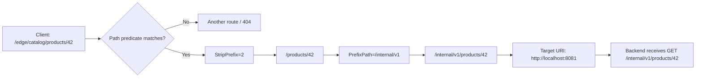

# Path Semantics in the Target URI and Dedicated Rewrite Configuration

## 1. A Real-World Problem When Configuring Routes

In microservices systems, an API Gateway often exposes a public path different from the path used by the internal service. For example:

- The client calls **`GET /edge/catalog/products/42`** through Spring Cloud Gateway.
- The Gateway selects **catalog-service** at **`http://localhost:8081`**.
- The backend only exposes the endpoint **`GET /internal/v1/products/42`**.

A common mistake is appending `/internal/v1` to the end of the route `uri` and expecting the Gateway to concatenate the paths automatically. In **Spring Cloud Gateway Server WebFlux and Server Web MVC**, the official documentation states clearly that **any path declared in the route URI is ignored** when proxying HTTP(S). To satisfy the API above, you must **declare path transformations separately using filters**.

This lesson belongs to the **Route Configuration** chapter of the **SPRING_CLOUD_GATEWAY** module. After this lesson, you will be able to:

1. Distinguish between the **client request path**, the path in the **target route URI**, and the path **after filter rewriting**.
2. Understand why `uri: http://localhost:8081/internal/v1` does not automatically prepend a prefix to downstream requests.
3. Properly use the `StripPrefix`, `PrefixPath`, `RewritePath`, and `SetPath` filters.
4. Build routes for the same backend using both YAML and the Java DSL, and know the differences between WebFlux and Web MVC.
5. Verify HTTP paths, queries, headers, and routing errors during operation before expanding to discovery, authentication, and protection policies.

> **Version scope:** The examples below use the configuration namespace of **Spring Cloud Gateway Server 5.0.x**. Use the starter, BOM, and documentation matching your application's version. Spring Cloud Gateway 4.x may use the older configuration namespace; Gateway Server Web MVC and WebFlux have different Java APIs. The focus of this lesson is HTTP(S) routing to another service. The case of `forward:` to an internal handler is distinguished separately in section 9.

## 2. Three Path Concepts to Keep Separate

| Concept | Example | Purpose |
|---|---|---|
| **Path sent by client to gateway** | `/edge/catalog/products/42` | Input data; evaluated by the `Path` route predicate |
| **Path inside the route URI** | `/internal/v1` in `http://localhost:8081/internal/v1` | **Does not act as a base path** for HTTP(S) proxy requests |
| **Post-filter path** | `/internal/v1/products/42` | The actual path the backend receives when filters transform it properly |

The **route URI** normally specifies the backend's **scheme** (`http`/`https`), **host**, and **port**. Meanwhile, the `Path` predicate only checks **whether the request matches the route**. **Gateway filters** are what decide whether to keep, remove, replace, or prepend path segments before proxying.



In the diagram, both transformations run **before the downstream HTTP call**. They construct the request path; the target URI supplies the server address. The query string, such as `?lang=vi`, is separate from the path and continues to be forwarded in examples without a query-modifying filter.

### 2.1. A Path Predicate Is Not a Path Rewrite

```yaml
predicates:
  - Path=/edge/catalog/**
```

This line means *select this route for requests whose path matches the pattern*, such as `/edge/catalog/products/42`. It **does not mean** "strip `/edge/catalog`" or "rewrite the path to `/products/42`." To do that, you must add a filter.

### 2.2. The Target URI Is Not a Concatenated Full URL

Do not assume Spring Cloud Gateway performs string concatenation like:

```text
route uri                              = http://localhost:8081/internal/v1
client path                            = /edge/catalog/products/42
WRONG EXPECTATION (concatenation)      = /internal/v1/edge/catalog/products/42
WRONG EXPECTATION (auto prefix swap)   = /internal/v1/products/42
CORRECT when NO path filter is used    = /edge/catalog/products/42
```

The **How It Works** documentation for **both Server WebFlux and Server Web MVC** specifies that the path portion of a route's `uri` is ignored. Therefore, for HTTP(S) proxy routes, write a simple, unambiguous target URI such as `http://localhost:8081`, and configure rewrites with filters.

## 3. Anti-Pattern: Putting a Base Path in `uri`

Consider a **Gateway Server WebFlux 5.0.x** route configured as follows:

```yaml
spring:
  cloud:
    gateway:
      server:
        webflux:
          routes:
            - id: catalog-wrong
              uri: http://localhost:8081/internal/v1
              predicates:
                - Path=/edge/catalog/**
```

If the client calls:

```bash
curl -i 'http://localhost:8080/edge/catalog/products/42?lang=vi'
```

the request is forwarded to the backend at **`localhost:8081`** with the **path `/edge/catalog/products/42`** because there is no path-rewriting filter. Assuming the backend only exposes `/internal/v1/products/42`, it may return **404 Not Found**. This error happens even though the route predicate matched and the target hostname/port are completely right.

The two separate changes needed are:

1. **Select the backend address:** `uri: http://localhost:8081`.
2. **Rewrite the downstream path:** add one or more filters as shown in section 4 or section 5.

Do not try to fix this by adding more slashes or path segments to the end of `uri`; that approach does not address the root cause.

## 4. Approach 1: `StripPrefix` Combined with `PrefixPath`

This is an intuitive approach when **removing some public path segments and prepending a fixed internal base path**.

Suppose the backend has a controller or handler serving **`GET /internal/v1/products/{id}`**. A complete WebFlux configuration for this route:

```yaml
# gateway-demo/src/main/resources/application.yml
server:
  port: 8080

spring:
  application:
    name: gateway-demo
  cloud:
    gateway:
      server:
        webflux:
          routes:
            - id: catalog-strip-and-prefix
              uri: http://localhost:8081
              predicates:
                - Path=/edge/catalog/**
              filters:
                - StripPrefix=2
                - PrefixPath=/internal/v1
                - AddRequestHeader=X-Gateway-Route, catalog-strip-and-prefix
```

**Step-by-step evaluation:**

| Step | Path | Explanation |
|---|---|---|
| Client sends | `/edge/catalog/products/42` | 4 segments: `edge`, `catalog`, `products`, `42` |
| `Path` predicate | `/edge/catalog/products/42` | Only checks route match; does not change path |
| `StripPrefix=2` | `/products/42` | Removes the first 2 segments: `edge` and `catalog` |
| `PrefixPath=/internal/v1` | `/internal/v1/products/42` | Prepends the internal prefix |
| HTTP proxy | `http://localhost:8081/internal/v1/products/42` | Backend receives the transformed path |

Example with a query string:

```text
Client   GET http://localhost:8080/edge/catalog/products/42?lang=vi
Backend  GET http://localhost:8081/internal/v1/products/42?lang=vi
```

`StripPrefix` and `PrefixPath` operate on the **path**; they are not responsible for adding or removing query parameters. The `AddRequestHeader` filter in the example only adds a header so the backend can identify the route, and has nothing to do with path transformation.

**Order matters:** applying `StripPrefix` first and then `PrefixPath` as shown makes the result predictable. If you reverse the order, `StripPrefix=2` could strip the `internal` and `v1` segments that were just added, sending an unintended path to the backend. When combining multiple path-modifying filters, always test the **final path**.

### 4.1. Options When Only One Filter Is Needed

- **Only remove a prefix:** `Path=/api/products/**` plus `StripPrefix=2` turns `/api/products/42` into `/42`. If you want `/products/42` downstream, use `StripPrefix=1`.
- **Only add a prefix:** `PrefixPath=/internal/v1` turns `/products/42` into `/internal/v1/products/42`, but **does not remove** any existing path portion.
- **Need both removal and addition:** combine them like the full route above, or use `RewritePath`.

## 5. Approach 2: Replacing the Path with a Single `RewritePath`

`RewritePath` accepts a **Java regular expression** (`regexp`) and a **replacement string** (`replacement`). It is useful when the public path has a longer prefix or a more flexible structure than "drop N segments."

This is **a standalone alternative** to the route in section 4; do not declare two routes with the same predicate in the same lab example without explicitly configuring priority order.

```yaml
spring:
  cloud:
    gateway:
      server:
        webflux:
          routes:
            - id: catalog-rewrite
              uri: http://localhost:8081
              predicates:
                - Path=/edge/catalog/**
              filters:
                - RewritePath=^/edge/catalog/(?<tail>.*)$, /internal/v1/$\{tail}
```

Regex explanation:

| Token | Meaning |
|---|---|
| `^` | Start-of-string anchor; avoids rewriting a path that happens to contain the prefix in the middle |
| `/edge/catalog/` | Public prefix to replace |
| `(?<tail>.*)` | Named capturing group called `tail`; keeps the remainder |
| `$` | End-of-string anchor |
| `/internal/v1/$\{tail}` | Replaces the prefix with the internal base path and inserts the value of `tail` |

For example, `/edge/catalog/products/42` becomes `/internal/v1/products/42`. If you also want to rewrite the path without a trailing `/` (`/edge/catalog`), you must extend the regex and clearly define the corresponding target endpoint. Do not assume the regex above handles every trailing-slash variation.

**YAML syntax note:** in Spring Cloud Gateway configuration, a replacement referencing a regex group is written as **`$\{tail}`**. The **backslash** between `$` and `{` prevents `${tail}` from being interpreted as a configuration property placeholder before `RewritePath` uses it. Write it as shown in the Spring documentation; when using the Java DSL, this YAML-specific escaping is not needed.

### 5.1. Comparing `RewritePath` with `StripPrefix`

`StripPrefix=2` is easy to read and has less regex risk when you simply want to drop two fixed segments; `RewritePath` is more flexible when you must **rename prefixes**, **preserve multiple dynamic parts**, or perform complex mappings. In return, regexes must be tested against paths with/without trailing `/`, special characters, and URL-encoded data.

For maintainability, prefer the **simplest option that accurately expresses the mapping**. Do not mix `StripPrefix` and `RewritePath` in a single route if both remove prefixes, unless their sequential application has been deliberately designed and tested.

## 6. Approach 3: `SetPath` with Path Variables

When the public path follows a specific pattern, `SetPath` lets you replace the **entire path** with a template based on variables captured by the predicate. For example, a route specifically for a single product by ID:

```yaml
spring:
  cloud:
    gateway:
      server:
        webflux:
          routes:
            - id: catalog-set-path
              uri: http://localhost:8081
              predicates:
                - Path=/edge/catalog/products/{id}
              filters:
                - SetPath=/internal/v1/products/{id}
```

The request `GET /edge/catalog/products/42` captures `id=42`, so the downstream request has the path `/internal/v1/products/42`. This approach is transparent for routes with a fixed number of segments, though it does not automatically forward arbitrary subpaths like a `/**` pattern. `SetPath` uses a **URI template** whereas `RewritePath` uses **regex**: `SetPath`'s `{id}` syntax differs from `RewritePath`'s `(?<tail>.*)` and `$\{tail}` syntax.

### 6.1. Quick Filter Selection Table

| What do you want to do? | Sample input | Filter | Result |
|---|---|---|---|
| Keep path unchanged | `/public/products/42` | No path filter | `/public/products/42` |
| Strip one segment | `/api/products/42` | `StripPrefix=1` | `/products/42` |
| Strip two segments | `/edge/catalog/products/42` | `StripPrefix=2` | `/products/42` |
| Prepend base path | `/products/42` | `PrefixPath=/internal/v1` | `/internal/v1/products/42` |
| Replace entire prefix | `/edge/catalog/products/42` | `RewritePath` as in section 5 | `/internal/v1/products/42` |
| Map a specific template | `/edge/catalog/products/42` | `SetPath=/internal/v1/products/{id}` with matching predicate | `/internal/v1/products/42` |

## 7. Applying with the Java DSL and Gateway Server Web MVC

### 7.1. Gateway Server WebFlux — Java `RouteLocatorBuilder`

If the application declares routes in Java instead of YAML, the path transformation remains separate from the URI:

```java
import org.springframework.cloud.gateway.route.RouteLocator;
import org.springframework.cloud.gateway.route.builder.RouteLocatorBuilder;
import org.springframework.context.annotation.Bean;
import org.springframework.context.annotation.Configuration;

@Configuration
class GatewayRoutes {

    @Bean
    RouteLocator catalogRoutes(RouteLocatorBuilder builder) {
        return builder.routes()
            .route("catalog-java", r -> r
                .path("/edge/catalog/**")
                .filters(f -> f
                    .stripPrefix(2)
                    .prefixPath("/internal/v1"))
                .uri("http://localhost:8081"))
            .build();
    }
}
```

What still matters is that `.uri("http://localhost:8081")` **only specifies the upstream**, while `.stripPrefix(2)` and `.prefixPath(...)` construct the path sent to the backend. The Java configuration is an **alternative** to the YAML route—do not run both simultaneously for the same path.

### 7.2. Gateway Server Web MVC — Corresponding Configuration

Gateway Server Web MVC runs on Servlet/WebMvc.fn and does not use WebFlux's `RouteLocatorBuilder`. Even so, the rule of **not relying on a path in `uri`** also applies to HTTP(S) routes, and correspondingly named filters exist in the 5.0.x documentation line:

```yaml
# Use only in a Gateway Server Web MVC application.
spring:
  cloud:
    gateway:
      server:
        webmvc:
          routes:
            - id: catalog-mvc
              uri: http://localhost:8081
              predicates:
                - Path=/edge/catalog/**
              filters:
                - StripPrefix=2
                - PrefixPath=/internal/v1
```

Do not mix `server.webflux` and `server.webmvc` routes "for better compatibility"; choose the **runtime** that matches your application architecture. In MVC, if `server.servlet.context-path` is set, check whether the request path includes the context path at the filter stage; versions that provide `StripContextPath` let you remove the context path **before** path-modifying filters. Verify against the exact MVC version you are using.

## 8. Self-Verification with a Real Backend

### 8.1. Test Backend

Assume you have a Spring Boot application `catalog-demo` using the **Spring Web** dependency, running on port **8081**, with the endpoint:

```java
package com.example.catalog;

import java.util.Map;
import org.springframework.boot.SpringApplication;
import org.springframework.boot.autoconfigure.SpringBootApplication;
import org.springframework.web.bind.annotation.GetMapping;
import org.springframework.web.bind.annotation.PathVariable;
import org.springframework.web.bind.annotation.RequestHeader;
import org.springframework.web.bind.annotation.RequestParam;
import org.springframework.web.bind.annotation.RestController;

@SpringBootApplication
@RestController
public class CatalogApplication {

    public static void main(String[] args) {
        SpringApplication.run(CatalogApplication.class, args);
    }

    @GetMapping("/internal/v1/products/{id}")
    public Map<String, String> find(
            @PathVariable String id,
            @RequestParam(name = "lang", defaultValue = "default") String lang,
            @RequestHeader(name = "X-Gateway-Route",
                           defaultValue = "direct") String route) {
        return Map.of("id", id, "lang", lang, "route", route);
    }
}
```

Set `server.port: 8081` in the backend configuration; the gateway uses the `spring-cloud-starter-gateway-server-webflux` starter and `server.port: 8080`. Select compatible Spring Boot and Spring Cloud BOM versions according to the release documentation. You do not need to add Spring Web to the Gateway Server WebFlux application to run this lesson.

### 8.2. Verification Steps

First start the backend and test the internal endpoint:

```bash
curl -i 'http://localhost:8081/internal/v1/products/42?lang=vi'
```

Next, start the gateway with **only one** of the route options above, such as the route from section 4:

```bash
curl -i 'http://localhost:8080/edge/catalog/products/42?lang=vi'
```

Expected response for the section 4 example (abbreviated; JSON field order may vary):

```http
HTTP/1.1 200 OK
Content-Type: application/json

{"id":"42","lang":"vi","route":"catalog-strip-and-prefix"}
```

The response shows the backend received **ID 42**, the **`lang=vi` query**, and the **header added by the Gateway**. The direct call and the gateway call differ in the `route` value, proving the proxy flow actually passed through the filter.

Try additional cases:

```bash
# Path does not match any configured route.
curl -i 'http://localhost:8080/edge/orders/42'

# Path matches, but the test backend has no corresponding controller.
curl -i 'http://localhost:8080/edge/catalog/unknown/42'

# Calling the public path directly on the backend; typically 404 since no such mapping exists.
curl -i 'http://localhost:8081/edge/catalog/products/42'
```

These commands are hands-on instructions, **not test results executed here**. Exact results depend on your backend, filters, security chain, and other routes in the application.

### 8.3. How to Distinguish 404 Errors

| Symptom | Likely cause | What to check |
|---|---|---|
| Gateway returns 404, no request reaches backend | No route matches `Path` or method/host | Check route predicates, route ID, and incoming request to gateway |
| Backend returns 404 even though route matched | Post-filter path does not match controller | Compare actual path received by backend with expected path |
| Backend is called at `/edge/catalog/...` | No rewrite filter configured or filter not applied | Inspect `filters` configuration on that specific route |
| Backend receives path missing `/internal/v1` | Missing or misconfigured `PrefixPath` / `RewritePath` | Check filter order and arguments |
| Backend receives `/internal/v1/internal/v1/...` | Prefix applied twice | Check `default-filters`, route filters, or ingress configuration |
| Gateway returns 5xx | Backend down, wrong host/port, DNS/TLS/timeout | Call backend directly **from the Gateway's runtime environment** and read connection logs |

To avoid confusion, log the **request ID**, **route ID**, original path, and actual path received by the backend, while measuring upstream status/latency with logs, metrics, or distributed tracing. With Gateway Actuator, expose route inspection endpoints only to authorized operators; never expose administrative features publicly on the Internet.

## 9. Exceptions and Edge Cases Requiring Caution

### 9.1. Using `lb://` with Service Discovery

When the backend is selected via Spring Cloud LoadBalancer, the URI can be `lb://catalog-service` instead of `http://localhost:8081`. This **only changes how the host/instance is chosen**; it does not strip path prefixes automatically:

```yaml
uri: lb://catalog-service
predicates:
  - Path=/edge/catalog/**
filters:
  - StripPrefix=2
  - PrefixPath=/internal/v1
```

This snippet illustrates **one route's content**, not a standalone `application.yml` file. Running it requires the **Spring Cloud LoadBalancer** dependency and a compatible source of service instances (such as a `DiscoveryClient`). Changing `uri` to `lb://` does not provide service discovery on its own.

### 9.2. The Special Case of `forward:`

The statements about URI paths in this lesson apply to **HTTP(S) proxying from the Gateway to downstream**. In Server WebFlux, `forward:` is a different mechanism: `ForwardRoutingFilter` uses `DispatcherHandler` to dispatch to an **internal handler** and can use **the path from the forward URI** as the handling path. For example, `forward:/localendpoint` has its own meaning in the internal flow. Do not infer from `http://` rules that every scheme ignores its path in the same way.

### 9.3. Queries, Fragments, and Headers Are Separate Parts

- The `StripPrefix`, `PrefixPath`, `RewritePath`, and `SetPath` filters used here operate on the **request path**. Do not rely on them to edit query parameters; to add or modify queries, use query-parameter-specific features.
- **Host** in the target `uri` is where the Gateway connects; the `Host` predicate matches incoming client requests. Those are two different roles.
- **Headers** such as `Authorization`, `Cookie`, and `X-Forwarded-*` require appropriate forwarding/authentication policies. Rewriting paths alone does not create security.
- A URL fragment `#section` is client-side information, not part of the HTTP request-target sent to the server; do not use fragments to design downstream routes.

### 9.4. Path Encoding, Slashes, and Safety

Do not assume a regex matches identically on requests containing spaces, `%`, `%2F`, double slashes, or trailing `/`. Frameworks, reverse proxies, and downstream services may apply different URL encoding and normalization rules. For critical routes, test those variations and align policies across ingress, Gateway, and application.

Path rewriting also **does not replace authentication/authorization**. Never let a rewritten public route accidentally reach internal administrative endpoints (such as `/internal/admin/**`). Define explicit allow and deny rules with Spring Security and test permissions **on both the public paths and the actual downstream resources**. If the gateway enforces rate limiting, retries, circuit breakers, or outbound TLS, also verify filter ordering, target addresses, and actual error behavior; those features do not fix path mappings by themselves.

## 10. Exercises and Review Questions

**Exercise 1 — Predict the path:** A route has `Path=/api/catalog/**`, `uri: http://localhost:8081/service`, and no path filters. The client calls `/api/catalog/products/8`. What path does the backend receive?

**Exercise 2 — Swap prefixes:** The backend requires `/v2/products/8`, and the client calls `/api/catalog/products/8`. Write a concise filter chain using `StripPrefix` and `PrefixPath`.

**Exercise 3 — Regex:** Use `RewritePath` to map `/public/files/images/logo.png` to `/storage/images/logo.png`; also test `/public/files/` and `/public/files`.

**Exercise 4 — Path template:** Use `SetPath` to turn `/v1/products/17` into `/internal/catalog/items/17` using the `{id}` variable from the `Path` predicate.

**Exercise 5 — Operations:** When the Gateway returns 404, what signals should you gather to distinguish an unmatched route from a backend that cannot find the endpoint? If the backend does not respond and the gateway returns 5xx, should you immediately edit `RewritePath`?

### Answer Hints

1. **`/api/catalog/products/8`**; the `/service` path in the HTTP route URI is not used to append to or replace the request path.
2. `StripPrefix=2` followed by `PrefixPath=/v2`; the backend receives `/v2/products/8`.
3. You can use `RewritePath=^/public/files/(?<tail>.*)$, /storage/$\{tail}`. For URLs without a trailing `/`, add an explicit rule or adjust the regex; do not silently assume it matches.
4. `Path=/v1/products/{id}` predicate and `SetPath=/internal/catalog/items/{id}` filter.
5. Check the **route ID/predicates**, the actual path the backend receives, and status/trace/logs on both sides. Connection 5xx errors usually require checking the upstream, DNS, TLS, port, and timeouts first.

## Official References

- [Spring Cloud Gateway Server WebFlux 5.0 — How It Works](https://docs.spring.io/spring-cloud-gateway/reference/5.0/spring-cloud-gateway-server-webflux/how-it-works.html) — confirms that the path in the route URI is ignored.
- [Spring Cloud Gateway Server Web MVC 5.0 — How It Works](https://docs.spring.io/spring-cloud-gateway/reference/5.0/spring-cloud-gateway-server-webmvc/how-it-works.html) — similar URI rules and MVC architecture.
- [Server WebFlux 5.0 — RewritePath GatewayFilter](https://docs.spring.io/spring-cloud-gateway/reference/5.0/spring-cloud-gateway-server-webflux/gatewayfilter-factories/rewritepath-factory.html) — regex, replacement, and YAML escaping rules.
- [Server WebFlux 5.0 — PrefixPath GatewayFilter](https://docs.spring.io/spring-cloud-gateway/reference/5.0/spring-cloud-gateway-server-webflux/gatewayfilter-factories/prefixpath-factory.html) — adding a base path.
- [Server WebFlux 5.0 — SetPath GatewayFilter](https://docs.spring.io/spring-cloud-gateway/reference/5.0/spring-cloud-gateway-server-webflux/gatewayfilter-factories/setpath-factory.html) — URI template with path variables.
- [Server WebFlux 5.0 — StripPrefix GatewayFilter](https://docs.spring.io/spring-cloud-gateway/reference/5.0/spring-cloud-gateway-server-webflux/gatewayfilter-factories/stripprefix-factory.html) — stripping the first N segments.
- [Server Web MVC 5.0 — RewritePath Filter](https://docs.spring.io/spring-cloud-gateway/reference/5.0/spring-cloud-gateway-server-webmvc/filters/rewritepath.html) — rewrite configuration for the Servlet stack.
- [Server WebFlux 5.0 — Global Filters](https://docs.spring.io/spring-cloud-gateway/reference/5.0/spring-cloud-gateway-server-webflux/global-filters.html) — `RouteToRequestUrlFilter`, `ForwardRoutingFilter`, and LoadBalancer.
