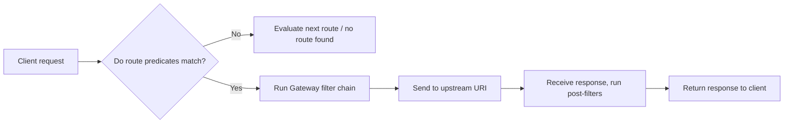

# Java DSL and Combining Conditions with `and`, `or`, and `negate`

## 1. Context: Selecting the Right Route in Spring Cloud Gateway

In microservices systems, **Spring Cloud Gateway** receives HTTP requests from web, mobile, or partner clients and chooses the target service. A single Gateway may hold many routes: an orders-read route, a product-catalog route, an internal-app route, or a canary/preview route. As the number of routes grows, checking only the path is often not enough: a request may need to satisfy a specific **host**, **path**, **HTTP method**, **header**, or several conditions at once.

For example, consider expressing these requirements:

- Forward **GET** requests to `/api/orders/**` only when `Host` is `api.example.test`.
- Have the same catalog service serve `/api/catalog/**` **or** `/api/products/**`.
- Match the normal reports route only if the path is `/api/reports/**` **and not** carrying the header `X-Mode: preview`.

The **Java DSL (fluent API)** of `RouteLocatorBuilder` expresses these rules in Java code, especially when combining **AND**, **OR**, and **NOT**. In Gateway, these conditions are called **route predicates**; they decide whether a request belongs to a route. Only after a route is selected do **Gateway filters** transform paths/headers, apply configured policies, and forward the request upstream.

This lesson belongs to the **Route Configuration** chapter of the **SPRING_CLOUD_GATEWAY** module. The goal is to learn how to write routes with the Java DSL, understand condition combination order, and verify results. Capabilities such as authentication, rate limiting, circuit breakers, retries, TLS, and observability remain relevant to Gateway operations, but must be configured via their respective components; writing predicates does not enable them automatically.

> **Version scope:** Examples focus on **Spring Cloud Gateway Server WebFlux** with `RouteLocatorBuilder` and the `and()`, `or()`, and `negate()` APIs. Starter declarations, configuration namespaces, and some auxiliary APIs may vary across Spring Cloud Gateway/WebFlux/MVC versions. Choose a release train compatible with Spring Boot and consult the documentation for your exact version.

## 2. Route, Predicate, and Filter: Three Distinct Responsibilities

A route consists of these core parts:

| Component | Answers the question | Example |
| --- | --- | --- |
| **Route ID** | What is this route called? | `orders-read` |
| **Predicate** | Which requests match the route? | `Path=/api/orders/**` and `Method=GET` |
| **URI** | Where should the request be sent? | `http://localhost:8081` or `lb://ORDER-SERVICE` |
| **Filter** | What request/response adjustments or policies apply? | `StripPrefix=1`, adding a response header |

High-level processing flow:



Predicates do not mutate request contents; filters are not used to replace route selection. For example, `path("/api/orders/**")` selects the route, whereas `stripPrefix(1)` removes the `/api` segment when forwarding.

A route matches when its **composite predicate** evaluates to `true`. If no route matches, the Gateway typically returns `404`, depending on error handling and other handlers in the application. If a route matches but the upstream fails to respond, the error stems from transport or the upstream rather than from the predicate.

## 3. Basic Java DSL Syntax

### 3.1. Declaring a `RouteLocator` Bean

The following complete example assumes the Gateway listens on `localhost:8080` and three sample services are running on `8081`, `8082`, and `8083`:

```java
import org.springframework.context.annotation.Bean;
import org.springframework.context.annotation.Configuration;
import org.springframework.http.HttpMethod;
import org.springframework.cloud.gateway.route.RouteLocator;
import org.springframework.cloud.gateway.route.builder.RouteLocatorBuilder;

@Configuration
public class GatewayRoutesConfig {

    @Bean
    RouteLocator gatewayRoutes(RouteLocatorBuilder builder) {
        return builder.routes()

            // AND: matching host, matching path, and matching HTTP method.
            .route("orders-read", r -> r
                .host("api.example.test")
                .and().path("/api/orders/**")
                .and().method(HttpMethod.GET)
                .filters(f -> f
                    .stripPrefix(1)
                    .addResponseHeader("X-Gateway-Route", "orders-read"))
                .uri("http://localhost:8081"))

            // OR: accept either of two paths.
            .route("catalog-alias", r -> r
                .path("/api/catalog/**")
                .or().path("/api/products/**")
                .filters(f -> f
                    .addResponseHeader("X-Gateway-Route", "catalog-alias"))
                .uri("http://localhost:8082"))

            // NOT: exclude requests with X-Mode: preview; still bounded by path.
            .route("reports-normal", r -> r
                .header("X-Mode", "preview").negate()
                .and().path("/api/reports/**")
                .filters(f -> f
                    .addResponseHeader("X-Gateway-Route", "reports-normal"))
                .uri("http://localhost:8083"))

            .build();
    }
}
```

The imports above are the primary imports for this example. `@Configuration` registers the configuration class, and `@Bean` returns a `RouteLocator` containing the constructed routes. Each `.route("id", r -> ...)` call defines one route; `.build()` finalizes the list.

When `host("api.example.test")` is used, tests must send the matching HTTP `Host` header even though the actual connection URL is `localhost:8080`. Behind a reverse proxy, verify how the host header is forwarded and check proxy trust policies.

Path transformation example:

```text
Client:   GET /api/orders/42
Route:    orders-read (host + path + GET all match)
Filter:   StripPrefix=1
Upstream: GET http://localhost:8081/orders/42
```

The other two routes **do not call** `stripPrefix`: they preserve the request path when forwarding upstream. This is an illustrative choice; real applications must design filters to match the endpoints on the target services.

### 3.2. Thinking in Configuration Order

Common syntax:

```java
.route("route-id", r -> r
    .path("/api/example/**")           // Define the first predicate
    .and().method(HttpMethod.GET)       // Combine with a second predicate
    .filters(f -> f.stripPrefix(1))     // Process after route matches
    .uri("http://localhost:8081"))     // Forwarding destination
```

Remember that `.and()`, `.or()`, and `.negate()` are **not** filters and do not create a new route. They combine or invert the condition result for **the current route**.

## 4. The AND Operator: All Conditions Must Be True

`and()` corresponds to logical conjunction: **A AND B** is true only when both A and B are true.

| A | B | A AND B |
| --- | --- | --- |
| False | False | False |
| False | True | False |
| True | False | False |
| True | True | **True** |

Example: allow only **GET** on the orders endpoints under host `api.example.test`:

```java
.route("orders-read", r -> r
    .host("api.example.test")
    .and().path("/api/orders/**")
    .and().method(HttpMethod.GET)
    .uri("http://localhost:8081"))
```

Logical expression:

```text
Host = api.example.test
AND Path matches /api/orders/**
AND Method = GET
```

Verification table:

| Host | Method | Path | Matches route? |
| --- | --- | --- | --- |
| `api.example.test` | GET | `/api/orders/42` | **Yes** |
| `api.example.test` | POST | `/api/orders` | No, wrong method |
| `api.example.test` | GET | `/api/products/42` | No, wrong path |
| `other.example.test` | GET | `/api/orders/42` | No, wrong host |

A request failing any condition will not be routed here. It **may still** match another route if the system defines one.

**Predicates in YAML:** when configuring a route with multiple lines under `predicates` in a config file, they are combined with AND by default. The Java DSL makes it easier to express OR/NOT logic when needed.

## 5. The OR Operator: Any Matching Condition Suffices

`or()` corresponds to logical disjunction: **A OR B** is true when at least one condition is true.

| A | B | A OR B |
| --- | --- | --- |
| False | False | False |
| False | True | **True** |
| True | False | **True** |
| True | True | **True** |

For example, during an endpoint rename, both `/api/catalog/**` and `/api/products/**` route to the same catalog service:

```java
.route("catalog-alias", r -> r
    .path("/api/catalog/**")
    .or().path("/api/products/**")
    .uri("http://localhost:8082"))
```

Meaning:

```text
Path matches /api/catalog/**
OR Path matches /api/products/**
```

Both branches of the OR go to **the same URI** and run through **the same filter chain** of route `catalog-alias`. If each branch needs to go to a different service, create **two separate routes** with their respective URIs.

### 5.1. Shorter Syntax for Multiple Values of the Same Kind

Some predicates accept multiple values directly in a single method call:

```java
.route("catalog-read", r -> r
    .path("/api/catalog/**", "/api/products/**")
    .and().method(HttpMethod.GET)
    .uri("http://localhost:8082"))
```

Here, the two path patterns are checked with **OR** inside the `Path` predicate, while `.and().method(GET)` additionally requires GET. Think of it as:

```text
(Path = /api/catalog/** OR Path = /api/products/**)
AND Method = GET
```

This is usually cleaner to read when grouping multiple paths into one condition. `method(HttpMethod.GET, HttpMethod.HEAD)` likewise represents a set of accepted HTTP methods.

### 5.2. Do Not Use OR to Bypass a Required Condition

Suppose you write:

```java
// Broken logic if every request must be under /api/orders/**
.path("/api/orders/**")
.and().method(HttpMethod.GET)
.or().header("X-Channel", "mobile")
```

Due to evaluation chaining, the actual expression is:

```text
(Path orders AND Method GET) OR (X-Channel = mobile)
```

The header branch after OR can cause the route to match completely unrelated paths. Client-supplied headers can also be forged, so never treat them as sufficient proof for granting access.

When you want **(Path A OR Path B) AND GET**, prefer `path(A, B).and().method(GET)`, or use explicitly parenthesized Java `Predicate` objects as shown in section 7.

## 6. The NEGATE Operator: Inverting a Condition

`negate()` means **NOT**: `true` becomes `false`, and vice versa.

| A | NOT A |
| --- | --- |
| False | **True** |
| True | False |

Example: a reports route for normal requests that **does not** accept the header `X-Mode: preview`:

```java
.route("reports-normal", r -> r
    .header("X-Mode", "preview").negate()
    .and().path("/api/reports/**")
    .uri("http://localhost:8083"))
```

At the point `.negate()` is called, the accumulated predicate is `header("X-Mode", "preview")`; negation flips that condition. Then `.and().path(...)` narrows the scope:

```text
NOT (X-Mode matches preview)
AND Path matches /api/reports/**
```

| Request | Has `X-Mode: preview`? | Reports path? | Matches? |
| --- | --- | --- | --- |
| `GET /api/reports/2026` | No | Yes | **Yes** |
| `GET /api/reports/2026` | Yes | Yes | No |
| `GET /api/orders/42` | No | No | No |

Note: `header("X-Mode", "preview")` evaluates the header value as a regular expression. With regex `preview`, a missing header or non-matching value becomes true after `negate()`. This example is strictly for **mode-based routing**, not security authorization.

### 6.1. Pitfall: Negation Can Make a Route Too Broad

Do not carelessly write:

```java
// Warning example: far too broad
.route("everything-except-admin", r -> r
    .path("/api/admin/**").negate()
    .uri("http://localhost:8083"))
```

This route can match nearly every request **outside** `/api/admin/**`, including paths not belonging to any intended API. It can shadow other routes and send unintended traffic upstream.

If the requirement is "only the reports API, except preview," combine it with a **positive predicate** bounding the path like the first example in section 6. In multi-client systems, default-deny at the security layer and route-independent authorization rules remain essential.

### 6.2. What Does `negate()` Apply To?

When combining multiple conditions, `.negate()` inverts **the composite predicate accumulated up to that call**, rather than guessing that you meant "negate only the adjacent condition." Therefore:

```text
NOT (A AND B)   differs from   A AND (NOT B)
```

By De Morgan's law, `NOT (A AND B)` equals `(NOT A) OR (NOT B)`, which is much broader than `A AND (NOT B)`. To avoid misinterpretation, group conditions explicitly before negating or use standard Java `Predicate` variables with explicit parentheses.

## 7. Combining AND, OR, and NOT Without Ambiguity

Suppose the requirement is:

> Route GET requests to the catalog service if the path starts with `/api/catalog/` **or** `/api/products/`, but **do not** accept requests with `X-Mode: preview`.

The expression is:

```text
((PathCatalog OR PathProducts) AND MethodGET) AND NOT(Preview)
```

This can be written cleanly using multiple `Path` patterns and a negation:

```java
.route("catalog-normal", r -> r
    .path("/api/catalog/**", "/api/products/**")
    .and().method(HttpMethod.GET)
    .and().not(p -> p.header("X-Mode", "preview"))
    .uri("http://localhost:8082"))
```

**API note:** `not(Function<PredicateSpec, BooleanSpec>)` negates a predicate group in Java DSL versions that provide this method. Do not confuse `.not(p -> ...)` with the zero-argument `.negate()`; verify the exact method signatures available in your version. If `not(...)` is unavailable, you can use explicitly grouped Java `Predicate` instances as shown next.

### 7.1. Grouping Expressions with `java.util.function.Predicate`

Below is a **standalone example** using `Predicate<ServerWebExchange>` to make grouping crystal clear. Simple prefix checks are used here for readability and do not fully replace `Path` predicate pattern semantics:

```java
import java.util.function.Predicate;
import org.springframework.http.HttpMethod;
import org.springframework.web.server.ServerWebExchange;

// Individual Java predicates; must not perform blocking I/O.
Predicate<ServerWebExchange> catalog = ex ->
    ex.getRequest().getPath().value().startsWith("/api/catalog/");

Predicate<ServerWebExchange> products = ex ->
    ex.getRequest().getPath().value().startsWith("/api/products/");

Predicate<ServerWebExchange> isGet = ex ->
    HttpMethod.GET.equals(ex.getRequest().getMethod());

Predicate<ServerWebExchange> isPreview = ex ->
    "preview".equalsIgnoreCase(
        ex.getRequest().getHeaders().getFirst("X-Mode")
    );

Predicate<ServerWebExchange> matched =
    catalog.or(products)
           .and(isGet)
           .and(isPreview.negate());

// Inside builder.routes():
.route("catalog-normal", r -> r
    .predicate(matched)
    .uri("http://localhost:8082"))
```

`Predicate.and(...)`, `Predicate.or(...)`, and `Predicate.negate()` here come from standard Java. The resulting `matched` expression is grouped by the method chains, making the logic easy to inspect. `PredicateSpec.predicate(matched)` plugs that logic into the Java DSL route.

In practice, **prefer built-in predicate factories** such as `path(...)`, `host(...)`, `method(...)`, `header(...)`, and `query(...)` so you do not re-implement path matching, URL encoding, and regex handling. Write custom Java predicates only when requirements truly exceed built-in predicates.

### 7.2. Truth Table for the Combined Expression

| Path in catalog/products? | GET? | Preview? | `catalog-normal` route |
| --- | --- | --- | --- |
| Yes | Yes | No | **Matches** |
| Yes | Yes | Yes | No |
| Yes | No | No | No |
| No | Yes | No | No |
| No | Yes | Yes | No |

Checking with a truth table helps catch expressions that accidentally evaluate as `A OR (B AND C)` instead of `(A OR B) AND C`.

## 8. AND/OR and Route Precedence

A Gateway often has overlapping routes, such as:

```text
Route A: /api/orders/**
Route B: /api/**
```

Both can match `GET /api/orders/42`. The Gateway must **pick one route**, and selection depends on `order` as well as how routes are sorted/registered. In the Java DSL, you can specify order explicitly:

```java
.route("orders-specific", r -> r
    .order(-10)
    .path("/api/orders/**")
    .uri("http://localhost:8081"))

.route("api-fallback", r -> r
    .order(100)
    .path("/api/**")
    .uri("http://localhost:8089"))
```

A **lower `order` value means higher priority**. Here, the specific route has order `-10` and the fallback has `100`, so `/api/orders/42` is expected to select `orders-specific`. Do not rely merely on file declaration order when multiple route sources may be combined.

Additionally:

- Each route must have a **distinct ID** for traceability in logs and metrics.
- `or()` only joins predicates **within a single route**; it does not order two routes.
- A route with an overly broad predicate can shadow later routes.
- No matching route is different from a matched route whose upstream returns an error.
- When mixing YAML-configured routes with a Java `RouteLocator`, check for duplicate paths/IDs and verify priority order in the merged route list.

## 9. When to Create Two Routes Instead of Using OR

Suppose:

- `GET /api/catalog/**` goes to the catalog service.
- `GET /api/pricing/**` goes to the pricing service.

These have **two different URIs**, so use two routes:

```java
.route("catalog-service", r -> r
    .path("/api/catalog/**")
    .and().method(HttpMethod.GET)
    .filters(f -> f.stripPrefix(1))
    .uri("http://localhost:8082"))

.route("pricing-service", r -> r
    .path("/api/pricing/**")
    .and().method(HttpMethod.GET)
    .filters(f -> f.stripPrefix(1))
    .uri("http://localhost:8084"))
```

If you put `path("/api/catalog/**").or().path("/api/pricing/**")` in **one route** with a single `uri`, both request groups go to the same destination. That is only valid when the same upstream handles both prefixes.

The Java DSL can integrate with Service Discovery using an `lb://SERVICE-ID` URI if the Gateway has a compatible `DiscoveryClient` or `ServiceInstance` source and Spring Cloud LoadBalancer configured. Simply writing `lb://...` does not make the system auto-register or auto-discover services.

## 10. Testing Routes with HTTP Requests

Assuming the configuration in section 3 is running, you can test each scenario. Use `-i` to inspect HTTP status and response headers; the `X-Gateway-Route` header is added by the filter when its route handles the request.

### 10.1. Testing AND

```bash
# Matches host, path, and GET:
curl -i -H "Host: api.example.test" \
  http://localhost:8080/api/orders/42

# Wrong method; does not match orders-read:
curl -i -X POST -H "Host: api.example.test" \
  http://localhost:8080/api/orders/42

# Wrong host; does not match orders-read:
curl -i -H "Host: other.example.test" \
  http://localhost:8080/api/orders/42
```

### 10.2. Testing OR

```bash
curl -i http://localhost:8080/api/catalog/products/42
curl -i http://localhost:8080/api/products/42
```

Both paths are expected to match `catalog-alias`. Responses may include `X-Gateway-Route: catalog-alias` when routed through it, though the final HTTP status code also depends on whether the upstream exposes those endpoints.

### 10.3. Testing NEGATE

```bash
# No X-Mode: preview => matches reports-normal
curl -i http://localhost:8080/api/reports/2026

# Has X-Mode: preview => does not match reports-normal
curl -i -H "X-Mode: preview" \
  http://localhost:8080/api/reports/2026
```

**Do not rely on HTTP `200` alone to conclude a route matched.** A request can match a route and still receive `404` from the service, or receive `401/403/429/503` from other components. In multi-route systems, check route ID logs, configured metrics/traces, or properly secured Gateway observability endpoints.

### 10.4. Minimal Test Case Table

| Case | Input conditions | Expected result |
| --- | --- | --- |
| A1 | Right host + GET + order path | Selects `orders-read` |
| A2 | Right host + POST + order path | Does not select `orders-read` |
| A3 | Different host + GET + order path | Does not select `orders-read` |
| O1 | Catalog path | Selects `catalog-alias` |
| O2 | Products path | Selects `catalog-alias` |
| O3 | Pricing path | Does not select `catalog-alias` |
| N1 | Report path, no preview header | Selects `reports-normal` |
| N2 | Report path, preview header | Does not select `reports-normal` |
| N3 | Order path, no preview header | Does not select `reports-normal` |

To test independently of real upstreams, configure mock services or use your project's Gateway integration testing tools. In this lesson, the table serves as a **behavioral specification** to verify during implementation; do not assume real services are listening on the sample ports.

## 11. Common Pitfalls When Combining Predicates

| Mistake | Consequence | Fix |
| --- | --- | --- |
| Confusing `and()` and `or()` | Route matches too broadly or drops valid requests | Write the logical expression first and build a truth table |
| Negating a path without a positive bound | Captures nearly every request outside the negated path | Add reasonable path/host/method bounds |
| Chaining `A.and().B.or().C` when intending `A AND (B OR C)` | Branch C can bypass A | Use multi-value methods or explicitly grouped predicates |
| Using a client header for authorization | Clients can spoof headers | Use Spring Security and enforce authorization in services |
| Using OR for paths needing different URIs | Requests go to the wrong microservice | Split into separate routes per destination |
| Omitting `order` on overlapping routes | Fallback route wins over specific route | Set explicit order and test overlapping matches |
| `404` when calling a path with rewrite filters | Upstream receives the wrong path | Check the path before and after `StripPrefix`/`RewritePath` |
| Writing custom predicates with blocking I/O | Blocks WebFlux event-loop threads | Keep predicates fast; never make synchronous JDBC/HTTP calls |
| Using APIs from a different version | Fails to compile or routes fail to load | Verify dependencies, namespaces, and matching Javadocs |

### 11.1. Predicates Are Not an Authentication Mechanism

A route with `.header("X-Role", "admin")` only checks an **HTTP header value** that any caller can set. It does not validate JWTs, signatures, permissions, or identity. If an internal route needs protection:

1. Configure Spring Security/WebFlux to authenticate and enforce access rules.
2. Enforce resource ownership and business rules inside the appropriate microservice.
3. Restrict direct network access to upstreams using proper network controls.
4. Configure TLS, rate limiters, circuit breakers, and timeouts independently as needed; predicates only select routes.

Thus, `NOT Header` or `Host` predicates are useful for **traffic routing**, but should never be treated as the sole security boundary.

### 11.2. Impact of Filters on Reading Paths and Headers

Route predicates normally evaluate the request when the Gateway selects a route; `GatewayFilter` instances run after the route has matched. If a filter subsequently changes the path or headers, do not expect predicates to be re-evaluated against the modified request. On routes using `StripPrefix` or `RewritePath`, distinguish:

```text
Path used to select route:     /api/orders/42
Path forwarded to upstream:    /orders/42
```

When debugging, inspect both values alongside the route ID. If downstream logic depends on the post-transformation path, design filters and routes for the right processing stage and execution order.

## 12. When Does the Java DSL Beat YAML?

| Need | Java DSL | YAML/Properties |
| --- | --- | --- |
| AND of several basic predicates | Yes | Yes, typically the default for a `predicates` list |
| Complex OR or NOT structures | Flexible with fluent API and Java `Predicate` | May require splitting routes or different config mechanisms depending on version |
| Custom predicates in Java | Convenient via `predicate(...)` | Cannot write Java lambdas directly in YAML |
| Varying only URIs or timeouts per environment | Can be externalized into properties | Convenient to configure via environment variables |
| Unit-testing combinational logic | Can extract `Predicate`/`RouteLocator` to test | Must load configuration and test with actual requests |

There is no rule requiring every route to be written in Java. For simple routes using mostly AND, YAML is usually more concise. When you need grouped conditions and code-managed custom logic, the Java DSL shines. Whichever approach you choose, carefully manage route IDs, priority ordering, per-environment configuration, and route test suites.

## 13. Mini-Lab: Turning Rules into Expressions

Requirement: `GET /api/inventory/**` **or** `HEAD /api/inventory/**` should go to the inventory service, but requests with `X-Mode: maintenance` must **not match** that route.

Analysis:

```text
Path = /api/inventory/**
AND (Method = GET OR Method = HEAD)
AND NOT (Header X-Mode matches maintenance)
```

This can be expressed using a multi-method predicate and header negation:

```java
.route("inventory-public", r -> r
    .path("/api/inventory/**")
    .and().method(HttpMethod.GET, HttpMethod.HEAD)
    .and().not(p -> p.header("X-Mode", "maintenance"))
    .filters(f -> f
        .stripPrefix(1)
        .addResponseHeader("X-Gateway-Route", "inventory-public"))
    .uri("http://localhost:8085"))
```

Self-check cases:

- `GET /api/inventory/items/1` without maintenance header: must match.
- `HEAD /api/inventory/items/1` without maintenance header: must match.
- `POST /api/inventory/items/1`: must not match.
- `GET /api/inventory/items/1` with `X-Mode: maintenance`: must not match.
- `GET /api/orders/42` without maintenance header: must not match.

This is solely a traffic-routing example; if "maintenance" represents a safety or access-control policy, never trust a client-controlled header. You can replace the negation with an explicitly grouped Java `Predicate<ServerWebExchange>` if your version's Java DSL API differs from this example.

## 14. Summary and Official References

When configuring routes in **Spring Cloud Gateway Server WebFlux**:

- `and()`: all conditions must hold.
- `or()`: at least one condition must hold.
- `negate()`: inverts the predicate built up to that call site.
- `path(A, B)` or `method(GET, HEAD)`: groups multiple options of the same kind without explicit `.or()` chains.
- Java `Predicate<ServerWebExchange>`: useful when complex expressions require explicit grouping.
- `.filters(...)` and `.uri(...)`: process matched requests and define the target; they are not logical operators.

A safe workflow is to **write out the logical expression first**, translate it into the Java DSL, and then verify it against a table of matching and non-matching cases. Always watch for overlapping routes, priority order, filter side effects, and authentication boundaries; these directly impact operating a Gateway safely in microservices systems.

Official documentation for checking version-specific APIs:

- [Spring Cloud Gateway — Fluent Java Routes API](https://docs.spring.io/spring-cloud-gateway/reference/spring-cloud-gateway-server-webflux/fluent-java-routes-api.html).
- [Spring Cloud Gateway — Route Predicate Factories](https://docs.spring.io/spring-cloud-gateway/reference/spring-cloud-gateway-server-webflux/request-predicates-factories.html).
