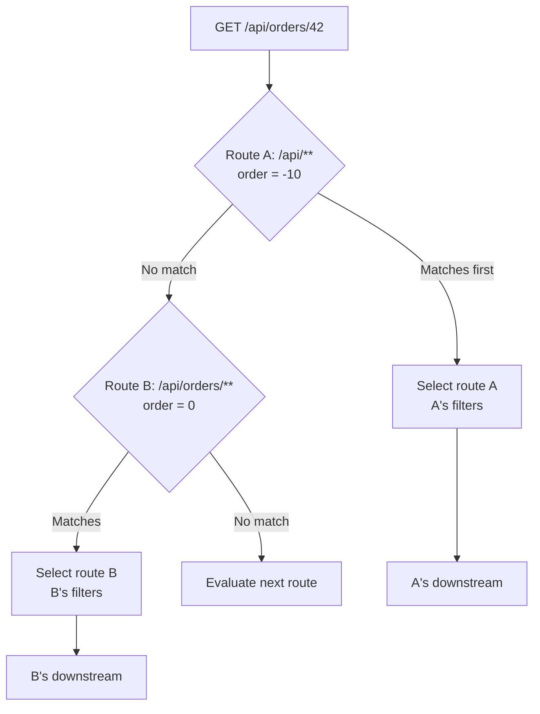

# General Routes, Specific Routes, and the Risk of Misrouting Requests

When an API Gateway sits in front of multiple microservices, a single request can satisfy **multiple routing rules**. For instance, `GET /api/orders/42` matches both `/api/orders/**` and `/api/**`. Without explicit priority ordering, the request can be sent to the wrong service, pass through the wrong filters, or bypass policies intended specifically for the orders API.

In the **SPRING_CLOUD_GATEWAY** module, we build an API Gateway using **route predicates**, **filter chains**, path/header transformations, and service discovery; then we apply authentication, rate limiting, circuit breakers, retries, TLS, and request observability to operate a microservices edge safely. This topic from the **Route Configuration** chapter focuses on a prerequisite before all those steps: **defining general and specific routes so requests land on the right route**.

> **Scope:** Examples focus on **Spring Cloud Gateway Server WebFlux**, where `RoutePredicateHandlerMapping` selects a route from `RouteLocator` before `FilteringWebHandler` runs gateway filters. The `spring.cloud.gateway.routes` configuration illustrates the common format of several Spring Cloud Gateway WebFlux 4.x versions. Check starter names and configuration namespaces against your application's exact version, especially when upgrading to releases using `spring.cloud.gateway.server.webflux.routes`.

## 1. What Are General Routes and Specific Routes?

A **route** in Spring Cloud Gateway describes at least three things: *when a request matches*, *which URI the request is forwarded to*, and *which filters run when the route is selected*. A route usually has an `id`, `uri`, `predicates`, `filters`, and `order`.

A **general route** (*general route, fallback route, or catch-all route*) accepts a broad set of requests. Examples:

- `Path=/api/**`: matches many APIs prefixed with `/api/`.
- `Path=/api/orders/**`: matches subpaths of the orders API without distinguishing HTTP methods.
- `Path=/**`: a very broad pattern that can cover nearly all HTTP paths passing through the gateway.

A **specific route** adds stricter constraints on path, method, host, header, or query parameters. Examples:

- `Path=/api/orders/**` and `Method=GET`: accepts only GET requests in the orders group.
- `Path=/api/admin/**` and `Host=admin.example.test`: accepts only the admin branch on that hostname.
- `Path=/api/orders/{orderId}` and `Method=GET`: matches a path pattern with an `orderId` variable using the URI template syntax supported by the `Path` predicate.

| Attribute | General route | Specific route |
| --- | --- | --- |
| **Condition breadth** | Accepts many requests from a broad group | Accepts fewer requests due to extra constraints |
| **Typical purpose** | Legacy APIs, shared service groups, fallbacks | Admin APIs, order reads/writes, versioned APIs, partners |
| **Example** | `Path=/api/**` | `Path=/api/orders/**` combined with `Method=GET` |
| **Risk** | Can shadow specific routes; sends requests to unintended backends | Can miss valid requests if method/host/header is misconfigured |
| **What to control** | Coverage, low priority, safe fallback policies | Accurate predicates, proper priority, authorization, and filters |

"General" or "specific" describes a **relationship between matching conditions**, not a separate route type in the library. Two routes can share the same `uri` while differing in predicates and filters; they can still compete for the same request.

## 2. How Does Spring Cloud Gateway Actually Pick a Route?

In a typical Server WebFlux architecture:

1. A request arrives in WebFlux and passes through application-level `WebFilter` instances, if any.
2. `DispatcherHandler` searches for a suitable handler; `RoutePredicateHandlerMapping` is the Gateway's handler mapping.
3. `RoutePredicateHandlerMapping` obtains the `Route` objects built from `RouteLocator` and evaluates predicates in the order the routes are supplied.
4. **The first matching route** is selected and stored on `ServerWebExchange`, typically under the `GATEWAY_ROUTE_ATTR` attribute.
5. `FilteringWebHandler` then combines `GlobalFilter`s with that route's `GatewayFilter`s and executes the filter chain, including rewrites, gateway-level security, load balancing, and routing as configured.

`order` controls route priority. Among routes sorted by `order`, **smaller numbers have higher priority**: `-20` comes before `0`, and `0` comes before `100`. If multiple routes overlap in conditions and share the same `order`, do not rely on YAML declaration order or the "more specific" look of a path pattern to pick the winner; configure unambiguous priorities or non-overlapping conditions.

**Key point:** Spring Cloud Gateway does not apply a global "most specific path automatically wins" rule across all routes. A `Path=/api/**` route with `order=-100` can be evaluated and selected ahead of `Path=/api/orders/**` with `order=0`.

### 2.1. Predicates Within the Same Route Usually Combine with AND

Example:

```yaml
predicates:
  - Path=/api/orders/**
  - Method=GET
```

This route matches only when **both** conditions hold. `POST /api/orders/42` matches the path but not the method, so it is excluded from this route. A single `Path` predicate can accept multiple path patterns combined per that factory's semantics; this differs from the AND combination across **separate predicates** in the same route.

### 2.2. Routes Compete Sequentially, Not Simultaneously

If `GET /api/orders/42` matches both route A and route B, the request runs through **the selected route's filters** plus matching `GlobalFilter`s. Filters configured only on the unselected route do not run merely because its predicates would also have matched.

This is especially critical when a specific route has `RequestRateLimiter`, `CircuitBreaker`, or header-adding filters, yet a general route is selected first: **filters attached exclusively to the specific route will not apply to that request**. Policies in `WebFilter`s or backends may still apply independently; keep protection layers distinct.



This is a logical diagram of **sequential matching**. It does not imply the system has only two routes, nor that every HTTP request goes through the Gateway handler mapping: other handler mappings in the application may still handle requests.

## 3. Error Example: A General Route Captures Requests by Mistake

Suppose there are two backends:

- `order-service`: handles orders.
- `legacy-service`: receives remaining legacy APIs.

A configuration **with an ordering bug**:

```yaml
spring:
  cloud:
    gateway:
      routes:
        - id: api-legacy
          order: -10
          uri: http://legacy-service:8080
          predicates:
            - Path=/api/**
          filters:
            - StripPrefix=1
            - AddResponseHeader=X-Demo-Route, api-legacy

        - id: orders-api
          order: 0
          uri: lb://order-service
          predicates:
            - Path=/api/orders/**
          filters:
            - StripPrefix=1
            - AddResponseHeader=X-Demo-Route, orders-api
```

A `GET /api/orders/42` request matches both path predicates, but `api-legacy` has `order=-10` and is selected first. After `StripPrefix=1`, the request is forwarded to `http://legacy-service:8080/orders/42` instead of `order-service`. The result may be `404`, a malformed response, or even data from a legacy API that happens to share a similar path.

**Warning sign:** the orders API works when calling `order-service` directly, yet returns `legacy-service` responses through the gateway. Changing hosts, restarting the backend, or adding retries **will not fix wrong route selection**.

> The `X-Demo-Route` header is solely for observation in this example; in production systems you should not expose internal route/backend structure to clients by default.

## 4. Fix with Explicit Route Priority

Give the specific route a **lower** `order` and put the general route behind it:

```yaml
spring:
  cloud:
    gateway:
      routes:
        - id: orders-api
          order: -20
          uri: lb://order-service
          predicates:
            - Path=/api/orders/**
          filters:
            - StripPrefix=1
            - AddResponseHeader=X-Demo-Route, orders-api

        - id: api-legacy
          order: 100
          uri: http://legacy-service:8080
          predicates:
            - Path=/api/**
          filters:
            - StripPrefix=1
            - AddResponseHeader=X-Demo-Route, api-legacy
```

After the fix:

| Incoming request | Expected route | Explanation | Downstream path after `StripPrefix=1` |
| --- | --- | --- | --- |
| `GET /api/orders/42` | `orders-api` | Specific route matches first | `/orders/42` |
| `POST /api/orders` | `orders-api` | No method restriction, so path still matches | `/orders` |
| `GET /api/customers/9` | `api-legacy` | Misses orders, caught by `/api/**` fallback | `/customers/9` |
| `GET /status` | Neither route in example | No matching path predicate | No downstream call via these two routes |

The `lb://order-service` URI is a **logical service name**: it requires Spring Cloud LoadBalancer and an appropriate instance source. Failing to find an instance is **a post-route-selection error**, distinct from `api-legacy` accidentally capturing the request.

### 4.1. Why Not Just Reorder the Two Routes in the File?

In a tiny config file, swapping lines in YAML might happen to produce the desired result. In real systems, however, routes can come from multiple sources, be cached, be dynamically loaded, or share equal priority. Depending on file position is not a reliable routing contract. Set explicit `order` values for overlapping routes and minimize predicate intersections whenever possible.

### 4.2. Must Specific Routes Always Use Negative Numbers?

No. Negative numbers carry no special security meaning. What matters is the **relative ordering** among competing routes. For instance, `order=10` for specific routes and `order=100` for fallbacks works equally well. Use a consistent numbering scheme so operators can insert new routes without renumbering everything.

## 5. Specializing with Multiple Predicates, Not Only Path

Accurate route selection requires understanding every request attribute that can affect matching.

### 5.1. Same Path, Different Methods

An API can separate order reads from writes:

```yaml
spring:
  cloud:
    gateway:
      routes:
        - id: orders-read
          order: -30
          uri: lb://orders-read-service
          predicates:
            - Path=/api/orders/**
            - Method=GET

        - id: orders-write
          order: -20
          uri: lb://orders-write-service
          predicates:
            - Path=/api/orders/**
            - Method=POST,PUT,PATCH,DELETE

        - id: orders-fallback
          order: 100
          uri: lb://orders-default-service
          predicates:
            - Path=/api/orders/**
```

In this setup, `GET` matches the read route, and the listed write methods match the write route; other methods (unless blocked earlier) can fall into the fallback. That may be **undesirable** if the application must return `405 Method Not Allowed` or handle `OPTIONS`/`HEAD` via dedicated policies. Define explicit behavior for every HTTP method—especially CORS preflights—rather than treating a fallback as a cure-all.

**Note:** In `Method=POST,PUT,PATCH,DELETE`, multiple methods are values of **one** `Method` predicate. By contrast, the `Path` and `Method` lines are **two distinct predicates** that must both hold.

### 5.2. Same Path, Different Hostnames

```yaml
- id: partner-orders
  order: -40
  uri: lb://partner-orders-service
  predicates:
    - Host=partners.example.test
    - Path=/api/orders/**

- id: public-orders
  order: 0
  uri: lb://public-orders-service
  predicates:
    - Host=api.example.test
    - Path=/api/orders/**
```

These two routes share an identical path but split by hostname. Keep in mind that the `Host` header and related forwarded headers are affected by reverse proxies, TLS termination, and trusted-proxy settings. **Matching `Host` is not user authentication**: every access boundary still needs proper security policies. If clients can send arbitrary hostnames to the gateway, restrict or verify the source and enforce appropriate routing policies.

### 5.3. Routing by Header or Query Parameter

`Header=X-Api-Version, v2` or `Query=mode, preview` can split processing branches. Use them only when the API contract explicitly defines those parameters, and pair them with an appropriate fallback route. Because clients typically control headers and queries, **never use these conditions to grant sensitive access in place of authentication/authorization**.

For example, two routes share `Path=/api/catalog/**`: one adds `Header=X-Api-Version, v2` to point to the new backend, while the other catches legacy requests. Give the v2 route higher priority and test cases where the header is missing, differently cased, or multi-valued.

## 6. Subtle Route Collisions

### 6.1. A `/**` Route Placed at Too High a Priority

A `Path=/**` fallback can intercept nearly every path hitting the gateway, including endpoints meant for specific routes. In applications with multiple handler mappings, effects on management or static endpoints also depend on mapping order, but **never rely on that as a security layer**. Add a catch-all route only when genuinely needed, audit all paths and route orders, and block unintended backend exposure.

### 6.2. Admin Route Captured First by a Public Route

Suppose `Path=/api/**` goes to a public API, while `Path=/api/admin/**` goes to an admin service and carries a filter enforcing admin checks. If the public route matches first, the admin-specific filter **never runs**. Depending on how the public backend handles that path, the outcome can be a misrouted call or exposure through an inadequately protected branch.

Safety principles:

- Give admin routes clear predicates, priority order, and target endpoints.
- Enforce authentication/authorization at the **proper trust boundaries**, including the backend handling sensitive resources; do not place all trust in a single gateway filter that could be skipped if another route wins.
- Never allow a fallback to forward to a backend with broader privileges than intended; restrict network ingress and sanitize client identity headers.

### 6.3. Specific Route Restricts Method, General Route Does Not

For instance, `orders-read` only accepts `GET`, while `api-fallback` accepts `Path=/api/**` for all methods. When a client sends `POST /api/orders/42`, the read route does not match and the fallback captures the request. That might be intentional, or it might invoke the wrong backend. When a method should be disallowed, explicitly define error handling or a dedicated route.

### 6.4. Predicates Relying on Proxy-Altered Values

A route with `Host=api.example.test` can fail to match if requests reaching the gateway actually carry `Host=internal-proxy`; `RemoteAddr` may reflect the proxy's IP instead of the client's. Behind an ingress or load balancer, inspect what actually reaches the gateway and configure trusted forwarded headers safely. Never blindly trust `X-Forwarded-*` headers sent by external clients.

### 6.5. Duplicate IDs, Dynamic Routes, and Caching

In systems combining config-file routes with discovery or a dynamic repository, sources may generate IDs, predicates, or priorities differently than YAML authors expect. Keep route IDs unique and inspect the **runtime route list** after startup or refresh. Updated config data is not guaranteed to take effect in a cached `RouteLocator` until the refresh mechanism actually executes.

### 6.6. Mistaking Path Rewrites for Route Re-Evaluation

`StripPrefix`, `SetPath`, and `RewritePath` are filters that run **after the gateway selects a route**. If `Path=/api/**` wins, a filter rewriting `/api/orders/42` to `/orders/42` **does not cause the system to re-match** a `Path=/orders/**` route. The rewritten path is used by subsequent filters and forwarding, not for another default route-matching pass.

### 6.7. Weighted Routing Is Not Specificity-Based Priority

Mechanisms such as the `Weight` predicate split traffic among routes in the same group according to configured weights. That is a specialized feature for load distribution or canary rollouts; it **does not** mean the gateway compares path specificity across all routes to pick a winner. When combining weighted routes with fallbacks, carefully design and test route priorities and competition conditions.

## 7. Designing Unambiguous Route Configurations

A maintainable structure separates routes needing different policies and puts fallbacks at lower priority. Consider an API covering admin, orders GET, remaining orders, and legacy APIs:

```yaml
spring:
  cloud:
    gateway:
      routes:
        - id: admin-api
          order: -100
          uri: lb://admin-service
          predicates:
            - Path=/api/admin/**
            - Host=admin.example.test
          filters:
            - StripPrefix=1
            - AddResponseHeader=X-Demo-Route, admin-api

        - id: orders-read
          order: -50
          uri: lb://order-service
          predicates:
            - Path=/api/orders/**
            - Method=GET
          filters:
            - StripPrefix=1
            - AddResponseHeader=X-Demo-Route, orders-read

        - id: orders-general
          order: -40
          uri: lb://order-service
          predicates:
            - Path=/api/orders/**
          filters:
            - StripPrefix=1
            - AddResponseHeader=X-Demo-Route, orders-general

        - id: api-fallback
          order: 100
          uri: http://legacy-service:8080
          predicates:
            - Path=/api/**
          filters:
            - StripPrefix=1
            - AddResponseHeader=X-Demo-Route, api-fallback
```

This configuration teaches **matching order**, not a production security template. The `admin-api` route restricts both hostname and path, yet if a client uses a different hostname, `/api/admin/**` can fall through to `api-fallback`. In a real application, **decide explicitly where admin requests with the wrong hostname are rejected**—such as at a trusted access-control layer or the backend—and ensure fallbacks never open unintended paths. Never assume the fallback behavior in this example is secure by default.

| Request | Host | First matching route | What to watch out for |
| --- | --- | --- | --- |
| `GET /api/admin/users` | `admin.example.test` | `admin-api` | Matches host and path; still requires proper auth/authorization. |
| `GET /api/admin/users` | `api.example.test` | `api-fallback` | Can be a **serious misroute** if the fallback does not reject admin paths. |
| `GET /api/orders/42` | `api.example.test` | `orders-read` | GET method and orders path. |
| `POST /api/orders` | `api.example.test` | `orders-general` | Read route skipped due to method. |
| `GET /api/customers/7` | `api.example.test` | `api-fallback` | Only the general route matches. |
| `GET /health` | `api.example.test` | Neither route in example | May be handled by another mapping or return `404`. |

**Lesson from the table:** High priority **does not force a route with unmet conditions to match**. `admin-api` has `order=-100`, yet still fails to match when `Host` is wrong. A broad fallback can still catch that request; safety requires explicit deny policies, not just route ordering.

### 7.1. Designing Path Spaces to Avoid Overlap

Where possible, use stable API prefixes such as `/api/orders/**`, `/api/payments/**`, and `/api/catalog/**`, plus a legacy route matching only the specific legacy prefixes that must remain supported. You do not necessarily need an `/api/**` catch-all. When a fallback is a business requirement, restrict what the backend can execute and thoroughly test sensitive path zones.

### 7.2. When Should You Split Routes for the Same Backend?

You can split routes to apply different policies—for example, GET orders with caching, POST orders with stricter rate limiting, or admin orders with extra authentication checks. Declare explicit predicates for each request class and verify that a request cannot accidentally slip through a route with weaker filters.

If routes differ only slightly while creating large overlapping areas, consider consolidating shared behavior into appropriate filters and keeping route definitions easy to reason about. A **high route count alone does not inherently cause bugs**; untested overlapping match regions are the real risk.

## 8. Testing to Catch Misrouted Requests

Do not only check whether "the API returns 200." Two backends can both return `200` for the same path while serving the wrong service's response. When testing routing, verify **route ID** and **target backend** in addition to status codes.

### 8.1. Building a Request Matrix

At minimum, test:

1. A request guaranteed to match the specific route.
2. A request inside the overlap zone between the specific and general routes.
3. A request matching only the fallback.
4. Requests with a matching path but a different method: `GET`, `POST`, `HEAD`, and `OPTIONS` as applicable.
5. Requests with valid and invalid `Host`/header/query values.
6. Sensitive or forbidden requests, such as `/api/admin/**` on a public host; verify they are **rejected at the right layer**.
7. Requests belonging to no route; verify whether another handler processes them or returns `404`.

Sample matrix:

| Case | Request | Expected | Bug it catches |
| --- | --- | --- | --- |
| A | `GET /api/orders/42` | Route `orders-read` | `/api/**` shadowing the read route |
| B | `POST /api/orders` | Route `orders-general` | GET route over-matching or missing method config |
| C | `GET /api/customers/7` | Route `api-fallback` | Orders route too broad |
| D | `GET /api/admin/users`, public Host | Rejected per security design | Fallback accidentally forwarding admin request |
| E | `OPTIONS /api/orders` | Intended CORS/preflight behavior | Method route breaking preflight |
| F | `GET /not-api` | Does not hit `/api/**` fallback | Catch-all too broad |

### 8.2. Observing Routes via Response Headers in a Demo Environment

With the `AddResponseHeader=X-Demo-Route, ...` filters from the example and running backends, try:

```bash
curl -i http://localhost:8080/api/orders/42
curl -i -X POST http://localhost:8080/api/orders
curl -i http://localhost:8080/api/customers/7
```

Read `X-Demo-Route` to see which route was chosen. **This is a demo technique**: do not rely on this header as authorization proof, and consider removing it in production. If a backend is unavailable, an error status alone does not prove predicates failed; verify the route ID via logs, metrics, or traces.

For routes with a `Host` predicate:

```bash
curl -i -H "Host: admin.example.test" http://localhost:8080/api/admin/users
curl -i -H "Host: api.example.test" http://localhost:8080/api/admin/users
```

Use manual `Host` headers only in **controlled test environments** to compare behavior. In production networks, handle hostnames and proxy/TLS trust boundaries properly.

### 8.3. Automated Contract Testing

In integration tests, start the gateway with the routes under test and stub backends that record incoming requests. With `WebTestClient`, a verification check can look like:

```java
// Assumes the integration test has started the gateway and test backend.
webTestClient.get()
    .uri("/api/orders/42")
    .exchange()
    .expectHeader()
    .valueEquals("X-Demo-Route", "orders-read");
```

Also assert which backend stub was invoked, the path after `StripPrefix`, and the invocation count. If a test includes an `lb://...` route, configure load balancing and discovery/stub instances for the test environment, or use a fixed URI to isolate **route selection** from **instance resolution**. Tests must fail when the wrong route is picked, even if both backends return `200`.

## 9. Observing Route Errors in Operations

When receiving a report like "calling API A returned data from B," gather evidence step by step:

| Question | Signals to inspect |
| --- | --- |
| What request did the client send? | **Sanitized** HTTP method, host/path, query, and headers; upstream proxy effects |
| Which routes exist at runtime? | Route IDs, URIs, predicates, filters, and `order` values loaded by the gateway |
| Which route actually won? | Route ID in logs/metrics/traces or temporary marker in a test environment |
| Which filters applied? | `GlobalFilter`s, selected route's `GatewayFilter`s, execution order, path rewrites |
| Where was the request sent? | Post-routing URL, logical `lb://` target, instance selected by load balancer |
| Where did the error response originate? | No matching route at gateway, proxy/backend returning `404`, backend timeout, rate limiter `429`, auth `401/403` |

In Spring Cloud Gateway Server WebFlux, you can read the selected route from the exchange—for instance, inside a `GlobalFilter`:

```java
Route route = exchange.getAttribute(
    ServerWebExchangeUtils.GATEWAY_ROUTE_ATTR
);
String routeId = route == null ? "unknown" : route.getId();
```

This snippet only reads metadata **after the Gateway has selected a route**; it is not an algorithm that picks a new route. Built-in metrics and tracing can include route ID tags depending on configuration and version. If you enable the Gateway Actuator endpoint to inspect runtime routes, secure access strictly because route details can reveal internal topology.

**Pay special attention to `404` errors:** a `404` can come from **no matching route**, from another WebFlux handler, or from the selected route's backend. Never tweak predicates before confirming where the response originated. Likewise, `503` may stem from no available instance or downstream connection failure rather than a general route catching the wrong request.

### 9.1. Be Careful When Logging Request Details

Route ID, correlation ID, and processing duration are usually enough for investigations. Never write raw `Authorization` tokens, session cookies, passwords, sensitive bodies, or personal query data into logs. Observability must not introduce a data leak.

## 10. Related Security and Operational Principles

### 10.1. Route Predicates Are Not an Authorization Mechanism

`Path`, `Header`, `Host`, or `Query` help decide which service a request should go to, but **matching a route does not mean the request is authorized to access the resource**. Enforce authentication and authorization at trusted layers such as Spring Security/`WebFilter`, gateway policies, and especially within the backend for resource-level permissions. Client-supplied role/user headers must be treated as untrusted data unless a verified trust mechanism is in place.

### 10.2. Misrouted Requests Can Break Rate Limits and Resilience

Suppose `orders-write` has strict rate limiting while the fallback does not. If a write request is captured by the fallback, the specific route's rate limit will not apply. The same issue occurs with circuit breakers, retries, timeouts, and route-specific header transformations.

Conversely, overly broad retries on a fallback can repeat unintended write operations. Decide which policies apply globally and which depend on individual routes; test overlapping cases and pair retries with timeouts, retry budgets, and idempotency where appropriate.

### 10.3. TLS and Target Backends Are Two Separate Concerns

HTTPS from client to gateway does not automatically make gateway-to-backend connections HTTPS/mTLS. When a route misroutes a request, it may reach a backend with a different trust boundary or protocol than expected. Control target URIs, certificates, network reachability, and backend permissions alongside route priorities.

### 10.4. Routes Evolve Over Time

When updating routes in a config repository or dynamic source, understand when changes are loaded, whether route caches are refreshed, and which version is currently active. After every change, re-test at least requests in the **overlap zone** between new and existing routes. Adding a small fallback today can shadow a specific route deployed tomorrow if regression tests are skipped.

## 11. Checklist Before Deploying Routes

1. **Define the scope:** which path, host, method, header, and query should actually match; which requests must be rejected?
2. **List overlap zones:** which existing routes could match the same requests as the new route, especially `/**` or `/api/**`?
3. **Assign `order` transparently:** which route takes precedence, where do fallbacks sit, and are there duplicate conditions/priorities?
4. **Verify policies:** do authentication, authorization, rate limits, retries, and circuit breakers depend on the right route winning?
5. **Verify rewrites and backends:** do post-match path/header transformations match downstream APIs? Can `lb://` resolve instances?
6. **Write tests for overlaps:** cover positive matches, non-matches, differing methods/hosts, sensitive requests, and out-of-scope requests.
7. **Track route IDs:** in operations, can you distinguish route-selection bugs from discovery, network, TLS, or backend failures?

## 12. Scenario Exercises and Suggested Answers

### Scenario A — "Broad" Route Preceding "Narrow" Route

`legacy`: `Path=/api/**`, `order=-50`.  
`orders`: `Path=/api/orders/**`, `order=0`.

**Question:** Where does `GET /api/orders/42` go?  
**Answer:** `legacy` wins because it matches first by priority. Fix it by giving `orders` higher priority, narrowing the fallback scope, or both.

### Scenario B — Matching Path but Wrong Method

`orders-read` has `Path=/api/orders/**` and `Method=GET`; `orders-general` has only `Path=/api/orders/**`.

**Question:** Does `POST /api/orders/42` pass through `orders-read` just because its path matches?  
**Answer:** No. Predicates in `orders-read` combine with AND; the POST request can proceed to `orders-general` if it matches. Decide whether the general route is supposed to allow that method.

### Scenario C — Adding a Path-Rewrite Filter to "Redirect" Route Priority

A `Path=/api/**` route already matched, and a `RewritePath` filter turns `/api/orders/42` into `/orders/42`.

**Question:** Will the Gateway automatically look for a `Path=/orders/**` route after rewriting?  
**Answer:** Not in the normal routing pipeline: predicates are evaluated before the gateway filter chain. Rewriting affects the downstream request, not re-running route matching.

### Scenario D — Admin Path with Wrong Host

`admin-api` has `Path=/api/admin/**` and `Host=admin.example.test`; `api-fallback` has `Path=/api/**`.

**Question:** What happens if an admin request arrives with `Host=api.example.test`?  
**Answer:** The admin route fails the `Host` condition; if the fallback matches, the request may be forwarded to the fallback backend. You need an explicit deny policy for wrong-host admin requests and verification that the fallback opens no unauthorized path.

### Scenario E — Returning HTTP 404

The Gateway returns `404` for `GET /api/orders/42`.

**Question:** Can you conclude that the orders route was skipped?  
**Answer:** Not yet. Either the gateway found no route, or it matched the route and the backend had no endpoint for the path after `StripPrefix`. Check the route ID and target backend before drawing conclusions.

## 13. Key Takeaways

- **General routes** accept many requests; **specific routes** add extra constraints for a narrower subset.
- In Spring Cloud Gateway Server WebFlux, **predicates and `order` together decide which route is selected**. The first matching route in priority order is used; there is no universal rule that "a more specific path always wins."
- Route selection happens **once in the standard matching pipeline** before the route's `GatewayFilter`s run. Path/header rewrites inside filters do not re-trigger route selection.
- General routes can shadow specific routes, hit the wrong backend, or bypass filters attached to a specific route. Guard admin endpoints, write methods, and broad fallbacks carefully.
- Test **route IDs, target backends, post-rewrite paths, and rejection behavior** across overlap zones; a `200` HTTP status alone does not prove correct routing.

**Practical principle:** Define match boundaries clearly, give specific routes sensible priority, constrain fallbacks, and protect resources at trust boundaries. A predictable route configuration is the foundation for route predicates, filter chains, service discovery, authentication, rate limiting, circuit breakers, retries, TLS, and observability to work properly in Spring Cloud Gateway.
